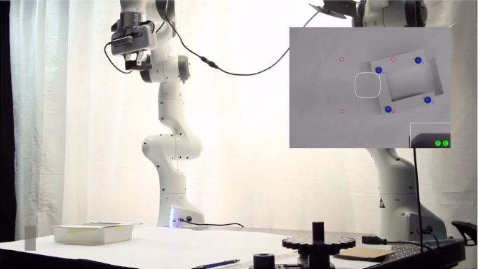
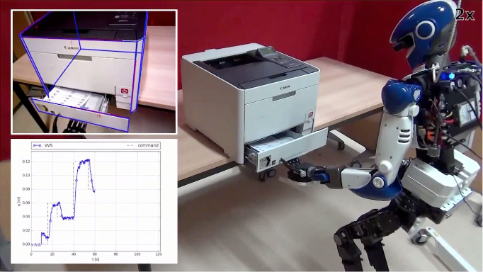
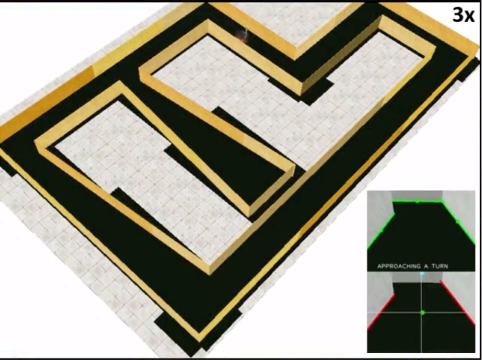
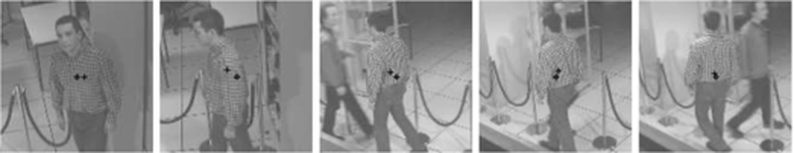
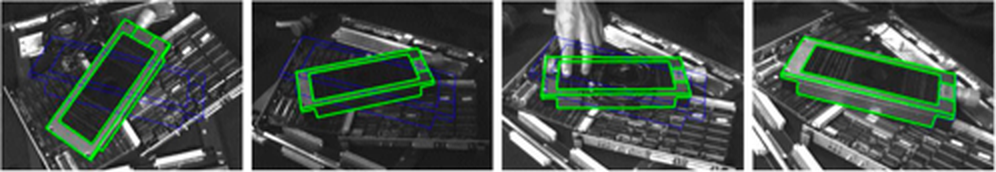

## 들어가며

이번 1주차 주제는 **Visual Servoing**(VS)임. 한마디로 <mark class="mint">카메라로 보면서 로봇을 움직이는 기술</mark>임.

1주차는 강의 텍스트 없이 슬라이드와 필기를 보고 중요한 것만 골라서 정리함. 강의는 질문 네 개로 시작함.

- Visual servoing이란 무엇인가?
- 왜 필요한가?
- 어떻게 만드는가?
- 무엇을 할 수 있는가?

흐름은 이렇게 감.
1. **기초 (1~3장)**: VS의 정의, PBVS와 IBVS, 시각 특징, 카메라 배치
2. **유도 (4~7장)**: 제어 법칙 3단계, 카메라 투영 모델, 상호작용 행렬, 필요한 점의 개수
3. **실전 문제 (8~11장)**: L을 모를 때의 제어 식, 안정성, L 근사와 실패 사례, 좋은 특징의 조건
4. **확장 (12~14장)**: 좌표계와 속도, 로봇 자코비안, 여러 가지 시각 특징
5. **적용 (15장)**: 실제 로봇 예시

---

## 1. Visual Servoing이란

### 1-1. 정의

슬라이드는 VS를 세 문장으로 정의함.

- 로봇의 움직임을 제어하는 서보 루프 안에서 컴퓨터 비전 데이터를 쓰는 것
- 비전 기반 제어가 취하는 행동
- 원하는 목표에 도달하도록 제어 알고리즘에 시각 피드백을 주는 방법

표현만 다르고 말하는 건 같음. <mark class="pink">카메라 정보가 제어 루프 안에 직접 들어간다</mark>는 것임.

> 💡 그럼 왜 필요한가? 사진을 한 번 찍고, 물체 위치를 계산하고, 그 위치로 팔을 보내는 방식은 카메라 보정이나 로봇 모델이 조금만 틀려도 그대로 위치 오차가 됨. VS는 움직이는 동안 계속 보고 오차를 다시 계산하니까 이런 모델 오차를 피드백으로 잡아낼 수 있음.

### 1-2. 블록선도

제어 루프는 이렇게 돎.

> 목표(reference) → 오차(error) → **VS Control** → 명령(commands) → **Robot & Camera** → 이미지(image) → **Image Processing** → 측정값(measurement) → 다시 오차로

각 신호를 VS 기호로 바꾸면 이렇게 됨.

| 블록선도 | 뜻 | 기호 |
|---|---|---|
| reference | 목표 시각 특징 | $$ \mathbf{s}^* $$ |
| measurement | 현재 시각 특징 | $$ \mathbf{s} $$ |
| error | 시각 오차 | $$ \mathbf{e} = \mathbf{s} - \mathbf{s}^* $$ |
| commands | 속도 명령 | $$ \mathbf{v} $$ |

### 1-3. PBVS와 IBVS

VS는 크게 두 갈래임.

| | PBVS (Position-Based) | IBVS (Image-Based) |
|---|---|---|
| 이미지 처리 | 복잡함 (3D pose를 복원해야 함) | 쉬움 (특징만 뽑으면 됨) |
| 제어 법칙 | 비교적 쉬움 | 더 복잡함 |

둘 사이의 절충안으로 2.5D VS 같은 방식도 있음. <mark class="mint">이 강의는 IBVS에 집중</mark>함.

---

## 2. Visual feature: 이미지에서 뭘 뽑아 쓰는가

### 2-1. 이미지 전체가 필요하진 않다

빨간 물체를 바라보는 작업을 생각해 봄. 카메라가 찍은 240 × 320 컬러 이미지는 컴퓨터 안에서 240 × 320 × 3 크기의 숫자 행렬임. 숫자로 230,400개인데, 물체를 화면 가운데 두는 데 필요한 건 **물체 중심 좌표 숫자 2개**면 충분함.

이렇게 뽑은 값이 **visual feature**(시각 특징)임. 슬라이드는 여러 관점으로 설명하는데 핵심은 이거임.

- 이미지의 풍부한 데이터를 **요약**하려는 시도
- <mark class="mint">로봇을 제어하는 데 필요한 장면의 요지(gist)</mark>
- VS 루프를 닫고 원하는 동작을 만들기 위해 이미지에서 얻은 요약 정보

단, <mark class="pink">요약이니까 정보 손실이 따라온다</mark>는 건 알고 있어야 함.

### 2-2. 어떻게 뽑고, 뭘 쓰나

물체 중심을 뽑는 과정은 영상 처리 기본기로 충분함. 색으로 거르고(color filtering), 다듬고(smoothing), 침식과 팽창(erode & dilate)으로 노이즈를 지운 뒤, 덩어리를 찾으면(blob detection) 됨. 이런 도구는 **OpenCV**에 다 들어 있음.

특징이 꼭 점일 필요도 없음. 슬라이드에 나온 예시는 **점, 직선, 복원된 점, 윤곽선, 이미지 모멘트, 픽셀 밝기**까지 다양함.

---

## 3. 카메라는 어디에 달까

| | Eye-in-hand | Eye-to-hand |
|---|---|---|
| 카메라 | 로봇 끝에 달려서 같이 움직임 | 밖에 고정 |
| 대상 | 고정된 물체를 관찰 | 로봇이 움직이는 물체를 관찰 |

같은 방향으로 움직여도 이미지 속 점의 방향은 반대가 됨.

- **Eye-to-hand**: 물체가 왼쪽으로 가면 이미지 속 점도 왼쪽으로 감
- **Eye-in-hand**: 카메라가 왼쪽으로 가면 이미지 속 점은 오른쪽으로 감

그래서 두 구성은 식에서 <mark class="pink">부호가 반대</mark>로 나옴. 자세한 식은 13-2에서 봄. 지금부터 유도는 전부 eye-in-hand 기준임.

---

## 4. 제어 법칙은 3단계로 나온다

### 4-1. 3D 문제를 이미지 문제로 바꾸기

실제로 원하는 건 카메라를 어떤 3D 위치와 자세로 옮기는 것임. IBVS는 이걸 직접 풀지 않고 이렇게 바꿈.

> **이미지 속 점 s를, 목표 위치 s\*에 겹치게 만들자**

오차가 0이 되면 카메라도 간접적으로 원하는 자세에 도착함. 슬라이드 표현으로는 Cartesian task가 visual task로 번역되는 것임. 그럼 이미지 오차를 줄이려면 카메라를 어떻게 움직여야 할까? 이걸 푸는 게 다음 3단계임.

### 4-2. 유도 3단계

**1단계. 모델 설계**: 카메라가 움직이면 특징이 어떻게 움직이는지 식으로 씀.

$$
\dot{\mathbf{s}} = \mathbf{L}\mathbf{v}
$$

여기서 $$ \mathbf{L} $$이 **상호작용 행렬**(interaction matrix)임. 점 하나면 $$ \mathbf{s} \in \mathbb{R}^2 $$, 카메라 속도는 $$ \mathbf{v} \in \mathbb{R}^6 $$이라서 $$ \mathbf{L} \in \mathbb{R}^{2 \times 6} $$이 됨.

**2단계. 원하는 오차 거동 정하기**: 오차가 지수적으로 0에 가도록 정함.

$$
\dot{\mathbf{e}} = \dot{\mathbf{s}} - \dot{\mathbf{s}}^* = -\lambda \mathbf{e}, \qquad \lambda > 0
$$

여기서 $$ \lambda $$는 제어 이득(control gain)임.

**3단계. 제어기 계산**: 목표가 고정이면 $$ \dot{\mathbf{s}}^* = 0 $$이니까 1단계 식을 2단계 식에 넣음.

$$
\dot{\mathbf{e}} = -\lambda \mathbf{e} = \dot{\mathbf{s}} = \mathbf{L}\mathbf{v}
\quad \Longrightarrow \quad
\mathbf{v} = -\lambda \mathbf{L}^{+} \mathbf{e}
$$

이게 이 강의의 핵심 식임. <mark class="mint">오차를 보고, L로 뒤집어서, 카메라 속도를 낸다.</mark>

여기서 $$ \mathbf{L}^{+} $$는 유사역행렬(pseudo-inverse)임. $$ \mathbf{L} $$이 정사각행렬이 아니라서 일반 역행렬 대신 씀. 세로로 긴 행렬이면 이렇게 계산함.

$$
\mathbf{L}^{+} = (\mathbf{L}^\top \mathbf{L})^{-1} \mathbf{L}^\top
$$

> 💡 $$ \dot{\mathbf{e}} = -\lambda \mathbf{e} $$의 해는 $$ \mathbf{e}(t) = \mathbf{e}(0)\,e^{-\lambda t} $$임. 시간 $$ 1/\lambda $$가 지날 때마다 오차가 약 37%로 줄어듦. $$ \lambda $$가 크면 빨리 수렴하지만 실제 시스템에서는 지연 때문에 진동할 수 있음.

> 💡 이 3단계는 IBVS만의 얘기가 아님. PBVS나 2.5D VS도 같은 틀이고, $$ \mathbf{s} $$와 $$ \mathbf{L} $$을 뭘로 정의하느냐만 달라짐.

남은 일은 $$ \mathbf{L} $$을 구하는 것임. 그러려면 3D 점이 이미지에 어떻게 찍히는지부터 알아야 함.

---

## 5. 카메라 투영 모델

### 5-1. 원근 투영

핀홀 카메라에서 카메라 좌표계의 3D 점 $$ (X, Y, Z) $$는 이미지 평면의 $$ (x, y) $$로 투영됨. $$ f $$는 초점거리임.

$$
x = f\frac{X}{Z}, \qquad y = f\frac{Y}{Z}
$$

<mark class="pink">Z로 나누는 순간 깊이 정보가 사라진다.</mark> 이미지 한 장으로는 물체가 작은 건지 멀리 있는 건지 구분이 안 되는 이유임. 이 Z가 뒤에서 계속 문제가 됨.

> 💡 여기서 $$ (x, y) $$는 미터 단위의 이미지 평면 좌표임. $$ f = 1 $$로 둔 $$ x = X/Z $$가 정규화 좌표(normalized coordinates)고, 상호작용 행렬을 쓸 때 주로 이걸 씀.

### 5-2. 동차좌표로 묶기

나눗셈이 들어 있으면 행렬로 쓰기 불편하니까 벡터 끝에 1을 붙임(동차좌표). 그러면 선형식 하나로 정리됨. 왼쪽의 깊이는 모르는 값이라 스케일 파라미터 $$ \zeta $$로 둠.

$$
\zeta \begin{pmatrix} x \\ y \\ 1 \end{pmatrix}
=
\begin{pmatrix} f & 0 & 0 \\ 0 & f & 0 \\ 0 & 0 & 1 \end{pmatrix}
\begin{pmatrix} 1 & 0 & 0 & 0 \\ 0 & 1 & 0 & 0 \\ 0 & 0 & 1 & 0 \end{pmatrix}
\begin{pmatrix} X \\ Y \\ Z \\ 1 \end{pmatrix}
$$

### 5-3. 월드 좌표계에서 카메라 좌표계로

지금까지 $$ (X, Y, Z) $$는 카메라 기준 좌표였음. 실제로는 점이 관성 좌표계(월드)에서 주어지는 경우가 많아서 카메라 pose $$ (\mathbf{R}, \mathbf{t}) $$로 변환함. 이게 외부 파라미터(extrinsic)임.

$$
\begin{pmatrix} X \\ Y \\ Z \\ 1 \end{pmatrix}
=
\begin{pmatrix} \mathbf{R} & \mathbf{t} \\ \mathbf{0}^\top & 1 \end{pmatrix}^{-1}
\begin{pmatrix} X_0 \\ Y_0 \\ Z_0 \\ 1 \end{pmatrix}
$$

역행렬이 붙는 이유는 $$ (\mathbf{R}, \mathbf{t}) $$가 월드에서 본 카메라의 pose인데, 점은 반대로 월드에서 카메라 기준으로 옮겨야 해서임.

### 5-4. 미터에서 픽셀로

실제 측정값은 미터가 아니라 픽셀임. 픽셀 크기 $$ (\rho_w, \rho_h) $$로 나누고 중심점 $$ (u_0, v_0) $$를 더하면 됨.

$$
u = u_0 + \frac{x}{\rho_w}, \qquad v = v_0 + \frac{y}{\rho_h}
$$

### 5-5. 전부 합치면

$$
\zeta\,\tilde{\mathbf{p}} = \mathbf{K}\,\mathbf{P}\,\left({}^{0}\mathbf{T}_c\right)^{-1}\tilde{\mathbf{P}},
\qquad
\mathbf{K} = \begin{pmatrix} f/\rho_w & 0 & u_0 \\ 0 & f/\rho_h & v_0 \\ 0 & 0 & 1 \end{pmatrix}
$$

| 기호 | 이름 | 역할 |
|---|---|---|
| $$ \mathbf{K} $$ | 내부 파라미터 행렬 (calibration matrix) | 초점거리, 픽셀 크기, 중심점 |
| $$ \mathbf{P} $$ | 표준 투영 행렬 | 3D를 2D로 투영 |
| $$ {}^{0}\mathbf{T}_c $$ | 카메라 pose (외부 파라미터) | 월드와 카메라 사이 변환. extrinsic calibration으로 구함 |
| $$ \mathbf{C} = \mathbf{K}\mathbf{P}({}^{0}\mathbf{T}_c)^{-1} $$ | 카메라 행렬 | 월드의 3D 점을 픽셀로 한 번에 매핑 |

K 안의 $$ f/\rho_w $$, $$ f/\rho_h $$는 **초점거리를 픽셀 단위로 나타낸 값**임. 보통 $$ f_x $$, $$ f_y $$라고 부르는 그 값임.

---

## 6. 상호작용 행렬 유도

이제 $$ \mathbf{L} $$을 구함. eye-in-hand 카메라의 속도를 병진 $$ \boldsymbol{\nu} $$와 회전 $$ \boldsymbol{\omega} $$로 나눠서 $$ \mathbf{v} = (\boldsymbol{\nu}, \boldsymbol{\omega}) $$로 씀. 유도는 세 줄이면 끝남.

**① 투영식을 시간으로 미분함**

$$
\dot{x} = f\frac{\dot{X}Z - X\dot{Z}}{Z^2} = \frac{f}{Z}\dot{X} - \frac{x}{Z}\dot{Z},
\qquad
\dot{y} = \frac{f}{Z}\dot{Y} - \frac{y}{Z}\dot{Z}
$$

**② 점의 속도를 카메라 속도로 씀**

점은 가만히 있는데 카메라가 움직이니까, 카메라 기준으로는 점이 반대로 움직이는 것처럼 보임.

$$
\begin{pmatrix} \dot{X} \\ \dot{Y} \\ \dot{Z} \end{pmatrix}
= -\boldsymbol{\nu} - \boldsymbol{\omega} \times \begin{pmatrix} X \\ Y \\ Z \end{pmatrix}
= \begin{pmatrix}
-1 & 0 & 0 & 0 & -Z & Y \\
0 & -1 & 0 & Z & 0 & -X \\
0 & 0 & -1 & -Y & X & 0
\end{pmatrix}
\begin{pmatrix} \boldsymbol{\nu} \\ \boldsymbol{\omega} \end{pmatrix}
$$

**③ 대입하고 정리함**

1번 식에 2번 식을 넣고 $$ X = xZ/f $$, $$ Y = yZ/f $$로 바꾸면 이렇게 됨.

$$
\begin{pmatrix} \dot{x} \\ \dot{y} \end{pmatrix}
=
\begin{pmatrix}
-\dfrac{f}{Z} & 0 & \dfrac{x}{Z} & \dfrac{xy}{f} & -f - \dfrac{x^2}{f} & y \\[8pt]
0 & -\dfrac{f}{Z} & \dfrac{y}{Z} & f + \dfrac{y^2}{f} & -\dfrac{xy}{f} & -x
\end{pmatrix}
\begin{pmatrix} \boldsymbol{\nu} \\ \boldsymbol{\omega} \end{pmatrix}
$$

정규화 좌표($$ f = 1 $$)로 쓰면 교과서에 나오는 그 모양이 됨. 뒤에서는 이 식을 씀.

$$
\mathbf{L}_{\mathbf{x}} =
\begin{bmatrix}
-1/Z & 0 & x/Z & xy & -(1+x^2) & y \\
0 & -1/Z & y/Z & 1+y^2 & -xy & -x
\end{bmatrix}
$$

이 행렬에서 봐야 할 건 세 가지임.

- **고정된 행렬이 아님**: 현재 점 위치 $$ (x, y) $$와 깊이 $$ Z $$의 함수임. 필기에 적힌 state-dependent가 이 뜻임.
- **앞 세 칸(병진)에만 Z가 있음**: 카메라가 평행 이동할 때 가까운 점은 많이 움직이고 먼 점은 적게 움직이기 때문임. 회전 세 칸은 깊이와 상관없음.
- <mark class="pink">Z를 카메라 한 대로는 직접 잴 수 없음</mark>: 5장에서 사라진 그 깊이임. 그래서 실제로는 L을 근사해서 씀. 이게 8장의 출발점임.

실제 측정값인 픽셀 좌표로 바꾸면 초점거리와 픽셀 크기 같은 내부 파라미터도 들어감. 이 값들은 카메라 캘리브레이션에서 구하거나 추정함.

---

## 7. 점은 몇 개 필요할까

점 하나는 식 2개를 줌. 카메라 자유도는 6이니까 <mark class="pink">점 하나로는 수렴해도 카메라 pose가 하나로 정해지지 않음.</mark>

3D 공간에서 카메라를 제어하려면 **최소 3개의 점**이 필요함. 각 점의 식을 세로로 쌓으면 됨.

$$
\mathbf{s} = \begin{bmatrix} \mathbf{s}_1 \\ \mathbf{s}_2 \\ \mathbf{s}_3 \end{bmatrix} \in \mathbb{R}^{6},
\qquad
\mathbf{L} = \begin{bmatrix} \mathbf{L}_1 \\ \mathbf{L}_2 \\ \mathbf{L}_3 \end{bmatrix} \in \mathbb{R}^{6 \times 6}
$$

슬라이드가 강조하는 건 <mark class="mint">어떤 특징을, 몇 개, 어떤 목표값으로 쓸지도 알고리즘 설계의 일부</mark>라는 점임.

> 💡 실제로는 점 3개로 끝내지 않음. 점 3개는 같은 이미지를 만드는 카메라 자세가 여러 개 있고, $$ \mathbf{L} $$이 특이해지는 자세도 있음. 그래서 보통 4개 이상 쓰고, 그러면 $$ \mathbf{L} \in \mathbb{R}^{8 \times 6} $$처럼 세로로 긴 행렬이 되어 앞에서 본 유사역행렬이 필요해짐.

---

## 8. 근사가 들어간 진짜 제어 식

여기까지 제어 법칙 $$ \mathbf{v} = -\lambda \mathbf{L}^{+} \mathbf{e} $$를 유도했음. 문제는 $$ \mathbf{L} $$에 깊이 Z가 들어 있어서 <mark class="pink">정확한 L을 알 수 없다</mark>는 것임. 그래서 여기부터의 질문은 이거임.

> **L을 정확히 모르는데 제어가 왜 수렴하고, 언제 실패하고, 어떤 특징을 골라야 하는가**

이 뒤로는 *Springer Handbook of Robotics* 34장과 Chaumette 슬라이드를 바탕으로 한 파트임. 식부터 Handbook 표기로 다시 정리함. 모든 비전 기반 제어의 목표는 오차를 0으로 만드는 것임.

$$
\mathbf{e}(t) = \mathbf{s}(\mathbf{m}(t), \mathbf{a}) - \mathbf{s}^*
$$

- 측정값 $$ \mathbf{m}(t) $$: 관심점의 이미지 좌표 같은 값
- 추가 지식 $$ \mathbf{a} $$: 카메라 내부 파라미터나 물체 3D 모델 같은 정보
- 시각 특징 $$ \mathbf{s} $$: 이 둘로 계산한 k차원 벡터
- 목표값 $$ \mathbf{s}^* $$: 특징이 도달해야 할 값

> 💡 Handbook에도 주석으로 달려 있는데, 일반 피드백 제어는 보통 "목표 − 현재"로 쓰지만 여기는 "현재 − 목표"임. 제어 법칙 앞에 마이너스가 붙는 이유임.

VS를 이루는 요소는 세 가지임.

| 구성요소 | 식 | 의미 |
|---|---|---|
| 특징의 기구학 | $$ \dot{\mathbf{s}} = \mathbf{L}_{\mathbf{s}} \mathbf{v}_c $$ | 카메라 속도가 특징 속도로 바뀌는 관계 |
| 오차 동역학 | $$ \dot{\mathbf{e}} = \mathbf{L}_{\mathbf{e}} \mathbf{v}_c $$ | 목표가 고정이면 $$ \dot{\mathbf{e}} = \dot{\mathbf{s}} $$ |
| 피드백 명령 | $$ \mathbf{v}_c = -\lambda \mathbf{L}_{\mathbf{e}}^{+} \mathbf{e} $$ | 설계 파라미터는 $$ \lambda $$와 $$ \mathbf{L}_{\mathbf{e}}^{+} $$ |

그런데 실제 시스템에서는 $$ \mathbf{L}_{\mathbf{e}} $$를 완벽히 알 수 없으니까 근사값 $$ \widehat{\mathbf{L}_{\mathbf{e}}^{+}} $$를 씀. 그러면 폐루프 식은 이렇게 됨.

$$
\mathbf{v}_c = -\lambda \widehat{\mathbf{L}_{\mathbf{e}}^{+}} \mathbf{e}
\quad \Longrightarrow \quad
\dot{\mathbf{e}} = -\lambda \mathbf{L}_{\mathbf{e}} \widehat{\mathbf{L}_{\mathbf{e}}^{+}} \mathbf{e}
$$

<mark class="mint">진짜 L과 우리가 쓴 근사가 곱해져 있다</mark>는 게 핵심임. 이 곱이 어떤 행렬이냐에 따라 시스템의 거동이 결정됨.

---

## 9. 언제 수렴하는가

### 9-1. 세 가지 경우

폐루프 식을 $$ \mathbf{s} $$로 쓰면 이렇게 됨.

$$
\dot{\mathbf{s}} = \mathbf{L}_{\mathbf{s}} \mathbf{v} = -\lambda \mathbf{L}_{\mathbf{s}} \widehat{\mathbf{L}_{\mathbf{s}}^{+}} (\mathbf{s} - \mathbf{s}^*)
$$

곱 $$ \mathbf{L}_{\mathbf{s}} \widehat{\mathbf{L}_{\mathbf{s}}^{+}} $$에 따라 세 경우로 나뉨.

| 곱 | 결과 | 의미 |
|---|---|---|
| 단위행렬과 같음 | 완벽한 거동 | s가 s\*로 곧장 감 |
| 양의 정부호 (> 0) | 오차 크기 감소 | 곡선으로 가더라도 s\*에 가까워짐. 안정 |
| 음의 정부호 (< 0) | 오차 크기 증가 | 불안정 |

즉 <mark class="mint">근사가 완벽할 필요는 없고, 곱이 양의 정부호이기만 하면 오차가 줄어든다.</mark> VS가 모델 오차에 강한 이유가 이것임.

### 9-2. Lyapunov로 확인하기

필기에 있는 안정성 해석임. 오차의 크기를 나타내는 함수를 잡음.

$$
V(\mathbf{e}) = \frac{1}{2}\lVert \mathbf{e} \rVert^2
$$

시간 미분하고 폐루프 식을 넣으면 이렇게 됨.

$$
\dot{V} = \mathbf{e}^\top \dot{\mathbf{e}} = -\lambda\, \mathbf{e}^\top \mathbf{L}_{\mathbf{e}} \widehat{\mathbf{L}_{\mathbf{e}}^{+}} \mathbf{e}
$$

이게 항상 음수면 오차는 계속 줄어듦. 그래서 안정성 조건은 이거임.

$$
\lambda > 0, \qquad
\mathbf{L}_{\mathbf{e}} \widehat{\mathbf{L}_{\mathbf{e}}^{+}} + \left(\widehat{\mathbf{L}_{\mathbf{e}}^{+}}\right)^{\!\top} \mathbf{L}_{\mathbf{e}}^\top > 0
$$

> 💡 조건에 전치를 더한 항이 나오는 이유는 $$ \mathbf{e}^\top \mathbf{A} \mathbf{e} $$에서 행렬 $$ \mathbf{A} $$의 대칭 부분만 살아남기 때문임. 즉 $$ \mathbf{e}^\top \mathbf{A} \mathbf{e} = \tfrac{1}{2}\mathbf{e}^\top (\mathbf{A} + \mathbf{A}^\top) \mathbf{e} $$임.

필기에는 $$ \lambda $$ 대신 양의 정부호 행렬 $$ \mathbf{M} > 0 $$을 써도 된다는 메모도 있음. 방향마다 이득을 다르게 줄 수 있다는 뜻임.

### 9-3. 그런데 점이 많으면 함정이 있다

> 💡 점 4개면 $$ \mathbf{L} \in \mathbb{R}^{8 \times 6} $$이고, 곱 $$ \mathbf{L}\widehat{\mathbf{L}^{+}} $$는 8×8 행렬이지만 rank는 6을 넘을 수 없음. 그래서 양의 정부호가 될 수 없고, 이미지 오차 전체에 대해서는 전역 안정성이 보장되지 않음. 오차가 0이 아닌데 $$ \widehat{\mathbf{L}^{+}}\mathbf{e} = 0 $$이 되는 순간이 있으면 속도 명령이 0이 되어 로봇이 멈춤. 이게 다음 장에 나오는 **local minimum**임.

---

## 10. L을 뭘로 근사할까

### 10-1. 대표적인 세 가지

| 번호 | 선택 | 특징 |
|---|---|---|
| (1) | $$ \widehat{\mathbf{L}^{+}} = \mathbf{L}_{\mathbf{e}}^{+} $$ | 매 순간 현재 특징과 깊이로 계산 |
| (2) | $$ \widehat{\mathbf{L}^{+}} = \mathbf{L}_{\mathbf{e}^*}^{+} $$ | 목표 위치의 값으로 계산. 상수라서 한 번만 구하면 됨 |
| (3) | $$ \widehat{\mathbf{L}^{+}} = (\mathbf{L}_{\mathbf{e}}/2 + \mathbf{L}_{\mathbf{e}^*}/2)^{+} $$ | 둘의 평균 |

어떤 게 무조건 좋다고 말할 수 없음. 슬라이드 예시 세 개를 보면 왜 그런지 나옴.

### 10-2. 예시 1, 2: 같은 출발, 다른 도착

슬라이드의 두 예시는 점 4개($$ \mathbf{L} \in \mathbb{R}^{8 \times 6} $$)를 쓰는 같은 상황처럼 보임.

- **예시 1, 현재 L 사용**: 오차 그래프는 깔끔하게 줄어드는데 <mark class="pink">목표가 아닌 자세에서 멈춤</mark> (local minimum)
- **예시 2, 목표 L 사용**: 그래프는 중간에 크게 출렁이지만 <mark class="mint">목표 자세에 도착</mark> (global minimum)

그래프가 예쁘다고 성공한 게 아니라는 점이 재밌음.

### 10-3. 예시 3: 광축 180도 회전

목표 자세가 지금 자세에서 광축(z축)으로 180도 돌린 것이라고 해 봄. 정답은 $$ \omega_z $$로 돌기만 하면 되는 아주 단순한 움직임임.

그런데 특징이 이미지 점 좌표면 일이 꼬임. 각 점이 반대편으로 가는 지름길은 화면 중심을 통과하는 직선이라서, 제어기가 회전 대신 병진을 내보냄.

- **현재 L 사용**: 점들이 중심으로 모임. 카메라가 뒤로 물러나는 셈이고, 점들이 가운데 모이면 <mark class="pink">L의 rank가 2로 떨어져서 특이점</mark>에 빠짐
- **목표 L 사용**: 점들이 바깥으로 퍼짐. 카메라가 앞으로 전진하는 셈이고 점들이 화면 밖으로 나갈 수 있음
- **특징을 다른 걸로**: <mark class="mint">2D 직선 파라미터나 정확한 pose를 쓰면 완벽하게 회전함</mark>

> 💡 직접 계산해 봄. 네 점이 $$ (\pm 0.1, \pm 0.1) $$, $$ Z = 1 $$, $$ \lambda = 1 $$인 정사각형을 정확히 180도 돌린 상태면, 회전 명령은 0이고 $$ v_z $$만 현재 L일 때 −2, 목표 L일 때 +2가 나옴. 카메라 z축이 앞쪽이니까 위 설명과 맞음. Marey & Chaumette(2008)도 같은 결과를 보고하면서 이 경우 평균을 포함해 어떤 혼합도 잘 동작하지 않는다고 함.

여기서 얻는 교훈은 <mark class="mint">L을 어떻게 근사하느냐만큼, s를 뭘로 잡느냐가 중요하다</mark>는 것임. 슬라이드도 이미지와 3D 공간의 거동은 s 선택에 직접 연결된다고 정리함.

> 💡 필기에 있는 **ViSP**는 이런 VS를 구현할 수 있는 오픈소스 라이브러리임 (Marchand et al., 2005).

---

## 11. 좋은 특징의 조건

VS의 목표는 영상 데이터를 폐루프 안에 넣어 로봇 작업을 해내는 것임. 필요한 단계는 네 가지임.

1. 로봇의 m 자유도를 제어할 k개의 시각 특징 고르기 ($$ k \ge m $$, $$ m \le 6 $$)
2. 목표값 정하기
3. 오차를 0으로 만들기
4. 영상 처리(매칭, 추적)를 비디오 속도에 가깝게 돌리기

이 중 첫 번째가 이 장의 주제임. Main goal은 작업에 맞는 s를 고르는 것이고, 슬라이드는 최소 조건과 꿈의 조건으로 나눠서 말함.

**최소 조건 (At least)**

- 목표 근처에서 $$ \operatorname{rank} \mathbf{L}_{\mathbf{s}} = m $$: 제어하려는 자유도가 특징에 다 드러나야 함
- 커널 조건 $$ \operatorname{Ker} \mathbf{L}_{\mathbf{s}} = \mathcal{S}^* $$: 특징이 변하지 않는 움직임이 작업에서 허용된 움직임과 같아야 함

> 💡 두 번째 조건은 virtual linkage라고 부름. 예를 들어 plane-to-plane 작업은 평면끼리 맞추기만 하면 되니까 그 평면 안에서 미끄러지거나 도는 건 상관없음. 이 움직임에서는 특징이 안 변해도 되고, 나머지 방향에서는 반드시 변해야 한다는 뜻임.

**꿈의 조건 (At most)**: $$ \mathbf{L}_{\mathbf{s}} = \mathbf{I}_6 $$

- 로봇 자유도 하나에 특징 하나
- 완벽한 decoupling, s와 v가 같은 거동
- 특이점도 local minimum도 없음 (전역 안정)
- 이상적인 condition number
- 선형 시스템 제어

슬라이드에 "yet a dream for 6 dof!"라고 적혀 있음. 6자유도에서 이런 특징은 아직 꿈이라는 얘기임.

---

## 12. 좌표계와 속도

### 12-1. Pose

카메라 좌표계와 물체 좌표계의 관계가 pose임.

$$
\mathbf{X}_c = {}^{c}\mathbf{R}_o \mathbf{X}_o + {}^{c}\mathbf{t}_o
$$

회전 $$ {}^{c}\mathbf{R}_o \in SO(3) $$과 병진 $$ {}^{c}\mathbf{t}_o \in \mathbb{R}^3 $$을 합친 게 pose이고, 이 공간이 $$ SE(3) $$임.

회전 행렬은 회전축 $$ \mathbf{u} $$와 회전각 $$ \theta $$로도 쓸 수 있음(axis-angle).

$$
\mathbf{R} = \cos\theta\, \mathbf{I}_3 + \sin\theta\, [\mathbf{u}]_\times + (1 - \cos\theta)\, \mathbf{u}\mathbf{u}^\top
$$

### 12-2. Kinematic screw

카메라와 장면 사이의 순간 속도를 **kinematic screw**라고 부름. 병진 3개와 회전 3개를 합친 $$ \mathbf{v} = (\boldsymbol{\upsilon}, \boldsymbol{\omega}) $$임. 6장에서 쓴 그 속도임.

이건 카메라 속도와 물체 속도의 차이로 나눌 수 있음.

$$
\mathbf{v} = \mathbf{v}_c - \mathbf{v}_o
$$

특징 s는 pose의 함수니까 chain rule을 쓰면 상호작용 행렬의 정의가 일반화됨.

$$
\dot{\mathbf{s}} = \frac{\partial \mathbf{s}}{\partial \mathbf{p}} \dot{\mathbf{p}} = \mathbf{L}_{\mathbf{s}} \mathbf{v} = \mathbf{L}_{\mathbf{s}} (\mathbf{v}_c - \mathbf{v}_o)
$$

<mark class="mint">이미지 변화는 상대 속도로만 결정된다.</mark> 카메라가 움직이나 물체가 반대로 움직이나 이미지에서는 같아 보인다는 뜻이고, 3장에서 본 eye-in-hand와 eye-to-hand의 부호 차이가 여기서 나옴.

속도를 다른 좌표계로 옮길 때는 6×6 변환을 씀.

$$
{}^{o}\mathbf{V}_c =
\begin{bmatrix}
{}^{o}\mathbf{R}_c & [{}^{o}\mathbf{t}_c]_\times {}^{o}\mathbf{R}_c \\
\mathbf{0}_3 & {}^{o}\mathbf{R}_c
\end{bmatrix}
$$

---

## 13. 관절 명령까지

### 13-1. 로봇 자코비안

지금까지 나온 건 카메라 속도임. 실제 로봇에는 관절 속도 $$ \dot{\mathbf{q}} $$를 줘야 함. 그 둘을 잇는 게 로봇 자코비안임.

$$
\mathbf{v}_n = {}^{n}\mathbf{J}_n(\mathbf{q})\, \dot{\mathbf{q}}
$$

속도 제어는 이걸 뒤집어서 계산함.

$$
\dot{\mathbf{q}}^* = {}^{n}\mathbf{J}_n(\mathbf{q}^*)^{-1}\, \mathbf{v}_n^*
$$

그리고 $$ \det {}^{n}\mathbf{J}_n(\mathbf{q}) = 0 $$인 자세가 로봇 특이점임. 상호작용 행렬의 특이점과는 별개로 로봇 쪽에도 특이점이 있다는 뜻임.

### 13-2. Eye-in-hand와 Eye-to-hand

카메라 속도와 물체 속도 중 로봇이 만드는 게 뭐냐에 따라 식이 갈림.

**Eye-in-hand**: 로봇이 카메라를 움직임.

$$
\dot{\mathbf{s}} = \mathbf{L}_{\mathbf{s}}\, {}^{c}\mathbf{V}_n\, {}^{n}\mathbf{J}_n(\mathbf{q})\, \dot{\mathbf{q}} + \frac{\partial \mathbf{s}}{\partial t}
$$

**Eye-to-hand**: 로봇이 물체를 움직임.

$$
\dot{\mathbf{s}} = -\mathbf{L}_{\mathbf{s}}\, {}^{c}\mathbf{V}_n\, {}^{n}\mathbf{J}_n(\mathbf{q})\, \dot{\mathbf{q}} + \frac{\partial \mathbf{s}}{\partial t}
= -\mathbf{L}_{\mathbf{s}}\, {}^{c}\mathbf{V}_{\emptyset}\, {}^{\emptyset}\mathbf{V}_n\, {}^{n}\mathbf{J}_n(\mathbf{q})\, \dot{\mathbf{q}} + \frac{\partial \mathbf{s}}{\partial t}
$$

읽는 법은 간단함. 오른쪽부터 관절 속도 → 자코비안으로 말단 속도 → $$ \mathbf{V} $$로 카메라 좌표계 변환 → $$ \mathbf{L}_{\mathbf{s}} $$로 특징 속도 순서임. <mark class="pink">Eye-to-hand에 붙은 마이너스</mark>가 $$ \mathbf{v}_o $$ 앞의 마이너스임.

마지막 항 $$ \partial \mathbf{s}/\partial t $$는 로봇이 안 움직여도 특징이 변하는 성분임. 예를 들어 eye-in-hand에서 대상이 스스로 움직이는 경우임.

---

## 14. 여러 가지 시각 특징

### 14-1. 이미지 점

6장에서 유도한 $$ \mathbf{L}_{\mathbf{x}} $$가 기본임. 점이 화면 중심($$ x = y = 0 $$)에 있으면 이렇게 단순해짐.

$$
\mathbf{L}_{\mathbf{x}} =
\begin{bmatrix}
-1/Z & 0 & 0 & 0 & -1 & 0 \\
0 & -1/Z & 0 & 1 & 0 & 0
\end{bmatrix}
$$

윗줄을 보면 $$ v_x $$와 $$ \omega_y $$가 같은 줄에 있음. 옆으로 평행 이동하는 것과 고개를 돌리는 게 이미지에서 구분이 안 된다는 뜻임. 그래서 점 하나로는 둘 중 하나만 제어할 수 있음.

점을 쌓으면 6자유도를 제어할 수 있는데, 슬라이드는 <mark class="pink">특이점을 조심하라며 n ≥ 4</mark>를 권함.

> 💡 슬라이드의 원기둥 그림이 이 얘기임. 점 3개를 지나는 원기둥 위에 카메라가 오면 상호작용 행렬이 특이해짐. 세 점이 놓인 평면에 수직인 원기둥을 잡고 카메라를 원기둥 위, 안, 밖에 놓고 직접 계산해 보니 원기둥 위에서만 행렬식이 0이 됐음.

### 14-2. 픽셀 좌표

실제 측정값 $$ \mathbf{x}_p = (x_p, y_p) $$를 쓸 때의 식임. $$ f_x $$, $$ f_y $$는 초점거리와 픽셀 크기의 비율이고 $$ (x_c, y_c) $$는 중심점임.

$$
x_p = x_c + f_x x, \qquad y_p = y_c + f_y y
\quad \Longrightarrow \quad
\mathbf{L}_{\mathbf{x}_p} = \begin{bmatrix} f_x & 0 \\ 0 & f_y \end{bmatrix} \mathbf{L}_{\mathbf{x}}
$$

슬라이드는 이 식이 캘리브레이션 오차에 대한 안정성 분석에 유용하다고 함.

줌으로 초점거리를 바꿀 수 있으면 $$ f $$도 제어 입력이 됨.

$$
\dot{\mathbf{x}}_p = \mathbf{L}_{\mathbf{x}_p} \mathbf{v} + \begin{bmatrix} (x_p - x_c)/f \\ (y_p - y_c)/f \end{bmatrix} \dot{f}
$$

앞으로 가는 것과 줌을 당기는 게 비슷한 효과를 내니까, 광축 방향 움직임 $$ v_z $$에 여유(redundancy)가 생김.

### 14-3. 원통좌표

점을 $$ (x, y) $$ 대신 극좌표 $$ (\rho, \theta) $$로 쓰는 방법임 (Iwatsuki & Okiyama, 2002).

$$
\rho = \sqrt{x^2 + y^2}, \qquad \theta = \arctan\frac{y}{x}
$$

$$
\mathbf{L}_{\rho} = \begin{bmatrix} -\dfrac{\cos\theta}{Z} & -\dfrac{\sin\theta}{Z} & \dfrac{\rho}{Z} & (1+\rho^2)\sin\theta & -(1+\rho^2)\cos\theta & 0 \end{bmatrix}
$$

$$
\mathbf{L}_{\theta} = \begin{bmatrix} \dfrac{\sin\theta}{\rho Z} & -\dfrac{\cos\theta}{\rho Z} & 0 & \dfrac{\cos\theta}{\rho} & \dfrac{\sin\theta}{\rho} & -1 \end{bmatrix}
$$

위 식에서 $$ \mathbf{L}_{\rho} $$의 마지막 칸과 $$ \mathbf{L}_{\theta} $$의 셋째 칸이 0임. 즉 $$ v_z $$는 $$ \rho $$만, $$ \omega_z $$는 $$ \theta $$만 바꿈. <mark class="mint">앞뒤 이동과 광축 회전이 분리</mark>되는 것임. 10-3의 180도 회전 문제에 잘 맞는 특징임.

단, 화면 중심($$ \rho = 0 $$)에서는 $$ \theta $$가 정의되지 않으니 조심해야 함.

### 14-4. 스테레오

카메라 두 대로 같은 점을 보면 식을 쌓을 수 있음.

$$
\begin{bmatrix} \dot{\mathbf{x}}_l \\ \dot{\mathbf{x}}_r \end{bmatrix}
= \mathbf{L}_{\mathbf{x}_l \mathbf{x}_r} \mathbf{v}_c,
\qquad
\mathbf{L}_{\mathbf{x}_l \mathbf{x}_r} =
\begin{bmatrix}
\mathbf{L}_{\mathbf{x}_l}\, {}^{l}\mathbf{V}_c \\
\mathbf{L}_{\mathbf{x}_r}\, {}^{r}\mathbf{V}_c
\end{bmatrix}
$$

식은 4줄이지만 rank는 3임. <mark class="pink">에피폴라 제약</mark> 때문임. 3D 점 하나의 자유도는 3이라서 두 이미지 좌표가 서로 독립이 아님. 다중 카메라로도 바로 확장됨.

> 💡 스테레오의 이득은 깊이임. 두 영상의 시차로 Z를 삼각측량할 수 있으니까, 6장에서 문제였던 Z를 직접 얻을 수 있음.

### 14-5. 점이 아닌 특징: 선분

직선, 원, 사각형 같은 기하 도형도 특징이 될 수 있음. 일반식은 chain rule 그대로임. 물체 쪽 파라미터가 이미지 도형으로 투영되고, 거기서 특징을 계산하는 순서대로 곱함.

$$
\mathbf{L}_{\mathbf{s}} = \frac{\partial \mathbf{s}}{\partial \mathbf{p}_i} \frac{\partial \mathbf{p}_i}{\partial \mathbf{P}_o} \mathbf{L}_{\mathbf{P}_o}
$$

슬라이드의 예시는 선분임. 양 끝점 좌표 대신 중점, 길이, 방향을 씀.

$$
\mathbf{s} = (x_m, y_m, l, \alpha)
$$

선분이 이미지 평면과 나란하면($$ D = 1/Z_1 - 1/Z_2 = 0 $$) 상호작용 행렬이 깔끔한 삼각 형태가 됨. 같은 물체라도 특징을 어떻게 파라미터화하느냐에 따라 L의 모양이 달라진다는 걸 보여 주는 예시임. 슬라이드는 더 나은 선택으로 $$ \mathbf{s} = (x_m/l,\ y_m/l,\ 1/l,\ \alpha) $$를 제시하면서 이 L을 직접 써 보라는 연습문제를 냄.

---

## 15. 실제 로봇 적용 예시

### 15-1. Pick-and-place: 상자에 물건 넣기

<!-- 슬라이드: Application example (1/5) pick-and-place. Task: place an object in a box -->

오른쪽 위 작은 창이 영상 처리 화면임. **파란 점**이 지금 보이는 상자의 네 모서리($$ \mathbf{s} $$), **빨간 동그라미**가 목표 위치($$ \mathbf{s}^* $$)임. 파란 점이 빨간 동그라미에 겹치도록 팔을 움직이면 물건을 상자에 넣을 수 있음.

### 15-2. Robotic manipulation: 서랍 열고 닫기

<!-- 슬라이드: Application example (2/5) robotic manipulation. Task: open/close a drawer -->

휴머노이드가 프린터 서랍을 여닫는 작업임. 왼쪽 위 영상을 보면 프린터와 서랍의 모서리를 파란 **직선**으로 잡고 있음. 2장에서 말한 대로 특징이 꼭 점일 필요는 없다는 예시임. 왼쪽 아래 그래프는 서랍 위치 $$ q $$가 명령(command)을 계단처럼 따라가는 모습임.

### 15-3. Corridor navigation: 복도 가운데로 걷기

<!-- 슬라이드: Application example (3/5) corridor navigation. Task: navigate at the center of a corridor -->

휴머노이드가 미로의 복도 가운데를 따라 걷는 장면을 위에서 내려다본 것임. 오른쪽 아래 작은 창이 카메라 화면인데, 복도 양쪽 경계선을 잡고 있음.

> 💡 슬라이드에 없는 설명을 같은 연구 그룹 논문(Faragasso et al., 2013)에서 찾아봄. 바닥과 벽의 경계선 두 개가 만나는 **소실점**의 가로 좌표는 로봇의 방향에만 의존하고, 두 경계선이 영상 가로축과 만나는 점들의 **중간점**은 복도 안에서 옆으로 치우친 정도까지 반영함. 이 둘을 0으로 만들면 로봇이 복도와 나란해지면서 가운데로 오게 됨.

### 15-4. Pedestrian tracking: pan/tilt 카메라로 보행자 추적

<!-- 슬라이드: Pedestrian tracking using a pan/tilt camera -->

카메라가 사람을 따라 고개를 돌려서 계속 화면에 담음.

### 15-5. Grasping: 6자유도 로봇 팔로 물체 잡기

<!-- 슬라이드: Positioning/grasping task using a 6 dof robot arm -->

초록 사각형이 추적 중인 물체임. 다른 부품이 잔뜩 깔려 있어도 물체를 놓치지 않아야 함.

> 💡 마지막 두 사례는 11장의 m이 다른 예시로 볼 수 있음. pan/tilt 카메라는 회전 2자유도만 제어하면 되고, 물체를 잡는 팔은 6자유도 전부를 제어해야 함.

위 사진은 모두 강의노트 슬라이드에서 가져왔음. 슬라이드에는 Application example이 5개라고 적혀 있는데 노트에는 3개까지만 있음.

---

## 16. 핵심 요약

1. **Visual Servoing**: 카메라 정보를 제어 루프 안에 직접 넣어서 로봇을 움직임
2. **PBVS vs IBVS**: PBVS는 이미지 처리가 복잡하고 제어가 쉬움. IBVS는 이미지 처리가 쉽고 제어가 복잡함
3. **Visual feature**: 이미지 전체 대신 제어에 필요한 요지만 뽑아 씀. 요약이라 정보 손실이 있음
4. **카메라 배치**: eye-in-hand와 eye-to-hand는 이미지 속 움직임과 식의 부호가 반대임
5. **제어 법칙**: 모델 → 원하는 오차 거동 → 제어기 계산의 3단계로 나옴
6. **카메라 모델**: K(내부), P(투영), T(외부)로 3D 점이 픽셀이 됨. 이 과정에서 깊이 Z가 사라짐
7. **상호작용 행렬**: 투영식 미분에 점의 상대 속도를 넣으면 나옴. (x, y, Z)의 함수임
8. **점 개수**: 최소 3개, 실제로는 보통 4개 이상
9. **안정성**: L을 정확히 모르니 근사를 쓰고, 진짜 L과 근사의 곱이 양의 정부호면 오차가 줄어듦
10. **Local minimum**: 점이 많으면 곱이 양의 정부호가 될 수 없어서 오차가 남은 채 멈출 수 있음
11. **L 근사와 특이점**: 현재 값, 목표 값, 평균 중 항상 좋은 선택은 없음. 180도 회전처럼 간단한 문제도 점 좌표로는 실패할 수 있고, 특징을 바꾸면 해결됨
12. **좋은 특징**: rank와 kernel이 작업에 맞아야 하고, 이상은 L이 단위행렬인 것
13. **상대 속도와 자코비안**: 이미지 변화는 상대 속도로 결정되고, 자코비안이 카메라 속도를 관절 속도로 바꿈. 로봇 쪽에도 특이점이 있음
14. **다양한 특징**: 픽셀, 줌, 원통좌표, 스테레오, 선분은 각각 다른 문제를 풀어 줌

>한 줄로 묶으면  
>**이미지에서 특징을 뽑고, 그 오차가 지수적으로 줄어들도록 카메라 속도를 계산하는 게 IBVS다. 핵심인 상호작용 행렬 L은 대충 알아도 곱이 양의 정부호면 수렴하지만, 특징 선택이 나쁘면 간단한 움직임에서도 실패한다. 그래서 VS 설계의 핵심은 어떤 s를 쓰느냐에 있다.**

2주차에서는 이런 제어 명령을 받아서 실제로 움직이는 로봇의 몸을 봄.

---

## 참고문헌
- Chaumette, F., Hutchinson, S., & Corke, P. (2016). Visual servoing. In B. Siciliano & O. Khatib (Eds.), *Springer Handbook of Robotics* (2nd ed., Ch. 34, pp. 841–866). Springer.
- Chaumette, F., & Hutchinson, S. (2006). Visual servo control, Part I: Basic approaches. *IEEE Robotics & Automation Magazine*, 13(4), 82–90.
- Chaumette, F. (1998). Potential problems of stability and convergence in image-based and position-based visual servoing. In *The Confluence of Vision and Control* (LNCIS 237, pp. 66–78). Springer.
- Marey, M., & Chaumette, F. (2008). Analysis of classical and new visual servoing control laws. *IEEE International Conference on Robotics and Automation*.
- Iwatsuki, M., & Okiyama, N. (2002). A new formulation of visual servoing based on cylindrical coordinate system with shiftable origin. *IEEE/RSJ International Conference on Intelligent Robots and Systems*.
- Marchand, E., Spindler, F., & Chaumette, F. (2005). ViSP for visual servoing: A generic software platform with a wide class of robot control skills. *IEEE Robotics & Automation Magazine*, 12(4), 40–52.
- Corke, P. (2017). *Robotics, Vision and Control: Fundamental Algorithms in MATLAB*. Springer.
- Ma, Y., Soatto, S., Kosecka, J., & Sastry, S. S. (2012). *An Invitation to 3-D Vision: From Images to Geometric Models*. Springer.
- De Luca, A. (2020). *Visual servoing*. Robotics 2 course slides, Sapienza University of Rome.
- Faragasso, A., Oriolo, G., Paolillo, A., & Vendittelli, M. (2013). Vision-based corridor navigation for humanoid robots. *IEEE International Conference on Robotics and Automation*.
- Paolillo, A., Faragasso, A., Oriolo, G., & Vendittelli, M. (2017). Vision-based maze navigation for humanoid robots. *Autonomous Robots*, 41(2), 293–309.
- Siciliano, B., Sciavicco, L., Villani, L., & Oriolo, G. (2010). *Robotics: Modelling, Planning and Control*. Springer.