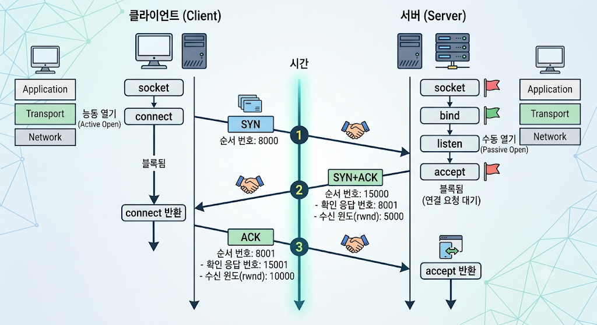

**---
title : 컴퓨터 네트워크 [TCP 연결설정]
categories: [major, Computer network]
description: 컴퓨터 네트워크 개요
---
# TCP 연결 설정

전편에서 전송 계층과 TCP의 큰 그림, 그리고 TCP 헤더의 각 필드를 살펴봤다면, 
여기서는 TCP 연결이 실제로 어떻게 맺어지고, 유지되고, 끊어지는지를 다룹니다.
이번 주제는 TCP 연결 설정(TCP Connection Establishment)입니다.

---

> ### 목차
>
> 1. 들어가기 (Introduction)
>    - 3-way 핸드셰이크로 연결을 맺고, 데이터를 주고받고, 연결을 끊는 세 단계의 흐름을 정리합니다.
> 2. TCP 연결 관리의 특수한 경우 (Special Cases in TCP Connection Management)
>    - 동시 열기, TCP 홀 펀칭, 반쪽 닫기(half-close), 동시 닫기처럼 일반적이지 않은 연결 상황을 살펴봅니다.
> 3. 초기 순서 번호 (Initial Sequence Number)
>    - 연결마다 초기 순서 번호(ISN)를 다르게 정하는 이유, ISN을 추측해 세그먼트를 위조하는 공격, 실제 운영체제가 ISN을 고르는 방법을 알아봅니다.
> 4. 연결 설정 타임아웃 (Timeout of Connection Establishment)
>    - 상대가 응답하지 않을 때 SYN을 몇 번, 어떤 간격(지수 백오프)으로 다시 보내는지 봅니다.
> 5. TCP 옵션 (TCP Options)
>    - MSS, 선택적 ACK(SACK), 윈도 스케일, 타임스탬프와 PAWS, TCP-AO 등 연결을 맺을 때 주고받는 옵션들을 하나씩 정리합니다.
> 6. TCP를 이용한 경로 MTU 탐색 (Path MTU Discovery with TCP, 선택)
>    - TCP가 경로상의 가장 작은 MTU를 알아내 단편화 없이 세그먼트 크기를 맞추는 방법을 살펴봅니다.
> 7. TCP 상태 전이 (TCP State Transitions)
>    - TCP를 유한 상태 기계로 보고, 연결의 각 상태와 TIME_WAIT(2MSL 대기) 상태가 필요한 이유를 알아봅니다.
> 8. 리셋 세그먼트 (Reset Segments)
>    - 없는 포트로의 연결 요청, 연결 강제 종료, 반쯤 열린 연결, TIME_WAIT 암살 등 RST가 쓰이는 경우를 봅니다.
> 9. TCP 서버 동작 (TCP Server Operation)
>    - netstat로 서버가 포트를 어떻게 쓰는지 확인하고, 로컬 주소 제한과 들어오는 연결 큐(backlog)를 정리합니다.

---

## 1. 들어가기 (Introduction)

TCP가 데이터를 보내기 전에 왜 연결부터 맺어야 하는지, 연결이란 정확히 무엇인지 정리하고,
연결을 맺는 3-way 핸드셰이크, 데이터 전송, 연결 종료로 이어지는 TCP 연결의 전체 흐름을 살펴본다.

### TCP 연결과 연결 상태 (TCP Connection and Connection State)

> 핵심
> 
> TCP는 유니캐스트 연결 지향 프로토콜로, 양 끝점이 연결 상태를 유지하며, 연결은 4-튜플로 구분되고 설정, 데이터 전송, 종료의 세 단계를 거친다.

- TCP는 유니캐스트(unicast) 연결 지향 프로토콜이다.
  - 데이터를 보내기 전에 두 끝점 사이에 연결을 먼저 맺어야 한다.
  - 바이트 스트림 서비스를 제공하기 위해, TCP는 IP 계층 이하에서 생기는 패킷 손실, 중복, 오류 같은 모든 전송 문제를 찾아내고 바로잡는다.
- TCP는 연결 상태(connection state), 즉 양 끝점이 각자 보관하는 연결에 대한 정보를 관리한다.
- 다시 말하지만, TCP 연결은 IP 주소 두 개와 포트 번호 두 개로 이루어진 4-튜플로 구분된다.
  - 더 정확히는 끝점(소켓) 한 쌍이며, 각 끝점은 (IP 주소, 포트 번호) 쌍으로 구분된다.
  - 연결은 보통 세 단계를 거친다.
    - 설정(연결 수립), 데이터 전송(연결된 상태), 해제(연결 종료)

설명

유니캐스트란 송신자 하나와 수신자 하나가 1:1로 통신하는 방식이다.
TCP 연결은 항상 정확히 두 끝점 사이에서만 맺어지므로, 여러 수신자에게 한꺼번에 보내는 브로드캐스트나 멀티캐스트에는 TCP를 쓸 수 없다.

연결 상태에는 다음과 같은 정보가 들어간다.

- 양쪽 끝점의 IP 주소와 포트 번호 (4-튜플)
- 내가 보낼 다음 순서 번호, 상대에게 받을 다음 순서 번호
- 상대가 알려 준 윈도 크기
- 지금 연결이 어느 단계에 있는지 (상태)

이 정보는 양 끝 호스트에만 있고, 중간 라우터는 연결에 대해 아무것도 기억하지 않는다.

TCP 연결의 세 단계는 다음과 같다.

| 단계 | 영어 | 하는 일 | 주로 쓰이는 플래그 |
|---|---|---|---|
| 연결 설정 | Setup (Connection Establishment) | 양쪽이 초기 순서 번호와 옵션을 주고받는다 |**

### 연결 설정 중 옵션 교환과 순서 번호 (Options and Sequence Numbers During Connection Establishment)

> 핵심
> 
> 연결을 맺는 동안 양 끝점은 연결 매개변수에 관한 옵션을 주고받으며, SYN과 SYN+ACK 세그먼트는 각각 순서 번호를 하나씩 소비하고 손실되면 재전송된다.

번역

- 연결을 맺는 동안, 두 끝점은 연결의 매개변수에 관한 여러 옵션을 주고받을 수 있다.
  - 어떤 옵션은 연결을 맺을 때만 보낼 수 있다.
  - 다른 옵션은 나중에 보낼 수도 있다.
  - TCP 헤더에서 옵션을 담을 수 있는 공간은 40바이트로 제한되어 있다.
  - TCP 명세상 SYN 세그먼트에 응용 데이터를 실을 수도 있지만, 버클리 소켓 API가 이를 지원하지 않아 거의 쓰이지 않는다.
- 연결을 맺는 동안, 각 SYN(그리고 SYN+ACK) 세그먼트는 순서 번호를 하나 소비하며, 손실되면 재전송된다.

설명

옵션은 보낼 수 있는 시점에 따라 나눌 수 있다. 각 옵션은 5장(TCP 옵션)에서 자세히 다룬다.

| 옵션 | 보낼 수 있는 때 |
|---|---|
| MSS (최대 세그먼트 크기) | SYN에서만 |
| 윈도 스케일 (Window Scale) | SYN에서만 |
| SACK 허용 (SACK-Permitted) | SYN에서만 |
| SACK 블록 | 연결이 맺어진 뒤 |
| 타임스탬프 (Timestamps) | SYN에서 사용 여부를 정하고, 이후 모든 세그먼트에 포함 |

옵션 공간이 40바이트인 이유는 헤더 길이 필드가 4비트이기 때문이다.
4비트로 나타낼 수 있는 최댓값은 15이고 단위가 4바이트이므로 헤더는 최대 60바이트이다.
여기서 고정 헤더 20바이트를 빼면 옵션에 쓸 수 있는 공간은 40바이트가 남는다.

SYN은 데이터가 없어도 순서 번호를 하나 소비한다.
예를 들어 클라이언트가 초기 순서 번호(ISN) 8000으로 SYN을 보내면, 서버는 ACK 번호 8001로 응답하고 클라이언트의 첫 데이터 바이트는 8001번이 된다.

| 세그먼트 | 순서 번호 소비 |
|---|---|
| SYN, SYN+ACK | 1 소비 |
| FIN | 1 소비 |
| 데이터 n바이트 | n 소비 |
| 데이터 없는 ACK | 소비하지 않음 |

---

### 3-way 핸드셰이크 (Three-Way Handshake)

> 핵심
> 
> TCP 연결은 SYN, SYN+ACK, ACK 세 개의 세그먼트를 주고받는 3-way 핸드셰이크로 맺어진다.



- 3-way 핸드셰이크를 이용한 일반적인 연결 설정 (그림)
  - 참고: 실제로는 SYN, SYN+ACK 세그먼트에 여러 옵션도 함께 담긴다.

그림 속 세그먼트

| 순서 | 방향 | 세그먼트 | 순서 번호 | 확인 응답 번호 | 수신 윈도(rwnd) |
|---|---|---|---|---|---|
| 1 | 클라이언트 → 서버 | SYN | 8000 | - | - |
| 2 | 서버 → 클라이언트 | SYN + ACK | 15000 | 8001 | 5000 |
| 3 | 클라이언트 → 서버 | ACK | 8001 | 15001 | 10000 |

그림 속 BSD 함수

| 쪽 | 함수 호출 순서 | 하는 일 |
|---|---|---|
| 서버 | `socket` → `bind` → `listen` | 소켓을 만들고 포트를 정한 뒤 연결 요청을 기다린다 (수동 열기, passive open) |
| 서버 | `accept` (블록됨) | 연결이 완성될 때까지 기다린다 |
| 클라이언트 | `socket` → `connect` (블록됨) | SYN을 보내 연결을 요청한다 (능동 열기, active open) |
| 클라이언트 | `connect` 반환 | SYN+ACK를 받으면 연결이 열린 것으로 보고 반환한다 |
| 서버 | `accept` 반환 | 마지막 ACK를 받으면 연결이 열린 것으로 보고 반환한다 |


1. 클라이언트가 자신의 초기 순서 번호(8000)를 담아 SYN을 보낸다.
2. 서버는 클라이언트의 SYN을 확인(ACK 8001)하면서, 자신의 초기 순서 번호(15000)를 담은 SYN을 함께 보낸다. 이 두 가지를 한 세그먼트에 담은 것이 SYN+ACK이다.
3. 클라이언트가 서버의 SYN을 확인(ACK 15001)하면 연결이 완성된다.

양쪽 모두 상대에게 자신의 초기 순서 번호를 알리고, 상대가 그것을 받았다는 확인을 받아야 하므로 원래는 네 번의 교환이 필요하다.
서버의 ACK와 SYN을 한 세그먼트로 합쳐 세 번으로 줄인 것이 3-way 핸드셰이크이다.

세 번째 ACK의 순서 번호는 8001이다.
SYN이 8000번을 소비했으므로 클라이언트가 다음에 쓸 번호는 8001이고, 데이터 없는 ACK는 순서 번호를 소비하지 않으므로 첫 데이터 바이트도 8001번이 된다.

rwnd는 각자 상대에게 알려 주는 자신의 수신 윈도 크기이다.
서버는 SYN+ACK로 5000바이트, 클라이언트는 ACK로 10000바이트까지 받을 수 있다고 알린다.

---
### 양방향 데이터 전송 (Normal Bidirectional Data Transfer)

> 핵심
> 
> 연결이 맺어지면 양쪽이 동시에 데이터를 보낼 수 있으며, 데이터 세그먼트에 ACK를 함께 실어(피기배킹) 상대의 데이터를 확인한다.

- 일반적인 양방향 데이터 전송 

| 순서 | 방향 | 플래그 | 순서 번호 | 확인 응답 번호 | 데이터 |
|---|---|---|---|---|---|
| 1 | 클라이언트 → 서버 | ACK, PSH | 8001 | 15001 | 8001 ~ 9000 (1000바이트) |
| 2 | 클라이언트 → 서버 | ACK, PSH | 9001 | 15001 | 9001 ~ 10000 (1000바이트) |
| 3 | 서버 → 클라이언트 | ACK | 15001 | 10001 | 15001 ~ 17000 (2000바이트) |
| 4 | 클라이언트 → 서버 | ACK | 10001 | 17001 | 없음 (rwnd: 10000) |


연결 설정에서 정한 번호가 그대로 이어진다.
클라이언트의 첫 데이터는 8001번부터, 서버의 첫 데이터는 15001번부터 시작한다.

1, 2번 세그먼트에서 클라이언트는 서버에게 받은 데이터가 없으므로 ACK 번호가 계속 15001이다.

3번 세그먼트에서 서버는 자신의 데이터 2000바이트를 보내면서, ACK 10001로 클라이언트가 보낸 10000번까지의 데이터를 한꺼번에 확인한다.
데이터에 ACK를 함께 싣는 피기배킹과, 앞의 두 세그먼트를 한 번에 확인하는 누적 ACK가 함께 쓰인 예이다.

4번 세그먼트는 보낼 데이터가 없어서 ACK만 보내는 경우이다.
데이터가 없으므로 순서 번호 10001은 소비되지 않고, 클라이언트가 다음 데이터를 보낸다면 다시 10001번부터 시작한다.

PSH 플래그는 수신 측 TCP에게 데이터를 버퍼에 모아 두지 말고 바로 응용 프로그램에 넘기라고 요청하는 표시이다.

---
### 양방향 데이터 전송 (Normal Bidirectional Data Transfer)

> 핵심
> 
> 연결이 맺어지면 양쪽이 동시에 데이터를 보낼 수 있으며, 데이터 세그먼트에 ACK를 함께 실어(피기배킹)(piggybacking) 상대의 데이터를 확인한다.

- 일반적인 양방향 데이터 전송 (그림)

그림 속 세그먼트

| 순서 | 방향 | 플래그 | 순서 번호 | 확인 응답 번호 | 데이터 |
|---|---|---|---|---|---|
| 1 | 클라이언트 → 서버 | ACK, PSH | 8001 | 15001 | 8001 ~ 9000 (1000바이트) |
| 2 | 클라이언트 → 서버 | ACK, PSH | 9001 | 15001 | 9001 ~ 10000 (1000바이트) |
| 3 | 서버 → 클라이언트 | ACK | 15001 | 10001 | 15001 ~ 17000 (2000바이트) |
| 4 | 클라이언트 → 서버 | ACK | 10001 | 17001 | 없음 (rwnd: 10000) |

연결 설정에서 정한 번호가 그대로 이어진다.
클라이언트의 첫 데이터는 8001번부터, 서버의 첫 데이터는 15001번부터 시작한다.

1, 2번 세그먼트에서 클라이언트는 서버에게 받은 데이터가 없으므로 ACK 번호가 계속 15001이다.

3번 세그먼트에서 서버는 자신의 데이터 2000바이트를 보내면서, ACK 10001로 클라이언트가 보낸 10000번까지의 데이터를 한꺼번에 확인한다.
데이터에 ACK를 함께 싣는 피기배킹(piggybacking)과, 앞의 두 세그먼트를 한 번에 확인하는 누적 ACK가 함께 쓰인 예이다.

4번 세그먼트는 보낼 데이터가 없어서 ACK만 보내는 경우이다.
데이터가 없으므로 순서 번호 10001은 소비되지 않고, 클라이언트가 다음 데이터를 보낸다면 다시 10001번부터 시작한다.

PSH 플래그는 수신 측 TCP에게 데이터를 버퍼에 모아 두지 말고 바로 응용 프로그램에 넘기라고 요청하는 표시이다.


### 연결 종료 (Connection Termination)

> 핵심
> 
> TCP는 원래 네 개의 세그먼트로 연결을 종료하도록 설계되었지만, 많은 구현에서 두 번째와 세 번째 세그먼트를 FIN+ACK 하나로 합쳐 세 개로 종료한다. FIN도 SYN처럼 순서 번호를 하나 소비한다.

- 3-way 핸드셰이크를 이용한 일반적인 연결 종료 
  - TCP는 연결 종료에 4-way 핸드셰이크를 쓰도록 설계되었지만, 많은 구현에서는 두 번째와 세 번째 세그먼트를 하나로 합친다.
  - 데이터가 없는 FIN(그리고 FIN+ACK) 세그먼트는 각각 순서 번호를 하나 소비한다.


| 순서 | 방향 | 세그먼트 | 순서 번호 | 확인 응답 번호 |
|---|---|---|---|---|
| 1 | 클라이언트 → 서버 | FIN (+ACK 플래그) | x | y |
| 2 | 서버 → 클라이언트 | FIN + ACK | y | x + 1 |
| 3 | 클라이언트 → 서버 | ACK | x + 1 | y + 1 |


먼저 `close`를 호출해 FIN을 보내는 쪽의 종료를 능동 닫기(active close), FIN을 받고 나서 닫는 쪽의 종료를 수동 닫기(passive close)라고 한다.
연결을 맺을 때와 달리, 닫기는 클라이언트와 서버 어느 쪽이든 먼저 시작할 수 있다.

원래의 4-way 종료는 다음과 같다.

| 순서 | 세그먼트 | 의미 |
|---|---|---|
| 1 | 클라이언트 → 서버: FIN | 나는 더 보낼 데이터가 없다 |
| 2 | 서버 → 클라이언트: ACK | 네 FIN을 받았다 |
| 3 | 서버 → 클라이언트: FIN | 나도 더 보낼 데이터가 없다 |
| 4 | 클라이언트 → 서버: ACK | 네 FIN을 받았다 |

TCP는 전이중 통신이므로 양쪽 방향을 각각 닫아야 한다.
서버가 FIN을 받은 시점에 더 보낼 데이터가 없다면 2번 ACK와 3번 FIN을 한 세그먼트(FIN+ACK)로 합쳐 3-way로 종료할 수 있다.

FIN은 SYN처럼 순서 번호를 하나 소비하므로, 상대는 x가 아니라 x + 1로 확인 응답한다.
마지막 ACK는 데이터가 없으므로 순서 번호를 소비하지 않으며, 순서 번호는 x + 1이다.

---
## 2. TCP 연결 관리의 특수한 경우 (Special Cases in TCP Connection Management)

앞에서 본 연결 설정과 종료는 한쪽이 먼저 시작하고 다른 쪽이 응답하는 일반적인 경우였다.
여기서는 양쪽이 동시에 연결을 열거나 닫는 경우, 그리고 한 방향만 닫는 반쪽 닫기처럼 흔하지 않은 상황을 살펴본다.

### 동시 열기 (Simultaneous Open)

> 핵심
> 
> 두 응용 프로그램이 동시에 서로에게 능동 열기를 하면, 일반적인 3-way 핸드셰이크보다 하나 많은 네 개의 세그먼트로 연결이 맺어진다.

- 동시 열기
  - 일부러 맞추지 않는 한 거의 일어나지 않지만, 두 응용 프로그램이 동시에 서로에게 능동 열기를 하는 것도 가능하다.
    - 양쪽이 모두 상대의 IP 주소와 포트 번호를 알고 있어야 하는데, 이런 경우는 드물다.
  - 일반적인 3-way 핸드셰이크보다 하나 많은 네 개의 세그먼트를 주고받아야 한다.
    - 양쪽이 모두 클라이언트이자 서버로 동작하므로, 어느 쪽도 클라이언트나 서버라고 부르지 않는다.

| 순서 | 방향 | 세그먼트 | 순서 번호 | 확인 응답 번호 |
|---|---|---|---|---|
| 1 | c1 → c2 | SYN (+옵션) | ISN(c1) | - |
| 2 | c2 → c1 | SYN (+옵션) | ISN(c2) | - |
| 3 | c2 → c1 | SYN + ACK (+옵션) | ISN(c2) | ISN(c1) + 1 |
| 4 | c1 → c2 | SYN + ACK (+옵션) | ISN(c1) | ISN(c2) + 1 |

이후 데이터 전송을 시작할 수 있다.

1, 2번 SYN은 서로 엇갈려 전송된다.
각자 SYN을 보낸 상태에서 상대의 SYN을 받으면, 자신의 SYN을 다시 보내면서 상대의 SYN에 대한 ACK를 함께 싣는다(3, 4번).

3, 4번의 순서 번호가 ISN + 1이 아니라 ISN 그대로인 이유는, 이 세그먼트가 앞에서 보낸 SYN을 다시 보내는 것이기 때문이다.
SYN이 차지하는 번호는 ISN 하나뿐이므로 같은 SYN을 다시 보내도 같은 번호를 쓴다.

일반 3-way 핸드셰이크에서는 서버가 SYN과 ACK를 한 세그먼트로 합쳐 보내지만,
동시 열기에서는 양쪽이 먼저 SYN을 따로 보내 버린 뒤라서 SYN과 ACK를 합칠 기회가 없어 세그먼트가 하나 더 필요하다.

### TCP 반쪽 닫기 (TCP Half-Close)

> 핵심
> 
> 반쪽 닫기는 데이터 흐름의 한 방향만 닫는 동작으로, 보내기는 끝냈지만 상대의 데이터는 계속 받을 수 있다. 버클리 소켓 API에서는 `shutdown()` 함수를 쓴다.

- TCP 반쪽 닫기
  - 반쪽 닫기(half-close)는 데이터 흐름의 한 방향만 닫는 동작이다.
    - API는 응용 프로그램이 "나는 데이터를 다 보냈으니 상대에게 FIN을 보내 줘. 하지만 상대가 FIN을 보낼 때까지 상대의 데이터는 계속 받고 싶어."라고 말할 수 있는 기능을 제공해야 한다.
      - 버클리 소켓 API에서는 `shutdown()` 함수를 사용한다.
    - 반쪽 닫기 두 번이 합쳐지면 연결 전체가 닫힌다.
  - 이 기능이 필요한 응용 프로그램은 많지 않아서, 흔히 쓰이지는 않는다.


| 단계 | 방향 | 세그먼트 |
|---|---|---|
| 클라이언트가 닫기 시작 | 클라이언트 → 서버 | FIN + ACK, Seq = K, ACK = L |
| | 서버 → 클라이언트 | ACK, Seq = L, ACK = K + 1 |
| 반쪽 닫힌 상태 | 서버 → 클라이언트 | 데이터 추가 전송 |
| | 클라이언트 → 서버 | 데이터 확인 응답 |
| 나머지 반쪽 닫기 | 서버 → 클라이언트 | FIN, Seq = L, ACK = K + 1 |
| | 클라이언트 → 서버 | ACK, Seq = K, ACK = L + 1 |

 3-way 종료와 달리, 서버는 클라이언트의 FIN에 ACK만 보내고 자신의 FIN은 바로 보내지 않는다.
이 동안 연결은 반쪽 닫힌(half-closed) 상태가 되어 다음과 같이 동작한다.

| 방향 | 상태 |
|---|---|
| 클라이언트 → 서버 | 닫힘 (클라이언트는 더 이상 데이터를 보내지 않음, ACK는 보냄) |
| 서버 → 클라이언트 | 열림 (서버는 데이터를 계속 보낼 수 있음) |

서버가 보낼 데이터를 다 보내고 FIN을 보내면, 나머지 방향도 닫혀 연결 전체가 종료된다.
결국 반쪽 닫기는 FIN과 ACK를 합치지 않은 원래의 4-way 종료와 같은 모양이다.

`close()`와 `shutdown()`의 차이는 다음과 같다.

| 함수 | 동작 |
|---|---|
| `close()` | 소켓을 완전히 닫는다. 이후 상대가 보내는 데이터도 받을 수 없다. |
| `shutdown(sock, SHUT_WR)` | 보내는 방향만 닫고 FIN을 보낸다. 받는 방향은 열려 있다. |
| `shutdown(sock, SHUT_RD)` | 받는 방향만 닫는다. |
| `shutdown(sock, SHUT_RDWR)` | 양방향을 모두 닫는다. |


### 동시 닫기 (Simultaneous Close)

> 핵심
> 
> 양쪽이 동시에 능동 닫기를 하면 FIN이 서로 엇갈려 전송되고, 각자 상대의 FIN에 ACK를 보내 네 개의 세그먼트로 연결이 종료된다.


- 동시 닫기
  - 양쪽이 모두 능동 닫기를 하여, 서로 먼저 FIN을 보낸다.

그림 속 세그먼트 (c1, c2는 모두 능동 닫기를 하는 쪽)

| 순서 | 방향 | 세그먼트 | 순서 번호 | 확인 응답 번호 |
|---|---|---|---|---|
| 1 | c1 → c2 | FIN, ACK (+옵션) | K | L |
| 2 | c2 → c1 | FIN, ACK | L | K |
| 3 | c2 → c1 | ACK (+옵션) | L | K + 1 |
| 4 | c1 → c2 | ACK (+옵션) | K | L + 1 |


1, 2번 FIN은 서로 엇갈려 전송된다.
각자 FIN을 보낸 뒤 상대의 FIN을 받으면, 그 FIN에 대한 ACK를 보낸다(3, 4번).

10페이지의 동시 열기와 구조가 같다.
양쪽이 이미 FIN을 따로 보낸 상태라서 FIN과 ACK를 한 세그먼트로 합칠 수 없으므로, 일반 3-way 종료보다 세그먼트가 하나 많은 네 개가 필요하다.

| 구분 | 일반적인 경우 | 동시에 하는 경우 |
|---|---|---|
| 연결 설정 | 3개 (SYN → SYN+ACK → ACK) | 4개 (SYN, SYN 엇갈림 → SYN+ACK, SYN+ACK) |
| 연결 종료 | 3개 (FIN → FIN+ACK → ACK) | 4개 (FIN, FIN 엇갈림 → ACK, ACK) |

---
## 3. 초기 순서 번호 (Initial Sequence Number)

연결을 맺을 때 양쪽은 각자 초기 순서 번호(ISN)를 정해 SYN에 담아 보낸다.
ISN을 왜 0이 아닌 값으로, 연결마다 다르게 정해야 하는지, ISN을 쉽게 추측할 수 있으면 어떤 공격이 가능한지,
그리고 실제 운영체제는 ISN을 어떻게 고르는지 살펴본다.

### 초기 순서 번호를 정하는 이유 (Initial Sequence Number)

> 핵심
> 
> 양 끝점은 SYN을 보내기 전에 연결마다 다른 초기 순서 번호(ISN)를 고른다. 같은 4-튜플로 다시 맺어진 새 연결의 순서 번호가 이전 연결의 순서 번호와 겹치지 않게 하기 위해서이다.

- 초기 순서 번호 (ISN)
  - 각 끝점은 연결을 맺기 위해 SYN을 보내기 전에, 그 연결에서 쓸 ISN을 고른다.
    - ISN은 시간에 따라 바뀌어야 하며, 그래야 연결마다 서로 다른 ISN을 갖게 된다.
    - RFC 793은 ISN을 4μs마다 1씩 증가하는 32비트 카운터로 보도록 정하고 있다.
  - 이렇게 하는 목적은, 한 연결의 세그먼트 순서 번호가 동일한 다른(새) 연결의 순서 번호와 겹치지 않게 하는 것이다.
    - 특히, 같은 연결의 서로 다른 인스턴스(incarnation) 사이에서 새 순서 번호가 겹쳐서는 안 된다.

같은 연결의 인스턴스(incarnation)란, 연결이 끝난 뒤 똑같은 4-튜플(출발지 IP, 출발지 포트, 목적지 IP, 목적지 포트)로 다시 맺어진 연결을 말한다.
4-튜플이 같으므로 수신자는 세그먼트가 이전 연결의 것인지 새 연결의 것인지 4-튜플만으로는 구분할 수 없다.

ISN이 항상 0이라면 다음과 같은 문제가 생긴다.

| 시점 | 상황 |
|---|---|
| 이전 연결 | 순서 번호 0번부터 데이터를 보냈고, 그중 한 세그먼트(5000번)가 라우터에서 오래 지연된다. |
| 연결 종료 후 | 같은 4-튜플로 새 연결이 맺어지고, 다시 0번부터 데이터를 주고받는다. |
| 지연된 세그먼트 도착 | 이전 연결의 5000번 세그먼트가 뒤늦게 도착한다. 순서 번호가 새 연결의 윈도 안에 들어가면 정상 데이터로 받아들여진다. |

ISN을 연결마다 다르게 정하면, 새 연결의 순서 번호는 이전 연결과 전혀 다른 위치에서 시작하므로
뒤늦게 도착한 옛날 세그먼트는 윈도 밖의 번호가 되어 버려진다.

RFC 793 방식의 카운터는 4μs마다 1씩 증가하므로, 32비트 공간을 한 바퀴 도는 데 걸리는 시간은 다음과 같다.

2³² × 4μs ≈ 17,180초 ≈ 약 4.77시간

세그먼트가 네트워크에 머무를 수 있는 시간(MSL, 7장에서 다룸)은 보통 수십 초에서 2분 정도이므로,
카운터가 한 바퀴 돌아 같은 번호를 다시 쓸 때쯤에는 옛날 세그먼트가 이미 사라진 뒤이다.

비유하면, 은행 번호표가 매일 1번부터 시작한다고 해보자.
어제 37번 표를 받고 안 쓴 사람이 오늘 와서 37번을 내밀면, 
오늘의 37번과 구분이 안 되겠죠?
그런데 번호표가 계속 이어지는 큰 숫자라면(어제는 8000번대, 오늘은 12000번대)
어제 표는 바로 티가 난다.

## 4. 연결 설정 타임아웃 (Timeout of Connection Establishment)

연결이 정상적으로 맺어지고 끊어지는 모습을 실제 예제로 확인한 뒤,
상대가 응답하지 않아 연결을 맺을 수 없을 때 TCP가 SYN을 언제, 몇 번 다시 보내다가 포기하는지 살펴본다.

### SYN 재전송과 지수 백오프 (Exponential Backoff)

> 핵심
> 
> SYN에 응답이 없으면 TCP는 SYN을 다시 보내는데, 다시 보낼 때마다 기다리는 시간을 두 배로 늘린다. 이를 지수 백오프라고 하며, 정해진 횟수만큼 재전송해도 응답이 없으면 연결을 포기한다.

- 연결 설정 타임아웃
  - 처음 명령을 실행하고 약 3.2분 뒤에 타임아웃이 발생한다.
  - 지수 백오프<mark class="pink">(exponential backoff)</mark>: 두 번째 세그먼트는 첫 번째로부터 3초 뒤에, 세 번째는 두 번째로부터 6초 뒤에, 네 번째는 세 번째로부터 12초 뒤에 보내진다.
    - 참고: 이더넷에서는 실제 백오프 시간을 무작위로 고른다.
    - 처음 보내는 SYN/SYN+ACK 세그먼트의 재시도 횟수는 일부 시스템에서 설정할 수 있으며, 보통 5처럼 꽤 작은 값이다.
    - 예: 리눅스의 `net.ipv4.tcp_syn_retries`와 `net.ipv4.tcp_synack_retries`
    - 리눅스 전용 소켓 옵션 `TCP_SYNCNT`로 연결마다 따로 정할 수도 있다.

실행 화면


대기 시간을 모두 더하면 3 + 6 + 12 + 24 + 48 + 96 = 189초이고,
실행 화면의 시작(21:16:34)과 종료(21:19:43) 사이도 정확히 189초(약 3.2분)이다.

대기 시간을 두 배씩 늘리는 이유는 다음과 같다.

- 응답이 없는 원인이 네트워크 혼잡일 수 있다. 같은 간격으로 계속 보내면 혼잡을 더 악화시키므로, 점점 덜 자주 보낸다.
- 상대가 일시적으로 바빴던 것이라면, 기다리는 시간을 늘려 회복할 시간을 준다.
- 재시도 횟수가 적어도 전체 대기 시간은 충분히 길어진다. 5번만 재전송해도 3분 넘게 기다릴 수 있다.

이더넷도 충돌이 나면 백오프를 쓰지만, 방식이 다르다.

| 구분 | 대기 시간 정하는 방법 | 이유 |
|---|---|---|
| TCP SYN 재전송 | 정해진 값을 매번 두 배로 늘림 | 상대와 네트워크에 회복할 시간을 줌 |
| 이더넷 (CSMA/CD) | 두 배씩 넓어지는 범위 안에서 무작위로 고름 | 충돌한 장치들이 같은 시간에 다시 보내 또 충돌하는 것을 피함 |

재시도 횟수는 리눅스에서 `net.ipv4.tcp_syn_retries`(SYN), `net.ipv4.tcp_synack_retries`(SYN+ACK)로 시스템 전체에, `TCP_SYNCNT` 소켓 옵션으로 연결마다 정할 수 있다.

---

## 5. TCP 옵션 (TCP Options)

연결을 맺을 때 SYN에 담아 주고받는 TCP 옵션들을 살펴본다.
먼저 옵션이 헤더 안에서 어떤 형식으로 들어가는지 정리하고,
MSS, 선택적 ACK(SACK), 윈도 스케일, 타임스탬프와 PAWS, TCP-AO를 하나씩 알아본다.

### TCP 옵션의 구조 (TCP Options)

> 핵심
> 
> 모든 TCP 옵션은 종류를 나타내는 1바이트 kind로 시작하며, EOL(kind 0)과 NOP(kind 1)은 1바이트짜리이고 나머지 옵션은 kind 뒤에 길이를 나타내는 len 바이트가 붙는다.


- TCP 헤더는 옵션을 담을 수 있다.
  - 전체 옵션 목록은 <mark class="pink">IANA</mark>가 관리한다.
  - 모든 옵션은 옵션의 종류를 나타내는<mark class="pink"> 1바이트 kind</mark>로 시작하며, RFC 1122에 따라 이해할 수 없는 옵션은 그냥 무시한다.
  - kind 값이 0과 1인 <mark class="pink">옵션(EOL과 NOP)</mark>은 1바이트만 차지한다.
    - TCP 헤더 길이 필드의 설계상 TCP 헤더 길이는 32비트(4바이트)의 배수여야 하므로 NOP이 필요하다.
  - 나머지 옵션은 kind 바이트 뒤에 len 바이트가 따라온다.

옵션은 종류(kind), 길이(len), 값의 순서로 들어간다.
수신자는 모르는 kind를 만나더라도 len만큼 건너뛰면 다음 옵션을 읽을 수 있으므로, 이해할 수 없는 옵션을 안전하게 무시할 수 있다.
덕분에 새로운 옵션이 추가되어도 옛날 구현과 함께 동작할 수 있다.

TCP 헤더 길이 필드는 4바이트 단위로 길이를 적기 때문에, 옵션을 포함한 헤더 전체가 4바이트의 배수가 되어야 한다.
옵션 길이가 4의 배수가 아니면 NOP이나 EOL로 빈자리를 채운다.

예를 들어 Wireshark 예제에서 SYN의 옵션 24바이트는 다음과 같이 4바이트 단위로 맞춰져 있다.

| 4바이트 묶음 | 내용 |
|---|---|
| 1 | MSS (4바이트) |
| 2 | NOP (1) + 윈도 스케일 (3) |
| 3 ~ 5 | NOP (1) + NOP (1) + 타임스탬프 (10) |
| 6 | NOP (1) + NOP (1) + SACK 허용 (2) |

### TCP 옵션 값 목록 (TCP Option Values)

> 핵심
> 
> 주요 TCP 옵션은 kind 번호와 길이로 구분되며, 이 장에서 다루는 MSS, 윈도 스케일, SACK, 타임스탬프, TCP-AO가 모두 이 목록에 들어 있다.

- TCP 옵션 값 (2012년 기준)

| kind | 길이(바이트) | 이름 | 정의 문서 | 설명과 용도 |
|---|---|---|---|---|
| 0 | 1 | EOL | RFC 793 | 옵션 목록의 끝 |
| 1 | 1 | NOP | RFC 793 | 아무 동작 안 함 (빈자리 채우기용) |
| 2 | 4 | MSS | RFC 793 | 최대 세그먼트 크기 |
| 3 | 3 | WSOPT | RFC 1323 | 윈도 스케일 값 (윈도 값을 왼쪽으로 시프트할 양) |
| 4 | 2 | SACK-Permitted | RFC 2018 | 송신자가 SACK 옵션을 지원함 |
| 5 | 가변 | SACK | RFC 2018 | SACK 블록 (순서가 어긋나게 받은 데이터) |
| 8 | 10 | TSOPT | RFC 1323 | 타임스탬프 옵션 |
| 28 | 4 | UTO | RFC 5482 | 사용자 타임아웃 (일정 시간 동안 아무 일이 없으면 연결 중단) |
| 29 | 가변 | TCP-AO | RFC 5925 | 인증 옵션 (여러 알고리즘 사용) |
| 253 | 가변 | Experimental | RFC 4727 | 실험용으로 예약 |
| 254 | 가변 | Experimental | RFC 4727 | 실험용으로 예약 |

길이는 kind와 len 바이트를 포함한 옵션 전체의 크기이다.
"가변"인 옵션은 담는 내용에 따라 길이가 달라진다. 예를 들어 SACK는 알려 줄 데이터 블록 수에 따라 길이가 바뀐다.

|구분	|하는 일	|예|
|---|---|---|
|플래그|	연결의 단계(상태)를 바꾼다|	SYN을 보내면 SYN_SENT, SYN+ACK를 받으면 ESTABLISHED, FIN을 보내면 FIN_WAIT_1|
|옵션	|연결에서 쓸 규칙과 값을 정한다|	세그먼트 최대 크기는 1460바이트(MSS), 윈도에 2를 곱해서 읽기(윈도 스케일), SACK 써도 됨(SACK 허용)|

비유하면 플래그는 "여보세요", "끊을게" 같은 통화의 시작과 끝 신호고,
옵션은 통화 시작할 때 "우리 한국어로 얘기하자, 천천히 말해 줘" 하고 
정하는 대화 규칙이다. 규칙을 정한다고 통화가 시작되거나 끝나지는 않는다.

### MSS 옵션의 배경: 패킷 크기와 MTU (Background on MSS Option: Packet Size and MTU)

> 핵심
> 
> 패킷 크기는 보통 네트워크 인터페이스의 MTU로 제한되며, 이더넷의 MTU는 대부분 1,500바이트이다. 더 큰 점보 프레임도 있지만 오래된 장비와 잘못 설정된 방화벽 때문에 널리 쓰이지 못했고, 대신 NIC의 오프로드 기능으로 1,500바이트 MTU의 성능을 높이고 있다.

- MSS 옵션의 배경: 패킷 크기와 MTU
  - 패킷 크기는 보통 네트워크 인터페이스의 MTU(Maximum Transmission Unit, 최대 전송 단위)로 제한되며, 많은 이더넷 네트워크에서 MTU는 1,500바이트로 설정되어 있다.
    - 실제로 TCP/IP와 현재의 이더넷에서 패킷 크기는 프로토콜 헤더 54바이트(옵션이나 버전에 따라 더 클 수 있음)를 포함해 54바이트에서 9,054바이트 사이이다.
    - MTU 1,500이라는 크기는 초기 이더넷에서 NIC 버퍼 메모리 비용과 전송 지연 같은 요소들 사이의 균형을 맞추기 위해 정해졌다.
    - 현재 이더넷은 약 9,000바이트까지의 더 큰 패킷(프레임)을 지원하며, 이를 점보 프레임(jumbo frame)이라고 한다.
  - 두 가지 요소가 겹치면서 점보 프레임의 보급이 방해받았다: 오래된 네트워크 하드웨어와 잘못 설정된 방화벽이다.
  - 1,500 MTU 프레임의 성능은 TCP 오프로드(TCP offload)와 대용량 세그먼트 오프로드(large segment offload) 같은 네트워크 인터페이스 카드(NIC) 기능으로 개선되었다.

<mark class="pink">MTU는 한 링크가 데이터링크 계층에서 한 번에 실어 나를 수 있는 IP 패킷의 최대 크기이다.</mark>
최소 크기 54바이트는 헤더만 있고 데이터가 없는 패킷의 크기로, 다음과 같이 구성된다.


패킷 크기를 키우면 데이터 대비 헤더 비율이 줄어들고, 같은 양의 데이터를 더 적은 패킷으로 보낼 수 있다.


- 큰 프레임을 담으려면 NIC에 더 많은 버퍼 메모리가 필요하다. 초기 이더넷 시절에는 메모리가 비쌌다.
- 하나의 큰 프레임이 회선을 오래 차지하면, 다른 장치는 그동안 기다려야 하므로 지연이 커진다.

### MTU와 MSS (MTU and MSS)

> 핵심
> 
> MTU는 보통 IP 기준으로 정한 값이라 이더넷 헤더와 CRC를 포함하지 않는다. MTU보다 큰 IP 패킷은 여러 조각으로 단편화되며, TCP의 MSS는 MTU에서 IP 헤더와 TCP 헤더 크기를 뺀 값으로 계산한다.


- MSS 옵션의 배경: 패킷 크기와 MTU
  - 대부분의 경우 (링크) MTU는 IP 기준으로 설정되므로 RFC를 확인해야 한다. 다만 일부 이더넷 스위치는 MTU라는 말을 이더넷의 최대 프레임 크기를 가리키는 데 쓰기도 한다.
  - IP는 MTU보다 큰 패킷을 여러 조각(fragment)으로 단편화해야 한다.
  - TCP의 최대 세그먼트 크기(MSS)는 MTU에서 헤더 오버헤드를 빼서 계산한다.


MTU와 MSS의 관계 (MTU = 1,500)

| 부분 | 크기 |
|---|---|
| IP 헤더 | 20바이트 |
| TCP 헤더 | 20바이트 |
| 데이터 페이로드 (= MSS) | 1,460바이트 |
| 합계 (= MTU) | 1,500바이트 |

최종적으로 만든어진 ip 크기가 Mtu보다 크면: IP 단편화 (MTU = 1,500)

| 패킷 | IP 헤더 | 페이로드 | 전체 크기 |
|---|---|---|---|
| 원래 패킷 | 20바이트 | 2,000바이트 | 2,020바이트 |
| 조각 1 | 20바이트 | 1,480바이트 | 1,500바이트 |
| 조각 2 | 20바이트 | 520바이트 | 540바이트 |


MTU는 링크가 한 번에 실을 수 있는 IP 패킷의 최대 크기이므로, 이더넷 헤더(14바이트)와 CRC(4바이트)는 포함하지 않는다.
따라서 MTU가 1,500바이트인 이더넷의 실제 최대 프레임 크기는 1,500 + 14 + 4 = 1,518바이트이다.
일부 스위치 제품은 이 프레임 크기를 MTU라고 부르기도 하므로, 장비 설정에서 MTU 값을 볼 때는 무엇을 기준으로 한 값인지 확인해야 한다.

MSS는 TCP 세그먼트 하나에 담을 수 있는 데이터의 최대 크기로, 다음과 같이 계산한다.

MSS = MTU − IP 헤더 − TCP 헤더 = 1,500 − 20 − 20 = 1,460바이트

IP 패킷이 MTU보다 크면 IP 계층은 이를 여러 조각으로 나눈다(단편화, fragmentation).
 페이로드 2,000바이트를 1,480바이트와 520바이트로 나누고, 각 조각에 IP 헤더를 붙여 MTU 1,500바이트 안에 맞춘다.
조각들은 목적지 호스트에 모두 도착한 뒤에야 원래 패킷으로 다시 조립된다.

단편화는 다음과 같은 이유로 피하는 것이 좋다.

- 조각 하나만 사라져도 패킷 전체를 다시 보내야 한다.
- 목적지가 모든 조각을 모을 때까지 버퍼에 보관해야 하므로 부담이 생긴다.
- 방화벽이나 NAT가 첫 번째 조각이 아닌 조각에서는 포트 번호를 볼 수 없어 처리에 문제가 생길 수 있다.

TCP는 MSS를 기준으로 세그먼트 크기를 정하기 때문에, 처음부터 IP 패킷이 MTU를 넘지 않도록 만들어 단편화를 피할 수 있다.

### 최대 세그먼트 크기 옵션 (Maximum Segment Size Option)

> 핵심
> 
> MSS는 TCP가 상대로부터 받을 수 있는 가장 큰 세그먼트의 데이터 크기로, 연결을 맺을 때 SYN에 담아 알린다. MSS는 협상이 아니라 각자 "이보다 큰 세그먼트는 받지 않겠다"고 알리는 한계값이다.

- 최대 세그먼트 크기(MSS) 옵션
  - MSS는 TCP가 상대로부터 받을 의향이 있는 가장 큰 세그먼트이며, 따라서 상대가 보낼 때 써야 하는 최대 크기이다.
    - TCP 데이터 바이트만 세며, TCP 헤더나 IP 헤더의 크기는 포함하지 않는다. (RFC 879)
  - 연결을 맺을 때, 각 끝점은 보통 자신의 SYN 세그먼트에 MSS 옵션을 담아 자신의 MSS를 알린다.
    - MSS 값은 16비트로 나타낸다.
    - MSS 옵션이 없으면 기본값 536바이트를 쓴다. (최소 크기의 IPv4 헤더와 TCP 헤더를 붙이면 IPv4 데이터그램 크기는 576바이트가 된다.)
    - 이더넷에서 MSS는 보통 TCP/IPv4에서 1460, TCP/IPv6에서 1440이다.
    - 특별한 MSS 값 65535는 IPv6 점보그램(jumbogram)에서 사실상 무한대인 MSS를 나타낼 때 쓸 수 있다. (RFC 2675)
      - 이 경우 송신 MSS(SMSS)는 경로 MTU에서 60바이트를 뺀 값으로 정해진다.

SYN  설정 보낼때만 설정으하고 중간에 변경이 불가능하다.
<br>
MSS 옵션을 안 보내면 536바이트로 보내야 해서 세그먼트가 거의 3배로 늘어난다. 최대 크기를 상대방이 모르기 때문이다.
세그먼트마다 헤더도 붙고, 송수신 쪽 CPU도 패킷마다 처리해야 하니까 MSS를 제대로 
알리는 것만으로도 꽤 아낀다. 그리고 MTU에 딱 맞는 크기라 단편화도 피할 수 있다.


### 선택적 확인 응답 옵션 (Selective Acknowledgment, SACK Options)

> 핵심
> 
> 누적 ACK는 중간에 빠진 데이터가 있으면 그 뒤에 받은 데이터를 확인해 줄 수 없다. SACK 옵션은 수신자가 이미 받은 데이터 블록의 범위를 알려 주어, 송신자가 실제로 빠진 세그먼트만 골라서 재전송할 수 있게 한다.

- 선택적 확인 응답(SACK) 옵션
  - TCP는 누적 ACK를 쓰기 때문에, 올바르게 받았더라도 앞서 받은 데이터와 이어지지 않는 데이터는 결코 확인 응답할 수 없다.
    - 이런 경우 TCP 수신자의 수신 데이터 큐에 구멍(hole)이 있다고 한다.
  - TCP 송신자가 수신자 쪽에 구멍이 있다는 것을 알 수 있다면, 어떤 TCP 세그먼트를 재전송할지 더 잘 고를 수 있다. TCP SACK 옵션이 이 기능을 제공한다.
  - TCP는 <mark class="pink">SYN(또는 SYN+ACK) 세그먼트에서 SACK 허용(SACK-Permitted) 옵션을  받아, 상대가 SACK 정보를 알릴 수 있다는 것을 알게 된다.</mark>
  - 이 과정이 끝나면, 순서가 어긋난 데이터를 받은 TCP는 상대가 더 효율적으로 재전송할 수 있도록 그 데이터를 설명하는 SACK 옵션을 보낼 수 있다.
    - SACK 옵션에 담긴 정보는 수신자가 성공적으로 받은 데이터 블록을 나타내는 순서 번호의 범위이며, 이를 SACK 블록이라고 한다.
    - SACK 블록 n개를 담은 SACK 옵션의 길이는 (8n + 2)바이트이다. (2바이트는 kind와 length)
      - 타임스탬프 옵션도 함께 쓰는 경우(현대 TCP에서 일반적), n ≤ 3이다.

누적 ACK의 약점은 다음 예에서 볼 수 있다.

| 세그먼트 | 바이트 범위 | 도착 여부 |
|---|---|---|
| 1 | 1001 ~ 2000 | 도착 |
| 2 | 2001 ~ 3000 | 손실 |
| 3 | 3001 ~ 4000 | 도착 |
| 4 | 4001 ~ 5000 | 손실 |
| 5 | 5001 ~ 6000 | 도착 |

누적 ACK만 쓰면 수신자는 ACK 2001만 보낼 수 있다.
송신자는 2001번부터 빠졌다는 것만 알 뿐, 3번과 5번 세그먼트가 도착했는지는 모른다.
그래서 2번만 다시 보내고 기다리거나, 2번부터 5번까지 모두 다시 보내야 한다.

SACK를 쓰면 수신자는 다음과 같이 응답한다.

| 필드 | 값 | 의미 |
|---|---|---|
| ACK 번호 | 2001 | 2000번까지 빠짐없이 받았다 (누적 ACK는 그대로) |
| SACK 블록 1 | 3001 ~ 4001 | 3001 ~ 4000번도 받았다 |
| SACK 블록 2 | 5001 ~ 6001 | 5001 ~ 6000번도 받았다 |

송신자는 이 정보로 구멍이 2001 ~ 3000과 4001 ~ 5000 두 곳이라는 것을 알고, 2번과 4번 세그먼트만 재전송한다.
SACK 블록의 오른쪽 끝은 받은 마지막 바이트의 다음 번호로 적는다.

SACK는 누적 ACK를 대신하는 것이 아니라, 누적 ACK에 추가 정보를 덧붙이는 것이다.
ACK 번호는 여전히 누적 ACK 규칙을 따른다.

SACK 블록 하나는 왼쪽 끝(4바이트)과 오른쪽 끝(4바이트)으로 이루어져 8바이트이다.
옵션 공간 40바이트 안에 넣을 수 있는 블록 수는 다음과 같다.

| 경우 | 남은 옵션 공간 | 최대 블록 수 |
|---|---|---|
| SACK만 사용 | 40바이트 | (40 − 2) ÷ 8 → 4개 |
| 타임스탬프도 사용 (NOP 2 + 10 = 12바이트) | 28바이트 | (28 − 2) ÷ 8 → 3개 |

덕분에 1개만 없어졌어도 여러개를 순서대로 다시 보내는 상황을 모면할 수 있다.

### 윈도 스케일 옵션 (Window Scale Option)

> 핵심
> 
> 윈도 스케일 옵션은 16비트 윈도 크기 필드는 그대로 두고, 그 값을 왼쪽으로 s비트 시프트(2^s배)해서 읽도록 해 최대 윈도를 약 1GiB까지 늘린다. SYN에서만 보낼 수 있고, 양쪽이 모두 보내야 사용된다.

옵션 형식

| 필드 | 크기 | 값 |
|---|---|---|
| kind | 1바이트 | 3 |
| length | 1바이트 | 3 |
| 스케일 값 (Scale factor) | 1바이트 | s (0 ~ 14) |

- 윈도 스케일(WSCALE 또는 WSOPT) 옵션
  - 윈도 스케일 옵션(RFC 1323)은 TCP 윈도 크기 광고 필드의 용량을 사실상 늘려 준다.
    - 다만 필드 크기를 바꾸는 대신, 헤더에는 여전히 16비트 값을 담고, 이 16비트 값에 1바이트 스케일 값 s를 적용하는 옵션을 정의한다. (0 ≤ s ≤ 14)
      - TCP는 윈도 필드 값을 스케일 값 s만큼 왼쪽으로 시프트하므로, 최대 윈도 크기는 1GiB (2¹⁴ × (2¹⁶ − 1))가 된다.
    - 이 옵션은 SYN 세그먼트에만 나타날 수 있으므로, 스케일 값은 방향별로 고정된다.
    - 상호 운용성을 위해, 윈도 스케일을 사용하려면 양쪽 모두 자신의 SYN 세그먼트에 이 옵션을 담아 보내야 한다.
  - 윈도 스케일 옵션은 대역폭-지연 곱(BDP)이 큰 네트워크, 즉 RTT와 대역폭의 곱이 비교적 큰 네트워크에서 대용량 데이터를 전송할 때 가장 중요하다. 이런 네트워크를 롱 팻 파이프(long fat pipe)라고도 부른다.


실제 윈도 크기는 다음과 같이 계산한다.

실제 윈도 크기 = 헤더의 윈도 값 × 2^s

| 스케일 값 s | 배율 | 최대 윈도 크기 |
|---|---|---|
| 0 | 1배 | 65,535바이트 (약 64KB) |
| 7 | 128배 | 약 8MB |
| 14 (최대) | 16,384배 | 2¹⁴ × (2¹⁶ − 1) ≈ 1GiB |

Wireshark 예제의 클라이언트 SYN에는 "Window scale: 1 (multiply by 2)", 즉 s = 1이 들어 있었다.
하지만 서버의 SYN+ACK에는 이 옵션이 없었으므로, 그 연결에서는 양방향 모두 윈도 스케일을 쓰지 않는다.

롱 팻 파이프는 "길고(RTT가 큼) 굵은(대역폭이 큼) 관"이라는 뜻이다.
이런 네트워크에서 회선을 꽉 채우려면 ACK를 받기 전에 BDP만큼 데이터를 보낼 수 있어야 하는데,
윈도 스케일 없이는 윈도가 64KB로 묶여 회선의 일부만 쓰게 된다.


### 타임스탬프 옵션 (Timestamps Option)

> 핵심
> 
> 타임스탬프 옵션은 송신자가 세그먼트마다 자신의 시각 값(TSval)을 넣고, 수신자가 그 값을 ACK의 TSecr 필드에 그대로 되돌려 보내게 한다. 송신자는 ACK를 받을 때마다 현재 시각과 TSecr의 차이로 RTT를 잴 수 있다.

- 타임스탬프 옵션과 PAWS
  - 32비트 타임스탬프 옵션(TSOPT 또는 TSopt)은 송신자가 모든 세그먼트에 4바이트짜리 타임스탬프 값 두 개를 넣을 수 있게 한다.
    - 수신자는 받은 TSOPT 값을 ACK의 32비트 타임스탬프 에코 응답(TSER 또는 TSecr) 필드에 담아 되돌려 보낸다. 이를 통해 송신자는 ACK를 받을 때마다 연결의 RTT 추정값을 계산할 수 있다.
  - 타임스탬프는 단조 증가하는 값이다.
    - 수신자는 받은 값을 그대로 돌려줄 뿐이므로, 타임스탬프의 단위나 실제 값이 무엇인지 신경 쓰지 않는다.
    - RFC 1323은 송신자가 타임스탬프 값을 1초에 최소 1씩 증가시키도록 권장한다.
  - 타임스탬프 옵션을 쓰면 비교적 세밀하게 RTT를 측정할 수 있다.
    - 연결의 RTT를 잘 추정하려는 주된 이유는 재전송 타임아웃을 정하기 위해서이다. 재전송 타임아웃은 TCP가 손실되었을 가능성이 높은 세그먼트를 언제 다시 보낼지를 알려 준다.
    - 타임스탬프 옵션이 생기기 전에는, 대부분의 TCP가 윈도 하나에 RTT 샘플을 하나만 측정했다.
    - 타임스탬프 옵션을 쓰면 더 많은 샘플을 얻을 수 있어 더 나은 RTT 추정이 가능하다. (RFC 1323, RFC 6298 참고)


RTT는 다음과 같이 계산한다.

| 단계 | 일어나는 일 |
|---|---|
| 1 | 송신자가 자신의 시각 100일 때 세그먼트를 보낸다. (TSval = 100) |
| 2 | 수신자가 ACK를 보내면서 받은 값을 그대로 돌려준다. (TSecr = 100) |
| 3 | 송신자는 자신의 시각 130일 때 ACK를 받는다. |
| 4 | RTT = 130 − 100 = 30 (송신자의 시각 단위) |

### 타임스탬프 옵션 예제 (Example of the Timestamp Option)

> 핵심
> 
> 수신자는 마지막으로 보낸 ACK 번호(lastack)와 되돌려 줄 타임스탬프 값(tsrecent)을 기억해 두고, ACK 하나로 여러 세그먼트를 확인할 때는 그중 가장 먼저 도착한 세그먼트의 타임스탬프를 돌려준다. 송신자는 ACK를 받은 시각에서 돌아온 값을 빼 RTT를 구한다.

- 타임스탬프 옵션과 PAWS
  - 타임스탬프 옵션 예제

| 순서 | 송신자 시각 | 방향 | 데이터 | ACK | TSval | TSecr |
|---|---|---|---|---|---|---|
| 1 | 4720 | 송신자 → 수신자 | 12000 ~ 12099 | - | 4720 | - |
| 2 | 4725 | 송신자 → 수신자 | 12100 ~ 12199 | - | 4725 | - |
| 3 | 4732 (도착) | 수신자 → 송신자 | - | 12200 | - | 4720 |

RTT = 4732 − 4720 = 12

수신자가 기억하는 값의 변화

| 시점 | lastack (마지막으로 보낸 ACK 번호) | tsrecent (돌려줄 타임스탬프) |
|---|---|---|
| 처음 | 12000 | 없음 |
| 1번 세그먼트 도착 후 | 12000 | 4720 |
| 2번 세그먼트 도착 후 | 12000 | 4720 (바뀌지 않음) |
| ACK 12200 보낸 후 | 12200 | 4720 |

설명

수신자는 두 가지 값을 기억한다.

- lastack: 수신자가 마지막으로 보낸 ACK 번호, 즉 다음에 받기를 기다리는 순서 번호이다.
- tsrecent: 다음 ACK의 TSecr에 넣어 돌려줄 타임스탬프 값이다.

tsrecent는 도착한 세그먼트의 순서 번호가 lastack과 같을 때, 즉 수신자가 기다리던 바로 그 세그먼트일 때만 갱신된다.

- 1번 세그먼트는 12000번부터 시작하고 lastack도 12000이므로, tsrecent를 4720으로 갱신한다.
- 2번 세그먼트는 12100번부터 시작해 lastack(12000)과 다르므로, tsrecent는 4720 그대로 둔다.

수신자는 두 세그먼트를 받은 뒤 ACK 12200 하나로 한꺼번에 확인하고(누적 ACK), TSecr에는 4720을 넣는다.
송신자는 시각 4732에 이 ACK를 받고, RTT를 4732 − 4720 = 12로 계산한다.

더 최근 값인 4725가 아니라 4720을 돌려주는 이유는, 수신자가 ACK를 바로 보내지 않고 모아서 보냈기 때문이다(지연 ACK).
1번 세그먼트는 2번이 올 때까지 ACK를 기다린 셈이므로, 4720을 돌려주면 이 기다린 시간까지 RTT에 포함된다.
송신자 입장에서는 실제로 ACK를 받기까지 걸린 시간이 반영되어, 재전송 타임아웃을 너무 짧게 잡는 일을 막을 수 있다.

### PAWS: 순서 번호 순환 방지 (Protection Against Wrapped Sequence Numbers)

> 핵심
> 
> 순서 번호가 한 바퀴 돌아 같은 번호가 다시 쓰이면, 뒤늦게 도착한 옛날 세그먼트가 정상 세그먼트로 받아들여질 수 있다. PAWS는 타임스탬프를 순서 번호에 덧붙인 추가 32비트처럼 써서, 타임스탬프가 이전보다 작은 세그먼트를 옛날 세그먼트로 판단해 버린다.

- 타임스탬프 옵션과 PAWS
  - 순서 번호 순환 방지(PAWS, Protection Against Wrapped Sequence Numbers)
    - 타임스탬프 옵션은 수신자가 옛날 세그먼트를 받아 유효한 것으로 여기지 않도록 하는 방법도 제공한다.
    - 즉, 타임스탬프 옵션은 실질적인 순서 번호 공간을 32비트만큼 더 늘려 주며, PAWS 알고리즘은 세그먼트를 받을 때 이 공간을 활용한다.
  - 예: 윈도 크기가 약 1GB(2³⁰)이고, 송신자가 윈도 하나를 보낼 때마다 타임스탬프를 1씩 증가시킨다고 하자.
    - 순서 번호 필드는 D와 E 사이에서 한 바퀴 돌지만, PAWS 알고리즘으로 A에서 보낸 세그먼트와 E에서 보낸 세그먼트를 구분할 수 있다.

예제 (G = 2³⁰바이트, 순서 번호 공간 = 4G)

| 시점 | 보낸 바이트 | 순서 번호 | 타임스탬프 | 수신 결과 |
|---|---|---|---|---|
| A | 0G ~ 1G | 0G ~ 1G | 1 | 정상 |
| B | 1G ~ 2G | 1G ~ 2G | 2 | 정상, 다만 세그먼트 하나가 손실되어 재전송됨 |
| C | 2G ~ 3G | 2G ~ 3G | 3 | 정상 |
| D | 3G ~ 4G | 3G ~ 4G | 4 | 정상 |
| E | 4G ~ 5G | 0G ~ 1G | 5 | 정상 (순서 번호가 한 바퀴 돌아 다시 0부터) |
| F | 5G ~ 6G | 1G ~ 2G | 6 | 정상, 다만 재전송했던 세그먼트가 다시 나타남 |

설명

순서 번호는 32비트이므로 4G(2³²)바이트를 보내면 다시 0으로 돌아간다.
윈도가 1G라면 윈도 4개마다 한 바퀴를 도는 셈이다.

문제는 F 시점에 생긴다.

1. B 시점에 보낸 세그먼트 하나가 사라진 줄 알고 재전송했지만, 사실 원본은 사라지지 않고 네트워크 어딘가에서 오래 지연되고 있었다.
2. F 시점에 수신자는 순서 번호 1G ~ 2G 범위의 데이터를 받고 있다.
3. 이때 B 시점의 지연된 원본이 도착한다. 이 세그먼트의 순서 번호도 1G ~ 2G 범위에 있으므로, 순서 번호만 보면 정상 데이터와 구별할 수 없다.

PAWS는 타임스탬프로 이 세그먼트를 걸러 낸다.

| 세그먼트 | 순서 번호 | 타임스탬프 | 판단 |
|---|---|---|---|
| F 시점의 정상 세그먼트 | 1G ~ 2G 범위 | 6 | 최근에 받은 타임스탬프 이상 → 받음 |
| B 시점의 지연된 원본 | 1G ~ 2G 범위 | 2 | 최근에 받은 타임스탬프(5 이상)보다 작음 → 옛날 세그먼트로 보고 버림 |

PAWS의 규칙은 간단하다.
수신자는 최근에 받은 타임스탬프 값(tsrecent)을 기억하고, 도착한 세그먼트의 타임스탬프가 이보다 작으면 순서 번호가 윈도 안에 있더라도 버린다.

순서 번호(32비트)와 타임스탬프(32비트)를 함께 보면, 사실상 64비트짜리 순서 번호를 쓰는 것과 같은 효과가 난다.
덕분에 헤더의 순서 번호 필드 크기를 바꾸지 않고도 고속 전송에서 생기는 순서 번호 순환 문제를 해결할 수 있다.

---
## 7. TCP 상태 전이 (TCP State Transitions)

TCP는 연결을 맺고, 데이터를 주고받고, 연결을 끊는 동안 일어나는 일을 유한 상태 기계로 정의한다.
TCP 연결이 거치는 상태들과 상태가 바뀌는 조건을 정리하고,
연결을 먼저 끊은 쪽이 마지막에 머무는 TIME_WAIT 상태가 왜 필요한지 살펴본다.


### 상태 전이도 (State Transition Diagram)

> 핵심
> 
> TCP는 연결 설정, 연결 종료, 데이터 전송 중에 일어나는 여러 사건을 관리하기 위해 유한 상태 기계(finite state machine)로 정의된다. 각 상태는 받은 세그먼트나 응용 프로그램의 요청(사건)에 따라 정해진 세그먼트를 보내며(동작) 다음 상태로 넘어간다.

- 상태 전이도
  - 연결 설정, 연결 종료, 데이터 전송 중에 일어나는 여러 사건을 추적하기 위해, TCP는 유한 상태 기계로 명세되어 있다.

그림 읽는 법

- 화살표의 글자는 "사건 / 동작" 형식이다. 예를 들어 "SYN / SYN + ACK"는 SYN을 받으면 SYN+ACK를 보낸다는 뜻이고, "–"는 아무것도 보내지 않는다는 뜻이다.
- 실선은 클라이언트의 전이, 점선은 서버의 전이, 분홍색 선은 클라이언트와 서버 모두 일어날 수 있는 전이(주로 특수한 경우)이다.


### TCP의 상태 (States for TCP)

> 핵심
> 
> TCP 연결은 CLOSED부터 CLOSING까지 11개의 상태를 가지며, 각 상태는 "무엇을 보냈고, 무엇을 기다리고 있는가"로 설명할 수 있다.

- TCP의 상태

| 상태 | 설명 | 주로 거치는 쪽 |
|---|---|---|
| CLOSED | 연결이 없다. | 양쪽 |
| LISTEN | 수동 열기를 했고, SYN을 기다린다. | 서버 |
| SYN-SENT | SYN을 보냈고, ACK를 기다린다. | 클라이언트 (능동 열기) |
| SYN-RCVD | SYN+ACK를 보냈고, ACK를 기다린다. | 서버 |
| ESTABLISHED | 연결이 맺어져 데이터를 주고받는 중이다. | 양쪽 |
| FIN-WAIT-1 | 첫 번째 FIN을 보냈고, ACK를 기다린다. | 먼저 닫는 쪽 (능동 닫기) |
| FIN-WAIT-2 | 첫 번째 FIN에 대한 ACK를 받았고, 두 번째 FIN을 기다린다. | 먼저 닫는 쪽 |
| CLOSE-WAIT | 첫 번째 FIN을 받아 ACK를 보냈고, 응용 프로그램이 닫기를 기다린다. | 나중에 닫는 쪽 (수동 닫기) |
| TIME-WAIT | 두 번째 FIN을 받아 ACK를 보냈고, 2MSL 타임아웃을 기다린다. | 먼저 닫는 쪽 |
| LAST-ACK | 두 번째 FIN을 보냈고, ACK를 기다린다. | 나중에 닫는 쪽 |
| CLOSING | 양쪽이 동시에 닫기로 했다. | 동시 닫기의 양쪽 |


### TIME_WAIT 상태 (2MSL 대기 상태)

> 핵심
> 
> 능동 닫기를 한 쪽은 마지막 ACK를 보낸 뒤 MSL의 두 배(2MSL) 동안 TIME_WAIT 상태에 머문다. 마지막 ACK가 사라졌을 때 다시 보낼 수 있게 하기 위해서이며, 이 동안 같은 연결은 다시 쓸 수 없다.

- TIME_WAIT (2MSL 대기) 상태
  - 최대 세그먼트 수명(MSL, Maximum Segment Lifetime): 세그먼트가 버려지기 전까지 네트워크에 존재할 수 있는 최대 시간
    - RFC 793은 2분으로 정하고 있지만, 실제로는 30초, 1분, 2분이 흔히 쓰인다.
    - 리눅스에서는 `net.ipv4.tcp_fin_timeout`이 2MSL 대기 시간(초)을 뜻한다.
  - TCP가 능동 닫기를 하고 마지막 ACK를 보내면, 그 연결은 MSL의 두 배 동안 TIME_WAIT 상태에 머물러야 한다.
    - <mark class="pink">마지막 ACK가 사라졌을 경우 TCP가 이를 다시 보낼 수 있게 하기 위해서이다.
  - 문제: 2MSL 대기 상태 동안에는 양 끝점이 그 연결을 다시 사용할 수 없다.

  - 버클리 소켓 API에서는 `SO_REUSEADDR` 소켓 옵션으로 특정 TCP 소켓에 대해 이 제한을 우회할 수 있지만, TCP는 여전히 2MSL 대기 상태 동안 이 포트 번호가 (같은 연결로) 재사용되는 것을 막는다.
    - 대화형 응용 프로그램에서는 보통 클라이언트가 능동 닫기를 하고 2MSL 대기 상태에 들어가므로, 임시 포트에 대한 제한은 심각하지 않을 수 있다.
    - 하지만 서버는 상황이 다르다. 서버는 거의 항상 잘 알려진 포트를 쓰기 때문이다.
      - 연결이 맺어진 서버 프로세스를 종료하고 바로 다시 시작하면, 서버는 자신의 포트 번호를 끝점에 할당하지 못하고 최대 4분 동안 "Address already in use" 바인드 오류를 받는다.

TIME_WAIT가 필요한 이유는 다음 상황에서 볼 수 있다.

| 순서 | 일어나는 일 |
|---|---|
| 1 | 클라이언트(능동 닫기)가 서버의 FIN을 받고 마지막 ACK를 보낸다. |
| 2 | 이 ACK가 네트워크에서 사라진다. |
| 3 | 서버(LAST-ACK 상태)는 ACK가 오지 않으니 FIN을 재전송한다. |
| 4 | 클라이언트가 이미 연결 정보를 지웠다면 이 FIN에 RST로 응답하게 되고, 서버는 연결이 정상적으로 끝나지 않았다고 판단한다. |
| 4' | 클라이언트가 TIME_WAIT에 머물러 있다면 마지막 ACK를 다시 보내 정상적으로 종료할 수 있다. |


#### 더 알아보기: 서버를 재시작할 때 생기는 TIME_WAIT 문제

TIME_WAIT는 보통 클라이언트 쪽 이야기로 생각하기 쉽지만, 서버에서도 생긴다.
TIME_WAIT에 들어가는 쪽은 클라이언트나 서버가 아니라 "먼저 연결을 닫은 쪽"이기 때문이다.

클라이언트와 연결된 상태에서 서버 프로그램을 종료하면, 운영체제가 그 프로그램이 열어 둔 소켓을 대신 닫으면서 서버 쪽에서 먼저 FIN을 보낸다.
즉, 서버가 능동 닫기를 한 쪽이 되어 TIME_WAIT 상태에 들어간다.

중요한 점은 TCP 연결 정보가 응용 프로그램이 아니라 운영체제 커널 안에 있다는 것이다.
서버 프로세스가 완전히 종료되어도, 커널은 TIME_WAIT 상태의 연결을 2MSL 동안 메모리에 그대로 남겨 둔다.

이 상태에서 서버를 바로 다시 실행하면 다음과 같은 일이 생긴다.

| 순서 | 일어나는 일 | 서버 쪽 상태 |
|---|---|---|
| 1 | 서버 프로그램이 클라이언트와 연결된 채 동작 중 | ESTABLISHED |
| 2 | 관리자가 서버 프로그램을 종료하고, 커널이 FIN을 보냄 | FIN-WAIT-1 → FIN-WAIT-2 |
| 3 | 클라이언트도 FIN을 보내고, 커널이 마지막 ACK를 보냄 | TIME_WAIT (2MSL 동안 유지) |
| 4 | 관리자가 서버를 바로 재시작하고 `bind()`로 80번 포트를 요청 | "Address already in use" 오류 |
| 5 | 2MSL이 지나 TIME_WAIT 연결이 사라짐 | 이제 `bind()` 성공 |

커널 입장에서는 80번 포트에 아직 TIME_WAIT 연결이 남아 있으므로, 새 프로그램의 바인드 요청을 거절한다.
MSL이 2분이라면 서버를 최대 4분 동안 다시 열 수 없다.

클라이언트는 연결할 때마다 운영체제가 새 임시 포트를 골라 주므로 이전 포트가 TIME_WAIT에 묶여 있어도 문제가 없다.
반면 서버는 80번처럼 정해진 포트를 반드시 써야 하므로 이 제약이 그대로 드러난다.

## 8. 리셋 세그먼트 (Reset Segments)

TCP 헤더의 RST 플래그가 켜진 리셋 세그먼트는 연결을 정상 절차 없이 즉시 끊는 데 쓰인다.
리셋이 언제 보내지는지, 그리고 없는 포트로의 연결 요청, 연결 강제 종료, 반쯤 열린 연결, TIME_WAIT 암살처럼 리셋이 쓰이는 대표적인 경우를 살펴본다.

### 리셋 세그먼트 소개 (Introduction)

> 핵심
> 
> TCP는 도착한 세그먼트가 해당 연결에 맞지 않아 보이면 리셋(RST) 세그먼트를 보낸다. 리셋을 받으면 보통 FIN 교환 없이 연결이 바로 끊어진다.

  - 일반적으로 TCP는 도착한 세그먼트가 참조하는 연결에 대해 올바르지 않아 보일 때마다 리셋을 보낸다.
    - 참조하는 연결(reference connection): 리셋의 TCP 헤더와 IP 헤더에 담긴 4-튜플로 지정되는 연결
  - 리셋은 보통 TCP 연결을 빠르게 해제한다.
  - 따라서 리셋 세그먼트는 여러 용도로 쓰인다.

리셋 세그먼트는 TCP 헤더의 RST 플래그가 켜진 세그먼트이다.
"이 세그먼트는 나에게 맞지 않다" 또는 "이 연결을 당장 끝낸다"는 뜻을 전한다.

"올바르지 않아 보이는 세그먼트"의 예는 다음과 같다.

| 상황 | 리셋을 보내는 이유 |
|---|---|
| 아무도 listen하지 않는 포트로 SYN이 옴 | 받아 줄 연결이 없다 |
| 이미 사라진 연결에 대한 데이터가 옴 | 그런 연결을 알지 못한다 |
| 응용 프로그램이 연결을 강제로 끊기로 함 | 정상 종료 대신 즉시 중단한다 |

리셋에는 어느 연결에 대한 것인지가 4-튜플로 들어 있다.
리셋을 보낼 때는 받은 세그먼트의 출발지와 목적지를 서로 바꿔 적으므로, 상대는 자신의 어느 연결이 거절되었는지 알 수 있다.

FIN과 RST는 연결을 끝낸다는 점은 같지만 방식이 다르다.

| 구분 | FIN | RST |
|---|---|---|
| 의미 | 나는 더 보낼 데이터가 없다 (정상 종료) | 이 연결을 즉시 끊는다 (비정상 종료) |
| 상대의 응답 | ACK를 보내고, 자신도 남은 데이터를 보낸 뒤 FIN | 응답하지 않음 (RST에는 ACK하지 않음) |
| 남은 데이터 | 끝까지 전달됨 | 버려짐 |
| 이후 상태 | FIN-WAIT, TIME-WAIT 등을 거쳐 종료 | 바로 CLOSED |

### 사례 2: 연결 강제 종료 (Aborting a Connection)

> 핵심
> 
> 연결은 보통 FIN으로 정상 종료하지만, 언제든 FIN 대신 RST를 보내 강제로 끊을 수도 있다. 강제 종료를 하면 아직 보내지 못한 데이터는 버려지고, 상대는 정상 종료가 아니라 강제 종료였다는 것을 알 수 있다.

- 사례 2: 연결 강제 종료
  - 연결을 끝내는 일반적인 방법은 한쪽이 FIN을 보내는 것이다. (정상 해제, 우아한 해제, 우아한 종료(graceful close) 등으로 부른다.)
  - FIN 대신 리셋을 보내 언제든 연결을 강제로 끊는 것도 가능하다. <mark class="pink">(강제 해제(abortive release), 강제 종료(abortive close)</mark>라고 부른다.)
  - 강제 해제는 응용 프로그램에 두 가지 기능을 제공한다.
    - (1) 큐에 남아 있는 데이터는 모두 버리고 리셋 세그먼트를 즉시 보낸다.
    - (2) 리셋을 받은 쪽은 상대가 정상 종료가 아니라 강제 종료를 했다는 것을 알 수 있다.
  - 버클리 소켓 API는 "닫을 때 머무르기(linger on close)" 소켓 옵션(`SO_LINGER`)의 머무르는 시간을 0으로 설정해 강제 해제 기능을 제공한다.
    - "데이터가 상대에게 도착하는지 확인하는 데 시간을 전혀 쓰지 말고, 바로 중단하라."
    
정상 종료와 강제 종료를 비교하면 다음과 같다.

| 구분 | 정상 종료 (graceful close) | 강제 종료 (abortive close) |
|---|---|---|
| 보내는 세그먼트 | FIN | RST |
| 아직 못 보낸 데이터 | 끝까지 보낸 뒤 FIN을 보냄 | 버림 |
| 상대가 받는 결과 | 데이터를 끝까지 받고 EOF(읽기 결과 0) | "Connection reset by peer" 오류 |
| 이후 상태 | FIN-WAIT, TIME-WAIT 등을 거쳐 종료 | 바로 CLOSED (TIME-WAIT 없음) |

abortive close는 “RST를 보내서 연결을 끊는 종료 방식”에 붙인 이름이다.
다만 두 말이 가리키는 범위가 조금 다르다.

RST: 세그먼트(플래그) 자체. 여러 상황에서 쓰여요.
abortive close: 그 RST를 이미 맺어진 연결을 끝내려고 쓰는 
경우를 가리키는 이름이다. FIN으로 끝내는 graceful close의 반대말.
## 9. TCP 서버 동작 (TCP Server Operation)
서버가 받을 로컬 IP 주소나 상대 끝점을 제한하는 방법, 그리고 운영체제가 들어오는 연결 요청을 쌓아 두는 연결 큐(backlog)도 정리한다.

### 동시 서버와 TCP 포트 번호 (Concurrent Servers and TCP Port Numbers)

- 대부분의 TCP 서버는 동시(concurrent) 서버이다.
  - 새 연결 요청이 서버에 도착하면, 서버는 연결을 받아들이고 새 클라이언트를 처리할 새 프로세스나 스레드를 실행한다.
  - 이 절에서는 TCP 서버가 포트 번호를 어떻게 쓰는지, 동시에 접속한 여러 클라이언트를 어떻게 처리하는지 알아본다.
- TCP 포트 번호
  - IPv4/IPv6를 모두 지원하는 듀얼 스택 호스트에서 `netstat` 명령으로 보안 셸 서버(sshd)를 관찰한다.
  - 다음 `netstat` 출력은 보안 셸 연결이 하나도 없는 시스템의 결과이다.
    - `-a` 옵션은 모든 네트워크 끝점을 보여 준다.
    - `-n` 옵션은 IP 주소를 점으로 구분된 숫자 형식으로 출력한다.
    - `-t` 옵션은 TCP 끝점만 고른다.


### 클라이언트가 접속했을 때의 포트 사용 (TCP Port Numbers with Clients)

> 핵심
> 
> 클라이언트가 접속할 때마다 서버에는 같은 로컬 포트(22)를 쓰는 ESTABLISHED 소켓이 하나씩 새로 생긴다. LISTEN 소켓은 그대로 남아 다음 연결을 기다리며, 각 연결 소켓은 상대의 IP 주소와 포트 번호로 구분된다.

번역

- TCP 포트 번호
  - 이제 호스트 163.152.162.146에서 이 서버로 접속하는 보안 셸 클라이언트를 실행한다.
  - 이제 같은 시스템(121.172.41.30)에서 이 서버로 또 다른 클라이언트 요청을 시작한다.

클라이언트 1개가 접속한 뒤


클라이언트 2개가 접속한 뒤


클라이언트가 접속할 때마다 줄이 하나씩 늘어난다.
세 줄을 4-튜플로 정리하면 다음과 같다.

| 소켓 | 로컬 IP | 로컬 포트 | 외부 IP | 외부 포트 | 상태 |
|---|---|---|---|---|---|
| LISTEN 소켓 | 모든 주소 (와일드카드) | 22 | 정해지지 않음 | 정해지지 않음 | LISTEN |
| 연결 소켓 1 | 165.246.43.170 | 22 | 163.152.162.146 | 16137 | ESTABLISHED |
| 연결 소켓 2 | 165.246.43.170 | 22 | 121.172.41.30 | 16140 | ESTABLISHED |

세 소켓 모두 로컬 포트는 22번으로 같다.
그래도 각 연결 소켓은 외부 주소가 다르므로 4-튜플 전체로 보면 서로 다른 연결이다.

LISTEN 소켓의 로컬 주소는 와일드카드였지만, 연결 소켓의 로컬 주소는 165.246.43.170으로 정해져 있다.
연결이 맺어질 때 클라이언트가 실제로 접속한 서버의 IP 주소로 확정되기 때문이다.

서버에 세그먼트가 도착하면, TCP는 4-튜플이 가장 구체적으로 일치하는 소켓으로 보낸다.

| 도착한 세그먼트 | 전달되는 소켓 |
|---|---|
| 163.152.162.146:16137에서 온 데이터 | 연결 소켓 1 |
| 121.172.41.30:16140에서 온 데이터 | 연결 소켓 2 |
| 처음 보는 클라이언트가 보낸 SYN | LISTEN 소켓 (새 연결 소켓이 만들어짐) |

같은 클라이언트 호스트가 서버에 연결을 두 개 맺더라도, 클라이언트는 연결마다 다른 임시 포트를 쓰므로 외부 포트가 달라 역시 구분된다.

클라이언트들이 같은 서버의 같은 포트로 접속하더라도, 서버는 클라이언트마다 1:1 사적인 연결을 맺고 그 연결만을 위한 별도의 소켓을 만든다.

### 다른 링크로 들어온 연결과 Send-Q (Connection via Another Interface and Send-Q)

> 핵심
> 
> 와일드카드로 LISTEN하는 서버는 호스트에 있는 어느 IP 주소로 들어온 연결이든 받으며, 연결 소켓의 로컬 주소에는 클라이언트가 실제로 접속한 서버 IP가 기록된다. Send-Q는 보냈지만 아직 ACK를 받지 못한 데이터의 양이다.

- TCP 포트 번호
  - 다음으로 세 번째 클라이언트 연결을 시작한다. 이 클라이언트(169.229.62.97)는 같은 이더넷이 아니라, 서버 10.0.0.1에서 DSL PPPoE 링크 너머에 있다.
    - Send-Q 값은 서버 호스트가 이 연결로 928바이트를 보냈지만 아직 확인 응답을 받지 못했다는 뜻이다.


세 번째 연결은 로컬 주소가 앞의 두 연결과 다르다.

| 연결 | 로컬 주소 (서버) | 외부 주소 (클라이언트) | 들어온 경로 |
|---|---|---|---|
| 1 | 165.246.43.170:22 | 163.152.162.146:16137 | 첫 번째 네트워크 인터페이스 |
| 2 | 165.246.43.170:22 | 121.172.41.30:16140 | 첫 번째 네트워크 인터페이스 |
| 3 | 67.125.227.195:22 | 169.229.62.97:1473 | DSL 링크 쪽 인터페이스 |

서버 호스트에는 네트워크 인터페이스가 여러 개 있고, 인터페이스마다 IP 주소가 따로 있다.
LISTEN 소켓은 로컬 주소를 와일드카드로 지정했으므로, 어느 IP 주소로 들어온 연결이든 22번 포트에서 받아들인다.
연결이 맺어지면 연결 소켓의 로컬 주소는 클라이언트가 실제로 접속한 서버의 IP 주소로 정해진다.

Recv-Q와 Send-Q는 소켓 버퍼에 남아 있는 데이터의 양을 보여 준다.

| 칸 | 의미 | 값이 쌓이는 경우 |
|---|---|---|
| Recv-Q | 받았지만 응용 프로그램이 아직 읽지 않은 데이터 | 응용 프로그램이 데이터를 늦게 읽음 |
| Send-Q | 보냈지만 상대에게서 아직 ACK를 받지 못한 데이터 | 경로가 느리거나 RTT가 길어 ACK가 늦게 옴 |

세 번째 연결은 DSL 링크를 거치므로 같은 이더넷에 있는 클라이언트보다 RTT가 길다.
`netstat`을 실행한 순간 서버가 보낸 928바이트에 대한 ACK가 아직 돌아오지 않아 Send-Q에 남아 있는 것이다.
ACK가 도착하면 Send-Q는 다시 0이 된다.

### 로컬 IP 주소 제한하기 (Restricting Local IP Addresses)

> 핵심
> 
> 서버가 로컬 IP 주소를 와일드카드 대신 특정 주소 하나로 지정하면, 그 주소를 목적지로 한 연결만 받는다. 다른 주소로 들어온 연결 요청은 같은 호스트의 127.0.0.1이라도 TCP 모듈이 RST로 거절한다.

- 로컬 IP 주소 제한하기
  - 서버가 로컬 IP 주소를 와일드카드로 두지 않고 특정 로컬 주소 하나로 지정하면 어떻게 되는지 볼 수 있다.
    - 로컬 네트워크의 호스트 10.0.0.3에서 이 서버로 접속하면 정상적으로 동작한다.
    - 하지만 10.0.0.1이 아닌 다른 목적지 주소(로컬 주소 127.0.0.1 포함)로 이 서버에 접속하려 하면, 연결 요청은 TCP 모듈에서 받아들여지지 않는다.

```
Linux% sock -s 10.0.0.1 8888
```


127.0.0.1:8888로 접속을 시도했을 때 (tcpdump)

| 번호 | 방향 | 플래그 | 순서 번호 | 확인 응답 번호 | 윈도 |
|---|---|---|---|---|---|
| 1 | 127.0.0.1:1292 → 127.0.0.1:8888 | SYN | 591843787 | - | 32767 |
| 2 | 127.0.0.1:8888 → 127.0.0.1:1292 | RST | 0 | 591843788 | 0 |

`sock -s 10.0.0.1 8888`은 로컬 주소 10.0.0.1, 포트 8888로 서버를 실행하는 명령이다.
LISTEN 줄의 로컬 주소가 와일드카드(`0.0.0.0` 또는 `::`)가 아니라 `10.0.0.1:8888`로 정해져 있다.

| 접속 시도 | 목적지 주소 | 결과 |
|---|---|---|
| 10.0.0.3에서 접속 | 10.0.0.1:8888 | 정상 연결 (ESTABLISHED) |
| 같은 호스트에서 접속 | 127.0.0.1:8888 | RST로 거절 |

127.0.0.1:8888로 온 SYN은 4-튜플이 일치하는 LISTEN 소켓이 없으므로,
51페이지의 "존재하지 않는 포트로의 연결 요청"과 똑같이 처리된다.
TCP는 RST(확인 응답 번호 = SYN의 순서 번호 + 1)를 보내고, 클라이언트는 "Connection refused" 오류를 받는다.
이 거절은 커널의 TCP 모듈에서 이루어지므로 서버 프로그램은 연결 요청이 왔다는 사실조차 알지 못한다.

---
약하면 하나의 연결이 아닌 리슨 상태에서 소켓을 생성하여 독립시킴 =>  동시 처리 가능 