## 들어가며

지난 시간에는 로봇을 어떻게 제어할지를 봤고, 오늘은 그 제어 명령을 받아서 실제로 움직이는 **몸, 본체**에 집중함.

> **로봇의 형태는 단순한 외관이 아니라 물리적 제약의 집합이다**

몸이 바뀌면 가능한 운동, 필요한 센서, 위치 추정의 오차, 안전 설계까지 전부 달라져야 함. 

<!-- 슬라이드 2: 오늘의 이야기 -->

오늘 이야기는 질문 세 가지로 정리됨.

- **로봇은 어떤 방식으로 움직이는가**: locomotion 이야기
- **현장의 조건은 어떤 형태를 요구하는가**: 어떤 환경에 어떤 로봇을 적용해야 하는가
- **서로 다른 로봇은 어떻게 한 시스템으로 묶는가**: 제목의 "이종", 즉 여러 종류의 로봇을 함께 쓰려면 뭐가 필요한가

내용 길어서 블로그는 두 편으로 나눴음. 1편은 로봇의 **형태**, 2편은 로봇의 **비교와 현장 운용**임.

1편 흐름은 이렇게 갑니당.
1. **몸이 왜 중요한가**: 제어의 전제, 자율주행 3요소, 이종 로봇의 뜻
2. **Locomotion의 기본**: 접촉, 지지, 추진
3. **Wheeled robot**: 구동 방식, non-holonomic, Mecanum wheel, AGV와 AMR
4. **Tracked robot**: 무한궤도
5. **Legged robot**: 균형, gait, 학습으로 걷기
6. **Humanoid robot**: 왜 사람 모양인가
7. **Wheeled-legged robot**: 다리 끝에 바퀴
8. **그 밖의 로봇**: 드론, 수중 로봇, 모바일 매니퓰레이터
9. **어떤 로봇을 고를 것인가**: 작업에서 출발하기

---

## 1. 몸이 왜 중요한가

### 1-1. 같은 카메라, 다른 제어

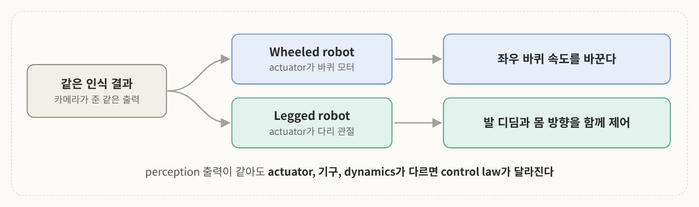
<!-- 슬라이드 3: 지난 시간 -->

지난 시간에는 **visual servoing**이라고 해서 영상 특징을 가지고 로봇 팔을 제어하는 내용을 다뤘고.
이번 시간은 그 제어 앞단의 하드웨어 구성을 보는 시간임.

예를 들어 카메라가 하나 있는데 하나는 바퀴형 로봇에, 하나는 보행 로봇에 달려 있다고 해 봄.

- **바퀴형 로봇**: 좌우 바퀴의 속도를 바꿔야 함
- **legged robot**: 발 디딤과 몸의 방향을 함께 제어해야 함

즉 <mark class="pink">perception의 출력이 같아도 actuator와 기구, dynamics가 다르면 control
law가 달라짐</mark>. Visual Servoing에서 본 로봇 팔이 무엇 위에 올라가느냐도 오늘 이야기와 이어짐.

### 1-2. 복습: 자율주행의 3요소

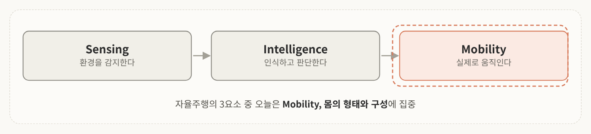
<!-- 슬라이드 4: 자율주행의 3요소 -->

- **Sensing**: 환경을 감지하는 센서 (카메라, LiDAR, IMU, GPS)
- **Intelligence**: 그 센서로 인식하고 판단하는 지능 (위치 추정, 지도 작성, 경로 계획)
- **Mobility**: 실제로 이동하는 몸

오늘은 이 중에서 mobility, 즉 **몸의 형태와 구성**에 집중함. 몸의 형태가 sensing과 intelligence의 조건까지 바꾸기 때문임.

### 1-3. 로봇들은 어디를 어떻게 다니나

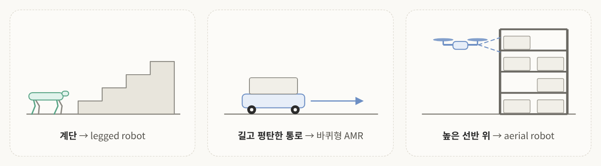
<!-- 슬라이드 5: 로봇들은 어디를 어떻게 다니나 -->

계단도 있고, 평평한 곳도 있고, 공중도 있음. 여기서 중요한 건 로봇의 외형보다 <mark class="mint">바닥,
장애물, 작업의 목적</mark>임. 환경이 다르면 최적의 locomotion도 달라짐.

- **계단 지형**: 보행할 수 있는 legged robot이 유리
- **길고 평탄한 통로**: 바퀴 달린 AMR이 효율적
- **랙이 있고 높은 선반 위 물건을 확인해야 할 때**: 땅에 있는 로봇보다 aerial robot이 유리

### 1-4. "이종 로봇"이란?

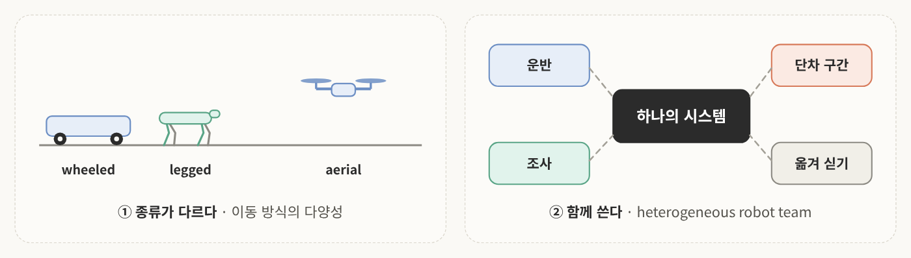
<!-- 슬라이드 6: 이종 로봇이란 -->

이종 로봇은 **heterogeneous robot**, 즉 locomotion 방식이나 형태가 서로 다른 로봇을 말함. 여기에는 두 가지 뜻이 있음.

1. **종류가 다르다**: wheeled robot, legged robot, drone처럼 이동 방식이 다양함
2. **함께 쓴다**: 서로 다른 로봇을 하나의 팀으로 운용함 (heterogeneous robot team)

실제 물류 현장을 생각해 보면, 무거운 물체를 대량으로 평지에서 안정적으로 운반할 때는 AMR을,
선반 상단 재고를 조사할 때는 드론을, 계단이나 단차가 있으면 4족 보행 로봇을 쓸 수 있음. 
이 로봇들이 서로 상호 보완적인 역할을 하면서 결국 그 현장에 맞는 서비스나 시스템을 만들어 내는 것임.

---

## 2. Locomotion의 기본

### 2-1. 접촉, 지지, 추진

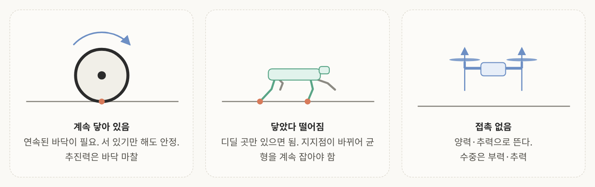
<!-- 슬라이드 7: Locomotion의 기본 -->

**Locomotion**은 몸을 한 장소에서 다른 장소로 옮기는 것을 말함. 
예전에는 바퀴형 로봇을 얘기할 때 locomotion보다 mobility라는 표현을 많이 썼는데, 보행형 
로봇이 나오면서 locomotion이라는 키워드가 대두됐음.

Locomotion은 크게 세 가지로 구별해 볼 수 있음.

| 구분 | Wheeled · Tracked | Legged | Aerial · Underwater |
|---|---|---|---|
| **접촉 방식** | 계속 닿아 있음 → 연속된 바닥 필요 | 닿았다 떨어짐 → 디딜 곳만 있으면 됨 | 접촉 없음 |
| **지지 방식** | 항상 안정 (서 있기만 해도 안 넘어짐) | 걸음마다 지지점이 바뀜 (균형을 계속 잡아야 함) | 유체 안에서 지지 |
| **추진력의 원천** | 바닥 마찰 | 바닥 마찰 | 양력·추력 / 부력·추력 |

즉 어디에 몸을 지지하고, 이동하는 힘을 어디서 얻느냐에 따라 구분되는 것임. 이 세가지가 뒤에 나오는 모든 장단점의 뿌리임.

### 2-2. Locomotion 분류

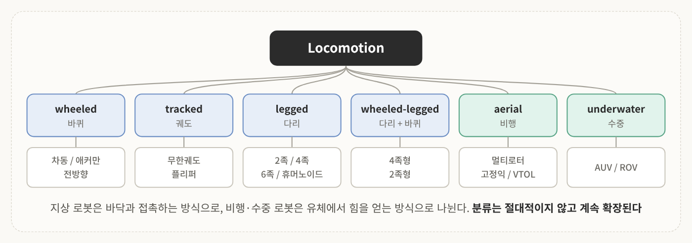
<!-- 슬라이드 10: Locomotion 분류 -->

지상 로봇은 지면과 접촉하는 방식에 따라 **바퀴형(wheeled), 궤도형(tracked), 다리형(legged), 
그리고 이게 섞인 hybrid 타입**으로 나눌 수 있음. 최근에는 다리 끝에 바퀴가 달린 wheeled-legged robot도 있음. 
비행 로봇과 수중 로봇은 유체에서 힘을 얻음.

이게 일반적인 분류이긴 한데 절대적인건 아님. 새로운 이동 체계가 나오면 분류도 확장됨. 
트랙에 플리퍼를 단 형태처럼 조합이 계속 등장하고 있음.

---

## 3. Wheeled robot

### 3-1. 구동 방식 세 가지

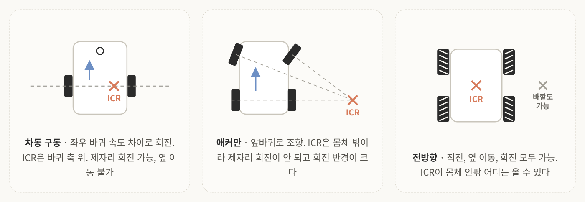
<!-- 슬라이드 11: Wheeled robot 구동 방식 -->

가장 대표적으로 쓰이는 로봇이 바퀴형임. 크게 세 가지로 구분하는데, <mark class="pink">바퀴 배치와 
바퀴 특성이 회전 반경과 이동 자유도를 결정</mark>함.

**차동 구동 (differential drive)** 
왼쪽, 오른쪽 바퀴가 달려 있고(네 바퀴인 경우도 있음) **좌우 바퀴의 속도 차이로 회전**함. 
실내 AMR에서 가장 많이 쓰고 대표적인 예시가 로봇 청소기임. 구조가 아주 단순하고 제자리 회전이 됨. 
다만 꽃게처럼 바로 옆으로 이동하는 건 불가능함.

**애커만 (Ackermann)** 
자동차처럼 앞바퀴로 조향하는 방식임. 고속이나 실외 주행에 유리한데 회전 반경이 커서 좁은 통로에서 불리함.

**전방향 (omnidirectional)** 
보통 Mecanum wheel이나 omni wheel을 씀. 옆으로도, 직진도, 회전도 모든 동작이 됨.

이런 회전을 설명할 때는 **회전 중심이 어디냐**를 봄. 이걸 **ICR**(순간회전중심)이라고 부름.

- 차동 구동: 바퀴 축 위에 있음
- 애커만: 조향각에 맞춰 몸체 외부에 있음. 제자리 회전이 안 되니 당연히 밖에 있어야 함
- Mecanum wheel: 몸체 안에 있을 수도 있고 조작에 따라 외부에도 있을 수 있는 독특한 구성

### 3-2. 옆으로 못 가는 로봇: non-holonomic

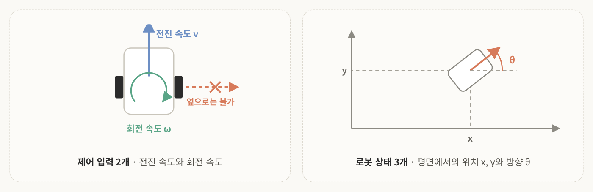
<!-- 슬라이드 12: non-holonomic 제어 입력과 상태 -->

전방향으로 이동하지 못하고 이동의 제약을 받는 로봇을 **non-holonomic** 로봇이라고 함. 차동 구동과 애커만 방식이 그런 예임.

제어 입력은 **전진 속도와 회전 속도, 2개**가 들어감. 그런데 2차원 평면에서 로봇의 상태는 **x, y, 방향(θ), 3개**임. 
상태는 세 개인데 제어 입력은 두 개뿐임.

그래서 목표가 바로 옆에 있어도 바로 못 감. 회전해서 가든가, 후진하듯이 뺐다가 다시 들어가야 함.

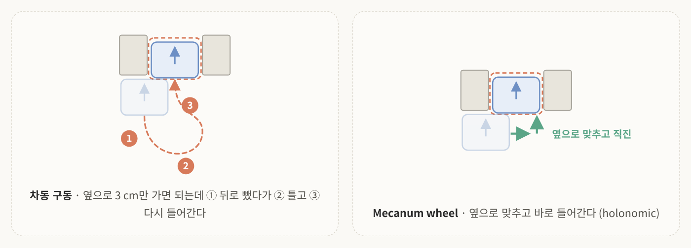
<!-- 슬라이드 12: 도킹 예시. 3 cm 오프셋은 강의 예시이고 그림 비율은 과장 -->

"그냥 그렇게 주행하면 되지 않나요?"라고 할 수 있는데 현장에 가 보면 얘기가 다름. 
예를 들어 충전하려고 도킹 스테이션에 들어가는데 처음에 정렬을 잘못했음. 실제로는 오른쪽으로 **3cm**만 가면 되는데, 
그 3cm 때문에 로봇이 뒤로 뺐다가 우회전했다가 다시 앞으로 들어가야 함.

평행 주차, 충전 스테이션 도킹, 컨베이어 옆 정렬, 좁은 통로 방향 전환이 전부 이 문제임.

반면 Mecanum wheel은 전방향으로 이동할 수 있어서 바로 자리로 들어감. 이런 로봇이 **holonomic**임. 제약을 하드웨어로 없앤 셈.

> 💡 non-holonomic은 "못 가는 곳이 있다"는 뜻이 아니라 "**그 방향으로 바로** 못 간다"는 뜻임. 자동차가 평행 주차로 옆 칸에 들어가듯 앞뒤로 여러 번 움직이면 결국 원하는 위치와 방향에 도달할 수 있음. 대신 그만큼 공간과 시간이 듦.

### 3-3. Mecanum wheel

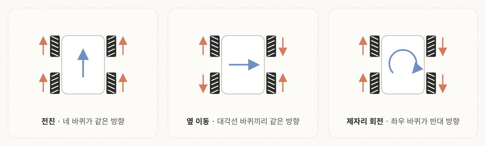
<!-- 슬라이드 13: Mecanum wheel 세 가지 동작. 롤러는 위에서 본 방향 -->

**Mecanum wheel**은 바퀴 둘레에 45도로 기울어진 롤러가 달린 바퀴임. 바퀴 4개의 회전 방향 조합으로 전진도, 
옆 이동도, 제자리 회전까지도 됨. 전방향 이동을 할 수 있는 바퀴로 **omni wheel**이라는 것도 있으니 같이 찾아보면 좋음.

**장점**
- 매우 좁은 공간에서 아주 자유롭게 이동함
- <mark class="mint">정밀하게 위치 정렬</mark>을 할 수 있음. 이게 매우 중요함

**단점**

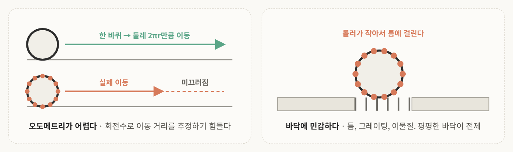
<!-- 슬라이드 13: Mecanum wheel 단점. 미끄러짐 길이는 설명용 -->

- 롤러가 작아서 바닥 틈, 철망 같은 그레이팅, 이물질에 걸리기 쉬움
- 롤러 미끄러짐이 커서 **바퀴 회전수로 이동 거리를 추정(오도메트리)하기 어려움**. 보통 바퀴는 한 바퀴 돌면 외경 둘레만큼 갔다고 하면 되는데, 여기는 롤러가 달려 있어서 한 바퀴 돌아도 그만큼 이동하지 않음
- 무거운 짐을 실으면 진동이나 소음이 커짐. 그래서 팔레트급 AMR에서는 드묾

마지막 건 기계적 설계로 좀 줄일 수 있는데, 앞의 두 가지는 모델링을 잘해도 해결하기 굉장히 어려운 문제임.

즉 평평한 바닥에서는 활용 가치가 매우 높지만 그렇지 못한 환경에서는 활용도가 떨어짐. 이게 2편의 **브라운필드**에서 다시 나옴.

### 3-4. 물류 현장의 AGV와 AMR

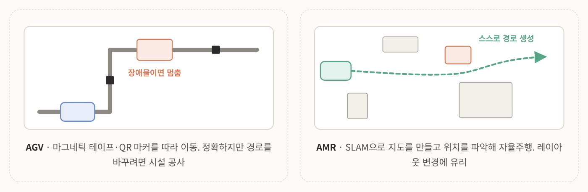
<!-- 슬라이드 14: AGV와 AMR -->
바퀴형 로봇을 두 가지로 나눠서 표현하자면.

- **AGV (Automated Guided Vehicle)**: 바닥의 마그네틱 테이프나 QR 마커를 따라 정해진 경로로 이동함. 따라가기만 하면 되니 정확도가 높을 수밖에 없는데, 경로나 레이아웃을 바꾸려면 시설 공사를 해 줘야 함
- **AMR (Autonomous Mobile Robot)**: SLAM으로 지도를 만들어 위치를 파악하고 스스로 자율주행함. 장애물을 피해 가고 레이아웃 변경에 유리한 대신 위치 정확도는 AGV보다 낮은 편임

적재 형식에 따라 형태도 나뉨.

- **선반 이송형 (KIVA형)**: 선반 아래로 들어가 선반째 운반
- **토트 운반형**: 사람과 같이 다니면서 물건을 담고 빼는 오더 피킹
- **팔레트형 (포크 AMR)**: 팔레트 같은 무거운 짐

사실 현장에서는 AGV가 유지보수가 훨씬 저렴해서, 필요하면 두 가지를 병행하는 곳도 꽤 있음.

> 💡 용어 주의. 물류에서 AGV는 Automated Guided Vehicle이지만, 다른 분야에서는 **Autonomous Ground Vehicle**(지상형 자율 차량)을 AGV라고 부르기도 함.

---

## 4. Tracked robot

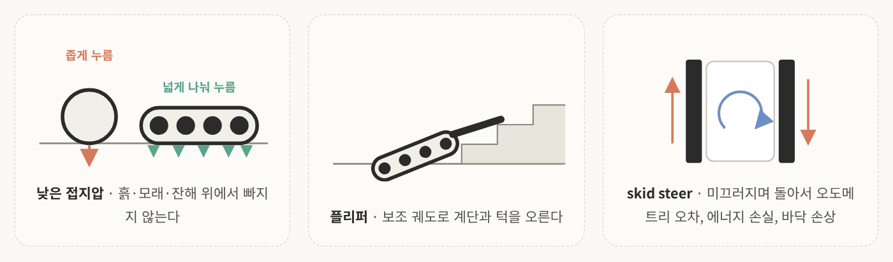
<!-- 슬라이드 15: Tracked robot -->

간혹 바퀴 대신 **무한궤도**(track)로 로봇을 설계하는 경우가 있음. 대부분은 바퀴를 쓰겠지만 비포장이 매우 심한 환경에서는 바퀴만으로 활용도가 높지 않음. 그래서 실내 물류보다는 주로 **재난, 건설, 농업, 국방** 환경에서 씀.

**강점**
- 접지 면적이 넓어 접지압이 낮음. 흙, 모래, 잔해 위에서 빠지지 않음
- **플리퍼**(flipper)라는 보조 궤도가 달린 형태는 어느 정도 높이로 올라갈 수 있어서 계단이나 턱도 오름

**약점**
- 회전할 때는 차동 구동과 비슷하게 양쪽 트랙을 반대 방향이나 다른 속도로 돌려 미끄러뜨림 (**skid steer**)
- 미끄러지면서 도니까 오도메트리 오차가 큼
- 에너지 손실이 있고 바닥도 손상됨
- 당연히 무겁고 느리며 소음이 큼

그래도 바퀴가 주지 못하는 강력한 강점이 있어서 특수한 환경에서는 매우 중요하게 쓰임.

---

## 5. Legged robot

### 5-1. 왜 다리인가

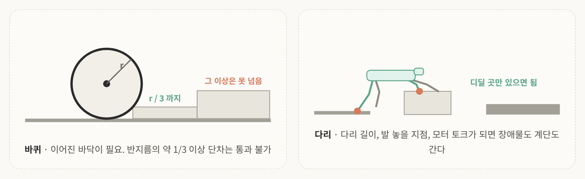
<!-- 슬라이드 17: 왜 다리인가. 왼쪽 그림의 r/3 단차는 비례에 맞춤 -->

최근 가장 많이 나오는 로봇 중 하나가 다리형 로봇임 그냥 **legged robot**이라고 부름.

바퀴는 이어진 바닥이 필요함. 불규칙하면 주행을 못 하고, 특히 **바퀴 반지름의 3분의 1 이상 되는 단차**는 통과할 수 없음.

하지만 legged robot은 다리가 구조물을 넘을 수 있는 높이가 되고, 발 놓을 지점이 있고, 올라갈 만큼 모터 토크가 충분하면 장애물도 계단도 이동할 수 있음.

대신 치르는 대가가 있다.

- 구조가 복잡하고 제어가 어렵고 액추에이터가 많아짐
- <mark class="pink">서 있기만 해도 에너지를 씀</mark>

두 번째가 재밌는 부분인데 바퀴형 로봇은 안정한 상태로 지지하고 있으니까 가만히 있을 때는 에너지 소비가 거의 없음. 하지만 legged robot은 그 양이 아주 크진 않아도 균형을 위해 계속 에너지를 씀. 4족 보행 로봇 위에 뭘 싣거나 무게중심이 안 맞으면 다리들을 지속적으로 조절해야 함.

### 5-2. 다리 수와 균형

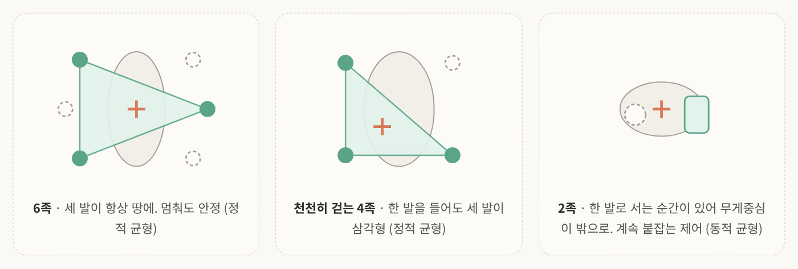
<!-- 슬라이드 18: 다리 수와 균형. 초록은 땅에 닿은 발과 지지 다각형, 십자는 무게중심 -->

건축이나 구조 설계에서도 나오는 개념인데, **support polygon**(지지 다각형)이 중요함. 무게중심이 각 발들이 만드는 다각형 안에 있느냐 없느냐로 안정성을 평가함. 위 그림에서 초록 영역이 지지 다각형, 주황 십자가 무게중심임.

**정적 균형 (static stability)** 
움직이지 않는 상태에서 무게중심이 support polygon 안에 있으면 넘어지지 않음.

- **Hexapod robot**: 세 발을 항상 땅에 두는 삼각 보행을 함. 점이 3개면 면이 하나 나오니까 나머지 발이 떠 있어도 멈춰서 안정적임
- **천천히 걷는 4족 보행 로봇**: 한 발을 들면 나머지 세 발이 삼각형을 만듦. 무게중심이 그 안에 또는 근접하게 위치하도록 설계해서 정적 균형을 유지함

**동적 균형 (dynamic stability)** 
- **2족 보행 로봇**: 한 발로 서 있는 순간이 반드시 있음. 무게중심이 계속 흔들려서 넘어지려는 걸 계속 붙잡는 형태로 제어해야 함
- **뛰는 4족 보행 로봇**: 발을 빠르게 움직이니까 발이 모두 떠 있는 순간이 있음. 그래서 균형 설계가 매우 중요함

2족 보행에서는 예전에 로봇 축구 대회 같은 데서 쓰던 **ZMP(Zero Moment Point)** 제어도 있었음. 동적 균형에서 모먼트가 0이 되는 포인트가 유지되도록 제어하는 기술임. 개론에서는 이름만 알고 넘어가면 됨.

정리하면 정적인 경우는 무게중심을 support polygon 안에 두고, support polygon을 구성할 수 없을 만큼 동적인 경우는 움직이는 순간순간 다각형을 일시적으로 만들어서 그 안으로 무게중심이 들어오도록 제어함. 다리 수가 많을수록 균형은 쉽지만 무게, 비용, 복잡도는 늘어남.

### 5-3. Gait (보행 패턴)

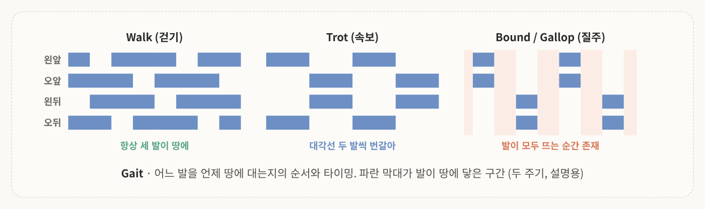
<!-- 슬라이드 19: Gait 다이어그램. 타이밍은 설명용 -->

**Gait**는 보행 패턴임. 왼쪽 앞, 오른쪽 앞, 왼쪽 뒤, 오른쪽 뒤, 어느 발을 언제 땅에 대는지의 순서와 타이밍을 말함. 요즘 4족 보행 로봇을 사면 이런 gait 제어가 이미 내부에 설계되어 들어가 있음.

- **Walk (걷기)**: 한 발씩 차례대로 이동해서 항상 세 발이 땅에 있음. 느리지만 안정적
- **Trot (속보)**: 대각선 두 발씩 번갈아 이동. quadruped의 가장 기본적인 이동임. 살짝 두 발이 떠 있어도 다음 발이 딛는 시점에 support polygon이 구성됨
- **Bound / Gallop (질주)**: 앞뒤 두 발씩 움직여서 발이 모두 뜨는 순간이 있음. 매우 빠르지만 무게중심이 흐트러지기 전에 발을 딛어야 해서 불안정함

빠를수록 발이 땅에 닿는 시간이 짧고 균형 잡기가 어려움. 그래서 치타나 개의 동작을 따라 하는 보행 제어도 많이 연구되고 있음. 지형과 속도에 따라 gait를 바꾸는 게 legged robot 제어의 기본 문제임.

### 5-4. 학습으로 걷는 로봇

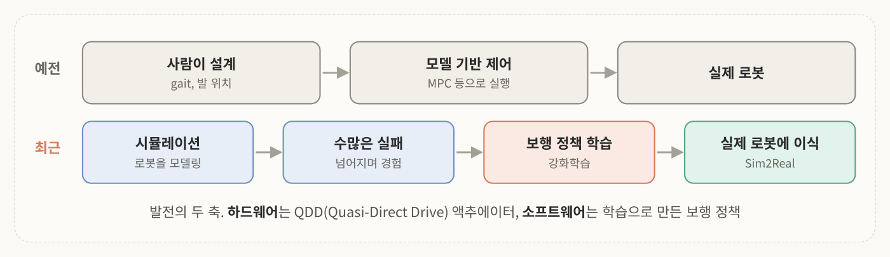
<!-- 슬라이드 20: 학습으로 걷는 로봇 -->

보행 로봇이 빠르게 발전한 근거는 두 가지임.

첫째는 **하드웨어 개선**임. **QDD(Quasi-Direct Drive)** 모터라는 게 있는데, MIT에서 개발한 치타(Cheetah)를 찾아보면 됨. 이런 말랑말랑한(backdrivable) 액추에이터가 나오면서 보행 로봇이 굉장히 빠르게 개발됐음.

둘째는 **강화학습과 Sim2Real**임. 기존에는 사람이 발 위치와 gait를 설계하고 MPC 같은 모델 기반 제어로 실행했음. 최근에는 로봇을 시뮬레이션으로 모델링하고 굉장히 많은 실패를 경험하게 하면서 보행 정책을 학습시킨 뒤 실제 로봇에 이식함. <mark class="mint">다양한 시행착오를 이미 경험한 정책</mark>이라 굉장히 안정적으로 적용할 수 있음.

슬라이드 기준으로는 ETH Zurich가 2020년에 진흙, 눈, 잔해 위에서도 넘어지지 않는 보행을 Science Robotics에 냈고, 2022년에는 카메라와 LiDAR로 지형을 보면서 걷는 보행이 나왔음. 4족 로봇이 얼음판, 자갈, 계단에서 안정적으로 걷게 된 이유임. 자세한 내용은 4주차(Sim2Real)와 5주차(강화학습)에서 이어짐.

> 💡 "backdrivable"은 바깥에서 힘을 주면 모터가 거꾸로 밀려 돌아간다는 뜻임. 감속비가 큰 일반 모터는 바깥 힘으로 잘 안 돌아가서 착지 충격이 그대로 기어로 들어가는데, QDD는 감속비를 낮춰서 충격을 흡수하고 토크를 빠르게 제어할 수 있음. 그래서 발이 땅에 부딪히는 일이 잦은 다리에 잘 맞음.

### 5-5. Quadruped robot 사례

4족 보행 로봇은 **플랜트 현장 점검, 순찰, 데이터 수집**에 많이 씀. 계단과 다층 이동이 되고 열화상이나 가스 센서를 등에 얹기 좋아서, 물건을 나르는 용도보다는 "보러 가는" 용도로 자리 잡는 중임.

대표적으로 Boston Dynamics의 **Spot**, 스위스 ANYbotics의 **ANYmal**, 중국 **Unitree**의 로봇이 있고 국내에서는 **레인보우로보틱스**가 대표적임.

### 5-6. 잠깐 정리

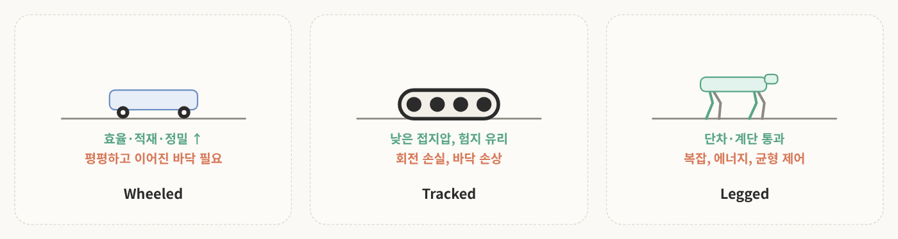
<!-- 슬라이드 22: 잠깐 정리 -->

| 방식 | 강점 | 약점 |
|---|---|---|
| **Wheeled** | 효율, 적재, 정밀 | 평평하고 이어진 바닥 필요 |
| **Tracked** | 낮은 접지압, 험지 | 회전 손실, 바닥 손상 |
| **Legged** | 단차·계단 통과 | 관절이 많고 에너지 소모, 균형 제어 |

Hexapod와 quadruped는 정적 균형이 되고 biped는 동적 균형이 필수임. 그리고 학습 기반 보행으로 실용 수준에 도달했음.

---

## 6. Humanoid robot

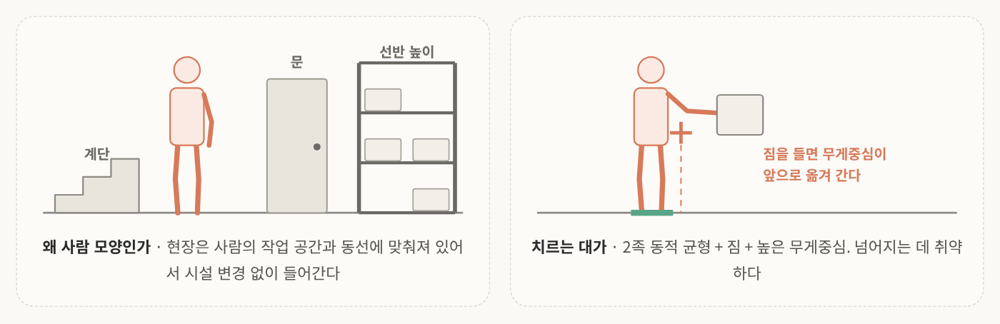
<!-- 슬라이드 23: Humanoid robot -->

최근 많이 소개되는 **휴머노이드 로봇**은 두 다리와 두 팔을 가진 로봇임. 다른 말로 biped(2족 보행 로봇)라고도 하는데, biped는 2족 보행까지고 휴머노이드는 상체(팔과 손)까지 있는 것임.

항상 나오는 질문이 "왜 굳이 사람 형태로 만드는가"임. 답은 간단함. <mark class="pink">대부분의 산업 현장은 사람의 작업 공간과 동선에 맞춰 설계되어 있음</mark>. 로봇을 사람 형태로 만들면 시설 변경 없이 현장에 넣을 수 있음.

한계도 뚜렷함.

- 2족 동적 균형이 쉽지 않음
- 물건을 들면 무게중심이 달라져서 제어가 훨씬 어려워짐
- 무게중심이 위에 있고 무거워서 넘어지는 데 매우 취약함

다만 최근 제어 기술이 발달하면서 많이 개선되고 있음. 그리고 용도가 갈리고 있음. 4족 보행 로봇은 이동이나 센서를 많이 달아 점검하는 태스크에, 휴머노이드는 **사람의 작업을 대체할 수 있느냐**는 관점에서 많이들 봄.

**사례**
- **Agility Robotics Digit**: 물류센터 토트 운반 실증. 2편에서 자세히 나옴
- **Boston Dynamics Atlas (전동형)**:  2026년 생산 시작, 현대차 로보틱스 메타플랜트 우선 투입. 리프팅 약 30kg급, 배터리 교체형
- **Figure AI, Apptronik, Unitree, 국내 기업**: 공장과 물류 환경에서 실증 진행 중

사실 아직 명확한 사례가 있다기보다는 "이런 식으로 쓸 수 있다"라고 주장하고 활용도를 파악하는 단계임. 
아직 사람 옆에서의 안전 규격이 없어서 실증도 분리된 구역에서 함.

---

## 7. Wheeled-legged robot

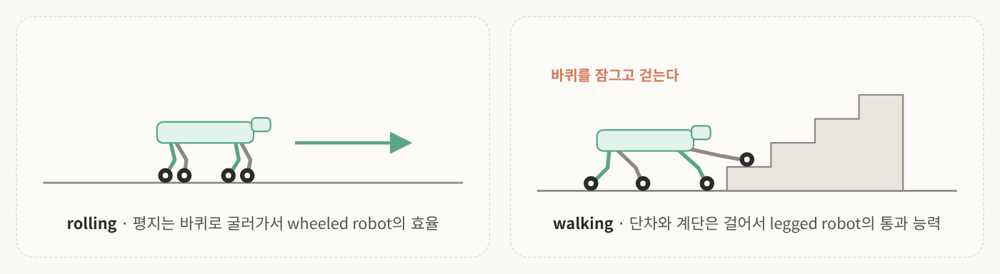
<!-- 슬라이드 25: Wheeled-legged robot 원리 -->

앞에서 새로운 형태도 나온다고 했는데, 바로 **다리 끝에 구동 바퀴를 단 로봇**임. Unitree 같은 여러 로봇 회사에서 많이 제안하고 있음.

- **평지**: 바퀴로 굴러가서(rolling) wheeled robot과 같은 효율
- **계단, 단차**: 바퀴를 잠그고 걸어감(walking)

바퀴의 약점(단차)과 다리의 약점(효율)을 서로 보완하려는 시도임. 4족 형태도 있고 biped 형태도 있음. 예전 보행 형태에서는 몸을 낮추면 이동이 어려웠는데, 이제는 바퀴로 굴러갈 수 있으니 몸을 낮춰서 아주 낮게도 이동할 수 있음.

**사례**
- **RIVR**: 라스트마일 배송에 wheeled-legged robot을 활용. ETH Zurich 연구실 창업 기업(구 Swiss-Mile)이고, 평지에서 최고 약 15km/h로 달리다 현관 계단이나 연석을 만나면 걸어 오름. 2026년 3월에 아마존이 인수함
- **Ascento**: 다리에 바퀴를 단 2족 형태의 순찰 로봇. 계단은 점프로 통과함
- **ANYmal on wheels**: ANYbotics의 ANYmal에 바퀴를 달아 실증

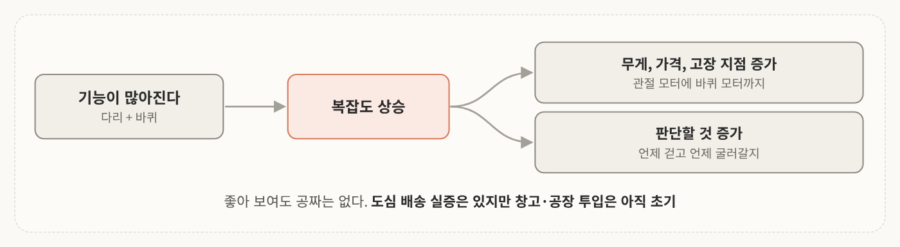
<!-- 슬라이드 27: Wheeled-legged robot 한계 -->

너무 좋아 보이는데 당연히 한계도 있음.

기능이 많아지면 복잡도가 올라가고, 그러면 무게, 가격, 고장 날 수 있는 지점이 모두 늘어남. 언제 걷고 언제 굴러갈지 판단할 것도 많아지고, 그러려면 지형을 미리 인식해야 해서 제어 문제이면서 인지 문제가 됨.

그리고 아직은 "현장에 이게 있으면 좋겠다"는 주장에 가깝고 실제로 공장에 투입된 건 많지 않음. 배송 정도에는 필요할 수 있는데, 실제 산업 환경이 이런 아주 복잡한 이동 특성을 필요로 하느냐 하면 아직은 그렇게 보기 어려움.

| | Wheeled | Legged | Wheeled-legged |
|---|---|---|---|
| **평지 효율·속도** | 유리 | 불리 | 유리 (rolling) |
| **단차·계단** | 불리 | 유리 | 유리 (walking) |
| **적재** | 유리 | 보통~불리 | 보통 |
| **복잡도·가격** | 낮음 | 높음 | 가장 높음 |
| **현장 실적** | 성숙 | 점검 분야 정착 | 초기 |

즉 wheeled-legged robot은 어느 한쪽의 최고치를 갖는 게 아니라 **둘 사이의 절충**임.

---

## 8. 그 밖의 로봇

### 8-1. Aerial robot

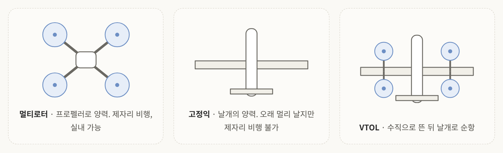
<!-- 슬라이드 28: Aerial robot -->

Aerial robot은 물류 로봇에 넣을 수도 뺄 수도 있는데, 물류 환경에서 쓸 수 있으니 이종 로봇에 포함해서 봄.

| | 멀티로터 | 고정익 | VTOL |
|---|---|---|---|
| **양력** | 프로펠러 | 날개 | 프로펠러 + 날개 |
| **제자리 비행** | 가능 | 불가 | 가능 |
| **비행 시간·거리** | 짧음 (20~40분급) | 김 | 중간 |
| **실내 사용** | 가능 | 불가 | 제한적 |
| **물류 용도** | 재고 조사, 근거리 | 장거리 배송·측량 | 중거리 배송 |

물류 환경에서는 주로 멀티로터 드론을 재고 조사에 쓰고, 실외 배송은 아마존이 실증해 보려고 한 적이 있음. 실외에는 GPS가 있지만 실내에는 없으니 카메라나 다른 센서로 위치를 추정하면서 운용함. 자세한 내용은 7주차 항공 분야 AI에서 이어짐.

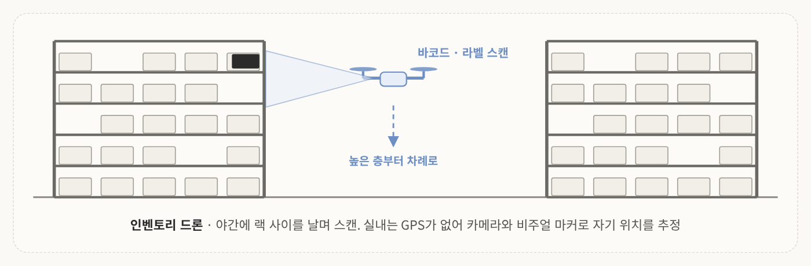
<!-- 슬라이드 29: Inventory drone -->

실제로 **인벤토리 드론**이라고 해서 야간에 창고 랙 사이를 다니면서 바코드나 라벨을 스캔하고 지속적으로 점검하는 로봇이 있음. 사람이 리프트를 타고 올라가던 작업을 대체함. GPS가 없으니까 카메라나 비주얼 마커로 자기 위치를 추정하는 경우가 많음.

슬라이드의 표현이 좋음. 이동 로봇이 못 가는 <mark class="mint">"수직 방향"을 맡는다</mark>는 점에서 이종 로봇 팀의 한 축임.

### 8-2. 수중 · 특수 환경 로봇

직접 접할 일은 많지 않지만 수중, 수상 로봇도 있음. 물속에서는 전파가 통하지 않아 음향 통신을 쓰고 GPS도 없어서 위치 추정이 어려움. 파이프나 벽을 타는 **wall-climbing** 로봇처럼 자석이나 흡착으로 붙어서 설비를 검사하는 로봇도 있음.

### 8-3. Mobile manipulator: 이동 + 조작

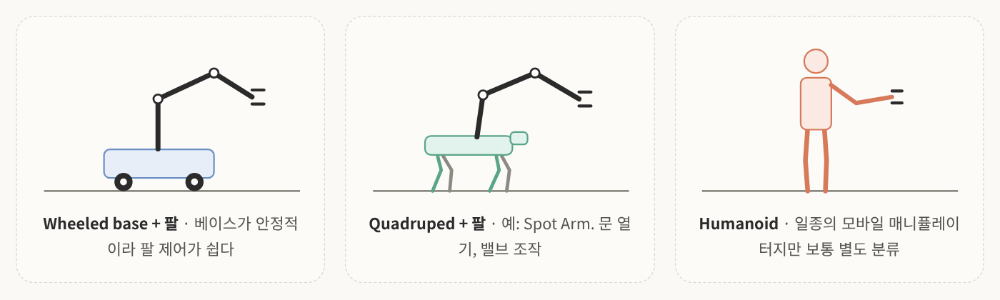
<!-- 슬라이드 31: Mobile manipulator -->

모바일 로봇도 들어 봤고 매니퓰레이터, 협동 로봇도 들어 봤을 텐데, 이 둘을 붙인 게 **모바일 매니퓰레이터**임. 이동하는 몸체와 조작하는 상체가 같이 있음.

- **Wheeled base + 팔**: 베이스가 안정적이라 팔 제어가 쉬움. 닿는 높이는 고정. 물류 피킹, 공장 내 부품 이송
- **Quadruped + 팔** (Spot Arm 등): 문 열기, 밸브 조작, 계단 너머의 작업
- **Humanoid**: 엄밀히 말하면 모바일 매니퓰레이터의 일종이지만 보통 별도 카테고리로 분류함

1주차 visual servoing이 바로 이 "팔"의 제어임. 팔이 무엇 위에 올라가느냐에 따라 문제가 달라짐. 베이스가 흔들리면 카메라도 흔들리고, 팔을 뻗으면 베이스의 균형이 바뀜.

---

## 9. 어떤 로봇을 고를 것인가

### 9-1. 작업에서 출발하기

<!-- 슬라이드 32: 어떤 로봇을 고를 것인가 -->

여러 형태를 봤는데 결국 어떤 로봇을 고를지는 **어떤 작업을 할 것인가**에 달려 있음.

<mark class="pink">로봇을 먼저 정하고 작업을 맞추는 게 아니라, 작업을 먼저 보고 거기에 맞는 로봇을 고르는 것</mark>이 중요함. 볼 것은 세 가지임.

- **무엇을 나르나**: 무게, 크기, 취급 방식 (토트, 팔레트, 낱개)
- **어디를 다니나**: 바닥 상태, 단차, 경사, 층간 이동, 통로 폭
- **얼마나 자주, 빨리**: 시간당 처리량, 운용 시간

### 9-2. 생각해 보기: 이 현장에는 어떤 로봇이?

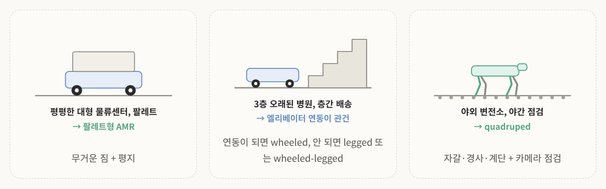
<!-- 슬라이드 33: 생각해보기 -->

오프라인 수업이었으면 물어봤을 거라고 한 문제임. 정답보다 **왜 그렇게 나왔는지**를 보면 됨.

1. **평평한 대형 물류센터, 팔레트 이송**: 무거운 짐 + 평지니까 팔레트형 AMR이 자연스러움
2. **3층짜리 오래된 병원, 층간 물품 배송**: 엘리베이터 연동이 되면 wheeled robot, 안 되면 계단을 갈 수 있는 legged robot이나 wheeled-legged robot. 근데 처리량은?
3. **야외 변전소, 야간 점검**: 자갈, 경사, 계단에 카메라 점검까지 있으니 quadruped가 많이 쓰임

### 9-3. Locomotion 방식별 정리표

| 방식 | 접촉 방식 | 강점 | 약점 | 주 용도 |
|---|---|---|---|---|
| **Wheeled** | 계속 접촉, 굴림 | 효율·적재·정밀·저비용 | 단차·험지 불가, 바닥 상태에 민감 | 실내 물류 AMR, 자율주행차 |
| **Tracked** | 면 접촉, 미끄러지며 회전 | 낮은 접지압, 험지·계단 | 회전 손실, 바닥 손상, 소음 | 재난·건설·농업·국방 |
| **Legged** | 불연속 접촉 | 단차·계단·잔해 통과 | 복잡·고가, 에너지, 균형 제어 | 점검·순찰, 사람 작업 |
| **Wheeled-legged** | 굴림 + 불연속 접촉 | 효율과 통과 능력의 절충 | 가장 복잡, 모드 전환 판단 | 도심 배송, 순찰 |
| **Aerial** | 접촉 없음 (양력) | 지면 제약 없음, 수직 접근 | 짧은 비행 시간, 적은 적재, 실내 안전 | 재고 조사, 측량, 배송 |
| **Underwater** | 접촉 없음 (부력·추력) | 수중 작업 가능 | 통신·위치 추정 어려움 | 해양 조사, 설비 검사 |

---

## 10. 핵심 요약

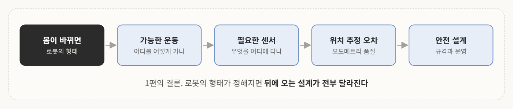
<!-- 직접 만든 그림: 1편 정리 -->

1. **Locomotion은 접촉, 지지, 추진으로 나뉜다**: 어디에 닿고, 어떻게 버티고, 힘을 어디서 얻는가
2. **Wheeled robot**: 차동, 애커만, 전방향. 바퀴 배치가 회전 반경과 자유도를 정함
3. **Non-holonomic**: 입력 2개, 상태 3개라서 옆으로 바로 못 감. Mecanum wheel이 이걸 없애지만 바닥과 오도메트리에 약함
4. **Tracked robot**: 낮은 접지압으로 험지를 가지만 skid steer의 대가를 치름
5. **Legged robot**: 디딜 곳만 있으면 가는 대신 균형이 핵심. 정적 균형은 support polygon, 동적 균형은 계속 붙잡기
6. **Gait와 학습**: QDD 액추에이터와 Sim2Real이 보행 로봇을 실용 수준으로 끌어올림
7. **Humanoid robot**: 시설 변경 없이 들어가는 게 판매 논리. 동적 균형과 안전이 숙제
8. **Wheeled-legged robot**: 바퀴와 다리의 절충. 복잡도가 대가
9. **고르는 순서**: 로봇이 아니라 작업에서 출발

>한 줄로 묶으면  
>**로봇의 몸은 물리적 제약의 집합이고, 어떤 몸을 고를지는 작업과 환경이 정한다.**

그럼 다음 질문은 이거임. 후보를 **어떤 기준으로 비교**하고, **실제 현장에 넣으면 뭐가 문제**가 되는가? 이어지는 2편에서 다룸.

---

## 참고문헌
- 조영근, 「Physical AI 개론 2 2주차: 이종 로봇의 형태와 이동 특성」, 인하대학교 전기전자공학부 / AI로봇 융합전공 강의 자료.
- Siegwart, R., Nourbakhsh, I. R., & Scaramuzza, D. (2011). *Introduction to Autonomous Mobile Robots* (2nd ed.). MIT Press.
- Raibert, M. H. (1986). *Legged Robots That Balance*. MIT Press.
- Kajita, S., Hirukawa, H., Harada, K., & Yokoi, K. (2014). *Introduction to Humanoid Robotics*. Springer.
- Lee, J., Hwangbo, J., Wellhausen, L., Koltun, V., & Hutter, M. (2020). Learning quadrupedal locomotion over challenging terrain. *Science Robotics*, 5(47).
- Miki, T., Lee, J., Hwangbo, J., Wellhausen, L., Koltun, V., & Hutter, M. (2022). Learning robust perceptive locomotion for quadrupedal robots in the wild. *Science Robotics*, 7(62).
- Bjelonic, M., Bellicoso, C. D., de Viragh, Y., Sako, D., Tresoldi, F. D., Jenelten, F., & Hutter, M. (2019). Keep Rollin': Whole-body motion control and planning for wheeled quadrupedal robots. *IEEE Robotics and Automation Letters*, 4(2).
- [SiliconANGLE (2026.3.20) – Amazon acquires last-mile delivery robot startup Rivr](https://siliconangle.com/2026/03/20/amazon-acquires-last-mile-delivery-robot-startup-rivr/)