## 들어가며

1편에서 로봇의 형태를 하나씩 봤다면, 2편은 **그 로봇들을 어떻게 비교하고, 실제 현장에 넣으면 뭐가 문제가 되고, 여러 종류를 어떻게 같이 쓰는가**임.

앞에서는 구조적 특징을 봤음. 이제 동일한 질문을 모든 로봇 타입에 던져 놓고 비교할 차례임. 그리고 시선을 제품 사양표에서 필드로 옮김. 교수님 표현을 빌리면 이거임.

> **아무리 좋은 로봇도 실제 동선의 작은 제약 조건을 통과하지 못하면 쓸 수 없다**

2편 흐름은 이렇게 감.
1. **비교 기준 8가지**: 지형, 속도, 적재, 에너지, 안정성, 정밀도, 인식, 안전과 비용
2. **현장에서는 무엇이 문제인가**: 브라운필드의 바닥, 단차, 층간 이동, 통로, 통신, 운영
3. **여러 종류의 로봇을 함께 쓰기**: 역할, 공통 지도, 넘기는 지점, 인터페이스

---

## 1. 비교 기준 8가지

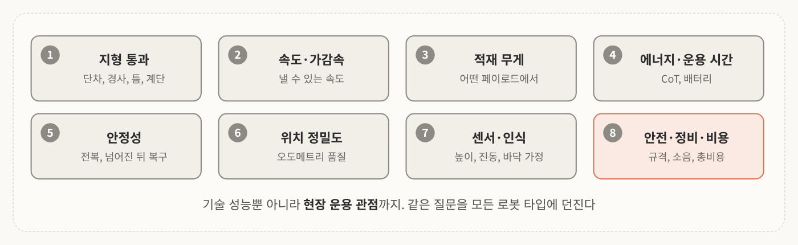
<!-- 슬라이드 36: 비교 기준 8가지 -->

환경에 따라 로봇을 어떻게 고를지 볼 때 쓰는 기준은 8가지 정도임. 단순한 기술 성능뿐 아니라 현장 운용 관점까지 포함함.

1. 지형 통과 능력 (traversability)
2. 속도와 가감속
3. 적재 무게
4. 에너지 효율과 운용 시간
5. 안정성
6. 위치 정밀도와 오도메트리 품질
7. 센서 · 인식 관점의 특성
8. 안전 규격, 소음, 정비, 비용

과제도 이 8가지 기준을 그대로 쓰니까 각 기준마다 근거(수치, 출처)를 적는 연습을 해 보라고 함.

### 1-1. 기준 1: 지형 통과 능력

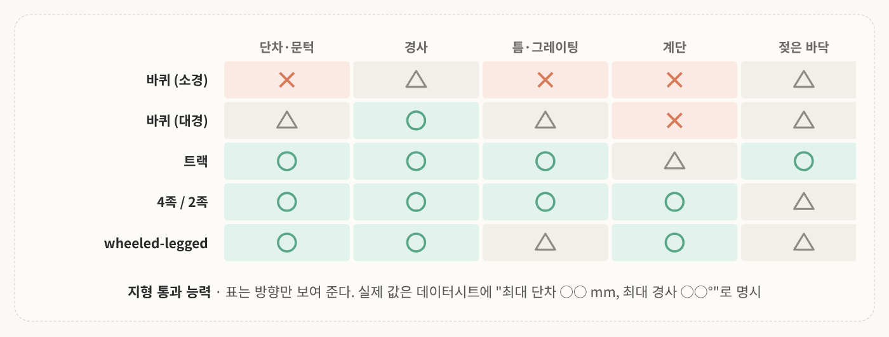
<!-- 슬라이드 37: 지형 통과 능력 표 -->

- **Wheeled robot**: 경험적으로 바퀴 반지름의 약 3분의 1 이하 단차까지 통과한다고 많이 얘기함. 서스펜션 여부에 따라서도 달라지고 바퀴가 클수록 유리함. 땅에 붙어 가는 AMR은 소형 캐스터가 달려 있어서 문턱 같은 데서 한계가 있음. 경사는 보통 5~10% 이하를 권장함
- **Tracked robot**: 트랙 길이보다 작은 틈은 통과하고, 플리퍼가 있으면 어느 정도 단차와 계단까지 극복함
- **Legged robot**: 다리 길이에 비례해 단차와 계단을 통과함. 다만 지면에 항상 닿아 있지 않아서 접촉면 안정성이 떨어지고, 바닥이 젖으면 위험도가 매우 높아짐
- **Wheeled-legged robot**: walking mode는 legged robot, rolling mode는 wheeled robot과 비슷함

표는 대략적인 방향만 보여 주는 것임. 실제 제품은 데이터시트에 "최대 단차 ○○mm, 최대 경사 ○○°"처럼 값이 나와 있음.

> 💡 경사 단위를 조심해야 함. 강의의 5~10%는 수평 100m에 5~10m 오른다는 뜻이고, 각도로 바꾸면 약 2.9~5.7°임. 데이터시트의 ° 값과 비교할 때 %와 섞으면 안 됨.

> 💡 "트랙 길이보다 작은 틈"은 상한에 가까운 표현으로 보면 됨. 무게중심이 틈을 건너기 전에 앞쪽이 건너편에 닿아야 해서, 실제 값은 트랙 길이보다 꽤 짧을 수 있음. 이것도 정확한 건 데이터시트로 확인.

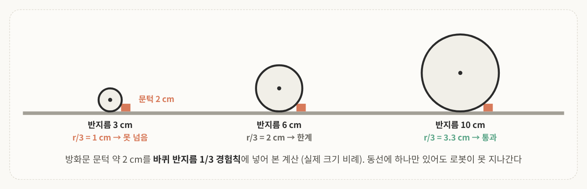
<!-- 슬라이드 38: 문턱 하나에 멈춘 AMR. 그림의 계산은 r/3 경험칙을 적용한 예시 -->

실제 AMR을 운용할 때 이런 문제가 특히 많이 나옴. 산업 현장 보안 이슈 때문에 강의 자료에는 현장 사진을 AI로 재구성한 그림이 들어가 있는데, 내용은 이거임.

현장은 로봇을 크게 고려하지 않고 만들다 보니 청소하기 편하려고 만든 아주 작은 단차 같은 게 의외로 많음. **방화문 문턱(약 2cm), 배수로 그레이팅, 도크 램프**가 빈번하게 있음. 로봇을 안정적으로 만들려고 지면에 딱 붙어 가도록 설계했다면 이런 환경에서 극복이 어려움.

<mark class="pink">단차 자체는 작아도 동선에 하나만 있으면 로봇이 못 지나감.</mark>

> 💡 위 그림은 r/3 경험칙에 문턱 2cm를 넣어 본 계산임. r/3 ≥ 2cm니까 바퀴 반지름이 최소 6cm(지름 12cm)는 되어야 함. 2cm가 왜 무서운 숫자인지 보임.

### 1-2. 기준 2, 3: 속도와 적재

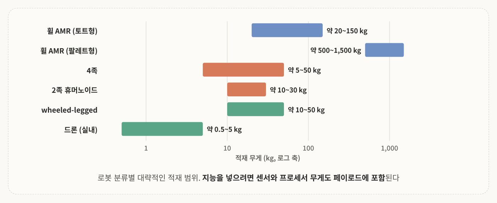
<!-- 슬라이드 39: 적재 범위 그래프를 슬라이드 값 그대로 다시 그림 -->

핵심은 <mark class="mint">어떤 페이로드에서 어떤 속도로 주행할 수 있느냐</mark>임.

- **Wheeled robot**: 속도와 적재 모두 유리함. 토트형 AMR은 수십~150kg급, 팔레트형은 톤급까지 감. 속도는 1~2m/s 정도. 고속도 되지만 AMR은 아주 빠르게 움직인다기보다 무거운 무게를 안정적으로 운용하는 게 가장 큰 장점임
- **Quadruped robot**: 적재는 보통 수~수십kg인데 수십kg도 사실 매우 큰 것임. 움직이면서 운반할 수 있는 최대 페이로드는 보통 20~30kg 정도로 봄. 속도는 1~1.5m/s
- **Humanoid robot**: 아주 무겁게 해도 10~30kg 정도가 최대임. 보행 자체의 안정성이 떨어져서 아직 안정적으로 무게를 들고 옮기는 형태로 쓰이고 있지는 않음. 걷는 속도는 1m/s 안팎
- **Drone**: 수 kg 이하. 재고 조사는 "보는" 작업이 위주라서 무거운 페이로드보다 가볍고 여러 대를 빠르게 쓰는 걸 목표로 함. 실외 배송으로 가면 kg 단위 페이로드가 필요함

여담인데 중요한 얘기가 하나 있음. Physical AI 수업에서 하는 건 결국 이런 몸에 인텔리전스를 넣는 일임. 지능을 넣으려면 센서도 달고 프로세서도 달아야 함. 그래서 <mark class="pink">인식을 위한 처리 장치까지 적재 무게에 포함</mark>해서 봐야 함.

### 1-3. 기준 4: 에너지 효율 (Cost of Transport)

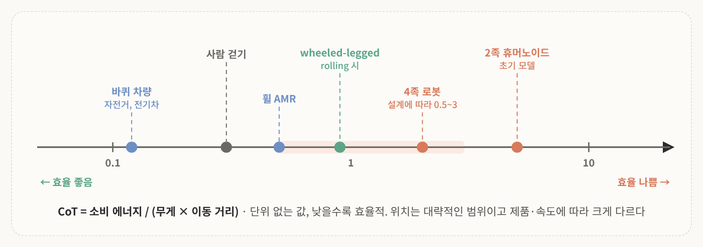
<!-- 슬라이드 40: CoT 축. 점 위치는 슬라이드의 대략적인 값을 로그 축으로 다시 그림 -->

오늘의 유일한 수식임. 로봇 모델링을 수식으로 들어가면 회전 중심축, 바퀴 외경, 기구학까지 다 봐야 해서 굉장히 복잡해짐. 이번 강의는 개론이고 운용 관점이니까 활용에 필요한 것만 보는데, 그중 가장 중요한 게 에너지 효율임.

$$
\mathrm{CoT} = \frac{\text{소비 에너지}}{\text{무게} \times \text{이동 거리}}
$$

**CoT**(Cost of Transport)는 무게와 이동 거리 대비 소비한 에너지임. 단위 없는 무차원 값이고 **낮을수록 효율적**임.

동물, 사람, 차량을 한 축에 놓고 보려고 나온 예전 지표(Tucker, 1975)를 로봇에 대입한 것임. 에너지만 보면 큰 로봇이 불리하니까 무게와 거리로 나눠서 정규화한 것이고, 같은 임무에서 CoT가 낮으면 같은 배터리로 더 멀리 갈 가능성이 큼.

보통 wheeled 기반 로봇은 CoT가 낮고, legged robot은 관절 유지와 발 충격 때문에 높음. 대략적인 순서는 **wheeled vehicle < 사람 걷기 < legged robot**임. 다만 MIT Cheetah처럼 설계에 따라 동물 수준까지 내려온 사례도 있어서, gait와 설계에 따른 차이가 큼.

주의할 점이 두 가지 있음.

- <mark class="pink">이게 항상 정답은 아님</mark>. 여러 로봇을 하나의 정량 지표로 간략하게 표현한 것이고 절대적이지 않음
- 드론이나 수중 로봇까지 넣으면 지지 방식이 달라서 수치를 그대로 비교하기 어려움. 맥락을 이해하고 써야 하는 예시 지표임

> 💡 분모의 "무게"가 질량 m이 아니라 힘 mg일 때 무차원이 됨. 즉 CoT = E / (mgd)이고 에너지(J)를 힘 × 거리(N·m = J)로 나누니 단위가 사라짐. 질량으로 나누면 J/(kg·m)가 되니 자료를 볼 때 확인해야 함.
>
> 감을 잡아 보면, 50kg 로봇이 1km를 갈 때 CoT가 2면 2 × 50 × 9.8 × 1,000 ≈ 980kJ, 약 272Wh임. CoT가 0.5면 약 68Wh임. 같은 배터리로 네 배 차이가 남.

### 1-4. 기준 4: 운용 시간과 충전

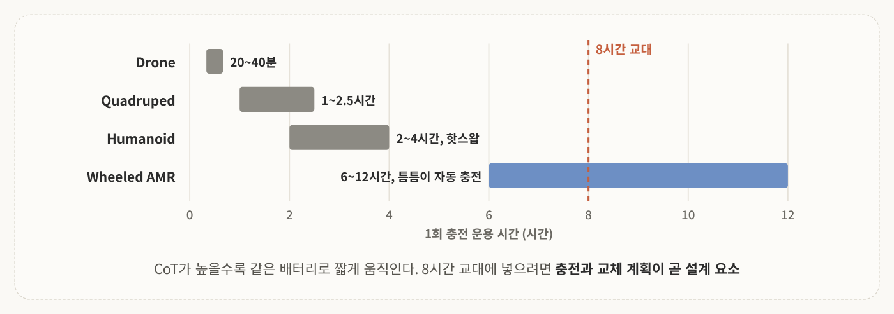
<!-- 슬라이드 41: 운용 시간 범위를 슬라이드 값으로 그림 -->

CoT가 높을수록 같은 배터리로 짧게 움직임.

- **Quadruped robot**: 1회 충전 약 1~2.5시간
- **Humanoid robot**: 약 2~4시간, 배터리 교체(핫스왑)로 보완
- **Wheeled AMR**: 6~12시간, 틈틈이 자동 충전
- **Drone**: 20~40분. 항상 나오는 얘기인데 떠 있을 수 있는 시간이 많지 않아서, 저렴한 드론을 여러 대 운용하는 형태로 많이 계획함

여기서 교수님이 강조한 게 **도입의 관점**임. 로봇을 도입하느냐 마느냐는 결국 기존 비용을 얼마나 줄일 수 있느냐로 결정됨. 그래서 이런 값이 나와야 함.

- 몇 대의 로봇이 몇 시간 운용할 수 있는가
- 충전하는 시간은 얼마나 필요한가
- 충전할 때 오퍼레이션이 멈추는가, 다른 로봇이 대체하는가
- 전체 시스템을 도입하는 데 비용이 얼마나 드는가

이런 capacity가 나와야 회사들이 도입할 수 있음. 8시간 교대 근무에 넣으려면 충전 스테이션 위치, 예비 로봇 대수, 배터리 교체 인력까지 설계 요소가 되고, 운용 시간은 구매 가격만큼 총비용에 영향을 줌.

> 💡 슬라이드 숫자로 보면 4족은 가장 오래 가는 경우(2.5시간)도 8시간 교대의 3분의 1이 안 됨. AMR은 12시간급이면 교대 근무 하나를 그냥 버팀. "운용 시간이 곧 설계 요소"라는 말이 이 차이임.

### 1-5. 기준 5: 안정성과 복구

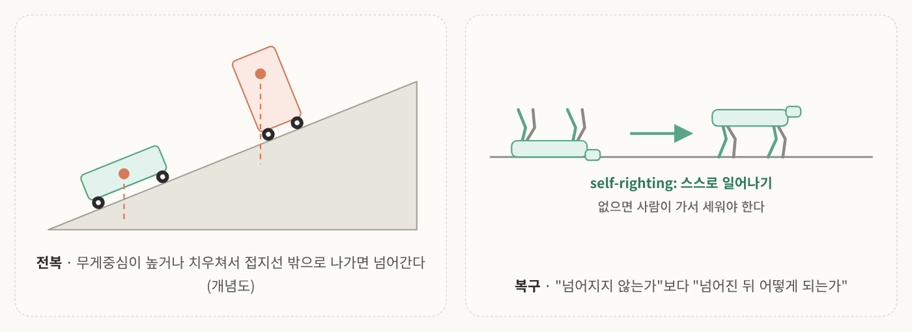
<!-- 슬라이드 42: 안정성과 복구. 전복 그림은 개념도 -->

현장에서는 두 가지를 같이 봄. **얼마나 안정적으로 운용되는가**, 그리고 **실패했을 때 스스로 복구할 수 있는가**.

**Wheeled · Tracked robot** 
접지가 안정적이라 기본 안정성이 높음. 대신 적재가 한쪽으로 치우치거나 무게중심이 높아질수록, 짐이 많이 쌓일수록 전복 여유가 작아짐. 슬라이드 기준으로 급회전, 경사로, 치우친 적재에서 무게중심이 바퀴 접지선 밖으로 나가면 위험하고, 키가 크고 폭이 좁을수록 불리함.

**Legged robot** 
기본 보행 패턴 자체가 불안정해서 넘어질 가능성이 분명히 있음. 그래서 스스로 일어나는 기능(**self-righting**)이 항상 들어감. 없으면 사람이 가서 세워야 함. 그리고 짐을 어디에 싣느냐에 따라 보행 성질이 매우 달라져서, 이것까지 고려해 실제로 안정적으로 되는지 확인해야 함.

슬라이드의 이 문장이 핵심임. 운용 관점에서는 <mark class="mint">"넘어지지 않는가"보다 "넘어진 뒤 어떻게 되는가"가 더 중요</mark>함.

### 1-6. 기준 6: 위치 정밀도와 오도메트리

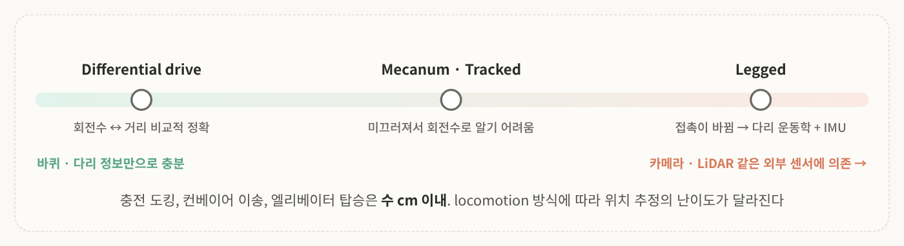
<!-- 슬라이드 43: 위치 정밀도와 오도메트리 -->

**오도메트리**(odometry)는 바퀴 회전수나 다리 움직임으로 이동 거리와 방향을 추정하는 것임. differential drive라면 오른쪽, 왼쪽 바퀴 회전수로 얼마나 갔는지 계산함.

다른 센서 없이 이게 정확할수록 당연히 좋음. **충전 도킹, 컨베이어 이송, 엘리베이터 탑승**은 수 cm 이내가 필요한데, 오도메트리만으로는 어려워서 LiDAR나 카메라를 추가로 달게 됨. 물론 요구도가 높아질수록 가격도 커짐.

- **Differential drive**: 바퀴 회전수와 이동 거리 관계가 비교적 정확함. 나중에 로봇 신호처리 수업에서 모델링을 배움
- **Mecanum wheel · Tracked**: 둘 다 미끄러지면서 이동함. 회전수가 거리로 1:1 맵핑되지 않아 추정 성능이 떨어짐
- **Legged**: 발이 닿았다 떨어지면서 접촉 상태가 계속 바뀜. 다리 운동학과 IMU를 융합해서 추정함

즉 <mark class="pink">오도메트리가 부정확할수록 카메라나 LiDAR 같은 외부 센서에 의존</mark>함. locomotion 방식이 위치 추정의 난이도까지 바꾸는 것임.

> 💡 강의에서 정확도와 정밀도 얘기가 나왔는데, 측정에서 쓰는 일반적인 구분은 이럼. **정확도**(accuracy)는 값이 참값에 얼마나 가까운가, **정밀도**(precision)는 반복했을 때 값이 얼마나 일정한가임. 매번 똑같이 3cm 틀리는 로봇은 정밀하지만 정확하지 않음. 이런 오차는 보정으로 잡기 쉬움.

### 1-7. 기준 7: 센서·인식 관점

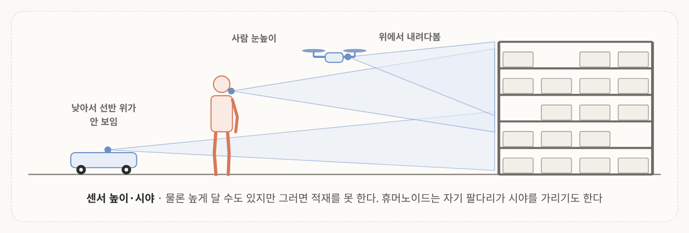
<!-- 슬라이드 44: 센서 높이와 시야 -->

어떤 로봇에 어떤 센서가 어느 방향으로 달렸느냐에 따라 인식할 수 있는 정보가 매우 달라짐.

- **센서 높이·시야**: wheeled AMR은 낮아서 선반 위가 안 보이고, 휴머노이드는 사람 눈높이, 드론은 위에서 봄. 센서를 높게 달 수도 있지만 그러면 적재를 못 함
- **진동·충격**: 센서가 있어도 이동 중에 진동이나 충격이 생기느냐가 중요함. legged robot은 발이 닿을 때마다 충격이 들어와서 IMU 잡음과 영상 흔들림이 생김
- **자기 몸이 시야를 가림**: 휴머노이드는 팔이나 액션 때문에 시야 가림이 생김
- **드론**: 날아다니니까 선반 상단에서 옆이나 위를 볼 수도, 아래를 볼 수도 있음

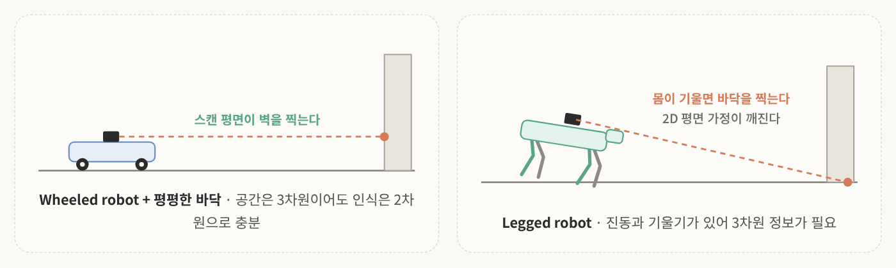
<!-- 슬라이드 44: 바닥이 평평하다는 가정. 기울기는 과장 -->

그리고 **바닥이 평평하다는 가정**이 있음. wheeled robot이고 바닥이 평평하면 실제 공간은 3차원이어도 주행과 인식은 2차원을 넘어갈 필요가 없음. 2D LiDAR 기반 SLAM이 이 전제임. 하지만 보행 로봇은 이 가정이 깨져서 3차원 정보가 필요함.

그래서 같은 SLAM 소프트웨어를 wheeled robot과 quadruped robot에 그대로 올리면 처음엔 잘 안 됨. 로봇을 다뤄 본 사람에게는 너무 당연한데, 의외로 운용하는 쪽에서는 이런 기본적인 차이를 잘 이해하지 못하는 경우가 많다고 함. 3주차 센서 데이터 처리에서 이 내용을 떠올리면 됨.

### 1-8. 기준 8: 안전, 소음, 정비, 비용

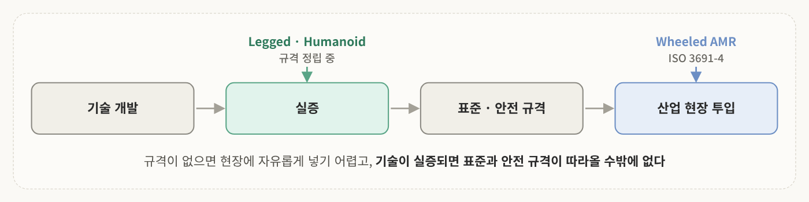
<!-- 슬라이드 45: 안전 규격 -->

로봇을 필드에 넣을 때는 안전 규격을 지키느냐가 매우 중요함. 강의에서는 샘플로 **ISO 3691-4**(무인 산업차량 안전)를 가져왔음. 인체 감지, 보호 영역, 속도 제한 같은 기준이 있음.

wheeled robot은 이런 규격을 확인할 수 있는데, 보행 로봇은 아직 규격을 정립하는 중임. <mark class="pink">안전 규격이 없으면 산업 현장에 자유롭게 넣기 어려움</mark>. 그래서 슬라이드 기준으로 legged robot과 humanoid robot의 실증은 사람과 분리된 구역에서 함.

기술이 개발되고 실증을 하면 산업 표준과 안전 규격이 따라올 수밖에 없는 구조임. 규격이 오히려 도입을 방해한다는 얘기도 있지만, 현장에 들어가려면 규격을 만들어 놔야 적용이 됨.

슬라이드에는 나머지도 정리되어 있음.

- **소음**: 궤도와 발소리가 야간, 사무실 환경에서 제약
- **정비**: 관절이 많을수록 마모와 고장 부위가 많음. wheeled AMR은 바퀴와 배터리 위주
- **비용**: 구매 가격보다 운용, 정비, 설비(충전기, 엘리베이터 연동) 비용이 큰 경우가 많음. 총소유비용(TCO)으로 판단

### 1-9. 종합 비교

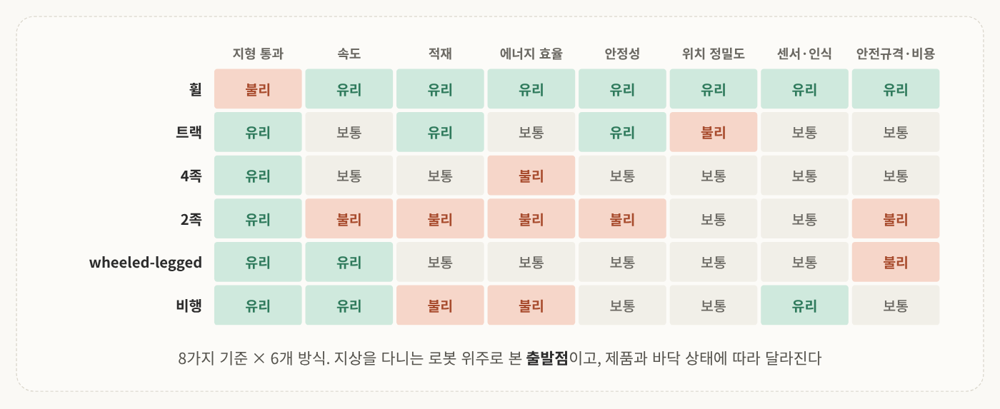
<!-- 슬라이드 46: 종합 비교표를 슬라이드 값 그대로 다시 그림 -->

8가지 기준에 대해 6가지 방식을 정리한 표임. 수중 로봇은 일반적인 환경이 아니니까 빼고 지상 주행·보행 로봇과 드론을 봤음.

표를 보면 한 줄이 전부 초록인 행이 없음. <mark class="mint">한 방식이 모든 기준에서 유리한 경우는 없고, 어떤 기준을 포기할지 정하는 것이 곧 형태 선택</mark>임. 지형 통과와 효율, 조작 능력과 안정성처럼 서로 맞바꾸는 관계가 대부분임.

같은 quadruped라도 제품마다 다르고 바닥이 젖으면 또 달라지니까, 이 표는 출발점으로 보면 됨.

---

## 2. 현장에서는 무엇이 문제인가

### 2-1. 그린필드 vs 브라운필드

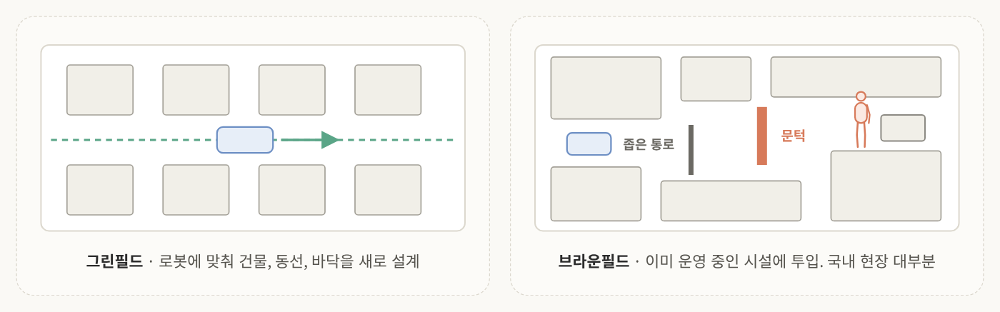
<!-- 슬라이드 49: 그린필드 vs 브라운필드 -->

이번 파트는 기존 시설에 로봇을 넣었을 때 생기는 운영 문제임. 로봇이 비싸고 성능이 아주 좋아도 문 폭, 바닥, 조인트, 네트워크 끊김 같은 이슈로 목표에 못 가는 경우가 생김. 현장에서는 이런 작은 불일치가 실제 작업 중단으로 이어짐. 즉 **로봇과 시설 사이의 인터페이스**를 보는 파트임.

**그린필드 (greenfield)** 
로봇에 맞춰 건물, 동선, 바닥을 새로 설계한 환경임. 공장뿐 아니라 건축 쪽에서 로봇 친화 건물 인증 같은 것도 진행되고 있음.

**브라운필드 (brownfield)** 
이미 운영 중인 시설에 로봇을 투입하는 것임. 로봇을 위해 만들어진 공간은 많지 않아서 <mark class="pink">국내 물류·제조 현장의 대부분이 브라운필드</mark>임. 기존 바닥, 문턱, 통로, 엘리베이터, Wi-Fi, 그리고 운영 중인 작업을 그대로 두고 로봇을 넣어야 함.

업계에서 요구하는 걸 정리하면 이럼.

- 물류 흐름을 먼저 이해함
- 바닥에 마커를 놓지 못하는 경우가 많음
- 기존 운영을 멈추지 않고 단계적으로 도입함
- 여러 대의 로봇을 한 시스템으로 운영함

이건 12주차 특강(정진용 리보틱스 CTO, "브라운필드 물류 산업현장의 로봇 자율주행")에서 이어짐.

### 2-2. 바닥

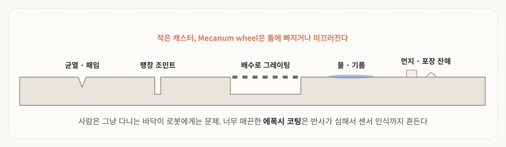
<!-- 슬라이드 50: 바닥 -->

가장 먼저 봐야 할 게 바닥임. 반도체 시설은 잘 되어 있지만, 물류 현장이나 택배사, 공단의 제조 시설에 가 보면 의외로 바닥 상태가 엉망임. 사람은 바닥에 균열이 있거나 좀 미끄러워도 그냥 다니니까 관심도가 높지 않음.

- 균열, 패임, 콘크리트 이음새(팽창 조인트), 배수로
- 물, 기름, 먼지, 박스나 포장 잔해
- 너무 매끈한 에폭시 코팅의 강한 반사

이런 환경에서는 작은 캐스터나 Mecanum wheel이 틈에 빠지거나 미끄러짐. 1편에서 Mecanum wheel이 holonomic이라 아주 좋다고 했는데, <mark class="pink">바닥 조건에 따라 전혀 못 쓰는 문제</mark>가 생기는 것임. legged robot은 젖은 바닥에서 미끄러지고, 반사나 먼지는 센서가 바닥을 벽으로, 먼지를 장애물로 오인하게 만듦. 이동뿐 아니라 인식까지 영향을 줌.

### 2-3. 단차, 문턱, 경사로, 도크

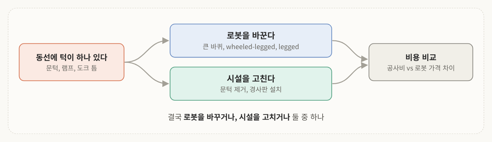
<!-- 슬라이드 51: 단차, 문턱, 경사로, 도크 -->

- **방화문 문턱**: 2cm 높이가 안 되어도 wheeled AMR 바퀴가 작으면 통과 불가
- **램프(경사로)**: 올라갈 때 짐이 치우치지 않고 안정적으로 갈 수 있느냐가 이슈
- **도크 레벨러 틈, 데크 플레이트**: 작은 바퀴가 빠짐

이렇게 되면 선택지는 둘임. 로봇을 바꾸거나, 시설을 고치거나. 시설 공사비와 로봇 가격 차이를 비교해서 결정함.

### 2-4. 층간 이동: 엘리베이터와 계단

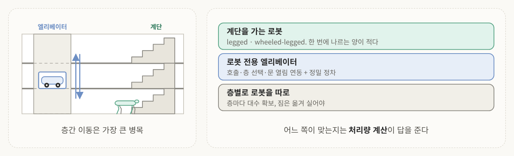
<!-- 슬라이드 52: 층간 이동 -->

다층 물류센터, 병원, 사무실에서 가장 큰 병목임.

**엘리베이터 연동** 
- 제어반과 통신으로 연동할지, 사람처럼 실제로 버튼을 조작할지
- 사람과 함께 탑승할지, 사람이 없을 때 탈지에 대한 정책

**계단** 
어떤 로봇이 어떻게 다니게 할지, 정말 올라갈 수 있는지를 봐야 함. legged robot과 wheeled-legged robot만 가능한데 한 번에 나르는 양이 적어서 처리량이 낮음.

결국 계단을 가는 로봇을 쓸지, 로봇 전용 엘리베이터를 둘지, 층별로 로봇을 따로 둘지는 처리량 계산이 답을 줌.

### 2-5. 통로 폭과 혼재 교통

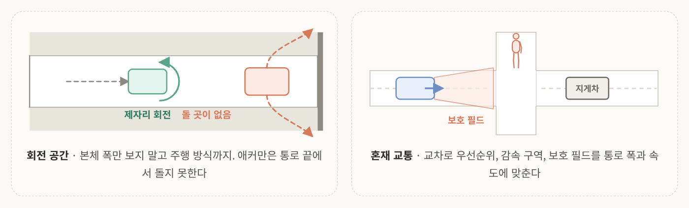
<!-- 슬라이드 53: 통로 폭과 혼재 교통 -->

의외로 현장에서 아직도 가장 많이 문제가 되는 게 **통로 폭**임. 안정적으로 운행하려면 여백이 충분해야 하는데, 브라운필드는 특정 공간에서 최대한 효율을 내는 게 회사 목표라서 공간 여유가 생각보다 많지 않음.

그래서 본체 폭만 보면 안 되고 주행 방식까지 봐야 함. 차동·전방향은 제자리 회전이 되어서 유리하고, 애커만은 회전할 때 궤적이 달라서 통로 끝에서 돌지 못하는 경우가 생김.

사람과 지게차가 섞이는 교차로에서는 우선순위와 감속 구역을 따로 설계해야 함. 안전 스캐너의 감지 영역(보호 필드)도 통로 폭과 속도에 맞춰 잡아야 하고, 얼마만큼의 safety margin을 둘지도 주행 특성에 따라 달라짐.

교수님이 덧붙인 얘기로, 지게차를 운용할 때 빨간 불빛으로 안전 구역을 표시하는 경우가 있음. 정책적으로 정해진 건지는 기억이 잘 안 난다고 하셨는데, 지게차는 크고 빨라서 사고가 많아 시각적으로 주행 중임을 알리는 게 중요하다고 함.

### 2-6. 통신 음영

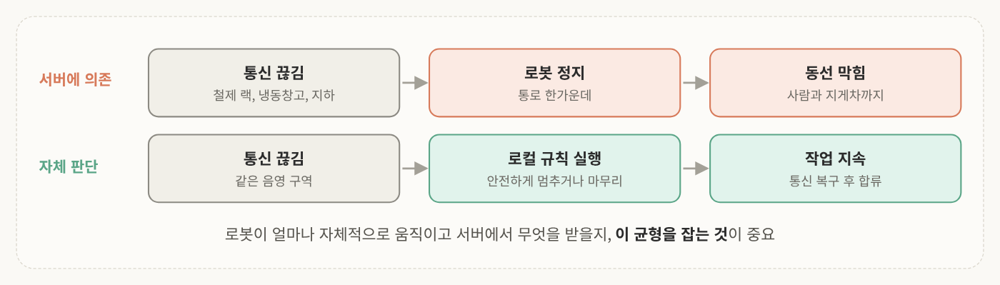
<!-- 슬라이드 54: 통신 음영 -->

철제 랙, 냉동창고, 지하 공간에서는 Wi-Fi나 통신이 제약되는 경우가 많음. 로봇이 모든 정보를 서버에 의존한다면 통신이 끊기면 멈출 수밖에 없음. 정지한 로봇이 통로를 막으면 사람과 지게차 동선까지 막힘.

그래서 <mark class="mint">로봇이 얼마나 자체적으로 움직이고 서버에서 무엇을 받아 올지, 이 균형을 잡는 것</mark>이 매우 중요함. 통신이 끊겨도 안전하게 멈추거나 마지막 지시를 마무리하는 규칙이 필요함. 통신 내용 자체는 8주차 로봇 통신에서 다룸.

### 2-7. 운영: 충전, 고장, 레이아웃 변경

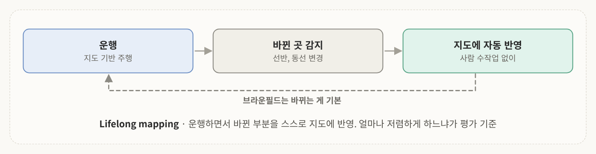
<!-- 슬라이드 55: 운영 -->

- **충전 스케줄**: 언제, 얼마나 충전하느냐가 중요하고 그에 따라 로봇이 활동할 레이아웃도 맞춰야 함. legged robot은 특히 중요함
- **고장·정지 시 회수**: 통로 한가운데 멈춘 로봇을 누가 어떻게 치우는가. legged robot은 넘어지면 무겁고 잡을 곳이 없어서 회수 절차가 필요함
- **레이아웃 변경**: 필드에서는 지도를 만들고 지도 기반으로 주행하는 경우가 많음

여기서 나오는 게 **lifelong mapping**임. 로봇이 운행하면서 바뀐 부분을 스스로 지도에 반영하는 기술임. 사람이 항상 수작업으로 "여기 바뀌었다"고 할 수 없으니까 얼마나 자동으로 반영하느냐가 중요함. 브라운필드는 기본적으로 계속 바뀌는 환경이라서, 이걸 **얼마나 저렴하게** 할 수 있느냐가 평가 기준이 됨.

### 2-8. 현장 사례

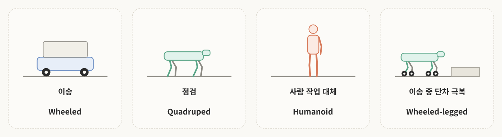
<!-- 슬라이드 56~57: 현장 사례 -->

- **Humanoid**: Agility Robotics Digit은 GXO 물류센터에서 AMR이 가져온 토트를 집어 컨베이어에 올리는 작업을 실증함. 슬라이드에 따르면 구독형(RaaS) 계약이고 사람과 분리된 구역에서만 운영함. Boston Dynamics는 현대자동차 메타플랜트에 넣으려고 여러 시도를 하고 있음
- **Wheeled-legged**: RIVR의 라스트마일 배송 로봇
- **Quadruped**: 여러 건설회사에서 인프라 모니터링 관점으로 많이 도입함
- **Wheeled AMR**: 운반과 사람 오더 피커 협업 형태로 물류센터에서 많이 씀

슬라이드 정리처럼 **형태별로 시장에서 맡는 자리가 갈리는 중**임. 유튜브에서 휴머노이드 실증을 검색하면 현장 영상을 여러 개 찾아볼 수 있음.

### 2-9. 현장 체크리스트

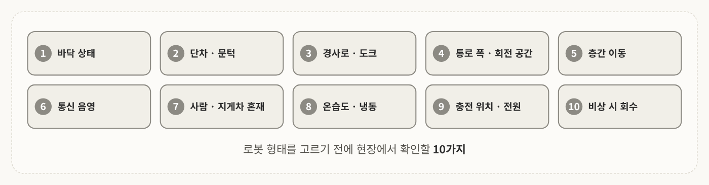
<!-- 슬라이드 58: 현장 체크리스트 -->

앞의 이슈를 묶으면 로봇 도입 전에 볼 체크리스트가 됨. 과제 2부에서도 이걸 그대로 씀.

① 바닥 상태 ② 단차·문턱 ③ 경사로·도크 ④ 통로 폭·회전 공간 ⑤ 층간 이동 ⑥ 통신 ⑦ 사람·지게차 혼재 ⑧ 온습도·냉동 여부 ⑨ 충전 위치와 전원 ⑩ 비상 시 회수·복구

---

## 3. 여러 종류의 로봇을 함께 쓰기

### 3-1. 왜 한 종류로는 안 되는가

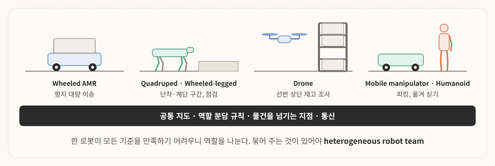
<!-- 슬라이드 60: 왜 한 종류로는 안 되는가 -->

이건 무조건 된다는 얘기는 아님. 다만 최종 목표가 사람 친화적인 공간에서의 완전 자율화라면, 각 로봇의 주행 특성을 파악해서 **효율적으로 함께 쓰는 팀**을 봐야 한다는 것임.

앞에서 봤듯 한 로봇이 모든 기준을 만족하기 어려우니 역할을 나눔. 심지어 이종 안에서도 타입이 다를 수 있음. AMR 안에서도 더 똑똑하고 큰 AMR과 세부 역할을 하는 작은 AMR로 나누는 식임.

이렇게 여러 대를 하나의 시스템으로 묶은 것이 **이종 로봇 팀**(heterogeneous robot team)임. 묶으려면 공통 지도, 역할 분담 규칙, 물건을 넘기는 지점, 통신이 필요함.

### 3-2. 사례: DARPA Subterranean Challenge

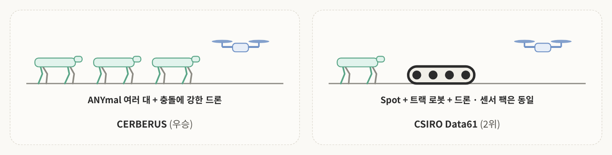
<!-- 슬라이드 61: DARPA SubT 팀 구성 -->

실증이라기보다는 경진대회 사례임. **SubT**는 미 국방성 산하 DARPA가 만든 로봇 대회(2018~2021)로, 지하 터널, 지하 도시, 동굴에서 로봇 팀이 탐색해서 물체를 찾음. 통신이 끊기고, 어둡고, 단차와 잔해가 많은 환경임.

- **CERBERUS**(우승): 4족 보행 로봇 ANYmal 여러 대 + 드론
- **CSIRO Data61**: Spot 보행 로봇 + 트랙 로봇 + 드론. 플랫폼은 달라도 센서 팩은 동일하게 맞춰서 분산 SLAM으로 지도를 공유함

두 팀의 공통 교훈은 이렇게 정리됨.

- 지하 환경의 지상 주력은 legged robot이었음
- 드론이 먼저 보고, legged robot이 들어가고, 모두 하나의 지도를 공유함
- 통신 두절을 전제로 각 로봇이 스스로 판단해야 함

재밌는 건 <mark class="mint">어떤 정보가 공유되어야 하는지</mark>까지 다뤘다는 점임. 로봇 A, B, C가 각자 가진 지도 정보가 공유되어야 함께 운용할 수 있음. "너무 당연한 거 아닌가요?"라고 할 수 있는데, 구두로 당연하다고 말하는 것과 실제로 결과물이 나오는 건 다른 얘기임.

대회 결과물로 창업한 사례도 있음. 1편의 RIVR 창업진이 이 대회 우승팀(CERBERUS) 출신이고, **Field AI**도 이 대회에 나갔던 NASA JPL 쪽 출신이 창업한 회사임.

> 💡 강의에서는 CSIRO를 "상위권", 슬라이드는 "공동 상위"라고 했는데, DARPA 발표로는 CERBERUS와 CSIRO Data61이 **23점 동점**이었고 타이브레이크로 CERBERUS가 1위, CSIRO가 2위임. 사실상 공동 1위 수준이었던 셈.

### 3-3. 공통 지도와 좌표계

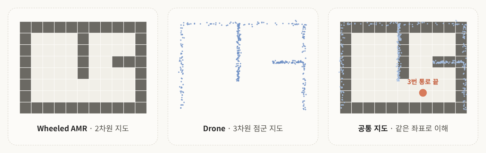
<!-- 슬라이드 63: 공통 지도와 좌표계. 지도는 설명용 예시 -->

로봇마다 센서 높이와 locomotion이 달라도 하나의 지도를 공유해야 임무를 나눌 수 있음. "3번 통로 끝에 있다", "1번 문으로 가야 된다"는 말을 이해하려면 <mark class="pink">같은 좌표로 이해하고 있어야</mark> 함.

wheeled robot은 2차원 지도, 드론은 3차원 점군 지도를 갖고 있다면, 이걸 하나로 융합해야 같은 위치를 말하는지 알 수 있음. 어려운 점은 이런 것들임.

- 서로 다른 센서로 본 같은 장소를 같은 장소로 알아보기 (place recognition)
- 통신이 끊겼다 이어질 때 지도를 병합하기

이 문제를 다루는 연구 분야가 **다중 로봇 SLAM**(collaborative SLAM)임.

### 3-4. 역할 분담과 물건을 넘기는 지점

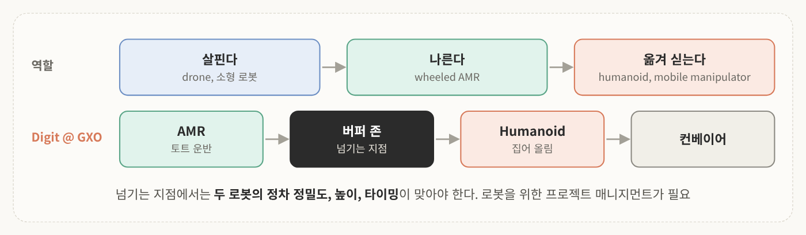
<!-- 슬라이드 64: 역할 분담과 물건을 넘기는 지점 -->

운영 관점에서는 로봇이 어떻게 역할을 나누고 언제 물건을 넘길지의 최적화가 매우 중요함.

기본 흐름은 **가볍고 빠른 로봇이 먼저 살피고 → 무거운 로봇이 나르고 → 팔 있는 로봇이 옮겨 싣는다**임.

넘기는 지점은 컨베이어, 버퍼 존, 정해진 위치의 선반처럼 미리 설계해야 함. 앞에서 본 Digit @ GXO가 바로 **AMR → 버퍼 존 → Humanoid → 컨베이어** 구조임.

어느 지점에서 넘기고 이동할지, 구역과 계획을 설계하는 건 로봇이 도입되면서 사람이 함께 봐야 하는 일임. 교수님 표현으로는 물건을 위한 프로젝트 매니지먼트가 아니라 <mark class="mint">로봇을 위한 프로젝트 매니지먼트</mark>가 들어가야 함.

### 3-5. 다수 로봇 운영과 인터페이스

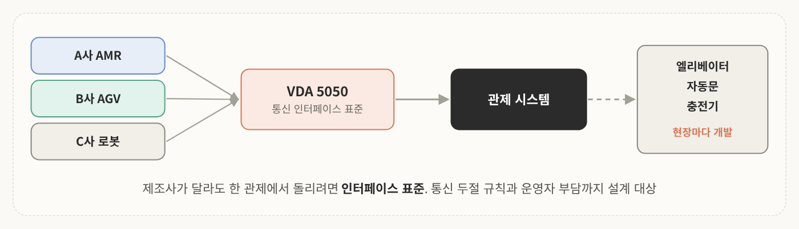
<!-- 슬라이드 65: 다수 로봇 운영과 인터페이스 -->

제조사가 다른 로봇들이 서로 다른 통신 규격을 쓰면 운영이 어려움. 그래서 **VDA 5050** 같은 표준을 따르느냐가 중요하고, 도입할 때 인터페이스 표준을 맞춤.

- **설비 연동**: 엘리베이터, 자동문, 충전기 연동은 현장에 따라 따로 개발해야 할 수 있음
- **통신 두절 규칙**: 통신이 꺼졌을 때의 안전 규칙도 만들어야 함
- **운영자 부담**: 로봇 종류가 늘면 좋긴 한데, 사람이 여러 대를 한 번에 보기 어려우니 모니터링을 잘 구성해야 함

### 3-6. 이종 로봇 팀의 세 조건

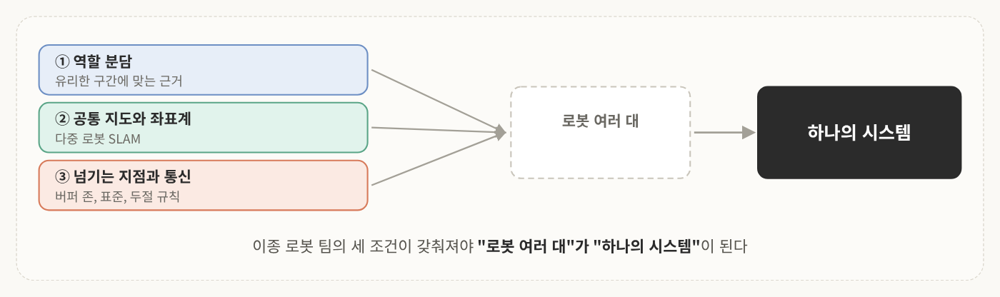
<!-- 슬라이드 66: 이종 로봇 팀의 세 조건 -->

1. **역할**을 어떻게 나눌 것인가
2. **공통 지도와 좌표계**를 어떻게 갖출 것인가
3. 서로 다른 로봇의 협력, 즉 **물건을 넘기는 지점과 통신**을 어떻게 설계할 것인가

이게 갖춰지면 단순히 로봇 여러 대가 아니라 하나의 시스템으로 동작시킬 수 있음.

---

## 4. 핵심 요약

1. **Locomotion**: 접촉, 지지, 추진에 따라 wheeled, tracked, legged, wheeled-legged, aerial, underwater로 나뉘고 각각 특성이 다름
2. **비교는 8가지 기준으로**: 지형 통과뿐 아니라 이동 에너지, 오도메트리, 센서 관점까지 같이 봄
3. **CoT**: 소비 에너지 / (무게 × 이동 거리). 편리하지만 절대적이지는 않음
4. **한 방식이 모든 기준에서 유리하지 않다**: 어떤 기준을 포기할지 정하는 것이 형태 선택
5. **브라운필드**: 바닥, 문턱, 층간 이동, 통신에 따라 선택이 달라짐. 가장 어려운 구간과 인터페이스가 답을 정함
6. **이종 로봇 팀**: 어떤 정보를 공유할지 확인한 뒤 역할을 나누고, 공통 지도와 넘기는 지점을 설계함

>한 줄로 묶으면  
>**로봇 선택은 어떤 기준을 포기할지 정하는 일이고, 현장의 가장 어려운 구간이 그 답을 정한다. 한 종류로 부족하면 역할을 나누고 하나의 지도로 묶는다.**

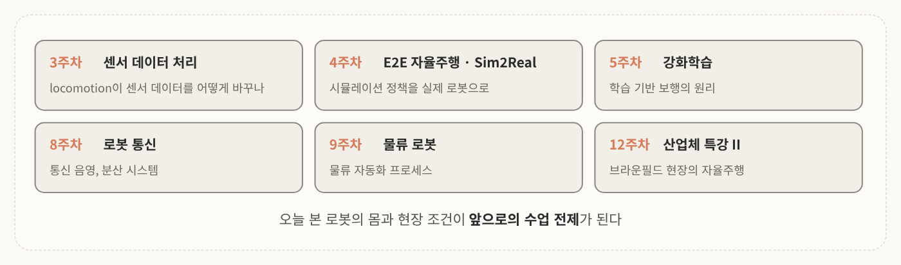
<!-- 슬라이드 68: 다음 주차와의 연결 -->

이후 수업은 오늘 본 내용을 바탕으로 센서, 주행, 강화학습, 통신, 물류 로봇 프로세스로 이어지고 전문가 특강도 준비되어 있음.

---

## 생각해 볼 문제

슬라이드 52에 나온 질문임.

**Q1.** 엘리베이터 한 대로 로봇 한 대씩 왕복하면 시간당 몇 번 나를 수 있는가? 계단을 가는 로봇, 로봇 전용 엘리베이터, 층별 로봇 중 무엇을 고르겠는가?

슬라이드 33과 58을 이어서 내가 하나 더 만들어 봄.

**Q2.** 3층짜리 오래된 병원에 물품 배송 로봇을 넣는다. 체크리스트 10개 중 가장 먼저 확인할 세 가지는 무엇이고, 왜 그런가?

> 💡 아래는 내가 풀어 본 답임. 공식 해설은 아님.
> - **Q1**: 왕복 시간을 T분이라 하면 시간당 60 / T번임. 호출 대기, 탑승, 이동, 하차를 합쳐 왕복 5분이라고 가정하면 시간당 12번, 8시간이면 96번임. 여기에 1회 적재량을 곱한 값이 필요한 처리량보다 크면 엘리베이터 연동으로 충분하고, 모자라면 전용 엘리베이터나 층별 로봇을 비교함. 계단 로봇은 1회 적재량이 작아서 같은 계산에서 불리해짐
> - **Q2**: ⑤ 층간 이동, ② 단차·문턱, ⑦ 사람 혼재가 먼저임. 엘리베이터 연동이 되느냐에 로봇 형태가 갈리고, 오래된 건물은 문턱이 동선을 끊을 수 있고, 병원은 사람과 침상이 섞여 다니는 공간이라 안전 요건이 앞에 오기 때문임

---

## 참고문헌
- 조영근, 「Physical AI 개론 2 2주차: 이종 로봇의 형태와 이동 특성」, 인하대학교 전기전자공학부 / AI로봇 융합전공 강의 자료.
- Tucker, V. A. (1975). The energetic cost of moving about. *American Scientist*, 63(4), 413–419.
- Seok, S., Wang, A., Chuah, M. Y., Hyun, D. J., Lee, J., Otten, D. M., Lang, J. H., & Kim, S. (2015). Design principles for energy-efficient legged locomotion and implementation on the MIT Cheetah robot. *IEEE/ASME Transactions on Mechatronics*, 20(3).
- Bloesch, M., Hutter, M., Hoepflinger, M. A., Leutenegger, S., Gehring, C., Remy, C. D., & Siegwart, R. (2012). State estimation for legged robots: Consistent fusion of leg kinematics and IMU. *Robotics: Science and Systems*.
- ISO 3691-4:2023. *Industrial trucks — Safety requirements and verification — Part 4: Driverless industrial trucks and their systems*.
- Tranzatto, M. et al. (2022). CERBERUS in the DARPA Subterranean Challenge. *Science Robotics*, 7(66).
- Hudson, N. et al. (2022). Heterogeneous ground and air platforms, homogeneous sensing: Team CSIRO Data61's approach to the DARPA Subterranean Challenge. *Field Robotics*, 2.
- Lajoie, P.-Y., Ramtoula, B., Wu, F., & Beltrame, G. (2022). Towards collaborative simultaneous localization and mapping: A survey of the current research landscape. *Field Robotics*, 2.
- VDA. *VDA 5050: Interface for the communication between automated guided vehicles (AGV) and a master control*.
- [DARPA (2021) – Subterranean Challenge Winners](https://www.darpa.mil/news/2021/subterranean-challenge-winners)
- [CSIRO (2021) – CSIRO Data61 team finished 2nd in the DARPA SubT robotics challenge](https://research.csiro.au/robotics/csiro-data61-team-finished-2nd-in-the-darpa-subt-robotics-challenge)
- [Field AI – Team](https://fieldai.com/team)