## 들어가며

이번 3주차는 스마트모빌리티공학과 심인욱 교수님의 로봇특성화대학 특강임. 제목은 "**센서 데이터 처리와 GPU 데이터 흐름**"이고 두 편으로 나뉨.

- **1강(이번 글)**: 로봇에 달린 카메라와 라이다에서 나온 데이터가 컴퓨터 안에서 어떤 모습이고 어떻게 움직이는지
- **2강(다음 글)**: 그 데이터를 GPU가 어떻게 처리하는지

코드는 거의 안 나오고 그림과 숫자 중심임. 간단한 계산이 나오면 같이 따라 해 보면 됨.

강의의 핵심 메시지는 한 줄임.

> **센서 데이터는 큰 배열이고, 배열은 용량이 크고 무겁다**

용량이 크면 어딘가로 전송하기 어렵거나 시간이 많이 걸림. 그래서 보통 "무겁다"고 표현함.

1편 흐름은 이렇게 감.
1. **로봇 위에 뭐가 달려 있나**
2. **카메라와 라이다**: 데이터의 모양이 어떻게 다른가
3. **얼마나 무거운가**: 숫자로 계산해 보기
4. **실시간이란 무엇인가**
5. **이미지 파이프라인**: 센서에서 인식까지
6. **라이다 파이프라인**: 패킷에서 검출까지
7. **공통 문제**: 스트리밍, 동기화, 경로별 속도

---

## 1. 로봇은 보고, 이해하고, 움직인다

### 1-1. 로봇 소프트웨어의 세 덩어리

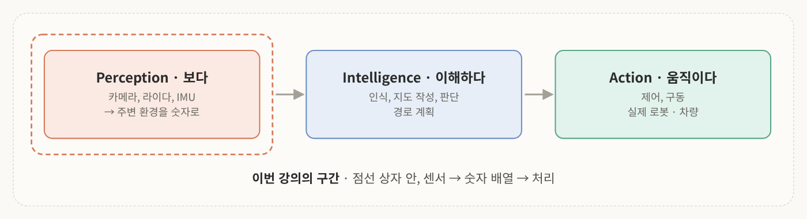
<!-- 슬라이드 2: 로봇은 보고, 이해하고, 움직인다 -->

로봇 소프트웨어는 크게 세 덩어리로 나뉨.

- **Perception (보다)**: 먼저 세상을 봐야 함. vision이나 인지라고도 부름
- **Intelligence (이해하다)**: 본 걸 이해해야 함. 흔히 decision이라고도 부름
- **Action (움직이다)**: 실제로 움직임

이번 강의에서 집중할 건 <mark class="pink">"보다", 즉 perception</mark> 이야기임.

로보틱스에서는 카메라와 라이다가 주로 쓰임. 이걸로 주변 환경을 숫자, 즉 디지털 데이터로 바꾸고, 그 숫자를 바탕으로 사람을 피하든지 "왼쪽으로 돌자"라고 판단하든지 해서 실제로 움직임.

오늘 던지는 질문은 세 가지.

- 카메라와 라이다에서 나온 데이터는 **컴퓨터 안에서 어떤 모습**인가?
- 그 데이터는 **어디에 놓이고, 몇 번 옮겨지고, 얼마나 무거운가**?
- 로봇이 실시간으로 움직이려면 이 데이터를 **얼마 안에 처리**해야 하는가?

### 1-2. 로봇 위에는 무엇이 달려 있나

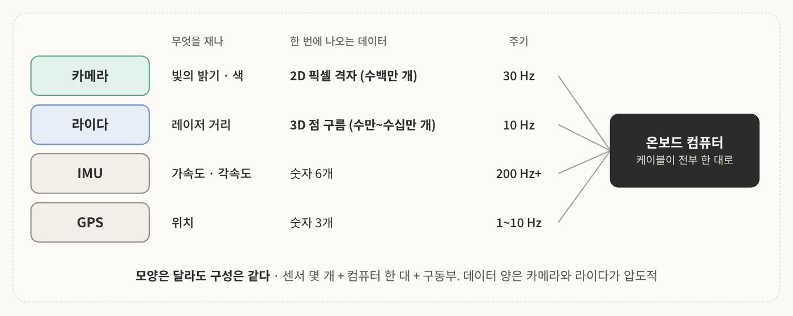
<!-- 슬라이드 3: 로봇 위에는 무엇이 달려 있나 -->

교수님 연구실 로봇 사진으로 설명이 시작됨. 바퀴 기반 실외 주행 로봇에는 3D 라이다, 카메라, perception 데이터를 처리하는 온보드 컴퓨터가 달려 있고, 사람 목소리를 듣고 말을 전달하려고 마이크와 스피커도 달려 있음. 캠퍼스를 걸어 다니는 4족 보행 로봇 **Unitree Go2**, 교육용으로 많이 쓰는 **LIMO Pro**도 크기와 형태만 다를 뿐 구성은 같음. 센서가 달려 있고, 온보드 컴퓨터가 달려 있고, 구동부가 달려 있음.

작은 로봇이든 걷는 로봇이든 바퀴 로봇이든, 결국 <mark class="mint">많은 데이터를 컴퓨터 안에 넣고 시간 안에 소화할 수 있어야</mark> 실제로 동작함.

센서별 성격은 이렇게 다름.

- **카메라**: 안에 있는 CCD나 CMOS 센서가 빛의 밝기를 숫자로 저장함. 2D 픽셀 격자로 수백만 개 데이터가 초당 30번 들어옴
- **라이다**: 레이저로 거리를 재서 3D 포인트 클라우드(점 구름)를 만듦. 보통 1초에 10번 돌면서 수만~수십만 개 점을 만들어 냄
- **IMU**: 가속도와 각속도를 출력함. 데이터는 작은데 100Hz, 200Hz처럼 굉장히 빠름
- **GPS**: 내 위치를 알려 줌. 가장 느려서 1~10Hz 정도

데이터 양은 카메라와 라이다가 압도적임. 실시간으로 처리하려면 이 둘을 가장 잘 다뤄야 하니까, 강의도 이 두 센서를 따라감.

---

## 2. 카메라와 라이다: 데이터의 모양이 다르다

### 2-1. 카메라: 빛을 숫자 격자로 바꾸는 장치

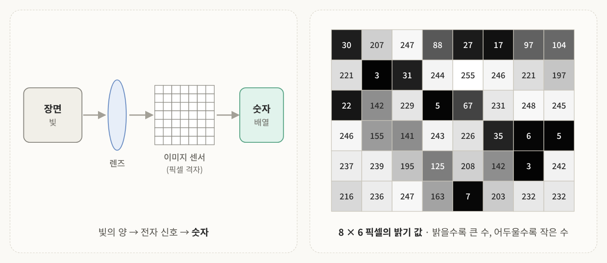
<!-- 슬라이드 4: 카메라 작동 원리와 8×6 픽셀값 -->

원리는 단순함. 장면에서 온 빛이 렌즈를 지나 이미지 센서에 닿음. 이미지 센서는 픽셀 단위로 격자가 깔린 작은 칩인데, 빛이 오래 닿거나 세게 닿으면 값이 커지고 적게 오면 값이 작아짐. 받아들인 빛의 양을 전자 신호로 바꾸고, 그걸 숫자로 저장하면 사진이 됨.

사진 한 귀퉁이를 8×6 크기로 뜯어서 픽셀값을 실측하면 위 그림처럼 보임. 값이 크면 빛이 많이 들어온 밝은 곳, 작으면 어두운 곳. 예시 사진(4032×3024)에는 픽셀이 약 1,200만 개 있고, <mark class="pink">영상 처리와 컴퓨터 비전은 이 숫자들에 대한 계산을 하는 응용 학문</mark>이라고 볼 수 있음.

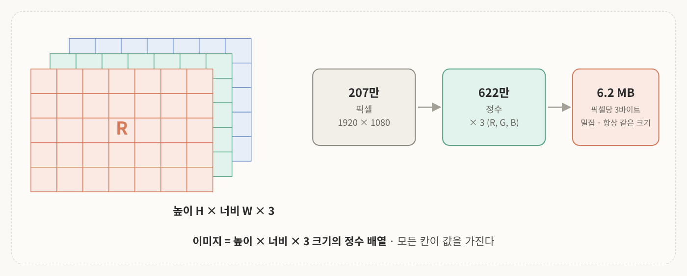
<!-- 슬라이드 4: 이미지 = H×W×3 정수 배열 -->

픽셀 하나는 빛의 양을 잰 정수 하나, 0에서 255 사이 값임. 컬러 카메라는 R, G, B 영역을 담당하는 값이 세 개니까 픽셀당 3바이트임. 흑백 카메라는 컬러 정보 없이 흑백 값만 있음.

1920×1080 카메라라면 픽셀만 207만 개, RGB 정수로는 622만 개임. 즉 이미지는 **높이 × 너비 × 3 크기의 정수 배열**임.

이미지 데이터의 특징은 <mark class="mint">dense(밀집)</mark>하다는 것. 픽셀 옆에는 반드시 어떤 값이 있고, 크기도 항상 같음.

### 2-2. 라이다: 레이저로 거리를 재서 점을 찍는 장치

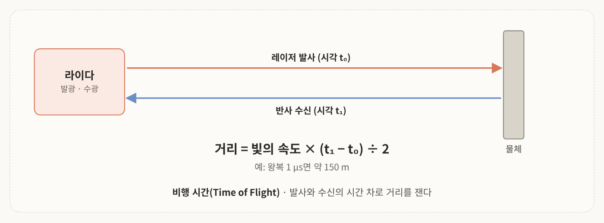
<!-- 슬라이드 5: Time of Flight -->

라이다는 레이저를 쏘고, 물체에 맞고 돌아오는 시간 차를 잼. 빛의 속도를 아니까 거리를 계산할 수 있음. 이게 **비행 시간(Time of Flight)** 원리임.

$$
\text{거리} = \frac{\text{빛의 속도} \times (t_1 - t_0)}{2}
$$

레이저는 905nm나 1,550nm 근방의 펄스를 씀. 눈에 안전하고 우리 눈에도 안 보이는 파장임.

레이저 하나만 보면 거리값만 아는 거임. 공간상의 점으로 만들려면 **어느 방향으로 쐈는지**를 알아야 x, y, z를 구할 수 있음.

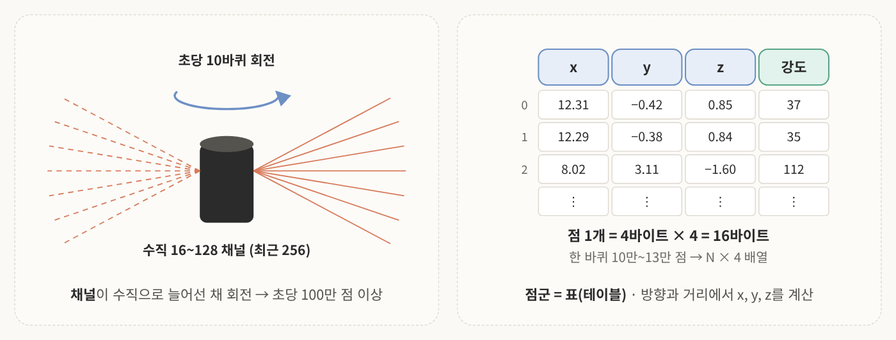
<!-- 슬라이드 5: 채널과 회전, 점 1개의 크기 -->

Go2 위에 올린 Ouster 센서를 보면 발광부와 수광부가 수직으로 많이 늘어서 있고(64개, 128개 등), 초당 10번씩 뱅글뱅글 돎. 위에서 보면 원점 기준으로 어느 방향으로 쐈는지 각도가 나오니까, 그 각도로 x, y, z를 구함.

채널 수는 16개부터 128개까지 있고 최근에는 256채널까지 나왔음. 10Hz로 돌면 초당 100만 점 이상을 생성해서, 기하학적이고 구조적인 정보를 꽤 정교하게 얻을 수 있음.

데이터 사이즈도 보자.

- 점 하나는 보통 **x, y, z, intensity** 4개 값을 다룸
- 각각 float32(4바이트)면 점 하나가 **16바이트**
- 10Hz로 돌고 한 바퀴에 10만~13만 점 → **N × 4 배열**

이미지와 다른 점은 구성임. 테이블 형태의 데이터라서, <mark class="pink">어떤 포인트 옆에 다른 포인트가 없을 수도 있음</mark>. 그래서 옆 점을 찾는 데 알고리즘적 노력이 많이 들어가거나 메모리를 많이 써야 함.

### 2-3. 이미지 vs 점군

두 데이터를 나란히 놓고 비교해 보면 차이가 확 보임.

| | 카메라 이미지 | 라이다 점군 |
|---|---|---|
| 데이터 형태 | 2D 격자 (H × W × 3), 정수 0~255 | 점 목록 (N × 4), floating point 실수 |
| 밀도 | 밀집 (dense): 모든 칸이 채워짐 | 희소 (sparse): 물체 표면에만 점이 있음 |
| 크기 | 항상 같음 (예: 1920×1080) | 매 스캔마다 다름 (N 가변) |
| 이웃 찾기 | 인덱스 ±1 | 거리 계산 필요 (탐색 비용) |
| 담고 있는 정보 | 색 · 질감, 거리 정보 없음 | 정확한 거리 · 형상, 색 없음 |
| 약점 | 조명 변화, 야간, 역광 | 비 · 눈 · 먼지, 얇은 물체 |
| 처리 방식 | 필터, CNN 등 격자 연산 | transformer, graph 기반, 또는 격자로 변환 |

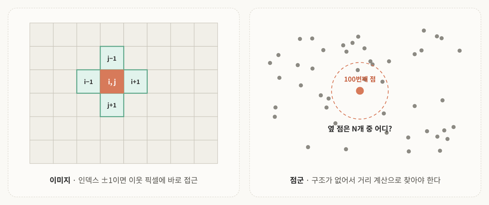
<!-- 슬라이드 6: 이웃 찾기 -->

여기서 실제로 많이 중요한 게 **이웃 찾기**임. 이미지는 격자 안에 인덱스 i, j가 있으니까 값만 조절하면 인접 픽셀에 바로 접근함. 근데 포인트 클라우드는 x, y, z, intensity가 N개 테이블로 쭉 있을 뿐이라, 내가 100번째 점이어도 내 옆에 있는 점이 전체 N개 중 어디 있는지 모름. 그래서 빠르게 찾는 알고리즘을 만들어야 함.

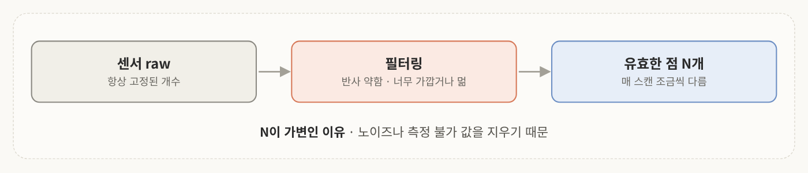
<!-- 슬라이드 6 강의 설명: N이 가변인 이유 -->

N이 가변이라는 말은 좀 이상하게 들리는데, 교수님 설명으로는 **센서 레벨에서는 데이터가 항상 고정된 개수로 생성됨**. Raw 데이터를 그대로 받으면 가변이 아니라 고정값으로 들어옴.

다만 그대로 쓰면 필터링이 필요함. 라이다 센서에는 자체 필터링 기능이 있어서, 유리에 닿아 반사율이 약한 값이나 너무 가깝거나 먼 값처럼 노이즈일 확률이 높은 건 지워 버림. 그래서 매 스캔마다 개수가 조금씩 바뀜.

약점도 대비됨. 카메라는 빛으로 데이터를 만드니까 조명 변화, 야간, 역광에 약함. 라이다는 내가 직접 빛을 쏘니까 조명과 상관없지만, 비나 눈이나 먼지에 빛이 반사되면 공중에 없는 장애물이 뜸. 레이저는 물리적으로 두께가 있어서 엄청 얇은 물체도 잘 안 잡힘. 참고로 올해는 색 정보까지 같이 측정하는 라이다도 상품화됐다고 함.

> **컴퓨터는 규칙적인 격자를 좋아한다.** 이미지는 이미 격자이고, 점군은 격자로 만들어 주는 단계가 처리 파이프라인에 들어간다.

---

## 3. 얼마나 무거운가

### 3-1. 숫자로 보기

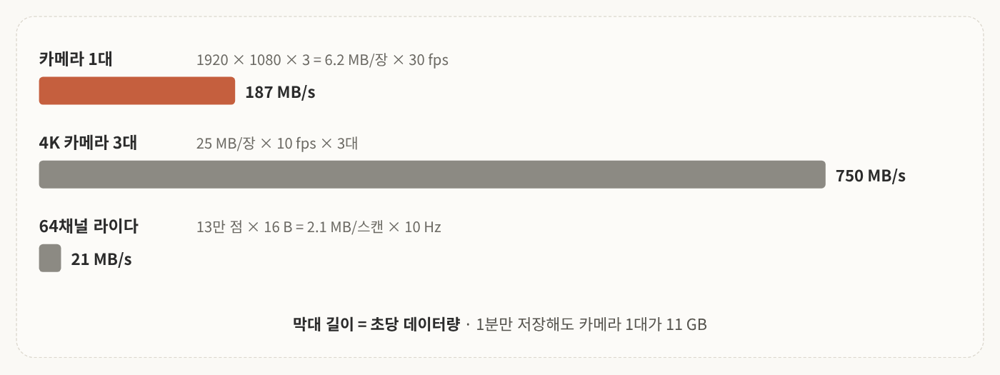
<!-- 슬라이드 7: 얼마나 무거운가 -->

**카메라 1대 (1920×1080, RGB, 30fps)** 
1920 × 1080 × 3바이트 ≈ 620만 바이트니까 한 장이 **6.2MB**임. 초당 30장이면 **초당 187MB**.

"JPEG나 PNG는 해상도가 훨씬 높아도 사이즈가 작던데요?" 할 수 있는데, 그건 압축된 영상임. 메모리에 올려서 처리하려면 압축을 풀어야 하니까 메모리 안에서는 결국 6.2MB를 차지함.

**4K 카메라 3대 (10fps)** 
4K는 픽셀이 약 4배라 한 장에 25MB, 초당 10장이면 250MB. 카메라 한 대로 로봇이 동작하진 않으니 3대면 **초당 750MB**임. 엄청 고화질이 아니어도 이 정도는 금방 나옴.

**라이다 1대 (64채널, 10Hz)** 
13만 점 정도에 한 스캔 약 2.1MB, 초당 **21MB**. 카메라보다는 가볍지만 128이나 256채널로 올라가면 이것도 가볍지만은 않음.

1분만 그대로 저장해도 카메라 한 대가 **11GB**임. 근데 실제 로봇에는 카메라 4~8대, 라이다 1~3대가 달림(강의에서는 카메라 8대, 라이다 2~3대를 흔한 예로 듦).

그래서 오늘 계속 강조하는 문장이 <mark class="pink">"데이터는 무겁다"</mark>임. 크기가 클수록 계산이 오래 걸리고, 복사와 이동이 오래 걸리고, 캐시에 바로 안 들어가고, 컴퓨터 내 통신 라인인 버스(bus)를 오래 점유함.

### 3-2. 한 장의 사진으로 확인: 36.6MB가 3MB로

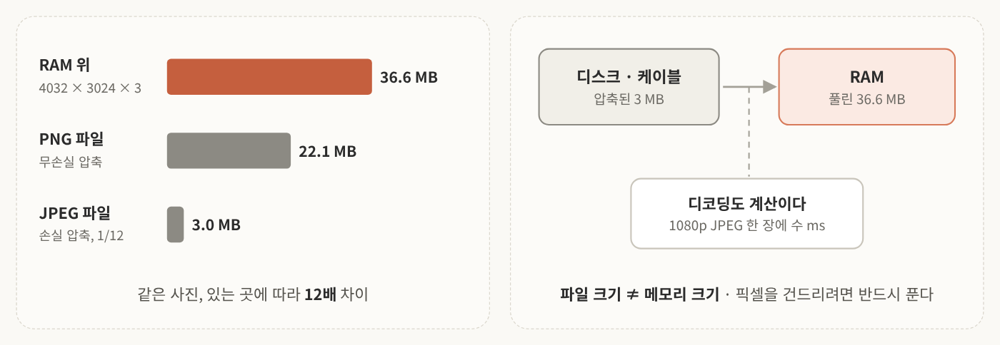
<!-- 슬라이드 8: 36.6MB → 3MB -->

학교 캠퍼스 사진(4032×3024 컬러)으로 실제 확인해 봄.

- **RAM 위 크기**: 4032 × 3024 × 3 = **36.6MB**. 프로그램이 사진을 열어서 픽셀을 건드릴 때 차지하는 크기
- **PNG 파일**: 22MB (무손실 압축)
- **JPEG 파일**: 3MB (손실 압축, 1/12)

같은 사진인데 어떻게 압축하고 어디에 놓였느냐에 따라 12배까지 달라짐.

헷갈리면 안 되는 게, <mark class="mint">파일 크기와 메모리 크기는 엄연히 다르다</mark>는 것. 케이블이나 디스크를 지날 때는 압축된 용량이지만, 메모리 안에서 값을 읽어 뭔가를 하려면 반드시 raw 데이터로 풀어야 함.

푸는 것도 디코딩이라는 계산 시간이 들어감. 보통 밀리세컨드 단위인데, 로보틱스에서는 이게 아껴야 하는 자원임. 그래서 괜히 압축했다가 수 ms, 수십 ms 손해 보지 말고 보통 그냥 raw로 처리함.

> 💡 강의에서는 "1,024로 2번 나눈다"고 했는데 실제로 계산해 보면 4032 × 3024 × 3 = 36,578,304바이트라서 **106으로 나눠야 36.6MB**임. 1,024로 두 번 나누면 약 34.9MiB가 나옴. 저장 장치에서 MB와 MiB가 섞여 쓰이는 흔한 차이라, 큰 흐름에는 영향 없음.

### 3-3. 로봇은 왜 비압축을 쓸까

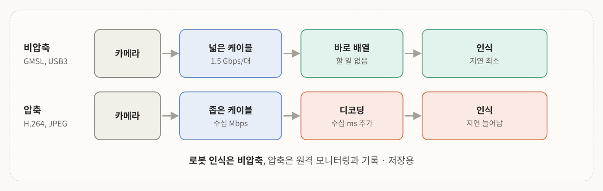
<!-- 슬라이드 8: 로봇에서의 선택 -->

| 방식 | 케이블 | 컴퓨터가 할 일 | 지연 | 언제 쓰나 |
|---|---|---|---|---|
| 비압축 (GMSL, USB3) | 넓어야 함 (1.5Gbps/대) | 없음, 바로 배열 | 최소 | 자율주행 · 로봇 인식용 |
| 압축 (H.264, JPEG) | 좁아도 됨 (수십 Mbps) | 디코딩 | 수십 ms 추가 | 원격 모니터링, 기록 · 저장 |

비압축은 데이터 용량이 커서 고대역폭 케이블이 필요하지만, CPU나 GPU에 들어오면 바로 계산할 수 있음. 압축은 디코딩을 한 번 거쳐야 해서 연산 시간이 듦.

그래서 자율주행이나 로봇용 인식에는 <mark class="pink">압축 없이 raw 데이터를 바로 활용</mark>함. 로봇이 처리하는 데이터 용량이 무지 많다는 걸 인지해 두자.

---

## 4. 실시간이란: 다음 데이터가 오기 전에 끝내기

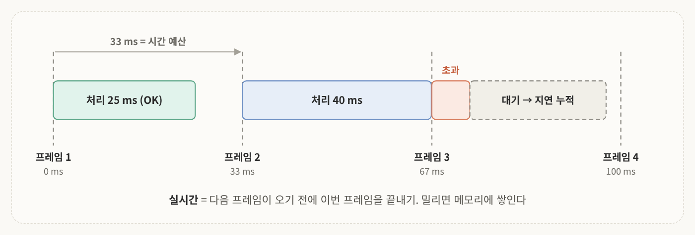
<!-- 슬라이드 9: 프레임 타임라인 -->

실시간(real-time)은 사실 빠르게 처리한다는 말이 아님. <mark class="pink">현재 들어온 데이터를 유실 없이 바로바로 처리할 수 있다</mark>는 뜻임.

은행 ATM을 생각해 보면, 돈을 입금했는데 데이터가 사라지진 않잖음. 데이터의 트랜잭션을 잃어버리지 않는 것이 실시간이고, 단순히 빠른 게 실시간이 아님.

카메라가 30프레임이면 프레임 사이 간격이 33ms임. 그러면 실시간이란 **다음 프레임이 오기 전에 이번 프레임의 모든 것을 처리하는 것**임.

- 프레임 1 처리에 25ms: 33ms 안에 끝나니 OK, 여유 약 8ms
- 프레임 2 처리에 40ms: 예산 초과. 그냥 버리면 그나마 다행인데, 제대로 디자인 안 하면 누적돼서 프레임 3을 지연해서 시작함

데이터가 밀린다는 건 어딘가 메모리에 저장하고 있다는 뜻이고, 그 메모리도 한계가 있으니 계속 밀리면 메모리가 터지고 프로그램에 문제가 생김.

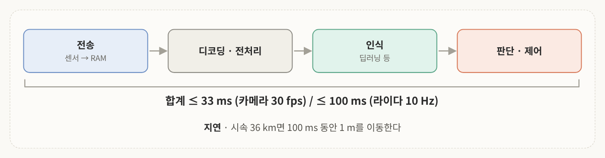
<!-- 슬라이드 9: 한 프레임의 예산 -->

그럼 33ms 안에 뭐가 들어가야 할까.

1. 센서에서 메모리(RAM)로 **전송**
2. **디코딩 · 전처리** (무조건 디코딩을 한다는 건 아니고 전처리임)
3. 딥러닝 알고리즘 같은 걸로 **인식**
4. **판단 · 제어** 출력

이 모든 게 33ms 안에 끝나야 함. 라이다 10Hz면 100ms 안에.

| 용어 | 뜻 |
|---|---|
| **지연 (latency)** | 센서가 본 순간부터 로봇이 반응하기까지의 시간. 시속 36km면 100ms 동안 1m 이동 |
| **처리량 (throughput)** | 초당 처리 프레임 수 |

둘 다 예산 안에 들어야 "실시간"이라고 부를 수 있음.

---

## 5. 이미지 데이터의 처리 과정

### 5-1. 이미지 파이프라인: 센서에서 인식까지

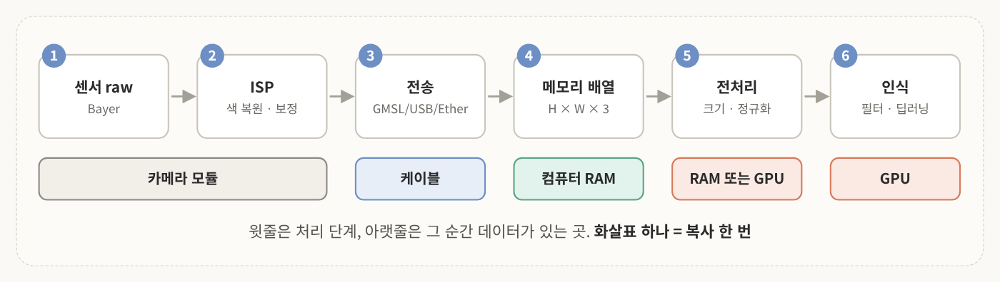
<!-- 슬라이드 11: 이미지 파이프라인 -->

찍힌 이미지가 인식까지 가는 과정임. 개론이라 핵심 과정만 적었고, 윗줄이 처리 단계, 아랫줄이 그 순간 데이터가 있는 곳임.

- **①② 카메라 모듈 안**: 센서의 raw(Bayer) 데이터가 촬영되고, ISP(Image Signal Processing) 칩셋이 색을 복원하고 보정함
- **③ 케이블**: GMSL, USB, 이더넷을 타고 컴퓨터로 이동. 고용량 데이터를 USB 2.0으로 보내면 밀림. 이더넷도 센서가 여러 개 연결되면 병목이 없는지 봐야 함
- **④ 메모리 배열**: RAM에 놓인 순간부터 프로그램이 다룰 수 있는 배열이 됨
- **⑤⑥ 전처리와 인식**: 여기서 유효한 계산이 일어남. 모든 픽셀에 같은 연산을 반복

중요한 건 <mark class="pink">화살표 하나하나가 주요한 복사 과정</mark>이라는 것. 6MB짜리 데이터가 30분의 1초마다 카메라 모듈에서 한 번, 케이블을 타고 메모리로 한 번, GPU로 또 한 번 복사됨. 파이프라인마다 서너 번의 복사가 일어나는 셈.

### 5-2. 센서에서 RAM까지: 케이블이 첫 병목

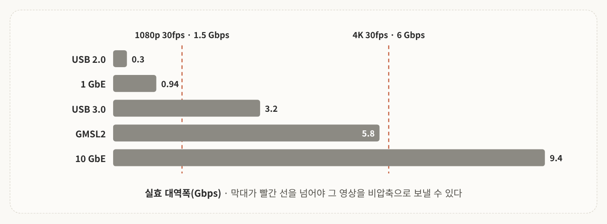
<!-- 슬라이드 12: 케이블 대역폭 vs 필요한 양 -->

이 데이터가 케이블을 통과할 수 있는지 계산해 보자. 1920×1080 픽셀, 픽셀당 24비트(RGB 각 8비트), 초당 30장을 곱하면 **약 1.5Gbps**가 필요함. 이 정도 계산만 할 수 있으면 어떤 카메라에 어떤 케이블이 필요한지 스스로 판단할 수 있음.

중요한 건 이 숫자가 아주 빨리 커진다는 것.

- 60프레임으로 올리면 → **3Gbps** (2배)
- 4K로 올리면 → **6Gbps** (픽셀 4배)

| 인터페이스 | 이론 대역폭 | 실효 대역폭 | 비압축 1080p 30fps | 비압축 4K 30fps |
|---|---|---|---|---|
| USB 2.0 | 0.48Gbps | 약 0.3Gbps | 불가 | 불가 |
| USB 3.0 | 5Gbps | 약 3.2Gbps | 가능 | 불가 |
| GMSL2 (차량용) | 6Gbps | 약 5.8Gbps | 가능 | 빡빡 |
| 1GbE (이더넷) | 1Gbps | 약 0.94Gbps | 압축 필요 | 압축 필요 |
| 10GbE | 10Gbps | 약 9.4Gbps | 가능 | 가능 |

스펙상 숫자가 그대로 나온다고 생각하면 안 됨. USB 3.0은 규격상 5Gbps지만 프로토콜 오버헤드를 빼면 실제로는 3Gbps대임. 그래서 1080p 30프레임은 되지만 4K는 어려움. 10GbE는 둘 다 여유 있는데 꽤 비싸고 안정화된 제품이 아직 많지 않음. 1GbE는 어느 쪽이든 압축해서 보내야 함.

압축하면 케이블에 여유가 생기지만 컴퓨터가 디코딩할 계산과 지연이 늘어남. 그 지연 때문에 시간을 맞추는 알고리즘까지 추가돼야 해서, 로봇과 차량은 보통 비압축 GMSL과 USB 3.0을 많이 씀.

정리하면 <mark class="mint">카메라 대수 × 해상도 × 프레임률이 케이블과 인터페이스를 정함</mark>. 로봇을 설계할 때 꼭 해 봐야 하는 계산임.

> 💡 슬라이드에는 "카메라 4대(1080p) ≈ 6Gbps → GMSL2가 딱 맞음"이라고 나오는데, 이건 이론값 6Gbps 기준임. 실효 5.8Gbps로 보면 4K 30fps처럼 빡빡한 수준이라고 보는 게 맞음.

### 5-3. RAM 위의 이미지: 2D 격자는 사실 1줄이다

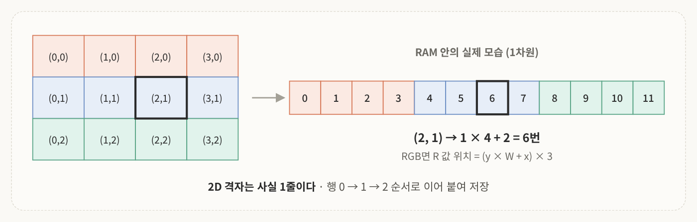
<!-- 슬라이드 13: RAM 위의 이미지 -->

메모리는 사실 1차원 배열임. 2D 이미지는 일반적으로 **행 단위로 이어 붙여서** 저장함. 3행 4열 예시를 보면 (2, 1) 픽셀의 위치는 y 인덱스 1 × width 4 + x값 2 = **6번**으로 계산할 수 있음. RGB라면 R 값 위치는 (y × W + x) × 3임.

여기서 중요한 건 <mark class="pink">메모리 접근 순서가 속도를 정한다</mark>는 것.

CPU는 메모리를 하나만 가져오는 게 아니라 덩어리로 가져옴. 행 방향으로 연속된 주소를 읽으면 CPU 캐시가 미리 가져다 놔서 훨씬 빠름. 반면 열 방향으로 읽으면 0번, 4번, 8번, 1번, 5번, 9번처럼 점프하면서 읽어야 해서 몇 배는 느려짐.

같은 맥락에서, float32로 바꾸면(정규화) 배열이 4배 무거워짐. 6.2MB가 25MB가 됨.

### 5-4. 실측: 같은 덧셈인데 행 방향 34ms, 열 방향 582ms

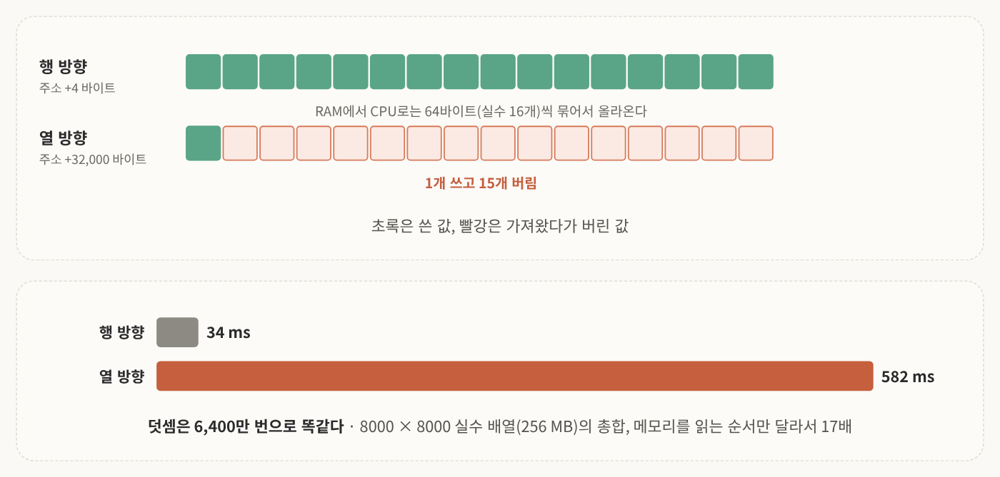
<!-- 슬라이드 14: 행 방향 vs 열 방향 -->

8000 × 8000 크기 실수 배열(256MB)의 총합을 구한 실험임. 덧셈 횟수는 6,400만 번으로 똑같고, 다른 건 메모리를 읽는 순서뿐임.

결과는 **행 방향 34ms, 열 방향 582ms**. 대략 17배 차이.

왜 이렇게 차이가 날까? 이유는 **캐시**임. RAM에서 CPU로 데이터가 올라올 때 64바이트씩, 즉 실수 16개씩 묶어서 올라옴.

- **행 방향**: 16개를 다 쓰고, 또 새로 읽어서 다 씀
- **열 방향**: 16개를 들고 와서 1개 처리하고 15개는 버림. 이걸 반복

그래서 대략 16~17배 차이가 나는 것. 이미지에 적용하면 한 행을 따라 처리하면 빠르고 열을 따라 처리하면 느림. 필터를 설계하든 이미지에 접근하든, 간단하지만 속도에 상당히 영향을 주는 이슈임.

> **코드가 아니라 데이터의 배치와 접근 순서가 속도를 정한다.** GPU에서도 같은 원리가 나옴(2편의 메모리 계층).

### 5-5. 전처리와 인식: 모든 픽셀에 같은 연산을

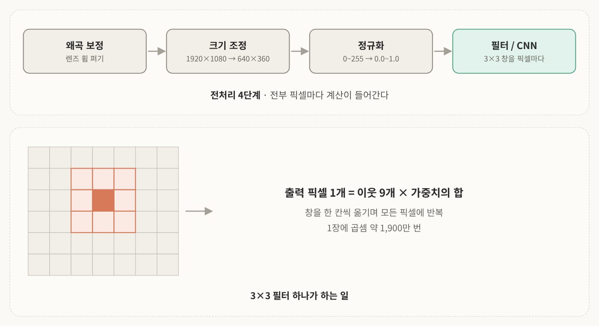
<!-- 슬라이드 16: 전처리 4단계, 3×3 필터 -->

RAM에 놓인 배열에 계산을 해야 함. 전처리 4단계를 보자.

- **왜곡 보정 (undistort)**: 렌즈 왜곡을 펴 주는 작업
- **크기 조정 (resize)**: 모든 해상도를 다 쓸 필요는 없으니 줄여서 씀 (예: 1920×1080 → 640×360)
- **정규화 (normalize)**: 픽셀마다 나눗셈으로 값을 0~1로 낮춤. 필터나 딥러닝에 정규화된 분포를 넣으면 일반적으로 인식률이 올라감
- **필터 / CNN**: 3×3 창으로 convolution 연산을 돌려 결과를 뽑음

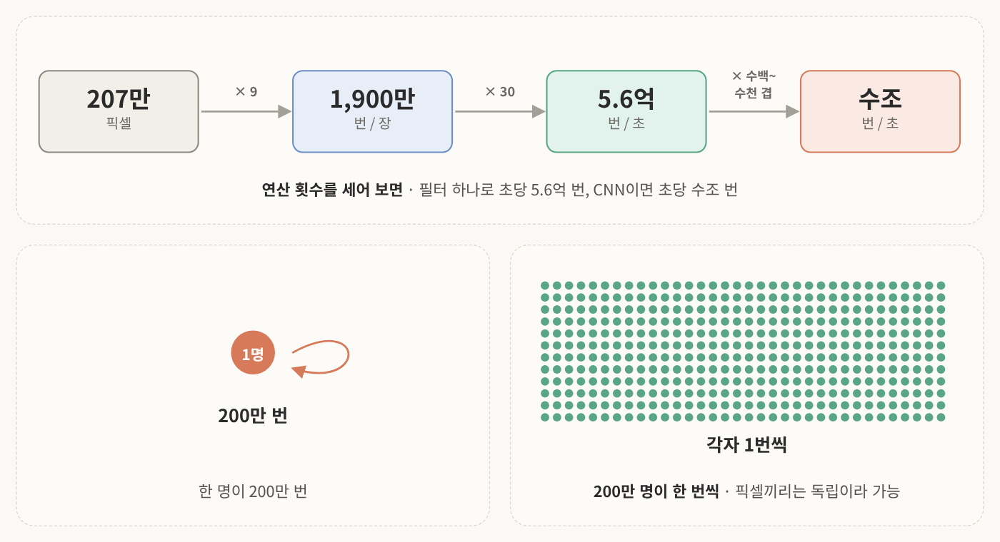
<!-- 슬라이드 16: 연산 횟수 세기 -->

연산 횟수를 세어 보면

- 3×3 필터는 덮고 있는 픽셀끼리 곱하니까(elementwise multiplication) 9번의 곱셈
- 한 장이 207만 픽셀이니 **1장에 약 1,900만 번**
- 초당 30장이면 필터 하나로 **초당 약 5억 6천만 번**
- CNN은 이런 필터가 수백~수천 겹이니 **초당 수조 번**

여기서 관찰 하나. <mark class="pink">픽셀마다 계산이 같고, 픽셀끼리는 독립</mark>임. 왼쪽 위 픽셀 결과가 오른쪽 아래 픽셀 결과에 영향을 거의 안 줌. 그러면 하나의 프로세서가 200만 번 하는 것보다 200만 명이 한 번씩 하면 되지 않을까? 이게 우리가 흔히 얘기하는 **GPU의 효과**임. 자세한 건 2편에서.

### 5-6. 실제로 해 보면: 필터 한 번의 결과와 시간

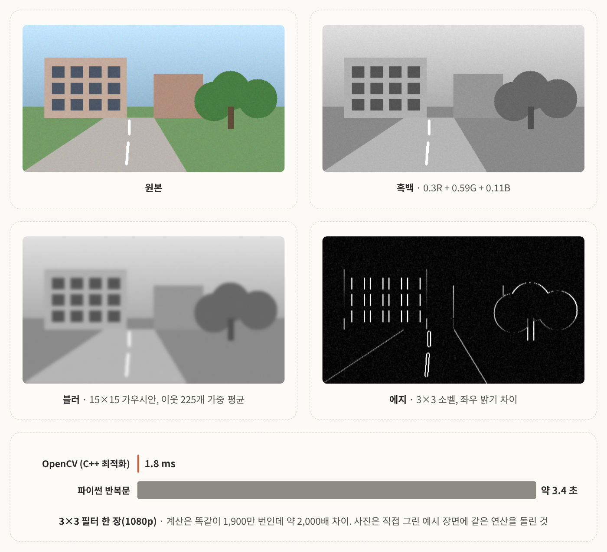
<!-- 슬라이드 17: 필터 결과와 시간. 캠퍼스 사진 대신 직접 그린 예시 장면에 같은 연산 적용 -->

강의에서는 고해상도 캠퍼스 사진을 1920×1080 컬러로 바꾸고 이런 처리를 해 봤음.

- **흑백 변환**: R, G, B를 가중 평균으로 합침. 가중치는 R 0.3, G 0.59, B 0.11로 총합이 1
- **블러**: 15×15 가우시안 필터. 총 225개 이웃의 가중 평균
- **에지**: 3×3 Sobel 필터로 좌우 픽셀 밝기 차이 계산

그럼 시간은 어떨까?

- OpenCV의 C++ 최적화 라이브러리: 3×3 필터 한 장에 약 **1.8ms**
- 파이썬 반복문으로 픽셀 하나씩: 이미지 한 장에 약 **3.4초** (480×270을 실측해서 1080p로 환산)

계산 횟수는 똑같이 1,900만 번인데 속도가 약 2,000배 차이남. <mark class="mint">한 번에 몇 개를, 어떤 순서로 처리하느냐</mark>에서 이만큼 차이가 남.

물론 파이썬과 C++의 차이도 있음. 파이썬을 단순 C++로 바꾸면 시간이 많이 줄고, 테크닉을 쓰면 한 번 더 줄어듦. 다만 교수님 말씀으로는 C++로 최적화된 OpenCV를 학부생이 조금 배운 걸로 이기기는 솔직히 쉽지 않다고 함.

> 💡 2,000배의 정체가 뭔지는 2편에서 풀림. 스포하자면 for문 대신 벡터화, SIMD, 그리고 GPU로 가는 이야기임.

---

## 6. 라이다 데이터의 처리 과정

### 6-1. 라이다 파이프라인: 패킷에서 검출까지

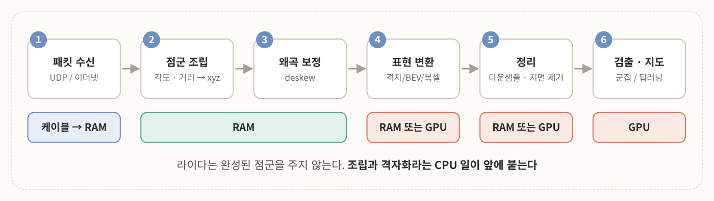
<!-- 슬라이드 19: 라이다 파이프라인 -->

이미지와 다른 점부터 말하면, <mark class="pink">라이다는 완성된 점군을 주지 않음</mark>. 카메라는 완성된 이미지를 출력해 주는데 라이다는 그렇지 않음.

- **① 패킷 수신**: 요즘 라이다는 LAN 케이블이 일반적임. 이더넷 패킷이 초당 수천 개씩 들어옴
- **② 점군 조립**: 컴퓨터가 네트워크로 받아서 각도와 거리를 x, y, z로 조립함. 보통 ROS 미들웨어를 쓰는데, 라이다는 ROS와 함께 발전해서 대부분 패키지를 잘 지원함
- **③ 왜곡 보정 (deskew)**: 움직이면서 돌기 때문에 이동량을 보정함
- **④ 표현 변환**: 포인트 클라우드를 그대로 쓰기도 하고, bird's-eye view나 복셀, 격자로 바꾸기도 함
- **⑤ 정리**: 너무 멀거나 가까운 점, 필요 없으면 지면 점 같은 걸 제거함
- **⑥ 검출 · 지도**: 실제 태스크(detection, semantic segmentation, registration, localization)로 넘김

참고로 필터 아웃되기 전 값들도 네트워크 패킷에는 실려 있음. 패킷을 직접 처리하는 코드를 짤 수 있으면 버려지는 데이터까지 받아서 활용할 수 있음.

데이터 양은 카메라보다 작지만 조립과 격자화 같은 일이 CPU에 붙어서, CPU 입장에서는 라이다가 조금 더 부담되는 데이터임.

### 6-2. 패킷에서 점군으로: 각도와 거리를 좌표로

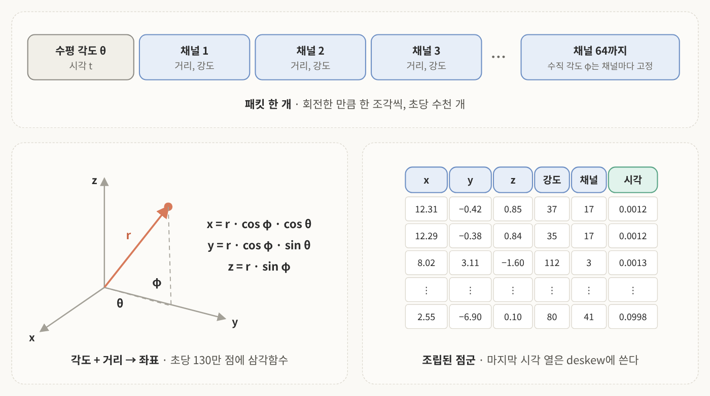
<!-- 슬라이드 20: 패킷과 점군 -->

위에서 아래로 늘어선 레이저의 각도가 φ(파이)이고 이건 채널마다 고정임. 위에서 보면 뱅글뱅글 도는 각도가 θ(세타)임. 레이저 하나하나를 **채널**이라고 부르고, 회전한 만큼 한 조각의 덩어리가 패킷으로 들어옴. 채널마다 거리와 강도가 나오고, 회전하면서 수평 각도 θ와 시각이 바뀜.

컴퓨터는 이걸 받아서 삼각함수로 좌표를 구함.

$$
x = r \cos\varphi \cos\theta, \quad y = r \cos\varphi \sin\theta, \quad z = r \sin\varphi
$$

64채널이면 초당 130만 점을 이렇게 계산해야 함. CPU 한 코어로도 가능하지만 연산량이 적지는 않음. 다행히 ROS 드라이버가 이 계산을 대신해 줌.

출력된 데이터는 오른쪽 표처럼 들어옴. x, y, z는 계산된 값이고 intensity, 채널 번호를 받을 수 있음. 그리고 **시각 정보**가 추가로 있는데, 왜 필요하냐면 바로 다음에 나오는 deskew 때문임.

### 6-3. 움직이는 로봇의 문제: 한 바퀴 도는 동안 세상이 바뀐다

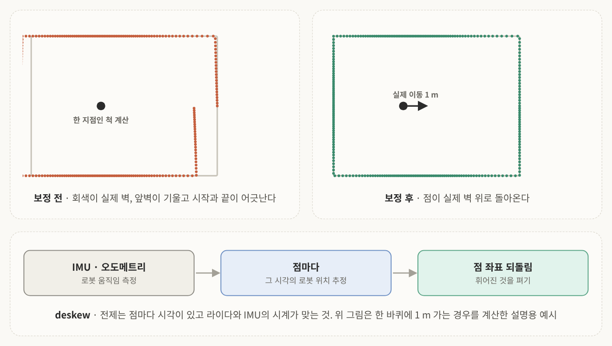
<!-- 슬라이드 21: motion distortion, deskew. 방 구조는 설명용으로 직접 계산 -->

로봇은 실제로 움직임. 라이다는 제자리에서 도는 게 아니라 로봇과 함께 이동하면서 돌고, 스캔 시작과 끝의 점은 서로 다른 곳에서 잰 것임.

근데 이 이동을 고려하지 않고 **한 지점에서 측정한 것처럼** 계산하면 왜곡이 쌓임. 곧은 벽이 휘어 나오고, 물체가 늘어나고, 정합(alignment)이 안 되거나 에러가 생김.

그래서 IMU로 라이다의 모션을 측정해서 **점마다 그 시각의 로봇 위치를 추정**하고, 점 좌표를 다시 되돌림. 찌그러지고 휘어진 걸 다시 펴는 이 과정이 <mark class="pink">deskewing</mark>임. IMU 오도메트리는 오차가 계속 누적되지만, 어차피 10분의 1초만 쌓이면 되니까 그 정도 모션은 추정할 수 있음.

전제는 두 가지.
- **점마다 시각**(timestamp)이 있어야 함
- **라이다와 IMU의 시간이 맞아야** 함 (PTP, GPS PPS로 시간 동기)

점 13만 개마다 변환 행렬을 곱해야 하니 이것도 역시 "같은 연산을 많은 데이터에"임.

> 💡 슬라이드에 따르면 카메라도 롤링 셔터면 같은 문제가 있음. 한 프레임을 위에서 아래로 순서대로 읽는 동안 로봇이 움직이니까, 원리가 똑같음.

### 6-4. 점군을 다루기 쉽게: 격자로 바꾸기

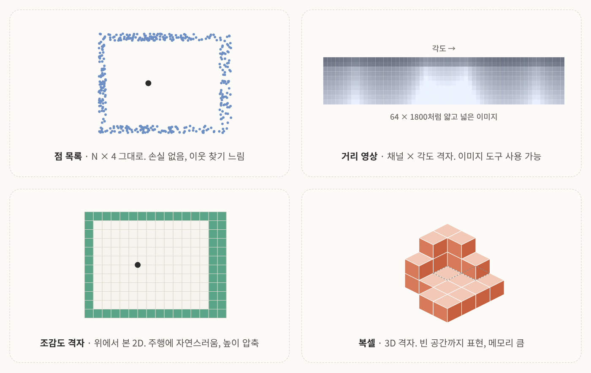
<!-- 슬라이드 22: 점군의 네 가지 표현 -->

포인트 클라우드는 sparse한 테이블 형태라 다루기 어려움. 메모리나 알고리즘 입장에서 다루기 편하려면 규칙적인 방식으로 표현하는 게 좋음.

| 표현 | 구조 | 장점 | 단점 |
|---|---|---|---|
| **점 목록 (Point cloud)** | 있는 그대로 N × 4 | 정보 손실 없음 | 이웃 찾기 느림, 빈 공간 표현 불가 |
| **거리 영상 (Range image)** | 채널 × 각도 격자, 64 × 1800 | 2D 이미지처럼 처리, 작고 빠름 | 멀리서 겹치는 점 손실 |
| **조감도 격자 (BEV grid)** | 위에서 본 2D 격자, 0.1m 셀 | 주행에 자연스러움, 검출 모델에 적합 | 높이 정보 압축 |
| **복셀 (Voxel)** | 3D 격자, 0.2m 정육면체 | 빈 공간 · 미지 공간 표현 | 메모리 큼 (빈 칸도 저장) |

이웃 찾기가 왜 중요하냐면, 포인트 클라우드로 하려는 일이 결국 주변 정보를 모아서 기하학적 특징을 표현하는 것이기 때문임. 이웃 찾기가 느리면 그만큼 오래 걸림. 그래서 빠르게 연산해야 하는 로봇이나 자동차에서는 점 목록 그대로는 잘 안 쓰려고 함.

나머지 표현의 원리는 하나임. <mark class="mint">불규칙한 점을 규칙적인 칸에 넣는 것</mark>. 그러면 이미지에서 쓰는 필터, CNN, GPU를 편하게 쓸 수 있음. 대신 칸 크기만큼 정보를 잃고 빈 칸에도 메모리를 씀. 내 애플리케이션에서 잃는 정보가 중요하지 않다면 적극적으로 변환해서 쓰면 됨.

가장 중요한 건 사실 GPU임. GPU에서 빠르게 쓰려면 거리 영상, BEV, 복셀이 훨씬 유리함. 포인트 클라우드도 graph convolution network 같은 테크닉으로 GPU를 쓸 수는 있지만 속도 차이가 많이 남.

---

## 7. 두 파이프라인에 공통인 것들

### 7-1. 스트리밍: 센서는 기다려 주지 않는다

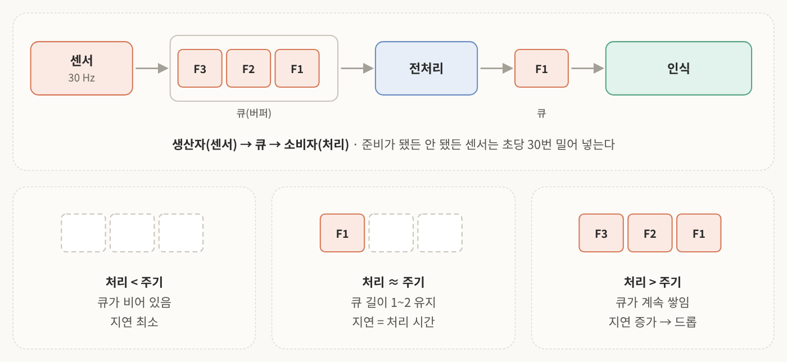
<!-- 슬라이드 24: 생산자-큐-소비자 -->

우리가 준비가 됐든 안 됐든 센서는 초당 30번 데이터를 밀어 넣음. 그래서 구조가 **생산자(센서) → 큐(queue) → 소비자**(컴퓨터)가 됨. 센서가 큐에 넣고, 전처리가 꺼내서 처리하고, 다시 큐에 넣으면 인식이 꺼내서 처리함.

속도로 보면 상황은 3가지뿐임.

| 상황 | 큐 | 지연 |
|---|---|---|
| 처리 < 주기 | 항상 비어 있음 | 최소 |
| 처리 ≈ 주기 | 길이 1~2 유지 | 처리 시간만큼 유지 |
| 처리 > 주기 | 계속 쌓임 | 증가, 메모리가 무한히 커지거나 크기 제한이면 오래된 데이터가 남음 |

로봇에게는 <mark class="pink">"늦은 정확한 답"보다 "지금의 답"이 훨씬 중요</mark>함. 그래서 밀리면 최신 프레임만 남기고 나머지는 버리도록(드롭) 보통 디자인함.

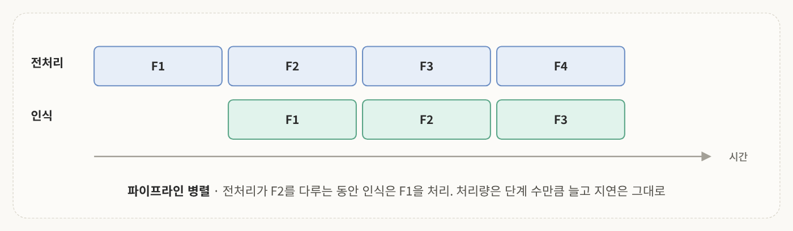
<!-- 슬라이드 24: 파이프라인 병렬 -->

그리고 **파이프라인 병렬**도 있음. 전처리가 프레임 2를 다루는 동안 인식이 프레임 1을 처리하면 단계 수만큼 처리량이 늘어남. 다만 지연은 그대로.

30프레임 기준으로 단계 하나가 33ms를 넘으면 그 단계를 병렬로 쪼개야 함. CPU에서는 멀티코어, GPU에서는 GPU 병렬화로 쪼갤 수 있음.

### 7-2. 카메라와 라이다를 합치려면: 시간과 공간을 맞추기

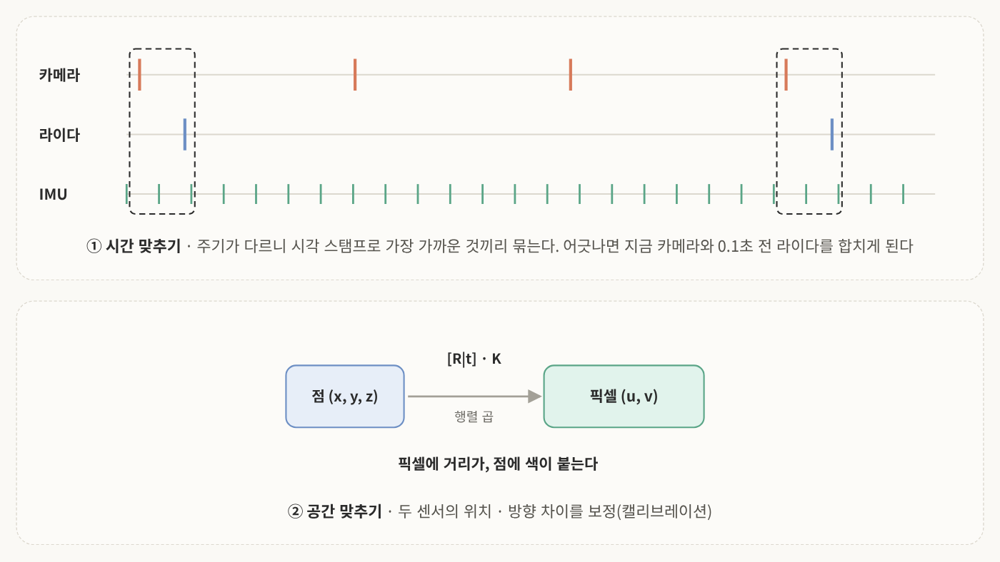
<!-- 슬라이드 25: 시간 동기화와 캘리브레이션. 시각 어긋남은 설명용 -->

카메라와 라이다를 같이 쓰려면 두 가지를 맞춰야 함.

**① 시간 맞추기 (time synchronization)** 
카메라는 30프레임, 라이다는 10프레임, IMU는 50, 100, 200Hz처럼 주기가 다름. 시간 기준으로 가장 가까운 것끼리 짝지어야 하는데, 타임 싱크가 어긋나 있으면 지금 카메라와 0.1초 전 라이다를 합치게 됨.

- **하드웨어 싱크**: 라이다 회전 모터의 인코더 정보로 카메라에 싱크 시그널을 날려서, 라이다가 특정 방향을 지날 때 카메라를 트리거함. 어긋남이 없지만 추가 장비가 들어감. 군사용이나 정교한 로봇팔 시스템에서 씀
- **소프트웨어 싱크**: 가볍게 쓰는 로보틱스에서는 둘 다 free-run시키고, 타임스탬프를 보고 알고리즘을 설계하거나 IMU로 보정함

일반적으로는 소프트웨어 싱크를 쓰는데, 명확하게 하려면 하드와이어로 엮는 게 좋음.

**② 공간 맞추기 (calibration)** 
센서는 위치도 다르고 바라보는 시점도 다름. 이걸 보정하지 않으면 동시에 쓰기 어려움. 두 센서의 위치 · 방향 차이를 rotation, translation 파라미터 [R\|t]로 계산하는 게 **extrinsic calibration**임. 로보틱스에서는 그냥 캘리브레이션이라고 부름.

카메라 내부 파라미터 K와 함께 한 번 재 두면, 점 (x, y, z)마다 행렬 곱으로 픽셀 (u, v)가 나옴. 점 13만 개에 행렬 곱이니까 이것도 같은 연산의 반복임.

결과적으로 <mark class="mint">이미지의 픽셀에 거리가 붙고, 점에 색이 붙음</mark>. "카메라가 본 저 사람은 12m 앞에 있다" 같은 판단이 가능해짐.

### 7-3. 데이터는 무겁다: 이동 경로마다 속도가 다르다

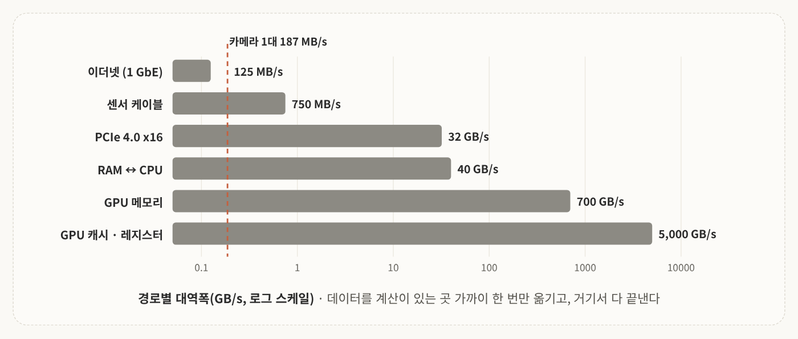
<!-- 슬라이드 26: 경로별 대역폭 -->

오늘의 결론 슬라이드 중 하나임. 데이터가 지나는 경로별 대역폭을 로그 스케일로 그린 것.

| 경로 | 대역폭 | 카메라 1대(187MB/s) 비중 |
|---|---|---|
| 1GbE 이더넷 | 125MB/s | 150% (아예 안 됨) |
| 센서 케이블 (GMSL2/USB3) | 750MB/s | 25% |
| PCIe 4.0 x16 (CPU ↔ GPU) | 32GB/s | 0.6% |
| RAM ↔ CPU | 40GB/s | |
| GPU 메모리 | 700GB/s | 0.03% |
| GPU 캐시 · 레지스터 | 5,000GB/s | |

패턴은 <mark class="pink">멀리 옮길수록 좁고 느리다</mark>는 것. 계산이 일어나는 곳에 가까울수록 빠름. 그래서 원칙은 하나임.

> **데이터를 계산이 있는 곳 가까이 한 번만 옮기고, 거기서 다 끝낸다.**

로보틱스는 디스크에 저장했다가 가져오는 게 아니라 센서 데이터를 실시간으로 옮겨 와야 해서, 수집 영역과 계산 영역 사이의 간극이 항상 존재함. 그래서 GPU 데이터는 GPU 안에서, CPU 데이터는 CPU 안에서 돌리는 식으로 처리하는 곳 가까이에서 돌리는 게 가장 빠름.

---

## 8. 핵심 요약

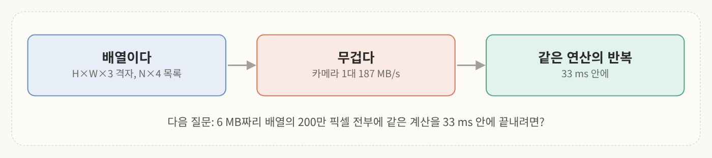
<!-- 직접 만든 그림: 1편 정리 -->

1. **센서 데이터는 배열이다**: 이미지는 H×W×3 격자, 점군은 N×4 목록. 격자로 만들면 같은 도구를 쓸 수 있음
2. **배열은 무겁다**: 카메라 1대 187MB/s. 복사 한 번, 케이블 하나가 곧 시간임
3. **파일 크기 ≠ 메모리 크기**: 처리하려면 반드시 풀어야 함. 그래서 로봇 인식은 비압축을 씀
4. **실시간은 유실 없이 다음 데이터 전에 끝내는 것**: 30fps면 33ms 예산 안에 전송, 전처리, 인식, 제어
5. **이미지 파이프라인**: 화살표 하나가 복사 한 번. 케이블이 첫 병목. 카메라 대수 × 해상도 × 프레임률로 인터페이스가 정해짐
6. **접근 순서가 속도를 정한다**: 같은 덧셈이 행 방향 34ms, 열 방향 582ms
7. **라이다 파이프라인**: 패킷 조립, deskew, 격자화가 앞에 붙음
8. **공통 문제**: 센서는 안 기다려 주니 큐와 드롭, 합치려면 시간 동기와 캘리브레이션

교수님이 강조한 연산 예산은 이렇게 정리됨. 빠르면 33ms 안에, 느리면 100ms, 아무리 늦어도 1초 안에는 뭔가를 처리해서 던져 줘야 로봇이 동작함.

>한 줄로 묶으면  
>**센서 데이터는 무거운 배열이고, 처리는 그 배열의 모든 칸에 같은 연산을 33ms 안에 반복하는 일이다.**

그럼 다음 질문은 자연스럽게 이거임. **6MB짜리 배열의 200만 픽셀 전부에 같은 계산을 33ms 안에 끝내려면?** 답은 2편에서.

---

## 생각해 볼 문제

강의 마지막 문제임. 교수님이 GPT나 Claude 쓰지 말고 손으로 계산해 보라고 하셨으니 먼저 풀어 보고 답을 보는 걸 추천함.

**Q1.** 4K(3840×2160) 컬러 카메라 3대를 10fps로 받으면 초당 몇 MB인가? 1GbE 이더넷 한 줄로 받을 수 있는가?

**Q2.** 라이다는 왜 대부분 이더넷으로 연결해도 충분한가?

**Q3.** 처리 시간이 40ms인 인식 모듈에 30fps 카메라를 연결했다. 1분 뒤 큐에는 몇 장이 쌓여 있는가? 로봇은 몇 초 전 세상을 보고 있는가? 어떻게 해야 하는가?

**Q4.** 점군을 복셀 격자로 바꾸면 무엇을 얻고 무엇을 잃는가?

> 💡 아래는 강의 숫자로 내가 풀어 본 답임. 공식 해설은 아님.
> - **Q1**: 약 25MB × 10 × 3 = **약 750MB/s**. 1GbE는 125MB/s라서 6배나 모자람. 한 줄로는 안 되고 압축하거나 10GbE를 써야 함
> - **Q2**: 64채널 라이다도 21MB/s라서 1GbE(125MB/s)의 약 17%임. 카메라처럼 수백 MB/s가 아님
> - **Q3**: 1분에 1,800장이 들어오고 1,500장을 처리하니 큐에 **300장**이 쌓임. 지금 처리 중인 게 1,500번째 프레임, 즉 50초 시점 장면이니까 로봇은 **약 10초 전 세상**을 보는 셈이고 이 차이는 계속 커짐. 최신 프레임만 남기고 드롭하고, 인식을 33ms 안으로 줄이거나 병렬로 쪼개야 함
> - **Q4**: 규칙적인 격자가 되니까 이웃 접근이 쉬워지고 CNN과 GPU를 쓸 수 있고 빈 공간과 미지 공간도 표현됨. 대신 칸 크기만큼 정보를 잃고 빈 칸에도 메모리를 씀

---

## 참고문헌
- 심인욱, 「센서 데이터 처리와 GPU 데이터 흐름 1강: 로봇 센서와 데이터 처리 과정」, 인하대학교 스마트모빌리티공학과 로봇특성화대학 특강 자료.