## 들어가며

1편에서 데이터가 어떻게 생겼고 얼마나 무거운가를 다뤘다면, 2편은 **그 무거운 데이터에 같은 연산을 어떻게 올바르게, 제시간에 하는가**임. 이번에도 개론이라 코드나 디테일보다 그림과 숫자 위주로 감.

교수님이 말한 강의 목표는 이거임.

> **GPU가 왜 빠른지, 그리고 언제 빠르지 않은지를 설명할 수 있게 되는 것**

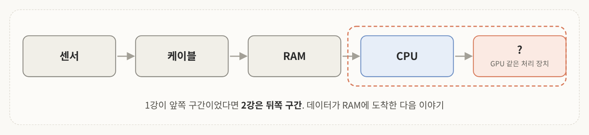
<!-- 슬라이드 2: 1강 요약 -->

1편 내용 중 기억해야 할 건 세 가지.

1. 이미지는 H×W×3, 점군은 N×4(혹은 N×5, intensity가 필요 없으면 N×3) 배열이고, 둘 다 **RAM 위에 1차원으로** 존재함
2. 카메라 한 대가 약 **187MB/s**. 복사하거나 처리하는 것 하나하나가 시간이 많이 드는 작업임
3. 처리는 **같은 연산의 반복**. 픽셀 207만 개에 곱셈 9번이면 1,900만 번이고, 이걸 **33ms 안에** 끝내야 함

그럼 한 명이 200만 번 처리하는 것보다 <mark class="pink">200만 명이 한 번씩 하면</mark> 훨씬 빠르지 않을까? 이게 병렬화의 기본 컨셉이고 오늘 강의 전체가 이 얘기임.

2편 흐름은 이렇게 감.
1. **두 가지 병렬**: 일을 나누기 vs 데이터를 나누기
2. **왜 GPU인가**: CPU의 한계, 구조 차이, 강점과 약점, SIMT
3. **GPU 데이터 흐름**: Host와 Device, 다섯 단계, 황금률, 스레드 구조
4. **GPU 메모리 계층**: 창고 방문 줄이기
5. **실시간 파이프라인**: 스트림, Jetson, 통합 메모리

---

## 1. 두 가지 병렬

### 1-1. 일을 나누기 vs 데이터를 나누기

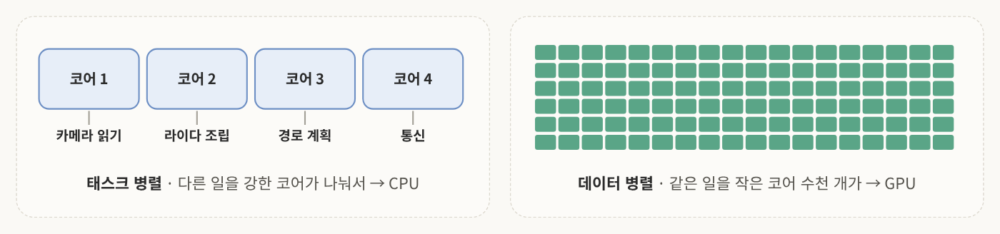
<!-- 슬라이드 3: 태스크 병렬 vs 데이터 병렬 -->

**태스크 병렬 (Task parallelism)**<br>
말 그대로 일 단위로 나누는 것. 코어 1은 카메라 읽기, 코어 2는 라이다 포인트 클라우드 조립, 코어 3은 경로 계획, 코어 4는 통신을 맡음. 서로 다른 태스크라 흐름도 다르고, 분기도 다르고, 프로세싱 주기도 다름. 이렇게 서로 다른 일을 처리하는 건 CPU가 GPU보다 훨씬 잘함.

**데이터 병렬 (Data parallelism)**<br>
같은 일을, 엄청나게 많은 데이터를 조각조각 내서 동시에 연산함. 작은 코어 수천~수만 개가 이미지 픽셀 하나씩 맡아서 완전히 같은 계산을 함. 조각끼리 독립적이고 흐름이 같아서 가능한 전략이고, 이런 일을 흔히 GPU가 맡음.

센서 데이터 처리는 <mark class="pink">데이터 병렬을 다루기 위한 가장 교과서적인 데이터</mark>임. 필터, 정규화, 크기 조정, CNN, 점 좌표 변환, 투영이 전부 "픽셀마다 같은 식, 포인트마다 같은 식"임.

로봇 소프트웨어 전체는 둘 다 씀. CPU 코어들이 센서 읽기, 계획, 통신을 나눠 맡고, 큰 데이터 계산 자체는 GPU로 넘김. CPU와 GPU를 잘 조합해서 쓰는 게 로봇의 데이터 흐름임.

### 1-2. CPU에서도 이미 그렇다: 반복문 680ms vs 벡터화 3.7ms

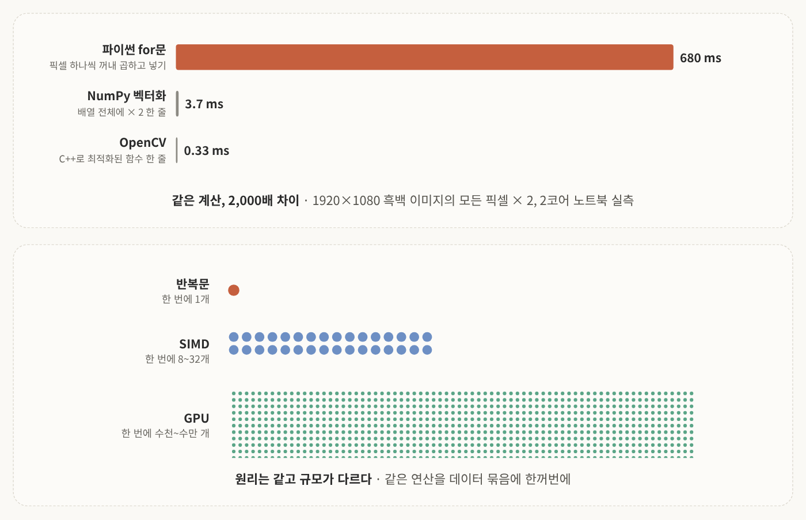
<!-- 슬라이드 4: 반복문 vs 벡터화 -->

GPU로 가기 전에, 사실 CPU 안에서도 데이터 병렬이 이미 일어나고 있음.

1920×1080 흑백 이미지의 모든 픽셀을 2배로 키우는 실험을 교수님 노트북에서 실측함.

| 방법 | 시간 | 하는 일 |
|---|---|---|
| 파이썬 for문 | 680ms | 픽셀 하나씩 꺼내서 곱하고 다시 넣기 |
| NumPy 벡터화 | 3.7ms | 배열 전체에 "× 2" 한 줄 (broadcasting) |
| OpenCV | 0.33ms | C++로 최적화된 함수 |

같은 계산인데 2,000배 이상 차이가 남. 왜 그럴까?

- **반복문**: 픽셀마다 파이썬 해석기가 끼어듦. 값을 꺼내고 넣는 데 계산보다 긴 시간이 쓰임. 자세한 건 "실시간 데이터 해석" 과목에서 다룬다고 함
- **NumPy 벡터화**: 안에 C 레벨로 최적화된 코드가 있어서 연속된 메모리를 순서대로 읽음. 거기에 CPU의 **SIMD**(Single Instruction Multiple Data), 즉 하나의 명령으로 여러 데이터를 처리하는 명령이 8~32개 값을 한 번에 계산함
- **GPU**: 이 묶음의 폭을 8~32개가 아니라 수천~수만으로 키운 것

<mark class="mint">원리는 같은데 규모가 현저히 다름</mark>. 그래서 GPU를 이해하려면 먼저 반복문과 벡터화의 차이를 이해하면 편함.

> 💡 강의에서 SIMD 폭이 슬라이드 4에서는 8~32개, 슬라이드 6에서는 8~16개로 조금 다르게 나옴. 틀렸다기보다 **값의 크기에 따라 달라지기** 때문임. 예를 들어 256비트 레지스터면 float32는 8개, 1바이트 값은 32개가 들어감.

---

## 2. 왜 GPU인가

### 2-1. CPU는 더 빨라지지 않는다

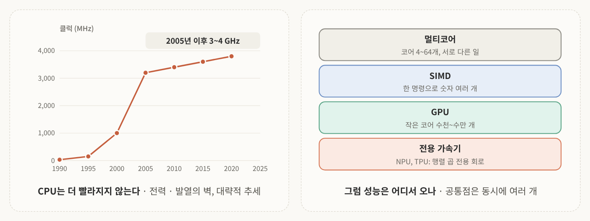
<!-- 슬라이드 6: CPU 클럭 정체, 성능은 어디서 오나 -->

CPU 클럭 속도의 역사를 보면 1990년대 33MHz, 2000년대 1GHz, 2005년쯤 3GHz, 그 뒤로 20여 년 동안 3~4GHz에 머물렀고 이제는 그마저도 거의 멈췄음.

트랜지스터는 계속 작아졌는데 **전력과 발열의 벽**(power wall)에 부딪혀서, 한 코어를 더 빠르게 만드는 길이 막힌 것. 여기서 나온 유명한 표현이 <mark class="pink">"공짜 점심은 끝났다(The free lunch is over)"</mark>임. 예전에는 같은 프로그램이 새 CPU로 바꾸면 저절로 빨라졌는데 이제는 아니라는 얘기임. 교수님은 2001학번이라 그 시절 컴퓨터가 계속 빨라지는 걸 직접 체감하셨다고 함.

그럼 지금 성능은 어디서 올까?

- **멀티코어**: 코어 4~64개에 서로 다른 일을 시킴. 교수님 공부할 때는 듀얼 코어도 대단했는데 지금은 흔함
- **SIMD**: 한 명령으로 숫자 여러 개를 동시에 계산. 2000년대 초반 인텔이 멀티미디어 처리용으로 내놓은 뒤 계속 발전함. 아까 NumPy가 빨랐던 이유
- **GPU**: 작은 코어 수천~수만 개에 단순하고 반복적인 같은 계산을 시킴
- **전용 가속기**: NPU, TPU 같은 행렬 연산 전용 장치. 강의에서는 NVIDIA 데이터센터 서버 Vera Rubin도 최신 사례로 언급함

공통점은 <mark class="mint">"동시에 여러 개"</mark>를 어떻게 빠르게 처리할까임. 결정적으로 시스템이 복잡해졌으니 소프트웨어가 병렬로 잘 짜여 있어야만 빨라짐. 아무리 컴퓨터가 좋아도 파이썬 반복문으로 계산하면 4GHz든 CPU가 100개든 느림.

교수님이 덧붙인 말이 인상적이었음. 요새는 Codex나 Claude Code가 코딩을 정말 잘해 주지만, 하드웨어와 시스템에 대한 확실한 이해는 사람이 들고 있어야 AI와 협업할 수 있다는 것.

### 2-2. CPU와 GPU는 칩의 면적을 다르게 쓴다

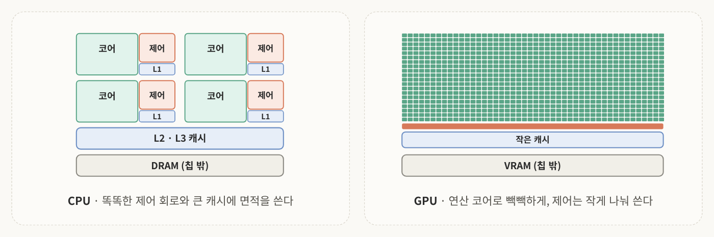
<!-- 슬라이드 7: Multi-core CPU vs GPU -->

**CPU**는 코어가 4개쯤 있고, 코어마다 컨트롤 회로와 L1 캐시가 붙어 있음. L2 캐시는 코어 둘이 공유하고, L3 캐시와 DRAM은 전체가 공유함(DRAM은 CPU 밖에 있음). 제어 회로는 분기를 예측하고 필요하면 명령 순서를 바꾸는 똑똑한 일에 많은 면적을 씀.

**GPU**는 제어 회로가 작게 쪼개져 있고 L1 캐시도 그렇고, 연산 코어가 빽빽하게 차 있음.

| | CPU | GPU |
|---|---|---|
| 코어 수 | 4~64개, 강함 | 수천~수만 개, 단순 |
| 제어 회로 | 큼: 분기 예측, 순서 재배치 | 작음: 여러 코어가 하나를 공유 |
| 캐시 | 큼 (수십 MB) | 작음, 대신 메모리 대역폭이 매우 큼 |
| 잘하는 일 | 복잡하고 제각각인 흐름, 빠른 반응 | 같은 계산을 대량으로, 높은 처리량 |

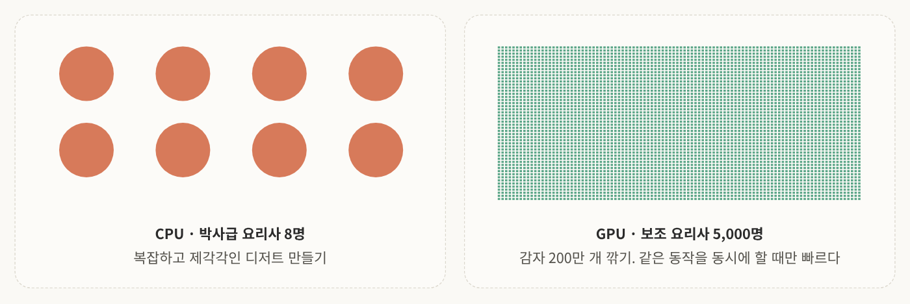
<!-- 슬라이드 7: 요리사 비유 -->

비유가 좋음. CPU는 **박사급 요리사 8명**, GPU는 **한 가지 동작만 배운 보조 요리사 5,000명**임. 만드는 과정이 복잡한 디저트는 CPU가 좋고, "감자 200만 개를 깎아라" 같은 일은 후자가 압도적으로 빠름.

대신 보조 요리사들은 <mark class="pink">같은 동작을 동시에 할 때만</mark> 빠름. 제각각 다른 일을 시키면 박사 8명보다 느릴 수 있음.

교수님은 뉴럴 네트워크를 굳이 비유하자면 이렇다고 하심. 복잡한 일을 단순한 일로 잘 쪼개서 쌓는 것. 감자를 깎고, 채를 썰고, 볶고처럼 단계별로 쪼개서 쌓으면 복잡한 일이 됨.

### 2-3. CPU vs GPU: 강점과 약점

| | CPU | GPU |
|---|---|---|
| **강점** | 코어 하나가 매우 빠름 | 코어 수가 압도적 (수천~수만) |
| | 분기 · 불규칙한 흐름을 잘 처리 | FLOPS가 CPU의 수십 배 |
| | 무작위 메모리 접근에 강함 (큰 캐시) | 메모리 대역폭이 매우 큼 (수백 GB/s ~ TB/s) |
| | 메모리 용량이 큼 (수십~수백 GB) | 같은 연산의 대량 반복에 최적 |
| **약점** | 코어 수가 적음 | 코어 하나는 느리고 단순 |
| | 대량 반복 계산의 처리량이 낮음 | 분기(if)가 많으면 성능 급락 |
| | | 무작위 메모리 접근에 약함 |
| | | 메모리가 작고 비쌈 (8~80GB) |
| | | CPU 메모리와 분리 → 복사 비용 |

**FLOPS**는 초당 부동소수점 연산 횟수임. 대략 "클럭 × 코어 수 × 코어당 연산 수"로 계산함. 데스크톱 CPU가 약 1 TFLOPS, GPU는 수십~수백 TFLOPS임.

GPU 메모리는 빠르고 대역폭이 높게 만들어서 작고 비쌈. 싼 걸 쓰면 대역폭이 떨어져서 대용량 처리가 너무 느려짐.

딱 두 가지만 기억하면 됨.

> **GPU는 "분기에 약하고", "CPU와 메모리가 분리되어 있다".**

### 2-4. SIMT: 하나의 명령, 여러 스레드

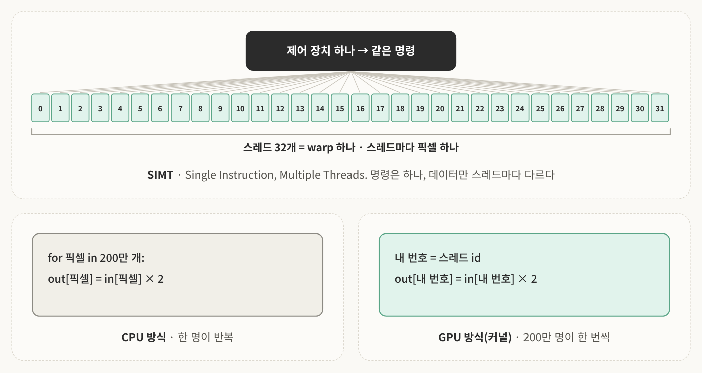
<!-- 슬라이드 9: SIMT와 CPU/GPU 코드 비교 -->

GPU가 코드를 실행하는 방식은 SIMD가 아니라 **SIMT**(Single Instruction, Multiple Threads)라고 부름. 하나의 명령으로 여러 스레드를 실행한다는 뜻임.

- **스레드(thread)**: 데이터 하나를 처리하는 작업 흐름. 예를 들어 픽셀 하나
- **warp**: 스레드 32개를 하나로 묶은 것
- 제어 장치 하나가 32개 스레드에 같은 명령을 내림. 그래서 32개 픽셀을 한 번에 처리하는 효과가 남

개발자 입장에서 뭐가 다르냐면, GPU 쪽 코드에는 <mark class="pink">반복문이 없음</mark>.

```text
# CPU 방식 (한 명이 반복)
for 픽셀 in 200만 개:
    out[픽셀] = in[픽셀] × 2

# GPU 방식 (200만 명이 한 번씩)
내 번호 = 스레드 id
out[내 번호] = in[내 번호] × 2
```

오른쪽 코드가 각 GPU 코어에서 똑같이 돌아감. 다른 건 스레드 번호뿐이라서, 1번 스레드는 1번 인덱스에, 2번 스레드는 2번 인덱스에 접근함. 프로그래머는 "픽셀 하나를 어떻게 처리할지"만 쓰고, 하드웨어가 그걸 복제해서 돌림.

이렇게 픽셀 하나를 처리하는 코드를 **커널**(kernel)이라고 부름.

---

## 3. GPU 데이터 흐름

### 3-1. 컴퓨터 안의 두 컴퓨터: Host와 Device

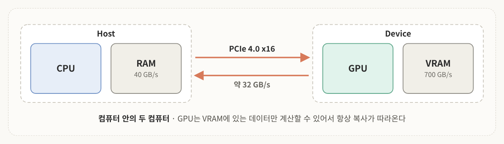
<!-- 슬라이드 11: Host와 Device -->

지금 쓰는 컴퓨터 대부분에는 heterogeneous한 두 디바이스가 공존함. 사실상 두 대의 컴퓨터가 있다고 생각하면 편함.

- **Host** = CPU + 시스템 RAM. 센서 데이터가 처음 도착하는 곳. 컴퓨터 제어권이 CPU 중심이고, GPU는 복잡한 구조를 연산하는 데 약해서 일반적으로 CPU가 관장함
- **Device** = GPU + GPU 메모리(VRAM)
- **PCIe** = 둘을 잇는 다리. NVIDIA 전용 시스템은 NVLink로 더 빠르게 잇고, GPU끼리도 NVLink로 전송함

핵심은 이거임. <mark class="pink">GPU 코어는 CPU의 RAM에 접근해서 계산하지 못함</mark>. RAM에 있는 데이터를 GPU 쪽으로 가져와야 CUDA로 계산을 돌릴 수 있음. 그래서 GPU 계산에는 항상 데이터 복사가 따라옴. RAM에서 VRAM으로 입력을 올리고, 결과를 만든 다음 다시 RAM으로 돌려보냄.

PCIe 4.0 x16은 초당 32GB임. 충분히 빠를까? 이미지 6.2MB 한 장이면 약 0.2ms니까 빠른 것 같지만, RAM 내부(40GB/s)나 VRAM 내부(700GB/s)에 비하면 훨씬 좁은 길임.

그래서 연구자나 개발자가 할 일은 **무엇을, 언제, 몇 번 옮길지 결정하는 것**임. GPU 프로그래밍의 절반은 계산이 아니라 데이터를 구조화하고 잘 배치하는 일임.

### 3-2. GPU 프로그램의 다섯 단계

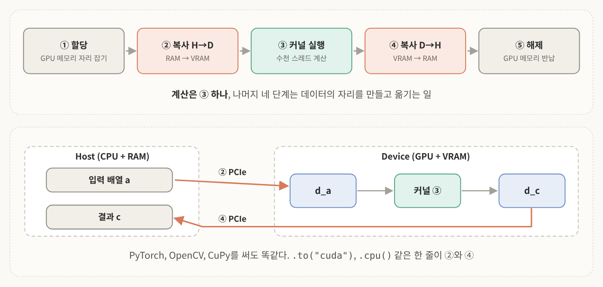
<!-- 슬라이드 12: 다섯 단계 -->

1. **할당**: GPU 메모리에 자리 잡기. 정해진 규칙 안에서 할당받아 씀
2. **복사 H→D**: Host에서 Device로 입력 복사
3. **커널 실행**: device 메모리로 계산
4. **복사 D→H**: 결과를 Host로 복사
5. **해제**: 다른 프로세스가 쓸 수 있게 GPU 메모리 반납

Host의 입력 배열 a가 Device의 d_a로 복사되고, 커널로 계산해서 d_c에 저장하고, 다시 c로 복사되는 구조임.

여기서 <mark class="mint">계산은 ③ 하나고 나머지는 다 데이터 이동</mark>임. PyTorch를 쓰든 OpenCV를 쓰든 CuPy를 쓰든 똑같음. 코드의 `.to("cuda")`, `.cpu()` 같은 한 줄이 ②와 ④이고, 보통 이 전송이 가장 느림.

### 3-3. 첫 실험: 벡터 덧셈, GPU가 CPU보다 느리다?

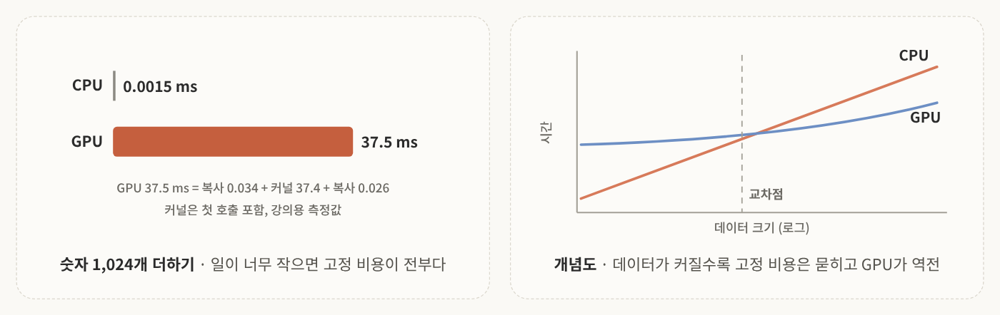
<!-- 슬라이드 13: 벡터 덧셈 실험과 교차점 개념도 -->

학생들이 GPU를 처음 켜서 해 보는 프로그래밍이 벡터 덧셈 같은 거임. 숫자 1,024개짜리 배열 두 개를 더해서 시간을 재 봄.

| 구간 | 시간 (ms) |
|---|---|
| CPU에서 그냥 더하기 | 0.0015 |
| GPU: 복사 H→D | 0.034 |
| GPU: 커널 실행 (첫 호출) | 37.4 |
| GPU: 복사 D→H | 0.026 |
| **GPU 합계** | **37.5** |

코어도 훨씬 많고 단순한 연산인데 왜 CPU보다 훨씬 느릴까?

- **일이 너무 작다**: 덧셈 1,024번은 CPU가 1.5μs면 끝냄. 아까 1,900만 번 얘기했는데 천여 번은 병렬화 효과가 없음
- **고정 비용이 있다**: GPU 준비(첫 호출 초기화), 커널 띄우기, 복사 왕복은 데이터가 적어도 치러야 함
- **전송이 계산보다 크다**: 데이터가 너무 작아서 4KB 옮기는 시간에 덧셈을 수만 번 할 수 있음

하지만 데이터가 커질수록 고정 비용은 묻히고, CPU는 데이터에 비례해서 시간이 늘어나니까 결국 GPU가 역전함. 그래서 <mark class="pink">어떤 비율로 데이터를 올리고, 계산하고, 받을지를 내 데이터에 맞춰 찾아야</mark> 함.

> 💡 표를 보면 복사보다 커널이 37.4ms로 훨씬 큰데, 이건 실제 덧셈 시간이 아니라 **첫 호출 초기화가 포함된 강의용 측정값**임. "전송이 계산보다 크다"는 덧셈 자체(μs 단위)와 비교한 말임. 또 슬라이드는 고정 비용이 "데이터가 1개든 100만 개든 거의 같다"고 하는데, 복사는 실제로 데이터 크기에 비례해서 늘어남. 다만 계산으로 얻는 이득에 비하면 묻힌다는 뜻으로 보면 됨.

### 3-4. 황금률: 한 번 올리고, 여러 번 계산하고, 한 번 내린다

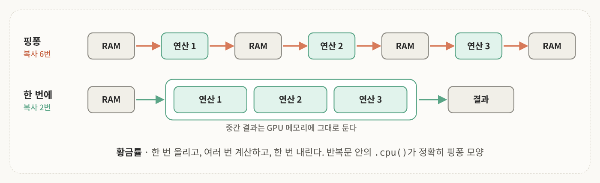
<!-- 슬라이드 14: 핑퐁 vs 좋은 패턴 -->

**나쁜 패턴: 핑퐁**<br>
작은 연산마다 GPU에 올렸다 내렸다 반복하면 연산 시간을 복사가 다 잡아먹음. 연산 3번에 복사 6번. PyTorch에서 `.cpu()`나 `.numpy()`를 반복문 안에서 부르면 정확히 이 모양임.

**좋은 패턴**<br>
메모리에 다 올리고, 연산을 쭉 돌리고, 결과를 한 번에 받음. 복사 2번이면 끝이고 중간 결과는 GPU 메모리에 그대로 둠.

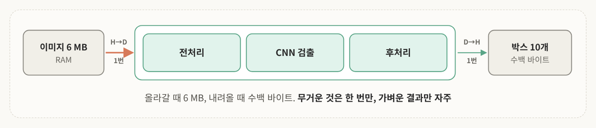
<!-- 슬라이드 14: 로봇 파이프라인 적용 -->

로봇 파이프라인에 적용하면 RAM의 이미지를 Device로 올리고, 전처리 · CNN 검출 · 후처리를 GPU에서 다 한 다음 결과만 내려받음.

올라갈 때 6MB, 내려올 때는 박스 10개 수백 바이트임. <mark class="mint">무거운 것은 한 번만 움직이고, 가벼운 결과만 자주 움직임</mark>.

다만 이미지가 무지 많아지면 H→D와 D→H가 여전히 문제가 됨. 그래서 더 고차원적인 테크닉이 필요하고, 그게 뒤에 나오는 스트림임.

### 3-5. 스레드는 층층이 묶인다: Thread → Block → Grid

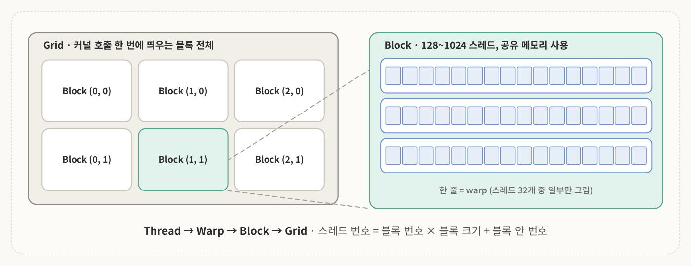
<!-- 슬라이드 15: Thread, Warp, Block, Grid -->

GPU 스레드는 계층적으로 구조화되어 있음.

| 단위 | 무엇인가 | 크기 |
|---|---|---|
| **Thread** | 데이터 한 조각(픽셀 하나)을 맡는 작업 흐름 | 1 |
| **Warp** | 같은 명령을 동시에 실행하는 스레드 묶음, 하드웨어가 자동으로 만듦 | 32 (고정) |
| **Block** | 서로 협력할 수 있는 스레드 묶음, 같은 코어(SM)에서 실행, 공유 메모리 사용 | 128~1024 (프로그래머 지정) |
| **Grid** | 커널 호출 한 번에 띄우는 블록 전체 | 필요한 만큼 |

참고로 CPU 스레드와 GPU 스레드는 조금 다름.

Grid 안에 block이 있고, block 안에 thread가 있으니 순서대로 계산하면 스레드 인덱스가 나옴.

> 스레드 번호 = 블록 번호 × 블록 크기 + 블록 안 번호

이 번호가 "내가 맡을 픽셀, 내가 맡을 포인트"를 가리킴. 계층이 있어서 1D, 2D, 3D 데이터를 모두 처리할 수 있음. 이미지는 2D(x, y), 복셀 격자는 3D로 번호를 매기면 자연스러움.

### 3-6. 픽셀 하나 = 스레드 하나: 이미지를 GPU에 펼치기

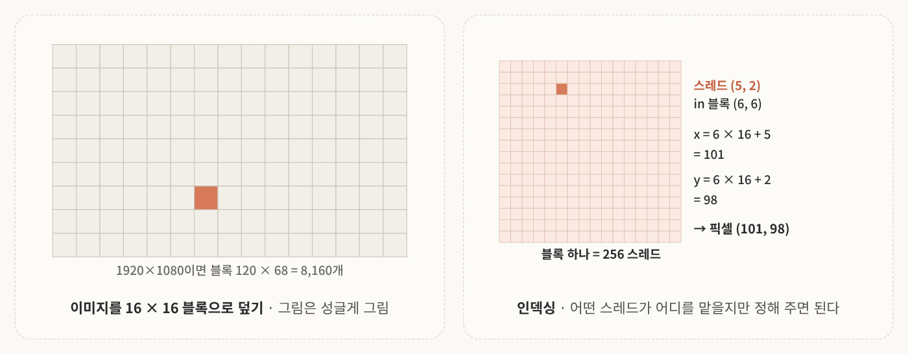
<!-- 슬라이드 16: 16×16 블록과 인덱싱 -->

이미지를 16×16 픽셀 블록으로 덮어 보자. 1080p면 블록이 120 × 68 = **8,160개**임. 블록 하나가 16×16이니까 256개 스레드가 동시에 처리함.

CPU는 픽셀 하나하나 돌아가면서 계산하지만, GPU는 16×16 블록 하나를 한 번에 처리하고 다음 블록으로 넘어감.

인덱싱도 계산해 보자. 블록 (6, 6) 안의 스레드 (5, 2)라면

- x = 6 × 16 + 5 = 101
- y = 6 × 16 + 2 = 98
- → 픽셀 (101, 98)만 처리, 메모리 주소는 (98 × 1920 + 101) × 3

계산 자체보다 컨셉이 중요함. <mark class="pink">GPU 연산은 인덱싱을 잘 계산하는 게 시작</mark>임. 어떤 스레드가 어디에 접근할지만 가이드해 주면 같은 계산을 하게 만들 수 있고, 반복문은 최소화해야 하고 없으면 더 좋음.

그런데 이런 질문이 나올 수 있음. "블록 하나를 코어 하나가 맡고, 옆 블록을 두 번째 코어가 맡으면 안 되나요?" 해도 됨. 근데 convolution처럼 인접 픽셀 연산을 모아서 하려면 곱하고 더하고 인덱싱하는 로직이 코어 하나에 들어가서 GPU가 느려짐. 그래서 인접 데이터를 한꺼번에 메모리에 올리고, 모든 코어를 할당해서 한 블록씩 처리하고 넘어가는 게 훨씬 유리함.

> 💡 슬라이드의 세부 내용 두 가지. 1080은 16으로 나눠지지 않아서 마지막 줄 블록 일부는 이미지 밖이고, 그 스레드는 "내 픽셀 없음"을 확인하고 쉼. 또 3×3 필터라면 각 스레드가 이웃 9칸을 읽어 자기 출력 한 칸을 쓰니까, 1,900만 번 곱셈이 커널 호출 한 번이 됨.

---

## 4. GPU 메모리 계층

### 4-1. GPU 안에도 가까운 메모리와 먼 메모리가 있다


<!-- 슬라이드 18: GPU 메모리 계층 -->

1편에서 RAM과 캐시를 봤음. 가까울수록 빠르고 작다는 것. GPU에도 똑같은 계층이 있음.

| 메모리 | 누가 쓰나 | 속도 | 크기 | 비유 |
|---|---|---|---|---|
| 레지스터 | 스레드 하나 | ~1 사이클 | 수십 개 | 내 손 |
| 공유 메모리 (shared) | 블록 안 스레드들 | 수 사이클 | 수십 KB | 같은 조의 작업대 |
| 전역 메모리 (global, VRAM) | 모든 스레드 + Host(복사) | 수백 사이클 | 수 GB | 건물 밖 창고 |
| 상수 메모리 (constant) | 모두 (읽기만) | 빠름 (같은 주소일 때) | 64KB | |

창고에 자주 가면 하루가 다 감. 성능의 열쇠는 <mark class="pink">창고에 몇 번 가느냐를 줄이는 것</mark>임.

**주의할 건 로컬 메모리**임. 레지스터나 shared memory는 하드웨어적으로 정해진 양이 있고, 부족할 때 프로그램이 뻗지 않게 해 주는 게 로컬 메모리임. 그림에서는 스레드 가까이 있지만 개념적인 계층일 뿐이고, **물리적으로는 글로벌 메모리에 있음**. 가변적으로 배치하려면 거대한 VRAM에서 가져다 써야 하니까. 그래서 로컬 메모리를 쓰게 되는 순간 프로그램이 상당히 느려짐.

### 4-2. 예: 3×3 필터에서 창고 방문 9번을 1번으로

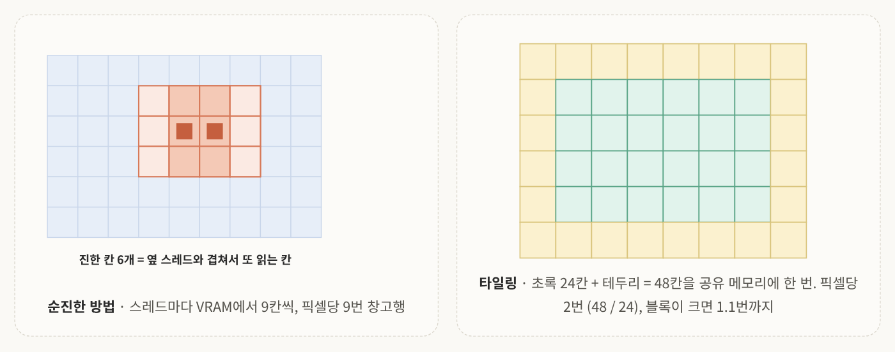
<!-- 슬라이드 19: 순진한 방법 vs 타일링 -->

**순진한 방법**<br>
스레드마다 전역 메모리에서 9칸씩 읽어 필터를 계산함. 옆 스레드와 6칸이 겹치는데 각자 또 읽음. 픽셀당 9번 창고에 가는 것.

**타일링 (tiling)**<br>
블록이 한꺼번에 가져옴. 블록이 맡은 4×6 픽셀에 테두리 1칸(halo)을 더해서 6 × 8 = 48칸을 공유 메모리에 한 번에 올림. 이후의 9칸 읽기는 공유 메모리, 즉 내 작업대에서 함.

전역 메모리 접근은 48 / 24픽셀 = 픽셀당 2번으로 줄고, 블록이 크면 1.1번까지 내려감. 동시에 써야 하는 데이터를 안다면 다 공유 메모리로 들고 와서 계산하는 게 가장 빠름.

> **먼 메모리에서 한 번 가져와 가까운 메모리에서 여러 번 쓴다.** Host ↔ Device 황금률의 축소판임.

이걸 직접 짤 필요는 없음. OpenCV CUDA, cuDNN, PyTorch의 convolution은 이미 이렇게 구현되어 있음. 다만 원리를 알면 **왜 큰 배치가 빠르고, 왜 작은 연산을 자주 부르면 느린가**를 알 수 있음.

---

## 5. 실시간 파이프라인 관점

### 5-1. 전송과 계산을 겹치기: 스트림

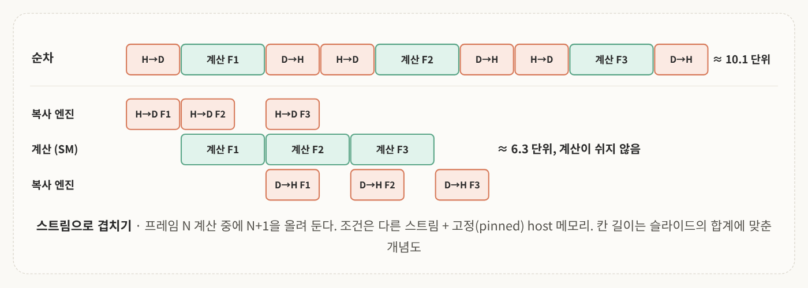
<!-- 슬라이드 21: 순차 실행 vs 스트림 -->

1편에서 파이프라인 병렬을 봤는데, GPU 안에서도 같은 걸 함. 데이터 로딩도 병렬화할 수 있다는 얘기.

**순차 실행**<br>
복사 → 계산 → 복사를 프레임마다 반복하면, 복사하는 동안 계산기가 놂. 자원 활용 측면에서 비효율적임.

**스트림으로 겹치기**<br>
GPU에는 계산기(SM)와 별도로 데이터 복사를 맡는 **복사 엔진**(copy engine)이 있음. 스트림(stream)은 GPU에 내리는 명령 줄인데, 다른 줄의 명령은 서로 겹쳐 실행될 수 있음. 이걸로 복사와 계산을 동시에 돌리도록 디자인함.

복사 엔진이 F1을 올리고, 계산 F1을 하는 동안 F2를 미리 올리고, 계산 F2를 할 때 F1 결과를 내려보내고 F3를 미리 올림. 이렇게 <mark class="pink">계산이 쉬지 않도록</mark> 만드는 것.

센서 프레임이 30Hz로 계속 오니까, 프레임 N을 계산하는 중에 N+1을 올려 두면 복사 시간이 사실상 사라짐. 순차 ≈ 10.1 단위가 겹치기 ≈ 6.3 단위로 줄어서, 같은 GPU로 **약 40%** 빨라지는 효과임.

조건은 **다른 스트림 + 고정(pinned) host 메모리**임. PyTorch에서는 `non_blocking=True`와 DataLoader의 `pin_memory`가 이 일을 해 줌. 간단하게 쓸 수 있으니 나중에 살펴보면 좋음.

### 5-2. 로봇 위의 GPU: Jetson과 통합 메모리

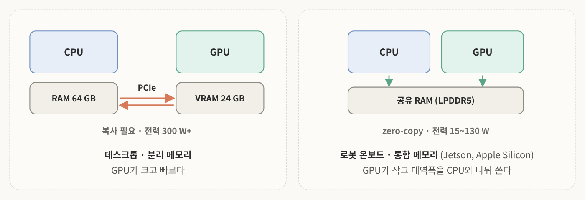
<!-- 슬라이드 22: 분리 메모리 vs 통합 메모리 -->

지금까지는 데스크톱 기준이었음. GPU와 CPU가 따로 있고 PCIe 다리로 복사하며, GPU는 크고 빠르고 전력을 300W 넘게 씀.

로봇은 저전력 엣지 디바이스를 많이 씀. **Jetson 시리즈나 Apple Silicon**처럼 CPU와 GPU가 한 칩에 통합되어 메모리를 공유하는 방식임.

교수님 연구실의 휴머노이드 **RB-Y1**에 실린 **Jetson AGX Thor**가 그 예임. CPU와 GPU가 공유 메모리를 쓰니까 서로 메모리를 교환할 때 복사가 없음(<mark class="mint">zero-copy</mark>). 대신 GPU가 데스크톱용보다 작고 메모리 대역폭을 CPU와 나눠 씀. 전력은 15~130W로 작음.

그리고 연구자가 아니면 대부분 커널을 직접 짜지 않음. 라이브러리가 대신해 줌.

| 라이브러리 | 하는 일 |
|---|---|
| OpenCV CUDA | 필터, 리사이즈, 스테레오 |
| PyTorch / TensorRT | CNN 추론, 최적화 · 양자화 |
| CuPy | NumPy 문법으로 GPU 배열 |
| PCL / Open3D | 점군 처리 (일부 GPU) |
| ROS 2 + NITROS | 노드 간 GPU 메모리 공유 |

로봇 개발자 레벨에서는 이런 라이브러리를 잘 써서 최적화하는 연습을 많이 하게 됨. 슬라이드 문장이 핵심임.

> 라이브러리가 커널 · 타일링 · 스트림을 대신하지만, **"복사를 몇 번 하는가"는 여전히 사용자의 코드가 정한다.**

### 5-3. 숫자로 비교: RB-Y1의 Jetson AGX Thor vs 데스크톱 GPU

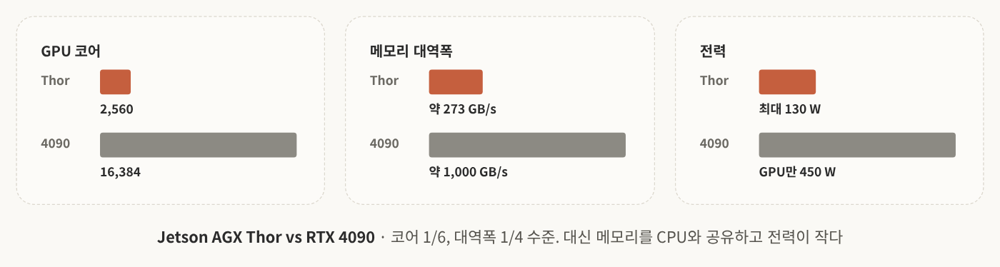
<!-- 슬라이드 23: Jetson AGX Thor vs RTX 4090 -->

| | Jetson AGX Thor (로봇 탑재) | RTX 4090 (데스크톱) |
|---|---|---|
| GPU 코어 | 2,560 CUDA 코어 (Blackwell) | 16,384 CUDA 코어 |
| 메모리 | 128GB LPDDR5X, CPU와 공유 | 24GB GDDR6X, GPU 전용 |
| 메모리 대역폭 | 약 273GB/s | 약 1,000GB/s |
| CPU | Arm Neoverse 14코어 (같은 칩 안) | 별도 CPU, PCIe로 연결 |
| 전력 | 40~130W | GPU만 450W |
| Host ↔ Device 복사 | 같은 메모리 → 생략 가능 | PCIe 32GB/s로 필수 |

코어는 1/6, 대역폭은 1/4 수준이라 <mark class="pink">데스크톱에서 8ms 걸리던 인식 모델이 로봇에서는 수십 ms가 될 수 있음</mark>. 33ms 예산을 다시 확인해야 한다는 뜻.

대신 메모리 128GB를 CPU와 공유하니까 센서 배열을 복사 없이 GPU가 바로 읽음. 다섯 단계 중 ②④가 사라지는 것.

사실 이건 선택의 문제가 아님. 교수님 말씀대로 로보틱스에서는 전력 문제 때문에 RTX 4090을 쓰기가 매우 어려움. 배터리로 움직이는 로봇에서는 전력이 GPU 선택의 첫 기준임.

---

## 6. 핵심 요약

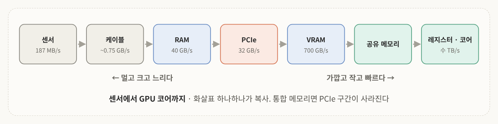
<!-- 슬라이드 24: 센서에서 GPU 코어까지 -->

두 강의를 한 그림으로 보면 이렇게 됨. 센서에서 나온 데이터가 케이블을 타고 CPU가 관장하는 RAM으로 들어가고, PCIe를 지나 VRAM으로 가고, shared memory와 레지스터를 거쳐 코어에서 계산됨. 엣지 디바이스면 PCIe 구간이 없어짐. 화살표 하나하나가 곧 복사임.


<!-- 슬라이드 24: 세 가지 결론 -->

1. **같은 연산을 많은 데이터에**: GPU는 픽셀마다 스레드 하나. 반복문 대신 인덱스 연산으로 "내 몫"만 처리. 분기 없이 쭉쭉 진행하도록 디자인
2. **성능은 복사 횟수가 정한다**: 한 번 올리고, 다 하고, 한 번 내린다. 먼 메모리는 한 번, 가까운 메모리에서 여러 번
3. **실시간은 겹치기로 만든다**: 올리기와 처리를 번갈아 하지 말고 겹쳐서. 프레임 N 계산 중에 N+1 전송

세부 내용까지 정리하면

- **병렬**: 태스크 병렬은 CPU, 데이터 병렬은 GPU
- **벡터화**: 같은 계산이 파이썬 for문 680ms, NumPy 3.7ms, OpenCV 0.33ms
- **GPU의 두 약점**: 분기에 약하고, CPU와 메모리가 분리되어 있음
- **다섯 단계**: 할당 → 복사 → 커널 → 복사 → 해제. 계산은 하나뿐
- **메모리 계층**: 가까운 순서로 레지스터 → 공유 메모리 → 전역 메모리. 로컬 메모리는 사실 VRAM
- **타일링**: 픽셀당 전역 접근 9번 → 2번
- **통합 메모리**: 복사가 사라지는 대신 GPU가 작음

>한 줄로 묶으면 <br>
>**6MB 배열 200만 픽셀을 33ms 안에 처리하려면, 한 번 올려서, 200만 스레드가 한 번씩, 다음 프레임을 미리 올리며 계산한다.**

1편의 질문에 대한 답이 이거임. 그리고 처음에 던진 "언제 빠르지 않은가"의 답은 일이 너무 작을 때, 분기가 많을 때, 데이터를 자꾸 왔다 갔다 할 때임.

---

## 생각해 볼 문제

**Q1.** 어떤 학생이 이미지 처리 30단계를 각각 GPU 함수로 만들고, 단계마다 결과를 CPU로 가져와 확인한 뒤 다음 단계로 넘겼다. 왜 느린가? 어떻게 고치는가?

**Q2.** 라이다 점 13만 개에 "20m 안쪽 점만 골라 지면인지 판정"하는 코드를 GPU로 옮겼더니 CPU보다 느렸다. 이유를 두 가지 이상 말해 보라.

**Q3.** 통합 메모리(Jetson)에서는 다섯 단계 중 어느 것이 사라지는가? 대신 무엇을 잃는가?

> 💡 아래는 강의 내용으로 내가 풀어 본 답임. 공식 해설은 아님.
> - **Q1**: 전형적인 핑퐁임. 단계마다 왕복하면 복사가 60번 일어나고 복사와 커널 띄우기 비용이 계산을 압도함. 한 번 올리고 30단계를 GPU 안에서 이어서 돌린 뒤 결과만 내리면 복사 2번으로 끝남. 중간 확인은 디버깅할 때만 함
> - **Q2**: 첫째, "20m 안쪽만"과 "지면인가"는 점마다 갈라지는 **분기**라서 GPU에 불리함. 둘째, 지면 판정에 주변 점을 찾아야 하면 **무작위 메모리 접근**이 되는데 GPU가 약한 부분임. 셋째, 13만 개는 1,900만 번에 비하면 작은 일이라 **복사와 고정 비용**이 묻히지 않을 수 있음
> - **Q3**: ②와 ④, 즉 Host ↔ Device 복사가 사라짐. 대신 GPU 규모가 작아지고(코어 1/6) 메모리 대역폭도 작은 데다 CPU와 나눠 씀(1/4). 전력을 아끼는 대신 계산 성능을 내주는 셈

---

## 참고문헌
- 심인욱, 「센서 데이터 처리와 GPU 데이터 흐름 2강: GPU 데이터 흐름 및 처리 구조」, 인하대학교 스마트모빌리티공학과 로봇특성화대학 특강 자료.
- Sutter, H. (2005). [The Free Lunch Is Over: A Fundamental Turn Toward Concurrency in Software](https://jacobfilipp.com/DrDobbs/articles/DDJ/2005/0503/0503a/0503a.html). *Dr. Dobb's Journal*, 30(3).
- NVIDIA. *CUDA C++ Programming Guide*.
- PyTorch Tutorials. [A guide on good usage of non_blocking and pin_memory() in PyTorch](https://docs.pytorch.org/tutorials/intermediate/pinmem_nonblock.html).