## 들어가며

이번 4주차는 인하대 전기전자공학부 · 전기컴퓨터공학과 **자율항법연구실(Autonomous Navigation Lab)** 원종훈 교수님 파트임. 주제는 <mark class="pink">End-to-End(E2E) 자율주행과 Sim-to-Real 문제</mark>.

교수님이 도입을 해주시고, 본 발표는 이 분야를 연구 중인 **이용하 박사과정**이 진행함. 내용은 실제로 나간 대회 얘기라 더 재밌음. 교수님 연구실이 쌓은 대회 성과부터 보면

- **2024 전국 자율주행 경진대회 1등**: 실차 기준으로 약 2시간 동안 레이싱
- **2026 E2E 자율주행 경진대회 1등**: 가상 공간에서 진행한 자율주행 대회

오늘 발표는 2026년 산업통상부 주관 **A1 챌린지**(End-to-End, Formula Racing, Multi-Agent, Reinforcement Learning), 즉 **자율주행 레이싱**을 위해 연구한 내용임.

E2E는 데이터가 굉장히 많이 필요하고 제어와 엮여 있어서 **드라이빙 시뮬레이터**가 핵심임. 그래서 알고리즘 개발도 주로 게임 같은 시뮬레이터 안에서 이뤄짐.

1편 흐름은 이렇게 감.
1. **E2E 자율주행**이란 무엇인가
2. **강화학습 기초**: 지도학습과 뭐가 다르고, loss는 어디서 나오는가
3. **알고리즘**: GT Sophy → SAC → QR-SAC
4. **데이터**: 어떻게 모으고 어떻게 골라 쓰는가
5. **보상 함수**: 12개 항을 어떻게 설계했는가
6. **커리큘럼 러닝**, 그리고 **성과와 한계**

---

## 1. End-to-End 자율주행이란

### 1-1. 모듈러에서 End-to-End로

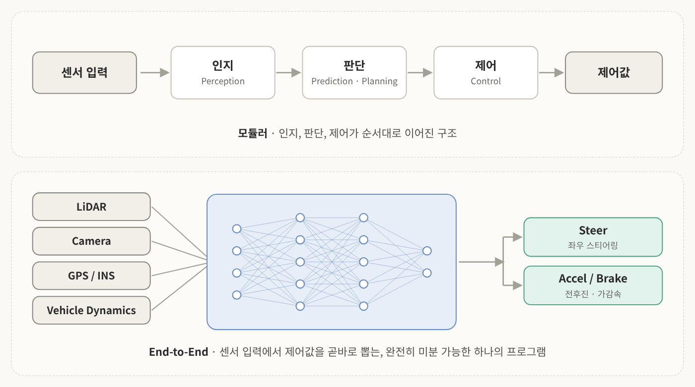
<!-- 슬라이드 3: E2E AD Pipeline + 교수님 도입 설명 -->

예전에는 소위 **모듈러(modular) 자율주행**이라고 해서 인지 → 판단 → 제어가 순서대로 이어지는 구조였음. 근데 AI가 발전하면서 자율주행차의 센서 입력에서 곧바로 제어값을 뽑아내는 기술이 들어옴.

뽑아내는 제어값은 딱 두 가지.
- **좌우 스티어링**
- **전후진 · 가감속**, 소위 acceleration / brake

이게 **End-to-End, 종단간 자율주행**임. 이걸 구현하려면 데이터셋이 엄청 많아야 하고 제어와 엮이기 때문에, 드라이빙 시뮬레이터 기술이 굉장히 중요해짐.

### 1-2. 정의와 세 가지 특징

정의부터 정확히 짚고 감.

> End-to-End 자율주행은 **raw sensor input**을 입력받아 **vehicle motion plan** 또는 **low-level control action**을 직접 출력하는, **완전히 미분 가능한(fully differentiable) 하나의 프로그램**이다.

LiDAR, 카메라, GPS/INS, vehicle dynamics 같은 센서 입력이 하나의 네트워크를 거쳐서 steering과 accel/brake로 곧바로 맵핑되는 구조임.

| 특징 | 내용 |
|---|---|
| **단순성 (Simplicity)** | perception, prediction, planning이 따로따로 모듈이었는데, 이걸 **하나의 모델로 통합해서 jointly** 학습 |
| **최적화 (Optimization)** | 중간 표현까지 포함한 전체 시스템이 **궁극의 태스크, 즉 실제 주행 성능**에 맞춰 최적화됨 |
| **데이터 기반 확장성** | 학습 데이터와 연산 자원을 늘리면 성능을 **지속적으로 향상**시킬 잠재력이 있음 |

---

## 2. 강화학습 기초

### 2-1. 지도학습 vs 강화학습

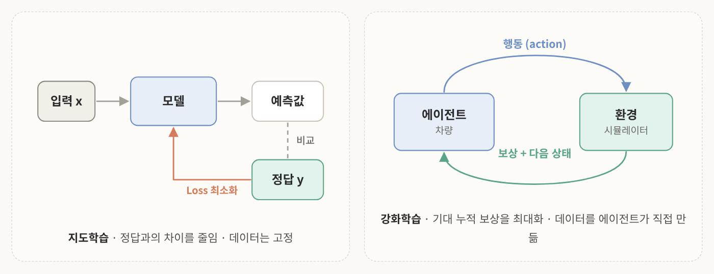
<!-- 슬라이드 4: Supervised vs Reinforced -->

| | 지도학습 (Supervised) | 강화학습 (Reinforcement) |
|---|---|---|
| 한 줄 요약 | 정답이 주어진 데이터로 **함수를 근사** | **시행착오**로 보상을 최대화하는 행동 전략을 찾음 |
| 학습 신호 | 모든 입력 x마다 붙은 **정답 label y** (지시적 신호) | 행동을 하면 환경이 주는 **스칼라 reward** |
| 목표 | 예측과 정답의 차이인 **loss 최소화** (미분 가능한 gradient 기반) | **기대 누적 보상 최대화** |
| 데이터 | **고정됨**. 학습이 진행돼도 모델 행동에 따라 안 바뀜 | **에이전트가 직접 만듦**. 환경을 탐색하며 능동적으로 얻음 |

가장 큰 차이는 <mark class="pink">데이터를 에이전트가 스스로 만들어 낸다</mark>는 것. 지도학습은 미리 라벨링된 데이터를 쓰고, 강화학습은 에이전트와 환경의 상호작용에서 나온 reward를 학습 신호로 씀.

> 💡 강의자료 표에는 "기대 누적 보상을 최소화"라고 적혀 있는데 발표 내용대로 **최대화**가 맞음.

### 2-2. Loss와 Reward는 어떻게 다를까

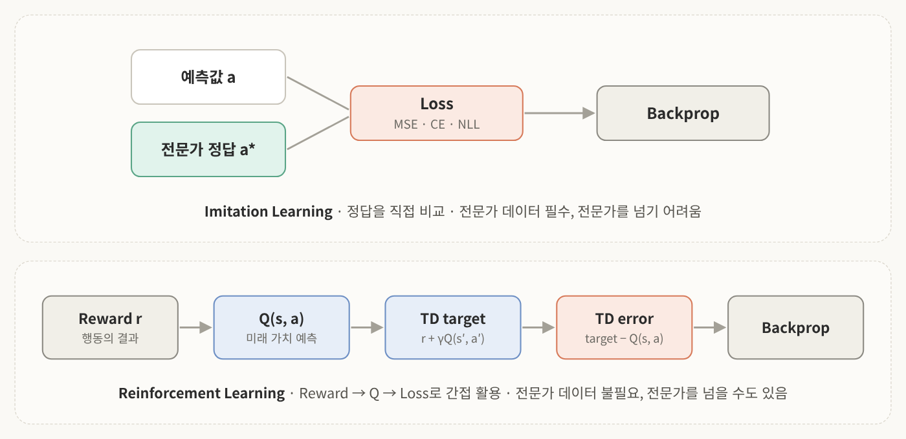
<!-- 슬라이드 5: Loss, Reward? -->

**Imitation Learning (IL)**
- Loss = **정답과의 거리**. 예측값과 정답을 직접 비교한 차이가 곧 IL loss이고, 이게 작아지는 방향이 학습 방향
- 대표적으로 **MSE, cross entropy, NLL**
- 별도의 reward 없이 **전문가(expert) 데이터와 얼마나 다른지만** 측정

**Reinforcement Learning (RL)**
- Reward는 **에이전트 행동의 결과**로 주어짐
- 그럼 RL에서 loss는 뭐냐? Reward를 바탕으로 **Q값을 추정**하고, **TD target**을 계산한 뒤, 둘의 차이로 loss를 구해서 backpropagation 함

용어를 정리하면

| 용어 | 뜻 |
|---|---|
| **Q** | 현재 행동이 가져올 **미래 가치의 예측값** |
| **TD** | Temporal Difference. 시간 간격을 둔 **두 예측의 차이** |
| **TD target** | 벨만 방정식. 현재 reward + 할인율 × 미래 보상 예측값 = r + γ · Q(s′, a′) |
| **TD error** | TD target − Q(s, a). **예측이 얼마나 틀렸는지** |

| | Imitation Learning | Reinforcement Learning |
|---|---|---|
| 감독 신호 | 전문가 레이블 | 환경 보상 (reward) |
| Loss 계산 | 직접적 | 간접적, Reward → Q → Loss |
| 전문가 데이터 | 필수 | 불필요 |
| 전문가 초월 | 불가 | 이론적으로 가능 |

### 2-3. 강화학습 루프

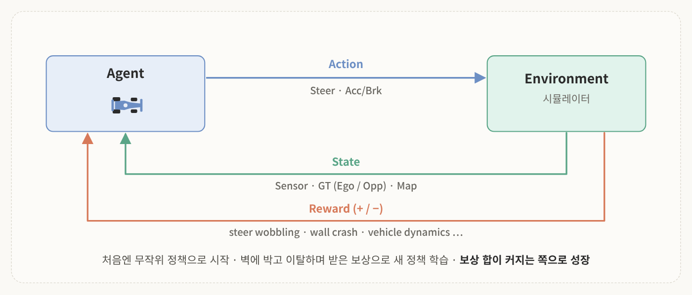
<!-- 슬라이드 6: Basic RL Loop -->

에이전트(여기선 차량)는 처음에 무작위 주행 정책으로 환경과 상호작용함. 벽에 박기도 하고, 차선을 이탈하기도 하고, 다른 차랑 충돌하기도 하면서 **+/− reward**를 받음.

그 reward로 새 policy를 학습하고, 새 policy로 또 행동하고, 또 상호작용함. 이걸 끝없이 반복하면서 <mark class="mint">reward의 합을 최대화하는 방향으로 주행 전략이 성장</mark>함.

### 2-4. 학습과 추론은 다르다

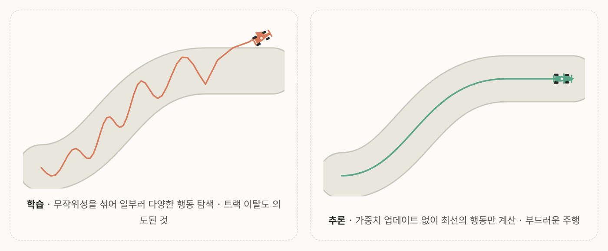
<!-- 슬라이드 7: Train vs Inference 영상 -->

- **학습**: 에이전트가 환경과 상호작용하며 얻은 데이터로 **정책을 업데이트**하는 과정
- **추론**: 학습된 모델에 현재 상태를 넣어서, **가중치 업데이트 없이** 실시간으로 최선의 행동을 계산하고 실행하는 과정

학습 중 영상을 보면 트랙을 이탈하고 핸들을 마구 꺾으면서 불안하게 달림. 근데 이건 <mark class="pink">의도된 것</mark>임. 다양한 행동을 탐색하면서 최적의 주행 전략을 스스로 배우게 하는 거니까. 추론 때는 이런 무작위성을 섞지 않고 최선의 행동만 계산하니 부드럽게 달림.

---

## 3. 베이스라인과 알고리즘

### 3-1. GT Sophy

베이스라인이 된 연구는 **GT Sophy**임. 소니의 Sony AI 연구팀이 만든 알고리즘으로, 플레이스테이션 **그란 투리스모(Gran Turismo)** 게임에서 인간 랭킹 1위를 이기겠다는 아이디어에서 출발함. 결과적으로 인간 운전자 랭킹 1위를 넘어서는 성능을 보임.

연구팀은 이 연구의 주력 알고리즘인 <mark class="pink">QR-SAC</mark>를 차용함. QR-SAC로 가기 전에 기초인 SAC부터 봄.

### 3-2. Soft Actor-Critic (SAC)

일반적인 강화학습은 기대 누적 보상을 최대화하는 정책을 학습함.

$$
J(\pi) = \mathbb{E}_{\tau \sim \pi}\left[\sum_{t=0}^{\infty} \gamma^t r(s_t, a_t)\right] \;\rightarrow\; \pi^* = \arg\max_\pi J(\pi) \tag{1}
$$

특정 상태에서 행동을 수행한 뒤 얻을 수 있는 최대 누적 보상이 최적 행동가치 함수이고, 이걸 현재 보상 + 다음 상태의 최적 가치로 재귀적으로 쓰면 벨만 최적 방정식이 됨.

$$
Q^*(s_t, a_t) = \max_\pi \mathbb{E}_\pi\left[\sum_{k=0}^{\infty} \gamma^k r_{t+k} \mid s_t, a_t\right] \tag{2}
$$

$$
Q^*(s_t, a_t) = r_t + \gamma \, \mathbb{E}_{s_{t+1}}\left[\max_{a_{t+1}} Q^*(s_{t+1}, a_{t+1})\right] \tag{3}
$$

여기서 다음 상태의 Q값이 가장 높은 행동 **하나를** 고르는 게 <mark class="pink">hard maximization</mark>임.

$$
\max_{a_{t+1}} Q^*(s_{t+1}, a_{t+1}) \tag{4}
$$

- **장점**: Q값이 가장 높은 행동을 직접 고르니까 정책을 빠르게 최적 행동 쪽으로 모을 수 있음
- **단점**: Q값에 작은 추정 오차만 있어도 그 행동이 반복 선택되면서 **과대 편향**이 커지고, 다른 행동을 **탐색하지 못함**. 연속 제어 환경에선 이 탐색 부족이 정책을 불안정하게 만들어서 치명적임

SAC는 누적 보상에 **정책 엔트로피**를 더함.

$$
J_{SAC}(\pi) = \mathbb{E}_{\tau \sim \pi}\left[\sum_{t=0}^{\infty} \gamma^t \big(r_t + \alpha \mathcal{H}(\pi(\cdot \mid s_t))\big)\right] \tag{5}
$$

그리고 보상과 엔트로피를 포함한 soft Q값을 평가하고 재귀적으로 계산함.

$$
Q^\pi_{soft}(s_t, a_t) = r_t + \gamma \, \mathbb{E}_{s_{t+1},\, a_{t+1} \sim \pi}\left[Q^\pi_{soft}(s_{t+1}, a_{t+1}) - \alpha \log \pi(a_{t+1} \mid s_{t+1})\right] \tag{6}
$$

$$
Q^*_{soft}(s_t, a_t) = r_t + \gamma \, \mathbb{E}_{s_{t+1}}\left[V^*_{soft}(s_{t+1})\right] \tag{7}
$$

마지막으로 행동 하나를 직접 최대화하는 대신, **Q값과 엔트로피를 함께 고려해 행동 확률 분포 자체를 최적화**함. 이게 <mark class="mint">soft maximization</mark>.

$$
V^*_{soft}(s_{t+1}) = \max_{\pi(\cdot \mid s_{t+1})} \mathbb{E}_{a_{t+1} \sim \pi(\cdot \mid s_{t+1})}\left[Q^*_{soft}(s_{t+1}, a_{t+1}) - \alpha \log \pi(a_{t+1} \mid s_{t+1})\right] \tag{8}
$$

그래서 SAC는 **높은 보상을 추구하면서도 여러 행동을 탐색**할 수 있는 정책을 배움.

> 💡 엔트로피는 "정책이 얼마나 골고루 고르느냐"임. 한 행동만 고집하면 엔트로피가 낮고, 여러 행동에 확률을 나눠 주면 높음. SAC는 여기에 점수를 주는 거니까, "잘 달리는 건 기본이고 **가능하면 다양하게 달려라**"라고 시키는 셈. α가 그 비중을 정함.

### 3-3. SAC가 좋은 이유 세 가지

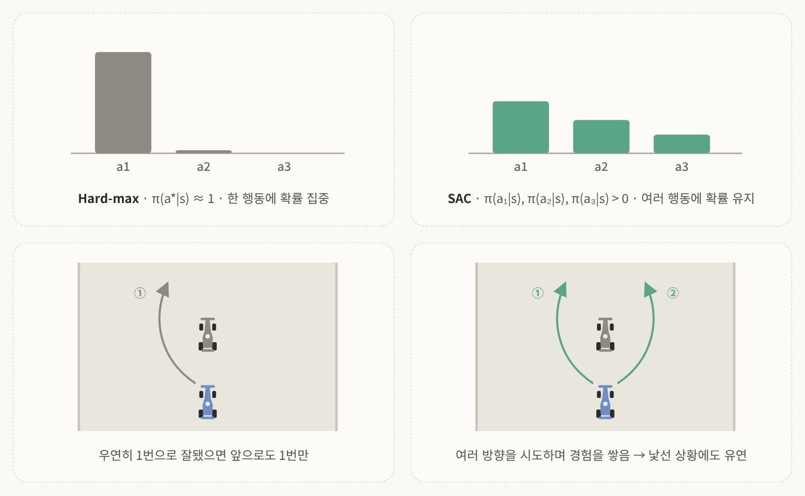
<!-- 슬라이드 10: Advantage of SAC, Hard-Max vs SAC Policy -->

**I. 조기 수렴과 local optimum 수렴 방지** 
Hard maximization은 학습 초반에 운 좋게 높은 보상을 받으면 그 행동으로 일찍 수렴해서 여러 행동을 경험하지 못함.

| 정책 방식 | 수학적 표현 | 행동 선택 | 정책 특성 |
|---|---|---|---|
| Hard-Max Policy | π(a\*∣s) ≈ 1 | 상태 s에서 최적 행동 a\*를 항상 선택 | 단일 행동에 확률 집중 |
| SAC Policy | π(a₁∣s), π(a₂∣s), π(a₃∣s) > 0 | 정책 분포에서 여러 행동을 확률적으로 선택 | 행동 다양성과 탐색 유지 |

**II. 복수의 유효한 행동 전략 학습** 
레이싱에서는 상황도 많고 가능한 행동도 엄청 많음. Hard-max는 우연히 1번 방향 추월이 높은 평가를 받으면 앞으로 대부분 1번 방향으로만 추월하게 학습될 가능성이 높음. SAC는 여러 액션의 확률을 유지하니까, 같은 상황에서 최대한 여러 행동을 시도하며 경험 데이터를 쌓음. 각 행동의 장기 보상도 비교할 수 있고.

**III. 불확실한 환경에 대한 강건성** 
여러 행동을 배웠으니까 마주했던 상황과 조금 다른 상황이 와도 유연하게 대응함.

### 3-4. Quantile Regression SAC (QR-SAC)

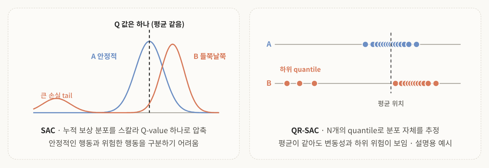
<!-- 슬라이드 11: SAC / QR-SAC Return Distribution -->

SAC에도 한계가 있음. Actor는 행동을 확률 분포로 모델링하는데, **critic은 누적 보상의 기대값을 스칼라 Q-value 하나로** 추정함.

$$
Q_\theta(s_t, a_t) \approx \mathbb{E}[Z^\pi(s, a)] \in \mathbb{R}
$$

$$
y = r + \gamma(1-d)\left[\min_{k=1,2} Q_{\bar\theta_k}(s', a') - \alpha \log \pi_\phi(a' \mid s')\right], \quad a' \sim \pi_\phi(\cdot \mid s')
$$

$$
L_Q^{SAC} = \mathbb{E}\left[(Q_\theta(s, a) - y)^2\right]
$$

문제는 두 가지.
1. return distribution을 평균 하나로 압축하면 **안정적으로 보상을 얻는 행동과 위험을 수반하는 행동을 구분하기 어려움**
2. 스칼라 TD target 하나로 학습하니까, return에 큰 이상치가 끼면 TD error가 급증하고 Q-value가 그쪽으로 크게 튀어서 **학습이 불안정**해짐

<mark class="pink">QR-SAC</mark>가 이 문제를 효과적으로 해결함. Quantile Regression은 **분위수 회귀**, 즉 분포의 각 지점을 예측하는 방식이라고 보면 됨.

Critic이 Q-value 하나 대신 **누적 보상 분포를 나타내는 N개의 quantile 값**을 출력함.

$$
Z_\theta(s, a) = [z_{\theta,1}(s,a), z_{\theta,2}(s,a), \dots, z_{\theta,N}(s,a)] \in \mathbb{R}^N
$$

$$
z_{\theta,i}(s, a) \approx F^{-1}_{Z^\pi(s,a)}(\tau_i), \qquad \bar Q_\theta(s, a) = \frac{1}{N}\sum_{i=1}^{N} z_{\theta,i}(s, a)
$$

- **하위 quantile**: 결과가 좋지 않을 때의 보상
- **상위 quantile**: 높은 보상을 얻는 경우

그래서 <mark class="mint">평균이 같은 행동이라도 결과가 안정적인지, 변동성과 하위 위험이 큰지를 분포 형태로 구별</mark>할 수 있음. 또 분포를 가우시안 같은 특정 형태로 가정하지 않고 여러 quantile로 직접 근사하니까, 비대칭적이고 복잡한 분포도 유연하게 표현함.

### 3-5. Quantile Huber Loss

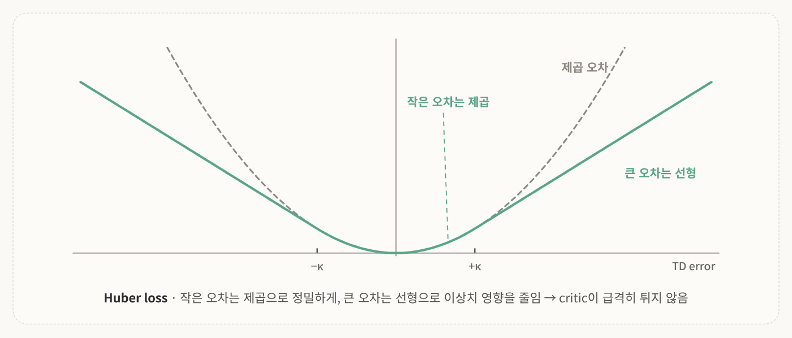
<!-- 슬라이드 11: Quantile Huber Loss -->

Critic 학습은 스칼라 타겟 하나를 맞추는 게 아니라 **타겟 quantile과 예측 quantile 사이의 오차**를 계산하고, 여기에 **quantile Huber loss**를 적용해서 각 분위수를 학습함.

$$
y_j = r + \gamma(1-d)\left[z_{\bar\theta_{k^*}, j}(s', a') - \alpha \log \pi_\phi(a' \mid s')\right]
$$

$$
\delta_{ij} = y_j - z_{\theta,i}(s, a), \qquad L_Q^{QR} = \frac{1}{N^2}\sum_{i=1}^{N}\sum_{j=1}^{N} \rho^{\kappa}_{\tau_i}(\delta_{ij})
$$

Huber loss는 **작은 오차엔 제곱 오차**를 써서 정밀하게 배우고, **큰 오차엔 선형 오차**를 써서 이상치 영향을 줄임. 그래서 큰 TD error가 나도 critic이 특정 타겟 쪽으로 급격히 튀는 걸 막을 수 있음.

정리하면, <mark class="pink">quantile critic으로 누적 보상 분포를 풍부하게 배우고, quantile Huber loss로 critic 학습을 안정화</mark>하려고 QR-SAC를 씀.

> 💡 비유하면 SAC critic은 "이 코너 평균 80점"이라고만 말하는 애고, QR-SAC critic은 "대부분 90점인데 10번에 1번은 벽에 박아서 −100점"까지 말해 주는 애임. 평균만 보면 똑같은데 레이싱에선 후자가 훨씬 쓸모 있음.

---

## 4. 데이터: 어떻게 모으고 어떻게 고를까

### 4-1. 병렬 수집과 중앙 학습

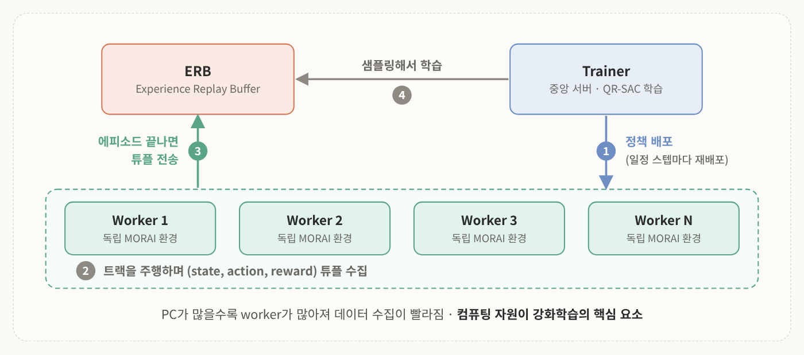
<!-- 슬라이드 12: Parallel Experience Collection and Centralized QR-SAC Training -->

학습 구조는 **Trainer, ERB, Worker** 세 요소로 구성됨. ERB는 Experience Replay Buffer, 경험 데이터가 저장되는 버퍼임.

1. 중앙 서버가 초기 정책을 각 **worker**에 배포 (worker = 각각의 차량, 에이전트)
2. 각 worker는 그 정책으로 트랙을 주행하며 경험 데이터 수집. 모이는 건 **state, action, reward 튜플**
3. 주행 불가능해지거나, 제한 시간에 도달하거나, 강한 페널티로 에피소드를 끝내는 플래그가 뜨면 튜플을 중앙 서버 **ERB로 전송**
4. 중앙 서버는 ERB에서 **샘플링해서 QR-SAC 네트워크를 학습**
5. 특정 트레이닝 스텝마다 학습된 정책을 worker들에게 **다시 배포**하고, worker는 최신 정책으로 계속 데이터 축적

그렇다고 최신 데이터로만 학습하는 건 아님. 과거 데이터도 같이 써야 하니까 ERB 전체에서 샘플링함.

실제 연구실에서는 그래프가 뜬 컴퓨터가 중앙 trainer, 나머지 PC들이 worker가 돼서 동시다발적으로 데이터를 모음. 각 worker는 독립적인 **MORAI** 환경에서 달림. 컴퓨터가 많을수록 worker가 많아지고 수집 속도가 빨라져서, <mark class="mint">컴퓨팅 자원이 강화학습에 매우 중요하다</mark>는 걸 느꼈다고 함.

### 4-2. 층화 샘플링: 시케인을 잊지 않게

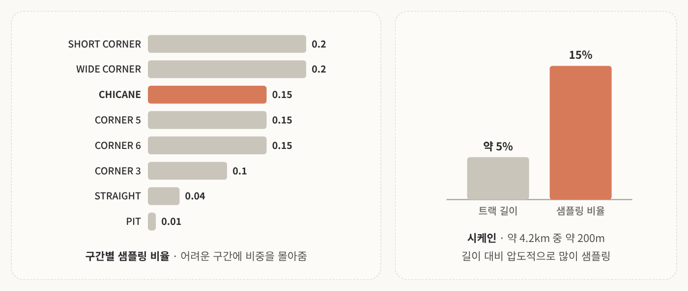
<!-- 슬라이드 13: Stratified Sampling, Fig 8~9 -->

모은 데이터는 그대로 쓰지 않고 <mark class="pink">stratified sampling(층화 샘플링)</mark>으로 골라서 씀. 전체 데이터를 여러 그룹으로 나눈 뒤 각 그룹에서 표본을 뽑는 방식임.

트랙을 직선(straight), 짧은 코너(short corner), 넓은 코너(wide corner), 시케인(chicane) 등으로 나눔.

균등 샘플링을 하면 트랙에서 비중이 큰 직선과 코너 데이터가 학습을 지배함. 그러면 시케인처럼 작은 비중의 구간엔 대응을 기대할 수 없음.

상암 트랙은 전체 약 4.2km, 시케인 구간은 약 200m임. 트랙의 극히 일부인데 **주행 난이도는 가장 높음**. 전체를 아무리 잘 달려도 시케인에서 대응이 안 되면 레이스가 무의미해짐. 그래서 <mark class="mint">길이 대비 압도적으로 많은 샘플링 비율</mark>을 줘서 에이전트가 시케인 대응 능력을 잊지 않게 했음.

실제로 층화 샘플링을 넣은 순간부터 시케인 대응 능력이 눈으로 보일 만큼 좋아졌다고 함.

> 💡 강의에서는 시케인 비중을 "약 0.04%"라고 말했는데, 200m / 4.2km로 계산하면 약 4.8%임. 그림도 약 5%로 그렸음. 그래도 샘플링 비율이 0.15니까 길이 비중의 약 3배를 배정한 셈.

### 4-3. 구간 → 상대 수 → 상대 속도 순서로

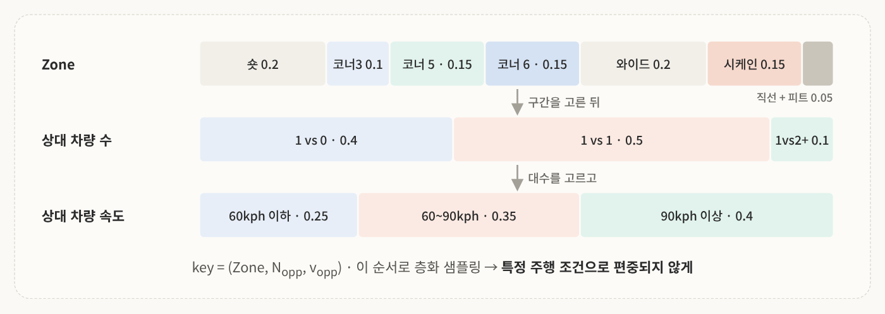
<!-- 슬라이드 14: key = (Zone, N_opp, v_opp), Fig 10~12 -->

$$
key = (Z, N_{opp}, v_{opp})
$$

구간을 나눈 다음, **유효 구간 내 상대 차량 대수**와 **상대 차량 속도**에 따라 다시 층화 샘플링함.

| 기준 | 샘플링 비율 |
|---|---|
| 상대 차량 수 | 1 vs 0: 0.4 / 1 vs 1: 0.5 / 1 vs 2+: 0.1 |
| 상대 차량 속도 | 60kph 이하: 0.25 / 60~90kph: 0.35 / 90kph 이상: 0.4 |

이렇게 하면 구간, 대수, 속도별로 정한 비율대로 뽑을 수 있어서 **특정 데이터에 편중된 학습이 안 일어남**. 대부분이 직진 데이터고 어려운 구간은 적으니까, 비율을 맞춰 골고루 배우게 하는 방법론임.

### 4-4. 시나리오로 상황을 강제로 만들기

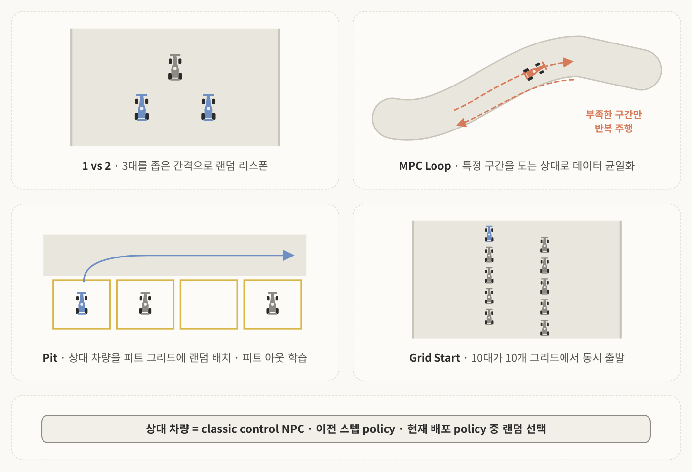
<!-- 슬라이드 15: Video 3~6 시나리오 -->

샘플링 전에 데이터 자체가 다양해야 함. 그래서 특정 시나리오를 강제하는 **시나리오 에디트(scenario edit)** 기능을 개발함.

**① 1 vs 2 시나리오** 
코드를 실행하면 차량 3대가 좁은 간격으로 랜덤 위치에 리스폰됨. 세 대가 같이 달리는 데이터를 얻기 위한 것. 상대는 classic control 기반 NPC(Pure Pursuit 같은 기존 제어기), 이전 스텝 policy, 현재 배포 policy 중에서 랜덤 선택. 영상은 3대 중 2대가 최신 policy로 데이터를 모으는 장면임.

**② MPC Loop 시나리오** 
①처럼 모으면 랜덤한 구간에서 상대와 경쟁하는 데이터가 잘 안 나오는 경우가 많았음. 그래서 **데이터가 부족한 구간을 지정하면 그 구간만 반복해서 도는 에이전트**를 배치함. 전 구간에서 최대한 균일한 양의 데이터를 모으려는 것.

**③ Pit 시나리오** 
피트(pit)는 실제 레이싱에서 정비나 타이어 교체에 쓰는 공간이고, 이 대회에선 주행 불능 시 다른 차를 방해하지 않고 재출발하는 데 쓰였음. 규정상 출발할 때 다른 차량의 그리드를 침범하거나 추돌하면 안 됨.

그래서 상대 피트 그리드 침범, 상대와 추돌, 피트 구역 정지선 밟기가 나오면 에피소드를 멈춰서 강하게 페널티를 줌. 이후 정상 주행으로 피트 나가는 법을 배우게 해서, 상대 그리드를 안 밟고 피트 아웃하게 만듦. 상대 차량은 랜덤으로 앞이나 뒤 그리드에 배치해서 대회에서 일어날 수 있는 상황을 최대한 가정함.

**④ Grid Start 시나리오** 
그리드는 레이싱의 출발선임. 대회는 **10대가 동시 주행**인데, 열 대가 나란히 출발하면 상황이 매우 복잡해질 게 뻔함. 그래서 코드를 돌리면 10대가 10개 그리드에 서서 동시에 출발하는 시나리오를 만듦. 상대는 여기서도 classic control, 이전 스텝 정책, 현재 스텝 정책 중에서 골라 최대한 다양한 상대에게 대응하게 설계함.

### 4-5. 리셋과 랜덤 리스폰

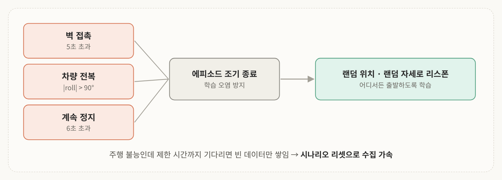
<!-- 슬라이드 16: Data Collection Strategy, Table 2~3 -->

차량이 주행 불능이 되면 제한 시간까지 빈 데이터만 갱신함. 그래서 데이터 수집을 가속하려고 **시나리오 리셋** 기능을 개발함.

| 리셋 조건 | 기준 |
|---|---|
| 벽 접촉 지속 | 5초 초과 |
| 차량 전복 | roll 90° 초과 |
| 정지 지속 | 6초 초과 |

이러면 에피소드를 조기 종료해서 학습이 오염되지 않게 함. 새로 리스폰할 때는 **트랙 내 랜덤한 위치, 랜덤한 자세**로 나오게 해서, 어디 있든 출발할 수 있도록 유도함. 특정 구간에 과적합되는 것도 막아 줌.

### 4-6. 그래서 뭘 배웠나

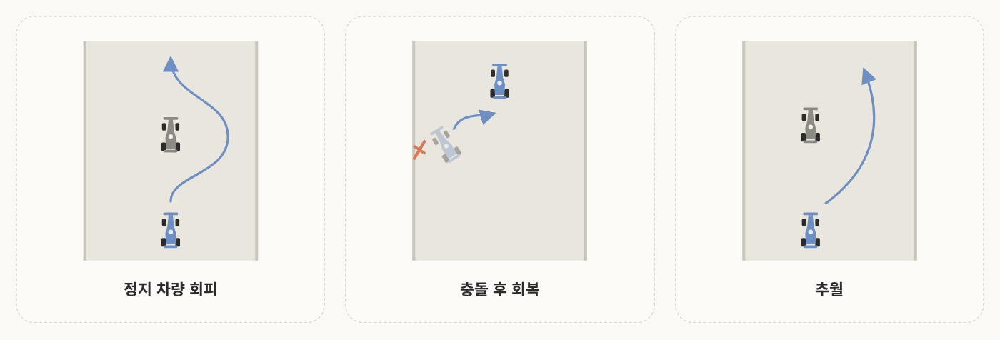
<!-- 슬라이드 17~18: Diverse Driving Situations, Training vs Inference -->

이렇게 학습하면 에이전트는 진짜 다양한 상황을 마주함. 정지한 차량을 회피하는 법(Static Obstacle Avoidance), 충돌 후 회복하는 법(Collision Recovery), 추월하는 법(Overtaking)을 배우면서 학습할수록 **generalized된 에이전트**가 됨.

학습 때와 추론 때를 나란히 비교해 보면
- **정적 장애물 회피**: 학습 중 습득한 회피 행동이 추론 단계에서도 안정적으로 재현됨
- **추월**: 학습 때 습득한 추월 전략을 실제 추론 과정에서도 그대로 가져감

즉 <mark class="pink">학습 데이터에 과적합된 게 아니라 추론 단계에서도 같은 수준으로 일관되게 수행</mark>한다는 걸 눈으로 확인할 수 있음.

---

## 5. 보상 함수 설계

### 5-1. 12개 항의 구성

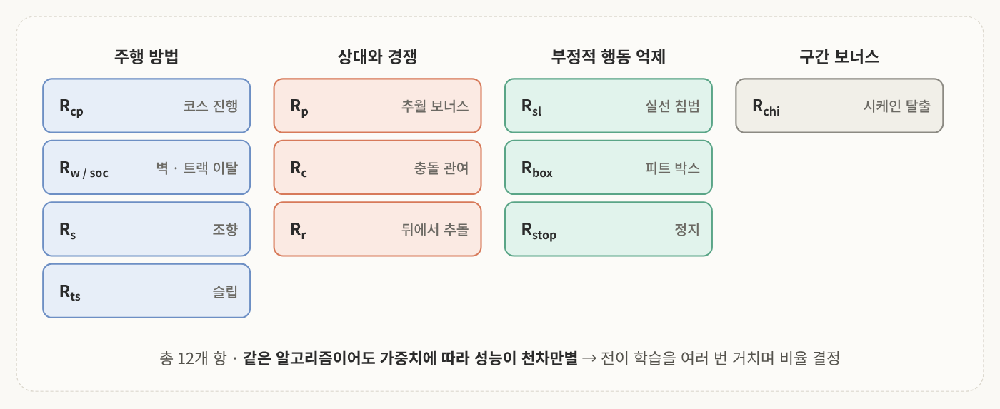
<!-- 슬라이드 19: Reward Function Setting -->

강화학습에서 가장 핵심이라고도 하는 부분임. 총 **12개 항**을 씀.

$$
R = R_{cp} + (R_w / R_{soc}) + R_s + R_{ts} + R_p + R_c + R_r + R_{stop} + R_{box} + R_{sl} + R_{chi}
$$

| 묶음 | 항 |
|---|---|
| 주행 방법 학습 | Rcp, (Rw / Rsoc), Rs, Rts |
| 상대 차량과 경쟁 | Rp, Rc, Rr |
| 부정적 행동 억제 | Rsl, Rbox, Rstop |
| 특정 구간 보너스 | Rchi |

같은 알고리즘을 써도 <mark class="pink">가중치 설정에 따라 모델 성능이 천차만별</mark>이라는 걸 실험으로 확인했다고 함. 수렴과 정상적인 학습을 위해 weight 설정이 매우 중요하고, 여러 번의 전이 학습을 거쳐 최종 비율을 정함.

| Course | Rcp | Rsoc | Rw | Rs | Rts | Rp | Rc | Rr | Rstop | Rbox | Rsl | Rchi |
|---|---|---|---|---|---|---|---|---|---|---|---|---|
| Sangam | 1 | - | 0.01 | 4 | 0.8 | 0.5 | 5 | 0.5 | 0.0 | 10 | 2 | 20 |
| Speedway | 0.8 | 0.1 | - | 5 | 0.8 | 0.5 | 5 | 0.5 | 0.0 | 10 | 1 | - |

### 5-2. Course Progress Reward: 앞으로 나아간 만큼

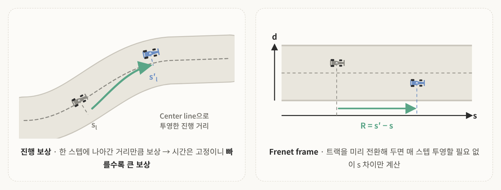
<!-- 슬라이드 20: Course Progress Reward, Frenet Frame -->

$$
R_{cp}(s, s') = s_l' - s_l
$$

쉽게 말해 **코스 진행에 대한 보상**임. 차량 위치를 트랙 센터 라인에 프로젝션해서, 현재 스텝 진행도에서 이전 스텝 진행도를 뺀 만큼 보상함.

기존 연구는 단순 프로젝션을 썼는데, 그러면 매 스텝 연산량이 늘어남. 그래서 연구팀은 **사전에 트랙 데이터를 Frenet frame으로 전환**하고 그 안에서 계산함.

이렇게 정의하면 빠를수록 자동으로 보상이 커짐. 거리 = 속도 × 시간인데 시간은 시뮬레이터 한 틱으로 고정이니까, <mark class="mint">진행 거리가 늘었다는 건 속도가 크다는 뜻</mark>임. 현재와 이전 state를 비교하니까 **역주행 페널티**도 같이 줄 수 있음.

### 5-3. Wall Penalty: 벽 타고 달리기 금지

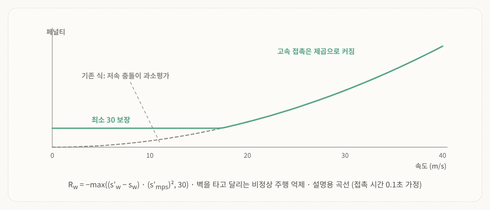
<!-- 슬라이드 21: Wall Penalty -->

$$
R_w(s, s') = -\max\big((s_w' - s_w) \cdot (s_{mps}')^2,\; 30\big)
$$

주행 중 벽에 닿는 걸 벌주는 항. 이게 없으면 코너에서 감속 없이 **벽을 이용해 최대한 속도를 내는 비정상적인 주행**을 배울 수도 있음.

베이스라인 연구는 벽에 닿은 시간 × 속도²로만 벌줬는데, 이러면 학습 초반 차가 느릴 때의 충돌이 **과소평가**됨. 그래서 max 함수로 **최소값 30을 보장**해서 저속과 고속 모두 벽 충돌을 피하도록 학습시킴. 벽 접촉이 5초 이상 이어지면 에피소드도 조기 종료함.

### 5-4. Off-Course Penalty: 지름길 금지

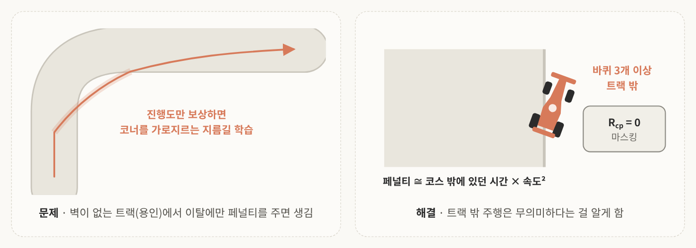
<!-- 슬라이드 22: Off-Course Penalty -->

$$
R_{soc}(s, s') = -\max\big((s_o' - s_o) \cdot (s_{mps}')^2,\; 30\big)
$$

벽이 없는 레이싱 환경(용인 서킷)에서 Rw 대신 쓰는 항임.

벽이 없을 때 트랙 밖으로 나가는 것에만 페널티를 주면, 진행도 보상이 큰 상황에서 코너를 아예 가로지르는 **지름길(corner cutting)** 현상이 생김. 그래서 트랙을 이탈하면 <mark class="pink">진행도 항을 마스킹</mark>해서 트랙 밖 주행은 무의미하다는 걸 알게 함.

- **이탈 조건**: 바퀴 3개 이상이 트랙 바운더리 바깥
- **페널티 크기**: 코스 밖에 있던 시간 × 속도². 느리게 살짝 나가는 것보다 빠르게 많이 나가는 걸 강하게 벌주려는 것

### 5-5. Slip Penalty: 타이어가 미끄러지면 벌점

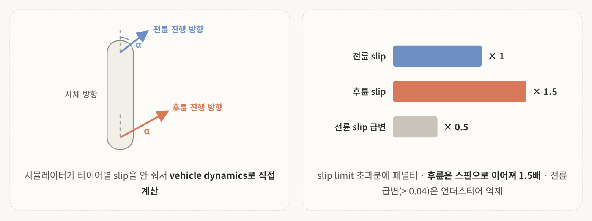
<!-- 슬라이드 23: Slip Penalty -->

$$
R_{ts}(s, s') = -v\Big([\lvert\alpha_f\rvert - \alpha_{max}]_+ + 1.5[\lvert\alpha_r\rvert - \alpha_{max}]_+ + 0.5\lvert\alpha_f - \alpha_f^{prev}\rvert \cdot \mathbb{1}_{\lvert\alpha_f - \alpha_f^{prev}\rvert > 0.04}\Big)
$$

$$
\alpha_f = \delta - \tan^{-1}\Big(\frac{v_y + L_f\dot\psi}{v_x}\Big), \qquad \alpha_r = -\tan^{-1}\Big(\frac{v_y - L_r\dot\psi}{v_x}\Big)
$$

시뮬레이터가 타이어별 slip 정보를 안 줘서 **vehicle dynamics 기반으로 직접 디자인**함.

- slip limit을 미리 정해 두고, 전륜 · 후륜 slip angle이 그보다 커지면 페널티
- **후륜은 전륜의 1.5배**: 후륜 slip은 차가 rear를 아예 잃어서 완전히 스핀하는 현상으로 이어지기 때문
- 전륜 slip angle이 이전 스텝 대비 **급격히 변하면 추가 페널티**: 조향 입력에 차가 지그재그로 흔들리며 언더스티어가 나는 걸 막음

> 💡 슬라이드의 αr 식에는 Lf로 적혀 있는데, 정의 줄에 앞뒤 축까지 거리가 따로 나오는 걸 보면 후륜은 일반적인 bicycle model 식처럼 vy − Lrψ̇로 보는 게 맞아서 위 식은 그렇게 적었음.

### 5-6. Steer Penalty: 핸들 떨지 마

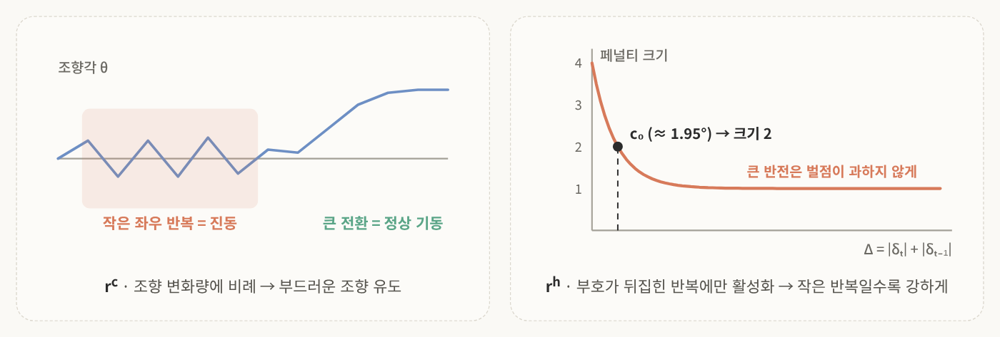
<!-- 슬라이드 24: Steer Penalty -->

$$
R_s(s_t, s_{t-1}, s_{t-2}) = w_c r_t^c + w_h r_t^h
$$

급격한 조향 변화와 반복적인 조향 진동을 억제하는 항임.

**① rtc 항: 조향 변화량 벌점**

$$
r_t^c = -\lvert\delta_t\rvert, \qquad \delta_t = \theta_t - \theta_{t-1}
$$

연속 시점 사이의 조향각 변화량에 비례하는 페널티. 정책이 조향각을 확 바꾸지 않고 부드러운 명령을 내게 유도함.

**② rth 항: 진동 벌점**

$$
r_t^h = -m_t\{1 + \exp[-c_s(\Delta_t - c_o)]\}, \qquad \Delta_t = \lvert\delta_t\rvert + \lvert\delta_{t-1}\rvert
$$

$$
m_t = I(\lvert\delta_t\rvert > c_d)\, I(\lvert\delta_{t-1}\rvert > c_d)\, I(\mathrm{sign}(\delta_t) \neq \mathrm{sign}(\delta_{t-1}))
$$

좌우 조향이 연속으로 반전되는 상황을 막는 항임. 현재와 이전 조향 변화량이 모두 cd보다 크고 **두 변화량의 부호가 반대일 때** mt = 1이 되어 켜짐.

여기서 지수 함수가 포인트인데, 조향 변화량이 커질수록 페널티를 키우려는 게 아니라 <mark class="pink">임계값 부근의 작은 반복 조향을 강하게 억제</mark>하려는 것임.
- 작은 진폭의 좌우 반복 → 고속에서 궤적 불안정과 타이어 slip으로 이어짐 → **큰 페널티**
- 큰 조향 반전 → 코너 전환이나 회피 기동에서 정상적으로 나옴 → 변화량이 커지면 지수 항이 줄어서 **페널티가 과하게 안 커짐**

| 상수 | 값 | 의미 |
|---|---|---|
| cd | 0.014 (약 0.8°) | 미세한 조향 보정과 실제 진동을 구분하는 임계값 |
| co | 0.034 (약 1.95°) | 지수 감쇠의 기준점. 여기서 진동 페널티 크기가 2 |
| cs | 182.883569 | 기준점 이후 페널티가 감소하는 속도 |

> 💡 슬라이드 글머리에는 "지수적으로 증가하는 추가 Penalty"라고 적혀 있는데, 식과 발표 설명은 Δ가 커질수록 **감소**하는 쪽임. 오른쪽 그래프는 슬라이드 상수를 그대로 넣어 계산한 곡선임. 표의 약 0.8°, 약 1.95°는 0.014, 0.034를 라디안으로 본 값임.

### 5-7. Passing Bonus: 추월과 방어

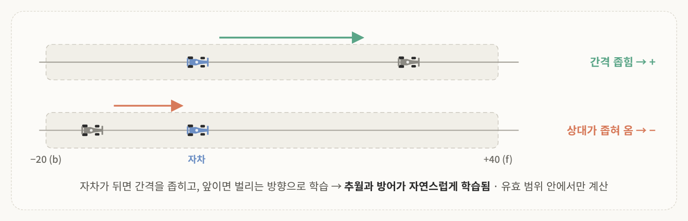
<!-- 슬라이드 25: Passing Bonus -->

$$
R_{ps}(s, s') = -\sum_i (s_{L_i} - s_{L_i}') \cdot \max\big(\mathbb{1}_{(b,f)}(s_{L_i}),\, \mathbb{1}_{(b,f)}(s_{L_i}')\big), \quad (b = 20,\ f = 40)
$$

여기부터는 상대 차량과 인터랙션하는 법을 배우는 항들임.

상대와의 간격이 좁혀지면 양의 보상, 벌어지면 음의 페널티를 줌. 그러면
- 자차(ego)가 **뒤에 있을 때** → 최대한 간격을 좁히려고 함
- 자차가 **앞에 있을 때** → 최대한 간격을 벌리려고 함

즉 <mark class="mint">추월과 방어가 자연스럽게 학습</mark>됨. 그리고 max 함수로 유효 범위 안의 차량에 대해서만 안정적으로 학습되게 했음.

| s | s′ | max 결과 | 의미 |
|---|---|---|---|
| 0 | 1 | 1 | 상대에게 접근하기 시작할 때 보상 계산 시작 |
| 1 | 1 | 1 | 범위 내일 때 지속 계산 |
| 1 | 0 | 1 | 범위를 벗어나는 순간까지 보상 반영 |
| 0 | 0 | 0 | 상호작용이 없으므로 보상 미반영 |

### 5-8. Collision Penalty: 관여만 해도, 박으면 더

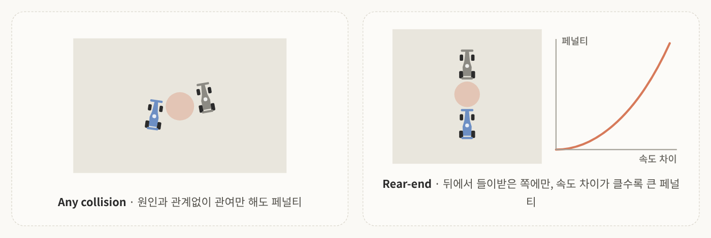
<!-- 슬라이드 26: Any Collision / Rear-end Collision Penalty -->

**Any Collision Penalty**: 자차가 유발했든 아니든, 원인과 관계없이 충돌에 부여함.

$$
R_c(s, s') = -\max_{i \in N} C_i
$$

**Rear-end Collision Penalty**: **충돌을 유발한 차량에게만** 부여함. 뒤에서 들이받는 걸 강하게 벌주는 항.

$$
R_r(s, s') = -\sum_i c_i \mathbb{1}_{>0}(s_{L_i} - s_L') \cdot \lVert s_v' - s_{v,i}' \rVert^2
$$

- indicator로 자차가 상대보다 뒤에 있었는지 감지
- 상대와 자차의 **속도 차이가 큰 상황**에서 충돌을 유발했으면 강하게 벌줌. 살짝 닿은 건 작게

둘을 같이 쓰면 <mark class="pink">충돌을 유발했으면 큰 페널티, 유발 안 했어도 관여하면 페널티</mark>가 됨.

### 5-9. Stop Penalty: 가만히 있기 금지

$$
R_{stop}(s, a) =
\begin{cases}
-(v_{min} - v_{mps})^2 & v < v_{min} \text{ and } a_{thr} \le 0 \\
-10 & z \in \{STRAIGHT\} \text{ and } a_{thr} \le 0 \\
0 & \text{otherwise}
\end{cases}
$$

여기서부터는 학습 도중 나오는 특정 행동을 강하게 억제하는 항들임.

학습 초기엔 total reward가 음수일 때가 많은데, 그럴 때마다 에이전트는 **주행을 회피하는 전략, 즉 가만히 정지해 있는 전략**을 배움. 그러면 policy가 local minima에 빠져서 이상한 방향으로 학습됨. 이걸 막는 항임.

- 속도가 최소 속도보다 낮은데 가속 명령을 안 내면 페널티
- 학습 초기에 직선에서 브레이크 밟는 현상을 없애는 데도 사용 (직선에서 가속 입력이 없으면 고정 페널티 −10)
- 정상 주행이 가능해진 **학습 중반 이후엔 마스킹**. 위 가중치 표에서 최종값이 0.0인 이유임

즉 기본적인 주행 방법을 익히게 해 주는 <mark class="mint">임시 보조 장치</mark>라고 보면 됨.

> 💡 슬라이드에는 vmin = 3.6 m/s로 적혀 있는데, 발표에서는 1km/h처럼 들림. 1 m/s가 3.6 km/h니까 단위 표기가 섞였을 수도 있어서 정확한 값은 확인이 필요함.

### 5-10. Pit-Box Penalty: 남의 자리 밟지 마

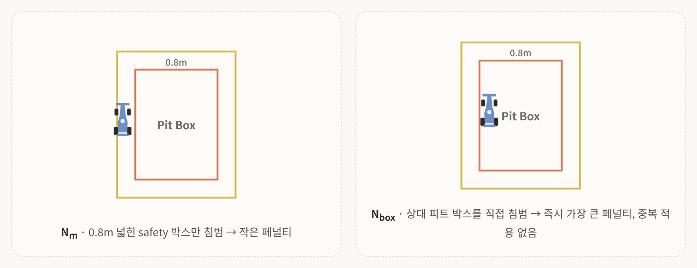
<!-- 슬라이드 28: Pit-Box Penalty -->

$$
R_{box}(s, a) = [N_{box} + \lambda_m N_m \mathbb{1}_{N_{box}=0}]
$$

상대 차량이 있는 피트 그리드를 밟고 지나가는 걸 막는 항. 상태 변수는 두 개임.

| 변수 | 상황 | 처리 |
|---|---|---|
| **Nbox** | 상대 그리드 박스를 **직접 침범** | 뒤쪽 항은 0으로 두고 즉시 가장 큰 페널티 |
| **Nm** | 0.8만큼 더 크게 잡은 **safety 박스** 침범 | 직접 침범보다 약하지만 일정 수준 이상의 페널티 |

Ego와 각 pit box의 bounding box가 겹치는지 검사하는 방식이고, 자기 피트 박스(iown)는 제외함. 이렇게 하면 상대 피트 박스를 최대한 피해 가는 쪽으로 학습됨.

### 5-11. Solid Line Penalty와 Chicane Bonus

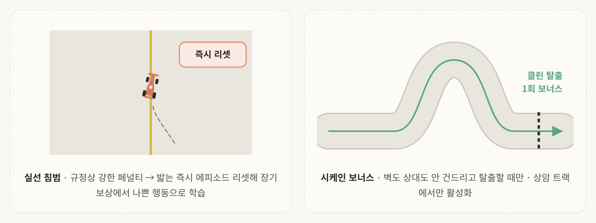
<!-- 슬라이드 29~30: Solid line Penalty, Chicane Bonus -->

**실선 침범**

$$
R_{sl}(s) = -\mathbb{1}_{s_{sl}}
$$

대회 규정상 피트 출구 쪽 실선을 밟으면 강한 페널티가 예고돼 있었음. 그래서 밟는 **즉시 에피소드를 리셋**시킴.

QR-SAC는 특성상 장기적인 보상을 향해 학습하는데, 에피소드 리셋 플래그가 들어가면 그 액션을 매우 나쁜 행동으로 판단해서 안 하는 쪽으로 학습함. 이 특성을 이용한 것.

**시케인 탈출 보너스**

$$
R_{chi}(s) = \mathbb{1}_{exit} \cdot \mathbb{1}_{clean}
$$

시케인은 S자 구간이라 난이도가 매우 높고, 벽을 긁으며 탈출하는 일이 종종 있었음. 형상 특성상 작은 실수가 바로 치명적이라서, <mark class="pink">상대와도 벽과도 충돌하지 않고 탈출했을 때</mark> 추가 보상을 줌. 탈출 순간 1회성이고 상암 트랙에서만 켜짐. 덕분에 단독 주행 시 시케인 통과 성능이 매우 개선됨.

---

## 6. 학습 전략: 커리큘럼 러닝

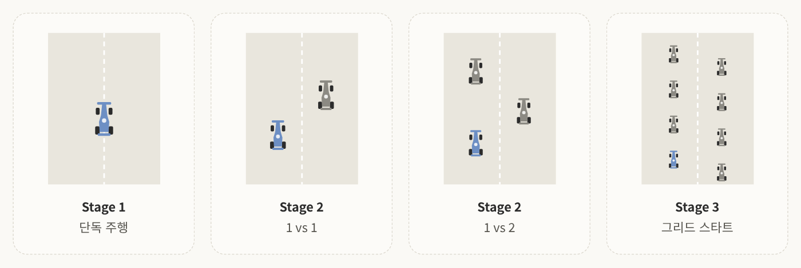
<!-- 슬라이드 31: Curriculum Learning -->

학습 시나리오 전략은 <mark class="pink">커리큘럼 러닝(curriculum learning)</mark>임. 쉬운 시나리오부터 어려운 시나리오까지 난이도를 높여 가는 방식.

**혼자 주행 → 1 vs 1 → 1 vs 2 → 그리드 스타트** 순서로 학습시킴.

- 순차적으로 하면 → 이전에 배운 스킬을 대부분 유지한 채 학습이 이어짐
- 처음부터 어려운 태스크를 시키면 → 유지해야 할 스킬들이 잊히면서 망가짐

> 💡 사람도 면허 따자마자 서킷에서 10대랑 동시 출발하면 망하듯이, 트랙 추종 → 추월 → 차량 간 상호작용 순서로 쌓는 게 안정적이라는 얘기임. 4-2의 층화 샘플링도 "이미 배운 걸 잊지 않게" 하는 장치라서 같은 고민의 다른 해법임.

---

## 7. 성과와 한계

### 7-1. 무엇을 해냈나

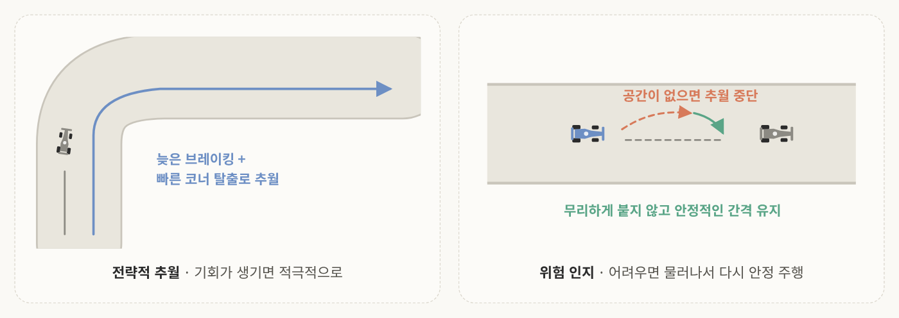
<!-- 슬라이드 32~33: Strategic Overtaking, Risk-Aware Behavior -->

**전략적 추월 (Strategic Overtaking)**
- 기회가 생길 때마다 소극적으로 대응하지 않고 **적극적으로 추월**
- 상대보다 **코너 탈출 속도가 빠르고 브레이킹 시점을 늦게** 가져가는 전략으로 코너 구간 추월에 성공하는 장면이 많음

**위험 인지 (Risk-Aware Behavior)**
- 추월이 어렵다고 판단되면 무리하게 붙지 않고 **선두 차량과 안정적인 간격 유지**
- 공간이 부족하거나 충돌 위험이 커지면 시도 중이던 **추월을 즉시 중단**하고 안정 주행으로 복귀

### 7-2. 한계

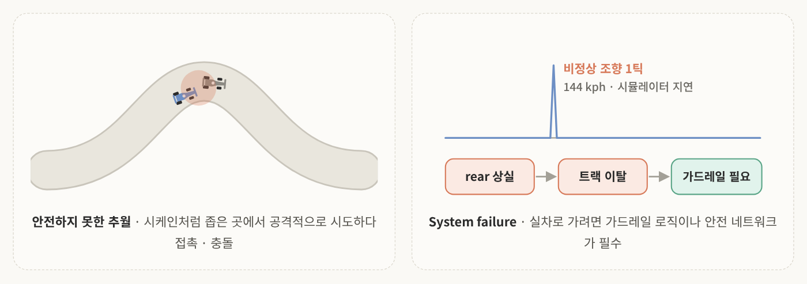
<!-- 슬라이드 34~35: Unsafe Overtaking, System Failure -->

**안전하지 못한 추월 (Unsafe Overtaking)** 
일부 상황에서는 안전거리나 충돌 위험을 충분히 고려하지 못한 채 추월을 시도함. 특히 시케인처럼 폭이 좁은 구간에서 공격적으로 추월하다가 접촉이나 충돌로 이어지는 경우가 있었음.

**시스템 실패 (System Failure)** 
대회 중(카이스트와의 1차전) 실제로 나온 사례임. 시뮬레이터 지연으로 비정상적인 조향이 **단 1틱** 들어갔는데, 속도가 **144kph**로 매우 빠른 상황이라 바로 rear 그립을 잃고 트랙을 이탈함.

이 사례로 연구팀이 체감한 건 하나임.

> E2E 모델을 실제 차량에 적용하려면(Sim2Real), 이런 극단적인 상황을 막을 **별도의 가드레일 로직이나 안전 네트워크가 반드시 필요**하다.

> 💡 시뮬레이터에서는 1틱 실수로 트랙 이탈이면 끝이지만, 실차였다면 사고임. 학습 기반 정책은 평균적으로 잘해도 **한 번의 이상 출력**을 막아 준다는 보장이 없어서, 그 바깥을 감싸는 안전장치가 필요하다는 얘기.

---

## 8. 핵심 요약

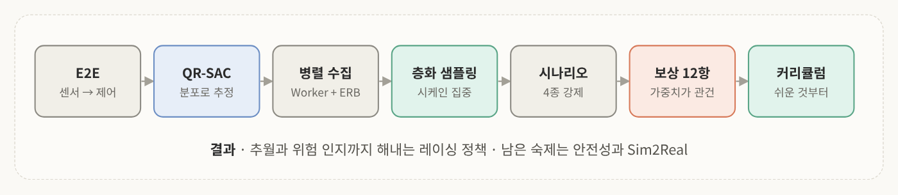
<!-- 직접 만든 그림: 1편 전체 흐름 -->

1. **E2E 자율주행** = raw sensor input에서 제어 출력까지 이어지는 **완전히 미분 가능한 하나의 프로그램**. 단순성, 최적화, 데이터 기반 확장성이 특징
2. **지도학습**은 고정된 정답 데이터로, **강화학습**은 에이전트가 직접 만든 데이터의 reward로 배움. RL의 loss는 Reward → Q → TD target → TD error로 **간접적으로** 나옴
3. **GT Sophy**에서 가져온 **QR-SAC**: SAC로 탐색을 유지하고, quantile critic으로 **누적 보상 분포**를 배우고, quantile Huber loss로 학습을 안정화
4. **Trainer · ERB · Worker** 구조로 병렬 수집. **층화 샘플링** key = (Zone, Nopp, vopp)로 시케인 같은 어려운 구간을 잊지 않게 함
5. **시나리오 에디트**(1 vs 2, MPC Loop, Pit, Grid Start)와 **리셋 · 랜덤 리스폰**으로 데이터 다양성 확보
6. **보상 12개 항**: 주행, 경쟁, 억제, 구간 보너스. 같은 알고리즘이어도 **가중치에 따라 성능이 천차만별**
7. **커리큘럼 러닝**: 단독 → 1 vs 1 → 1 vs 2 → 그리드 스타트
8. **성과**는 전략적 추월과 위험 인지, **한계**는 무리한 추월과 1틱 조향으로 인한 slip. 실차로 가려면 **가드레일이 필수**

>한 줄로 묶으면  
>**센서에서 제어까지 한 번에 잇는 E2E 정책을 만들기 위해, QR-SAC로 불확실성까지 배우고, 병렬 수집 · 층화 샘플링 · 시나리오로 데이터를 다양하게 만들고, 12개 보상 항으로 "빠르고 깨끗하게 이기는 법"을 가르쳤다.**

다음 편에서는 이 정책을 돌린 **전체 시스템 파이프라인**, 카메라만으로 상대를 보는 **StreamPETR 인지 모듈**, 인지와 정책을 잇는 **opponent adapter**, 실제 주행 데이터 분석, 그리고 **Sim2Real** 방향을 봄.

---

## 참고문헌
- Wurman, P. R., et al. (2022). Outracing champion Gran Turismo drivers with deep reinforcement learning. *Nature*, 602, 223–228.
- 이용하, 원종훈. E2E Autonomous Driving & Sim2Real (2026 A1 Challenge). *Physical AI 개론 강의자료 Part 1*, 인하대학교 자율항법연구실.