## 들어가며

1편에서는 E2E 자율주행 개념, 강화학습 기초, QR-SAC, 데이터 수집, 보상 함수, 커리큘럼 러닝까지 봤음. 2편도 이용하 박사과정 발표로 이어짐.

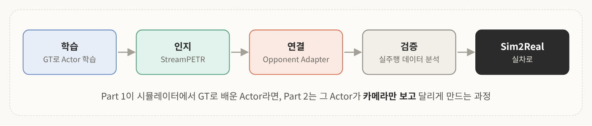
<!-- 직접 만든 그림: 2편 전체 흐름 -->

1편의 Actor는 상대 차량의 GT(정답 state)를 보고 배운 애임. 근데 대회 규정상 실제 주행에선 GT를 쓸 수 없음. 그래서 2편의 핵심 질문은 이거임.

> **GT로 배운 Actor를, 어떻게 카메라만 보고 달리게 만들까?**

흐름은 이렇게 감.
1. **시스템 파이프라인**: 학습이 실제로 어떻게 돌아가는가
2. **인지**: StreamPETR와 자체 데이터셋, 모델 학습
3. **Opponent Adapter**: 인지 결과를 Actor 입력으로 바꾸기
4. **데이터 분석**: 추론 파이프라인과 실주행 결과
5. **Sim2Real**: 시뮬레이터 밖으로 나가기

---

## 1. 학습 시스템 파이프라인

### 1-1. 시스템 연결: PC 12대 + 서버 1대

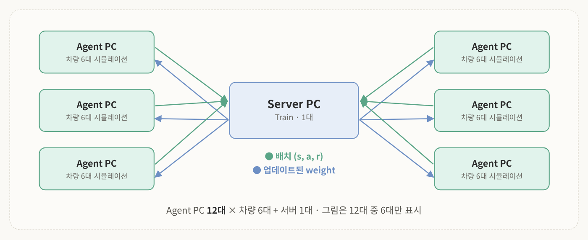
<!-- 슬라이드 3: System Connection (Training) -->

학습에는 총 **12대의 에이전트 PC**를 썼고, **PC마다 차량 6대**를 동시에 시뮬레이션함. 이 12대가 **서버 PC 하나**와 연결돼서 학습이 돌아감.

- 에이전트 PC → 서버: 주행 중 발생한 배치(상태 · 행동 · 보상) 전송
- 서버 → 에이전트 PC: 그 데이터로 업데이트한 weight를 다시 배포

> 💡 단순 계산으로 12 × 6 = 72대가 동시에 달리면서 경험을 모으는 셈임. 1편에서 "컴퓨팅 자원이 강화학습의 핵심"이라고 한 게 이런 스케일 얘기.

### 1-2. 데이터는 어떻게 오가나

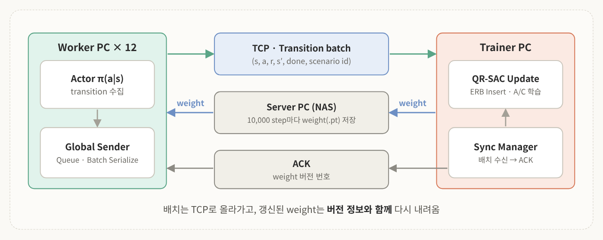
<!-- 슬라이드 4: Data Transfer Architecture (Train) -->

- **Worker PC 12대**: actor가 주행하며 transition을 수집하고, **global sender**가 queue에 모아 배치 단위로 직렬화(serialize)
- **TCP 통신**으로 서버 PC(NAS)에 전송. transition = (s, a, r, s′, done, scenario id)
- **Trainer PC**: 받은 배치를 ERB에 넣고 QR-SAC로 actor와 critic을 학습
- 수신이 끝나면 **ACK**(응답 신호)를 보내고, **sync manager**가 배치 수신과 ACK를 관리
- 갱신된 weight는 **버전 정보와 함께** 다시 worker의 actor로 전달
- 필요하면 checkpoint로 저장. 10,000 step마다 weight를 .pt로 저장함

### 1-3. 한 스텝 안에서 벌어지는 일

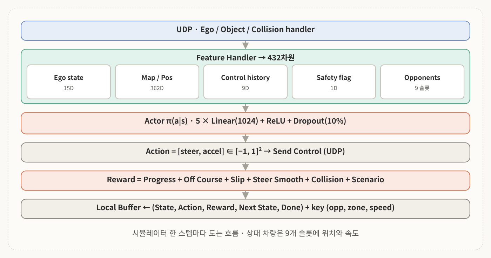
<!-- 슬라이드 5: E2E 학습 파이프라인 (1 Step) -->

UDP 프로토콜로 시뮬레이터에서 데이터를 받아 ego handler, object handler, collision handler, feature handler가 처리함.

| 입력 | 내용 | 차원 |
|---|---|---|
| **Ego state** | 속도, 가속도, 각속도, slip 등 | 15D |
| **Map & position** | 위치 + 전방 60개 포인트 | 362D |
| **Control history** | 조향 및 명령 이력 3스텝 | 9D |
| **Safety flag** | 벽 접촉, 코스 이탈 여부 | 1D |
| **Opponent** | 9개 슬롯 각각에 위치와 속도 | 45D (표 아래 참고) |

이걸 합쳐서 <mark class="pink">총 432차원 feature vector</mark>를 만들고, **5개의 linear 층 + ReLU + 10% dropout**으로 된 actor 네트워크에 넣어서 액션을 뽑음.

출력된 액션은 send control을 통해 UDP로 차량에 전달되고, 동시에 progress, off-course, slip, steer, collision 등으로 구성된 reward를 계산함 (1편 5장 내용).

그렇게 나온 state, action, reward, next state, 종료 여부 done 플래그까지 하나의 transition으로 묶어 **local buffer**에 저장하고, 상대 차량 수 등을 포함한 zone 키로 같이 관리함. 1편의 층화 샘플링 키가 여기서 쓰이는 것.

> 💡 슬라이드에는 Opponents가 15D로 적혀 있는데, 그러면 합이 402라서 432가 안 나옴. 9개 슬롯 × 5 = 45D면 정확히 432가 돼서 표에는 45D로 적었음. Adapter 쪽 슬라이드에도 Slot State가 슬롯당 5차원으로 나옴.

### 1-4. Actor 네트워크

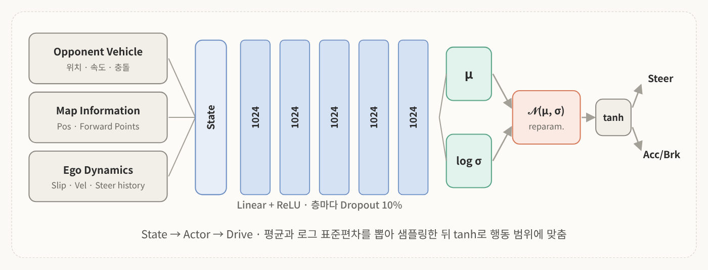
<!-- 슬라이드 6: System Pipeline -->

전체 흐름으로 보면 **상대 차량 정보(opponent vehicle), 지도 정보(map information), 자차 다이내믹스(ego vehicle dynamics)**가 들어가서 1024차원의 linear + ReLU 층을 지나고, 층마다 10% dropout이 걸림.

이후 **mean과 log standard deviation**을 출력한 뒤 reparameterize 과정을 거치고, actor 네트워크는 최종적으로 **steer와 accel/brake** 액션을 냄. 1편의 SAC가 확률적 정책이라서 평균과 표준편차를 뽑는 구조임.

---

## 2. 인지: StreamPETR

여기서부터가 perception 파트임.

### 2-1. 센서 구성: 카메라 5대

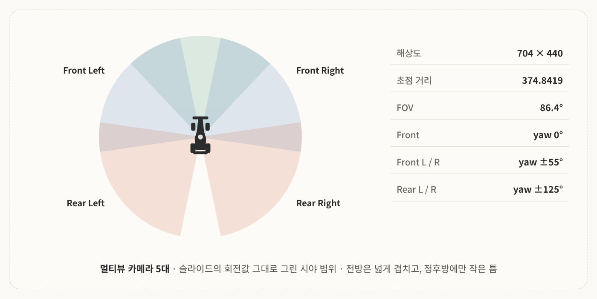
<!-- 슬라이드 7: Sensor Setup -->

멀티뷰 카메라 셋업을 씀. 전방, 전방 좌우, 후방 좌우 **총 5대로 360도를 커버**함.

| 항목 | 값 |
|---|---|
| 해상도 | 704 × 440 |
| 초점 거리 | 374.8419 |
| FOV | 86.4° |

> 💡 슬라이드의 회전값(0°, ±55°, ±125°)과 FOV 86.4°로 그려 보면 앞쪽은 넉넉히 겹치고, 정후방에만 약 24° 정도 틈이 생김. 그래서 그림엔 그대로 표시했음. 발표의 "360도 커버"는 "거의 360도"로 보면 됨.

### 2-2. StreamPETR란

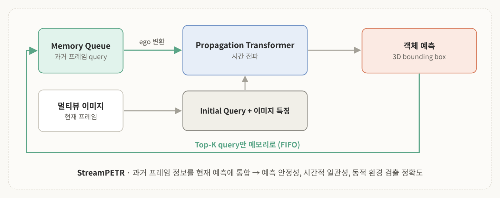
<!-- 슬라이드 8: StreamPETR -->

인지 모델은 <mark class="pink">StreamPETR</mark>를 씀. **temporal memory queue**로 과거 프레임 정보를 현재 프레임 예측에 통합하는 방식임.

- 예측의 **안정성과 시간적 일관성**이 올라감
- 시간적 맥락을 같이 쓰니까 차량이 움직이는 **동적 환경에서도 높은 검출 정확도** 확보

### 2-3. PETR: 2D 이미지에 3D 위치 입히기

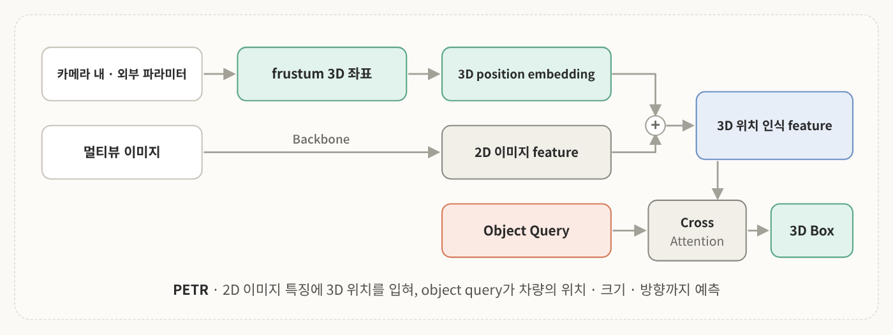
<!-- 슬라이드 9: PETR 3D Position-Aware Sparse Query Detection -->

StreamPETR의 기반인, 공간 인식을 맡는 PETR부터 봄.

2D 이미지 feature만으로는 객체의 실제 3차원 위치를 알기 어려움. 그래서 PETR은
1. 각 카메라의 **extrinsic, intrinsic**(내 · 외부 파라미터)을 써서 camera frustum 내부에 **3D 좌표를 생성**
2. 이걸 **position embedding**으로 변환
3. 2D 이미지 feature와 결합해서, object query가 이미지상의 객체를 넘어 **실제 3차원 위치까지** 학습하게 함
4. 3D 위치가 담긴 이미지 feature와 object query가 **cross-attention**으로 상호작용해서 차량의 위치, 크기, 방향을 포함한 **3D bounding box**를 예측

StreamPETR은 여기에 **과거 프레임의 시간 정보**를 추가로 씀.

### 2-4. 시간 정보를 어떻게 합칠까: 세 가지 방식

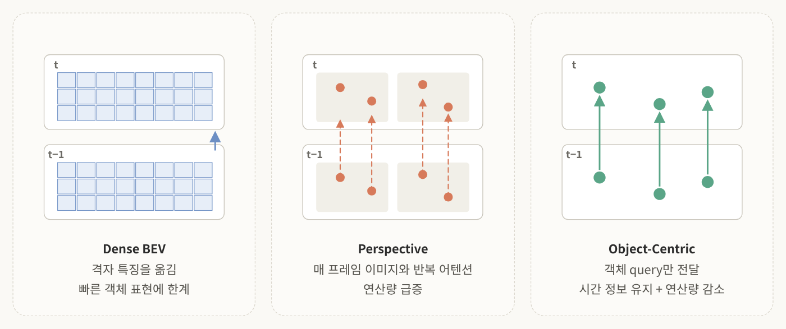
<!-- 슬라이드 10: Temporal Modeling Three Paradigms -->

멀티뷰 3D 검출은 시간 정보를 어떻게 융합하느냐에 따라 세 가지로 나뉨. BEV는 bird's-eye view, 위에서 내려다본 시점임.

| 방식 | 어떻게 | 한계 / 장점 |
|---|---|---|
| **Dense BEV** | 격자 형태의 BEV 특징을 다음 프레임으로 이동 | 구조가 고정돼서 빠르게 움직이는 객체 표현에 한계 |
| **Perspective** | object query가 매 프레임 이미지 특징과 어텐션 반복 | 연산량 급증 |
| **Object-Centric** | 전체 feature가 아니라 **검출된 객체의 query만** 다음 프레임으로 전달 | 시간 정보를 유지하면서 연산량 감소 |

그래서 <mark class="mint">object-centric 방식이 고속 레이싱 환경에 가장 적합</mark>하다고 판단함.

### 2-5. 왜 StreamPETR인가

StreamPETR은 **object query 자체를 시간에 따라 전파되는 hidden state**로 씀. 덕분에 움직이는 객체를 잘 표현하면서 효율성도 같이 챙김.

- **SOLOFusion 대비** 더 적은 연산 비용으로 **mAP 2.3%p 향상, 추론 속도 1.8배**
- object query 기반이라 **카메라 수나 배치가 바뀌어도 유연**해서, 5대 카메라 환경으로 포팅하기 좋음
- 이 시간 전파의 핵심 역할을 하는 게 **Motion-aware Layer Normalization(MLN)**

---

## 3. 데이터셋 구축

### 3-1. nuScenes에서 MORAI로

StreamPETR은 원래 Motional이 만든 공개 데이터셋 **nuScenes**로 학습함. 이걸 **MORAI 시뮬레이터 환경**에 맞춰 재구성함.

| | nuScenes | MORAI 자체 데이터셋 |
|---|---|---|
| 프레임 | 40,000 | 30,000 |
| Scene | 1,000 | 200 |
| 카메라 | 6대 | 5대 |

### 3-2. 어떤 조건으로 모았나

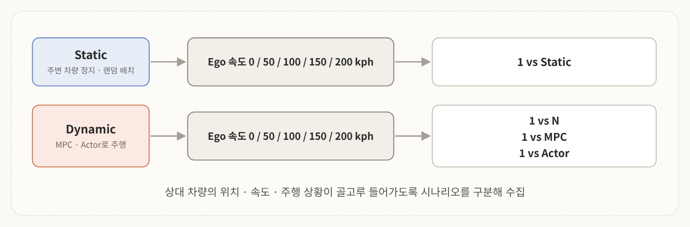
<!-- 슬라이드 13: Data Collection Strategy -->

다양한 상대 차량 위치와 속도, 주행 상황을 담으려고 정적 · 동적 시나리오를 구분함.

- **Static**: 주변 차량을 트랙에 무작위 배치하고, ego 차량을 다양한 속도로 주행
- **Dynamic**: 클래식한 자율주행 컨트롤러(MPC)나 다른 버전 actor로 주변 차량과 경쟁하는 상황에서 수집

각 조건에서 자차 속도를 **0kph 정지 상태부터 200kph 고속까지** 구분해서 바꿔 가며 모음.

### 3-3. 자동 라벨링과 BEV Visibility Filter

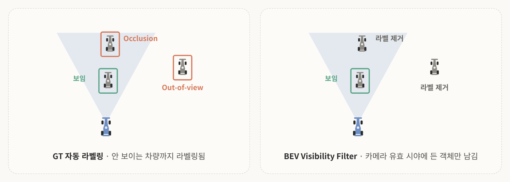
<!-- 슬라이드 14: Automated Data Annotation -->

대규모 데이터셋을 빠르게 만들려고 **MORAI의 GT 데이터를 활용한 자동 라벨링 파이프라인**을 구축함.

근데 문제가 있었음. 카메라 시야를 벗어난 차량(**out-of-view**), 앞 차량에 가려진 차량(**occlusion**)까지 라벨링됨.

이 잘못된 라벨을 없애려고 <mark class="pink">BEV Visibility Filter</mark>를 설계함. 카메라 위치 · 자세와 객체 위치를 BEV 좌표계에 투영한 뒤, 각 객체가 실제 카메라 유효 시야에 들어오는지 판별함. 그 결과 **실제 영상에서 관측 가능한 차량만** 라벨링돼서 데이터 신뢰도가 올라감.

> 💡 시뮬레이터 GT는 "세상에 뭐가 있는지"를 알려 주는 거지 "카메라에 뭐가 보이는지"를 알려 주는 게 아님. 벽 뒤 차를 찾으라고 시키면 모델은 없는 걸 찾아야 하니 학습이 꼬임.

### 3-4. 최종 데이터셋

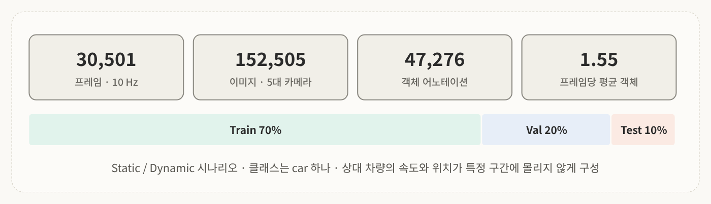
<!-- 슬라이드 15: Dataset Statistics -->

최종적으로 **10Hz 주기의 약 3만 프레임**을 구축함. 프레임마다 카메라 5대 영상이라 총 약 15만 장 이미지, 약 5만 개 객체 어노테이션을 확보함. 프레임별 객체 수뿐 아니라 상대 차량의 속도와 위치가 특정 구간에 몰리지 않고 다양하게 들어감.

---

## 4. 모델 학습

### 4-1. 무엇을 조절했나

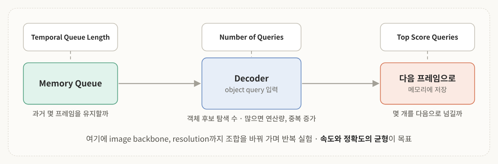
<!-- 슬라이드 16: StreamPETR Model Training -->

| 파라미터 | 의미 |
|---|---|
| **Temporal queue length** | 과거 몇 개 프레임의 object query를 메모리에 유지하고 현재 추론에 쓸지 |
| **Number of queries** | 프레임마다 객체 후보를 찾으려고 디코더에 넣는 전체 object query 수. 많을수록 더 많이 찾지만 **연산량과 중복 검출 가능성도 증가** |
| **Number of top score queries** | 현재 프레임 query 중 몇 개를 다음 프레임 temporal memory로 넘길지 |

그 외에 image backbone, resolution 등 조합을 여러 가지로 바꿔 가며 계속 실험함.

### 4-2. 초기 학습에서 터진 문제 두 가지

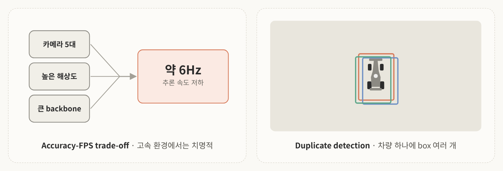
<!-- 슬라이드 17: Accuracy-FPS Trade-off, Duplicate Detection -->

**① 추론 속도 저하** 
5대 카메라 영상에 높은 입력 해상도와 큰 backbone을 써서 검출 성능을 우선했더니 추론 속도가 **약 6Hz까지** 떨어짐. 고속 환경에서는 매우 치명적임.

**② 중복 검출** 
여러 object query가 같은 객체를 동시에 예측해서 차량 하나에 bounding box가 여러 개 생김.

그래서 이후 학습은 **정확도와 속도의 균형 확보, 중복 예측 감소** 두 방향으로 진행함.

### 4-3. 평가 지표와 학습 환경

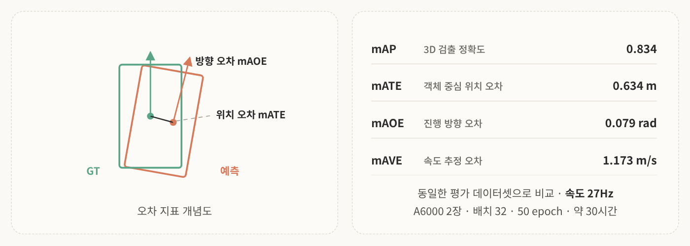
<!-- 슬라이드 18~19: Evaluation Metric, Training Setup -->

| 지표 | 의미 | 목표 |
|---|---|---|
| **mAP** | 전체적인 3D 객체 검출 정확도 | 높을수록 |
| **mATE** | 객체 중심의 위치 오차 | 낮을수록 |
| **mAOE** | 객체 진행 방향(heading) 오차 | 낮을수록 |
| **mAVE** | 객체 속도 추정 오차 | 낮을수록 |

이 네 지표와 추론 속도를 기준으로 모델을 비교함. 공정한 비교를 위해 모든 실험은 같은 환경임. **NVIDIA A6000 GPU 2대 병렬, 배치 32(FP16), 50 epoch**이고 한 번 학습에 **약 30시간**이 걸림. 학습이 끝나면 매번 같은 평가 데이터셋에서 지표와 속도를 기록해서 파라미터 변화에 따른 성능을 비교함.

### 4-4. 결과: Ver.24

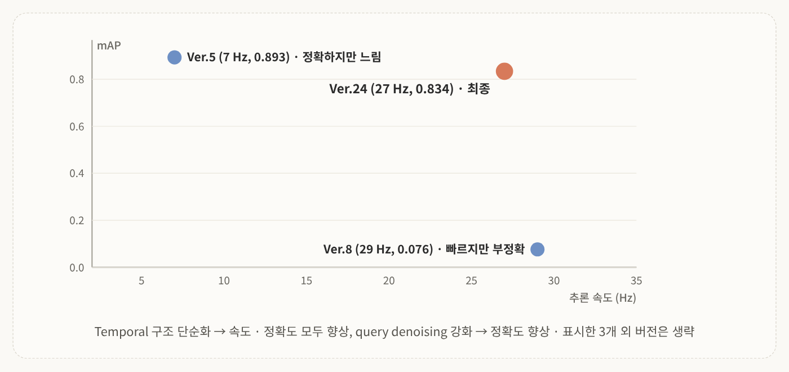
<!-- 슬라이드 20: StreamPETR Training Results -->

- 초기 실험 **Ver.5**: mAP는 높은데(0.893) 7Hz라 실시간 레이싱엔 한계
- 이후 nuScenes와 자체 데이터셋 차이를 고려해 **temporal queue와 query 구조를 단순화**함. 불필요한 연산과 탐색 공간이 줄면서 <mark class="pink">속도뿐 아니라 정확도까지 같이 향상</mark>
- object query **denoising을 강화**해서 같은 객체에 대한 중복 예측을 줄이고 정확도를 추가로 개선
- 최종 모델 **Ver.24**: mAP 0.834, **27Hz 실시간 추론**

| Parameter | Value |
|---|---|
| Resolution | 256 × 704 |
| Queue length | 4 |
| Backbone | ResNet-50 |
| Num query | 150 |
| Memory length | 320 |
| Top score queries | 64 |

> 💡 슬라이드 글머리와 평가 표는 mAP 0.834인데 같은 장 그래프 라벨은 0.814로 적혀 있음. 본문은 표 기준 0.834로 썼음.

> 💡 재밌는 포인트는 구조를 **줄였더니 정확도도 올랐다**는 것. nuScenes는 도심이라 한 장면에 객체가 많은데, 레이싱 데이터셋은 프레임당 평균 1.55개뿐임. 데이터에 비해 과한 구조를 덜어 낸 효과로 볼 수 있음.

---

## 5. Opponent Adapter: 인지와 정책 잇기

### 5-1. 왜 필요한가

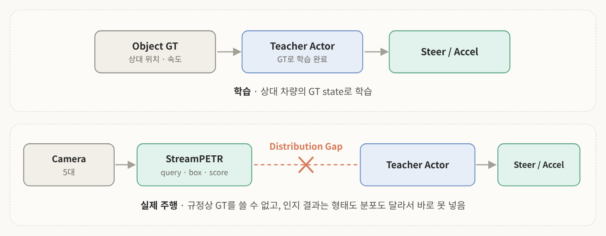
<!-- 슬라이드 21: Motivation for Opponent Adapter -->

학습 때는 상대 차량 GT로만 학습함. 그래서 **Teacher-Actor**는 GT opponent state에 맞춰져 있음.

근데 실제 주행에선 규정상 GT를 못 쓰고, StreamPETR이 내는 **object query, box, score** 같은 카메라 인지 결과만 쓸 수 있음. 이건 Actor가 학습 때 본 GT state와 <mark class="pink">형태도 distribution도 달라서</mark> 바로 넣기가 어려움.

그래서 StreamPETR 출력과 Actor 입력 사이의 갭을 줄이는 <mark class="mint">opponent adapter</mark>를 설계함.

### 5-2. 파이프라인과 내부 구조

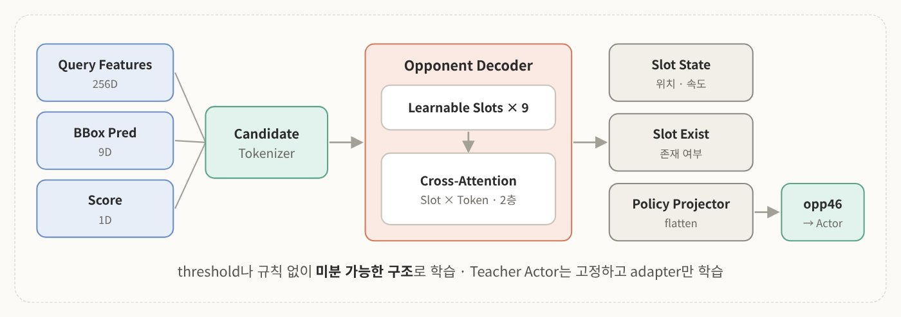
<!-- 슬라이드 22~23: Opponent Adapter Pipeline, Architecture -->

Adapter는 StreamPETR의 **raw query, box, score**를 입력받아 Teacher Actor가 쓸 수 있는 **opponent feature**로 변환함.

- score threshold나 rule-based filtering을 안 쓰고 **미분 가능한 구조**로 학습
- **Teacher Actor는 고정하고 adapter만 학습**해서, 기존 판단 능력을 유지하면서 효율적으로 학습 가능

내부는 세 단계임.
1. **Candidate Tokenizer**: raw query feature, bounding box, score를 하나의 토큰으로
2. **Opponent Decoder**: cross-attention으로 여러 object query를 **고정된 수의 opponent 슬롯**으로 정리
3. **출력**: 각 슬롯을 Teacher Actor가 쓸 수 있는 opponent state 형태로 변환

> 💡 슬롯이 왜 필요하냐면, 카메라에 몇 대가 잡히든 Actor 입력은 **항상 같은 크기**여야 하기 때문임. 그리고 threshold로 "이건 차, 저건 아님"을 자르지 않으니 애매한 검출도 정보로 살아 있고, 미분 가능하니까 학습으로 다듬을 수 있음.

### 5-3. 잘 변환되나

Adapter의 BEV 시각화를 보면 StreamPETR이 예측한 상대 위치(노랑)와 adapter 출력(파랑)이 같은 좌표계에서 유사한 위치에 형성됨. 즉 인지 결과를 Actor 입력에 맞는 표현으로 잘 변환하고 있음.

| Metric | Train | Val |
|---|---|---|
| Position error | 0.519 m | 0.673 m |
| Velocity error | 1.189 km/h | 1.181 km/h |
| Existence accuracy | 99.968% | 99.811% |
| Total loss | 0.0839 | 0.1080 |

StreamPETR과 opponent adapter를 거친 전체 perception 파이프라인을 시각화해 보면, 카메라 뷰에 잡힌 상대 차량 위치가 BEV 좌표상에 잘 추정됨. E2E 파이프라인이 정상적으로 동작한다는 걸 확인할 수 있음.

---

## 6. 추론 파이프라인과 데이터 분석

### 6-1. 추론 파이프라인

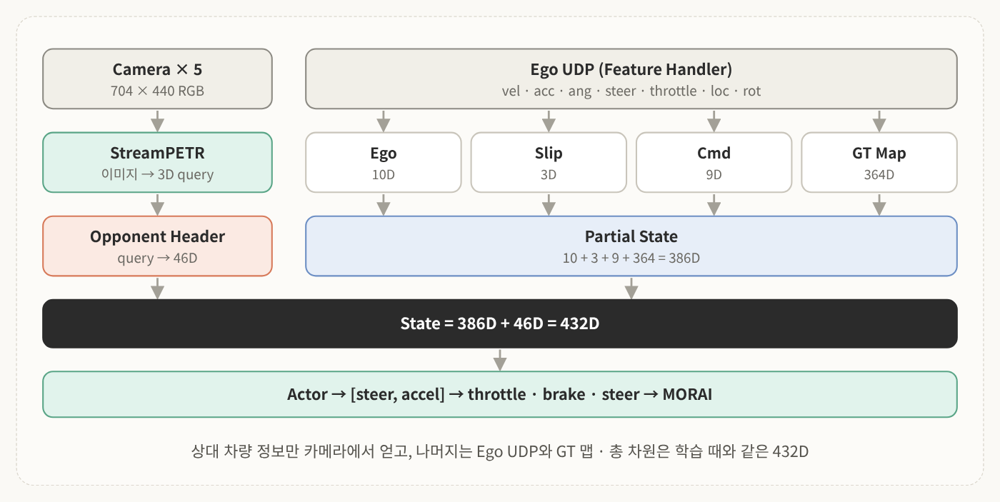
<!-- 슬라이드 26: System pipeline (Inference) -->

- **카메라 5대**(704×440 RGB)가 전방, 좌우 전방, 좌우 후방 담당
- **Ego UDP의 feature handler**가 속도, 가속도, 각속도, 조향, 스로틀, 위치, 회전 정보를 받음
- 카메라 이미지는 StreamPETR로 3D object query가 되고, opponent header를 거쳐 **46차원 opponent 정보**로 변환
- 364차원 GT 맵, 10차원 Ego adapter, 3차원 Slip adapter, 9차원 Cmd adapter를 합쳐 **386차원 partial state** 구성
- 386 + 46 = **432차원 최종 state**를 actor에 입력
- Actor 출력 steer, accel은 throttle, brake, steer로 변환되어 MORAI 내부 차량으로 전달

즉 <mark class="pink">상대 차량 정보만 GT에서 카메라 인지로 갈아 끼운</mark> 구조임.

### 6-2. 리소스와 추론 속도

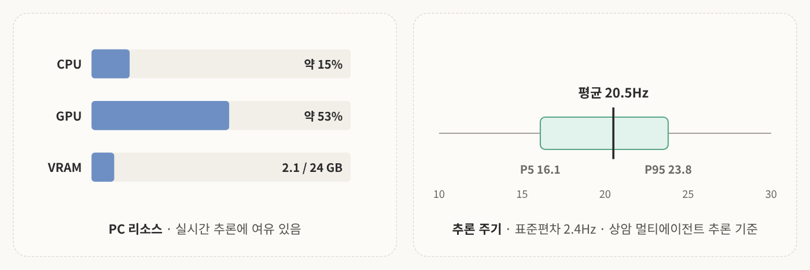
<!-- 슬라이드 27~28: PC Usage, Hz Analysis -->

**PC 리소스**: VRAM 약 2.1GB, GPU 사용률 53%, CPU 사용률 15%. 실시간 추론에 충분히 여유 있는 수준임.

**추론 주기**: E2E 모델이 입력을 받아 제어 명령을 내리는 주기를 쟀더니 전 구간 **평균 20.5Hz**, 표준편차 2.4Hz, 하위 5% 시점인 **P5가 16.1Hz**로 나옴.

> 💡 StreamPETR 단독은 27Hz인데 전체 평균은 20.5Hz임. 인지만이 아니라 adapter, actor, 통신까지 전부 거친 주기라서 그런 걸로 이해하면 됨. 평균뿐 아니라 P5를 같이 보는 이유는, 고속 주행에선 **가장 느린 순간**이 사고를 만들기 때문.

### 6-3. 조향 명령을 잘 따라가나

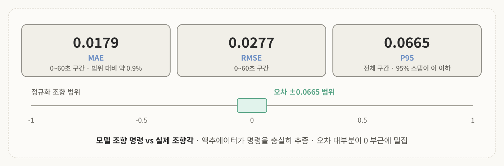
<!-- 슬라이드 29~30: Steer Error, Distribution -->

모델이 낸 조향 명령과 시뮬레이터 내부 차량의 실제 조향각을 비교하면 두 선이 거의 일치함. 액추에이터가 모델 명령을 **충실히 추종**한다는 뜻임.

- **MAE 0.0179**: 정규화 범위(−1~1) 기준 약 0.9% 수준
- **RMSE 0.0277**
- **P95 0.0665**: 전체 스텝의 95%에서 오차가 0.0665 이하

오차를 전체 구간 확률 밀도로 그려 보면 대부분이 0 부근에 밀집해 있음.

> 💡 슬라이드 그래프 안의 값을 보면 전체 구간 분포 쪽은 MAE 0.0211, RMSE 0.0765로 적혀 있음. 위의 0.0179, 0.0277은 0~60초 구간 그래프 값이라, 둘은 구간이 달라서 차이 나는 걸로 보임.

### 6-4. 정말 카메라를 보고 핸들을 꺾나

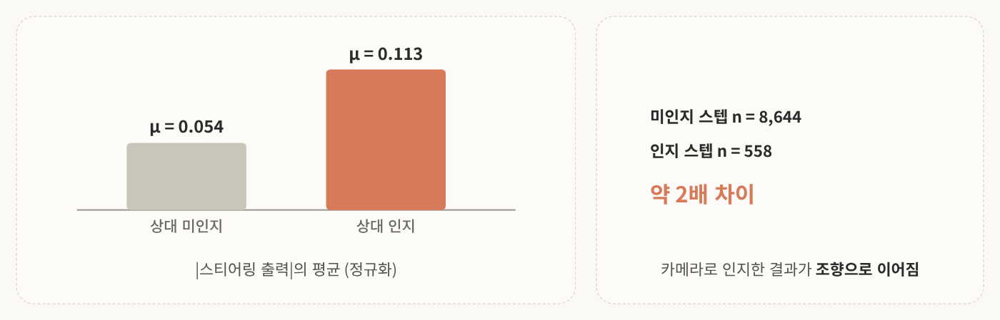
<!-- 슬라이드 31: 차량 인지 시 스티어링 휠 분포 변화 -->

상대 차량이 근처에 있을 때와 없을 때의 스티어링 출력 분포를 비교함.

- 상대가 **인지되지 않았을 때**: μ = 0.054
- 상대가 **인지되었을 때**: μ = 0.113

약 2배 차이. 이건 <mark class="mint">모델이 실제로 다른 차량을 카메라로 인지하고, 그걸 반영해서 조향으로 이어진다</mark>는 걸 방증하는 결과임.

### 6-5. A1 챌린지 결승전

마지막으로 Part 1, 2 기술을 전부 쓴 주행 영상으로 산업통상부 주관 E2E 자율주행 대회 **A1 챌린지 결승전** 영상을 봄. 원종훈 교수님 자율항법연구실 AIM 팀 경기임. 여러 대학 팀(한양대, 숭실대, 조선대 등)이 함께 달리는 가운데, 깔끔한 주행 라인과 속도로 선두권을 유지하고 정차 차량과의 충돌을 피하거나 상대를 추월하는 장면들이 해설됨.

---

## 7. Sim2Real: 시뮬레이터 밖으로

### 7-1. 목표: Formula 4 실차

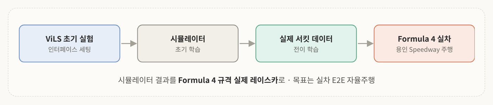
<!-- 슬라이드 33: Sim2Real 추진 방향 -->

지금까지는 전부 드라이빙 시뮬레이터 안의 결과임. 강화학습 기반 E2E 자율주행의 궁극적인 목표는 **실제 차량으로 E2E 자율주행을 수행하는 것**임.

목표 차량은 **Formula 4 규격 레이스카**고, 용인 Mercedes-Benz AMG Speedway 서킷 주행을 예정하고 있음. 필요한 단계는
1. **ViLS로 초기 실험**: 시뮬레이터와 실차 사이의 제어 · 통신 인터페이스 맞추기
2. **시뮬레이터 초기 학습**
3. **실제 데이터로 전이 학습**해서 강화학습 정책을 실차 환경에 맞게 다듬기

### 7-2. Sim2Sim부터

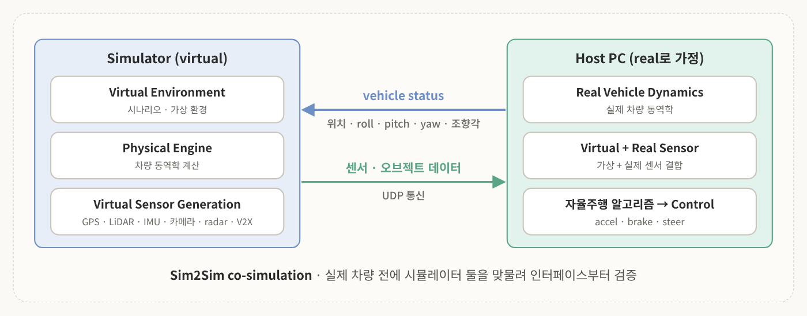
<!-- 강의자료 외 추가 슬라이드: Sim2Sim Co-Simulation -->

Sim2Real co-simulation에 앞서, 호스트 PC를 실제 차량이라고 가정하고 <mark class="pink">Sim2Sim co-simulation</mark>으로 먼저 검증함. 두 시뮬레이터는 **UDP 통신**으로 데이터를 주고받음.

| 방향 | 데이터 |
|---|---|
| Real → Sim | 위치, roll, pitch, yaw, 조향각 등 vehicle status |
| Sim → Real | GPS, IMU, LiDAR, radar, V2X 등 차량 센서 데이터 |

**시뮬레이터 쪽 3개 모듈**
- **Virtual Environment**: 시나리오와 가상 환경 생성
- **Physical Engine**: 차량 동역학 계산
- **Virtual Sensor Generation**: GPS, LiDAR, IMU, 카메라, radar, V2X 등 가상 센서 데이터 생성

**Real World 쪽**
- **Real Vehicle Dynamics**: 실제 차량 동역학
- **Virtual Sensor + Real Sensor**: 받은 가상 센서를 실제 센서와 결합
- 결합된 센서 정보가 자율주행 알고리즘에 들어가고, accel, brake, steer 명령이 만들어져 종방향 · 횡방향 제어를 담당하는 control 모듈로 차량을 제어

실제로 구현해 보니, virtual 쪽은 NPC 차량과 주변 교통까지 시뮬레이션하고 real로 가정한 쪽은 해당 차량이 단독으로 달리는데, 둘이 vehicle status와 센서 데이터를 주고받으며 **하나의 환경 안에서 함께 달리는 것처럼 동기화**됨.

### 7-3. Sim2Real gap과 X-in-the-Loop

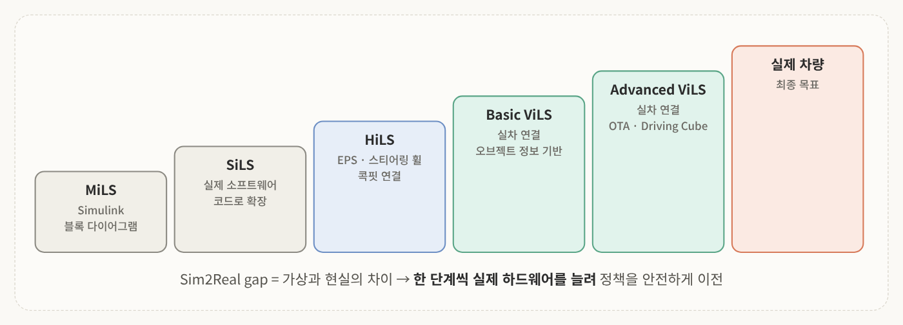
<!-- 슬라이드 32 관련: Sim2Real 단계적 접근 -->

**Sim2Real 문제**는 가상 환경에서 얻은 지식을 실제 환경의 에이전트(로봇, 차량 등)에 그대로 옮기기 어려운 문제임. 시뮬레이션과 현실 사이의 갭, 즉 **Sim2Real gap** 때문에 생김.

이걸 줄이려고 단계적으로 접근함.

| 단계 | 내용 |
|---|---|
| **MiLS** (Model in the Loop) | Simulink 블록 다이어그램 기반의 가장 초기 단계 |
| **SiLS** (Software in the Loop) | 블록 다이어그램을 실제 소프트웨어 코드로 확장 |
| **HiLS** (Hardware in the Loop) | SiLS를 EPS, 스티어링 휠, 실제 운전 콕핏 같은 차량 일부 하드웨어와 연결 |
| **ViLS** (Vehicle in the Loop) | SiLS나 HiLS를 실제 차량과 연결. **Basic ViLS**는 오브젝트 정보 기반, **Advanced ViLS**는 AVL사 Driving Cube처럼 OTA(무선 통신) 기반 |

ViLS 환경도 두 가지가 있음.
- **ViLS 1**: 테스트 벤치 기반. 차량을 섀시 다이나모 같은 랩 환경에 올리고 수행
- **ViLS 2**: PG(Proving Ground)라는 통제된 시험 환경에서 차량을 주행시키며 수행

이렇게 <mark class="mint">시뮬레이션에서 학습한 policy를 점진적으로 실제 하드웨어, 실제 차량으로 안전하게 이전</mark>함.

### 7-4. 안전 전략: ViLS와 System Identification

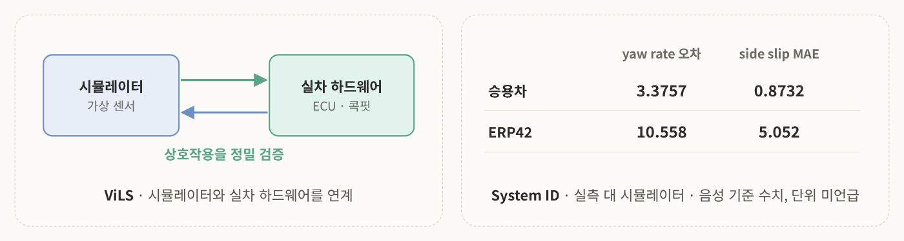
<!-- 강의자료 외 추가 슬라이드: Sim2Real 확장을 위한 안전 전략 설계 -->

**Vehicle-in-the-Loop Simulation** 
시뮬레이터 모델을 실차에 적용할 때의 gap을 줄이려고, 시뮬레이터와 실차 하드웨어를 연계한 ViLS 환경을 구축함. 가상 센서와 실제 ECU 제어기 간 상호작용을 정밀하게 검증할 수 있음. 실제 차량 콕핏에 시뮬레이터 화면을 연결해서 실차 하드웨어에서 시뮬레이션 주행을 그대로 재현함.

**Simulator Vehicle Dynamics System Identification** 
시뮬레이터의 차량 동역학이 실제 차량과 얼마나 비슷하게 움직이는지 검증했더니 실차 대비 높은 정합성을 확보함. 덕분에 기본 동역학 모델 대비 Sim2Real 이질감을 줄이고 고속 상황 스티어 조작 제어 신뢰성을 확보함.

검증에는 일반 승용차와 소형 모바일 로봇 플랫폼(**ERP42**) 두 개를 씀. 주행 경로와 시간에 따른 yaw rate, side slip을 실측(빨강)과 시뮬레이터 추정(파랑)으로 비교하면 상당히 비슷하게 겹침.

| 플랫폼 | yaw rate 오차 | side slip 평균 절대 오차 |
|---|---|---|
| 승용차 | 3.3757 | 0.8732 |
| ERP42 | 10.558 | 5.052 |

즉 실제 차량 거동을 재현하는 system identification을 적용하면 시뮬레이터 동역학 모델 성능이 올라감.

> 💡 이 표는 강의자료 PDF에 없는 추가 슬라이드라 발표 음성 기준으로 옮겼음. 단위는 언급되지 않았고 ERP42의 side slip 값은 잘 안 들려서 추정값임.

### 7-5. K-City 디지털 트윈 시험

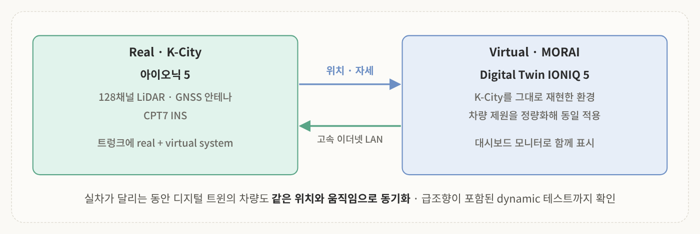
<!-- 강의자료 외 추가 슬라이드: K-City Sim2Real Co-Simulation, 하드웨어·소프트웨어 설계 -->

**Proving Ground Sim2Real Co-Simulation** 
경기도 화성의 자율주행 실험 도시 **K-City**에서 직접 실험함. MORAI 안에 K-City를 그대로 재현한 디지털 트윈이 있고, 앞유리 너머로 보이는 실제 K-City 장면과 대시보드 모니터의 디지털 트윈 장면이 같은 위치와 경로를 보여 줌. 실차가 달리는 동안 시뮬레이터 안 차량도 같은 도로와 차선을 따라 움직여서, <mark class="pink">실차와 디지털 트윈 간 위치 및 주행 상태 동기화가 안정적</mark>이라는 걸 확인함.

**Dynamic Digital Twin Test** 
앞의 실험이 직진 도로와 상대 차량 동기화였다면, 이번엔 급격한 스티어링 조작까지 포함한 동적 테스트임. 실제 도로 위 차량의 움직임이 디지털 트윈에서도 실시간으로 같은 위치와 움직임으로 반영됨.

**하드웨어 · 소프트웨어 설계**
- **트렁크 내부**: 실차를 제어하는 real system과 virtual system을 함께 탑재. 고속 이더넷 LAN으로 연결해서 위치 · 자세 추정 정보를 실시간으로 주고받음
- **테스트 차량**: 아이오닉 5에 128채널 LiDAR, GNSS 안테나, CPT7 INS 장치 탑재
- **디지털 트윈**: 같은 차량을 MORAI 안에 digital twin virtual IONIQ 5로 구현
- **제원 매칭**: 차량 제원을 정량화해서 시뮬레이터에도 동일하게 적용 → Sim2Real 동역학 이질감 최소화

> 💡 1편에서 본 "1틱 조향으로 스핀" 사례랑 연결해서 보면, 이 단계들이 왜 필요한지 보임. 실차에 바로 올리지 않고 가상 공간의 상대 차량, 실제 차량 하드웨어를 섞어서 검증하면 **사고 위험 없이 실패를 미리 찾을 수 있음**.

---

## 8. 핵심 요약

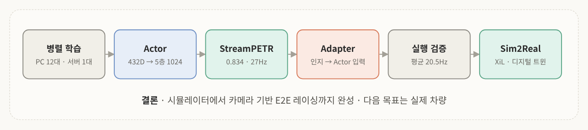
<!-- 직접 만든 그림: 2편 전체 흐름 -->

1. **학습 시스템**: 에이전트 PC 12대(PC당 차량 6대) + 서버 1대. TCP로 배치를 올리고, 버전 정보와 함께 weight를 내림
2. **Actor**: 432차원 state → 5층 Linear(1024) + ReLU + Dropout 10% → steer, accel
3. **StreamPETR**: 카메라 5대, temporal memory queue, object-centric 방식. query를 시간 전파 hidden state로 씀
4. **데이터셋**: MORAI GT 자동 라벨링 + BEV Visibility Filter. 30,501 프레임
5. **모델 튜닝**: 구조를 단순화하고 query denoising을 강화해서 최종 **Ver.24, mAP 0.834, 27Hz**
6. **Opponent Adapter**: 인지 결과와 GT 입력의 distribution gap을 메움. Teacher Actor는 고정, 미분 가능한 구조로 adapter만 학습
7. **실주행 분석**: 평균 20.5Hz, 조향 MAE 0.0179, 상대 인지 시 스티어링 평균 약 2배
8. **Sim2Real**: Sim2Sim → MiLS · SiLS · HiLS · ViLS 단계적 접근, system identification, K-City 디지털 트윈. 목표는 Formula 4 실차

>한 줄로 묶으면  
>**GT로 강하게 키운 Actor에 StreamPETR과 opponent adapter를 붙여 카메라만으로 달리게 만들었고, 이제 XiL과 디지털 트윈으로 시뮬레이터와 현실의 간극을 좁혀 실제 레이스카로 나아간다.**

이번 주 내용을 큰 그림으로 보면 Physical AI의 전형적인 흐름 그대로임. **시뮬레이터에서 대량으로 배우고, 인지와 행동을 하나로 잇고, 단계적으로 현실에 내려놓기.**

---

## 참고문헌
- Wurman, P. R., et al. (2022). Outracing champion Gran Turismo drivers with deep reinforcement learning. *Nature*, 602, 223–228.
- Wang, S., et al. (2023). Exploring Object-Centric Temporal Modeling for Efficient Multi-View 3D Object Detection. *ICCV*.
- Jia, X., et al. (2024). DriveAdapter: Breaking the Coupling Barrier of Perception and Planning in End-to-End Autonomous Driving.
- 이용하, 원종훈. E2E Autonomous Driving & Sim2Real (2026 A1 Challenge). *Physical AI 개론 강의자료 Part 2*, 인하대학교 자율항법연구실.