## 들어가며

이번 7주차는 항공우주공학과 조정우 교수님 강의임. 주제는 **항공 분야 AI**, 그중 1편은 **항공교통(Air Traffic)** 쪽임.

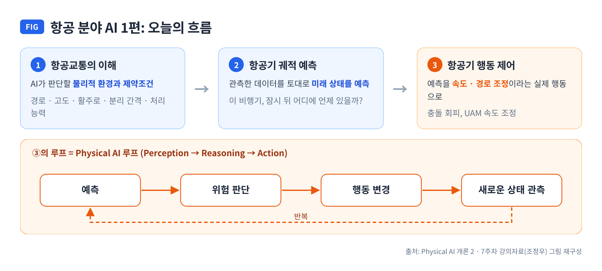

흐름은 세 덩어리로 감.

| 파트 | 내용 | 한 줄 요약 |
|---|---|---|
| ① 항공교통의 이해 | AI가 판단할 **물리적 환경과 제약조건** | AI가 뭘 할 수 있고 뭘 지켜야 하는지부터 알자 |
| ② 항공기 궤적 예측 | 관측한 데이터를 토대로 **미래 상태를 예측** | 이 비행기, 잠시 뒤에 어디 있을까? |
| ③ 항공기 행동 제어 | 예측 → 위험 판단 → 행동 변경 → 새로운 상태 관측 | 예측한 걸로 속도·경로를 실제로 바꾸기 |

AI를 어떤 환경에 넣으려면 그 환경에서 **어떤 행동이 가능하고 어떤 제약을 지켜야 하는지**를 먼저 알아야 함. 그래서 항공교통이 뭔지부터 차근차근 들어감.

> 💡 ③의 "예측 → 위험 판단 → 행동 변경 → 새로운 상태 관측"은 지난 강의들에서 계속 나온 Physical AI 루프(**Perception → Reasoning → Action**)를 항공교통 버전으로 바꿔 쓴 거임. 이번 강의 내내 이 루프가 어디서 돌아가는지 찾으면서 보면 재밌음.

---

## 1. 항공교통의 이해

### 1-1. 하늘 위의 교통체계

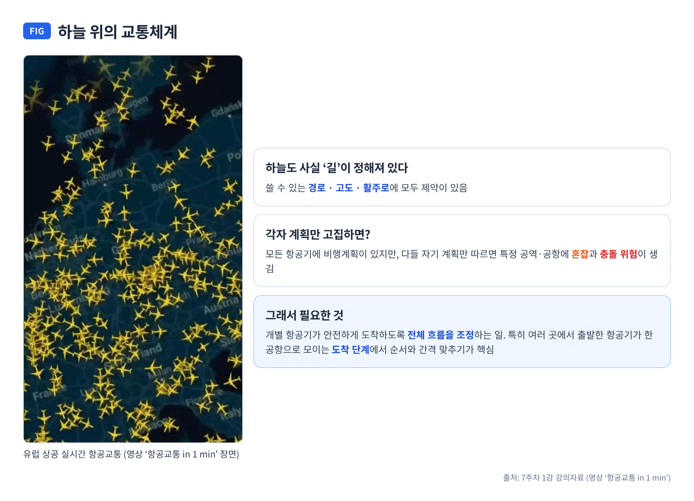
<!-- 1강 슬라이드 4: 하늘 위의 교통체계 (항공교통 in 1 min 영상) -->

하늘은 넓으니까 비행기가 각자 목적지로 그냥 날아가면 될 것 같지만, 실제로는 <mark class="pink">쓸 수 있는 경로, 고도, 공항 활주로에 다 제약이 있음</mark>.

특히 여기저기서 출발한 비행기들이 **한 공항으로 모이는 도착 단계**에서는 순서를 정하고 간격을 맞추는 게 엄청 중요해짐.

영상(항공교통 in 1 min)을 보면 유럽 하늘이 노란 비행기 아이콘으로 빽빽함. 항공교통도 결국 **하나의 거대한 교통망**이라는 거.
- 각 비행기는 자기 **비행계획**이 있음
- 근데 모두가 자기 계획만 고집하면 특정 공역이나 공항에서 **혼잡**이 생기고 **충돌**까지 날 수 있음
- 그래서 누군가 **전체 흐름을 조정**해 줘야 함

### 1-2. 비행 단계: 출발부터 도착까지

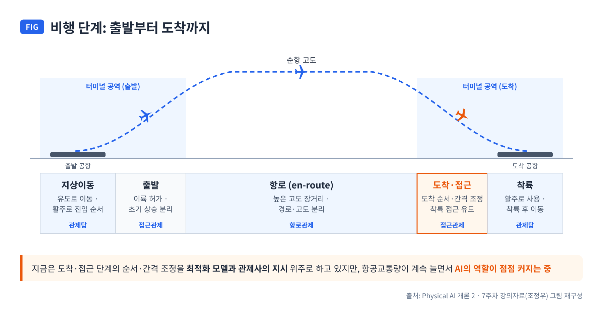
<!-- 1강 슬라이드 5: 비행단계 -->

비행기 한 대가 출발해서 도착할 때까지 거치는 단계임. 왼쪽이 출발 공항, 오른쪽이 도착 공항.

| 단계 | 하는 일 | 공역 |
|---|---|---|
| **지상이동** | 유도로 이동과 활주로 진입 순서 관리 | 공항 지상 |
| **출발** | 이륙 허가, 초기 상승 항공기 간 **분리** | 터미널 공역 (terminal area) |
| **항로** | 비행 경로·고도 관리, 항공기 간 **분리** | 항로 (en-route), 높은 고도의 장거리 구간 |
| **도착·접근** | 도착 **순서와 간격** 조정, 착륙 접근 유도 | 터미널 공역 (접근 관제) |
| **착륙** | 활주로 사용과 착륙 후 이동 관리 | 공항 |

포인트는 마지막 **도착·접근 단계**임. 지금은 이 순서·간격 조정을 **최적화 모델이나 관제사(사람) 위주의 지시**로 하고 있는데, 항공교통량이 계속 우상향하면서 <mark class="pink">AI의 역할이 점점 커지는 중</mark>이라고 함.

> 💡 그림 아래 파란 글씨(담당 관제)를 미국식 약어로 쓰면 이럼. 원래 강의 슬라이드에는 이 약어로 나옴
> - **ATCT**(Airport Traffic Control Tower): 관제탑. 이착륙 허가
> - **TRACON**(Terminal Radar Approach Control): 공항 주변 접근관제
> - **ARTCC**(Air Route Traffic Control Center): 항로관제 센터
> - **ATCSCC**: 미국 전체 흐름을 총괄하는 FAA 지휘 센터
>
> 영상 내레이션에서도 "관제탑이 이륙 허가를 주고, 실제 이륙과 상승은 터미널 관제가 맡는다"는 말이 나옴. 단계마다 담당이 바뀌는 릴레이 구조라고 보면 됨.

### 1-3. 미국 하늘의 하루

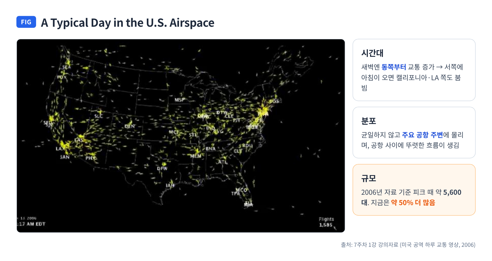
<!-- 1강 슬라이드 6: A Typical Day in the U.S. Airspace -->

미국 공역에서 하루 동안 항공교통이 어떻게 움직이는지 보여주는 영상임.

- **새벽**엔 **동쪽부터** 교통량이 늘어남. 아침이 동쪽에서 먼저 오니까
- 교통은 균일하게 퍼져 있지 않고, **주요 공항 주변으로 몰리고**, 공항 사이엔 뚜렷한 **흐름(줄기)**이 생김
- 시간이 지나 서쪽에도 아침이 오면 캘리포니아, 샌디에이고, LA 쪽도 붐비기 시작함
- 피크 때 화면 속 비행 수는 **5,600대** 수준. 근데 이건 **2006년 자료**라서, 지금은 이것보다 **50% 정도 더 많다**고 함
- 오른쪽 위로는 유럽을 오가는 비행기도 보임

결국 <mark class="pink">6,000대 넘는 비행기가 동시에 맞물려 돌아가는 하나의 시스템</mark>이라는 거.

### 1-4. 하늘의 교통체증 (Sky Traffic Jam)

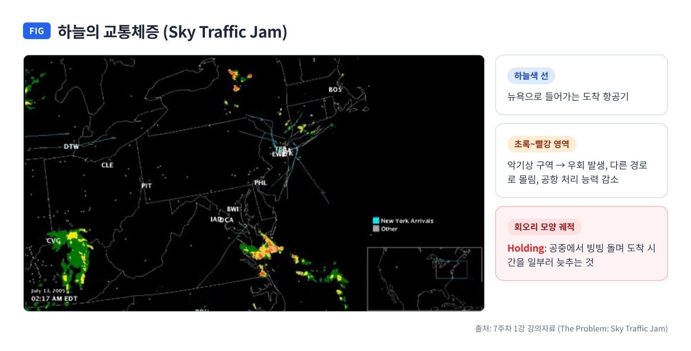
<!-- 1강 슬라이드 7: The Problem: Sky Traffic Jam -->

이번엔 비행기 이동이랑 **기상**을 같이 띄운 화면임. 색깔 덩어리가 악기상 구역, 하늘색 선이 뉴욕으로 들어가는 도착 항공기임.

- 원래 계획된 항로가 있어도 기상이 나빠지면 그 구역을 **우회**해야 함
- 그러면 다른 경로로 비행기가 **몰리고**, 공항 **도착 시간이 실시간으로 바뀌고**, 공항 자체 **처리 능력도 줄어듦**
- 중간에 **동글동글 회오리처럼 도는 궤적**이 보이는데, 이게 <mark class="pink">홀딩(holding)</mark>임. 공중에서 빙빙 돌면서 도착 시간을 **일부러 늦추는** 거

"이 비행기는 몇 분 뒤에 들어와야 효율적으로 처리된다", "지금 공항에 너무 많이 들어오고 있어서 처리 못 한다" 같은 판단은 중앙의 **최적화 모델이나 AI 모델**이 할 수도 있고, 그 판단에 따라 지시가 **실시간으로 계속** 내려가고 있음.

교수님 말로는, 비행기는 기계·항공공학의 산물이지만 **여러 사람의 목숨이 걸린 체계**라서
- 그 어떤 시스템보다 **안전**이 중요하고
- 안전을 지키면서 **효율**도 놓치지 않으려고 엄청 많은 공학 기법이 쓰이고
- **사람(관제사)이 중심**인 시스템이라 사람이 하는 일들이 시스템적으로 촘촘히 엮여 있다고 함

### 1-5. 김포공항: 하늘에도 "길"이 있다

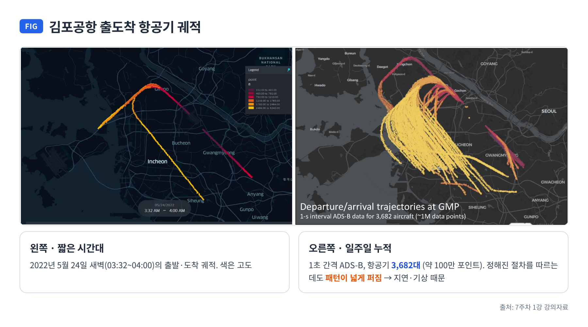
<!-- 1강 슬라이드 8: 김포공항 출도착 항공기 (1-s ADS-B, 3,682대, 약 100만 포인트) -->

김포공항 출도착 항공기 궤적을 일주일치 겹쳐 놓은 그림임. (1초 간격 ADS-B 데이터, 항공기 3,682대, 약 100만 포인트)

- 하늘에 도로가 그려져 있진 않지만, 비행기는 **비행 절차나 관제 지시**에 따라 정해진 경로를 써야 하는 규칙이 있음
- 그래서 여러 비행 기록을 겹치면 오른쪽처럼 **크레파스로 칠한 것 같은 패턴**이 나옴

근데 주목할 점이 하나 있음. 분명 정해진 절차를 따르는데도 <mark class="pink">경로 패턴이 그때그때 꽤 다름</mark>. 이유는 두 가지.
1. 출발·도착 공항의 **지연**을 고려해서 공중에서 시간을 더 써야 하는 경우
2. **기상**에 따라 경로가 달라지는 경우

> 💡 이게 뒤에서 나올 **궤적 예측이 어려운 이유**의 복선임. "절차대로 날아가니까 경로는 뻔하지 않나?" 싶지만, 실제로는 지연·기상·관제 지시 때문에 같은 절차 안에서도 경로가 넓게 퍼짐.

### 1-6. 제주공항: 포인트 머지 시스템

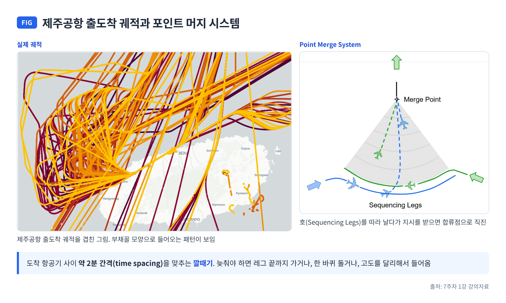
<!-- 1강 슬라이드 9: 제주공항 출도착 항공기 + Point Merge System -->

제주공항 출도착 궤적임. 왼쪽 그림은 어디서 들어오고 나가는지 알아보기 힘들 정도로 복잡한데, **부채꼴 모양**으로 들어오는 패턴이 보임.

이게 도착 항공기들이 **시간에 맞춰 도착**하기 위한 장치임.
- 예를 들어 도착 항공기끼리 **2분 정도의 간격(time spacing)**을 지켜야 함
- 한 대 들어오고 2분 뒤 한 대, 또 2분 뒤 한 대… 이 간격을 맞추는 장치가 오른쪽의 <mark class="pink">포인트 머지 시스템(Point Merge System)</mark>임

작동 방식은 이럼.
1. 왼쪽이든 오른쪽이든 들어온 비행기는 **호(arc) 모양의 대기 경로(Sequencing Legs)**를 따라 날다가
2. 관제사가 "지금 들어오세요" 하면 (또는 미리 계산된 시점이 되면)
3. 꺾어서 **합류점(Merge Point)**으로 직진

- 시간을 많이 써야 하면 **레그 끝까지** 갔다가 들어오고
- 더 늦어져야 하면 **한 바퀴 돌아서** 다시 들어오게 하거나
- **고도를 달리해서** 들어오게 할 수도 있음

한마디로 <mark class="mint">비행기를 일정한 간격으로 흘려보내는 깔때기</mark> 역할임.

> 💡 왜 부채꼴이냐면, 호 위의 어느 지점에서 꺾든 합류점까지 **거리가 같기 때문**임. 그래서 "언제 꺾느냐"만 정하면 도착 시간이 바로 정해짐. 관제사 입장에선 비행기마다 복잡하게 방향 지시(vectoring)를 줄 필요 없이 "지금 Direct to Merge Point" 한마디면 됨.

---

## 2. 몰리는 교통을 어떻게 조정할까

### 2-1. 오늘의 중심 질문

> **상황에 따라 항공기가 한꺼번에 몰리는 경우, 어떻게 안전하고 효율적으로 교통 흐름을 조정할 수 있을까?**

| 목표 | 필요한 것 |
|---|---|
| **안전** | 필요한 간격 확보: **시간 간격(time spacing)** + **공간 간격(spatial spacing)** |
| **효율** | 불필요한 **공중 대기(holding)**와 **우회(detour)** 줄이기 |

- 비행기를 너무 많이 띄워 보내면 공역이 **혼잡**해짐
- 너무 촘촘하게 보내면 필요한 **간격 확보가 어려워짐**

그래서 <mark class="pink">현재 위치만 보고 판단하지 말고, 앞으로의 도착 흐름을 미리 예측해서 미리 조정</mark>해야 한다는 게 결론. 실제로 쓰는 조정 기법부터 봄.

### 2-2. 항공교통흐름 조정 기법 4가지

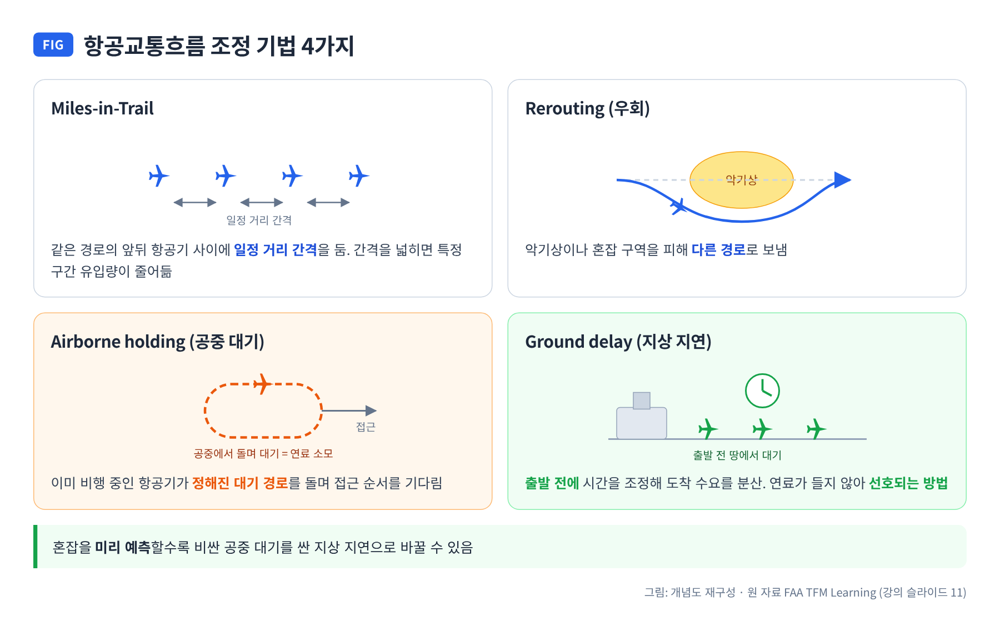
<!-- 1강 슬라이드 11: 항공교통흐름 조정 기법 (FAA TFM learning) -->

| 기법 | 방법 |
|---|---|
| **Miles-in-Trail** | 같은 경로를 따라가는 비행기 사이에 **일정 거리 간격** 확보. 간격을 넓히면 특정 구간 유입량이 줄어듦 |
| **Rerouting (우회)** | 악기상·혼잡 구역을 피해 **다른 경로**로 보냄 |
| **Airborne holding (공중 대기)** | 이미 날고 있는 비행기가 **정해진 대기 경로**를 돌며 접근 순서를 기다림 |
| **Ground delay (지상 지연)** | **출발 전에** 시간을 조정해서 목적지 도착 수요를 분산 |

Ground delay는 제주도 오가면서 다들 겪어봤을 거임. 출발이 지연되는 이유 중엔 <mark class="pink">도착 공항 사정이 안 좋아서 출발 공항에서 미리 잡아두는 경우</mark>도 포함됨.

공중에서 기다리면 **연료**가 엄청 드니까, 혼잡을 미리 예측할 수 있으면 더 이른 단계에서 조정할 여지가 생기고, 그래서 ground delay가 **굉장히 선호되는 방법**임.

> 💡 **"땅에서 기다리는 게 하늘에서 기다리는 것보다 싸다"** 이게 핵심. 그리고 땅에서 미리 잡아두려면? 몇 시간 뒤의 도착 혼잡을 **예측**할 수 있어야 함. 예측이 좋을수록 비싼 holding을 싼 ground delay로 바꿀 수 있는 구조.

### 2-3. 도착 예상시각(ETA)과 배정시각(STA)

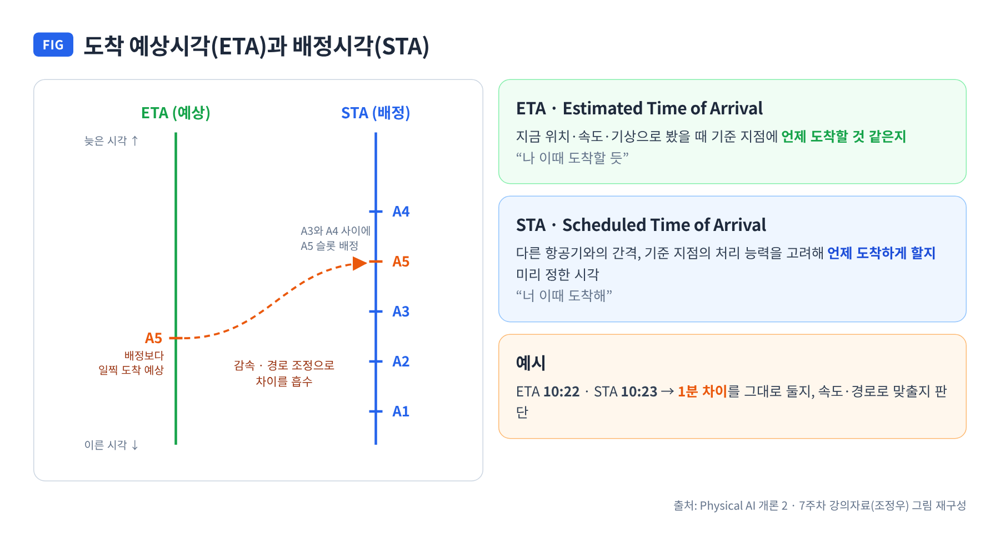
<!-- 1강 슬라이드 12: 도착 예상시각(ETA)과 배정시각(STA) -->

시간 기반으로 교통을 관리하려면 두 개념을 알아야 함.

| 용어 | 뜻 | 기준 |
|---|---|---|
| **ETA** (Estimated Time of Arrival) | **도착 예상 시각** | 지금 위치·속도·기상으로 봤을 때 그 지점에 **언제 도착할 것 같은지** |
| **STA** (Scheduled Time of Arrival) | **도착 배정 시각** | 다른 비행기와의 간격, 기준 지점의 처리 능력을 고려해 **언제 도착하게 할지** 미리 정한 시각 |

왼쪽 타임라인의 **A5**를 보면 예상시각(ETA)이 배정시각(STA)보다 **일찍** 찍혀 있음. 그러면 속도나 경로를 조정해서 시간을 맞춰야 함.
예를 들어 ETA가 10시 22분이고 STA가 10시 23분이면, 이 **1분 차이**를 그대로 둘지 어떻게 조정할지 판단이 필요함.

강의 슬라이드에는 실제 관제 화면의 타임라인도 같이 나오는데, 왼쪽 초록 글씨가 **ETA**, 오른쪽 파란 글씨가 **STA**로 같은 비행기가 양쪽에서 다른 위치에 찍혀 있음. 위 그림의 두 세로줄이 바로 그 구조임.

> 💡 쉽게 말하면 **ETA = "나 이때 도착할 듯"**, **STA = "너 이때 도착해"**. 둘의 차이만큼을 속도·경로로 흡수하는 게 관제의 일임. 그리고 ETA를 계산하는 게 결국 **궤적 예측**이라서, 뒤에서 AI가 들어가는 자리가 바로 여기.

### 2-4. 시간 기반 교통흐름관리 (TBFM)

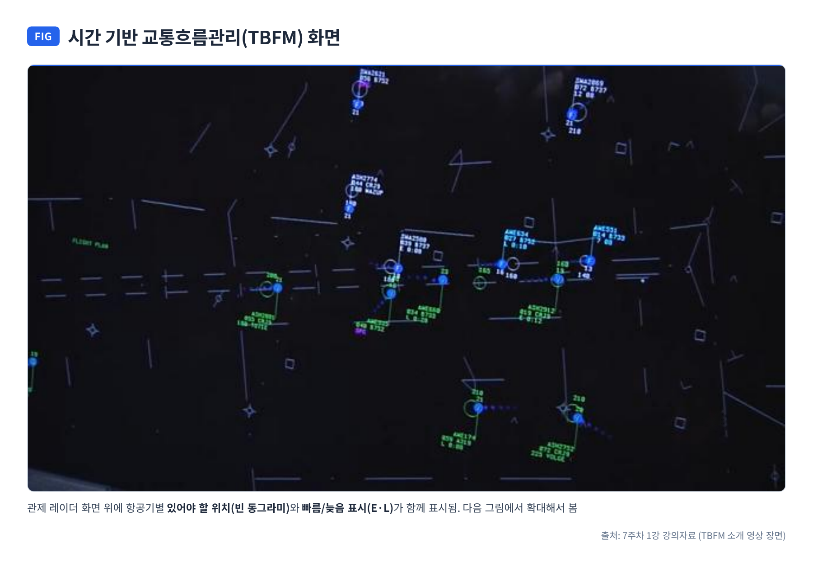
<!-- 1강 슬라이드 13: TBFM 관제 화면 영상 -->

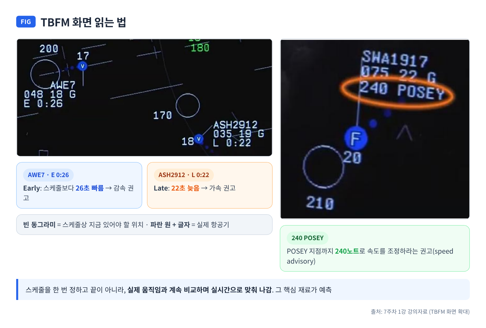
<!-- 1강 슬라이드 14: 시간 기반 교통흐름관리(TBFM) -->

방금 그 개념을 실제 도구로 만든 게 <mark class="pink">TBFM(Time-Based Flow Management)</mark>임.

1. 비행기별 **ETA** 계산
2. 필요한 간격을 고려해서 **STA** 배정
3. 너무 일찍 올 것 같으면 **속도·경로를 조정**해서 여유를 만듦

화면 읽는 법은 이럼.
- **동그라미** = 이 비행기가 지금 **있어야 할 위치**(스케줄상 위치)
- **AWE7 "E 0:26"** → **Early**, 스케줄보다 **26초 빨리** 날고 있음 → 속도 줄이라고 제안
- **ASH2912 "L 0:22"** → **Late**, **22초 늦음** → 속도 올리라고 제안
- 오른쪽 **SWA1917 "240 POSEY"** → POSEY 지점까지 **240노트로 속도를 조정하라**는 권고(speed advisory)

영상 내레이션에서도 "늦게 오는 비행기는 속도를 올려야 한다", "속도 권고가 데이터 블록에 표시된다", "속도만으론 스케줄을 못 맞추면 early/late 표시가 뜬다"는 내용이 나옴.

중요한 건 <mark class="pink">스케줄을 한 번 배정하고 끝나는 게 아니라, 실제 움직임과 계속 비교하면서 실시간으로 맞춰 나간다</mark>는 점. 그리고 그 과정에서 **예측**이 핵심 역할을 함.

### 2-5. 도착시각을 관리하는 기준 지점

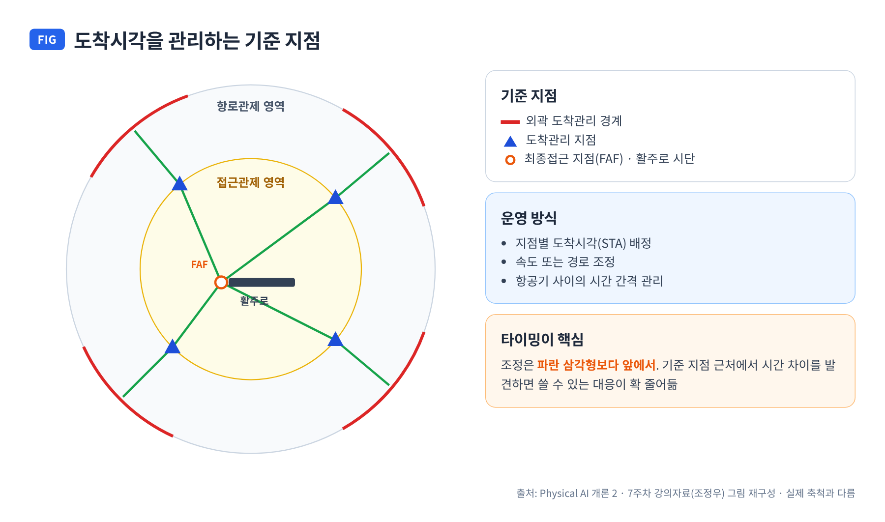
<!-- 1강 슬라이드 15: 도착시각을 관리하는 기준 지점 -->

그럼 시간을 **어디에** 맞추냐? 목적지 도착 시간 하나만 관리하는 게 아님. 항로에서 접근 공역을 거쳐 활주로까지 **여러 기준점**이 있음.

| 기준 지점 | 그림 표시 |
|---|---|
| 외곽 도착관리 경계 | 빨간 선 |
| 도착관리 지점 | 파란 삼각형 |
| 최종접근 지점(FAF) · 활주로 시단 | 안쪽 |

바깥은 **항로 관제** 영역, 안쪽 노란 원은 **접근 관제** 영역임. 용어를 외울 필요는 없고, <mark class="pink">이런 지점마다 통과 시각을 계산하고, 필요한 시간 간격이 확보되도록 도착시각을 배정한다</mark>는 것만 알면 됨.

그리고 경로·속도 조정은 **삼각형보다 앞에서** 해야 함. 기준 지점에 거의 다 와서 시간 차이를 발견하면 **쓸 수 있는 대응 카드가 확 줄어들기 때문**.

관리할 대상도 엄청 많음.
- 미국은 지금 **동시에 8,000대 이상** 비행 중
- 인천공항만 해도 **1시간에 100~200대** 정도가 들고 나감

> 💡 고속도로 진입 램프의 신호등(램프 미터링)이랑 비슷함. 톨게이트 직전에서 차를 세우면 이미 늦고, 진입 전에 간격을 벌려 놔야 본선이 안 막힘.

### 2-6. 도착 순서와 항공기 간격의 조정 (ATD-1)

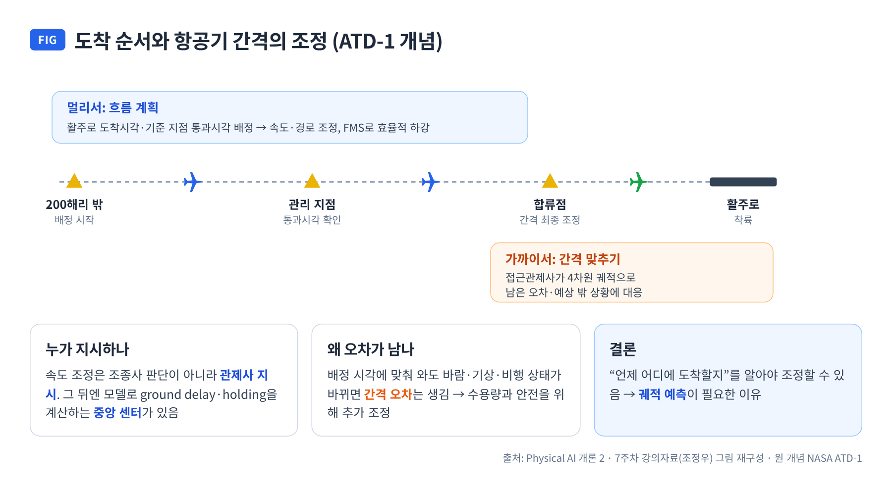
<!-- 1강 슬라이드 16: 도착 순서와 항공기 간격의 조정 (ATD-1) -->

도착시각 배정과 간격 조정이 어떻게 이어지는지 전체 그림임. 왼쪽 위에서 들어온 비행기가 아래 합류점과 활주로 쪽으로 가는 흐름.

1. **멀리서(약 200해리)**: 활주로 도착시각과 기준 지점 통과시각을 **배정**
2. **이동 중**: 속도·경로를 조정해서 도착 항공기 간격 확보. **비행관리시스템(FMS)**으로 지정 경로를 따라 효율적으로 하강
3. **가까이서**: 배정된 시각에 맞춰 와도 **간격 오차는 생김** → 수용량과 안전을 위해 추가 조정
4. **접근관제사**는 **4차원 궤적**을 토대로 남은 간격 오차와 예상 밖 상황에 대응

여기서 짚을 것.
- 속도 조정은 **조종사가 알아서 하는 게 절대 아니고**, **관제사 지시**에 따름
- 관제사 뒤엔 **중앙 집중형 센터**가 있어서, 모델로 계산한 ground delay·airborne holding 지시를 내리기도 하고, 관제사가 경험으로 판단하거나 최적화 모델 도움을 받기도 함
- 아무리 계획을 잘 세워도 바람·기상·비행 상태가 바뀌면 **오차는 생길 수밖에 없음**

즉 <mark class="mint">멀리서 흐름을 계획하는 과정 + 가까이서 실제 간격을 맞추는 과정</mark>, 이 두 개가 맞물려 돌아감.

여기까지 오면 왜 궤적 예측이 필요한지가 연결됨. **앞으로 어디에 언제 도착할지 알아야** 시간과 간격을 조정할 수 있고, 미리 대응해서 더 효율적으로 운영할 수 있음.

---

## 3. 항공기 궤적 예측

지금까지 계속 필요했던 정보가 있었음. <mark class="pink">"이 비행기가 앞으로 어디에, 언제 있을 것인가"</mark>. 이제 그 정보를 만드는 **궤적 예측**으로 넘어감.

순서는 이럼.
1. 비행기 한 대의 미래 움직임을 어떻게 예측하나
2. 여러 비행기 사이의 관계까지 반영하는 연구 사례
3. 예측에서 위험이 보이면 실제로 어떤 행동을 고를 건가

### 3-1. 4D 궤적 예측이란

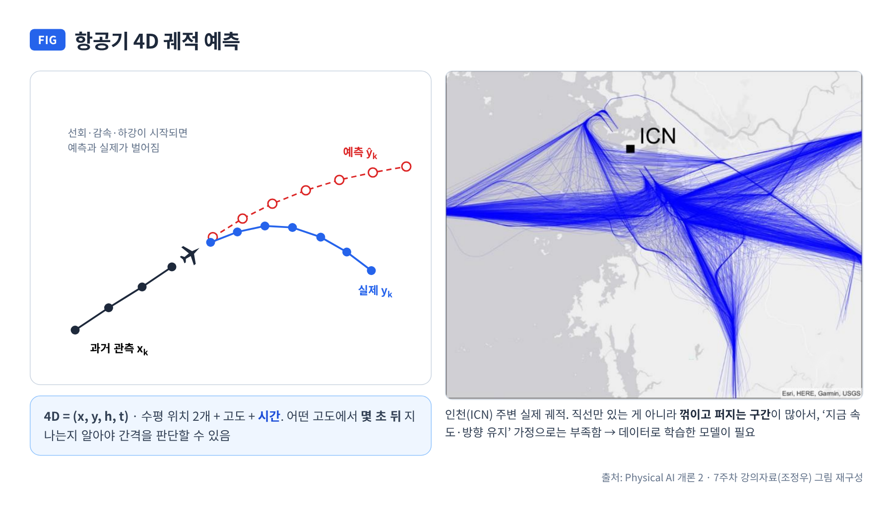
<!-- 1강 슬라이드 18: 항공기 4D 궤적 예측 - 과거 위치·속도·고도로 미래 궤적 (x,y,h,t) 예측 -->

궤적 예측 = **과거와 현재의 비행 상태로 미래 움직임을 추정**하는 것.
왼쪽 그림에서 검은 점(**Previous Trajectory**, 관측값 x)을 보고 빨간 빈 원(**Predicted Trajectory**, 예측값 ŷ)을 뽑는데, 실제(**True Trajectory**, 파란 점 y)와는 차이가 생길 수 있음.

여기서 **4D**는
- 수평 위치 2개 (**x, y**)
- 고도 (**h**)
- 시간 (**t**)

를 같이 다룬다는 뜻임.

지도의 어느 지점을 지나가는지만 알아서는 부족함. <mark class="pink">어떤 고도에서, 몇 초 뒤에 통과하는지</mark>까지 알아야 다른 비행기와 간격을 판단할 수 있음.

- 지금 속도·방향을 **그대로 유지**한다고 가정하면 짧은 시간 뒤 위치는 쉽게 계산됨
- 근데 비행기가 **선회, 감속, 하강**을 시작하면 그 가정이 깨짐
- 그래서 실제 비행 기록에 나타나는 **움직임 패턴 + 추가 정보**를 활용함

> 💡 오른쪽 그림이 인천(ICN) 주변 실제 궤적을 겹친 건데, 직선만 있는 게 아니라 꺾이고 퍼지는 구간이 많음. "등속 직선 운동"으로는 이 꺾이는 구간을 못 맞추니까 데이터로 학습한 모델이 필요한 거.

### 3-2. 위치·속도 말고 필요한 정보: 기상, 비행 절차

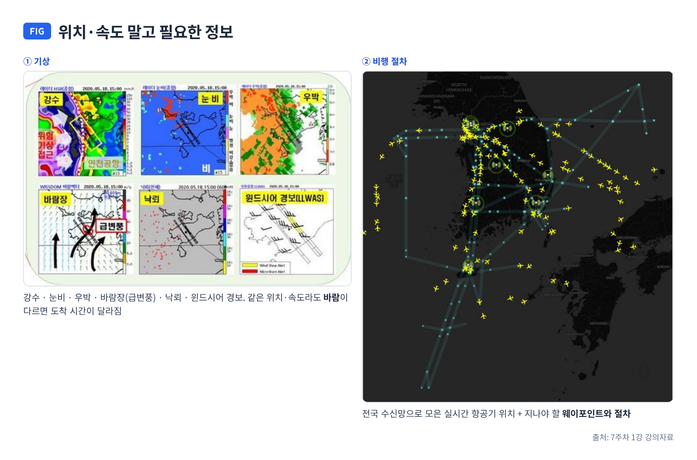
<!-- 1강 슬라이드 19: 기상, 비행절차 등 다양한 정보 반영 -->

**① 기상 (왼쪽)**
같은 위치, 같은 속도로 날아도 **바람** 같은 기상이 다르면 지상에서 관측되는 움직임과 도착 시간이 달라짐. 그림엔 강수, 눈·비, 우박, 바람장(급변풍), 낙뢰, 윈드시어 경보(LLWAS) 같은 기상 정보가 있음.

**② 비행 절차 (오른쪽)**
동북아 쪽 비행기들의 위치를 **실시간으로 수집**하는 화면임. 교수님 연구실에서 **전국에 수신망을 깔아서** 직접 궤적을 모으고 있다고 함. 비행기가 지나가야 하는 **웨이포인트(waypoint)**와 **절차**도 같이 표시돼 있는데, 이것까지 반영하면 예측에 더 도움이 됨.

### 3-3. 예측 결과의 두 가지 표현

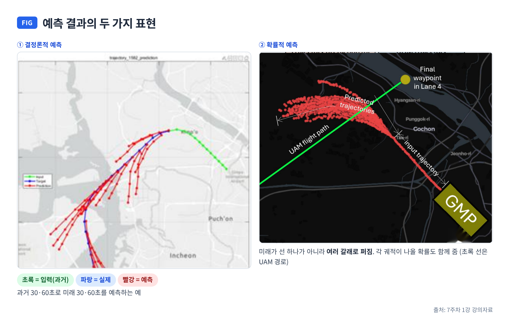
<!-- 1강 슬라이드 20: 실제·예측 궤적 비교 예 / 확률적 예측 -->

**① 실제·예측 궤적 비교 (왼쪽)**
- **초록** = 입력으로 준 과거 궤적, **파랑** = 실제 궤적, **빨강** = 예측
- 아주 잘 맞춘 케이스는 아니고 예시로 보면 됨
- 예를 들어 **과거 30초 / 60초**를 보고 **미래 30초 / 60초**를 예측. 학습이 끝나면 매 순간 직전 30·60초 데이터로 다음 30·60초를 **실시간 예측**함

**② 확률적 예측 (오른쪽)**
- 미래 궤적이 **선 하나가 아니라 여러 개로 퍼져** 있음
- 가능한 미래를 여러 개 생성하는 **확률적 예측**이고, 각 궤적이 나올 **확률**도 같이 줌
- 초록 선은 UAM 비행경로임. 이건 뒤의 UAM 사례에서 다시 나옴

> 💡 왜 확률적으로 예측하냐면, 같은 위치에서도 관제사가 "왼쪽으로 선회"를 줄지 "직진 유지"를 줄지 모르기 때문임. 선 하나로 찍으면 그 중간 어딘가(실제로는 아무도 안 가는 경로)를 예측해 버릴 수 있음. 여러 시나리오를 펼쳐 놓는 게 안전 판단엔 더 유리함.

### 3-4. 미래 경로를 알면 무엇을 할 수 있을까

궤적을 예측했으면 가장 직접적인 활용은 <mark class="pink">다른 비행기와 너무 가까워질 가능성을 미리 확인하는 것</mark>임. 슬라이드 표현으로는 "**항공기 예측 궤적을 고려한 타 항공기 실시간 속도조정 및 항로변경**".

- 두 비행기의 예상 경로가 같은 지점을 지나간다고 치면
- 간격이 부족해질 것 같으면 **속도를 바꿔서 통과 시간**을 바꾸거나 **경로**를 바꿈
- 근데 <mark class="pink">조정한 뒤의 궤적도 계속 다시 확인</mark>해야 함. 한 비행기 문제 풀려다가 **다른 비행기랑 가까워질 수 있기 때문**

그래서 비행기 한 대만 예측하는 데서 나아가 **주변 교통과의 관계**까지 반영해야 함.

### 3-5. 여러 항공기가 서로 영향을 주는 경우

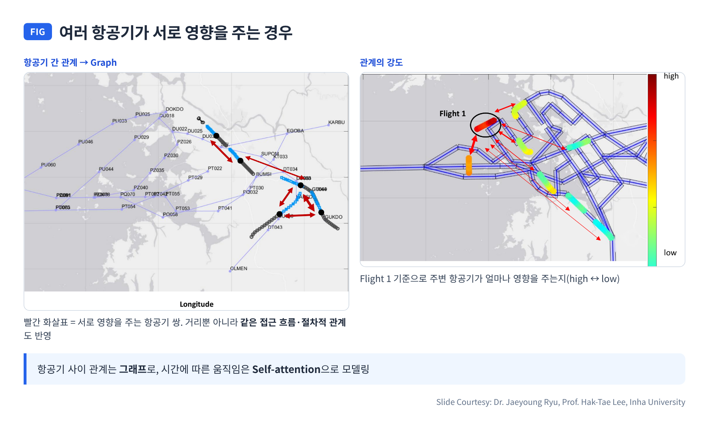
<!-- 1강 슬라이드 22: 여러 항공기가 서로 영향을 주는 경우 (Slide Courtesy: Dr. Jaeyoung Ryu, Prof. Hak-Tae Lee) -->

도착 비행기 한 대를 생각해 봄.
- **앞선 비행기가 느리게** 접근하면 뒤 비행기도 속도를 줄이거나 경로를 조정해야 할 수 있음
- 반대로 주변 교통에 **여유**가 있으면 다른 움직임이 나올 수 있음

즉 <mark class="pink">도착 항공기는 주변 항공기들의 속도와 위치에 영향을 받음</mark>.

- 왼쪽: 비행기들의 이동 경로 (빨간 화살표 = 서로 영향을 주는 관계)
- 오른쪽: Flight 1 기준으로 주변 비행기와의 관계 강도(high ↔ low)

비행기 사이의 **거리**뿐 아니라 **같은 접근 흐름에 속하는지**, **절차적으로 어떤 관계인지** 같은 정보도 예측에 유용함.

이 연구는 인하대 **이학태 교수님** 지도 학생인 **류재영 박사**가 박사 과정 때 한 연구임.
- 비행기 사이의 관계 → **그래프(Graph)**로 모델링
- 시간에 따른 움직임 → **Self-attention**으로 모델링

이 수업에선 AI 기법을 하나하나 파진 않을 거라, 쉽게 말하면 <mark class="mint">"이 비행기가 지금까지 어떻게 움직였는지 + 주변에 어떤 비행기들이 있는지를 같이 보고 미래 궤적을 예측한다"</mark> 정도로 이해하면 됨.

### 3-6. 사례: 다중 항공기 항적 예측 파이프라인

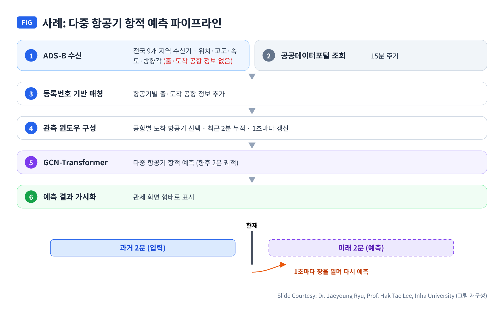
<!-- 1강 슬라이드 23: 사례: 다중 항공기 항적 예측 -->

모델을 돌리려면 데이터가 필요함.

| 단계 | 내용 |
|---|---|
| 1. ADS-B 수신 | **전국 9개 지역**에 설치한 수신기로 실시간 상태 정보 수신. **위치, 고도, 속도, 방향각** 등 포함. 단, **출·도착 공항 정보는 없음** |
| 2. 공공데이터포털 조회 | **15분 주기**로 조회 |
| 3. 등록번호 기반 매칭 | 비행기별 **출·도착 공항 정보 추가** |
| 4. 관측 윈도우 구성 | 공항별 도착 항공기 선택, **최근 2분** 데이터 누적, **1초마다** 갱신 |
| 5. GCN-Transformer | 다중 항공기 항적 예측 (**향후 2분** 궤적) |
| 6. 가시화 | 예측 결과를 화면에 표시 |

숫자 세 개 헷갈리지 말 것.
- **2분** = 모델에 넣는 **과거 관측 구간**
- **1초** = 결과를 **갱신하는 주기**
- **2분** = 앞으로 **예측하는 구간**

> 💡 **ADS-B**(Automatic Dependent Surveillance–Broadcast)는 비행기가 GPS로 구한 자기 위치·고도·속도를 1초 정도 간격으로 **공중에 계속 방송**하는 신호임. 암호화가 안 돼 있어서 수신기만 있으면 누구나 받을 수 있음. Flightradar24 같은 사이트가 이걸로 돌아가는 거고, 교수님 연구실이 전국에 수신기를 깐 것도 같은 원리.

### 3-7. 그래프 구조가 반영된 모델: GCN

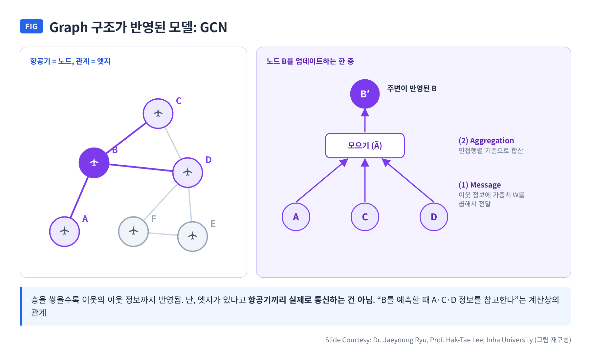
<!-- 1강 슬라이드 24: Graph 구조가 반영된 모델 → GCN -->

여기서 쓴 게 <mark class="pink">GCN(Graph Convolution Network, 그래프 합성곱 신경망)</mark>임. 이론은 따로 공부하고, 개념만 보면

- **점(노드, node)** = 비행기
- **선(엣지, edge)** = 비행기 사이의 관계

GCN의 핵심은 <mark class="pink">연결된 이웃의 정보를 모아서(aggregation) 내 표현을 업데이트</mark>하는 것.
오른쪽 그림에서 노드 B를 보면, 연결된 이웃 A, C, D의 정보가 **(1) Message**로 전달되고 **(2) Aggregation**으로 모여서 B가 갱신됨(B′). 이걸 층(layer)마다 반복하면 **주변 관계가 반영된 특징(interaction feature)**이 만들어짐.

주의할 점: 선이 있다고 비행기끼리 **진짜로 메시지를 주고받는 게 아님**. "A의 미래를 예측할 때 다른 비행기 정보를 이렇게 참고한다"는 **계산상의 관계**를 표현한 것.

> 💡 단톡방 비유로 생각하면 쉬움. 내가 내일 뭘 할지 예측하려면 나 혼자 일정만 볼 게 아니라 **친구들 일정(이웃 노드)**도 같이 봐야 함. 근데 친구 100명을 다 보는 게 아니라 **나랑 연결된(엣지) 친구들만** 봄. 그 친구들 정보를 모아서 내 상태를 업데이트하는 게 GCN 한 층임.

### 3-8. GCN-Transformer 통합 구조

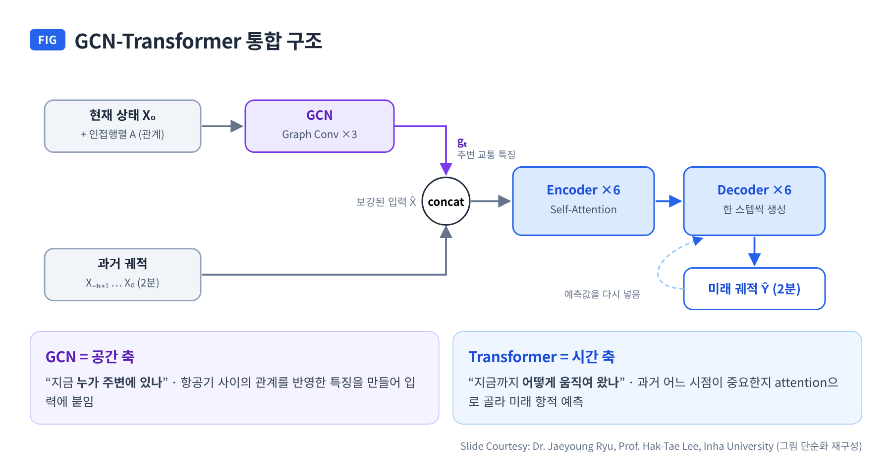
<!-- 1강 슬라이드 25: GCN-Transformer 통합 구조 -->

블록이 많은데, 역할만 보면 됨.

| 부분 | 입력 | 하는 일 |
|---|---|---|
| **왼쪽 GCN** | 현재 비행기 상태 **X₀** + 관계를 나타내는 **인접 행렬 A** | 주변 교통을 반영한 특징 **g_t** 생성 |
| **연결 (concatenate)** | 과거 비행 정보 + g_t | 입력을 보강한 **augmented input** |
| **가운데·오른쪽 Transformer** | 보강된 입력 | **시간에 따른 패턴** 처리, 미래 항적 예측. 과거 어느 시점이 중요한지 **attention**으로 반영 |

교수님이 이 페이지는 **숙제·시험에 안 나온다**고 못 박음. 기억할 건 딱 하나.

> <mark class="pink">**GCN은 항공기 사이의 관계, Transformer는 시간에 따른 움직임**을 반영한다.</mark>

> 💡 즉 GCN이 **공간 축(누가 주변에 있나)**, Transformer가 **시간 축(어떻게 움직여 왔나)**을 맡는 분업 구조. 이런 "공간 + 시간" 조합은 보행자 궤적 예측, 자율주행 차량 예측에서도 똑같이 쓰는 패턴임.

### 3-9. 결과 ①: 인천공항 Runway 33 착륙

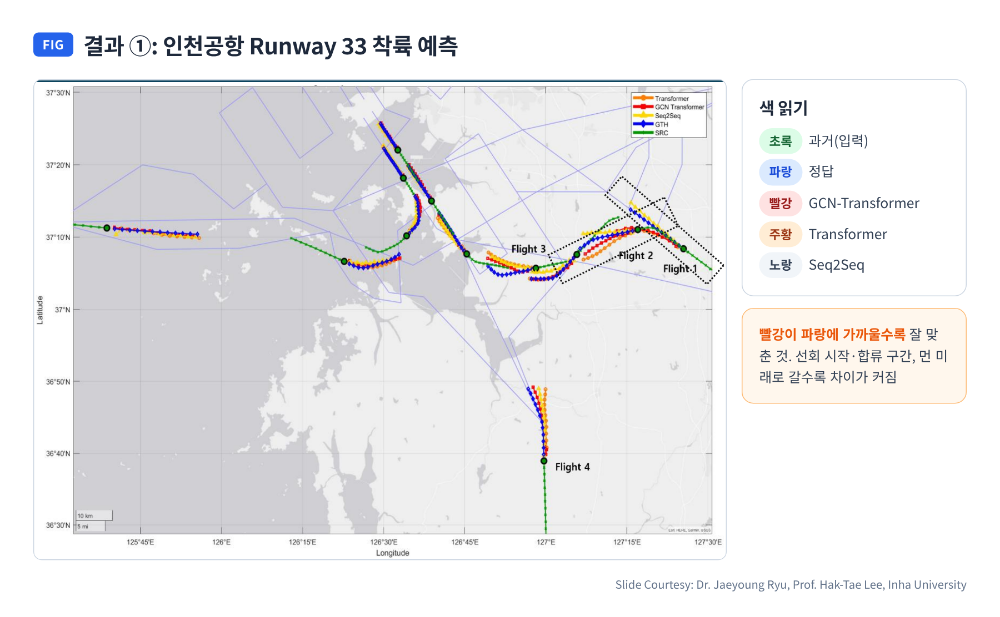
<!-- 1강 슬라이드 26: 인천 국제 공항 (Runway 33 방향 착륙) 예측 궤적 -->

인천공항 33번 방향 활주로로 접근하는 비행기들의 예측 사례임. 여러 방향에서 들어온 비행기들이 공항 쪽으로 **선회하고 합류**하는 모습.

| 색 | 의미 |
|---|---|
| 초록 (SRC) | 현 시점 기준 **과거 데이터** |
| 파랑 (GTH) | 맞춰야 할 **정답(ground truth)** |
| 노랑 | Seq2Seq |
| 주황 | Transformer |
| **빨강** | **GCN-Transformer** |

**빨강이 파랑에 가까울수록** 잘 예측한 것. 가까이 겹치는 곳도 있고 벌어지는 곳도 있음.

- 어느 구간에서 차이가 생기는지 그림으로 볼 수 있고, 이걸 종합해서 모델 성능을 판단함
- **선회가 시작되는 시점이나 합류 구간**에서 예측 차이가 커지는 경향이 있음
- **2분짜리 예측**이라 <mark class="pink">먼 미래로 갈수록 정확도가 살짝 떨어짐</mark>

> 💡 Flight 2를 보면 빨강(GCN-Transformer)이 파랑에 더 붙어 있는데, 앞 비행기(Flight 1)의 움직임을 "주변 정보"로 같이 봤기 때문이라고 볼 수 있음. 혼자만 보는 Seq2Seq·Transformer는 앞 비행기가 꺾는 걸 모르니 뒤 비행기 예측도 늦게 꺾임.

### 3-10. 결과 ②: 제주공항 관제 화면에 적용

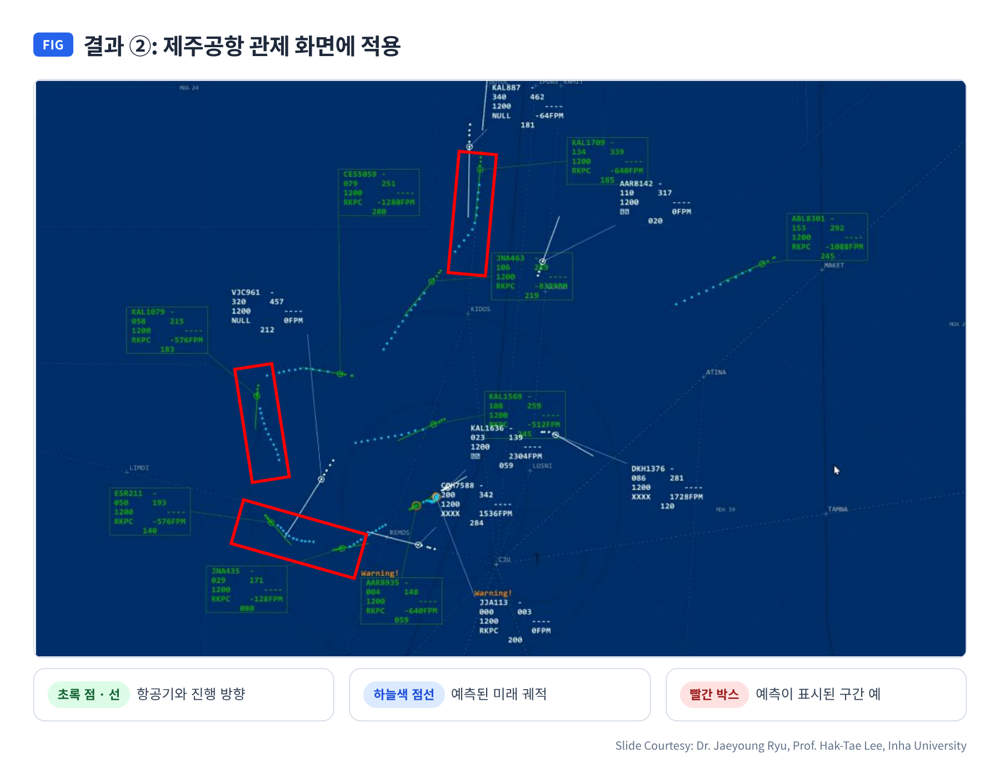
<!-- 1강 슬라이드 27: GCN-Transformer 기반 다중 항적 예측 - 예시 (제주) -->

이번엔 제주공항 교통 화면에 예측 결과를 띄운 예시임. **실제 관제사가 보는 화면이랑 거의 똑같은 형태**.

- 초록 점 = 비행기, 초록 선 = 진행 방향
- **하늘색 점선** = 예측된 미래 궤적
- 새 데이터가 들어올 때마다 예측이 갱신됨

이런 예측은 관제사가 앞으로의 교통을 **미리 훑어보는 데** 도움이 되고, 앞에서 본 **TBFM**이나 **속도 지시**를 정하는 데도 쓸 수 있음.

근데 여기서 질문 하나.

> 평소 패턴을 잘 맞추는 모델이 **평소에 없던 상황**에서도 적절한 움직임을 만들어 낼 수 있을까?

### 3-11. 예측 모델의 한계: 평소엔 잘 맞추지만…

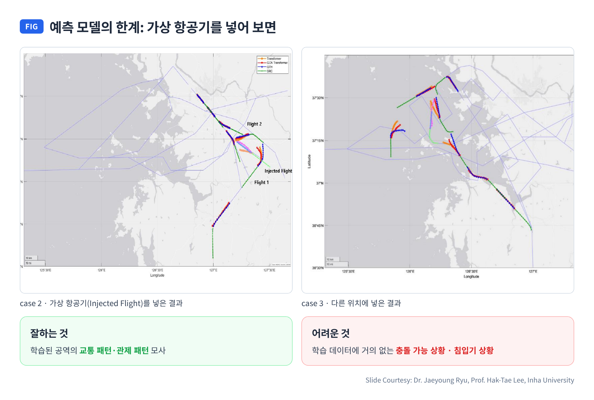
<!-- 1강 슬라이드 28: GCN-Transformer 기반 상황 예측 모델의 특성 (가상 항공기 추가 결과) -->

| GCN-Transformer가 잘하는 것 | 어려운 것 |
|---|---|
| **학습된 공역의 교통 패턴·관제 패턴**을 모사 | 학습 데이터에 거의 없는 **충돌 가능 상황**이나 **침입기 상황** |

이유는 간단함. 실제 항공 데이터엔 관제와 절차를 잘 따라 **정상 운항한 기록**이 대부분임. 그래서 익숙한 공역의 익숙한 패턴은 잘 맞춤.

그래서 연구팀은 **가상 항공기(Injected Flight)를 일부러 집어넣어서** 평소 패턴만으로는 대응이 안 되는 상황을 만들고 실험함.

핵심 문장은 이거.

> <mark class="pink">다음 움직임을 잘 맞추도록 학습했다고 해서, 침입기가 들어왔을 때 위험을 피하는 행동을 고르도록 학습된 건 아니다.</mark>

그래서 **위험 상황용 대응 모델을 따로** 만들었음.

> 💡 이게 바로 지난 강의에서 본 **Behavior Cloning의 한계**랑 같은 얘기임. 모방 학습은 "데이터에 있는 행동"만 흉내 냄. 데이터에 없는 위기 상황에선 정답을 모름. 그래서 시뮬레이션에서 시행착오로 배우는 **강화학습**이 등장하는 흐름까지 똑같음.

---

## 4. 예측을 행동으로: 충돌 회피 모델

### 4-1. 두 개의 모델: Reference Model과 Solution Model

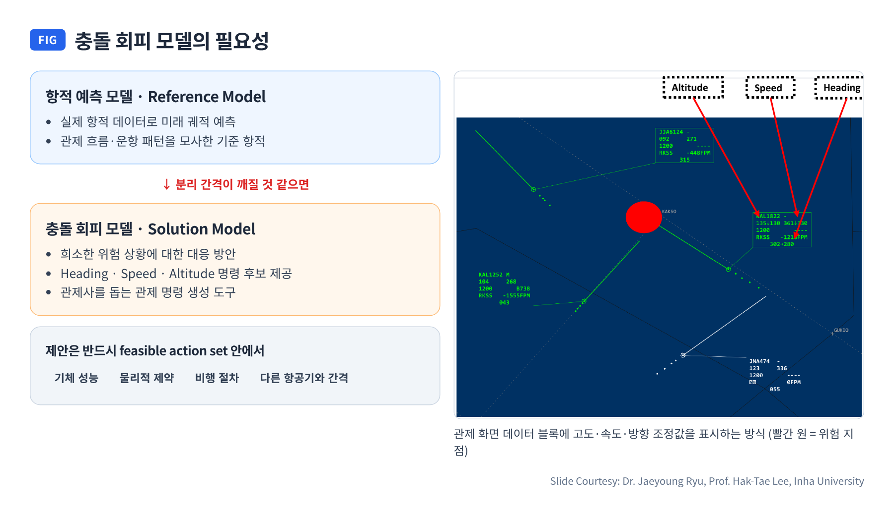
<!-- 1강 슬라이드 29: 충돌 회피 모델의 필요성 (CWP Data Block) -->

| 모델 | 이름 | 역할 |
|---|---|---|
| 항적 예측 모델 | **Reference Model** | 실제 항적 데이터로 미래 궤적 예측. 관제 흐름·운항 패턴을 모사한 **기준 항적** 생성 → 미래 교통 흐름 구성 |
| 충돌 회피 모델 | **Solution Model** | 예측에서 분리 간격이 안 지켜질 것 같으면 **어떤 조치를 할지** 찾아냄 |

오른쪽 화면(관제사 작업 화면의 데이터 블록)처럼 **Altitude(고도), Speed(속도), Heading(방향)** 항목에 위험 표시와 함께 **어떤 값을 어떻게 바꿀지** 띄워 줄 수 있음. 단순 위험 탐지를 넘어 **실제 회피 의사결정을 지원**하는 **관제 명령 생성 도구**로 쓸 수 있다는 것.

그리고 제안된 행동은 반드시 <mark class="pink">실행 가능한 행동 집합(feasible action set)</mark> 안에 있어야 함.
- 비행기 **성능** 안에서 (움직일 수 있는 범위)
- **물리적 제약** 지키면서
- **비행 절차** 지키면서
- **다른 비행기와의 간격** 유지하면서

### 4-2. 강화학습으로 회피 정책 학습

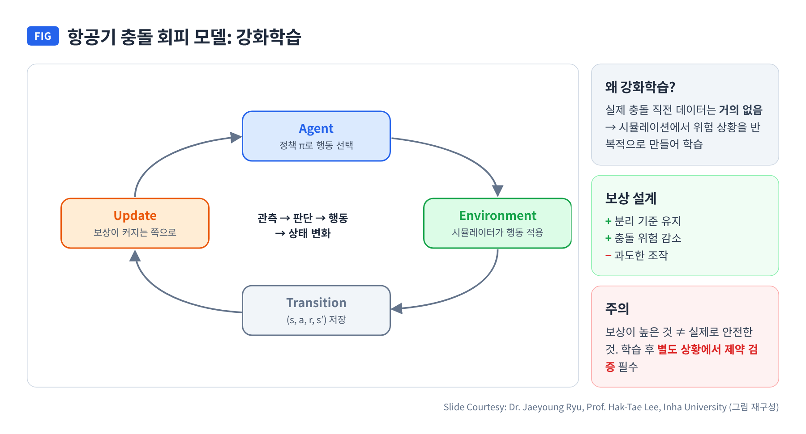
<!-- 1강 슬라이드 30: 항공기 충돌 회피 모델 (강화학습) -->

충돌 회피는 **데이터가 충분하지 않음** (실제 충돌 직전 상황이 자주 있으면 큰일이니까). 그래서 **강화학습(RL)**으로 정책을 만듦.

강화학습 루프는 이전 강의에서 본 거랑 같음.

1. **Agent**: 현재 상태 **s_t**를 보고 정책 π_θ(a|s)로 행동 **a_t** 선택
2. **Environment**: 행동을 적용해서 다음 상태 **s_t+1**과 보상 **R_t+1** 반환
3. **Transition**: (s_t, a_t, r_t+1, s_t+1, done)을 rollout에 저장
4. **Update**: 보상이 커지는 방향으로 policy/value 갱신

시뮬레이션에서 비행기를 **위험한 상황에 반복적으로 노출**시키고, 선택한 행동에 따른 **상태 변화와 분리 거리 변화**를 보상으로 평가함.

보상 설계에 넣을 수 있는 것들:
- **분리 기준**을 유지했는가
- **충돌 위험**이 줄었는가
- **불필요하게 큰 조작**을 하진 않았는가 (과도한 조작 억제)

근데 주의할 점이 있음.
- 위험을 한 번 피해도 **너무 크게 우회**하거나 **다른 비행기를 위험하게** 만들면 좋은 대응이 아님
- 그래서 <mark class="pink">보상이 높은 것과 실제로 안전한 것은 구분</mark>해야 함
- 학습 후엔 **별도 상황에서도 제약이 지켜지는지 검증**해야 함

이 **관측 → 판단 → 행동 → 상태 변화**의 반복이 Physical AI랑 직접 연결되는 지점임.

### 4-3. 결과: GCN-Transformer vs PPO

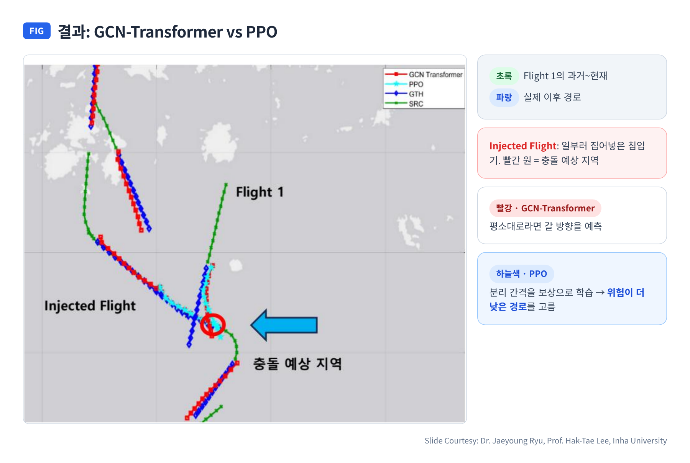
<!-- 1강 슬라이드 31: 충돌 회피 결과 (Injected Flight, 충돌 예상 지역) -->

결과 한 장만 보고 넘어감.

- **Flight 1**: 기존 비행기. 초록(SRC) = 과거~현재, 파랑(GTH) = 실제 이후 경로
- **Injected Flight**: 왼쪽에서 가상으로 집어넣은 침입기. **충돌 경로**로 날아옴
- 빨간 원 = **충돌 예상 지역**

| 모델 | 결과 |
|---|---|
| **GCN-Transformer** (빨강) | 주변 항적을 고려해서 Flight 1이 **평소대로라면** 갈 방향을 보여줌 |
| **PPO** (하늘색) | **분리 간격(안전)**을 보상으로 학습했기 때문에 **위험도가 더 낮은 경로**를 고름 |

즉 강화학습으로 <mark class="mint">미래가 일어나기 전에 "이 비행기는 이렇게 움직여야 한다"고 예측하고 지시를 내릴 수 있게</mark> 되는 것. AI 예측을 **실제 움직임 조정**으로 연결한 사례임.

> 💡 **PPO**(Proximal Policy Optimization)는 정책을 업데이트할 때 한 번에 너무 크게 바뀌지 않도록 "클리핑"을 거는 강화학습 알고리즘임. 안정적이고 연속 행동(속도, 방향각 같은 실수 값)에도 잘 맞아서 로봇·드론 쪽에서 거의 기본값처럼 씀. 2편 조류 퇴치 드론에서도 또 나옴.

---

## 5. 사례: 공항 주변에서 UAM을 운항할 수 있을까?

### 5-1. 연구 개요

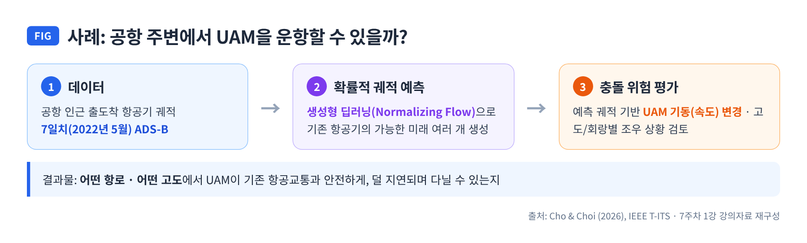
<!-- 1강 슬라이드 32: 사례: 공항 주변에서 UAM을 운항할 수 있을까? (Cho & Choi, 2026) -->

앞에선 기존 비행기끼리의 예측·회피를 봤다면, 이번엔 **새로운 교통수단이 기존 공역에 끼어드는 문제**임. 공항 주변에 **UAM(도심항공교통)** 경로를 만들 수 있을까?

공항 주변엔 이미 출발·도착하는 비행기들이 있음. 연구는 세 단계로 구성됨.

| 단계 | 내용 |
|---|---|
| ① 공항 인근 출도착 궤적 | **7일치(2022년 5월) ADS-B** 궤적 데이터 분석 |
| ② 궤적 예측 기반 UAM 운용성 평가 | **생성형 딥러닝 모델**로 기존 항공기 궤적을 **확률적으로 예측** |
| ③ UAM–기존 항공기 충돌 위험 평가 | 예측 궤적 기반으로 **UAM 기동(속도) 변경**, **고도/회랑별** 조우 상황 검토 |

이걸로 <mark class="pink">항로와 고도에 따라 UAM 운항 가능성이 어떻게 달라지는지</mark>를 봄.

### 5-2. 목표: UAM 경로 운영 가능성 평가

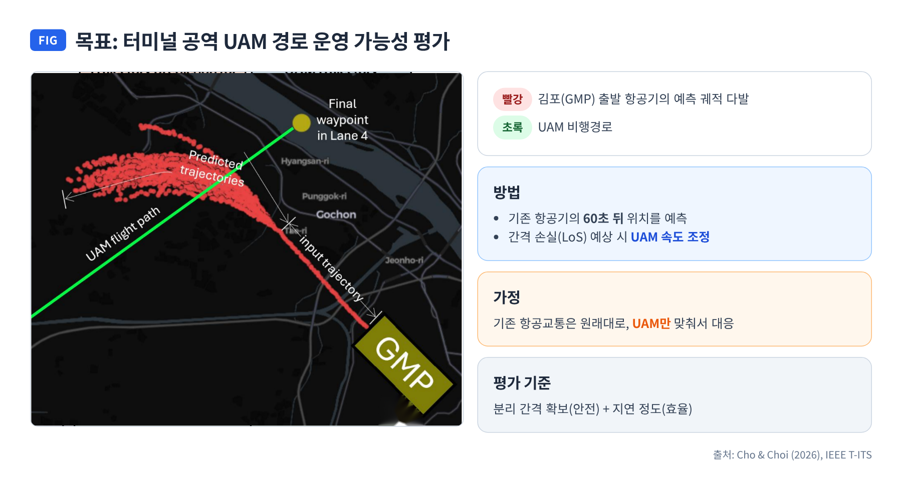
<!-- 1강 슬라이드 33: UAM-ATM Interoperability Assessment - Objective -->

중심 질문: **"기존 항공기 출·도착이 있는 공항 주변에서 UAM 경로를 운영할 수 있는가?"**
운영 가능성은 두 가지로 봄.
- 필요한 **분리 간격**을 확보할 수 있나 (안전)
- 그 과정에서 **지연**이 얼마나 생기나 (효율)

그림에서 빨강 = 기존 비행기(김포 GMP 출발)의 예측 궤적, 초록 = UAM 비행경로. 두 경로가 가까워지는 구간이 보임. 근데 진짜 위험을 판단하려면 <mark class="pink">두 기체가 같은 시각에 어디 있는지</mark>를 비교해야 함.

방법은
- 기존 비행기의 **60초 뒤** 움직임을 예측하고
- 간격 손실(**LoS, Loss of Separation**)이 예상되면 **UAM 속도를 조정**

여기서 중요한 가정: <mark class="pink">기존 항공교통은 원래대로 움직이고, UAM만 맞춰서 대응</mark>함. 양쪽 다 최적화한 게 아님.

### 5-3. Key Idea: 속도로 통과 시간을 조정한다

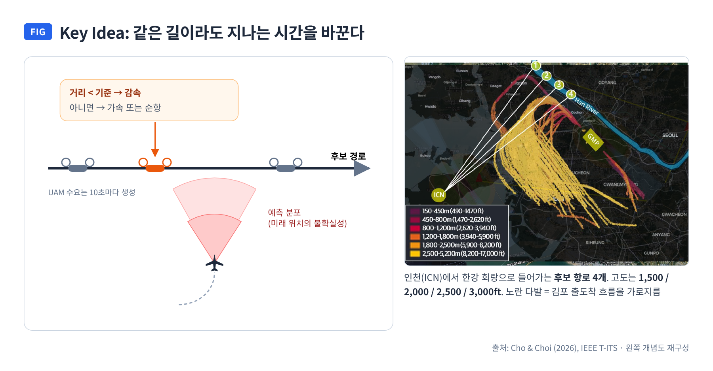
<!-- 1강 슬라이드 34: Key Idea (후보 경로 4개, 고도 1500~3000ft) -->

**왼쪽 개념도**
- UAM은 가로 방향 **후보 경로(Candidate route)**를 따라 이동 (UAM 수요는 10초마다 생성)
- 기존 비행기는 그 근처로 비행하고, 비행기 앞의 **부채꼴**은 미래 위치의 **불확실성**(= 확률적 예측으로 나온 궤적들의 분포)
- 거리가 기준보다 가까워질 것 같으면 **감속**해서 도착을 늦춤

같은 경로를 지나더라도 **통과 시간을 조정해서 간격을 확보**하는 것. 앞에서 본 **시간 기반 교통관리(TBFM)**랑 같은 발상임.

**오른쪽 지도**
- 인천(ICN)에서 한강 쪽으로 들어가는 **후보 항로 4개(Route 1~4)**
- 고도는 **1,500 / 2,000 / 2,500 / 3,000 ft**
- UAM이 날기 가장 좋은 공역이 **한강 위 회랑**인데, 인천 쪽에서 한강으로 들어가려면 **김포공항 출도착 흐름(노란 궤적 다발)을 일부 가로질러야** 함

그래서 이 항로들이 얼마나 운영 가능한지 본 연구임.

### 5-4. Method ①: Normalizing Flows로 확률적 궤적 예측

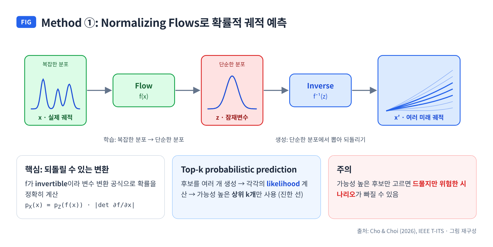
<!-- 1강 슬라이드 35: Method - Normalizing Flows -->

기존 비행기의 여러 가능한 미래를 만들려고 쓴 게 <mark class="pink">노멀라이징 플로우(Normalizing Flows)</mark>임. 앞의 Transformer와는 다른 계열의 **흐름 기반 생성 모델**.

- 왼쪽 **x** = 실제 궤적 데이터 (복잡한 분포)
- 가운데 **z** = 잠재변수 (다루기 쉬운 단순한 분포, 예: 가우시안)
- **Flow f(x)**: 복잡한 분포 → 단순한 분포로 변환
- **Inverse f⁻¹(z)**: 거꾸로 되돌리기. **되돌릴 수 있는 함수(invertible function)**를 쓰는 게 핵심

학습이 끝나면 단순한 분포에서 값을 뽑고 → 역변환하면 → **여러 미래 궤적**이 생성됨.

그리고 다른 생성 모델과 달리 <mark class="pink">각 샘플의 가능도(likelihood)를 직접 계산</mark>할 수 있음. 그래서 생성한 후보 중 가능도가 높은 것만 고르는 **Top-k probabilistic prediction**이 가능함.

주의: 가능성 높은 후보만 골랐다고 **드물지만 위험한 상황까지 다 포함되는 건 아님**. 후보를 어떻게 고르고 위험 평가에 어떻게 쓸지는 따로 고민해야 함.

이 부분도 **숙제·시험엔 안 나옴**. "여러 가능한 궤적을 만들어서 다음 계산에 쓴다"는 구조만 알면 됨.

> 💡 GAN이나 VAE 같은 다른 생성 모델은 "그럴듯한 샘플"은 뽑아도 "이 샘플이 얼마나 그럴듯한지(확률)"는 정확히 못 알려줌. 노멀라이징 플로우는 변환이 되돌릴 수 있게 생겨서 **변수 변환 공식(change of variable)**으로 확률을 정확히 계산할 수 있음. 안전 평가에서 "이 경로가 나올 확률"이 필요하니까 이 장점이 중요한 거.

### 5-5. Method ②: CPA 기반 UAM 가감속

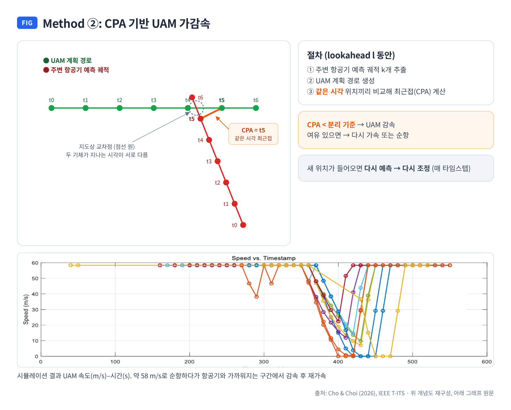
<!-- 1강 슬라이드 36: Method - Adjusting UAM acceleration (CPA) -->

예측 궤적을 얻었으면 UAM 속도를 조정함.

1. 앞으로 일정 시간(**lookahead time l**) 동안 주변 비행기의 예측 궤적 **k개**를 뽑음
2. 같은 시간 동안 UAM이 계획대로 가면 어디 있을지 계산
3. 두 기체의 **같은 시각 위치**를 비교해서 가장 가까워지는 순간을 찾음 → <mark class="pink">CPA(Closest Point of Approach, 최근접 접근점)</mark>
4. CPA 거리가 **분리 기준보다 작으면 → UAM 감속**
5. 여유가 있으면 → 설정 범위 안에서 **다시 가속하거나 순항 유지**

여기서 포인트는 <mark class="pink">지도에서 두 선이 가장 가까운 곳을 찾는 게 아니라, 같은 시간대 두 기체 위치를 비교한다</mark>는 것.

그리고 계산은 한 번으로 안 끝남. 새 위치가 들어오면 **다시 예측 → 다시 속도 조정**. 아래 Speed vs Timestamp 그래프를 보면 UAM들이 약 58 m/s로 순항하다가 비행기와 가까워지는 구간(약 350~450초)에서 **확 감속했다가 다시 가속**하는 게 보임.

> 💡 지도상으로 두 선이 교차해도 **시간이 엇갈리면** 안전함. 횡단보도에서 차가 지나간 **뒤에** 건너면 같은 지점을 지나도 안 부딪히는 거랑 같음. 그래서 4D(시간 포함) 예측이 필요한 거고, CPA도 "공간상 최근접"이 아니라 "시간을 맞춘 최근접"임.

### 5-6. Key Findings ①: 예측 정확도

결과는 **"모델이 잘 맞추나"**(예측 정확도)와 **"그걸로 간격을 확보하나"**(운용성)를 나눠서 봄. 먼저 예측 정확도부터.

**지표**
- **ADE**(Average Displacement Error): 예측 구간 **전체**에서 위치 오차의 평균
- **FDE**(Final Displacement Error): 예측 구간 **마지막 위치**의 오차
- 앞의 **min**: 여러 후보 중 **실제와 가장 잘 맞는 후보** 기준으로 평가

| 모델 | 입력 | 확률적? | minADE | minFDE |
|---|---|---|---|---|
| GRU+GRU | abs+dev | ✗ | 265.156 | 474.137 |
| GRU+MLP | abs+dev | ✗ | 264.387 | 496.840 |
| GRU+CNF | abs | ✓ | 76.80 | 25.65 |
| **GRU+CNF** | **abs+dev** | **✓** | **69.06** | **11.30** |

(CNF = Conditional Normalizing Flow, abs = 절대 위치, dev = 연속 위치 간 변위. 단위 m)

확률적 모델(CNF)이 기존 결정론적 모델보다 오차가 **확 낮음**.

근데 교수님이 콕 집은 주의사항: <mark class="pink">minFDE 11m를 "모든 예측의 평균 오차가 11m"로 읽으면 안 됨</mark>. 여러 후보 중 **제일 잘 맞은 거 기준**이고, 이 비교 조건에서의 결과로 이해해야 함.

> 💡 "min" 지표는 확률적 예측 평가에서 흔히 쓰지만 좀 관대한 지표임. 후보를 많이 뽑을수록 그중 하나는 우연히 맞기 쉬워지니까. 그래서 보통 후보 개수(k)를 같이 명시하고 비교함. 참고로 minFDE(11m)가 minADE(69m)보다 작은 건 흔한 일은 아닌데, 마지막 위치만 잘 맞는 후보가 따로 있을 수 있어서 그럴 수 있음. 정확한 해석은 논문을 확인하는 게 좋음.

### 5-7. Key Findings ②: 항로·고도별 운용성

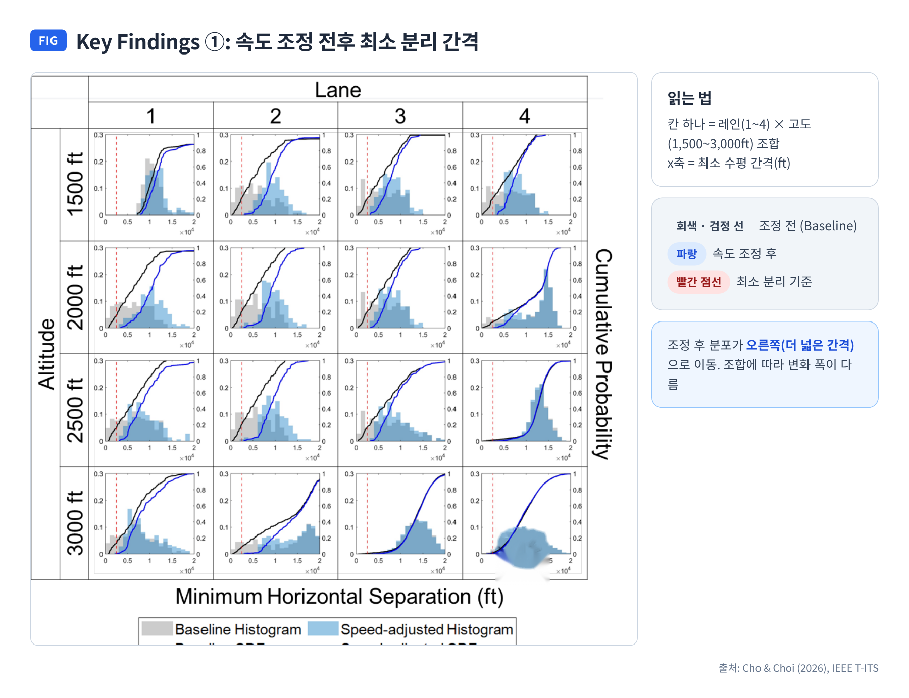
<!-- 1강 슬라이드 37 오른쪽: 속도 조정 전후 최소 분리 간격 (CDF) -->

**① 속도 조정 전후**
- 레인 1~4 × 고도 1,500~3,000ft 조합별로 최소 수평 간격 분포를 그림
- **빨간 점선** = 꼭 지켜야 하는 최소 분리 간격
- 회색(Baseline, 조정 전) → 파랑(Speed-adjusted, 조정 후)으로 가면 **가장 가까워진 순간의 간격이 늘어남**. 조합에 따라 변화가 큰 곳도 있고 작은 곳도 있음

여기서도 강조: <mark class="pink">예측 오차가 작아지는 것과 실제 운항 간격이 확보되는 것은 별개의 평가 항목</mark>.

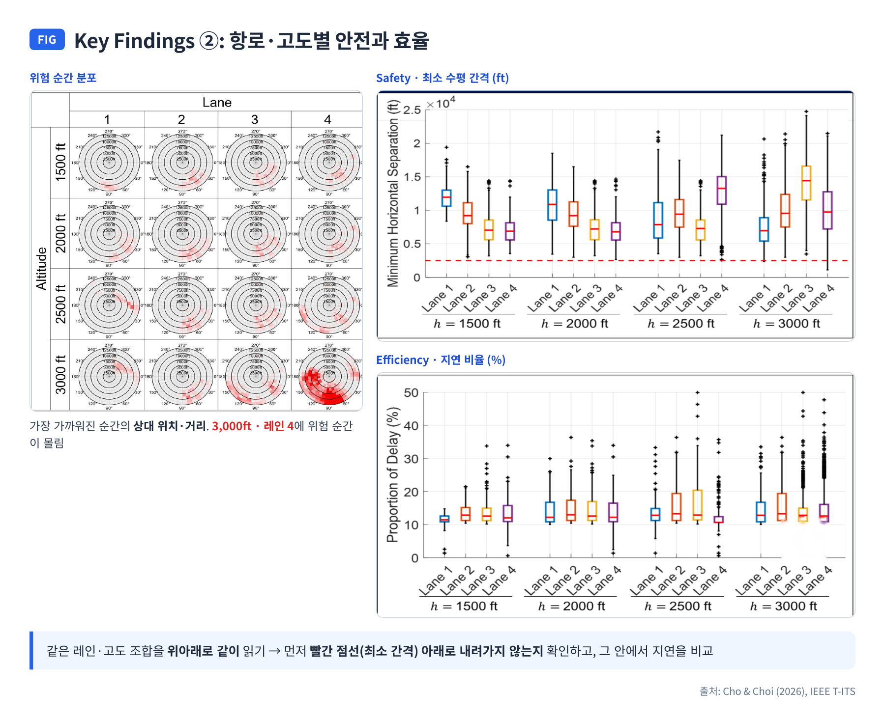
<!-- 1강 슬라이드 38: Key Findings - Feasibility Assessment (박스플롯, 극좌표 heatmap) -->

**② 안전 vs 효율 (오른쪽 박스플롯)**
- **위**: UAM과 비행기 사이 **최소 수평 간격** (Safety)
- **아래**: 운항 **지연 비율** (Efficiency)
- 같은 레인·고도 조합을 **위아래로 같이** 읽어야 함

| 경우 | 평가 |
|---|---|
| 간격은 넉넉한데 매번 크게 감속해서 지연이 길다 | 효율 ✗ |
| 빨리 지나가는데 필요한 간격을 못 지킨다 | 안전 ✗ → 아예 탈락 |

박스플롯이라 한 번의 비행이 아니라 **여러 상황에서의 분포**를 보여줌. 중앙값뿐 아니라 분포가 넓은지, **최소 간격선 아래로 내려가는 순간**이 있는지도 봐야 함.

결국 <mark class="mint">먼저 안전 기준을 충족하는지 걸러내고, 그 안에서 지연과 운영 부담을 비교</mark>하는 식으로 "어떤 고도의 어떤 레인이 UAM에 적합한지" 결론을 냄.

**③ 위험 순간의 상대 위치 (왼쪽 극좌표 그림)**
- 항상 **60초 뒤까지** 보면서, UAM과 비행기가 **가장 가까워지는 순간의 상대 위치와 거리**를 찍은 그림
- **고도 3,000ft, 레인 4**에서 빨간 점이 몰려 있음 → 위험한 순간이 **잦고**, 상대 거리도 **짧음**

> 💡 3,000ft·레인 4가 위험한 건 직관적으로도 맞음. 레인 4가 김포 쪽에 가장 가깝고, 3,000ft는 김포 출발기가 상승하면서 지나가는 고도대랑 겹침. 반대로 레인 4라도 2,500ft에선 간격이 오히려 넓게 나오는데, 이처럼 **고도 하나만 바꿔도 결과가 확 달라진다**는 게 이 연구가 2차원 지도가 아니라 4D로 봐야 하는 이유를 보여줌.

### 5-8. Conclusion

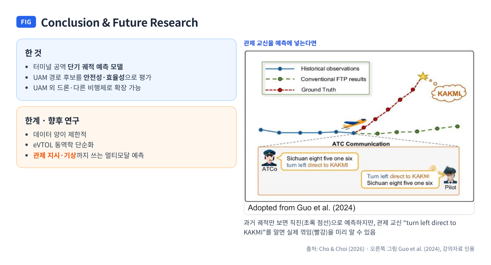
<!-- 1강 슬라이드 39: Conclusion / Limitation & Future research -->

정리하면
- **단기 터미널 공역 궤적 예측 모델**을 만들고
- 그 결과로 **UAM 경로 후보를 안전성과 효율성 측면에서 평가**함
- 대상은 UAM뿐 아니라 **드론이나 다른 비행체**로도 확장 가능

예측 정확도 확인은 물론이고, <mark class="pink">예측을 썼을 때 운항이 어떻게 달라지는지, 운항 자체가 가능한지</mark>까지 판단한 게 포인트. 앞의 GCN-Transformer 다중 항적 예측과는 성격이 다른 연구로, **궤적 예측이 이런 용도로도 쓰일 수 있다**는 걸 보여줌.

**한계와 향후 연구**
- 데이터 양이 제한적
- eVTOL(UAM 기체) 동역학을 단순화함
- **관제 지시(ATC instruction)나 기상**까지 같이 넣는 **멀티모달 예측** 필요

> 💡 오른쪽 그림(Guo et al., 2024)이 이 마지막 항목을 잘 보여줌. 과거 궤적만 보면(초록 점선) 비행기가 직진할 거라고 예측하는데, 실제로는 관제사가 "KAKMI로 좌선회 직항"이라고 지시해서 빨간 선처럼 꺾음. **관제 교신 음성까지 입력에 넣으면** 이런 꺾임을 미리 알 수 있다는 아이디어임. 이게 2편의 **관제 음성 인식** 얘기로 자연스럽게 이어짐.

---

## 6. 핵심 요약

<!-- 1강 슬라이드 40: 정리 (슬라이드 2와 동일) -->

1. 하늘에도 **경로·고도·활주로 제약**이 있고, 특히 **도착 단계**에서 순서와 간격을 맞추는 게 핵심. 김포·제주 궤적, **포인트 머지 시스템**이 그 예
2. 몰리는 교통은 **Miles-in-Trail · Rerouting · Airborne holding · Ground delay**로 조정. 연료 때문에 **ground delay가 선호**되고, 그러려면 **미리 예측**해야 함
3. **ETA(예상) vs STA(배정)** 차이를 속도·경로로 흡수하는 게 **TBFM**. 스케줄은 한 번 정하고 끝이 아니라 **실시간으로 계속 맞춤**
4. **4D 궤적 예측** = (x, y, h, t). 위치·속도뿐 아니라 **기상, 비행 절차, 주변 항공기**까지 반영
5. **GCN-Transformer**: GCN은 **항공기 사이 관계**, Transformer는 **시간에 따른 움직임**. ADS-B 2분 입력 → 1초 갱신 → 2분 예측
6. 평소 패턴을 잘 맞추는 모델 ≠ **위험 상황에서 잘 피하는 모델**. 그래서 **강화학습(PPO)** 기반 충돌 회피 모델을 따로 만듦. 보상이 높은 것과 실제 안전은 구분해야 함
7. **UAM 사례**: 노멀라이징 플로우로 기존 항공기 궤적을 **확률적으로 예측**하고, **CPA** 기준으로 UAM을 가감속. **안전 기준을 먼저 만족**시키고 그 안에서 **지연**을 비교해 항로·고도를 고름

>한 줄로 묶으면  
>**항공교통에서 AI의 역할은 "이 비행기가 언제 어디 있을지"를 4D로 예측하고, 그 예측을 속도·경로 조정이라는 실제 행동으로 연결한 뒤, 달라진 상태를 다시 관측하는 Physical AI 루프를 돌리는 것이다.**

교수님 마지막 당부도 그대로 옮겨 둠. AI 응용 사례를 볼 때는 항상
- **어떤 데이터로 무엇을 예측**하고
- 그 결과가 **어떤 실제 행동**으로 이어지며
- 그 행동이 **지켜야 할 제약**은 무엇인지

같이 생각해 보라는 것.

다음 편에서는 같은 루프를 **관제사를 돕는 AI**(음성 인식, LLM 기반 의사결정 보조)와 **직접 움직이는 드론**(조난자 탐색, 조류 퇴치)으로 넓혀 봄.

---

## 참고문헌
- Cho, J., & Choi, S. (2026). Toward safe integration of UAM in terminal airspace: UAM route feasibility assessment using probabilistic aircraft trajectory prediction. *IEEE Transactions on Intelligent Transportation Systems*.
- Slide Courtesy: Dr. Jaeyoung Ryu, Prof. Hak-Tae Lee, Inha University (GCN-Transformer 다중 항적 예측 · 강화학습 충돌 회피 연구, 강의 슬라이드 22~31).
- Guo et al. (2024). 강의 슬라이드 39에 인용된 그림 (ATC 교신을 활용한 궤적 예측).
- FAA. *Traffic Flow Management (TFM) Learning: ATFM Basics*. https://tfmlearning.faa.gov/tfm-training/atfm-basics/cdm-t1-lesson3b.html