## 들어가며

1편에서는 비행기가 **언제 어디로 갈지 예측**하고, 몰리는 교통을 **어떻게 조정**할지 봤음. 2편은 한 단계 더 들어가서, 그 예측으로 **실제로 뭘 할 수 있는지**를 사례 위주로 봄.

<!-- 2강 슬라이드 2: 항공분야 AI: 관제 보조 및 드론 임무 수행 -->

모든 사례에 공통으로 깔린 흐름은 세 단계임.

| 단계 | 하는 일 |
|---|---|
| **지시 이해** | 사람의 지시에서 **목표와 수행 조건**을 파악 |
| **상황 판단** | 관측 정보와 물리적 제약으로 **미래 상태와 위험을 예측** |
| **임무 수행** | 판단에 따라 **행동을 결정·조정**하고, 결과를 **다시 관측** |

- 지시를 이해했다고 바로 실행하면 안 됨. 주변 항공기, 장애물, 움직임의 제약을 보고 **앞으로 어떤 위험이 생길지** 판단해야 함
- 판단에 따라 **관제사에게 위험을 알리거나**, **드론의 이동·행동을 조정**함
- 행동한 뒤엔 달라진 상황을 **다시 관측**하고 또 판단·행동

오늘 사례는 크게 두 갈래임.
1. **판단을 돕는 AI**: 관제 음성 인식, LLM 기반 관제 의사결정 보조
2. **직접 행동하는 AI**: 조난자 탐색 드론, 다객체 경로 탐색, 조류 퇴치 드론

> 💡 1편의 "예측 → 위험 판단 → 행동 변경 → 새 상태 관측"에 앞단 하나가 붙은 거임. 바로 **"사람이 뭘 원하는지 알아듣기"**. 지난 강의의 VLA(Vision-Language-Action)에서 Language가 들어간 자리랑 같음.

---

## 1. 관제사의 판단을 돕는 AI

### 1-1. 관제사는 무슨 일을 하나

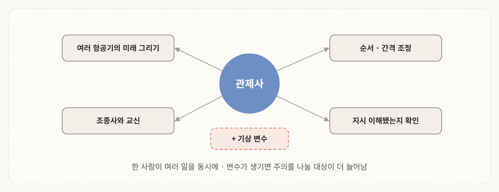
<!-- 2강 슬라이드 4: 관제사의 역할 -->

관제사는 비행기 한 대 위치만 보는 사람이 아님.
- **여러 비행기가 앞으로 어디로 갈지** 머릿속으로 그리면서 **순서와 간격**을 조정하고
- 동시에 **조종사와 교신**하고
- 자기가 준 지시가 **제대로 이해됐는지까지** 확인해야 함

그림처럼 관제사 한 명이 이 일들을 **동시에** 굴리고 있음. 평소에도 할 일이 많은데 <mark class="pink">기상 같은 변수까지 생기면 신경 써야 할 대상이 확 늘어남</mark>. 그럼 AI가 어디를 도와줄 수 있을까?

### 1-2. 관제 음성 인식: 받아쓰기와 알아듣기는 다르다

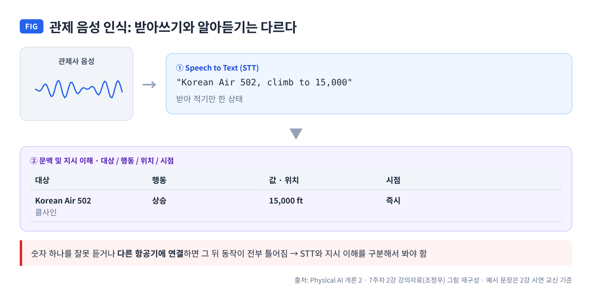
<!-- 2강 슬라이드 5: 관제 음성 인식 -->

첫 번째는 <mark class="pink">사람이 말한 지시를 기계가 처리할 수 있는 형태로 바꾸는 것</mark>. 크게 두 단계임.

| 단계 | 이름 | 하는 일 |
|---|---|---|
| ① | **음성 → 텍스트 (STT, Speech to Text)** | 관제사가 한 말을 **문장으로 받아 적기** |
| ② | **문맥 및 지시 이해** | **대상 · 행동 · 위치 · 시점** 등 정보 파악 |

받아 적었다고 이해한 게 아님. ②에서
- **누구에게** 내린 지시인지
- **무엇을** 하라는 건지
- **어디서, 언제** 하라는 건지

를 구분해야 함. 예를 들어 "고도 바꿔"라는 지시면 **항공기 식별 정보(콜사인)와 목표 고도를 정확히 짝지어야** 함. <mark class="pink">숫자 하나 잘못 듣거나 다른 비행기에 연결하면 그 뒤 동작이 전부 틀어짐</mark>.

> 💡 관제 교신은 일반 음성 인식이 특히 약한 분야임. 무전 잡음, 빠른 말투, "niner(9)" 같은 전용 발음, 콜사인과 숫자가 연달아 나오는 구조 때문. 그래서 뒤에서 나오듯 범용 모델을 **관제 음성으로 추가 학습**시키는 게 필수.

### 1-3. 시연: 지시를 알아듣고 해당 항공기가 자동 수행

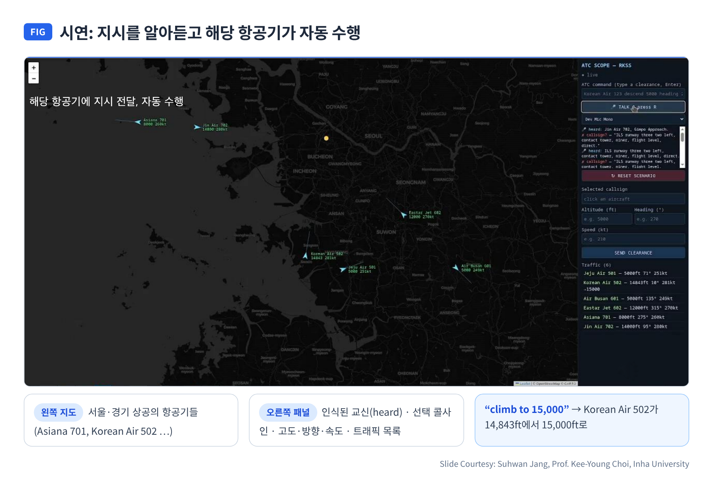
<!-- 2강 슬라이드 6: 해당 항공기에 지시 전달, 자동 수행 (Slide Courtesy: Suhwan Jang, Prof. Kee-Young Choi) -->

관제 지시를 해석해서 **해당 비행기의 동작**으로 연결하는 시연임.
- 왼쪽: 서울·경기 지도 위에 여러 비행기 (Asiana 701, Jin Air 702, Korean Air 502, Jeju Air 501 …)
- 오른쪽(ATC SCOPE – RKSS, 김포): 들은 지시(heard), 선택된 콜사인, 고도·방향·속도, 트래픽 목록

보면 말이 텍스트로 바뀌는 데서 끝나지 않고, <mark class="pink">선택된 비행기가 실행할 명령으로 전달</mark>됨. 예를 들어 "Korean Air 502, climb to 15,000" 하면 트래픽 목록에 Korean Air 502가 14,843ft → **15,000**으로 올라가는 게 찍힘.

볼 포인트는 세 개.
- **어떤 비행기**가 대상인지
- **어떤 값/행동**이 지시됐는지
- 그 지시가 **화면 움직임에 어떻게 반영**되는지

인하대 항공우주공학과 **장수환 학생, 최기영 교수님** 연구실의 연구임.

그럼 다음 질문은 이거. <mark class="mint">"이 지시, 그대로 실행해도 안전한가?"</mark>

---

## 2. LLM 기반 관제 의사결정 보조

### 2-1. 지시를 "이해"하는 것에서 "검증"하는 것으로

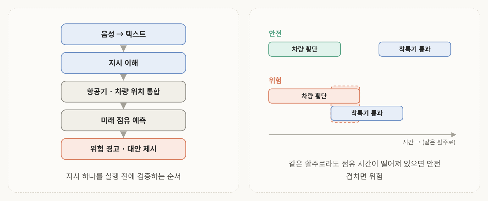
<!-- 2강 슬라이드 8: LLM 기반 관제 의사결정 보조 (STT → 지시 이해 → Situational Awareness → 위험 예측 → 의사결정 보조) -->

이번엔 AI가 지시를 수행했을 때 **다른 비행기나 차량과 위험하게 만날 가능성**이 있는지 확인함.

예를 들어 공항엔 **지상 운용 차량**들이 돌아다님. 차량한테 "활주로 건너"라고 하면 문장 자체엔 문제가 없어 보임. 근데 **착륙기가 가까이 오고 있으면** 얘기가 완전 달라짐. <mark class="pink">지시의 의미 + 지금 교통 상황을 같이 봐야</mark> 위험이 보임.

| 단계 | 하는 일 |
|---|---|
| 음성인식 (STT) | 음성 → 텍스트 |
| 문맥 및 지시 이해 | 대상·행동·위치·시점 파악 |
| **상황 인식 (Situational Awareness)** | 관제 지시 + 항공기·차량의 **위치와 이동 정보**(어디서, 어느 방향으로, 얼마나 빨리)를 통합 |
| **위험 예측** | 지시가 이행되면 각 대상이 **어디에 어떤 상태로** 있을지 예측. 같은 활주로를 써도 **점유 시간**이 충분히 떨어져 있으면 OK, **겹치면 위험** |
| **의사결정 보조** | 위험 경고 + **대기, 횡단 시점 조정** 같은 대응 방안 제시 |

이런 위험은 일어나면 안 되지만 항공에선 종종 생김. 실제 사고까진 안 가더라도 **준사고**(사고로 이어질 뻔한 상황)는 꽤 많이 발생함.

중요한 건 <mark class="pink">AI가 관제를 다 결정하는 게 아니라, 관제 지시에 숨어 있는 위험을 미리 확인해 주는 역할</mark>이라는 것.

### 2-2. 사고 사례: 활주로 횡단과 착륙이 겹쳤을 때

<!-- 2강 슬라이드 9: 라과디아 사고 (뉴스 화면 캡처라 이미지는 생략) -->

슬라이드에 나온 사례는 **뉴욕 라과디아 공항 사고**(2026년 3월, Air Canada Express 8646편)임. 관제사가 **소방차에게 활주로 횡단을 허가**했는데, 같은 활주로에 **착륙 접근 중인 비행기**가 있었던 상황.

교수님도 이 장에선 세부 원인을 단정하기보다 <mark class="pink">두 움직임이 같은 공간·같은 시간에 겹쳤다</mark>는 점에 집중하자고 함.

- 소방차: 비상 대응이라 **빨리** 가야 했음
- 비행기: 이미 **착륙하려고 접근** 중
- 각자 목적은 분명한데, **활주로라는 공통 공간**에서 엮임

그래서 횡단 허가를 확인하려면 차량 이동뿐 아니라 **비행기가 그 지점에 도착하는 시간**까지 같이 봐야 함.

### 2-3. 사건 진행 과정

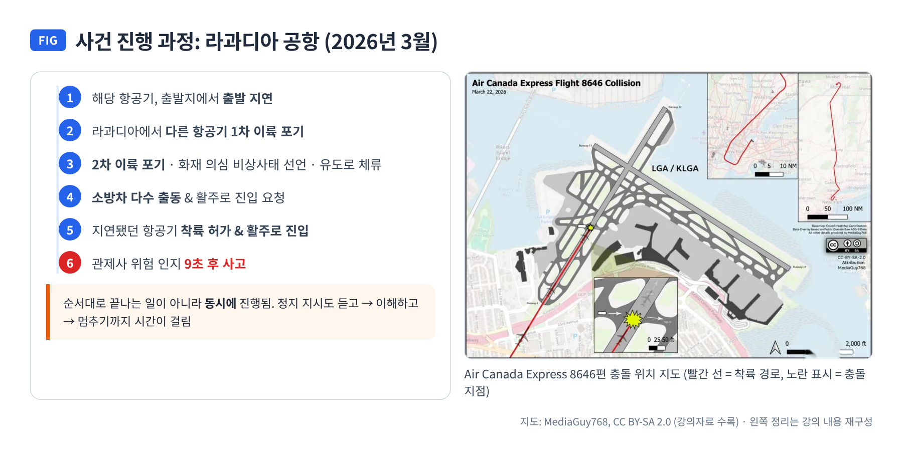
<!-- 2강 슬라이드 10: 사건 진행 과정 (Air Canada Express Flight 8646 Collision 지도, CC-BY-SA 2.0 MediaGuy768) -->

1. 해당 비행기가 출발지에서 **출발 지연**
2. 라과디아에서 이륙하려던 **다른 비행기가 1차 이륙 포기**
3. **2차 이륙 포기**, **화재 의심**으로 비상사태 선언 & 유도로에 체류
4. **소방차 여러 대 출동** & 활주로 진입 요청
5. 그 시점에 지연됐던 비행기가 **착륙 허가 받고 활주로 진입**
6. 관제사가 위험을 인지하고 **9초 후 사고 발생**

중요한 건 <mark class="pink">앞일이 끝나고 다음 일이 시작되는 단순 순차 업무가 아니라는 것</mark>.
- 비상 대응을 처리하는 **동안에도** 다른 비행기들은 이미 움직이고 있고
- 새 요청은 **계속** 들어옴
- 위험을 알아채고 정지 지시를 보내도, 상대가 **듣고 → 이해하고 → 실제로 멈추기**까지 시간이 걸림

그래서 던지는 질문은 이거.

> 위험이 코앞에 왔을 때 경고하는 것뿐 아니라, **횡단 지시를 내리는 그 순간에** AI가 지시를 이해하고 미래를 빠르게 시뮬레이션해서 충돌 가능성을 **먼저** 확인할 수 있었을까?

### 2-4. 위험을 놓치게 만든 조건

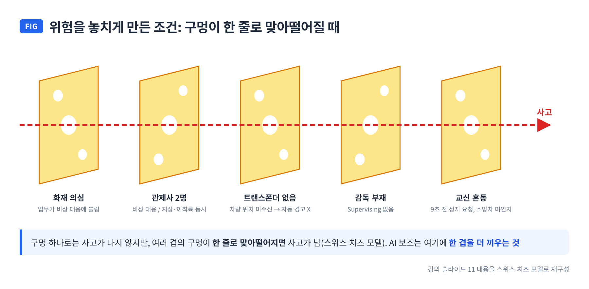
<!-- 2강 슬라이드 11: 위험을 놓치게 만든 조건 -->

| 조건 | 내용 |
|---|---|
| **화재 의심 상황 발생** | 비상 상황이라 업무가 한쪽으로 쏠림 |
| **관제사 근무 환경** | **2명**이서 한 명은 비상 대응 전담, 한 명은 **지상 관제 + 이착륙**을 동시에 |
| **지상 차량 트랜스폰더 미장착** | 차량 위치가 감시 시스템에 안 들어감 → **자동 충돌 경고가 작동 안 함** |
| **Supervising 부재** | 원래 더 많은 인원과 감독이 있어야 하는데 관행적으로 2명이 운영 |
| **9초 전 정지 요청** | 관제 측이 정지 요청을 했지만 **소방차 쪽이 자기한테 한 말인지 인지 못 함** |

> 💡 보면 기술 문제(트랜스폰더 없음)와 사람 문제(업무 과부하, 감독 부재, 교신 혼동)가 겹쳐 있음. 항공 안전에서 자주 말하는 **스위스 치즈 모델**이 딱 이거임. 구멍 하나로는 사고가 안 나는데, 여러 겹의 구멍이 한 줄로 맞아떨어질 때 사고가 남. AI 보조는 거기에 **치즈 한 장을 더 끼우는** 역할이라고 보면 됨.

### 2-5. 관제 지시의 위험을 사전에 확인하는 AI

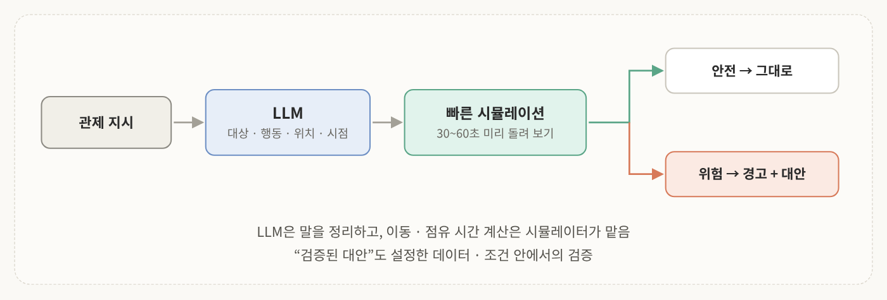
<!-- 2강 슬라이드 12: LLM 기반 관제 의사결정 보조 - 관제 지시의 위험을 사전에 확인하는 AI -->

그래서 제안하는 게 <mark class="pink">관제 지시의 위험을 사전에 확인하는 AI</mark>임. 질문은 딱 하나.

> **활주로 횡단/진입 허가가 그 활주로의 착륙·이륙 트래픽과 시간적으로 충돌하는가?**

구조는 **LLM + Fast-Time 시뮬레이션** 기반 지상관제 의사결정 보조 시스템.

| 역할 | 담당 |
|---|---|
| 지시의 **의미를 구조화** | **LLM** |
| 실제 이동과 **점유 시간 계산** | 교통 데이터 + **시뮬레이션** |

- **Fast-Time Simulation**: 앞으로의 상황을 **실제 시간보다 훨씬 빠르게** 돌려 보는 방식
- 지시가 실행되기 **전에** 결과를 미리 시뮬레이션하고 → 충돌 위험을 탐지하면 → 관제사에게 **근거와 함께** 빨리 알리고 → **대기나 횡단 시점 변경** 같은 대체안도 다시 시뮬레이션해서 확인

다만 슬라이드의 "**검증된 대체 지시**"라는 말은 <mark class="pink">설정된 데이터와 시뮬레이션 조건 하에서의 검증</mark>이라는 점은 기억해야 함.

### 2-6. 작동 예시

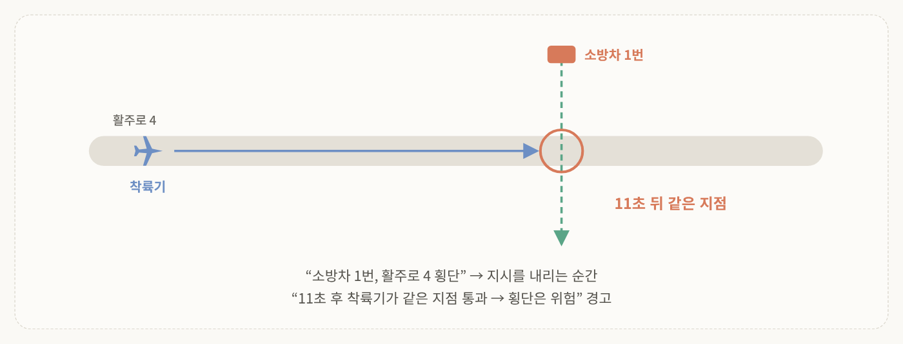
<!-- 2강 슬라이드 13: LLM 기반 관제 의사결정 보조 - 작동 예시 -->

| 단계 | 예시 |
|---|---|
| 1. 관제사 음성 지시 | "소방차 1번, 활주로 4 횡단" |
| 2. **LLM 지시 구조화** | 대상: 소방차 1번 // 행동: 활주로 횡단 // 위치: 활주로 4 // 시점: 즉시 |
| 3. 현재 지상·항공 데이터 반영 | 항공기·차량 위치와 속도, 착륙·이륙 항공기 궤적, 활주로·유도로 구조 |
| 4. 시뮬레이터로 지시 결과를 미리 실행 | **향후 30~60초** 상황 예측 |
| 5. 활주로 점유시간과 충돌 가능성 계산 | |
| 6. 위험 시 관제사에게 즉시 경고 | "**11초 후 착륙기가 동일 지점을 통과하므로 현재 횡단 지시는 위험**" |

과거 데이터로 각 대상이 어떻게 움직일지 예측하는 것도 학습할 수 있다고 가정하면, 지시대로 움직였을 때 **각자 어디로 갈지** 계산할 수 있음. 그 결과 차량이 횡단하는 도중 착륙기와 **같은 지점에 있게 되면** → "몇 초 뒤 이런 상황이 생기니 이렇게 하라"는 대체안을 줄 수 있음.

> 💡 2번이 핵심임. 말로 된 지시를 **대상/행동/위치/시점**이라는 정해진 칸에 채워 넣으면, 그다음부턴 일반 시뮬레이터가 계산할 수 있는 입력이 됨. LLM이 **사람 말 ↔ 기계 입력** 사이 통역사 역할을 하는 구조.

### 2-7. 시스템 구성 요소

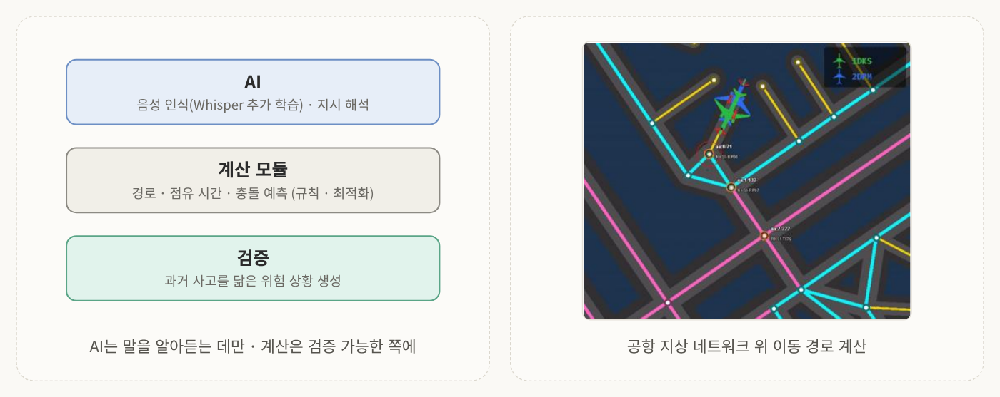
<!-- 2강 슬라이드 14: LLM 기반 지상관제 의사결정 보조 - 학습모델 / Components -->

**학습 모델**
- 관제 음성을 텍스트로 바꾸는 데 **Whisper**(오픈소스 음성 인식 모델)를 씀
- 여기에 **실제 관제 음성 데이터**를 추가 학습시켜서 항공·관제 특유의 표현을 익히게 함
- 지시 의미 해석은 그다음 단계로 따로 봄

**Components**
| 모듈 | 역할 |
|---|---|
| 지상 네트워크 & 라우팅 | 차량이 **어떤 길로** 활주로에 가는지 |
| 충돌예측 | 점유 시간 겹침 계산 |
| 항공기 도착 데이터 연동 | 착륙기가 **언제** 오는지 |
| 공항 지상 이동 데이터 연동 | 지상 차량·항공기 위치 |
| **위험상황 생성** | 다양한 조건에서 시스템을 **시험**하기 위한 시나리오 생성 |

여기서 교수님이 짚은 포인트: <mark class="pink">경로·도착 시간 같은 계산은 굳이 AI가 할 필요가 없음</mark>. 디지털 트윈이나 시뮬레이션 환경에 미리 만들어 두고 **최적화 모델이나 단순한 rule-based**로 계산하면 됨. AI는 **"무엇을 하라는 건지"만 전달**해 주면 됨.

위험상황 생성 모듈은 라과디아 사례뿐 아니라 **과거 수천, 수만 건의 항공 사고 사례**를 보고 비슷한 상황을 만들어서, 그때도 시스템이 제대로 작동하는지 **검증**하는 데 씀.

> 💡 "LLM한테 다 시키지 말고 잘하는 데만 쓰자"는 설계가 실무적으로 중요함. LLM은 말을 구조화하는 건 잘하지만 "11초 뒤 위치"를 계산하는 건 물리 시뮬레이터가 훨씬 정확하고 믿을 만함. 안전이 걸린 계산은 검증 가능한 쪽에 맡기는 것.

### 2-8. Human-in-the-Loop Simulation

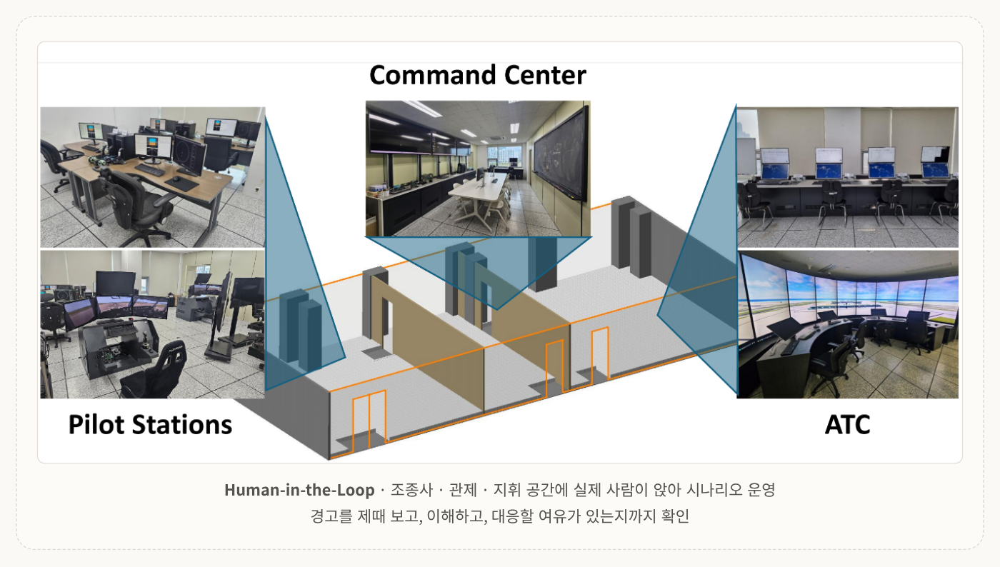
<!-- 2강 슬라이드 15: Human-in-The-Loop Simulation (Pilot Stations / Command Center / ATC) -->

이렇게 만든 시스템은 **사람이 참여한 환경**에서도 확인해야 함. 이게 <mark class="pink">휴먼 인 더 루프(Human-in-the-Loop, HITL)</mark> 시뮬레이션임. 사람이 루프 안에 있을 때도 시스템이 제대로 작동하는지 보는 것.

- **Pilot Stations**: 조종사 역할을 하는 공간
- **ATC**: 관제 업무 공간
- **Command Center**: 전체 지휘 공간

실제 담당자를 앉혀 놓고 전체 시나리오가 돌아가는지 검증함.

항공교통에서 HITL이 특히 중요한 이유: <mark class="pink">컴퓨터가 충돌 가능성을 계산했다고 현장에서 바로 도움이 되는 건 아님</mark>. 같이 봐야 할 것들이 있음.
- 관제사가 경고를 **제때 보는지**
- 경고의 **의미를 이해하는지**
- 경고를 **어떤 식으로 띄울지**
- 실제로 **대응할 여유**가 있는지

그리고 **불필요한 경고가 너무 자주** 뜨면 오히려 부담이 커짐. 그래서 **계산 결과의 정확성**과 **사람이 그 결과를 쓰는 과정**을 함께 평가해야 함.

> 💡 이른바 **경보 피로(alarm fatigue)** 문제임. 병원 모니터 알람이 너무 자주 울리면 의료진이 진짜 위급 알람도 무시하게 되는 것처럼, 관제에서도 오경보가 많으면 진짜 경보를 놓침. AI 정확도 99%여도 사람이 안 믿으면 0%가 되는 셈.

### 2-9. 공항 관제탑 시뮬레이터

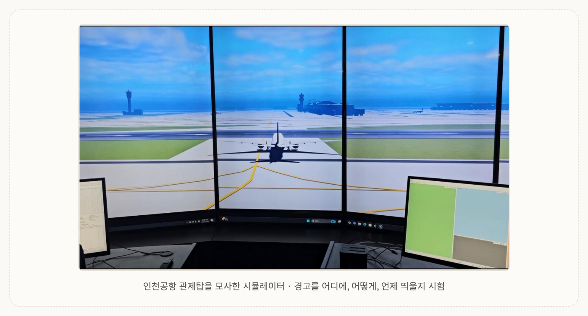
<!-- 2강 슬라이드 16: 공항 관제탑 시뮬레이터 (인천공항) -->

**인천공항 관제탑 환경을 모사한 시뮬레이터**임. 넓은 화면으로 공항 주변을 보면서 장비와 교신 정보를 같이 확인하는 환경. 교수님 연구팀이 개발한 거라고 함.

이런 환경에서 확인할 수 있는 것들
- 경고를 **어디에** 띄울지
- **어떤 표현**으로 알려 줄지
- 관제사가 **다른 일 하는 중에도** 알아챌 수 있을지

<mark class="pink">같은 예측 결과라도 전달 방식과 시점에 따라 쓸모가 달라짐</mark>.

---

## 3. 판단을 돕는 AI → 직접 행동하는 AI

여기까지는 AI가 **사람의 판단과 대응을 돕는** 사례였음. 이제부터는 **드론이 직접 움직이면서** 임무를 수행하는 사례임.

| 판단을 돕는 AI | 직접 행동하는 AI |
|---|---|
| 사람이 화면을 보고 **최종 행동은 사람이** | 드론이 고른 행동에 따라 **바로 위치·자세가 바뀜** |
| AI가 틀려도 사람이 한 번 거름 | **잘못 이해한 명령, 부정확한 위치 정보가 경로에 직접** 영향 |

대신 드론은 움직이면서 **새로 얻은 정보로 계획을 계속 고칠 수** 있음. 그래서 <mark class="pink">명령 이해 → 주변 관측 → 행동 결정 → 다시 관측</mark> 루프가 더 **빠르고 분명하게** 드러남.

---

## 4. 사례: 조난자를 찾는 자율 탐색 드론

### 4-1. 해커톤 프로젝트

이번 사례는 **항공드론 산업 수요 기반 해커톤 프로그램**에서 인하대 항공우주공학과, 스마트모빌리티공학과, 정보통신공학과 학생들(팀 "나갈래")이 만든 작업물임. 학생들이 Physical AI 강의용으로 자료를 제공해 줬다고 함.

사람이 직접 들어가기 어렵고 넓은 구역을 봐야 할 때 드론을 쓰는 상황인데, 단순히 **정해진 지점까지 날아가는 것보다 훨씬 복잡함**.
- 사람이 **어디 있는지 모르는 상태**에서 구역을 뒤져야 하고
- **어디를 이미 봤는지** 기억해야 하고
- 사람처럼 보이는 걸 찾으면 **인식해서 위치를 저장하고 알려줘야** 하고
- 동시에 벽이나 장애물과 **충분한 거리**를 유지하고
- **자기 위치**도 계속 업데이트하고
- **돌아가는 길**까지 알아야 함

### 4-2. 조난자 탐색 임무

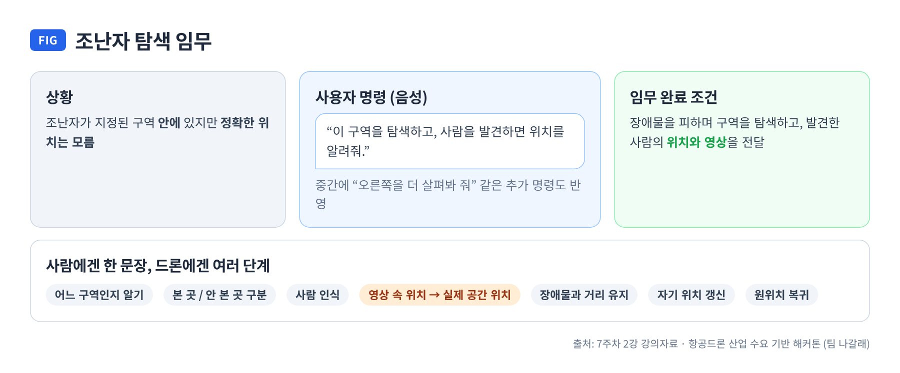
<!-- 2강 슬라이드 19: 조난자 탐색 임무 -->

| 항목 | 내용 |
|---|---|
| **상황** | 조난자가 지정된 구역 **안에** 있지만, **정확한 위치는 모름** |
| **사용자 명령** | "이 구역을 탐색하고, 사람을 발견하면 위치를 알려줘." |
| **임무 완료 조건** | 장애물을 피하며 구역을 탐색하고, 발견한 사람의 **위치와 영상**을 전달 |

명령은 **음성**으로 줌. 드론이 알아듣고 **자율적으로 탐색**하다가, 중간에 "오른쪽을 더 살펴봐 줘" 같은 **추가 음성 명령**을 주면 그대로 반영하는 구조.

사람한텐 간단한 문장이지만 드론이 하려면 여러 단계가 필요함.
- **어느 구역**을 탐색할지 알고
- **이미 본 곳 / 안 본 곳**을 구분하고
- 사람을 찾았을 때 영상으로 인식하는 걸로 끝이 아니라, 다른 사람이 실제로 구조하러 갈 수 있게 <mark class="pink">실제 공간의 위치와 연결</mark>해야 하고
- 장애물 피하면서 이동하고, **원위치로 복귀**까지

### 4-3. 필요 기능 4가지

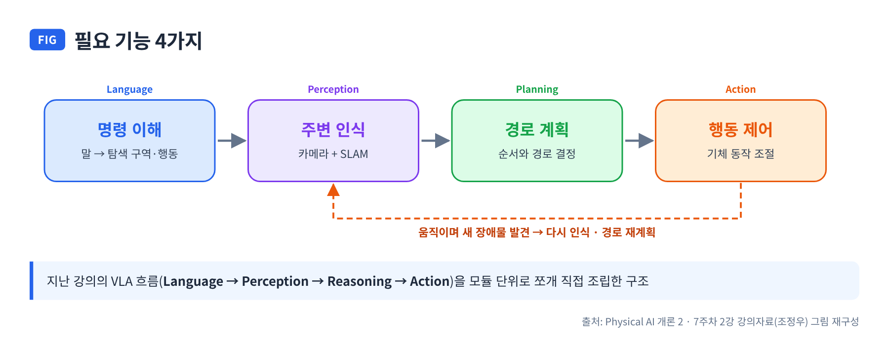
<!-- 2강 슬라이드 20: 필요 기능 (명령 이해 → 주변 인식 → 경로계획 → 행동 제어) -->

| 기능 | 하는 일 |
|---|---|
| ① **명령 이해** | 사용자의 말을 **탐색할 구역과 수행할 행동**으로 바꿈 |
| ② **주변 인식** | **카메라와 SLAM** 위치 정보로 장애물이 어디 있는지 파악 |
| ③ **경로 계획** | 어떤 **순서와 경로**로 움직일지 결정 |
| ④ **행동 제어** | 계획한 경로대로 움직이도록 **기체 동작을 조절** |

실제 비행에서는 이게 한 번만 도는 게 아니라 **계속 반복**됨. 이동 중에 새 장애물을 발견하면 **경로를 다시 짬**.

> 💡 이 네 칸을 지난 강의 개념에 대응시키면 ① Language 이해 ② Perception ③ Reasoning/Planning ④ Action임. 결국 **VLA 파이프라인을 모듈 단위로 쪼개서 직접 조립**한 형태라고 볼 수 있음.

### 4-4. 기본 동작 검증: 시뮬레이션과 실제 비행

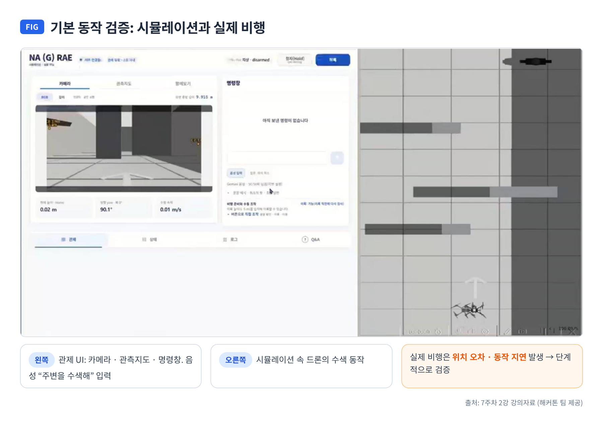
<!-- 2강 슬라이드 21: 기본 동작 검증: 시뮬레이션과 실제 비행 -->

기본 동작부터 확인하는 장면임. 왼쪽은 관제 화면(카메라, 관측지도, 명령창), 오른쪽은 시뮬레이션 환경. 음성으로 "**주변을 수색해**"라고 넣으면 주변을 수색하는 기본 동작을 시뮬레이션에서 확인할 수 있음.

| 시뮬레이션 | 실제 비행 |
|---|---|
| 여러 조건을 **반복하기 쉬움** | **위치 오차** 발생 |
| 거의 **오차 없이** 비행 | **동작 지연** 발생 |

그래서 시뮬레이션과 다른 결과가 나옴. 실제 환경에서 한 번 확인했다고 <mark class="pink">모든 조건이 검증된 건 아니지만</mark>, 기능을 **단계적으로 확인**하는 과정이라고 보면 됨.

> 💡 지난 강의의 **Sim-to-Real Gap**이 바로 이거임. 시뮬레이터에선 완벽했는데 실물에선 바람, 센서 잡음, 모터 지연 때문에 어긋남.

### 4-5. 자연어 명령을 드론 실행 명령으로

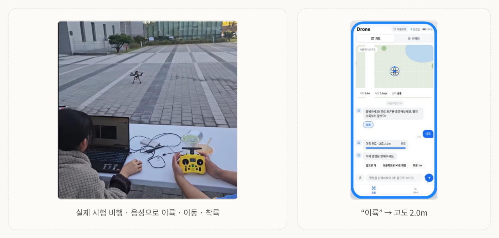
<!-- 2강 슬라이드 22: 자연어 명령을 드론의 실행 명령으로 바꾸기 -->

사용자가 말한 걸 드론이 실행할 명령으로 바꾸는 장면임.
- "**이륙해**" → 이륙 (앱 화면: 이륙 완료 · 고도 2.0m)
- "**오른쪽으로 ○m 비행해**" → 오른쪽 이동
- "**착륙해**" → 착륙

음성을 텍스트로 바꾸고 → 드론이 이해할 수 있는 **실행 명령**으로 변환. <mark class="pink">앞의 관제 음성 사례와 구조가 똑같음</mark>. 대상이 비행기에서 드론으로 바뀌었을 뿐.

### 4-6. 탐색에 필요한 관측: 카메라 · 지도 · 드론 위치

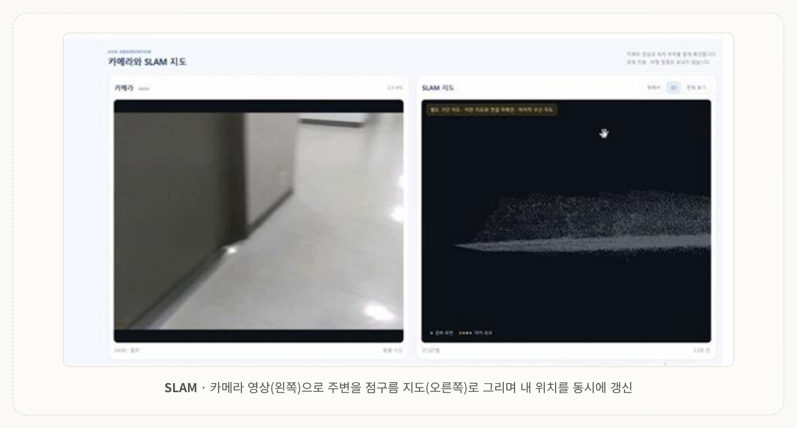
<!-- 2강 슬라이드 23: 탐색에 필요한 관측: 카메라·지도·드론 위치 (카메라와 SLAM 지도) -->

왼쪽은 카메라 영상, 오른쪽은 공간을 표현한 지도임. 드론이 **지금 어디 있는지**, 주변 장애물이 **어떻게 분포하는지**를 <mark class="pink">포인트 클라우드 형태로 실시간 맵핑하면서 자기 위치도 업데이트</mark>하는 **SLAM** 기법을 보여주는 거.

> 💡 **SLAM**(Simultaneous Localization and Mapping) = "지도 만들기"와 "지도 안에서 내 위치 찾기"를 **동시에** 하는 기술. 닭이 먼저냐 달걀이 먼저냐 문제임. 위치를 알려면 지도가 필요하고, 지도를 그리려면 위치를 알아야 하니까 둘을 같이 추정함. GPS가 안 되는 실내·지하에서 특히 필수. 로봇청소기가 집 구조를 그리는 것도 SLAM.

### 4-7. 조난자 탐색 미션 전체 과정

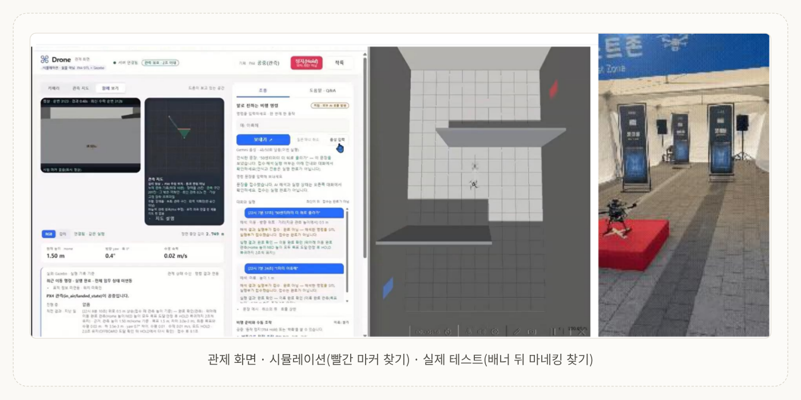
<!-- 2강 슬라이드 24: 조난자 탐색 미션 전체 과정 -->

앞에서 따로 본 **명령 · 관측 · 이동**이 하나로 연결되는 전체 임무 영상임.

**왼쪽 (관제 화면)**
- 카메라·관측 지도와 함께, 말로 전한 비행 명령과 실행 로그가 쌓임

**가운데 (시뮬레이션)**
- SLAM 같은 카메라 기반 인식으로 **실시간 맵핑**
- 맵을 토대로 **경로 계획** → 더 살펴볼 만한 곳에 **웨이포인트** 설정 → 이동
- 목표는 **빨간 마커 찾기**. 찾으면 임무 완료

**오른쪽 (실제 테스트)**
- **배너들이 배리어(barrier)** 역할
- 배리어를 인식하고 → 배리어 사이로 경로를 만들어 비행하고 → 최종적으로 배리어 뒤의 **조난자(마네킹)**를 인식하는 것까지가 하나의 흐름

실제 테스트 땐 **배너와 조난자 위치를 바꿔 가며** 진행했다고 함. (외워서 통과하는 게 아니라 진짜 탐색하는지 보려는 것)

---

## 5. 다객체 경로 탐색 (Multi-Agent Path Finding)

### 5-1. 드론이 여러 대라면?

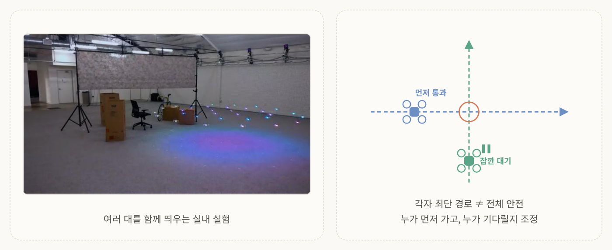
<!-- 2강 슬라이드 25: 다객체 경로 탐색 (Slide Courtesy of S. Koenig, 2022, ICAPS Invited Talk) -->

방금은 드론 한 대였는데, **여러 대를 같이** 띄우면 더 많은 정보를 더 빨리 모을 수 있음. 대신 <mark class="pink">드론끼리 안 부딪히고 안전하게 날게 하는 기법</mark>이 필요해짐.

| 한 대 | 여러 대 |
|---|---|
| **장애물 위치** 중심으로 경로 생각 | **다른 드론의 움직임**까지 고려 |
| 최단 경로 고르면 끝 | 각자 최단 경로 = 전체 안전 ✗ |

그래서 <mark class="pink">누가 먼저 지나가고, 누가 잠깐 기다리고, 누가 돌아갈지</mark>를 조정해야 함.

이런 기법은 꽤 오래전부터 개발돼 왔고, 교수님도 계속 연구 중인데 드론보다는 **UAM 교통 흐름 관리** 쪽에 적용하고 있다고 함. 조난자 탐색처럼 여러 대를 동시에 운용하는 경우에도 이 기법을 쓰면 좋은 결과가 나올 거라고 봄.

### 5-2. MAPF를 드론 군집에 적용한 사례

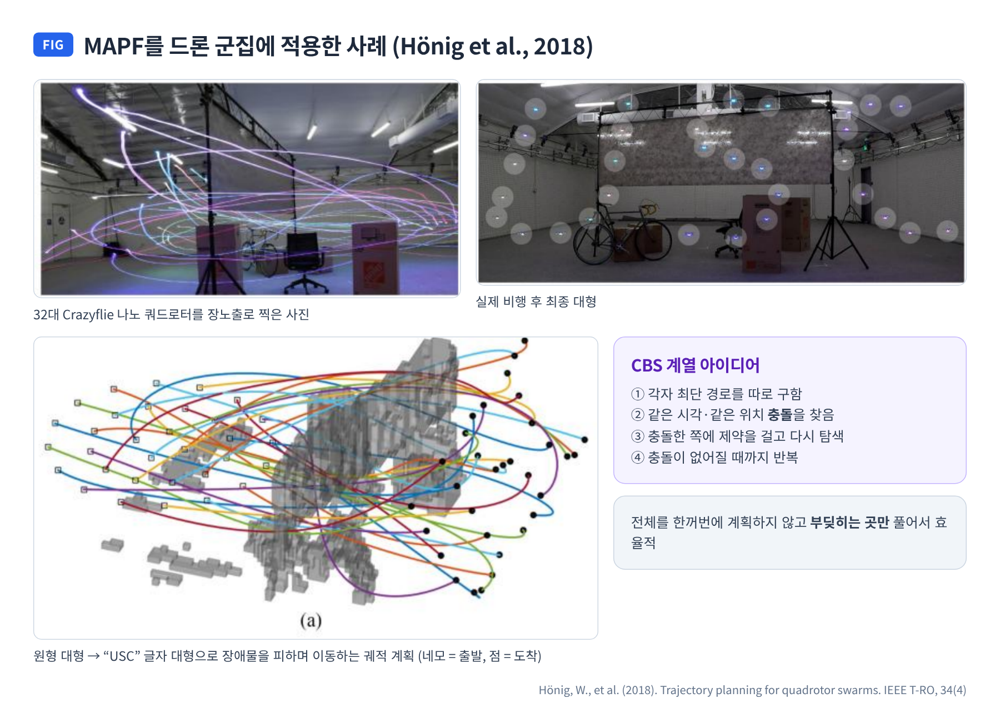
<!-- 2강 슬라이드 26: 다객체 경로 탐색 (Hönig et al., 2018, IEEE T-RO) -->

**다객체 경로 탐색(Multi-Agent Path Finding, MAPF)**을 드론에 적용한 초기 사례임 (Hönig et al., 2018).
- 32대의 Crazyflie 나노 쿼드로터가 장애물 가득한 실내에서 동시에 비행 (위 왼쪽: 장노출 사진)
- 원형 대형 → "**USC**" 글자 모양 대형으로, 장애물을 피하며 이동 (아래: 궤적 계획, 위 오른쪽: 실제 비행 후 최종 대형)

이 계열 연구를 <mark class="pink">CBS(Conflict-Based Search)</mark>라고 부름. 교수님은 CBS를 드론 제어 말고 **UAM 교통 흐름 관리**에 쓰고 있다고 함.

그리고 이런 기법이 **LLM, 물체 인식, 지시 이해**랑 결합되면 훨씬 많은 임무를 더 효율적으로 할 수 있을 거라고.

> 💡 **CBS** 아이디어는 의외로 단순함.
> 1. 일단 **각자 최단 경로**를 따로 구함
> 2. 경로들을 겹쳐 보고 **충돌(같은 시각, 같은 위치)**을 찾음
> 3. 충돌 하나를 골라서 "A는 그 시각에 거기 못 감" / "B는 그 시각에 거기 못 감" 두 갈래로 나눠 **제약을 걸고 다시 탐색**
> 4. 충돌이 없어질 때까지 반복
>
> 전체를 한꺼번에 계획하면 경우의 수가 폭발하는데, **부딪히는 곳만 골라서 풀기** 때문에 효율적임.

### 5-3. db-CBS: 실제로 날 수 있는 경로까지

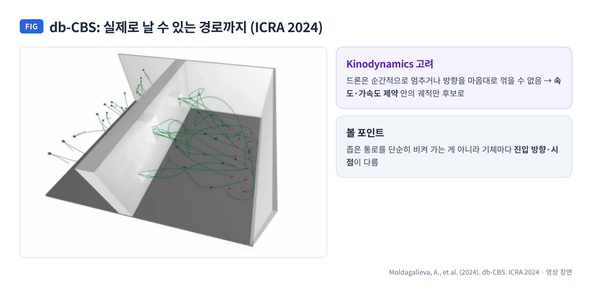
<!-- 2강 슬라이드 27: 다객체 경로 탐색 (Moldagalieva et al., 2024, db-CBS, ICRA) -->

좁은 실내에서 여러 대의 드론이 **어디를 어떻게** 움직여야 하는지 최적으로 찾는 알고리즘의 시연임 (db-CBS, ICRA 2024).

포인트는 단순히 충돌을 피하는 경로가 아니라 <mark class="pink">드론이 실제로 날 수 있는 움직임, 즉 키노다이내믹스(kinodynamics)를 고려한 경로</mark>라는 것.

- 드론은 순간적으로 **속도를 확 줄이거나 방향을 마음대로 꺾을 수 없음**
- 그래서 경로를 찾을 때 **속도·가속도 같은 운동 제약**을 같이 봐야 함
- 좁은 통로를 지날 때도 기체마다 **진입 방향·시점**이 달라질 수 있음

영상에서 단순히 비켜 가는 게 아니라 **어떤 궤적으로 통과하는지** 보면 좋음. 충돌을 해소하면서 **전체 이동 시간**도 달라짐.

> 💡 일반 CBS는 격자 위에서 "한 칸씩 이동"하는 식이라, 결과를 실제 드론에 넣으면 각진 경로가 나와서 못 따라감. **kinodynamic**은 "이 기체가 물리적으로 낼 수 있는 운동"만 후보로 쓰니까 계획 = 실제 비행이 됨. 1편의 **feasible action set**이랑 같은 얘기.

### 5-4. UAM에 적용한 결과

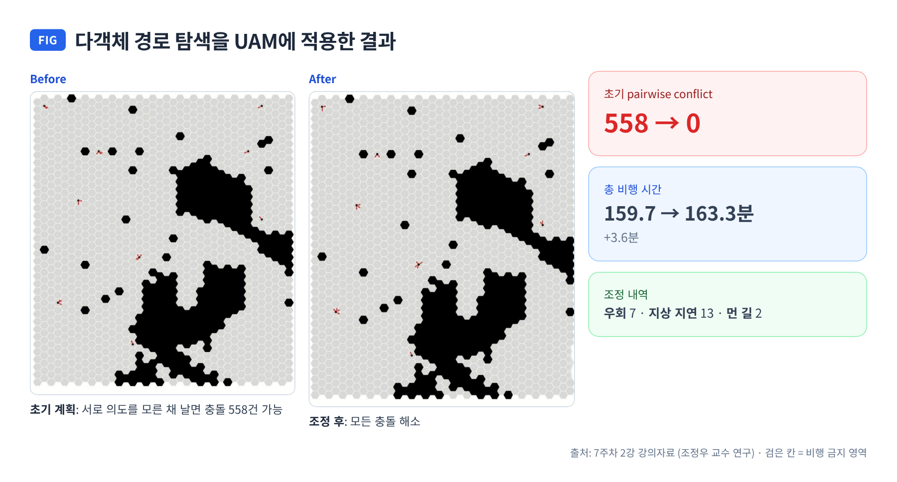
<!-- 2강 슬라이드 28: 다객체 경로 탐색 - 558 pairwise conflicts → solved -->

교수님 연구로, 이 기법을 **도심에서 UAM이 안전하고 효율적으로 다니는 방법**에 적용한 결과임. 육각형 격자 지도에서 검은 칸은 비행 금지 영역.

| | 초기 계획 | 조정 후 |
|---|---|---|
| 충돌 | **558개 pairwise conflict** | **0** (solved) |
| 총 비행시간 | 159.7분 | 163.3분 (**+3.6분**) |
| 조정 내역 | | **우회(bypass) 7번, 지상 지연(ground delay) 13번, 먼 길 돌기(detour) 2번** |

558개는 실제 사고가 558번 났다는 게 아니라, <mark class="pink">서로 의도를 모른 채 날면 이만큼 충돌이 날 수 있다</mark>는 계산값임.

경로 우회나 출발 지연 같은 조정을 넣으면 <mark class="mint">총 비행시간이 4분도 안 늘어난 상태에서 모든 기체가 충돌을 피함</mark>.

이런 알고리즘들은 수년 전부터 세계 최대 AI 학회들에 실린 것들이고, **음성 인식, 이미지·영상 인식**과 결합되면 현실 문제를 많이 풀 수 있을 거라고 봄.

> 💡 조정 내역을 보면 **ground delay가 13번으로 제일 많음**. 1편에서 "공중에서 기다리는 것보다 땅에서 기다리는 게 싸다"고 한 거랑 똑같은 결론이 UAM에서도 나온 거임. 출발 전에 몇 초~몇 분 늦추는 게 공중에서 돌아가는 것보다 훨씬 효율적.

---

## 6. 사례: 공항 인근 조류 퇴치를 위한 드론

### 6-1. 연구 전체 구성

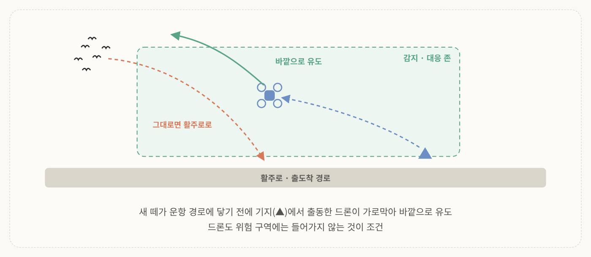
<!-- 2강 슬라이드 30: 공항 인근 조류 퇴치를 위한 드론 운용 (Cho, 2026, working paper) -->

마지막 사례는 **공항 인근 조류 퇴치**임. 공항 근처에 모여 있던 새들이 비행기 오갈 때 비행기 쪽으로 접근하는 걸 막으려고 드론을 운영하는 것.

| 파트 | 내용 |
|---|---|
| **운용 시나리오** | 2km × 4km × 0.6km **감지·대응 존** 설정 / 12 m/s로 나는 **10마리+ 새 떼** 랜덤 생성 / 퇴치 기능을 단 **단일 또는 다수 드론** 출격 |
| **강화학습 대응 모델** | **최근접 새, 새 떼 중심** 등으로 상태공간 설정 / **PPO**로 적정 드론 가속도 학습 / 드론이 위험구역으로 가면 **패널티** |
| **향후 연구방향** | **포식자-피식자(predator-prey) 행동**을 반영한 새 떼 회피 / **Herding(양치기)** 형태의 접근 방식 검토 |

목표는 <mark class="pink">드론이 새한테 가까이 가는 게 아니라, 새 떼가 비행기 운항에 영향을 주는 위험 구역에 못 들어가게, 드론도 그 구역은 피하면서 새 떼를 다른 쪽으로 유도하는 것</mark>. 현재 진행 중인 연구임.

### 6-2. 버드 스트라이크, 왜 위험한가

<!-- 2강 슬라이드 31: 드론을 활용한 버드스트라이크 위험 대응 (외부 출처 사진·그림이라 이미지는 생략) -->

슬라이드엔 **버드 스트라이크(bird strike)**로 엔진(팬, 가이드 베인, 압축기, 연소기 링, 저압 터빈)과 기수가 손상된 사례 사진이 나옴.

- 새는 비행기보다 훨씬 작지만, 비행 중 **상대 속도가 커서** 충돌 위치와 조건에 따라 큰 문제가 됨
- 특히 공항 주변은 **이착륙 경로에 새가 접근하는 상황**을 관리해야 함
- 우리나라에서도 **무안공항**에서 버드 스트라이크가 얽힌 안타까운 사고가 있었음

지금 대부분 공항은 사람이 **공포탄**을 쏘거나 **레이저** 장비로 쫓는 식인데, <mark class="pink">활주로에서 더 먼 곳부터 드론으로 새 떼를 쫓아내자</mark>는 접근이 한국뿐 아니라 미국에서도 시도되고 있음.

그리고 조류 대응은 새를 **발견**하는 걸로 끝이 아님.
- 새가 **어느 방향**으로 가는지
- **운항 경로에 접근**하는지
- **어떤 대응**을 해야 위험이 줄어드는지

까지 생각해야 함. 드론도 그냥 새를 흩어 놓는 게 아니라 <mark class="pink">흩어지는 방향이 우리가 원하는 방향</mark>이 되게 만들어야 함.

> 💡 운동에너지는 ½mv²라서 **속도의 제곱**에 비례함. 1kg짜리 새라도 이륙 직후 비행기(약 70~80 m/s)와 부딪히면 수 kJ 에너지가 한 점에 꽂히는 셈. 그래서 작은 새 한 마리로도 엔진이 망가질 수 있음.

### 6-3. Background: 비용과 현황

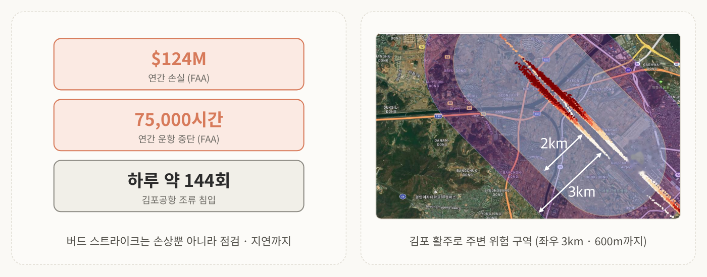
<!-- 2강 슬라이드 32: Bird strike prevention - Background (김포공항 조류 침입 heatmap) -->

- 버드 스트라이크는 **항공기 손상**뿐 아니라 **점검, 운항 지연**까지 이어짐
- FAA 기준 연간 **1억 2,400만 달러 손실**, **7만 5천 시간 운항 중단**
- **김포공항엔 하루 약 144회** 새가 침입
- 현재는 **조류 퇴치 차량이나 인력 순찰**로 대응

여기서 드론의 역할은 <mark class="pink">지상에서 대응하기 어려운 위치까지 가서 관측과 대응 범위를 넓히는 것</mark>임. 위험 구역은 활주로 기준 **좌우 3km, 고도 600m까지**.

다만 공항 주변 모든 공간을 드론이 마음대로 날 수는 없으니, **어디까지 탐지하고 어느 구역까지 대응할지**를 정해야 함.

### 6-4. Objective & Assumption

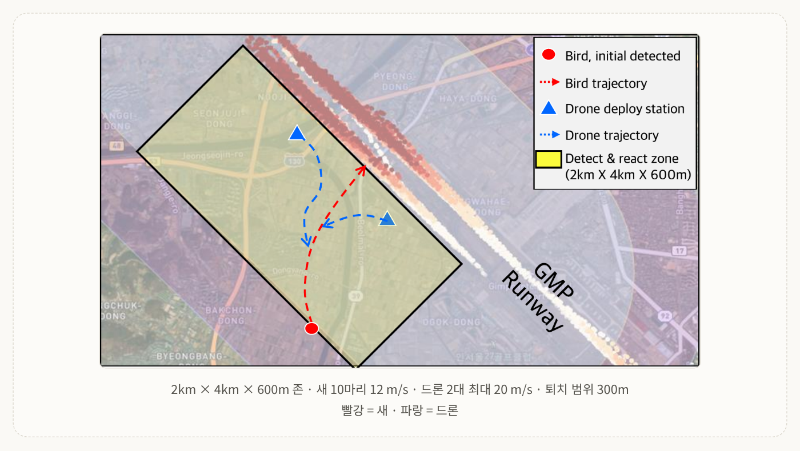
<!-- 2강 슬라이드 33: Objective & Assumption -->

**목표**: 강화학습 기반 드론 퇴치가 공항으로의 새 침입을 막는 데 효과적인지 평가

| 가정 | 값 |
|---|---|
| **감지·대응 존 (critical zone)** | **2km × 4km × 600m** (미국 연구 기준). 2km는 조류 레이더 탐지 범위(90% 신뢰도) |
| **새 떼** | **10마리**, 랜덤 생성, 속도 **12 m/s** (약 43 km/h) |
| **드론** | **2대**, 파란 삼각형 deploy station에 배치 |
| **퇴치 범위** | **300m** |
| **드론 속도** | 수평 최대 **20 m/s**, 수직 **5 m/s** |

여기서 <mark class="pink">deterrence(퇴치) 장비</mark>는 **새가 싫어하는 소리를 내는 음향 장비**임. 드론이 새에게 일정 거리(300m) 안으로 가까이 가면 **자동으로 작동**한다고 가정함.

> 💡 드론 수평 속도(20 m/s)가 새(12 m/s)보다 빠르긴 한데, 2배도 안 됨. 그래서 새를 **뒤쫓아 가는 전략**은 금방 한계가 옴. 새가 갈 곳을 **미리 예측해서 앞에서 막는** 게 유리하고, 그걸 사람이 규칙으로 짜기 어려우니 강화학습을 쓰는 것.

### 6-5. Methodology ①: PPO, 관측 · 행동 · 보상

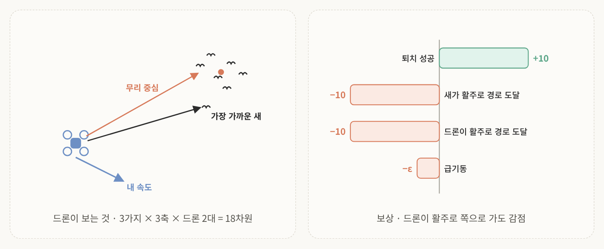
<!-- 2강 슬라이드 34: Methodology - PPO, Observation/Action/Reward -->

드론 움직임은 **강화학습(PPO)**으로 학습함. 강화학습 이론은 깊이 안 다루니까 **관측·행동·보상**만 봄.

**관측 (Observation, 18차원)**
| 항목 | 차원 |
|---|---|
| **가장 가까운 새**와의 상대 위치 (Δx, Δy, Δz) | 3 × 드론 2대 |
| **새 떼 중심**과의 상대 위치 (Δx\*, Δy\*, Δz\*) | 3 × 드론 2대 |
| **드론 자신의 속도** (vx, vy, vz) | 3 × 드론 2대 |

**행동 (Action, 연속)**
- 각 드론의 **3방향 가속도** (ax, ay, az)
- 기체가 낼 수 있는 범위로 제한: 수평 **±6.0 m/s²**, 수직 **±3.0 m/s²**

**보상 (Reward)**
| 상황 | 보상 |
|---|---|
| 퇴치 **성공** | **+10** |
| 새가 출·도착 경로에 도달 | **−10** |
| **드론이** 출·도착 경로에 도달 | **−10** (비행기 경로니까 드론이 가도 위험) |
| 급기동 | **−ε × 변화량** (너무 급하게 움직이면 비용) |

> 💡 보상 설계를 보면 1편 충돌 회피 모델이랑 철학이 같음. "목표 달성(+)"만 주면 드론이 새 잡으려고 활주로 쪽까지 막 쫓아갈 수 있으니까, **"드론 자신도 위험 구역 금지(−)"**와 **"과격한 조작 금지(−ε)"**를 같이 넣은 것. 보상을 어떻게 짜느냐가 곧 "안전하게 행동하라"를 가르치는 방법임.

### 6-6. Methodology ②: 새 행동 모델 (Boids)

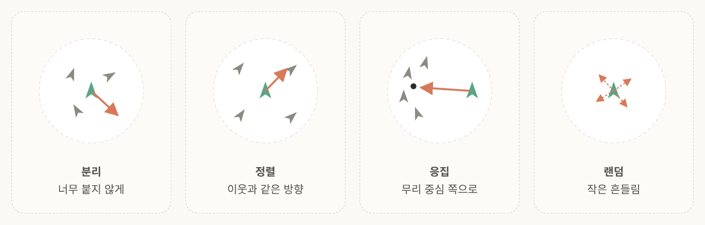
<!-- 2강 슬라이드 35: Bird behavior model - Boids (Reynolds, 1987) -->

시뮬레이션 속 새들은 <mark class="pink">보이드(Boids) 알고리즘</mark>(Reynolds, 1987)으로 움직임. 규칙 기반으로 새 떼를 흉내 내는 모델.

| 규칙 | 내용 |
|---|---|
| (a) **분리 (Separation)** | 가까운 새와 **너무 붙지 않게** 밀어냄. 거리 제곱에 반비례해서 가까울수록 세게 |
| (b) **정렬 (Alignment)** | 이웃의 **평균 속도 방향**으로 맞춤 |
| (c) **응집 (Cohesion)** | 이웃들의 **평균 위치(무리 중심)** 쪽으로 이동 |
| (d) **랜덤 드리프트** | 난기류 같은 **작은 무작위 노이즈** 추가 |

이걸 다 더해서 힘(가속도)을 만들고, 작은 계수(0.1)로 속도를 **조금씩** 업데이트함.

> 💡 Boids는 원래 영화 CG에서 새 떼·물고기 떼를 자연스럽게 그리려고 만든 모델임. 개체마다 "옆이랑 부딪히지 말고, 같은 방향 가고, 너무 떨어지지 마" 세 줄만 지키는데 전체로 보면 진짜 새 떼처럼 움직임. 단순한 규칙에서 복잡한 집단 행동이 나오는 **창발(emergence)**의 대표 예시.

### 6-7. Key Findings

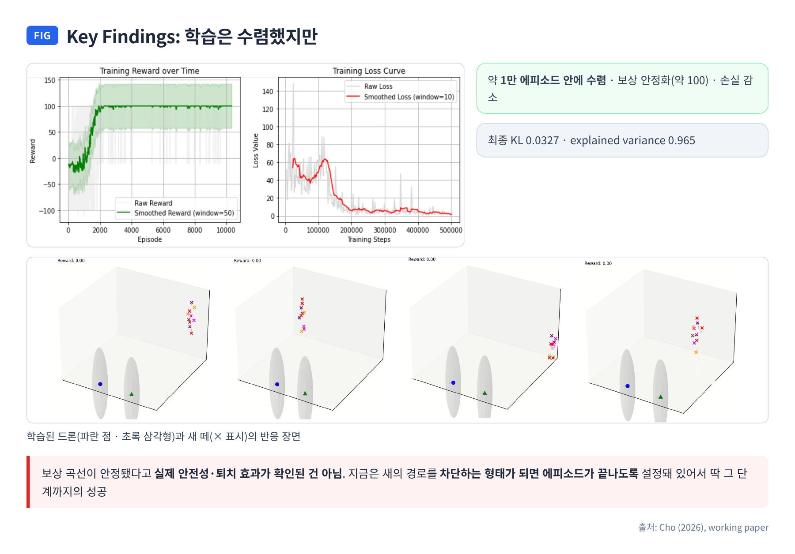
<!-- 2강 슬라이드 36: Key findings (Training Reward / Loss curve) -->

- **1만 에피소드 안에 수렴**
- **보상 안정화** → 정책이 학습됨 (그래프상 약 2,000 에피소드부터 100 근처에서 유지)
- **손실 감소** → 수렴
- 최종 KL 0.0327, explained variance 0.965

아래 장면들은 학습된 드론(파랑 점·초록 삼각형)이 새 떼(× 표시)에 어떻게 반응하는지 보여줌.

교수님이 꼭 짚은 주의점: <mark class="pink">보상 곡선이 안정됐다고 실제 안전성과 퇴치 효과가 확인된 건 아님</mark>. 이건 **설정된 환경과 설계된 보상 안에서** 더 나은 행동을 한다는 신호일 뿐임.
지금은 새들의 **경로를 차단하는 형태가 되면 에피소드가 끝나도록** 돼 있어서, <mark class="pink">딱 그 단계까지의 성공</mark>을 모사한 거라고 보면 됨.

> 💡 KL은 업데이트 전후 정책이 얼마나 달라졌는지(작을수록 안정), explained variance는 가치 함수가 실제 리턴을 얼마나 잘 설명하는지(1에 가까울수록 좋음)를 보는 지표임. 둘 다 "학습이 안정적으로 끝났다"는 신호지, "현실에서 새가 진짜 도망간다"는 증거는 아님.

### 6-8. 고려할 점

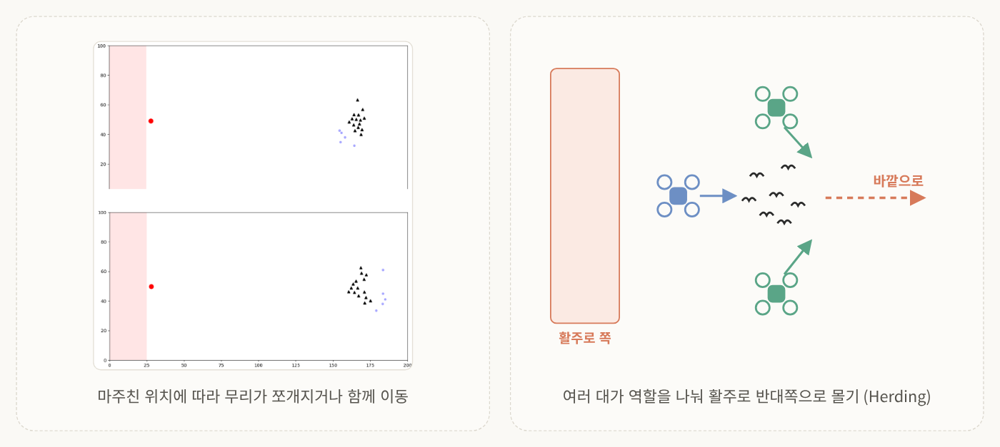
<!-- 2강 슬라이드 37: 고려할 점 -->

진행 중인 연구라 고려할 점이 많음.

**① 음향 장비 효과의 불확실성**
음향 퇴치 장비가 **100% 먹히진 않음**. 시뮬레이션에선 "300m 안이면 반응"으로 정했지만 실제론 상황 따라 다름. 그래서 **확률적으로 반응**하도록 모델링할 필요가 있음.

**② 새를 추격하는 것 → 안전한 방향으로 분산시키는 것**
퇴치 장비 영향을 받은 새가 **어떻게 반응**할지가 문제임. 드론이 그냥 **새를 쫓아다니는 모양**이 될지, 새가 **운항 경로 바깥으로 흩어지게** 될지.

**③ 조우 시 조류의 반응 모델링**
새가 어떻게 움직일지 100% 현실적으로 만들 순 없지만, 실제 새에게 이런 자극을 줬을 때 어떻게 움직였는지 **관측·모델링한 과거 연구**를 활용할 수 있음. 오른쪽 그림처럼 드론과 새가 마주치는 위치에 따라 무리가 **쪼개질 수도**, **같이 이동할 수도** 있음. 무리를 **안정적으로 바깥쪽으로 밀어내는** 연구가 필요함.

**④ 2대 이상의 드론 활용과 각자의 역할**
여러 드론이 다 같은 새를 같은 방식으로 쫓기보다, <mark class="pink">한 대는 앞에서 대응하고, 한 대는 뒤에서 백업하고, 다른 한 대는 다른 방향으로 몰아주는</mark> 식의 **역할 분담·협력**도 고민해야 함.

> 💡 ④는 사실상 **양치기 개(herding)** 문제임. 양치기 개 여러 마리가 각자 다른 위치에서 압박해야 양 떼가 원하는 방향으로 감. 앞 슬라이드 "향후 연구방향"의 **Herding**이 바로 이거고, 5장의 **다객체 경로 탐색**까지 붙이면 드론끼리 안 부딪히면서 역할을 나누는 문제로 이어짐.

---

## 7. 핵심 요약

<!-- 2강 슬라이드 38: 정리 (슬라이드 2와 동일) -->

1. 오늘 사례 전체의 뼈대는 **지시 이해 → 상황 판단 → 임무 수행 → 다시 관측**
2. **관제 음성 인식**은 STT(받아쓰기)와 **지시 이해**(대상·행동·위치·시점 파악)를 구분해야 함. 숫자·콜사인 하나 틀리면 동작이 다 틀어짐
3. **LLM 기반 관제 의사결정 보조**: LLM은 지시를 **구조화**하고, 이동·점유 시간은 **Fast-Time 시뮬레이션**이 계산. 횡단 지시를 내리는 순간 "11초 뒤 착륙기 통과 → 위험"처럼 **미리** 경고
4. 라과디아 사고는 업무 과부하, 트랜스폰더 부재, 감독 부재, 교신 혼동이 **겹친** 결과. AI는 관제를 대신하는 게 아니라 **숨은 위험을 먼저 확인**해 주는 역할
5. 시스템은 **Human-in-the-Loop**로 검증해야 함. 경고를 제때 보고 이해하는지, 오경보가 부담이 되지 않는지까지 평가
6. **직접 행동하는 AI(드론)**는 명령 이해 · 주변 인식(SLAM) · 경로 계획 · 행동 제어가 **계속 반복**됨. 시뮬레이션과 실제 비행 사이엔 오차·지연이 있음
7. 여러 대면 **다객체 경로 탐색(MAPF/CBS)** 필요. UAM 적용 시 558개 충돌을 **비행시간 +3.6분**만으로 모두 해소
8. **조류 퇴치 드론**: PPO로 가속도를 학습하고 Boids로 새를 모사. 보상 수렴 ≠ 실제 효과. 음향 장비 불확실성, 새의 반응, 다수 드론 역할 분담이 남은 과제

>한 줄로 묶으면  
>**1편이 "예측해서 조정하는 AI"였다면, 2편은 거기에 "사람 말을 알아듣는 AI"를 앞에 붙이고, "직접 움직이는 드론"으로 끝을 이은 것. 어느 쪽이든 핵심은 행동 전에 미래를 시뮬레이션해 위험을 확인하고, 행동 후엔 다시 관측하는 루프다.**

이걸로 항공 분야 AI 두 편이 끝남. Physical AI가 로봇 팔이나 자율주행차만의 얘기가 아니라, **하늘 위 교통 전체**와 **관제사 옆자리**, **공항 하늘의 드론**에서도 같은 루프로 돌아가고 있다는 걸 볼 수 있었음.

---

## 참고문헌
- Hönig, W., Preiss, J. A., Kumar, T. S., Sukhatme, G. S., & Ayanian, N. (2018). Trajectory planning for quadrotor swarms. *IEEE Transactions on Robotics*, 34(4), 856–869.
- Moldagalieva, A., Ortiz-Haro, J., Toussaint, M., & Hönig, W. (2024). db-CBS: Discontinuity-bounded conflict-based search for multi-robot kinodynamic motion planning. *2024 IEEE International Conference on Robotics and Automation (ICRA)*, 14569–14575.
- Koenig, S. (2022). Multi-Agent Path Finding and Its Applications. *ICAPS Invited Talk*.
- Reynolds, C. W. (1987). Flocks, herds and schools: A distributed behavioral model. *SIGGRAPH '87*.
- Cho, J. (2026). Deep reinforcement learning for coordinated drone-based deterrence against bird swarms in airport environments (Working paper).
- Slide Courtesy: Suhwan Jang, Prof. Kee-Young Choi, Inha University (관제 음성 인식 시연, 강의 슬라이드 6).