> ### 인공지능은 어떻게 학습하고 이해할까?
> 학습 = AI가 공부하는 법 (머신러닝, 신경망, 데이터로 패턴 익히기, 기출만 외우면 망하는 Overfitting 같은 거)
>  이해 = AI가 세상을 알아먹는 법 (이미지는 CNN, 언어는 Transformer·LLM, 둘 다 하는 VLM)
> 
>    이 편에서는 AI가 데이터로 학습하고 이미지·언어를 이해하는 원리를 다루며, 이는 보고-이해하고-행동하는 Physical AI로 가기 위한 기초 빌드업
>임

---

### 사전 지식 정리
- Perception → Reasoning → Action : 3단계 이해
  - Perception (보기) : 세상 정보 받아들이기. 사람으로 치면 눈
  - Reasoning (이해하기) : 본 걸 해석하고 판단하기. 사람으로 치면 뇌
  - Action (행동하기) : 판단한 대로 움직이기. 사람으로 치면 손, 발

 - 키워드 정리

  | 단계         | 키워드              | 설명                |
  |------------|------------------|-------------------|
  | Perception | Machine Learning | 규칙 대신 데이터로 배우는 방식 |
  |            | Neural Network    | 뇌 흉내 낸 학습 구조                  |
  | Reasoning  | CNN                 |  	이미지 보는 데 특화된 신경망 → 눈                 |
  |            |Transformer                  |   문맥 파악하는 Attention 구조                |
  |            |  LLM                |	Transformer + 거대 데이터 = ChatGPT → 말                   |
  |            |  VLM                | 이미지 + 언어 같이 이해 → 보고 말하기                  |
  | Action     | Robot Learning                 |    로봇이 데이터로 동작 배우기               |
   |            |VLA|   Vision + Language + Action → 몸             |
  
   
- 우리가 보는 콘텐츠들은 모두 같은 아이일까?

|AI	| 하는 일                                         | 	어떤 종류의 AI?                  |
|---|----------------------------------------------|------------------------------|
|YouTube 추천| 	내가 본 영상 기록 보고 다음 영상 추천| 	데이터로 취향 패턴 학습 (머신러닝)        | ---                                     
|Netflix 추천| 	시청 기록 기반 작품 추천| 	위랑 같은 계열 (머신러닝)             |
|Face ID| 	얼굴 보고 본인인지 판별| 	이미지 인식 (딥러닝, 보는 AI)         | # 인공지능은 어떻게 학습하고 이해하는가?                 
|Google Translate| 	문장을 다른 언어로 번역| 	언어 이해 (Transformer, 말하는 AI) |
|ChatGPT| 	질문 답하고 글 새로 써줌| 	생성형 AI (LLM, 만들어내는 AI)      | ### 1. AI 기본 개념 (p.5~6)                 
|자율주행| 	도로 보고 판단하고 직접 운전| 	보고·이해하고·행동하는 AI             | - 1-1. AI · ML · DL · 생성형 AI 관계 → p.5 ⭐ 
|로봇| 	물체 보고 집고 옮기기| 	보고·이해하고·행동하는 AI             | - 1-2. AI의 역사 → p.6          
 
화면 속에서만 노는 Digital AI, 마지막 자율주행·로봇은 현실에서 몸 쓰는 Physical AI 이제 구분 합시다!
그럼 정확히 어떻게 나뉘는지 이제부터 시작!
---

## 1. AI 기본 개념

### 1-1. AI · ML · DL · 생성형 AI 관계 ⭐

> Artificial Intelligence란?

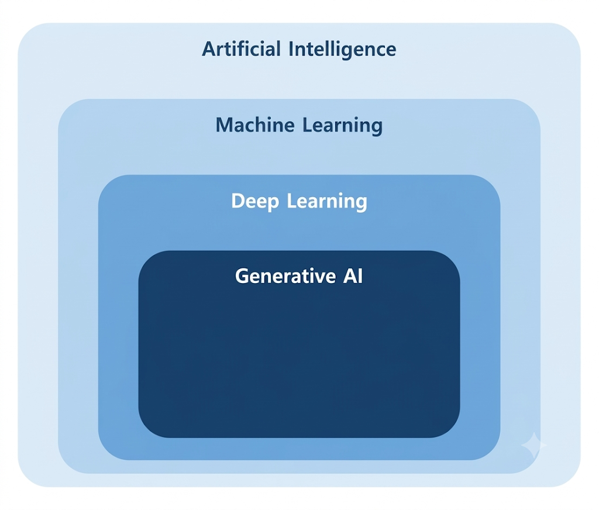{:.left}
  
① AI (가장 바깥 원)  
"사람처럼 똑똑하게 행동하는 컴퓨터 기술"이면 전부 다 AI. 방법은 안 따짐.
사람이 if문으로 규칙 1000개 직접 짜서 만든 프로그램도 똑똑하게 굴면 AI임. 즉 AI는 제일 넓은 우산 개념.
  =  <mark class="pink">사람의 지능적 행동을 컴퓨터가 수행하도록 만드는 기술</mark>

② Machine Learning (두 번째 원) 
AI 중에서 "규칙을 사람이 안 짜고, 데이터 보고 스스로 규칙 찾는" 애들.
예를 들어 스팸 필터 만들 때

옛날 방식: 사람이 “'무료', '당첨' 들어가면 스팸” 규칙 직접 입력
ML 방식: 스팸 메일 수만 개 보여주면 AI가 알아서 "이런 패턴이면 스팸이구나" 파악

=   <mark class="pink">규칙을 직접 작성하지 않고 데이터에서 규칙을 학습</mark>

③ Deep Learning (세 번째 원) 
ML 중에서 신경망(Neural Network)을 쓰는 애들. 신경망을 층(Layer)으로 깊게(Deep) 쌓아서 Deep Learning이라고 부름.
일반 ML은 "어디를 봐야 하는지(특징)"를 사람이 어느 정도 정해줘야 했는데, 딥러닝은 그것까지 알아서 찾음. 
Face ID, Google Translate 같은 게 여기. 
 
=  <mark class="pink">뉴럴 네트워크(신경망)을 이용한 기계학습</mark>

④ Generative AI (가장 안쪽 원) 
딥러닝 중에서 새로운 걸 만들어내는(생성하는) 애들. 글, 그림, 음성, 영상 등.
기존 AI가 "이 사진은 고양이임"(판별) 하는 애였다면, 생성형 AI는 "고양이 그림 하나 그려줌"(생성) 하는 애. ChatGPT, 이미지 생성 AI가 대표.
  =  <mark class="pink">새로운 텍스트, 이미지, 오디오 등을 생성하는 ai</mark>

### 1-2. AI의 역사 
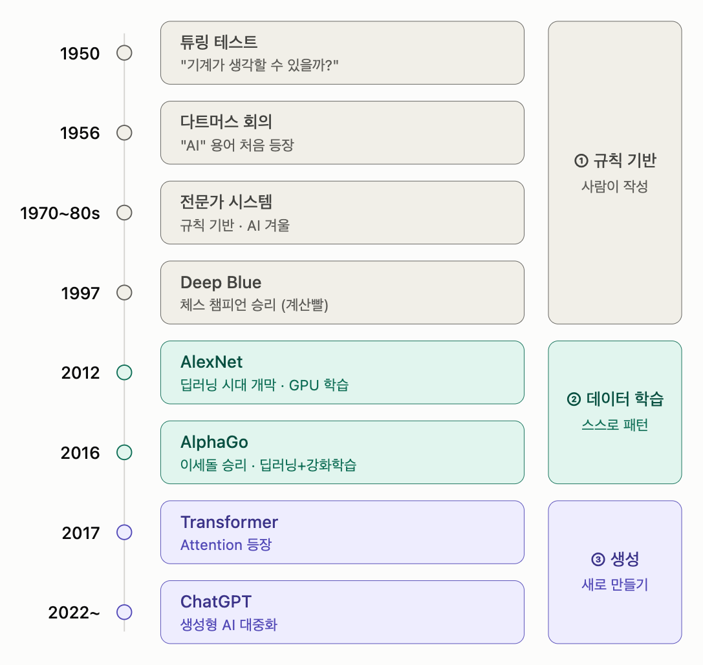

1. AI 역사의 큰 흐름 = 규칙 기반 → 데이터 학습 → 생성 
   1. 튜링테스트 : 기계가 생각할 수 있나? 라는 질문으로 튜링테스트 제안
2. 1956 다트머스 회의에서 “AI” 용어 탄생
3. AI 겨울 = 규칙 기반 AI의 한계로 기대가 꺼진 시기
   1. 전문가 시스템 = 전문가 지식을 사람이 규칙(if-then)으로 하나하나 입력한 AI. 예: "열이 나고 + 기침하면 → 감기 의심"
   2. 예외 상황에서 바로 고장남
   3. 투자 관심이 확 식은 시기
4. Deep Blue(계산·규칙) vs AlphaGo(딥러닝·강화학습) → 규칙 기반에서 학습 기반으로 바뀐 걸 보여주는 대표 비교 
   1. IBM의 Deep Blue가 체스 챔피언 카스파로프를 이김. 근데 포인트는 이게 학습한 AI가 아니라 계산빨이었다는 것. 엄청난 연산력으로 수를 미친 듯이 탐색하는 방식이라, 여전히 "사람이 짠 규칙 + 무식한 계산" 시대 쪽에 가까움.
   2. 이미지 인식 대회(ImageNet)에서 딥러닝 모델 AlexNet이 기존 방법들을 압도적 차이로 이겨버림. GPU로 신경망을 학습시킨 게 핵심.
   3. AlphaGo는 딥러닝 + 강화학습으로 기보를 학습하고 스스로 대국하며 실력을 키움.
5. 2012 AlexNet(딥러닝 시작) → 2017 Transformer(언어 혁신) → 2022 ChatGPT(대중화)는 뒤 페이지 내용이랑 바로 이어지니까 연도까지 기억하기
   1. 구글 논문 “Attention Is All You Need”에서 Transformer 구조 등장. 문장에서 어떤 단어끼리 연결되는지 계산하는 Attention이 핵심. 이게 지금 ChatGPT의 뼈대임.

---

## 2. 머신러닝 — AI는 어떻게 학습하는가

### 2-1. 전통 프로그래밍 vs 머신러닝 
- Traditional Programming (전통적 프로그래밍)
  - Rules(규칙) + Data → Program → Answer(정답)
  - 사람이 규칙을 만든다
  - 규칙 무한 땜빵 지옥
-  Machine Learning (기계학습)
   - Data + Answer(정답) → Learning(학습) → Model
     - AI가 "아 이런 패턴이면 스팸이구나" 하고 스스로 규칙을 만들어냄. 그 결과물이 모델(Model).
     - 모델 = ai가 스스로 만든 규칙 덩어리
   - 사용 단계: Model + New Data → Prediction
     - 학습 끝난 모델한테 한 번도 본 적 없는 새 메일을 주면 스팸인지 답을 냄
    -  처음 보는 데이터에도 답을 낸다 

|| 프로그래밍 |	머신러닝|
|---|-------|---|
|입력|	규칙 + 데이터	|데이터 + 정답|
|출력|	정답|	규칙(모델)|
|규칙 만드는 주체	|사람	|AI(데이터에서 학습)|
|새로운 상황|	규칙에 없으면 못 함	|패턴으로 예측 가능|
|비유	|레시피대로만 요리하는 로봇|	맛있는 요리 1만 개 맛보고 감 잡은 셰프|

> ⁉️ **가장 큰 차이는?**
>  "전통적 프로그래밍은 사람이 작성한 규칙에 데이터를 넣어 답을 얻는 반면, 머신러닝은 데이터와 정답으로부터 규칙(모델)을 스스로 학습하고, 이 모델로 처음 보는 데이터에 대해서도 예측한다."

### 2-2. 학습 방식 3가지 (지도·비지도·강화) 
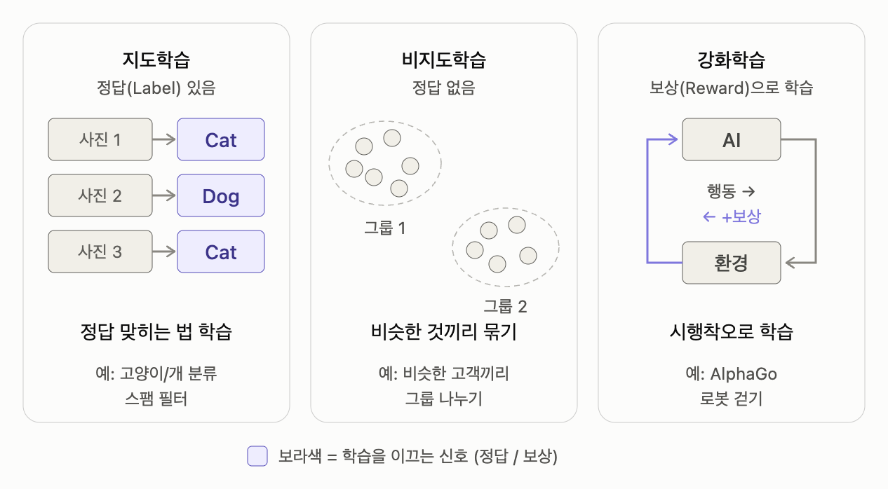
그림 보면 세 방식 차이가 "보라색이 어디에 있냐" 로 딱 갈림

① 지도학습 (왼쪽)
사진마다 보라색 정답 딱지(Cat, Dog) 가 붙어 있음. AI는 "사진 → 정답" 짝을 수천 개 보면서 정답 맞히는 법을 배움. 해설지 있는 문제집 푸는 거랑 똑같음 📝

② 비지도학습 (가운데)
보라색이 아예 없음. 정답 딱지 없이 회색 점(데이터)만 잔뜩 던져주면, AI가 알아서 "얘네 좀 비슷한데?" 하고 점선으로 그룹을 묶음. 근데 그룹 이름은 모름! 그냥 "그룹 1, 그룹 2"일 뿐이고 "야식 러버 그룹" 같은 해석은 사람 몫 🧩

③ 강화학습 (오른쪽)
정답 딱지는 없는데 대신 보라색 보상 화살표가 있음. AI가 환경에 행동(→) 해보고, 결과에 따라 보상(←)을 받는 걸 무한 반복. 이기면 간식, 지면 없음. 이 루프 돌면서 알파고가 바둑 고인물 됐고 로봇이 걷는 법 배움 🎮

>⚠️ 그래서 시험 포인트:  
> 비지도 vs 강화 둘 다 "정답이 없다"는 건 같은데, 강화학습은 보상 신호가 있고 비지도는 피드백 자체가 없음. 그림에서 보라색 유무 차이가 바로 그거!

### 2-3. AI는 패턴을 학습한다 
>A는 무엇을 배우는가?

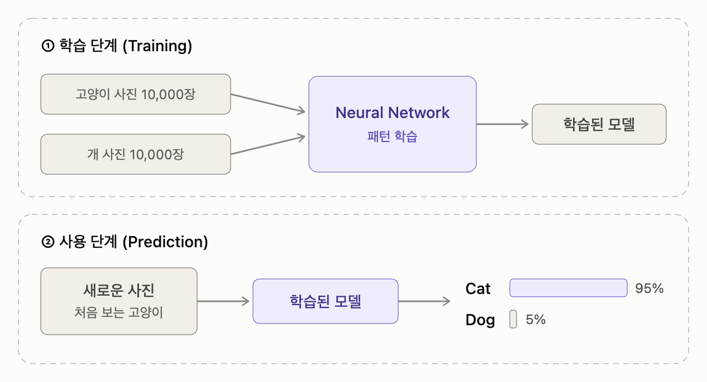
AI는 정답을 외우는 것이 아니라 데이터 속 패턴(Pattern)을 학습한다

① 학습 단계: 고양이 1만 장 + 개 1만 장  
신경망한테 사진을 엄청 많이 보여주면서 "이건 고양이, 이건 개" 정답을 같이 알려줌.
그러면 AI는 사진 한 장 한 장을 기억하는 게 아니라, 수만 장을 보면서 "고양이는 대체로 귀가 뾰족하고 얼굴이 동글하고, 개는 주둥이가 길고…" 같은 공통 패턴을 뽑아냄.
여기서 양쪽을 1만 장씩 비슷한 개수로 준 것도 포인트! 한쪽만 많으면 AI가 한쪽으로 쏠림 (10페이지 편향 얘기로 연결)

② 사용 단계: 처음 보는 사진 → Cat 95% 
학습 끝난 모델한테 학습 때 한 번도 안 본 사진을 주면 답을 냄.
여기서 꿀포인트 두 개 👇
- 답이 확률로 나온다: "고양이임!" 이렇게 단정하는 게 아니라 "고양이일 확률 95%, 개일 확률 5%" 처럼 나옴. 두 개 합치면 100%. 가장 높은 쪽을 최종 답으로 고르는 거. AI도 나름 "확신 정도"가 있는 셈 ㅋㅋ
- 처음 보는 사진인데 맞힌다: 이게 가능한 이유가 바로 하단 문구임

 <mark class="pink">③ 핵심 문구: "외우는 게 아니라 패턴을 학습한다" ⭐</mark>
- 외우기: "사진 3,742번 = 고양이" 이렇게 기억 → 새 사진 오면 못 맞힘 (본 적이 없으니까)
- 패턴 학습: "이런 특징이 있으면 고양이" 를 익힘 → 새 사진도 맞힘

### 2-4. 데이터가 중요한 이유 (양·질·편향)
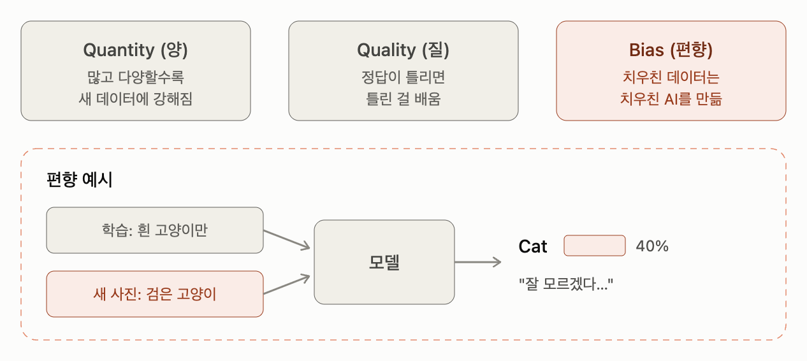

>Garbage In, Garbage Out : 데이터가 AI의 수준을 결정한다

① Quantity (양) — 많이, 그리고 다양하게 📦 
데이터가 많을수록 AI가 볼 수 있는 경우의 수가 늘어나서 처음 보는 데이터에도 강해짐.
근데 그냥 많기만 하면 안 되고 다양해야 함. 같은 고양이 사진 1만 장 복붙하면 그건 사실상 1장이랑 같음 정면, 옆모습, 누워있는 거, 어두운 데서 찍은 거 등등 골고루 있어야 함.

② Quality (질) — 정답이 정확해야 함 ✅ 
지도학습은 정답(Label)을 믿고 배우는데, 사람이 라벨링하다가 개 사진에 "고양이"라고 잘못 붙이면 AI는 그걸 진짜라고 믿고 배움. 틀린 해설지로 공부한 학생이 시험 망하는 거랑 똑같음 📝❌

③ Bias (편향) — 한쪽으로 쏠리면 AI도 쏠림 ⚖️ 
데이터가 특정 쪽에만 몰려 있으면 AI도 그쪽만 잘 알고 나머지는 못함. 그림 아래쪽 예시가 바로 이거 👇
- 편향 예시: 흰 고양이만 배운 AI 
  - 학습 데이터가 전부 흰 고양이 → AI는 "고양이 = 하얀 털 동물"이라고 잘못 배워버림
  그러다 검은 고양이를 만나면 → “Cat 40%… 잘 모르겠다” 😵 
  - 검은 고양이도 당연히 고양이인데, AI 입장에서는 "본 적 없는 색깔"이라 헷갈리는 거. 데이터가 다양하지 못하면(①) 이렇게 편향(③)이 생김. 양이랑 편향은 서로 연결된 문제라는 것도 포인트!

현실에서도 이거 진짜 문제 됨. 예를 들어 특정 인종 얼굴 위주로 학습한 얼굴인식 AI가 다른 인종은 잘 못 알아보는 사례들이 있었음. 로봇도 마찬가지로 밝은 실험실에서만 학습하면 어두운 집에서 버벅거릴 수 있음 🤖

 <mark class="pink">Garbage In, Garbage Out (GIGO) </mark>🗑️ 
쓰레기 넣으면 쓰레기 나온다. 컴퓨터 분야 유명한 격언임.
아무리 좋은 AI 모델이라도 데이터가 구리면 결과도 구림. 그래서 "데이터가 AI의 수준을 결정한다" 는 거.
요즘 AI 회사들이 데이터 확보에 목숨 거는 이유도 이거고

### 2-5. 신경망과 Weight 
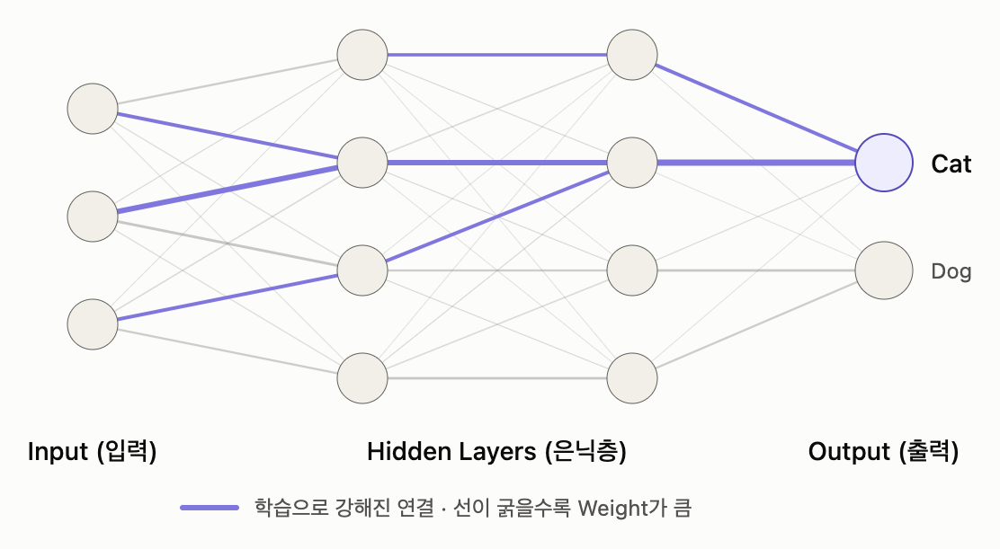 {:.left}
- Weight (가중치): 뉴런 사이 연결의 세기
- 학습 = Weight 조정 
  1. 처음에는 무작위 값 
  2. → 데이터를 보며 조금씩 변경 
  3. 정답을 잘 맞히는 값으로
- 수백만~수천억 개의 Weight

---

① 3층 구조: Input → Hidden Layers → Output
- Input (입력층): 데이터가 들어오는 입구. 사진이면 픽셀 숫자들이 여기로 들어옴 
- Hidden Layers (은닉층): 중간에서 실제로 계산하면서 특징을 뽑아내는 층. 밖에서 직접 안 보여서 "숨겨진(Hidden)" 층이라고 부름. 이게 여러 겹 깊게(Deep) 쌓이면 → Deep Learning!
- Output (출력층): 최종 답이 나오는 출구. 여기선 Cat / Dog 중 하나

② Weight (가중치) = 연결의 세기 ⭐ 
뉴런 사이 선 하나하나마다 숫자(Weight) 가 붙어 있음. 이 숫자가 크면 신호가 강하게 전달되고, 작으면 약하게 전달됨.
그림에서 선 굵기 = Weight 크기라고 보면 됨. 보라색 굵은 선들이 Cat 쪽으로 쭉 이어져 있는 거 보이지? 고양이 사진이 들어오면 이 굵은 길을 따라 신호가 강하게 흘러서 Cat 쪽 출력이 커지는 거임.

비유하면 수도관 밸브 🚰 밸브(Weight)를 얼마나 열어두냐에 따라 물(신호)이 어디로 많이 흐를지가 정해짐. 밸브를 잘 조절해 두면 고양이 사진 넣었을 때 물이 Cat 쪽으로 콸콸 흐르는 거.

③ 학습 = Weight 조정 ⭐⭐ (찐 핵심) 
“AI가 학습한다”는 게 대체 뭘 하는 거냐? → 이 Weight 숫자들을 고치는 것. 이게 전부임.
과정은 이렇게 감:
1. 처음엔 무작위 값 → 밸브가 아무렇게나 열려 있음. 고양이 넣어도 Cat 50%, Dog 50% 이런 찍기 수준 🎲
2. 데이터를 보며 조금씩 변경 → 틀릴 때마다 “Cat 쪽 밸브 좀 더 열고, Dog 쪽 좀 잠그자” 하고 살짝
3. 정답을 잘 맞히는 값으로 → 수만 번 반복하면 그림처럼 Cat 가는 길이 굵어진 상태가 완성

> "학습 결과물 = 모델"이라고 했잖아? 결국 모델 = 잘 조정된 Weight 숫자들의 묶음임.

④ 수백만~수천억 개의 Weight 🤯 
그림엔 선이 몇십 개지만 실제 AI는 차원이 다름.
- 이미지 인식 모델: 수백만~수천만 개
- ChatGPT 같은 LLM: 수천억 개 
뉴스에서 "파라미터 수천억 개짜리 모델" 할 때 그 파라미터가 대부분 이 Weight임. 이걸 사람이 손으로 조정하는 건 불가능하니까 데이터로 자동 조정하는 거고, 계산량이 어마어마해서 GPU가 필요한 거

### 2-6. Training Loop (Loss, 경사하강법) 
아까 위에서 뉴럴 네트워크는 데이터를 학습하는데 weight를 조정한다 했는데 그럼 어떻게 조정하냐?
>어떻게 학습하는가? : Training Loop

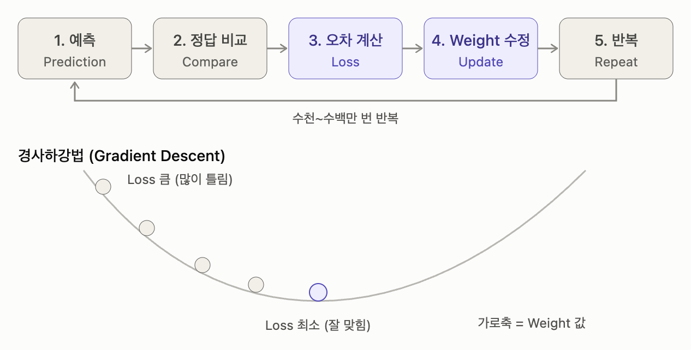

**① Training Loop 5단계 (위쪽 그림) 🔁**
고양이 사진 한 장으로 예를 들면:
1. **Prediction (예측)**: 사진 넣어보니 AI가 “Dog 70%, Cat 30%”라고 답함 (아직 Weight가 엉망이라)
2. **Compare (정답 비교)**: 정답 딱지 보니까 “Cat”임. 어 틀렸네? 
3. **Error / Loss (오차 계산)**: 얼마나 틀렸는지 숫자로 계산. 많이 틀릴수록 Loss가 큼 
4. **Update (Weight 수정)**: Loss를 줄이는 방향으로 Weight를 아주 조금 고침 (Cat 가는 밸브 살짝 열고, Dog 가는 밸브 살짝 잠그기)
5. **Repeat (반복)**: 다음 사진 넣고 1번부터 다시

② Loss (손실) = 얼마나 틀렸냐를 나타내는 숫자 📉
그냥 "틀렸다/맞았다"가 아니라 얼마나 틀렸는지를 숫자로 표현한 거.
- 고양이 사진에 Cat 30% → 많이 틀림 → Loss 큼
- 고양이 사진에 Cat 95% → 거의 맞음 → Loss 작음

③ Gradient Descent (경사하강법) = 안개 낀 산 내려가기 ⛰️🌫️
“Weight를 Loss 줄이는 방향으로 고친다”는데, 수천억 개 Weight를 어느 방향으로 고쳐야 할지 어떻게 앎? 그 방법이 경사하강법.

아래쪽 그림 보면:
- 가로축 = Weight 값, 세로 위치 = Loss (높을수록 많이 틀림)
- 공(현재 Weight 상태)이 왼쪽 위에서 시작 → Loss 큼
- 한 걸음씩 아래로 굴러 내려가서 → 보라색 바닥 = Loss 최소 도착

안개 낀 산 비유가 찰떡인 이유: 안개 때문에 산 전체가 안 보임 = AI는 "정답 Weight가 어딘지" 미리 알 수 없음
근데 발밑 경사는 느껴짐 = 지금 위치에서 어느 쪽이 내리막인지는 계산 가능 (이게 Gradient, 기울기)
그래서 내리막 방향으로 한 걸음 → 다시 발밑 확인 → 또 한 걸음… 반복하다 보면 골짜기 바닥(Loss 최소)에 도착

"조금씩" 이 포인트임. 한 번에 확 뛰면 골짜기를 지나쳐서 반대편 산으로 올라가 버릴 수도 있어서 작은 걸음으로 감 🚶
 성큼성큼 red red️️ ❌️ 
슬금슬금 green green ⭕
 
### 2-7. Overfitting과 일반화

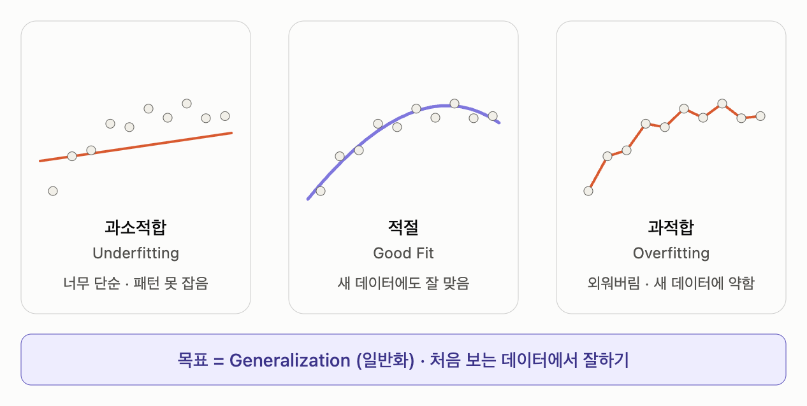
그림의 회색 점 = 학습 데이터, 선 = AI가 찾은 패턴. 세 칸 모두 점은 똑같은데, 선을 어떻게 긋느냐에 따라 결과가 갈림.

**① Underfitting (과소적합)** — 공부 너무 대충 함 😪 
점들은 휘어진 모양인데 AI가 그냥 직선 하나 쭉 그어버림. 너무 단순해서 패턴을 못 잡은 상태.
 → 학습 데이터도 못 맞히고, 새 데이터도 당연히 못 맞힘
 → 학생으로 치면  <mark class="mint">교과서 목차만 보고 시험 보러 간 상태 </mark>
 원인: 모델이 너무 단순하거나, 학습을 너무 조금 함

② **Good Fit (적절)** — 원리 이해함 😎 
점들 하나하나에 집착하지 않고 전체적인 흐름(곡선) 을 부드럽게 잡음. 점이 선에 딱 붙어 있진 않은데 그게 정상임. 데이터엔 원래 약간의 노이즈(잡음, 우연한 오차)가 섞여 있으니까.
 → 학습 데이터도 꽤 잘 맞히고, 새 데이터에도 잘 맞음 ✅
 →  <mark class="mint">원리를 이해한 학생</mark>. 처음 보는 응용문제도 풀 수 있음

③ **Overfitting (과적합)** — 기출만 달달 외움 🤯 
모든 점을 하나도 안 빼고 지그재그로 다 지나감. 학습 데이터 점수는 100점인데…
문제는 노이즈까지 다 외워버렸다는 거. 새 점이 들어오면 저 삐죽빼죽한 선 때문에 완전 엉뚱한 예측을 함 💀
 →  <mark class="mint">기출문제 답만 외운 학생</mark>. 기출이랑 똑같이 나오면 만점인데, 숫자 하나만 바뀌어도 멘붕
 위에서 말했던 “AI는 정답을 외우는 게 아니라 패턴을 학습한다”의 반대 상황이 바로 이거임. 

>AI의 목표 = Generalization (일반화): 처음 보는 데이터에서 잘하는 것 
학습 데이터 정확도가 높다고 무조건 좋은 게 아님 (과적합 주의)

---

## 3. Vision — AI는 어떻게 보는가

### 3-1. 컴퓨터가 보는 이미지 = 숫자의 행렬 
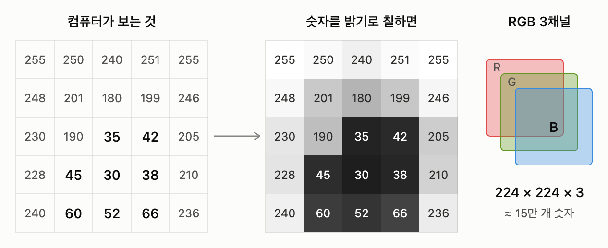
① 컴퓨터 눈에 사과는 그냥 숫자 표임 🔢 
우리는 사진 보면 바로 "사과네" 하는데, 컴퓨터한텐 "사과"도 "빨간색"도 없음. 오직 숫자만 있음.
- 0 = 완전 어두움 (검정) ⚫
- 255 = 완전 밝음 (흰색) ⚪
- 그 사이 = 회색 단계

그림 왼쪽 숫자 표를 그대로 밝기로 칠해보면(가운데) 👉 바깥은 하얗고, 가운데 아래쪽은 어두운 덩어리가 보이지? 숫자가 작은 칸(35, 30, 45…)이 모여서 물체 모양을 만드는 거. 컴퓨터 입장에선 저 숫자 배치 자체가 사진임!

② **RGB 3채널** — 색깔은 숫자 표 3장 겹치기 🎨 
흑백이면 숫자 표 1장이면 되는데, 컬러 사진은 빨강(R) · 초록(G) · 파랑(B) 세 가지 빛의 세기를 각각 따로 저장함. 그래서 숫자 표가 3장 겹쳐 있음 (오른쪽 그림)
- 빨간 사과 픽셀이면 → R 값은 높고, G·B 값은 낮음
- 흰 배경 픽셀이면 → R·G·B 셋 다 255

모니터도 실제로 이 3색 빛을 섞어서 모든 색을 만들어냄. 빛의 삼원색 그거임 💡

③ 224 × 224 × 3 ≈ 15만 개 숫자 🤯
AI가 이미지 받을 때 많이 쓰는 크기가 가로 224 × 세로 224 픽셀인데, RGB 3장이니까:

224 × 224 × 3 = 150,528개의 숫자

그러니까 사진 한 장 = 숫자 약 15만 개짜리 덩어리. 이 15만 개가 신경망의 Input(입력층) 으로 들어가는 거임. 그리고 저것도 작은 사진 기준이고, 폰 카메라 사진은 수천만 개 단위 

④  <mark class="pink">"사과"라는 정보는 숫자들 사이의 패턴 속에 숨어 있다 ⭐</mark>
 숫자 하나 딱 보고 "이건 사과다"를 알 수 있는 숫자는 없음. 픽셀 하나에 35라고 적혀 있으면 이게 사과 일부인지, 그림자인지, 검은 고양이인지 모름.
 숫자들이 어떻게 모여 있는지 (어디가 밝고 어디가 어두운지, 경계선이 어떻게 생겼는지, 어떤 모양을 이루는지) 그 배치 패턴을 봐야 사과라는 걸 알 수 있음.

근데 15만 개 숫자에서 이 패턴을 사람이 규칙으로 짜는 건 불가능 (전통 프로그래밍의 한계). 그래서 등장하는 게 → <mark class="pink"> CNN</mark>! 숫자 덩어리 속에서 패턴을 자동으로 찾아주는 신경망. 
>'사과'라는 의미는 개별 숫자가 아니라 숫자들 사이의 패턴 속에 숨어 있고, CNN이 이 패턴을 찾아낸다."

### 3-2. CNN 개요 (Edge → Shape → Object)
>Deep Learning의 혁신 : Vision

- CNN (Convolutional Neural Network) → “This is an apple.”
- Feature(특징)가 층을 지나며 점점 추상화된다
  - Edge (선) — 초기 Layer
  - Shape (모양) — 중간 Layer
  - Object (물체) — 깊은 Layer
- 하단: 사람이 Feature를 직접 설계하지 않아도 Neural Network가 Feature를 스스로 학습한다
  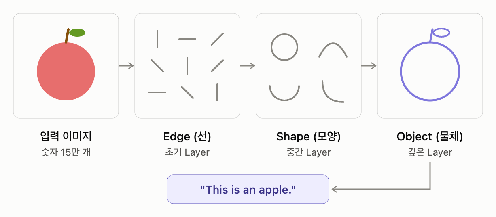

① Seeing 
 Seeing(보기) = Perception 단계 담당. 

②  <mark class="mint">CNN = 이미지 전용 신경망</mark> 🖼️ 
CNN(Convolutional Neural Network, 합성곱 신경망)은 신경망을 이미지 보는 데 특화되게 개조한 버전. 
사진 = 숫자 15만 개라고 했잖아? CNN은 이 숫자 덩어리를 받아서 결국 “This is an apple.” 이라는 답을 뽑아냄.

③  <mark class="pink">Feature가 층을 지나며 점점 추상화된다</mark> ⭐ 
Feature(특징) = "이 사진에서 주목할 만한 단서". CNN은 층을 지날수록 이 단서를 단순한 것 → 복잡한 것으로 조립해 나감.

|단계	|찾는 것|	그림|
|---|---|---|
|초기 Layer	|Edge (선) — 세로선, 가로선, 대각선	|짧은 선 조각들|
|중간 Layer|	Shape (모양) — 동그라미, 곡선, 모서리|	선들이 합쳐진 도형|
|깊은 Layer	|Object (물체) — 사과, 고양이, 얼굴	|도형들이 합쳐진 물체|

④  <mark class="pink">사람이 Feature를 직접 설계하지 않아도 스스로 학습한다</mark> ⭐⭐ 
- 딥러닝 이전: 사람이 직접 "사과를 알아보려면 빨간색 비율 계산하고, 동그란 윤곽 찾고…" 하고 특징 추출 방법을 손으로 설계해야 했음. 노가다 오지고, 사람이 생각 못 한 특징은 못 씀
- CNN (딥러닝): 사진 + 정답만 잔뜩 주면, 12페이지 Training Loop 돌면서 "선을 찾아야겠다, 동그라미를 찾아야겠다"를 AI가 알아서 깨우침
- => **딥러닝의 핵심 혁신은 이러한 특징을 사람이 직접 설계하지 않아도 신경망이 데이터로부터 스스로 학습한다는 점이다.**
> **핵심 정리**
>1. CNN = 이미지 인식에 특화된 신경망 (대표 예제 ① Seeing = Perception)
>2. Feature는 층을 지나며 점점 추상화됨: Edge(선, 초기) → Shape(모양, 중간) → Object(물체, 깊은)
>3. 깊을수록 더 복잡하고 의미 있는 특징을 인식 → 그래서 Deep Learning 
>4. 딥러닝의 혁신 = 사람이 특징을 설계하지 않아도 신경망이 스스로 특징을 학습 
>5. ML: 규칙을 학습 / DL: 무엇을 볼지(특징)까지 학습

### 3-3. Convolution (합성곱) 
>CNN의 핵심 ① Convolution (합성곱)

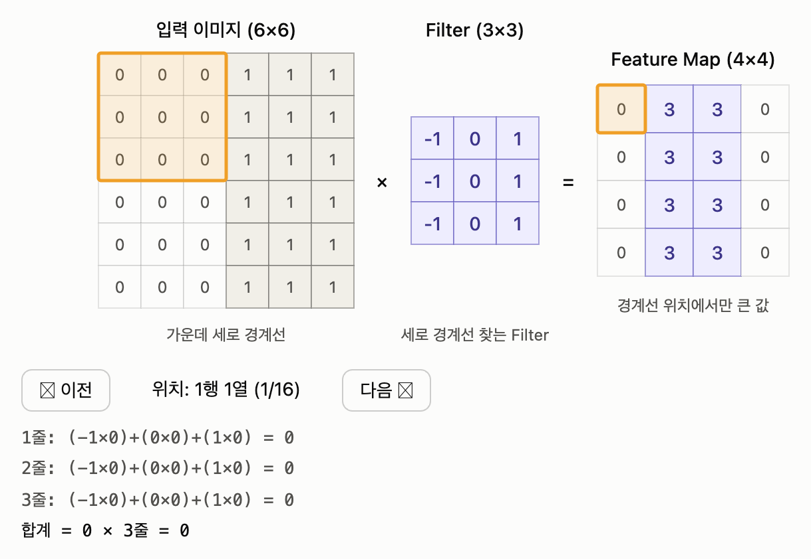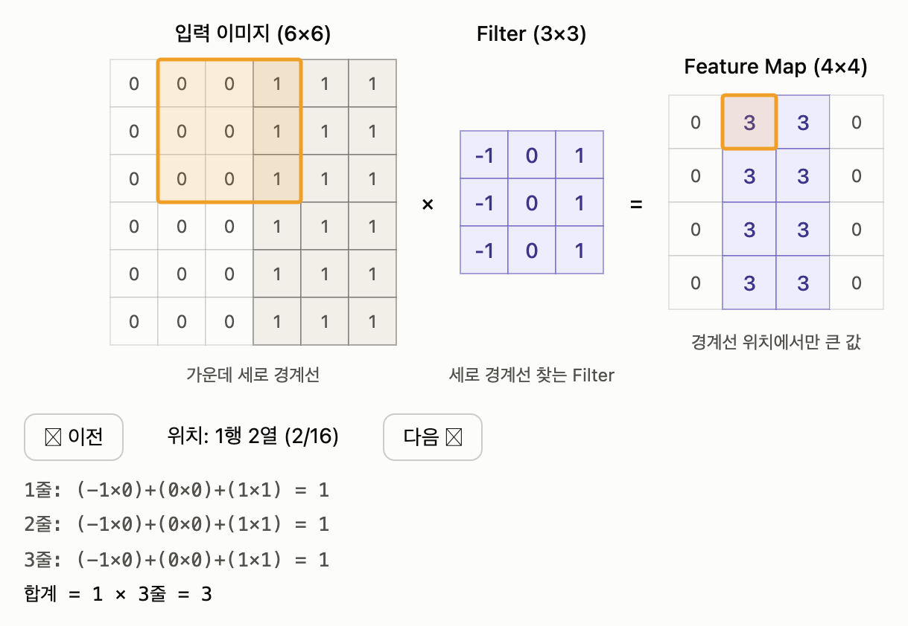 {:.pair}
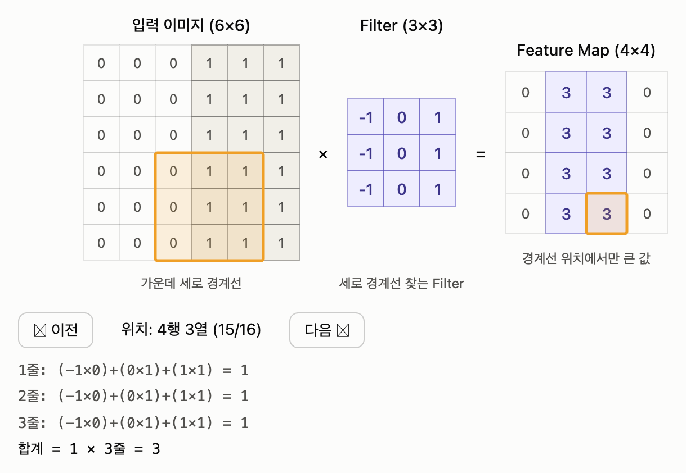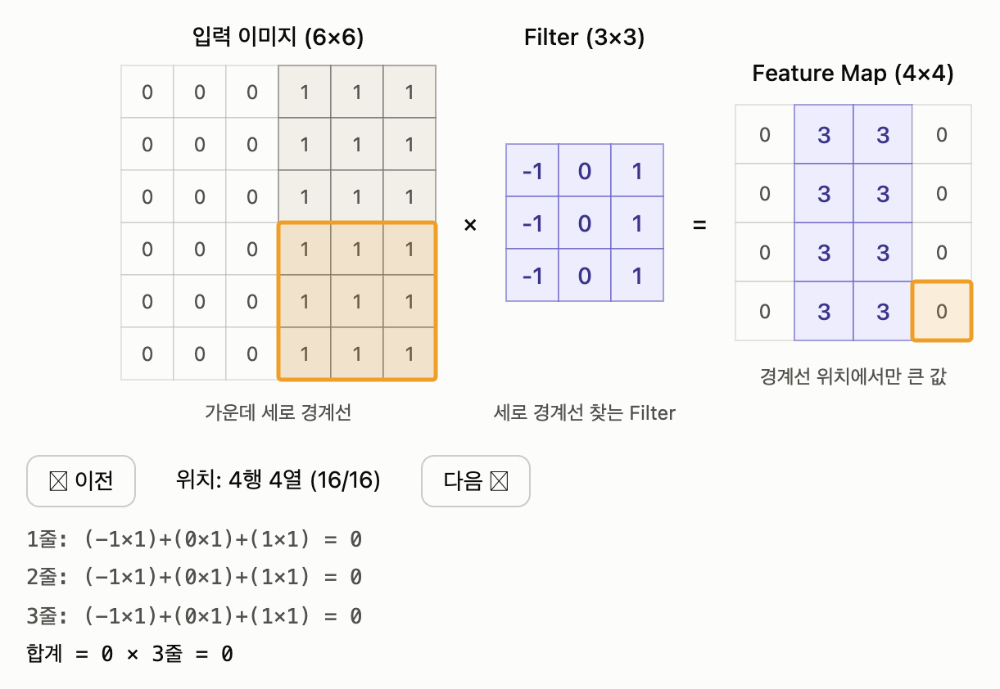 {:.pair}

① Filter (3×3) — 세로 경계선 탐지기 🔍 
Filter(= Kernel = Weight)는 특정 패턴을 찾는 작은 돋보기. 각 줄이 -1 0 1인데:
- 왼쪽 칸엔 -1 (어두우면 좋음)
- 오른쪽 칸엔 +1 (밝으면 좋음)

→ 즉 "왼쪽은 어둡고 오른쪽은 밝은 곳" = 세로 경계선에서 큰 값이 나오게 설계된 필터임.

② 계산 방법 (4단계) ⭐ 
1. Filter를 이미지 위에 겹친다 (그림의 주황 테두리)
2. 같은 자리끼리 곱한다
3. 모두 더해서 Feature Map 한 칸에 적는다
4. 한 칸씩 밀면서 반복

③ feature Map — "여기 경계선 있음!" 지도 🗺️ 
결과물 4×4 표가 Feature Map(특징 지도). 가운데 두 열에만 3이 떠 있지? = "이 위치에 세로 경계선이 있다" 는 걸 알려주는 지도임. 
 아까 초기 Layer가 Edge(선)를 찾는다고 했던 게 실제로는 이렇게 계산되는 거 

④  <mark class="pink">같은 Filter를 이미지 전체에 사용 → 어디 있든 찾아낸다</mark> 
필터 하나로 이미지 전체를 쭉 훑으니까, 경계선이 왼쪽 위에 있든 오른쪽 아래에 있든 위치 상관없이 찾아냄. 사과가 사진 구석에 있어도 가운데 있어도 알아보는 이유가 이거 🍎

⑤  <mark class="pink">Filter 값은 사람이 정하지 않는다 ⭐⭐</mark>  
예시에선 이해하라고 -1 0 1을 사람이 넣어놨는데, 실제 CNN에서는 필터 숫자가 바로 Weight임. 처음엔 무작위 → Training Loop로 자동 학습됨.
 그래서 AI가 학습하다 보면 알아서 "세로선 필터", "가로선 필터", "곡선 필터" 같은 게 생겨남. "사람이 Feature를 설계하지 않아도 스스로 학습한다"가 정확히 이 얘기! 

>**정리하면**
>   Convolution은 Filter(Kernel)를 이미지 위에 겹쳐 같은 위치의 값끼리 곱하고 더한 결과를 한 칸씩 밀며 기록하는 연산으로, 그 결과인 Feature Map은 Filter가 찾는 특징(예: 세로 경계선)이 있는 위치에서만 큰 값을 가진다. 같은 Filter를 이미지 전체에 적용하므로 특징의 위치와 무관하게 탐지할 수 있으며, Filter 값은 사람이 정하지 않고 Training Loop를 통해 학습되는 Weight이다.

### 3-4. 여러 Filter · ReLU · Pooling 
>CNN의 핵심 ② 여러 Filter와 Pooling

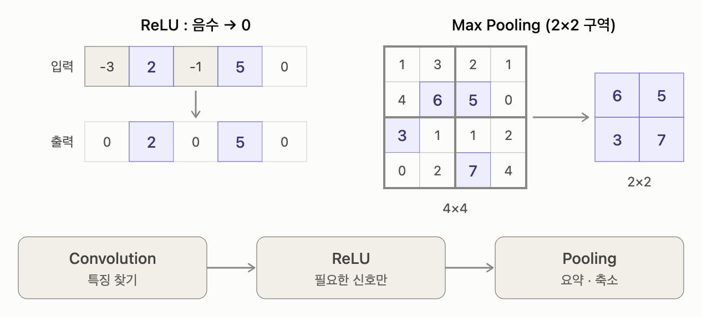
- 여러 Filter = 여러 특징
  - → Filter 수십~수백 개 → 특징 지도도 수십~수백 장
- ReLU: 음수는 0으로 → "특징이 있다"는 신호만 통과
- Max Pooling: 구역마다 가장 큰 값만
  - 크기가 줄어 계산이 가벼워진다
  - 위치가 조금 달라져도 같은 결과
- 흐름: Convolution(특징 찾기) → ReLU(필요한 신호만) → Pooling(요약·축소)

① 여러 Filter = 여러 특징 🔍🔍🔍 
사과 알아보려면 세로선만으론 부족함. 그래서 CNN은 Filter를 여러 개 동시에 씀.
- Filter 1 → 세로 선 찾기 → 세로선 지도 1장
- Filter 2 → 가로 선 찾기 → 가로선 지도 1장
- Filter 3 → 빨간 영역 찾기 → 빨간색 지도 1장

Filter 1개당 Feature Map 1장이 나오니까, Filter가 수십~수백 개면 특징 지도도 수십~수백 장. 사진 하나를 수백 개의 다른 관점으로 분석하는 셈. 탐정 수백 명이 각자 다른 단서만 찾는 느낌 🕵️
 그리고 이 필터들도 전부 사람이 정하는 게 아니라  <mark class="mint">학습으로 자동 생성됨</mark>

② ReLU — 음수는 0으로 ✂️ (그림 왼쪽) 
"특징이 있다"는 신호만 남기고, "없다/반대다"는 신호는 꺼버림. 클럽 입구 가드처럼 양수만 입장시키는 거

③ Max Pooling — 구역마다 대장만 남기기 👑 (그림 오른쪽)  
4×4를 2×2 구역 4개로 나누고(굵은 선), 각 구역에서 가장 큰 값만 뽑음. 

Pooling을 하는 이유 2가지
- 크기가 1/4로 줄어서 계산이 가벼워짐: 4×4 = 16칸 → 2×2 = 4칸. 사진 15만 개 숫자를 계속 다 들고 다니면 GPU 터짐 💥 요약본만 들고 다니는 거
- 위치가 조금 달라져도 같은 결과: 왼쪽 위 구역에서 6이 1칸 옆으로 옮겨가도, 같은 구역 안이면 최댓값은 여전히 6. 사과가 사진에서 살짝 옆으로 움직여도 똑같이 알아볼 수 있게 해줌 🍎↔️🍎

비유: 시험 범위 전체 대신 챕터별 핵심 하나씩만 요약노트에 적는 거. 분량은 줄고, 핵심은 살아남음 📝

>Convolution → ReLU → Pooling 과정은 계산량을 줄이고 위치 변화에도 강한 인식을 가능하게 한다

### 3-5. CNN 전체 구조 & 대표 모델 
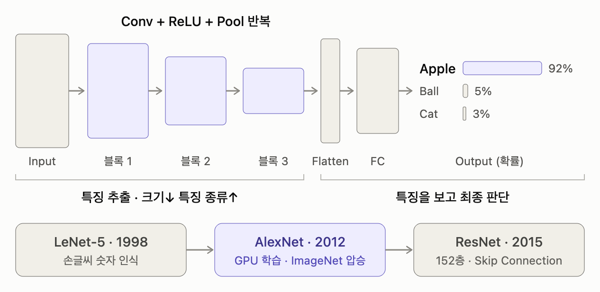
CNN은 크게 앞부분(특징 추출) 이랑 뒷부분(최종 판단) 두 파트로 나뉨.

① 앞부분: Conv + ReLU + Pool 블록 반복 (특징 추출) 🔍 
(Convolution → ReLU → Pooling)를 여러 번 쌓은 것.
 그림에서 보라색 블록이 오른쪽으로 갈수록 키가 작아지는 거 보이지? 이게 "깊어질수록 크기↓ · 특징 종류↑" 를 표현한 거임.
- 크기 ↓: Pooling 할 때마다 가로세로가 줄어듦
- 특징 종류 ↑: 뒤로 갈수록 Filter 개수를 늘려서 더 다양한 특징을 봄
- 특징 수준: 블록 1은 선(Edge), 뒤로 갈수록 모양(Shape)

쉽게 말하면 "사진은 점점 작게 압축하면서, 의미는 점점 진하게 농축하는" 과정 🧃 처음엔 "여기 픽셀 몇 번이 밝음" 수준이던 정보가 끝에 가면 "여기 둥근 모양 + 꼭지 있음" 수준으로 바뀜.

② 뒷부분: Flatten → Fully Connected → Output (최종 판단) 🧑‍⚖ ️
- **Flatten (펼치기)**: 앞에서 나온 특징 지도들은 여러 장짜리 2D 표 묶음인데, 판단하는 층은 한 줄짜리 숫자만 받을 수 있음. 그래서 표를 쭉 한 줄로 펼침. 그림에서 얇고 긴 막대가 그거. 김밥 재료 다 꺼내서 일렬로 늘어놓는 느낌 🍙→➖
- **Fully Connected (FC, 완전 연결층**): 펼친 특징들을 보고 종합 판단하는 층 신경망(모든 뉴런이 서로 다 연결된 구조)이 바로 이거임. "둥근 모양 있고, 빨간 영역 있고, 꼭지 있네 → 사과일 확률 높음" 이런 판단을 함
- **Output (확률)**: 최종 답을 확률로 출력. Apple 92%, Ball 5%, Cat 3% → 합치면 100%. 가장 높은 Apple이 최종 답. 

③ 대표 CNN 모델 3대장 🏆

|모델	|연도| 	특징	                                           | 의미                          |
|---|---|------------------------------------------------|-----------------------------|
|LeNet-5	|1998	| 손글씨 숫자 인식| 	CCNN 구조 자체는 1998년에 이미 있었음. 근데 당시엔 컴퓨터 성능이랑 데이터가 부족해서 손글씨 숫자 같은 단순한 데만 쓰였음 |
|AlexNet	|2012| 	GPU 학습 · ImageNet 압승| 	딥러닝 시대를 연 주인공 (같은 아이디어를 GPU + 대량 데이터(ImageNet) 로 크게 키웠더니 이미지 대회를 압도적으로 이겨버림.)   |
|ResNet	|2015| 	152층 · Skip Connection| 	152층까지 쌓음. 원래는 층을 너무 깊게 쌓으면 오히려 학습이 잘 안 되는 문제가 있었는데, Skip Connection(층 몇 개를 건너뛰는 지름길 연결)으로 해결함.       |

### 3-6. CNN 이후의변화 : 컴퓨터 비전의 발전 
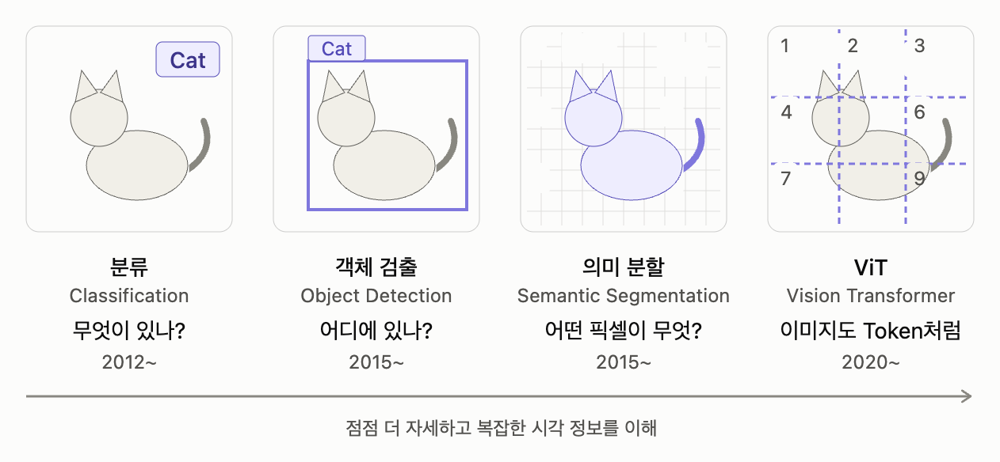

① **Image Classification (분류)** — "무엇이 있나?" (2012~) 
사진 전체를 보고 이름표 하나만 붙임: “Cat”. 끝. 
고양이가 사진 어디에 있는지, 몇 마리인지는 모름. CNN이 바로 이거 (Apple 92%). 2012년 AlexNet부터 본격적으로 잘하게 됨.
 → 친구한테 사진 보여주니까 "고양이네" 한마디 하고 끝나는 느낌 

② **Object Detection (객체 검출)** — "어디에 있나?" (2015~) 
이름뿐 아니라 위치를 박스로 표시함. "여기 이 네모 안에 Cat 있음". 
여러 물체도 각각 박스 쳐서 찾을 수 있음 (고양이 1, 강아지 1, 컵 1 …).  
→ 자율주행에서 엄청 중요함. "앞에 사람 있다"만 알면 안 되고 어디에 있는지 알아야 피하니까 🚗

③ **Semantic Segmentation (의미 분할)** — "어떤 픽셀이 무엇인가?" (2015~) 
박스보다 더 정밀하게, 픽셀 하나하나마다 "이건 고양이 픽셀, 이건 배경 픽셀" 하고 색칠함. 그림에서 고양이 모양 그대로 보라색으로 칠해진 거.
 박스는 고양이 주변 빈 공간까지 포함되는데, 분할은 윤곽선 딱 맞게 잡아냄. 
 → 로봇이 컵을 집으려면 이게 필요함. 컵의 정확한 테두리를 알아야 손을 어디에 댈지 정할 수 있으니까 

④ **Vision Transformer (ViT)** — "이미지도 Token처럼" (2020~) 
이건 결이 좀 다름. 앞의 셋은 "뭘 알아낼까(작업)" 의 발전이었다면, ViT는 "어떤 구조로 볼까(방식)" 의 변화임.
- CNN: Filter로 이미지를 쓱쓱 훑으면서 특징 찾기 
- ViT: 이미지를 작은 조각(패치)으로 잘라서, 각 조각을 단어처럼 취급함. 그림에서 점선으로 나눈 1~9번 조각들이 그거

---

## 4. Language — AI는 어떻게 언어를 이해하는가

### 4-1. 언어 이해의 어려움 (문맥 문제)

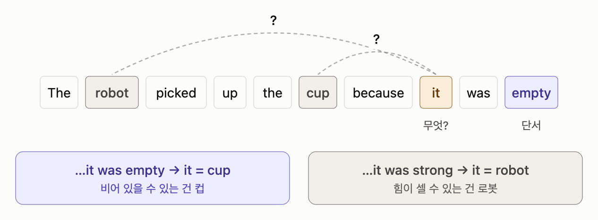
**Q.** “it”은 무엇을 의미할까? → robot? cup?
  단어만 찾는 Keyword matching으로는 알 수 없다 → 문맥(Context)을 이해해야 한다

- “…because it was empty” → it = cup (비어 있을 수 있는 건 컵)
- “…because it was strong” → it = robot (힘이 셀 수 있는 건 로봇)

단어 딱 하나만 바뀌었는데 it이 가리키는 대상이 바뀜!  같은 단어(it)라도 주변 단어들에 따라 의미가 달라짐.

③ Keyword matching으로는 못 푼다 ❌ 
Keyword matching = 문장에서 단어만 찾아서 처리하는 방식. 전통 프로그래밍처럼 규칙으로 짜는 거.
 예를 들어 규칙을 “it은 문장의 주어를 가리킨다”로 짜면? → 이번엔 robot이라 틀림.
 → 어떤 단순 규칙으로도 둘 다 맞힐 수 없음. 단어 자체가 아니라 단어들 사이의 관계를 봐야 하니까.

④  <mark class="pink">그래서 필요한 것: 문맥(Context) 이해 ⭐</mark>  
문맥 = 단어 주변의 다른 단어들이 만드는 전체 의미. 
“it”의 뜻을 알려면 it만 보면 안 되고, 문장 전체를 보면서 “it이랑 empty가 연결되네 → empty한 건 cup이지” 하고 단어들끼리 관계를 파악해야 함.

이걸 AI가 하게 만드는 게 바로 👉 Transformer의 Attention 

>💡 연결 포인트: CNN에서 "사과라는 의미는 픽셀 하나가 아니라 픽셀들 사이의 패턴에 숨어 있다" 했잖아? 언어도 똑같음. “it의 의미는 단어 하나가 아니라 단어들 사이의 관계(문맥)에 숨어 있다.” 이미지든 언어든 AI의 핵심은 결국 관계·패턴 찾기임.

### 4-2. Language Model = 다음 Token 예측
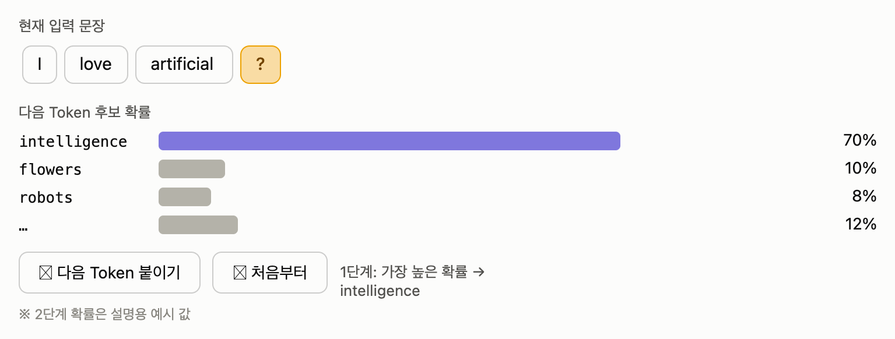
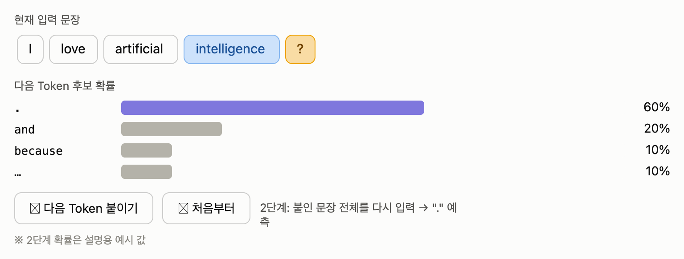
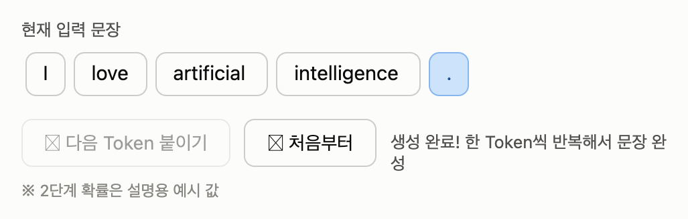
① 언어 모델이 하는 일: 다음 단어 맞히기 🎯 
Cat 95%, 18페이지 Apple 92%랑 완전 같은 방식임! 이미지 분류가 "이 사진은 어떤 클래스?"였다면, 언어 모델은 "다음 단어는 어떤 단어?" 를 분류하는 거.
 어떻게 저 확률을 아냐면 → 인터넷 텍스트를 엄청나게 많이 읽으면서 “artificial 다음엔 intelligence가 자주 오더라” 같은 패턴을 학습했기 때문. 

② 한 Token씩 붙여서 계속 생성 🔁 
언어 모델은 문장을 한 번에 통째로 만들지 않음.
1. “I love artificial” → 다음 Token 예측 → intelligence 선택 
2. 그걸 입력에 다시 붙임 → “I love artificial intelligence
3. 이 늘어난 문장 전체를 보고 또 다음 예측 → “.” 
4. 또 붙이고 → 또 예측 → … 끝날 때까지 반복

>언어 모델(Language Model)은 주어진 문장 다음에 올 Token을 확률로 예측하는 모델로,  예측한 Token을 다시 입력에 붙여 다음 Token을 예측하는 과정을 반복하며 문장을 한 Token씩 생성한다.

### 4-3. Token 
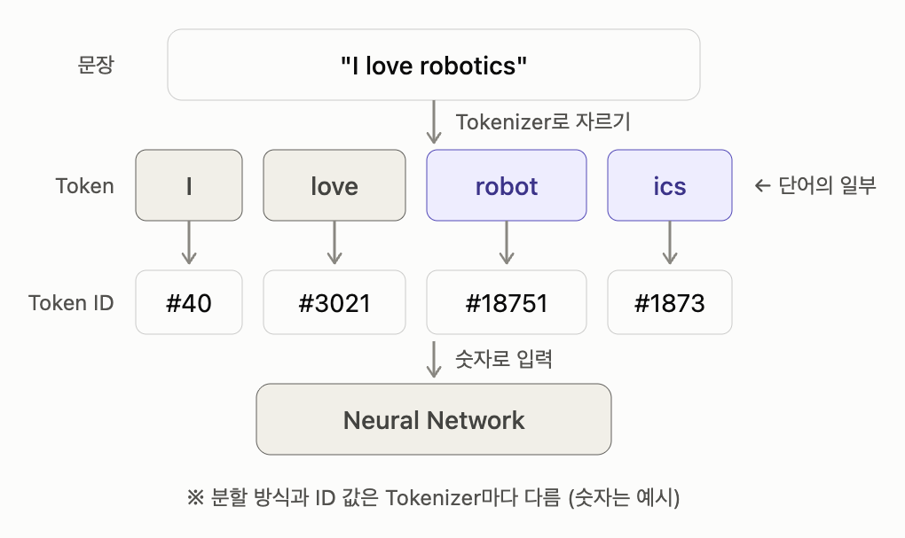
① **Token = AI가 읽는 텍스트 조각** 🧩 
AI는 문장을 글자 그대로 읽는 게 아니라 조각(Token) 단위로 잘라서 읽음. 이 자르는 도구를 Tokenizer라고 부름.
조각 크기는 상황에 따라 다름:
- 자주 쓰는 단어 → 통째로 1개 Token: I, love
- 덜 흔하거나 긴 단어 → 쪼개서 여러 개 Token: robotics → robot + ics 

그래서 정의가 “단어 또는 단어의 일부”인 거. Token ≠ 단어라는 거 주의!

② 왜 robotics를 쪼갬? 그냥 통째로 쓰면 안 됨? 🤔 
세상 모든 단어를 하나씩 다 등록하면 단어장이 끝도 없이 커짐. 신조어, 오타, 복합어까지 다 넣어야 하니까 ㅋㅋ
 대신 자주 나오는 조각들로 쪼개두면 적은 조각으로 거의 모든 단어를 조립할 수 있음 🧱
- robot + ics = robotics
- robot + s = robots

③ 각 Token은 숫자(ID)로 바뀐다 🔢 ⭐ 
컴퓨터는 숫자만 다룰 수 있음. 이미지를 픽셀 숫자로 바꿨던 것처럼, 글자도 숫자로 바꿔야 신경망에 넣을 수 있음.
그래서 Tokenizer는 단어장(사전)을 가지고 있고, 모든 Token에 고유 번호를 붙여둠:
- I → #40
- love → #3021

④ ※ Tokenizer마다 다르다 
자르는 방식이랑 번호 매기는 방식은 모델마다 다름. GPT 계열이 쓰는 Tokenizer랑 다른 회사 모델 Tokenizer는 같은 문장도 다르게 자를 수 있음. 그림의 숫자도 설명용 예시일 뿐 실제 값이 아님! 
 “robotics는 반드시 robot+ics로 나뉜다” ❌

### 4-4. Embedding 
💡 위의 언어 언어모델 토큰에서 D 번호는 그냥 출석번호라 의미가 없음. #3021(love)이랑 #3022가 비슷한 뜻이라는 보장이 전혀 없음 
번호만 봐선 “love”랑 “like”가 비슷한 단어라는 걸 알 수가 없음.
 → 그래서 번호를 의미가 담긴 숫자로 바꾸는 단계가 필요함. 그게  <mark class="pink">Embedding</mark>

>**Embedding** : 단어를 의미의 공간에 놓기위해 Token ID를 의미를 담은 숫자 벡터로 바꾼 것

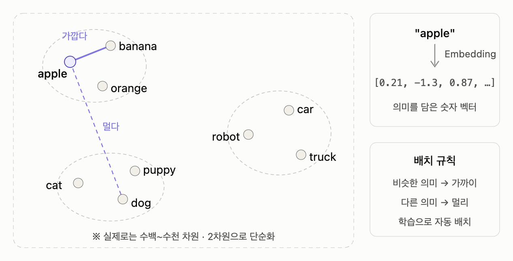

① Embedding = 단어에 "의미 좌표" 붙이기 📍 
Embedding은 각 Token을 숫자 여러 개짜리 묶음(벡터) 으로 바꾸는 것. 
“apple” → [0.21, -1.3, 0.87, …]

이 숫자들을 좌표라고 생각하면 됨. 

② 배치 규칙: 비슷하면 가까이, 다르면 멀리 ⭐ 
그림 보면:
- 🍎 apple · banana · orange → 과일끼리 한 동네
- 🐱 cat · dog · puppy → 동물끼리 한 동네
- 🤖 robot · car · truck → 기계·탈것끼리 한 동네

③ 학습을 통해 자동으로 배치된다 ⭐⭐ 
이 좌표를 사람이 하나하나 “apple은 여기, banana는 저기” 정하는 게 아님! 
인터넷 텍스트를 엄청 읽으면서 학습하다 보면 자동으로 정리됨. 원리는 "비슷한 문맥에 등장하는 단어는 비슷한 의미":
- "나는 아침에 ___를 먹었다" → apple, banana, orange 다 들어갈 수 있음 → 셋이 가까워짐
- “___가 꼬리를 흔들었다” → dog, puppy, cat 들어감 → 가까워짐

Embedding 숫자들도 결국 Weight처럼 Training Loop로 학습되는 값임.

④ 뒤에서 이미지도 같은 공간에 놓는다 (CLIP) 🌉 
지금은 단어만 지도에 올렸는데, 이미지도 이 지도에 같이 올림. 강아지 사진이 “A dog”라는 글 바로 옆에 놓이는 식! 
그러면 AI가 "이 그림 = 이 문장" 을 알 수 있게 됨 → 이게 VLM(보고 말하는 AI)의 핵심 원리. 

### 4-5. Attention & Transformer 
>Transformer의 핵심 : Attention (주의)

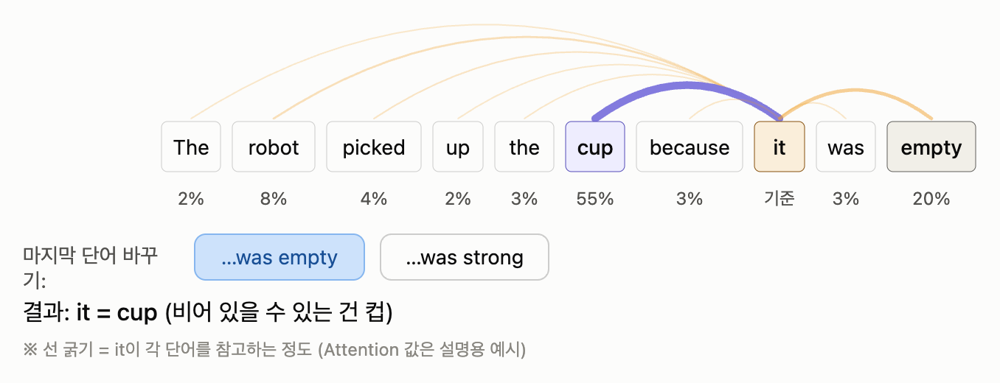
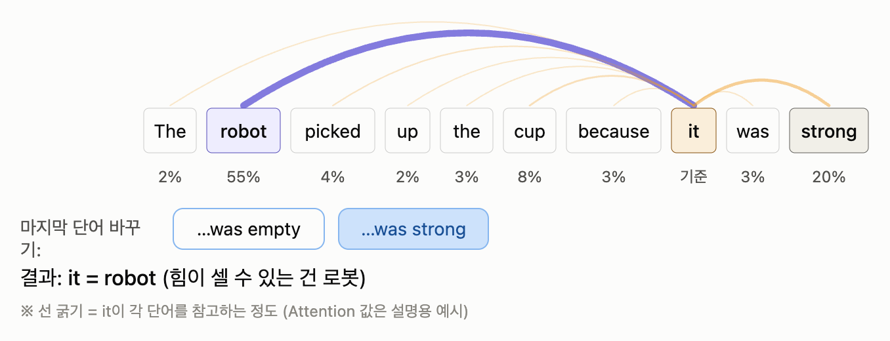
Keyword matching으론 못 풀고 문맥을 봐야 한다고 했었음. 그 문맥을 AI가 보는 방법이 바로 Attention!

① Attention = "누구를 참고할지" 스스로 계산하기  
Attention은 각 단어가 문장 속 다른 모든 단어를 쭉 훑어보고, 자기 의미를 파악하려면 어떤 단어를 얼마나 참고해야 할지 점수를 매기는 장치임.

그림에서 주황색 it이 기준 단어고, 다른 단어들로 뻗어나가는 선의 굵기 = 참고하는 정도(Attention 값):
- cup → 엄청 굵음 (55%) 👈 강한 연결
- empty → 꽤 굵음 (20%) 👈 단서
- robot → 얇음 (8%)
The, up, was 같은 애들 → 거의 안 보임 (2~3%)

→ it이 cup을 가장 강하게 참고하니까 it = cup! 🎉 정답 공개 완료

② "스스로 계산한다"가 핵심 ⭐⭐ 
이 연결 강도도 역시 사람이 정해주는 게 아님!
“it은 empty 나오면 cup 봐라” 같은 규칙은 어디에도 없음. 엄청난 양의 문장으로 학습하면서 "이런 문맥에선 이 단어를 봐야 다음 Token을 잘 맞히더라"를 스스로 터득한 거임.

- Filter → 학습됨
- Embedding → 학습됨
- Attention 연결 강도 계산법 → 학습됨

딥러닝은 진짜 "사람이 규칙 안 짜고 데이터로 학습" 의 무한 반복임 🔁

⑤ Transformer & “Attention Is All You Need” (2017) 📜 
 <mark class="pink">이 Attention을 핵심으로 만든 신경망 구조가 Transformer</mark>. 2017년 구글 논문 제목이 “Attention Is All You Need” (필요한 건 Attention뿐이다) 였음. 제목부터 자신감 미쳤음 

그리고 Transformer가 중요한 이유:
- 문장 속 모든 단어 쌍의 관계를 한 번에 계산 → 멀리 떨어진 단어끼리도 연결 가능 (it ↔ robot처럼 멀어도 OK)
-  LLM(ChatGPT) 의 뼈대가 됨
-  ViT도 이미지를 Token처럼 잘라서 이 Transformer에 넣은 거! 이미지 조각끼리도 Attention으로 관계를 봄

**CNN vs Transformer 비교 (정리용)**

| 	                                    | CNN                             | 	Transformer     |
|--------------------------------------|---------------------------------|------------------|
| 주 용도                                 | 	이미지	                           | 언어 (→ 이미지도)      |
| 핵심 장치| 	Convolution (Filter)| 	Attention       |
| 보는 방식	| 주변 작은 영역씩 훑기	| 모든 Token끼리 관계 계산 |
|  찾는 것| 	픽셀 사이 패턴| 	단어 사이 관계 (문맥)   |

### 4-6. LLM이란? 
>Transformer가 바꾼 것 : Large Language Model  
>  <mark class="pink">하나의 모델이 "다음 Token 예측"만으로 여러 언어 작업을 수행</mark>

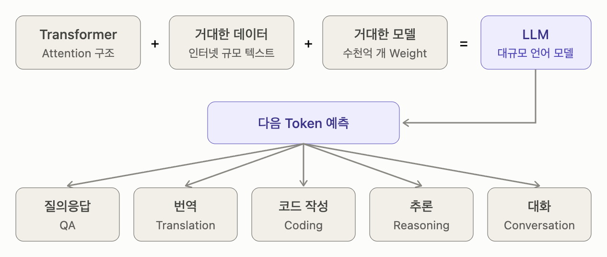

① LLM : Transformer + 거대한 데이터 + 거대한 모델 🍳 
LLM은 완전 새로운 발명이 아니라 지금까지 배운 재료를 엄청 크게 키운 거임.
- Transformer: 아까의 Attention 구조. 문맥 파악 담당
- 거대한 데이터: 인터넷 규모의 텍스트 (책, 뉴스, 위키, 코드 등등). "데이터 양이 많고 다양할수록 강해진다" 극한 버전
- 거대한 모델: Weight 수천억 개

이름 그대로 Large(대규모) + Language Model(언어 모델). "다음 Token 예측하는 언어 모델"을 Large하게 만든 게 LLM임. ChatGPT, Claude, Gemini 같은 애들이 다 여기 속함 🤖

② 다음 Token 예측 하나로 다 함 ⭐⭐
그림 가운데 보면 "다음 Token 예측" 이라는 능력 하나에서 5가지 작업이 쭉 뻗어나감. 이게 이 페이지 찐핵심.
옛날엔 번역 AI 따로, 질문답변 AI 따로, 대화 AI 따로 만들었는데, LLM은 하나의 모델이 다 함. 어떻게? 모든 작업을 "다음에 올 글 이어 쓰기" 로 바꿔버리면 됨:

 <mark class="pink">③ Q. ChatGPT가 문장을 정말 "이해"한다고 생각하나요? 🤔</mark> 
정답이 딱 정해진 질문이 아니라 생각해보라는 거임. 양쪽 입장 정리하면:
- "이해 못 한다" 쪽 🙅
  - 결국 하는 건 통계적으로 다음 Token 맞히기일 뿐
  - 사람처럼 경험하거나 느끼면서 의미를 아는 게 아님
  - 그럴듯하지만 틀린 말을 자신 있게 함 → 진짜 이해했으면 그럴까?
  - 몸이 없어서 "컵이 비어 있다"는 걸 실제로 본 적도 만져본 적도 없음

- "어느 정도 이해한다" 쪽 🙆
  - 문맥을 보고 it = cup을 맞힘
  - 처음 보는 질문에도 답하고 추론까지 함 → 일반화 능력
  - 다음 Token을 이렇게 잘 맞히려면 내부적으로 의미 구조를 학습했다고 볼 수도 있음 ( Embedding처럼 의미가 비슷한 걸 가깝게 놓음)

→ 결국 "이해"를 어떻게 정의하냐에 따라 답이 달라짐. 이 질문은 “LLM의 한계”랑 2편 "몸을 가진 AI"로 이어지는 떡밥이기도 함. 세상을 직접 보고 만져야 진짜 이해한다고 보면 → Physical AI가 필요하다는 결론으로 연결됨 🤖✋

### 4-7. LLM 만드는 3단계 → p.26
>LLM은 어떻게 만들어질까? 사전학습 → 지시학습 → RLHF  
> 책 읽고 → 대화 연습하고 → 선생님 피드백 📚🗣️👩‍🏫

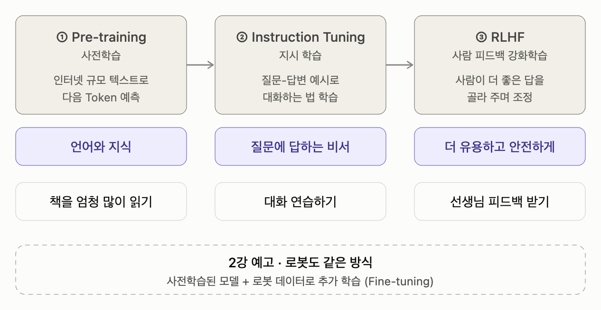
그림 줄 순서: 회색 = 무슨 학습인지 / 보라 = 결과물 / 흰색 = 사람 비유

①  <mark class="mint">Pre-training (사전학습)</mark> — 책 엄청 읽기 📚 
인터넷 규모의 텍스트를 가지고 "다음 Token 예측" 을 미친 듯이 연습하는 단계. "거대한 데이터 + 거대한 모델"이 투입되는 곳이 바로 여기임.
- 결과: 언어와 지식을 습득. 문법, 단어 뜻, 세상 상식, 코드 문법 등등을 다 흡수
- 근데 이 상태는 말 잘하는 게 아니라 "글 이어 쓰기"만 잘하는 상태임

예를 들어 사전학습만 한 모델한테 "한국의 수도는?" 물어보면 "서울입니다"가 아니라 "일본의 수도는? 중국의 수도는?" 이렇게 문제집처럼 질문을 이어 써버릴 수도 있음. 인터넷엔 그런 퀴즈 목록 글도 많으니까. 지식은 많은데 대화 매너가 없는 상태 🤓

②  <mark class="mint">Instruction Tuning (지시 학습)</mark> — 대화 연습하기 🗣️ 
"질문 → 좋은 답변" 짝으로 된 예시들을 보여주면서 질문을 받으면 답을 하는 방식을 가르침.
- 예시 데이터: “Q: 이 문장 영어로 번역해줘 / A: (번역문)”, “Q: 파이썬으로 정렬하는 법? / A: (설명 + 코드)”
- 결과: 질문에 답하는 비서로 변신

질문(문제) + 좋은 답변(정답)으로 학습하니까 이건  <mark class="pink">지도학습</mark>임! 지식은 이미 1단계에서 다 있으니까, 여기선 "지식을 어떤 형식으로 꺼내야 하는지" 를 배우는 거.

③  <mark class="mint">RLHF (사람 피드백 강화학습)</mark> — 선생님 피드백 받기 👩‍🏫 
RLHF = Reinforcement Learning from Human Feedback. 
모델이 같은 질문에 답변을 여러 개 만들면 → 사람이 "이게 더 좋아" 하고 골라줌 → 사람이 더 좋아하는 쪽으로 모델을 조정.

결과: 더 유용하고 안전하게. 더 친절하고, 더 정확하고, 위험한 요청은 거절하는 방향으로 다듬어짐

이름에 Reinforcement Learning(강화학습) 들어가는 거 포인트!  <mark class="pink">강화학습</mark>이 "시행착오 + 보상"이었잖아? 여기선 사람이 고른 선호 = 보상 역할을 함. 강아지 훈련할 때 잘하면 간식 주듯이, 좋은 답변엔 보상 🦴

### 4-8. LLM의 한계
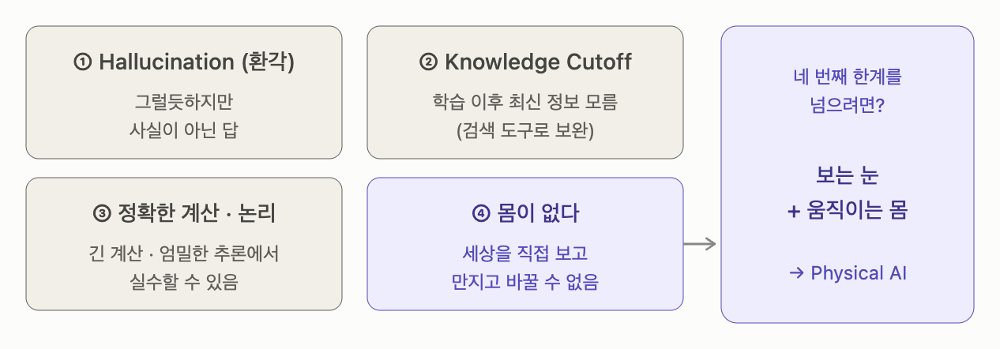

①  <mark class="mint">Hallucination (환각)</mark> — 그럴듯하게 틀리기 🤥 
없는 논문, 없는 사람, 틀린 날짜를 엄청 자신 있게 지어내는 현상. 
왜 생기냐면 LLM은 "사실인 문장" 을 만드는 게 아니라 "자연스러운 다음 Token" 을 만드는 모델이라서, 모르는 걸 물어봐도 "그럴듯한 문장"은 술술 이어 써버림.
 → 모르는데 모른다고 안 하고 아는 척하는 친구 st. 그래서 중요한 정보는 꼭 출처 확인해야 함!
 “ChatGPT는 정말 이해할까?” 질문에서 "이해 못 한다" 쪽 근거로 썼던 게 이거.

②  <mark class="mint">Knowledge Cutoff</mark> — 학습 끝난 이후는 모름 📅 
사전학습이 어느 시점까지의 데이터로 끝나니까, 그 이후 뉴스·사건은 모델 안에 없음. 학습 끝난 날짜가 Knowledge Cutoff(지식 단절 시점). 
→ 군대 갔다 온 사람이 그동안 나온 유행어 모르는 거랑 비슷 🪖 
보완책: 검색 도구. 질문 받으면 웹 검색해서 최신 정보를 가져와 답하는 방식. 

③ 정확한 계산 · 논리 — 긴 계산에서 실수 🧮 
“384729 × 9283 = ?” 같은 긴 계산이나, 단계가 많은 엄밀한 논리에서 틀릴 수 있음.
 이유: LLM은 계산기처럼 정확한 규칙으로 계산하는 게 아니라, 숫자도 Token 단위로 "그럴듯하게" 예측하니까. Token이 단어 조각이라고 했잖아? 숫자도 조각으로 쪼개져서 들어가서 계산이 꼬이기 쉬움.
 → 보완책: 계산기나 코드 실행 도구를 쓰게 함 (전통 프로그래밍의 정확성 + AI의 유연성 조합)

④ <mark class="mint">⭐ 몸이 없다: 세상을 직접 보고 만지고 바꿀 수 없음 (Digital AI의 근본 한계)</mark> 
네 번째 한계 해결 = 보는 눈(VLM) + 움직이는 몸(VLA, 2편에 설계) → Physical AI

---

## 5. Vision + Language — VLM

### 5-1. 멀티모달 AI 
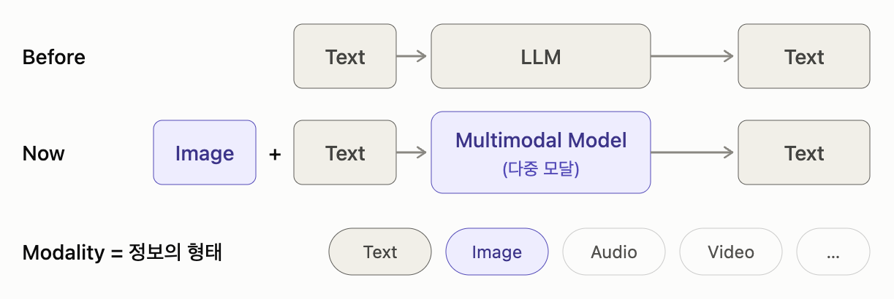
① Before vs Now — 입력에 사진이 추가됨 📸
- Before (LLM): 글 넣으면 → 글 나옴. 4장에서 배운 그 ChatGPT. 글자만 아는 상태
- Now (Multimodal Model): 사진 + 글 같이 넣으면 → 글 나옴

그림에서 보라색 Image 박스가 추가된 게 핵심 차이임. 출력은 똑같이 Text인데, 입력이 2가지 형태가 된 거.
요즘 ChatGPT나 Claude한테 사진 올리고 "이거 뭐야?" 물어볼 수 있잖아? 그게 바로 멀티모달 기능임 👀

② Modality (모달리티) = 정보의 형태 ⭐ 
모달리티 = 정보가 어떤 형태로 되어 있냐는 것.
- Text (글) 📝
- Image (사진) 🖼️
- Audio (소리) 🔊
- Video (영상) 🎬
- … (센서 데이터, 로봇 관절 각도 같은 것도 모달리티가 될 수 있음)

③ 예시: 횡단보도 사진 + 질문 🚶‍♀️🚗
- 입력: 횡단보도 사진 + "사진 속 사람들은 무엇을 하나요?"
- 출력: "여러 사람이 횡단보도를 건너고 있고, 차들은 정지해 있습니다."

분류(Classification)는 "사람 있음" 수준이었는데, 여기선 "누가 뭘 하고 있는지" 까지 말로 풀어냄. 훨씬 고차원적 이해!

| 목차                             | 능력                                        | 	비유                      |
|--------------------------------|-------------------------------------------|--------------------------|
| 3 Vision (CNN, ViT)	           | 이미지 이해|	눈 👀              |
| 4 Language (Transformer, LLM)	 | 언어 이해|	말 🗣️              |
| 5  Multimodal (VLM)	           | 이미지 + 언어 함께|	보고 말하기 👀🗣️ |

### 5-2. 이미지와 언어를 같은 공간에 (CLIP) 
>근데 문제가 하나 있음. 이미지는 픽셀 숫자고, 언어는 Token Embedding이라 서로 다른 형태잖아? 이 둘을 어떻게 같이 이해시키냐?

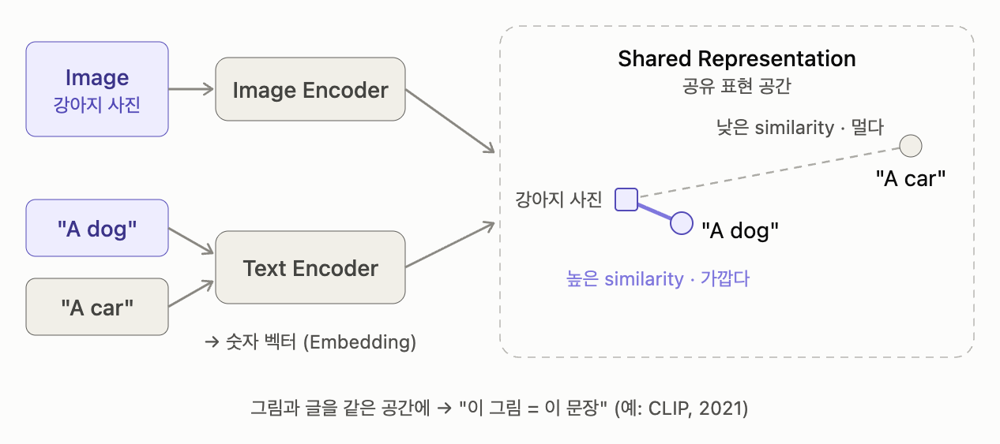

① 문제: 사진이랑 글은 언어가 다름 🤷
- 사진 → 픽셀 숫자 (14p)
- 글 → Token Embedding (23p)

둘 다 숫자긴 한데 완전 다른 체계의 숫자임. 한국어랑 아랍어처럼 서로 말이 안 통하는 상태. 그래서 "강아지 사진"이랑 “A dog”라는 글이 같은 걸 뜻한다는 걸 AI가 알 방법이 없음.

② 해결: **각자 번역기(Encoder)** 거쳐서 같은 지도에 올리기 🗺️
- Image Encoder: 사진 → 숫자 벡터로 변환 (목차 3 CNN/ViT 같은 이미지 모델이 이 역할)
- Text Encoder: 글 → 숫자 벡터로 변환 (목차 4 Transformer 같은 언어 모델이 이 역할)

Encoder = 입력을 의미를 담은 숫자 벡터**(Embedding)** 로 바꿔주는 장치. 번역기라고 생각하면 됨 🔄
 핵심은 두 번역기가 같은 "공용어" 로 번역한다는 것! 그래서 사진이든 글이든 결과물이 **같은 공간(Shared Representation)** 위의 점이 됨.

③  <mark class="mint">Shared Representation (공유 표현 공간) ⭐⭐</mark>
  Embedding 지도 기억나지? 거기선 단어만 올렸었는데, 이번엔 사진도 같은 지도에 올린 것임!
그림 오른쪽 보면:
- 🟪 강아지 사진 ↔ 🟣 “A dog” → 바로 옆 (높은 similarity)
- 🟪 강아지 사진 ↔ ⚪ “A car” → 멀리 (낮은 similarity)
  - Similarity(유사도) = 지도 위 두 점이 얼마나 가까운지를 나타내는 점수. 가까울수록 의미가 비슷하다는 뜻. "거리 = 의미 차이" 규칙이 사진과 글 사이에도 그대로 적용되는 거 ✅

비유하면 사진이랑 글이 같은 단톡방에 들어온 것 ㅋㅋ 원래 다른 방에 있어서 대화가 안 됐는데, 같은 방에 모이니까 "어 너랑 나랑 같은 얘기 하네?" 알아챔 💬

⑤ 결과: AI가 "이 그림 = 이 문장"을 알 수 있다 🎯
같은 공간에 있으니까 이런 게 가능해짐:
- 사진 넣고 → 가장 가까운 글 찾기 → "이건 강아지 사진이네" (사진 설명)
- 글 넣고 → 가장 가까운 사진 찾기 → "강아지" 검색하면 강아지 사진 나옴 (이미지 검색)

특히 신기한 건, 학습 때 따로 "고양이/개 분류"를 가르친 적 없어도 글로 된 후보만 주면 분류가 됨. 고양이/개 분류처럼 정답 딱지 붙여서 따로 학습 안 해도, “A cat” / “A dog” 문장 중 사진이랑 더 가까운 걸 고르면 끝이니까! 이게 CLIP이 혁신적이었던 이유 💡

 <mark class="pink">CLIP (2021)</mark>: OpenAI가 발표한 모델로, 이 "사진-글 같은 공간" 아이디어의 대표 주자. 이름도  <mark class="mint">Contrastive Language-Image Pre-training</mark> (대조 학습 기반 언어-이미지 사전학습). “Contrastive(대조)”가 바로 ④에서 말한 맞는 짝은 가깝게, 틀린 짝은 멀게 학습한다는 뜻임!

### 5-3. VLM
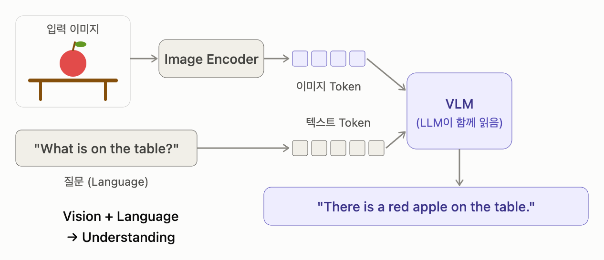
① VLM = 보고 + 말하는 AI 👀🗣️ 
 <mark class="pink">VLM (Vision-Language Model)</mark> = 이미지(Vision)와 언어(Language)를 함께 이해하는 모델.
- 입력: 테이블 위 사과 사진 + “What is on the table?” (테이블 위에 뭐가 있어?)
- 출력: “There is a red apple on the table.” (테이블 위에 빨간 사과가 있어요)

Multimodal Model의 대표 주자가 바로 VLM임. 요즘 ChatGPT, Claude, Gemini한테 사진 올려서 질문하는 게 전부 VLM 기능!

② Understanding 🎯

|	|대표 예제 ① Seeing |대표 예제 ② Understanding |
|---|---|---|
|모델	|CNN	|VLM|
|입력	|이미지만	|이미지 + 질문|
|출력	|“This is an apple.”	|“There is a red apple on the table.”|
|하는 일	|뭔지 알아보기	|질문에 맞게 상황 이해하고 설명|

Perception(보기) → Reasoning(이해하기) 단계로 한 칸 올라간 거임!

③ VLM 안에서는 무슨 일이? (그림 설명, 보충) 🔧 
그림은 요즘 VLM들이 흔히 쓰는 구조를 단순화한 거:
1. 이미지 → Image Encoder → 이미지 Token 🟪 
사진을 ViT처럼 조각내고, CLIP 같은 Image Encoder로 숫자 벡터로 바꿈. 이게 LLM 입장에서 "단어처럼 읽을 수 있는 Token" 이 됨 
2. 질문 → 텍스트 Token ⬜ 
Tokenizer로 질문을 Token으로 자름 
3. 둘을 나란히 붙여서 LLM이 함께 읽음 🟣 
LLM 입장에선 "이미지 Token 4개 + 텍스트 Token 5개짜리 긴 문장"을 읽는 거랑 같음. Attention으로 “table”이라는 단어가 이미지의 어느 조각이랑 관련 있는지 연결함 
4. 답변 생성 = 다음 Token 예측 ✍️
 “There → is → a → red → apple → …” 한 Token씩 이어 씀

→ 결국 **VLM** = 이미지를 **Token**으로 바꿔서 **LLM**한테 같이 읽혀주는 것! 지금까지 배운 게 전부 합쳐진 완전체임

### 5-4. VLM 활용과 한계 → p.31
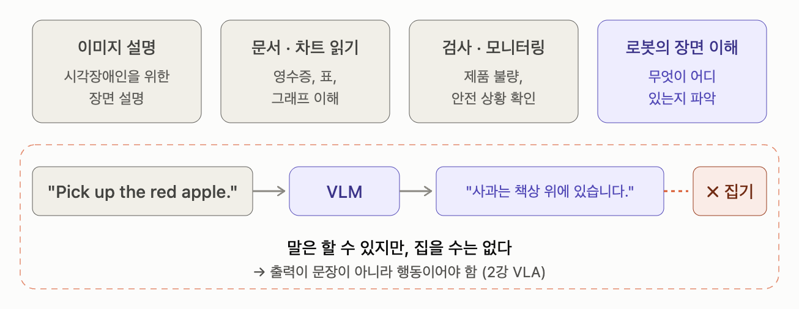
1. VLM 활용 4가지: <mark class="mint"> 이미지 설명
</mark>(시각장애인 지원) · <mark class="mint"> 문서·차트 읽기
</mark>(영수증·표·그래프) ·  <mark class="mint">검사·모니터
</mark>(불량·안전) ·  <mark class="mint">로봇의 장면 이해</mark>(무엇이 어디 있는지)
2. ⭐ 한계: “Pick up the red apple.” → "사과는 책상 위에 있습니다." → 말은 할 수 있지만, 집을 수는 없다 
3. 원인: VLM의 출력은 언어(문장) 라서 로봇을 직접 움직일 수 없음 
4. 해결: 출력을 행동(Action) 으로 바꾼 VLA (2편(다음장)) → Physical AI 완성

---
## 6. 마무리
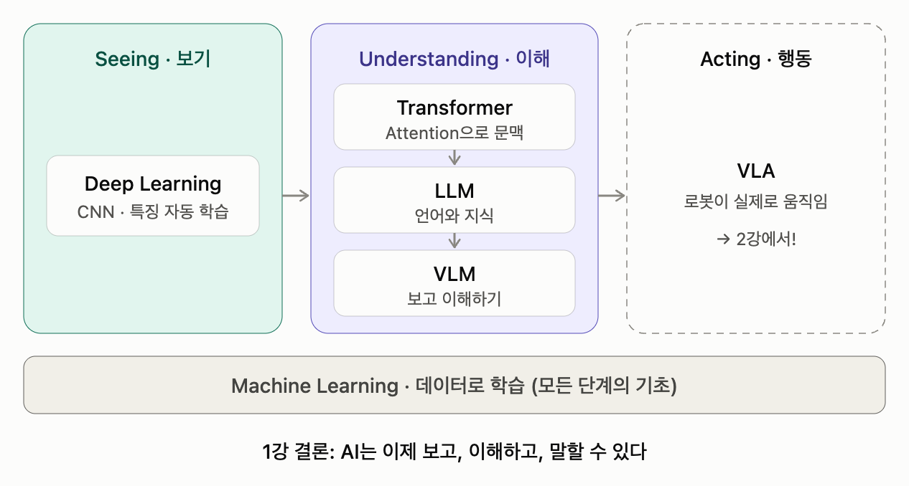

①  <mark class="pink">Machine Learning 
</mark>—  <mark class="mint">데이터로 학습 📊</mark>  
사람이 규칙 안 짜고 데이터 + 정답 → 규칙(모델) 을 스스로 찾음.
학습 = Weight 조정, 방법 = 예측 → 비교 → Loss → 경사하강법으로 수정
→ 반복. 목표는 외우기가 아니라 일반화

②  <mark class="pink">Deep Learning</mark> —  <mark class="mint">Feature 자동 학습 👀</mark> 
신경망을 깊게 쌓으면 뭘 봐야 하는지(특징)까지 알아서 학습함(15p). CNN이 Convolution → ReLU → Pooling 반복하면서 Edge → Shape → Object 로 추상화(16~18p). 대표 예제 ① Seeing: “This is an apple.”

③  <mark class="pink">Transformer </mark>— <mark class="mint"> Attention 🔦<</mark>br>
언어는 문맥이 중요함. 문장을 Token → Embedding 으로 바꾸고
, Attention으로 각 단어가 어떤 단어를 참고할지 계산 → it = cup

④  <mark class="pink">LLM </mark>—  <mark class="mint">언어와 지식</mark> 🗣️  
Transformer + 거대한 데이터 + 거대한 모델. 정체는 다음 Token
예측 하나로 질의응답·번역·코딩·대화 다 함. 사전학습 → 지시학습 → 
RLHF로 만들어지고, 환각·최신정보·계산·몸 없음 한계가 있음

⑤  <mark class="pink">VLM</mark> — <mark class="mint"> 보고 이해하기 👀🗣️</mark>  
이미지랑 글을 같은 공간에(CLIP,) → 이미지를 Token처럼 LLM에 같이 읽힘. 근데 말은 할 수 있지만 집을 수는 없음

