## 들어가며

오늘 주제는 한 줄로 요약하면 이거임.

> **통신과 AI, Physical AI가 어떻게 관련되어 있고, 어떻게 융합되어 가고 있는가**

로봇이나 자율주행차가 "보고 · 이해하고 · 행동하는" 건 봤는데, 이번엔 그 로봇들이 **서로, 그리고 서버와 어떻게 연결되느냐**를 통신 쪽 시각에서 보는 회차라고 보면 됨.

흐름은 이렇게 감.
1. **배경**: 1G → 5G 진화, 5G가 생각보다 성공 못 한 이유, 그래서 6G는 뭘 노리는가
2. **6G의 비전**: Native AI, 통신-컴퓨팅 융합, 그리고 Physical AI
3. **Wireless Caching**: Physical AI로 가는 길의 첫 번째 기술

---

## 1. 배경: 1G에서 5G까지

### 1-1. 통신은 "음성"에서 "모든 것"으로 진화했다

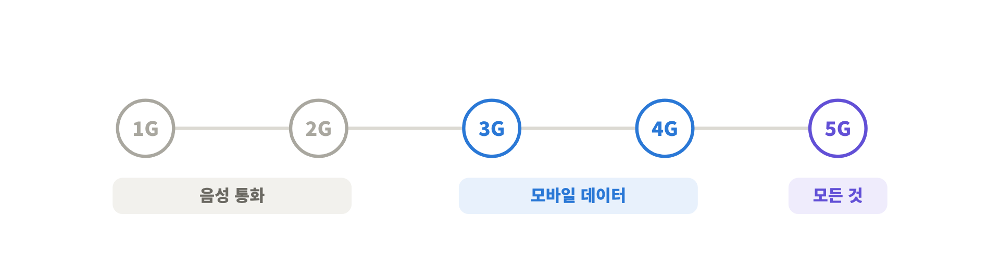

지금 우리가 쓰는 건 **5G** 시스템임. 이름 그대로 1세대(1G)부터 5세대(5G)까지 점점 진화해 왔음.

- <mark class="pink">1G · 2G</mark>는 주로 **보이스 트래픽**(전화 통화)을 다루는 통신 시스템이었음
- <mark class="pink">3G · 4G</mark>로 넘어가면서 음성이 아니라 **모바일 데이터**를 주고받는 시스템으로 바뀜. 우리가 폰으로 유튜브 같은 데이터 서비스를 쓰게 된 게 이때부터임
- 그게 더 진화해서 지금의 **5G**

한마디로 <mark class="mint">초기엔 음성 기반이던 통신망이, 이제는 인터넷에 떠다니는 모든 데이터를 다 먹어치우는 시스템으로 진화했다</mark>고 이해하면 됨.

### 1-2. 5G는 세 가지 목표로 설계됐다

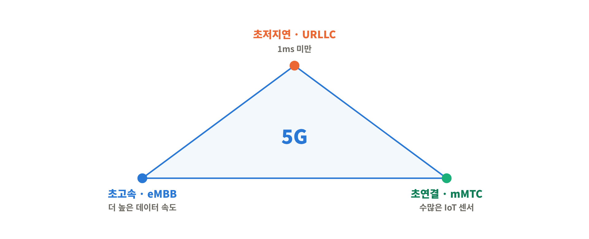

5G는 크게 세 가지 기준(criteria)을 놓고 설계됐음.

① <mark class="pink">초저지연 (URLLC, Ultra-Reliable Low Latency Communication)</mark> 
데이터 통신의 지연시간(latency)을 **1ms 미만**으로 줄이겠다는 목표.

② <mark class="pink">초고속 (eMBB, enhanced Mobile Broadband)</mark> 
더 높은 데이터 속도를 주겠다는 목표. 음성보다 모바일 · 비디오 트래픽이 훨씬 무거우니까 이걸 서포트하겠다는 거.

③ <mark class="pink">초연결 (mMTC, massive Machine Type Communication)</mark> 
스마트폰뿐 아니라 웨어러블, 스마트시티 등에 **수없이 깔린 IoT 센서**를 다 연결하겠다는 목표.

### 1-3. 5G의 "Big Three" 기술

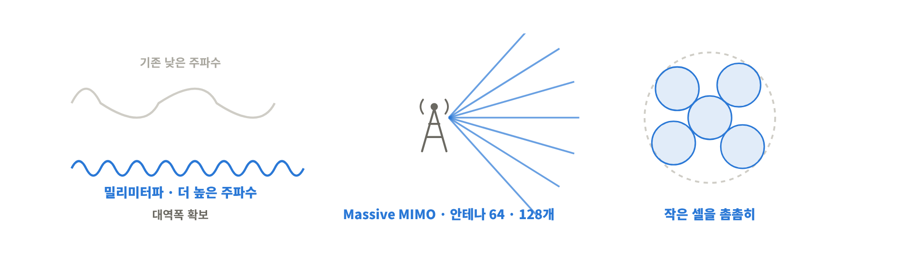

이 세 목표를 달성하려고 꺼낸 핵심 기술이 세 개 있음.

① 밀리미터파 (mmWave) 
기존 통신은 상대적으로 낮은 주파수 대역을 썼는데, 그 대역으로는 주파수가 충분하지 않았음.
그래서 5G로 넘어오면서 대역폭을 더 확보하려고 **파장이 mm 단위인 30GHz 근처의 높은 주파수 대역**을 쓰기로 함. 특히 우리나라 5G는 **28GHz 대역**을 기반으로 많이 설계됐음.

② Massive MIMO 
기지국이 가진 안테나 수를 64개, 128개 수준으로 **엄청 많이(massive)** 늘려서, 더 많은 유저를 서포트하는 기술.

③ Ultra-dense Small Cell 
통신 용량(capacity)을 늘리려고, 기존 매크로셀(macro cell) 기반 구조에 **그보다 작은 스몰셀을 촘촘하게 많이 깔겠다**는 전략.

> 💡 셋 다 결국 같은 질문에 대한 답임. **"용량을 어떻게 늘릴까?"** 
> mmWave = 도로를 **넓히기**(대역폭 확보), Massive MIMO = 차선을 **잘게 나눠 쓰기**(공간 재사용), Small Cell = 톨게이트를 **여러 개 짓기**(셀 밀도 증가).

### 1-4. 현실: 5G는 생각보다 성공하지 못했다

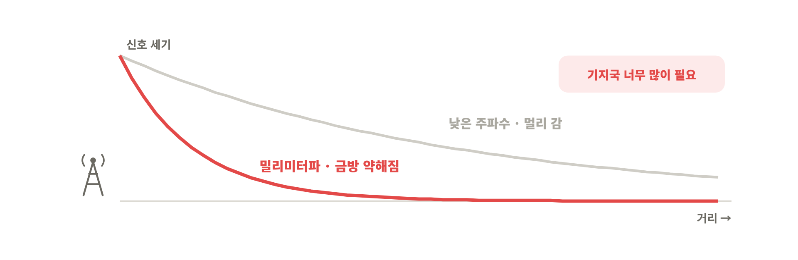

근데 5G는 그렇게 성공적인 시스템으로 평가받지 못하고 있음. 원인은 핵심 기술이었던 **mmWave**.

- 대역폭 확보하려고 높은 주파수로 올라갔는데, mmWave 신호는 **급격하게 감쇠**함
- 이걸 커버하려면 셀을 훨씬 더 많이 깔아야 함
- 통신사(SKT, KT, LG U+)가 실제로 깔아보니 **경제성이 없다**고 판단
- 결국 <mark class="pink">2022년쯤 28GHz 대역을 접게 됨</mark>(주파수 할당 취소)

즉 5G의 간판 기술이었던 mmWave를 사실상 포기한 셈이고, 그래서 사람들이 "그럼 **6G는 어떻게 설계해야 하지?**"를 훨씬 더 고민하게 됨.

> 💡 우리가 쓰는 "5G"는 대부분 3.5GHz 대역임. 그래서 체감 속도가 광고만큼 안 나온다는 얘기가 계속 나왔던 거. 진짜 빠른 속도는 28GHz에서 나오는 건데, 그쪽이 경제성 문제로 접혔기 때문.

---

## 2. 6G의 비전: AI, 그리고 Physical AI

### 2-1. 6G가 노리는 것

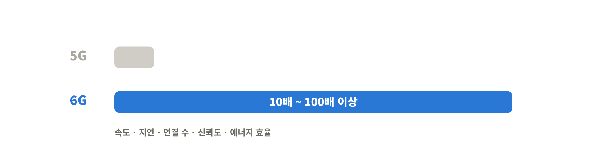

5G의 실패를 극복하려고 6G를 많이들 고민하고 있음.
6G는 5G보다 훨씬 높은 요구사항을 목표로 함. **에너지 효율, 주파수 효율, 무선 지연시간, 기기 밀도, 신뢰도, 데이터 속도**를 5G 대비 <mark class="pink">10배~100배 이상</mark> 끌어올리려고 노력하는 중.

### 2-2. 6G meets AI

6G로 넘어가면서 사람들이 제일 관심 갖는 건 **AI**임.

MIT 테크놀로지 리뷰(MIT Technology Review)에 2022년쯤 실린 기사인데, 지금처럼 LLM이 대세가 되기 전인데도 이미 **"AI가 6G의 핵심 기술이 될 것"**이라고 예측했던 글임.

### 2-3. 6G Vision: Native AI

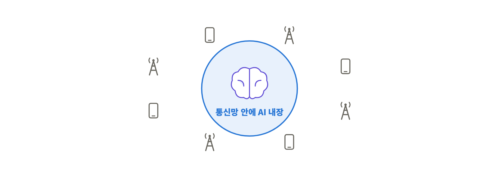

이를 기반으로 화웨이, 삼성, 에릭슨, 노키아 같은 회사들이 <mark class="pink">Native AI</mark>를 6G의 새로운 비전으로 제시하고 있음.

> **Native AI** = 처음부터 통신 시스템 안에 AI를 내장해서 설계하겠다

참고로 화웨이는 중국 회사인데, 글로벌 통신 시장 점유율은 삼성보다 훨씬 큼. 회사마다 비전은 다양하지만 **AI를 6G의 핵심 기술로 채택하겠다**는 건 대부분 공통임.

### 2-4. 왜 AI냐? 통신-컴퓨팅 융합

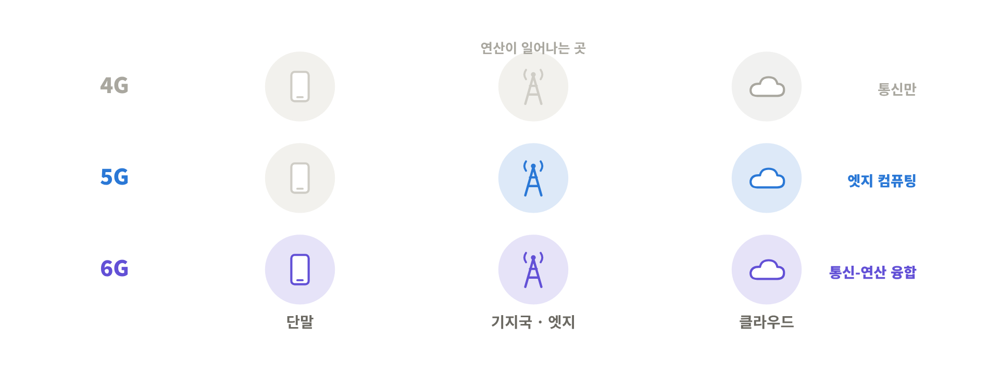

AI가 6G 핵심 기술이 된 기본 배경에는 <mark class="mint">통신과 컴퓨팅의 융합(Communications and Computing Convergence)</mark>이 있음.
6G를 통신 기술이라고만 생각할 수 있지만, 사실은 **통신뿐 아니라 AI 기반 연산을 잘하기 위한 시스템**이라고 이해하면 됨.

| 세대 | 연산은 어디서? |
|---|---|
| 4G | 통신만을 위해 설계된 시스템 |
| 5G | **엣지 컴퓨팅** – 기지국 · 코어 · 클라우드에서 다양한 연산 능력 제공 |
| 6G | 그게 **단말까지** 내려가서 통신과 연산이 융합 |

### 2-5. 6G Vision: Physical AI

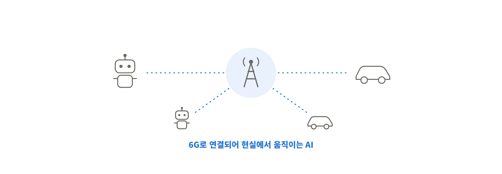

통신-컴퓨팅 융합으로 얻을 수 있는 또 다른 비전이 바로 **Physical AI**임.
6G 시대에 Physical AI가 핵심 애플리케이션이 될 거고, 이를 현실화하는 핵심 기술로 이런 것들을 꼽음.

- **Compound AI System** (여러 AI를 묶은 시스템)
- **Heterogeneous Edge Computing** (다양한 엣지 연산 자원)
- **Physical AI**
- **AI Flywheel**
- **Deployment-ready Development Platform** (바로 배포 가능한 개발 플랫폼)

결국 6G는 단순히 통신이 아니라 다양한 기술이 융합된 시스템이고, 
특히 **스토리지나 연산으로 대표되는 컴퓨팅 네트워크가 융합되면서 
Physical AI까지 진화할 것**이라는 게 포인트!.

### 2-6. Physical AI로 가는 로드맵

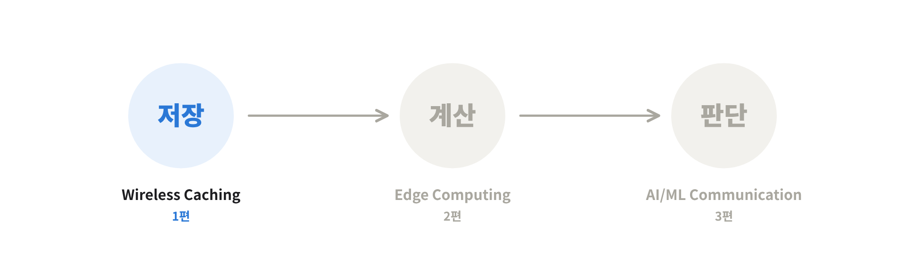

이런 연구는 2010년대 초반부터 쭉 이어져 왔음. 여기는 이 연구들이 어떻게 진행돼 왔고, Physical AI로 어떻게 진화하고 있는지를 세 단계로 설명함.

| 단계 | 기술 |
|---|---|
| ① | **Wireless Caching** (1편) |
| ② | **Edge Computing** (2편) |
| ③ | **AI/ML-Driven Communication** (3편) |

> 💡 단계별로 네트워크가 맡는 역할이 커지는 구조임. 
> ① 데이터를 **저장**해 두는 네트워크 → ② 데이터를 **계산**해 주는 네트워크 → ③ 데이터로 **학습 · 추론**까지 하는 네트워크. 
> 저장 → 연산 → 지능 순서로 레벨업한다고 보면 됨.

이번 글에서는 첫 번째인 **Wireless Caching**을 다룸.

---

## 3. Wireless Caching

### 3-1. 모바일 데이터 트래픽 수요

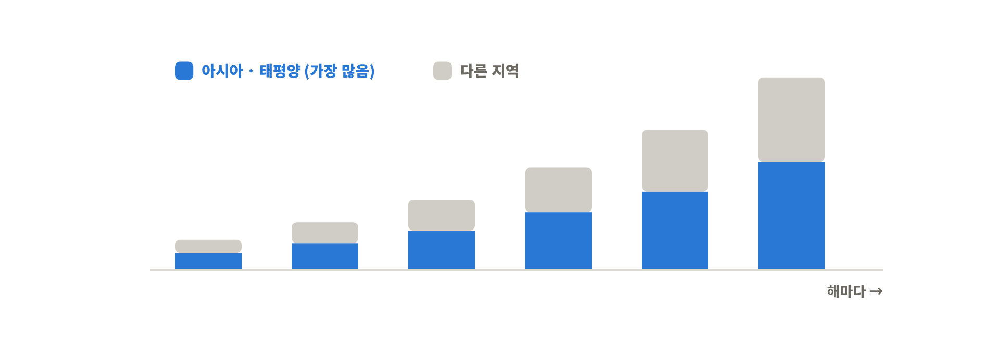

캐싱 얘기 전에 모바일 데이터가 얼마나 쓰이고 있는지부터 봄.
시스코(Cisco)가 2017년부터 2022년까지 모바일 데이터 트래픽을 예측한 표임.

- **아시아 · 태평양** 쪽 데이터 소모량이 훨씬 높음. 한국, 중국, 일본을 중심으로 스마트폰 보급이 엄청 많이 됐기 때문
- 해가 갈수록 증가폭이 **아주 급속도로** 올라감

### 3-2. 모바일 데이터 쓰나미

이렇게 트래픽이 치솟는 상황을 <mark class="pink">모바일 데이터 쓰나미(Mobile Data Tsunami)</mark>라고 부름.

여기서 핵심 질문은 이거임.

> 이 쓰나미를 서포트할 **무선 인프라가 얼마나 잘 준비되어 있을까?**

### 3-3. 기존 해법: 용량 늘리기

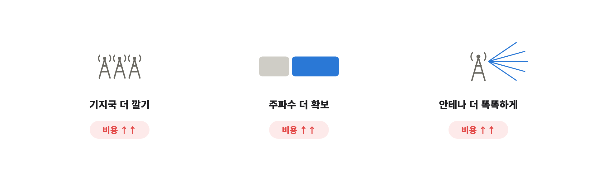

트래픽을 감당하려면 결국 통신 용량(capacity)을 확보해야 함. 이를 위한 기존 최신 기술은 크게 세 가지였음.

1. **기지국 밀도 높이기** – 기지국을 더 촘촘하게 깔기
2. **주파수 더 확보하기** – 앞에서 본 mmWave처럼 더 높은 대역 쓰기
3. **주파수 효율 높이기** – 안테나를 좀 더 똑똑하게 쓰기

### 3-4. 근본적인 문제 ①: 인프라는 무한히 늘릴 수 없다

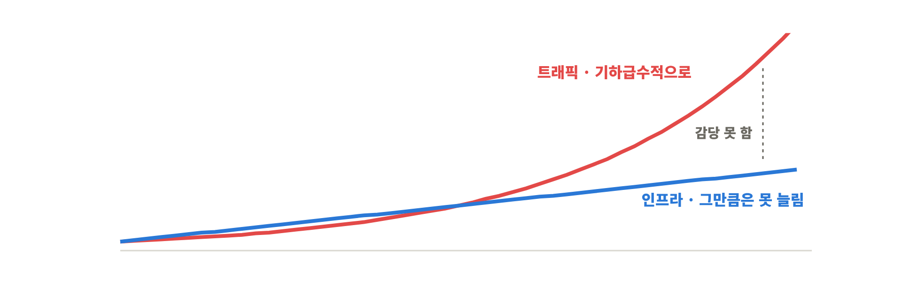

근데 이 세 가지 다 그렇게 성공적이지 못했음. 전부 **인프라를 많이 깔아야** 하는 방식이라 비용이 너무 많이 듦.

인프라를 무한히 늘릴 수는 없으니, <mark class="pink">지속가능성(Sustainability)과 확장성(Scalability)</mark>이 떨어진다고 볼 수 있음.

그래서 모바일 데이터 쓰나미를 대하는 통신 분야의 고민은 이거였음.

> "인프라를 늘리는 것 말고, **다른 방법**은 없을까?"

### 3-5. 근본적인 문제 ②: 피크 타임의 혼잡

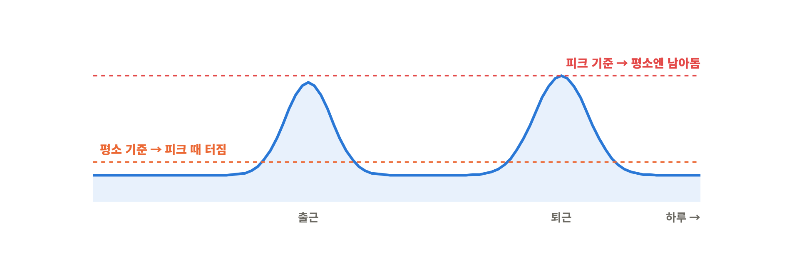

또 다른 이슈는, 아무리 통신 네트워크를 잘 만들어도 **데이터 패턴**에 따라 효율이 크게 달라진다는 것.

고속도로를 떠올리면 바로 이해됨.
- **피크 타임이 아닐 때**는 차가 거의 안 다님
- **출퇴근 피크 타임**엔 수많은 차가 올라와 있음

차에 탄 사람들이 데이터를 쓴다고 치면, 피크와 오프피크의 트래픽 패턴이 너무 크게 달라짐.
- **피크 기준**으로 네트워크를 설계하면 → 평소엔 설비가 놀고 있음
- **오프피크 기준**으로 설계하면 → 피크 때 터짐

어느 쪽이든 <mark class="mint">비용 측면에서 답이 잘 안 나오는 고민</mark>이었던 거.

### 3-6. 인터넷도 같은 문제를 겪었다

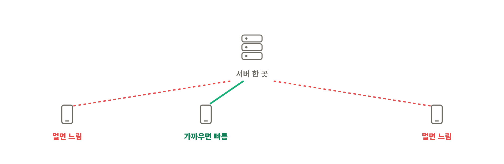

사실 이런 문제는 인터넷에도 똑같이 있었음.

인터넷은 보통 **서버**에 데이터가 있고, 우리가 요청하면 인터넷망을 타고 서버에서 데이터가 오는 구조임.
근데 서버가 어디 있느냐에 따라 **지연시간이 달라짐**. 예를 들어 서버가 태평양 한가운데 있다고 하면
- 서버와 가까운 유저 → 지연시간이 짧음
- 서버와 먼 유저 → 지연시간이 길어짐

그래서 인터넷 네트워크 연구하는 사람들도 이걸 어떻게 극복할지 고민을 많이 했음.

### 3-7. 인터넷의 해법: CDN

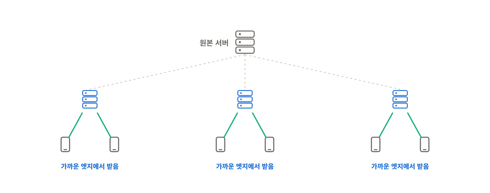

이 고민에 대한 기본적인 대답이 <mark class="pink">CDN (Content Delivery Network)</mark>임.

- 서버 하나에만 의존하지 않고, 지역마다 **로컬 엣지 서버**를 구축함
- 서버의 데이터를 **미리 복사해서 로컬 엣지에 갖다 놓음**
- 그러면 유저는 메인 서버가 아니라 **가까운 로컬 엣지**에 접속해서, 훨씬 짧은 지연시간으로 인터넷 서비스를 즐길 수 있음

> 💡 넷플릭스, 유튜브가 빠른 이유가 이거임. 넷플릭스는 국내 통신사 망 안에 자체 캐시 서버를 넣어둬서, 우리가 보는 영상 대부분이 해외가 아니라 국내 통신사 안에서 바로 날아옴.

그럼 자연스럽게 이런 생각이 듦.

> **이걸 무선 상황에도 비슷하게 적용해 보면 어떨까?**

### 3-8. 콘텐츠의 특징: 다들 비슷한 걸 본다

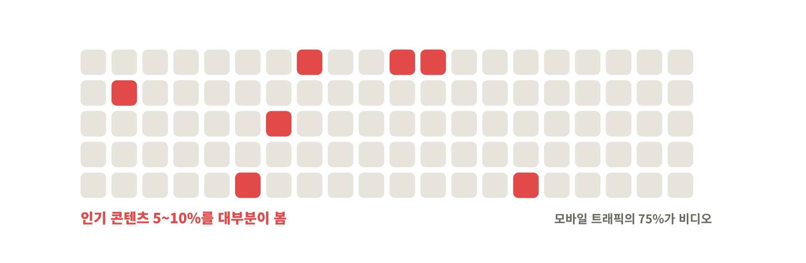

무선에 CDN 아이디어를 가져올 수 있는 근거는 데이터 트래픽 자체의 특징에 있음.

- 2020년 무렵 모바일 데이터 트래픽의 대부분, **75%가 비디오**
- 사람들이 모든 비디오를 골고루 보는 게 아니라, **5~10%의 인기 콘텐츠**를 기반으로 많이 봄

그럼 결론은 간단함.

> 모든 콘텐츠를 엣지 서버에 갖다 놓는 게 아니라, **인기 있는 5~10%만** 엣지 서버에 갖다 놔도 효율적으로 돌릴 수 있지 않을까?

### 3-9. Connection-Centric에서 Content-Centric으로

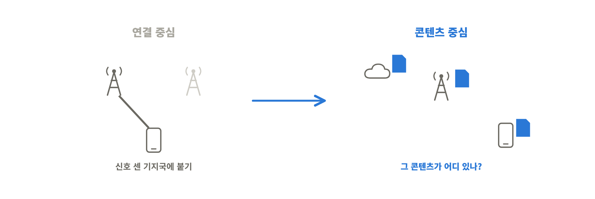

여기서 네트워크 설계 철학이 바뀜.

| 구분 | 연결 중심 (Connection-Centric) | 콘텐츠 중심 (Content-Centric) |
|---|---|---|
| 동작 | 근처에서 신호를 가장 세게 주는 기지국에 접속해서 데이터를 받음 | 콘텐츠의 특징을 고려해서 네트워크를 구성 |
| 관심사 | "어느 기지국에 붙을까?" | "**그 콘텐츠를 어디에 둘까?**" |

즉 네트워크가 <mark class="pink">Connection-centric Network → Content-centric Network</mark>로 진화했다고 이해하면 됨.

### 3-10. Cache-enabled Wireless Network: 세 가지 질문

그래서 <mark class="mint">캐시가 가능한 무선 네트워크(Cache-enabled Wireless Network)를 어떻게 잘 설계하느냐</mark>가 중요한 이슈임.

여기서 **캐시(cache)**는 그냥 "저장공간(storage)"이라고 생각하면 됨. 컴퓨터 쪽에서 가져온 말인데, 캐시는 기존 메모리보다 **그렇게 크지 않음**.
엣지 네트워크의 저장공간도 클라우드보다 크지 않으니까, **이 한정된 공간을 어떻게 잘 활용하느냐**가 관건임.

답해야 할 질문은 세 가지.
1. **Where to cache?** – 어디에 저장할까?
2. **What to cache?** – 무엇을 저장할까?
3. **How to cache?** – 어떻게 저장할까?

### 3-11. Where to cache? ① 코어에 저장 (EPC 캐싱)

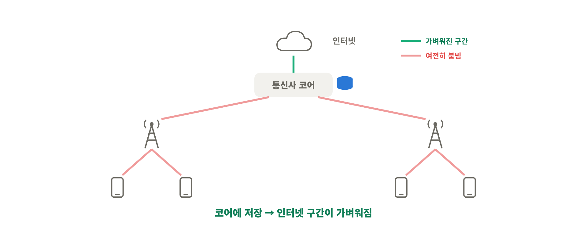

- **캐싱이 없을 때**: 모든 데이터를 인터넷에서 바로 받아옴 → 데이터 트래픽이 너무 많이 필요함
- **EPC 캐싱**: 몇 가지 데이터를 통신사 코어(MNO 코어)에 옮겨 놓으면 더 효율적

통신 네트워크에서 기지국은 코어 네트워크에 연결돼 있으니, 인터넷 서버에서 **코어까지만** 미리 가져다 놔도 효율이 좋아짐.

### 3-12. Where to cache? ② 기지국에도 저장

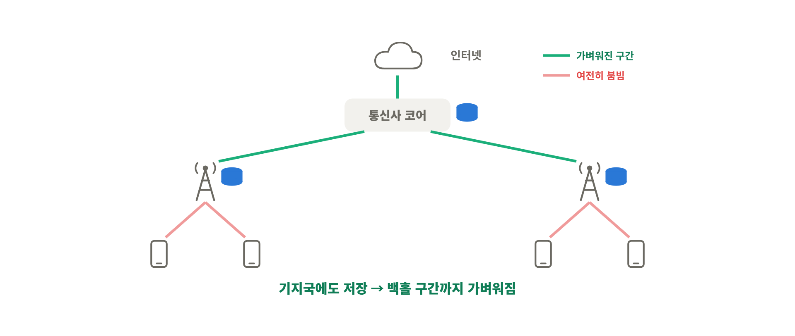

이걸 조금 더 진화시켜서, **각 기지국이 저장공간을 갖고 있다면** 중요한 데이터를 **기지국까지** 끌어다 놓을 수 있음.

> 💡 이러면 코어와 기지국 사이 구간(백홀, backhaul)의 짐도 덜어지고, 유저가 느끼는 지연시간도 줄어듦.

### 3-13. Where to cache? ③ 단말에도 저장

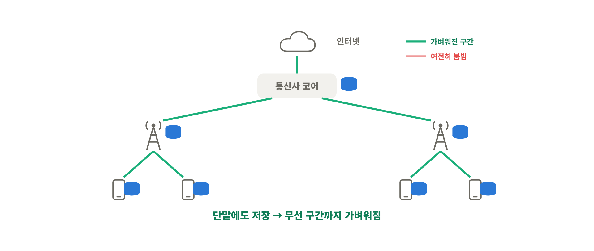

세 번째로, **단말도 저장공간이 있으니까** 이걸 잘 활용하면 좋지 않을까 해서 **단말 캐싱**도 고려하고 있음.

> 💡 데이터를 유저 쪽으로 **한 칸씩 당겨 올수록** 그 위쪽 구간의 짐이 덜어지는 구조임.
> - 코어에 저장 → 인터넷 ↔ 통신사 구간이 가벼워짐
> - 기지국에 저장 → 코어 ↔ 기지국 구간(백홀)까지 가벼워짐
> - 단말에 저장 → 기지국 ↔ 단말 무선 구간까지 가벼워짐
>
> 대신 아래로 내려갈수록 저장공간은 작아지고 관리할 곳은 많아짐. 이게 뒤에 나오는 How to cache가 어려운 이유.

### 3-14. What to cache? ① 캐싱 가능한 트래픽

모든 트래픽을 캐싱할 수 있는 건 아님.

- ❌ **캐싱 불가**: 게임, 음성통화 같은 **인터랙티브 애플리케이션**
- ⭕ **캐싱 가능**: 비디오 스트리밍처럼 **정해진 데이터**

넷플릭스에서 최근 인기 있는 영상을 띄워 주는 것처럼, 콘텐츠엔 기본적으로 **인기도(popularity)**가 있음.
- 인기도는 **계속 변하지만 (dynamic)**
- 어느 정도 **예측 가능함 (predictable)**

그래서 이 인기도를 잘 측정해서 **최근에 많이 소비되는 콘텐츠**를 기반으로 캐싱하면 훨씬 효율적임.

### 3-15. What to cache? ② 통째로 말고 앞부분만

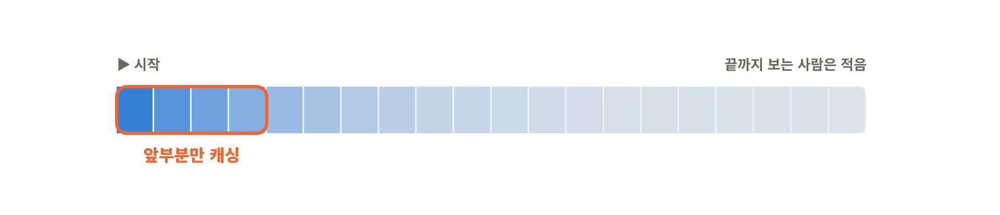

캐싱할 때도 인기 콘텐츠를 **통째로** 저장하는 게 아니라, **파일 단위나 청크(chunk) 단위**로 나눠서 일부만 캐싱하는 게 훨씬 효율적일 수 있음.

유튜브 생각해 보면 바로 이해됨. 영상을 처음부터 중간까지는 보는데, **끝까지 보는 사람은 생각보다 많지 않음**.
그래서 소비가 많은 **초반 청크만** 잘 캐싱해 놔도 훨씬 효율적으로 설계할 수 있음.

### 3-16. What to cache? ③ 요청은 소수 콘텐츠에 몰린다

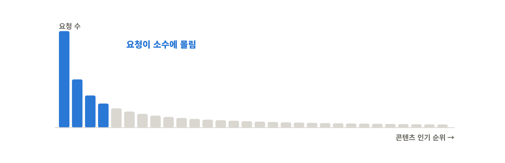

유저의 요청 패턴을 보면 모든 데이터를 골고루 요청하는 게 아니라 **인기 콘텐츠로 몰려 있음**.

그러니까 <mark class="mint">인기도 높은 콘텐츠 위주로, 그것도 앞부분만 잘라서 캐싱</mark>하는 게 훨씬 효율적이라는 결론.

> 💡 이렇게 순위가 높을수록 요청이 확 몰리고 뒤로 갈수록 길게 줄어드는 모양을 보통 **Zipf 분포**로 모델링함. 1등이 2등의 두 배, 3등의 세 배쯤 요청받는 느낌. 쏠림이 셀수록 작은 캐시로도 많은 요청을 처리할 수 있음.

### 3-17. How to cache? 어떤 파일을 어느 헬퍼에?

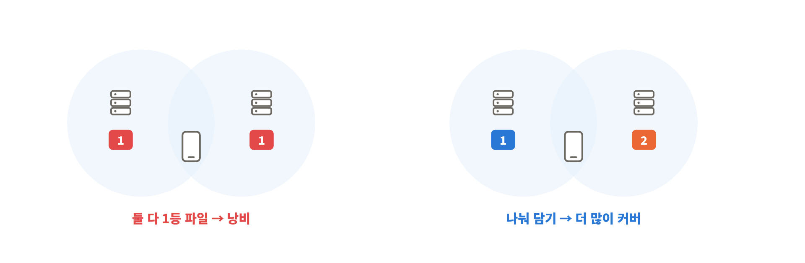

여기서 **헬퍼(helper)**는 캐시 메모리를 가진 장치를 말함. 코어든 기지국이든 저장공간 있으면 다 헬퍼.

- 모든 유저가 **헬퍼 하나에만** 접속할 수 있다면 → 그 헬퍼에 **지금 가장 인기 있는 콘텐츠**를 다 저장하면 됨
- 근데 실제로는 여러 헬퍼가 존재하니까, 콘텐츠를 **여러 헬퍼에 잘 나눠 담아야** 함 → 이 분배 문제가 생각보다 복잡함

> 💡 예를 들어 내 근처에 헬퍼 두 개가 겹친다면, 둘 다 1등 영상을 저장하는 건 낭비임. 하나는 1등, 하나는 2등을 담는 게 나을 수 있는데, 이런 조합을 네트워크 전체에서 맞추려니 어려워지는 거. 이런 문제를 보통 "NP-hard", 즉 경우의 수가 폭발해서 정답을 빨리 구하기 어려운 문제라고 함.

### 3-18. 협력 캐싱 ① 헬퍼 네트워크

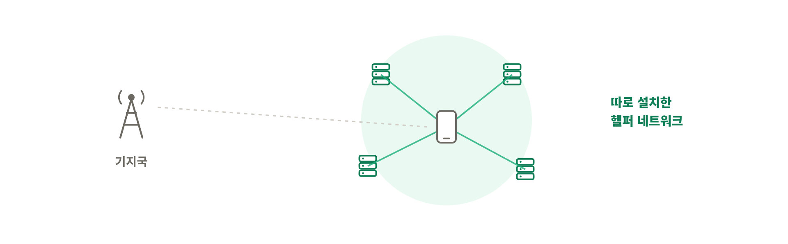

그래서 기존 기지국뿐 아니라 **헬퍼 네트워크를 따로 설치해서** 캐싱하는 방법을 사람들이 많이 고민하고 있음.

### 3-19. 협력 캐싱 ② 단말의 메모리 활용

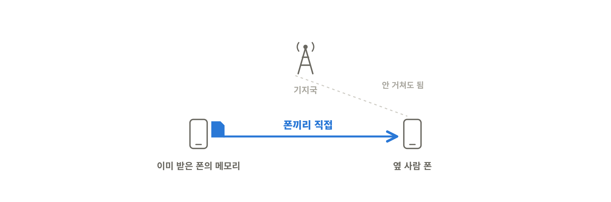

헬퍼를 통한 방법뿐 아니라, **모바일 단말이 가진 메모리**를 효율적으로 활용하는 것도 많이 고민하고 있음.

> 💡 옆 사람 폰에 이미 있는 영상을 기지국을 거치지 않고 **폰끼리 직접(D2D, Device-to-Device)** 주고받는 식. 기지국 쪽 무선 자원을 아낄 수 있음.

### 3-20. 정리: 모두가 함께 진화한다

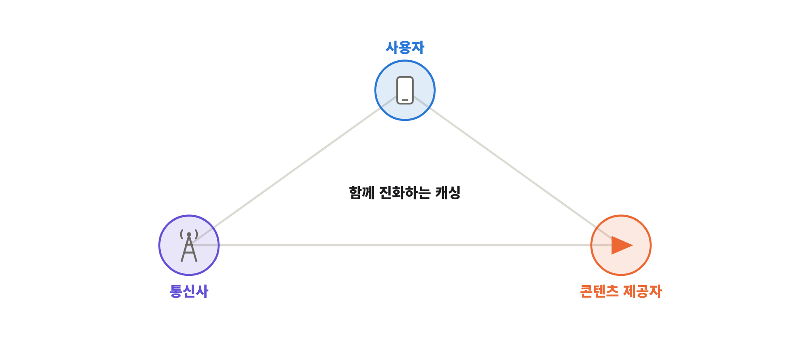

정리하면, 캐싱은 기존의 **연결 기반 접근이라기보다 콘텐츠 인기도 기반 접근**이라서 **유저, 통신사, 콘텐츠 제공자**가 다 같이 연관돼서 진화하고 있음.

그리고 이건 먼 미래 기술이 아니라 <mark class="mint">지금 우리가 쓰는 통신망에서도 많이 활용되고 있는 기술</mark>임.

---

## 4. 핵심 요약

1. 통신은 **음성(1G·2G) → 데이터(3G·4G) → 모든 것(5G)**으로 진화했고, 5G는 **초저지연 · 초고속 · 초연결**을 목표로 **mmWave · Massive MIMO · Small Cell**을 꺼냈음
2. 하지만 mmWave는 신호가 급격히 약해져 경제성이 안 나왔고, 28GHz 대역을 접으면서 **5G는 기대만큼 성공하지 못함**
3. 6G는 **Native AI**와 **통신-컴퓨팅 융합**을 핵심으로 삼고, 그 끝에 **Physical AI**를 비전으로 둠
4. Physical AI로 가는 로드맵은 **Wireless Caching → Edge Computing → AI/ML-Driven Communication** (저장 → 연산 → 지능)
5. **Wireless Caching**은 "인프라를 더 깔지 말고, 인기 콘텐츠를 유저 가까이 미리 갖다 놓자"는 발상. 네트워크가 **Connection-centric → Content-centric**으로 바뀜
6. 설계 질문은 **Where(코어 · 기지국 · 단말) / What(인기 콘텐츠, 그중에서도 앞부분) / How(여러 헬퍼에 어떻게 나눌지)**

>한 줄로 묶으면  
>**트래픽 폭증을 인프라 확장만으로는 못 막으니, 네트워크가 콘텐츠를 "기억"해서 유저 가까이 두자는 게 Wireless Caching이고, 이게 네트워크가 저장 → 연산 → 지능으로 진화하는 Physical AI 로드맵의 첫걸음이다.**

다음 편에서는 로드맵 두 번째 단계인 **Edge Computing**으로 넘어감.