## 들어가며

1편에서는 Physical AI로 가는 로드맵 3단계 중 첫 번째인 **Wireless Caching**을 봤음.

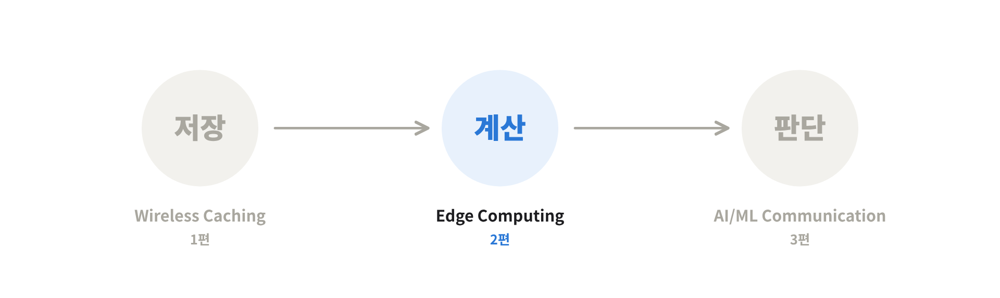

| 단계 | 기술 | 네트워크의 역할 |
|---|---|---|
| ① | Wireless Caching | 데이터를 **저장**해 둠 |
| **②** | **Edge Computing** ← 이번 글 | 데이터를 **계산**해 줌 |
| ③ | AI/ML-Driven Communication | 데이터로 **학습 · 추론**까지 함 |

이번 2편은 두 번째 단계인 **Mobile Edge Computing(MEC)**임. 1편이 "콘텐츠를 유저 가까이 갖다 놓자"였다면, 2편은 <mark class="mint">"연산도 유저 가까이에서 해주자"</mark>는 얘기임.

흐름은 이렇게 감.
1. **MEC란 무엇인가** – 클라우드 대신 엣지, 그리고 응용 예시
2. **오프로딩 판단과 제어** – 에너지 기준, 무선 자원 + 연산 자원
3. **이동성 · 캐싱** – 핸드오프, 프리패칭, 서비스 캐싱
4. **대규모 MEC · 표준화** – 간섭, 가상 머신, 운영 모드

---

## 1. Mobile Edge Computing이란?

### 1-1. 스마트폰으로 "연산"이 필요한 일을 하기 시작했다

데이터 통신이 대중화되면서 이제 모든 사람이 스마트폰을 씀. 그리고 스마트폰으로 진짜 별걸 다 함.
- 예전처럼 음성통화도 하고, 유튜브도 보고
- **게임**도 하고, **증강현실(AR)** 같은 서비스도 씀

근데 뒤의 두 개는 성격이 다름. 비디오나 음성은 **데이터만 왔다 갔다** 하면 되는데, 게임이나 AR은 어디선가 **연산(computation)**을 해줘야 돌아감.

문제는 <mark class="pink">단말(스마트폰)이 가진 연산 능력이 제한적</mark>이라는 것. 무거운 연산을 폰에서 막 돌리기엔 한계가 있음.

그래서 나온 기본 아이디어가 이거임.

> 무거운 연산을 폰에서 다 하지 말고, **연산 능력이 훨씬 좋은 쪽으로 넘겨서(offloading)** 처리하면 어떨까?

이렇게 연산을 다른 곳에 넘기는 걸 <mark class="pink">컴퓨테이션 오프로딩(Computation Offloading)</mark>이라고 부름.

### 1-2. 클라우드까지 가면 너무 멀다 (MCC의 한계)

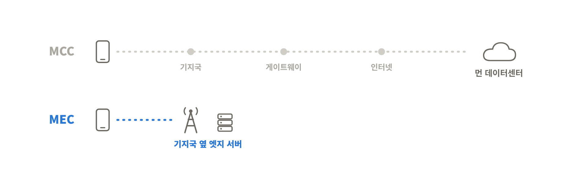

기존엔 이 오프로딩을 보통 **클라우드 서버**에서 했음. 이걸 **모바일 클라우드 컴퓨팅(MCC, Mobile Cloud Computing)**이라고 함.

흐름은 이럼.
1. 단말이 기지국 · 위성 · 와이파이 AP 등으로 데이터를 올림
2. 모바일 네트워크의 **게이트웨이**를 거쳐 **인터넷**을 타고
3. 아주 멀리 떨어진 **데이터 센터**까지 가서 연산하고
4. 다시 그 길을 거꾸로 돌아옴

단말에서 클라우드 서버까지 가는 거리가 생각보다 엄청 멂.
신호가 아무리 빨라도 **물리적인 거리 한계** 때문에 MCC는 <mark class="pink">지연시간이 길 수밖에 없음</mark>.

### 1-3. 해법: 기지국 옆에 서버를 두자 (MEC)

이걸 극복하려고 나온 게 <mark class="pink">모바일 엣지 컴퓨팅(MEC, Mobile Edge Computing)</mark>임.

> 오프로딩을 클라우드까지 보내지 말고, **중간에 기지국에 붙어 있는 엣지 서버**에서 처리하자

스마트 기기 앱, 커넥티드 차량, 감시(CCTV) 네트워크, 헬스 모니터링 같은 서비스에서 나오는 연산을 **기지국 옆 엣지 서버에서 바로 처리하고 돌려주니까**, 훨씬 빠른 연산 서비스가 가능해짐.

> 💡 1편의 CDN이랑 구조가 똑같음. CDN이 **콘텐츠**를 지역 엣지 서버에 복사해 뒀다면, MEC는 **연산 능력**을 엣지에 가져다 놓은 것. "멀리 있는 중앙 서버 대신 가까운 엣지"라는 발상은 그대로고, 엣지가 하는 일이 저장에서 계산으로 바뀐 거임.

### 1-4. MEC의 장점 네 가지

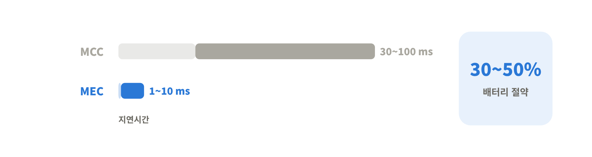

| 장점 | 이유 |
|---|---|
| **낮은 지연시간 (Low latency)** | 클라우드까지 안 가고 가까운 엣지에서 처리 |
| **단말 에너지 절약 (Energy saving)** | 신호를 보내야 하는 거리가 짧아짐 |
| **상황 인식 (Context awareness)** | 기지국 근처의 **지역적인 특징**(위치, 주변 상황)을 활용 가능 |
| **보안 향상 (Security)** | 단말 데이터가 클라우드까지 안 넘어감 |

지연시간 관점에서 숫자로 보면 차이가 확 남.

| 구분 | 전파 + 전송 지연 | 연산 지연 | 전체 지연 |
|---|---|---|---|
| MCC (클라우드) | 김 | 짧음 (서버 성능 좋음) | **30 ~ 100 ms** |
| MEC (엣지) | **확 줄어듦** | 조금 더 걸림 | **1 ~ 10 ms** |

엣지 서버는 클라우드보다 성능이 약해서 연산 자체는 좀 더 걸리지만, 데이터가 오가는 시간(전파 · 전송)을 획기적으로 줄이니까 **전체 지연은 오히려 확 줄어듦**.
그리고 단말 에너지 소모도 <mark class="pink">30~50% 정도</mark> 줄일 수 있음.

---

## 2. MEC는 어디에 쓰이나: 애플리케이션 예시

### 2-1. 얼굴 인식 (Face Recognition)

폰으로 사진을 찍으면 이게 누구 얼굴인지 분석해 주는 서비스.

1. **이미지 획득 (Image acquisition)** ← 사진은 폰으로 찍어야 하니까 **단말**에서
2. **얼굴 검출 (Face detection)**
3. **전처리 (Pre-processing)**
4. **특징 추출 (Feature extraction)**
5. **분류 (Classification)**

2~5번 같은 무거운 연산은 단말에서 할 필요 없이, 찍은 이미지를 빨리 **MEC 서버로 넘기면 서버가 대신 연산**해 줌. 전형적인 컴퓨테이션 오프로딩 서비스임.

### 2-2. 증강현실 (AR)

포켓몬 GO 같은 걸 생각하면 됨. 폰 카메라로 보이는 실제 화면 위에 가상 이미지를 얹는 게 AR임.

| 처리 단계 | 어디서? |
|---|---|
| 비디오 소스 (카메라 입력) | **단말** (로컬) |
| 트래커 (Tracker) – 카메라 움직임 추적 | **MEC 서버** |
| 매퍼 (Mapper) – 주변 공간 지도 만들기 | **MEC 서버** |
| 객체 인식 (Object recognizer) | **MEC 서버** |
| 렌더러 (Renderer) – 화면에 그리기 | **단말** (로컬) |

### 2-3. 그래서 통신과 컴퓨팅은 같이 설계해야 한다

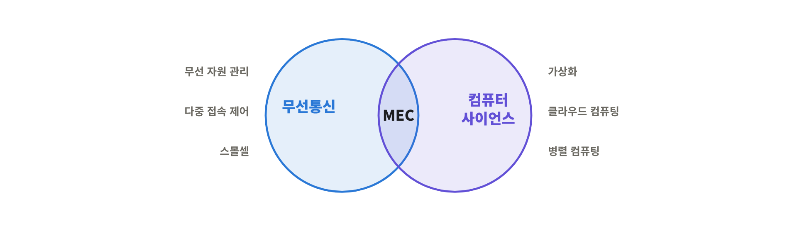

두 예시 다 구조가 똑같음.

> 단말에서 일부 연산 → **통신**으로 MEC 서버에 전송 → 서버에서 연산 → 다시 **통신**으로 돌려줌

연산과 통신이 계속 번갈아 나오니까, MEC는 <mark class="mint">커뮤니케이션과 컴퓨팅이 결합된 구조</mark>로 설계해야 함.

이걸 연구 관점으로 확장하면, 무선통신 연구하는 사람도 **무선통신만 파면 안 되고 컴퓨터 사이언스, 컴퓨터 네트워크를 같이 연구**해야 한다는 뜻임.
모바일 기기에서 모은 데이터가 무선 접속망(RAN)을 거쳐 결국 컴퓨터 네트워크로 이어지는 구조라서, 양쪽 기술이 잘 맞물려야 효율적인 오프로딩이 됨.

| 무선통신 쪽 기술 | 컴퓨터 사이언스 쪽 기술 |
|---|---|
| 무선 자원 관리 (Radio resource management) | 네트워크 기능 가상화 (NFV) |
| 다중 접속 제어 (Multiple access control) | 클라우드 컴퓨팅 |
| 물리 계층 (Physical layer) 기술 | 소프트웨어 아키텍처 |
| 스몰셀 기술 | 병렬 컴퓨팅, 라이브 마이그레이션 |

> 💡 이게 1편에서 본 6G의 **통신-컴퓨팅 융합(Communications & Computing Convergence)**이 실제로 어떤 모습인지 보여주는 예시임. 그리고 Physical AI로 바꿔 생각하면 바로 와닿음. 로봇이 카메라로 본 장면(단말)을 엣지 서버로 보내서 VLA 같은 무거운 모델로 추론하고, 행동 명령만 다시 받아오는 구조가 딱 이 AR 파이프라인이랑 같은 모양임.

---

## 3. 오프로딩, 할까 말까? (Energy-efficient MEC)

### 3-1. 판단 기준은 에너지

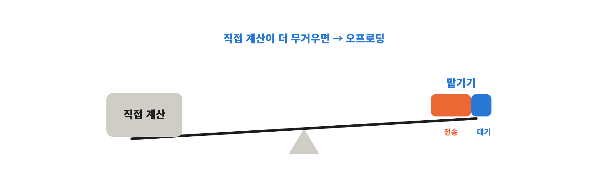

MEC에서 제일 중요하게 보는 건 <mark class="pink">에너지 소모(Energy consumption)</mark>임.
단말이 복잡한 서비스를 돌리려면 연산 자원뿐 아니라 에너지도 필요한데, 단말은 **배터리가 한정**돼 있음.

그래서 어떤 연산 작업(task)이 생겼을 때 질문은 이거임.

> 이걸 **로컬(단말)**에서 처리할까, **MEC 서버로 올려서** 처리할까?

**① 로컬 컴퓨팅 에너지** 
단말이 직접 계산할 때 쓰는 에너지 = **연산 전력 × (작업량 ÷ 단말 연산 속도)**
→ 일이 많거나 폰이 느릴수록 오래 돌려야 하니까 에너지가 커짐

**② 오프로딩 에너지** 
= 데이터를 MEC 서버까지 **전송하는 에너지** + 서버가 계산하는 동안 **기다리는(idle) 에너지**

결론은 간단함.

> <mark class="mint">로컬 에너지 > 오프로딩 에너지</mark> 일 때 오프로딩(엣지 컴퓨팅)을 하는 게 이득

> 💡 식으로 쓰면 이런 느낌임 (C: 필요한 연산량, M: 단말 속도, S: 서버 속도, D: 보낼 데이터 양, B: 대역폭). 
> 로컬: Pc × C/M 
> 오프로딩: Ptr × D/B + Pidle × C/S 
> 연산량 C가 크고 보낼 데이터 D가 작을수록 오프로딩이 유리해짐. 대역폭 B가 넓으면 전송 비용이 줄어서 역시 오프로딩 쪽으로 기울고.

### 3-2. 정리: 연산이 무거우면 넘기고, 데이터가 무거우면 직접

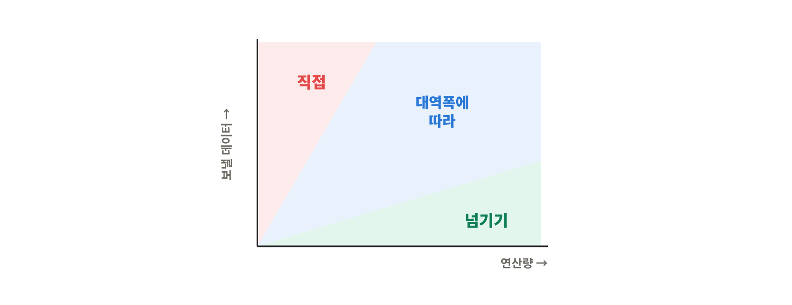

| 상황 | 결론 |
|---|---|
| **연산량이 큼** (계산은 빡센데 보낼 데이터는 적음) | **오프로딩**이 유리 |
| **통신 오버헤드가 큼** (계산은 가벼운데 보낼 데이터가 많음) | **로컬에서 직접** 하는 게 유리 |
| 그 중간 | <mark class="pink">Depends on bandwidth</mark>, 대역폭에 따라 달라짐 |

중간 영역은 결국 **우리가 MEC의 통신 · 연산 기술을 어떻게 설계하느냐**에 따라 결정되는 구간임.

> 💡 비유하면 무거운 수학 숙제를 학원에 맡길지 고민하는 거랑 같음. 문제는 어려운데 문제지가 한 장이면 학원 가서 푸는 게 이득. 근데 문제는 쉬운데 자료가 트럭 한 대 분량이면 들고 가는 게 더 힘듦. 그 중간이면 학원까지 길이 얼마나 뚫려 있냐(대역폭)에 따라 달라짐.

---

## 4. 오프로딩을 어떻게 제어할까 (Joint Communication & Computation)

### 4-1. 작업(Task)의 세 가지 프로필

모바일 게임을 예로 들면, 오프로딩할 작업에서 봐야 할 건 세 가지임.

1. **데이터 크기 (Data size)** – 오프로딩하려면 보내야 하는 데이터 양
2. **연산 강도 (Computation intensity)** – 처리하는 데 CPU 사이클이 얼마나 필요한지
3. **지연 요구사항 (Latency requirement)** – 이 시간 안에는 끝나야 한다는 제한

### 4-2. 통째로 넘기기 vs 나눠서 넘기기

| 방식 | 설명 |
|---|---|
| **바이너리 오프로딩 (Binary offloading)** | 작업을 **전부** 단말에서 엣지 서버로 넘김. 할지 말지 0 아니면 1 |
| **파셜 오프로딩 (Partial offloading)** | 작업을 **잘라서** 일부는 단말에서, 나머지는 엣지 서버에서 처리 |

### 4-3. 무엇을 조절할 수 있나

- **로컬 컴퓨팅**에서는 → 데이터 크기와 **CPU 사이클(연산 속도)**
  - 데이터가 크면 작업이 오래 걸리고, CPU를 빨리 돌릴수록 에너지가 많이 듦
- **오프로딩**에서는 → 데이터가 얼마나 빨리 서버로 가서 계산되고 돌아오느냐, 즉 **지연시간**
  - 지연 요구가 빡빡할수록 **전송 속도(데이터 레이트)를 올려야** 하고, 그러면 **에너지도 그만큼 더 씀**

즉 <mark class="pink">빠르게 하려면 에너지가 들고, 에너지를 아끼려면 느려지는</mark> 트레이드오프가 계속 따라다님.

### 4-4. 설계 챌린지: Where / Whether / What / How

| 질문 | 고민할 것 |
|---|---|
| **Where** – 어디로 오프로딩? | 엣지 서버? 중앙 클라우드? |
| **Whether** – 할까 말까? | 지연시간과 에너지 소모를 같이 따져야 함 |
| **What** – 무엇을? | 데이터(bit)만 보낼지, 연산 코드(컴포넌트)까지 같이 보낼지 |
| **How** – 어떻게? | 오프로딩 속도(rate)와 기간(duration)을 어떻게 제어할지 |

이걸 따로따로가 아니라 **동시에** 풀어야 하는 최적화 문제임.

### 4-5. 결국 "무선 자원 + 연산 자원" 공동 할당 문제

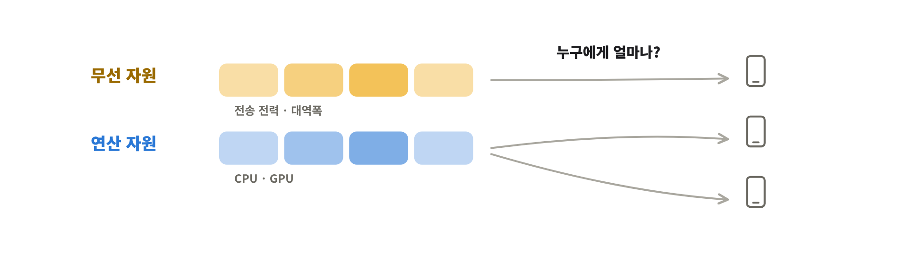

결국 오프로딩 문제는 <mark class="mint">무선 채널 자원과 연산 자원을 어떻게 같이 효율적으로 관리하느냐</mark>의 문제임.

| 자원 종류 | 대표적인 변수 |
|---|---|
| **무선 (Radio)** 자원 | 전송 전력 (Transmit power), 대역폭 (Bandwidth) |
| **연산 (Computation)** 자원 | 엣지 서버 · 단말의 CPU 사이클 (요즘은 GPU까지) |

그래서 모바일 컴퓨테이션 오프로딩은 한마디로 <mark class="pink">Joint Radio & Computation Resource Allocation</mark> 문제라고 이해하면 됨.

---

## 5. 움직이는 유저를 따라가기 (Mobility-aware MEC)

### 5-1. 연산 중에 기지국을 옮기면?

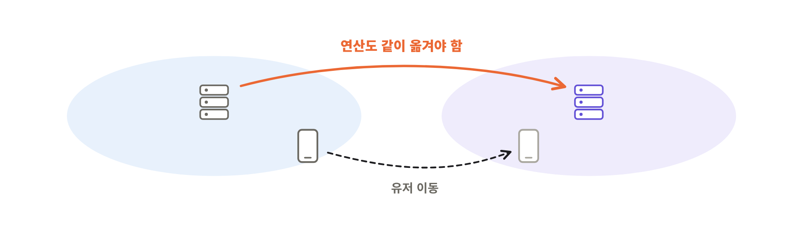

MEC 설계에서 유저의 **이동성(mobility)**은 엄청 중요한 요소임.

단말이 오프로딩 서비스를 받는 중에 유저가 폰 들고 움직이면? 한 엣지 서버에서 연산 받다가 다른 엣지 서버 쪽으로 넘어가야 함 → **핸드오프(handoff)** 필요.

- 예전 음성 트래픽의 핸드오프는 **연결만 옮기면** 돼서 비교적 간단했음
- 근데 이제는 **연산이 끼어 있으니까**, 기지국 핸드오프랑 **MEC 서버 간 핸드오프(작업 이전)**까지 같이 고려해야 함

여기서 쓸 수 있는 전략들
- **이동 예측** – 유저가 어디로 갈지 미리 알면, 작업을 **미리 다음 서버로 옮겨둘 수** 있음
- **주변 단말 활용** – 근처에 연산 자원이 **놀고 있는 단말**이 있으면, **D2D(단말 간 직접 통신)**로 그쪽에 작업을 맡김
- **이동성 인지 서버 스케줄링 (Mobility-aware server scheduling)** – 이동 패턴을 고려해서 어느 서버에 작업을 배정할지 정함

예측을 정확히 할수록 오프로딩을 훨씬 잘할 수 있음.

> 💡 자율주행차나 배달 로봇처럼 **계속 움직이는 Physical AI**에는 이게 핵심 문제임. 시속 100km로 달리는 차는 몇 초마다 기지국이 바뀌는데, 그때마다 연산이 끊기면 안 되니까.

### 5-2. 미리 보내두기: 프리패칭 (Prefetching)

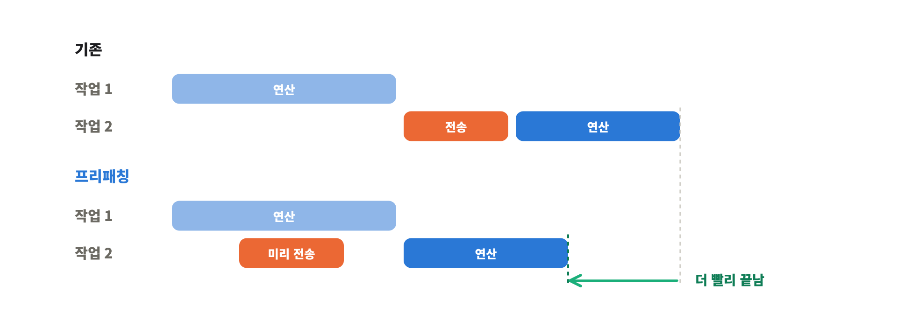

좀 더 구체적으로 보면, 큰 프로그램 하나 안에는 여러 개의 작업(task)이 들어 있음.

- 프로그램 **전체를 통째로** 오프로딩하면 → 보내야 할 데이터가 많음
- 프로그램을 **Task 1, 2, 3...으로 쪼개면** → 각 작업에 필요한 데이터만 골라 보낼 수 있음 → 오프로딩 데이터 레이트를 낮출 수 있음

근데 다음에 어떤 작업이 필요할지 알려면 **앞 작업 결과가 나올 때까지 기다려야** 하는데, 이러면 너무 오래 걸림.

그래서 나온 게 <mark class="pink">프리패칭(Prefetching)</mark>임.

> 앞 작업의 연산 결과가 나오기 **전에**, 다음에 필요할 데이터를 **미리 예측해서 오프로딩**해 둠

예측만 잘하면 앞 작업이 끝나기 전에 다음 작업 준비가 끝나 있으니까 기다리는 시간이 확 줄어듦.

**이동성 예측이랑 합치면 더 좋음** 
예를 들어 박물관이나 미술관에서 유저 동선을 예측할 수 있으면, 다음 전시실에서 어떤 연산 서비스(작품 인식, AR 해설 등)가 필요할지 미리 알 수 있음. 그거에 맞춰 미리 준비해 두면 훨씬 효율적인 엣지 컴퓨팅 서비스가 됨.

> 💡 유튜브가 영상 뒷부분을 미리 버퍼링해 두는 거랑 같은 원리임. 차이는 유튜브는 "다음 장면"을 미리 받는 거고, 여기서는 "다음 연산에 필요한 데이터"를 미리 보내두는 것.

---

## 6. 캐싱과 엣지 컴퓨팅의 만남 (Cache-enabled MEC)

### 6-1. 서비스 캐싱: 프로그램 자체를 엣지에 둔다

여기까지는 오프로딩을 하냐 마냐만 봤는데, 이제 **1편의 캐시 개념**을 가져올 수 있음.
엣지 서버는 저장공간뿐 아니라 연산 능력도 있으니까, **연산 서비스 자체**를 엣지에 캐싱해 두자는 거.

이걸 <mark class="pink">서비스 캐싱(Service Caching)</mark>이라고 함.

> CPU를 많이 먹거나, 메모리 · 저장공간을 많이 먹는 **프로그램(서비스)**을 미리 엣지 서버에 깔아두고, 요청이 오면 바로 돌려줌

| 1편 콘텐츠 캐싱 | 2편 서비스 캐싱 |
|---|---|
| **영상 파일**을 엣지에 미리 저장 | **프로그램 · 서비스**를 엣지에 미리 설치 |
| 요청 오면 파일을 바로 전송 | 요청 오면 바로 **연산해서** 결과 전송 |

### 6-2. 캐시 관리: 뭘 깔아두고 뭘 지울까

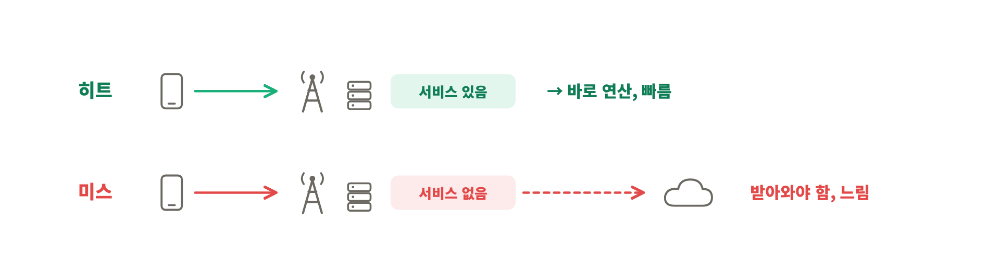

- **캐시 히트** (필요한 서비스가 MEC 서버에 있음) → 클라우드까지 안 가고 **훨씬 빠르게** 처리
- **캐시 미스** (MEC 서버에 없음) → 중앙 클라우드에서 해당 서비스를 받아와야 해서 **시간이 훨씬 오래 걸림**

근데 MEC 서버의 서비스 캐시 공간은 **한정적**임. 새 서비스를 들여오려면 기존 서비스를 **지워야** 하는데, 그 지우고 다시 받는 작업 자체가 낭비가 될 수 있음.

그래서 결국 1편이랑 같은 결론으로 돌아옴.

> 어떤 서비스가 **인기 있을지(popular)**를 잘 예측해서 그걸 캐싱해야 함

### 6-3. 공정성 문제: 가까운 유저만 좋아지면 안 된다

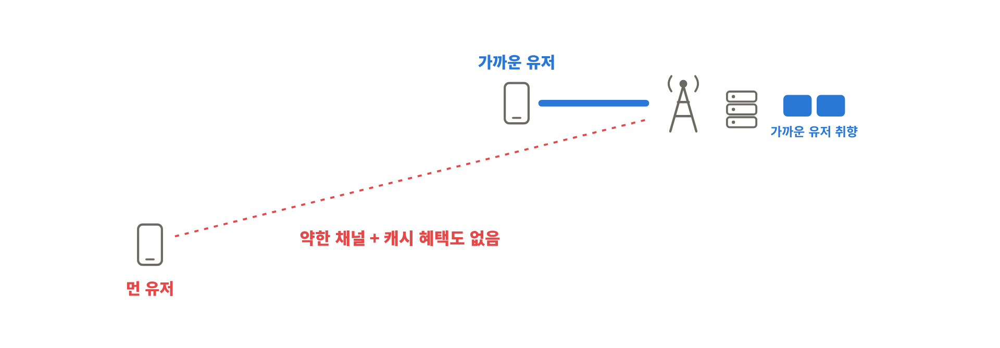

두 유저를 생각해 봄.

| | 기지국 **가까운** 유저 | 기지국 **먼** 유저 |
|---|---|---|
| 채널 상태 | 좋음 | 약함 |
| 오프로딩 | 잘 즐길 수 있음 | 업로드에 **에너지가 더 많이** 듦 |
| 서비스 캐싱 혜택 | 받음 | 잘 못 받음 |

캐싱을 가까운 유저 취향에만 맞춰버리면, 먼 유저는 **채널도 약하고 캐싱 혜택도 못 받는** 이중고에 빠짐.
→ <mark class="pink">가까운 유저와 먼 유저 사이의 공정성(Fairness)</mark>이 깨짐.

그래서 새로 설계할 땐
- 오프로딩 **처리량(throughput)과 지연시간**을 같이 고려한 **공정한 오프로딩 정책(Fair Offloading Policy)**이 필요하고
- 캐시 서비스도 **가까운 유저들 선호에만 몰빵하지 말고**, 셀 안의 모든 유저 선호를 동시에 고려해서 설계해야 함

---

## 7. 대규모 MEC 네트워크 설계 (Large-scale MEC)

### 7-1. 기지국이 여러 개면 간섭이 생긴다

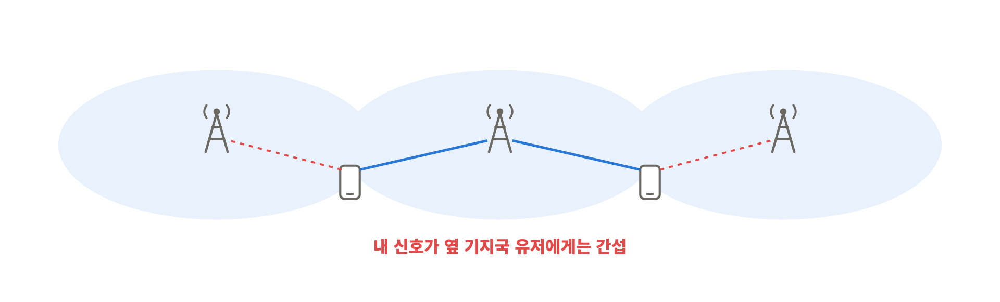

이번엔 MEC 서버 하나가 아니라, **여러 기지국마다 MEC 서버가 하나씩** 붙어 있는 큰 네트워크를 생각해 봄.

단말은 자기 근처 기지국으로 데이터를 오프로딩하는데, 내가 오프로딩하면서 **다른 기지국에 오프로딩 중인 유저를 방해**할 수 있음. 이걸 <mark class="pink">간섭(Interference)</mark>이라고 함.
그래서 간섭까지 고려해서 대규모 MEC 네트워크를 설계해야 함.

### 7-2. 유저가 느끼는 지연 = 통신 지연 + 연산 지연

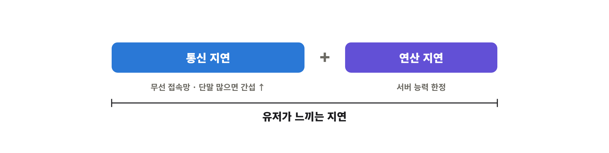

전체 흐름은 이렇게 됨.

> 모바일 유저 → **무선 접속망(RAN)** → **연산 서버 네트워크** → 다시 유저

그래서 지연이 두 군데서 생김.

| 지연 종류 | 어디서? | 언제 커지나? |
|---|---|---|
| **통신 지연 (Communication latency)** | 무선 접속망(RAN) | 오프로딩하는 단말이 너무 많으면 간섭 증가 |
| **연산 지연 (Computation latency)** | 연산 서버 네트워크 | 서버 연산 능력이 한정돼 있어서 몰리면 밀림 |

유저 체감 지연 = **통신 지연 + 연산 지연**.
그래서 <mark class="mint">RAN의 연결성(connectivity)과 연산 서버의 안정성(stability)</mark>을 동시에 고려해야 함.

### 7-3. 가상 머신 다중화: 많이 띄운다고 빨라지지 않는다

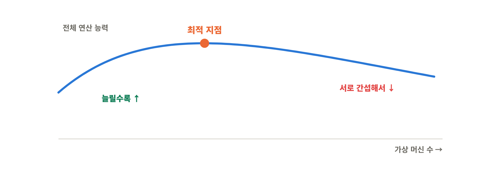

연산 서버의 지연을 분석하려면 **가상 머신 다중화(VM Multiplexing)**를 봐야 함.

- 가상 머신 다중화 = **물리 서버 한 대 위에 여러 개의 가상 머신(VM)**을 띄워서 돌리는 구조
- 근데 VM들은 완전히 독립적으로 안 돌아감. 다 **같은 물리 서버를 나눠 쓰니까** 서로 **I/O 간섭**을 줌
- 그래서 VM을 늘리면 처음엔 전체 연산 능력이 올라가다가, 간섭이 커지면서 **오히려 떨어짐**

→ 그 사이의 **최적 지점**을 잘 잡아서, 엣지 서버로 들어오는 트래픽을 잘 조절해야 함.

> 💡 식당 주방에 요리사를 늘리는 거랑 같음. 처음엔 요리사 늘릴수록 음식이 빨리 나오는데, 주방(물리 서버)은 그대로니까 어느 순간부터 서로 부딪히고 화구 기다리느라 오히려 느려짐.

### 7-4. 병목은 유저 밀도에 따라 바뀐다

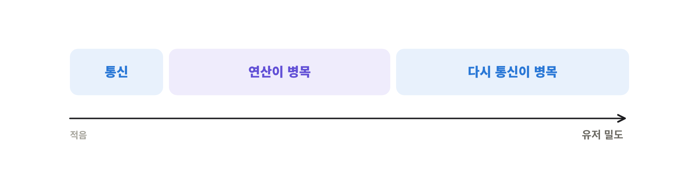

MEC 서버를 이렇게 설계했을 때 연산 지연과 통신 지연을 비교하면, **유저 밀도**에 따라 어느 쪽이 병목인지가 바뀜.

| 유저 밀도 | 병목 | 의미 |
|---|---|---|
| 아주 낮음 | **통신 제한 (Communication-limited)** | 통신 지연이 더 큼 |
| 중간 | **연산 제한 (Computation-limited)** | 연산 지연이 더 커서, 연산 쪽을 더 신경 써야 함 |
| 아주 높음 | 다시 **통신 제한** | 간섭이 폭증해서 통신 지연이 역전 |

즉 "MEC는 무조건 서버를 늘려라" 같은 정답이 없고, <mark class="pink">상황에 따라 통신을 손볼지 연산을 손볼지가 달라짐</mark>.

---

## 8. 표준화: MEC는 누가 운영하나

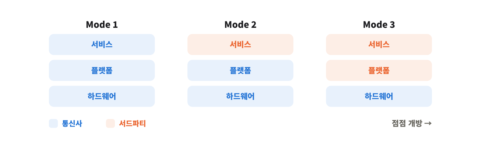

이런 MEC 구조는 통신 표준을 만드는 **3GPP**에서도 많이 고민하고 있음.
연산을 **단말 · 엣지 서버(기지국) · 코어 네트워크 · 클라우드** 중 어디서 할지에 따라 다양한 인터페이스를 설계 중이고, 운영 방식에 따라 세 가지 모드가 있음.

| 모드 | 운영 방식 |
|---|---|
| **Mode 1** | MEC 서비스 전체를 **통신사(MNO)**가 직접 관리 |
| **Mode 2** | 통신사가 **플랫폼(장)**만 마련하고, 여러 **서드파티**가 들어와서 서비스를 설치 |
| **Mode 3** | 통신사는 **하드웨어만** 제공하고, 그 안은 **서드파티 클라우드**가 알아서 설계 · 운영 |

Mode 1 → 3으로 갈수록 통신사가 손을 떼고 **점점 더 개방**되는 구조임.

> 💡 아파트로 비유하면 Mode 1은 통신사가 집까지 다 지어서 직접 관리하는 **관리형 임대**, Mode 2는 상가 건물만 지어놓고 가게들이 입점하는 **쇼핑몰**, Mode 3는 **땅이랑 전기만** 빌려주고 건물은 알아서 지으라는 구조.

---

## 9. 핵심 요약

1. **MEC**는 무거운 연산을 멀리 있는 클라우드가 아니라 **기지국 옆 엣지 서버**로 오프로딩하는 기술. 지연이 **30~100ms → 1~10ms**로 줄고, 단말 에너지도 **30~50%** 절약
2. 장점은 **낮은 지연 · 에너지 절약 · 상황 인식 · 보안** 네 가지. 얼굴 인식, AR이 대표 응용
3. 오프로딩 여부는 **에너지**로 판단. **연산이 무거우면 넘기고, 보낼 데이터가 무거우면 직접**, 중간은 **대역폭에 따라**
4. 오프로딩은 결국 **무선 자원(전력 · 대역폭) + 연산 자원(CPU · GPU)**을 함께 배분하는 **Joint Radio & Computation Resource Allocation** 문제
5. 움직이는 유저에겐 **MEC 서버 간 핸드오프**, **이동 예측**, **D2D 활용**, **프리패칭**이 필요
6. **서비스 캐싱**은 1편의 캐싱을 연산으로 확장한 것. 인기 서비스 예측과 **가까운 · 먼 유저 사이 공정성**이 관건
7. 대규모 MEC에선 **통신 지연 + 연산 지연**을 같이 봐야 하고, 병목은 **유저 밀도**에 따라 바뀜. VM은 많이 띄운다고 빨라지지 않음
8. 3GPP는 운영 주체에 따라 **Mode 1(통신사 전담) → Mode 2(플랫폼 개방) → Mode 3(하드웨어만 제공)**을 고민 중

>한 줄로 묶으면  
>**1편이 네트워크에 "기억력"을 줬다면, 2편 MEC는 네트워크에 "계산력"을 준 것. 연산을 유저 가까이 끌어오되, 에너지 · 지연 · 이동성 · 공정성을 통신과 연산 양쪽에서 동시에 맞추는 게 핵심이다.**

다음 편에서는 로드맵 마지막 단계인 **AI/ML-Driven Communication**으로 넘어감. 네트워크가 저장 → 연산을 넘어 **학습 · 추론**까지 하는 단계임.