## 들어가며

로드맵 마지막 단계까지 왔음.

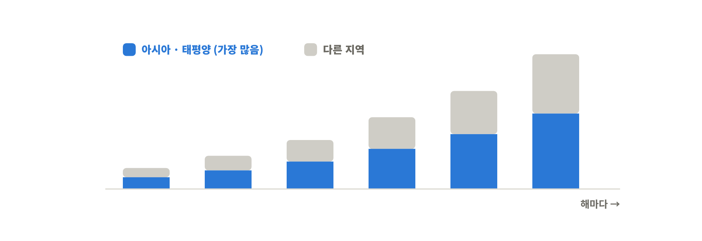
<!-- 1편 로드맵 슬라이드 재사용 (슬라이드 13: Road to Native & Physical AI) -->

| 단계 | 기술 | 네트워크의 역할 |
|---|---|---|
| ① | Wireless Caching (1편) | 데이터를 **저장**해 둠 |
| ② | Edge Computing (2편) | 데이터를 **계산**해 줌 |
| **③** | **AI/ML-Driven Communication** ← 이번 글 | 데이터로 **학습 · 추론**까지 함 |

최근 10년 동안 AI · 머신러닝이 엄청나게 발전하면서 "이거 통신에도 넣으면 어떰?"이라는 얘기가 쏟아져 나왔음. 이번 3편은 그 얘기를 네 가지 주제로 따라감.

1. **AI와 통신이 만나는 두 방향** – 통신을 위한 AI vs AI를 위한 통신
2. **엣지 러닝** – 중요한 데이터부터 올리기, 연합학습
3. **시멘틱 통신** – 비트 말고 "의미"를 보내기
4. **LLM 추론을 무선으로** – 폰의 작은 모델과 서버의 큰 모델이 같이 일하기

그리고 마지막에 교수님이 실제로 하고 계신 **로봇 + 통신(Physical AI) 연구**까지 봄.

---

## 1. AI와 통신이 만나는 두 방향

### 1-1. MLC vs CML

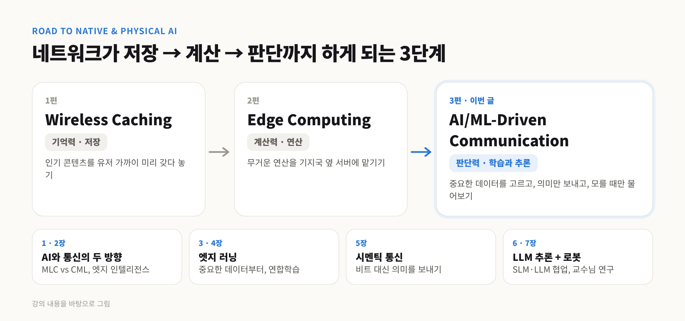
<!-- 슬라이드 63: When AI/ML meets Wireless Commun. -->

AI와 무선통신이 만나는 방향은 크게 두 가지임.

| 방향 | 한 줄 요약 | 도구 (Tool) | 목표 (Goal) |
|---|---|---|---|
| **ML for Communication (MLC)** | 머신러닝으로 **통신을 더 잘하자** | 머신러닝 | 무선통신 |
| **Communication for ML (CML)** | 머신러닝이 잘 돌아가게 **통신을 설계하자** | 무선통신 | 머신러닝 |

둘은 도구랑 목표가 정확히 **뒤집힌 관계**임. 그림 양쪽을 보면 둘 다 **지연시간 · 확장성 · 신뢰성**이라는 같은 축으로 평가받는데, ML 쪽은 학습 속도 · 모델 크기 · 일반화 성능으로, 통신 쪽은 기기 수 · 처리량 · 끊김 확률로 그 축을 잼.

### 1-2. AI/ML for Communications: 통신을 위한 AI

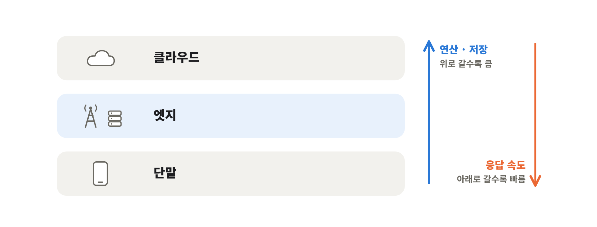
<!-- 슬라이드 64: AI/ML for Communications -->

첫 번째는 <mark class="pink">통신을 잘하려고 머신러닝을 쓰는</mark> 방향.

통신이라는 게 결국 단말에서 모은 데이터를 기지국이나 엣지 서버로 **올리고(업로딩) 내려받는(다운로딩)** 일임. 이때 엣지 서버가 학습해 둔 머신러닝 모델을 써서 이 과정을 더 효율적으로 만드는 것.

- **도구** = 엣지 서버의 머신러닝
- **목표** = 무선통신 자체를 자동화 · 최적화
- 연구 질문: *무선통신을 자동화하는 학습 알고리즘을 어떻게 설계할까?*

### 1-3. Communication for AI/ML: AI를 위한 통신

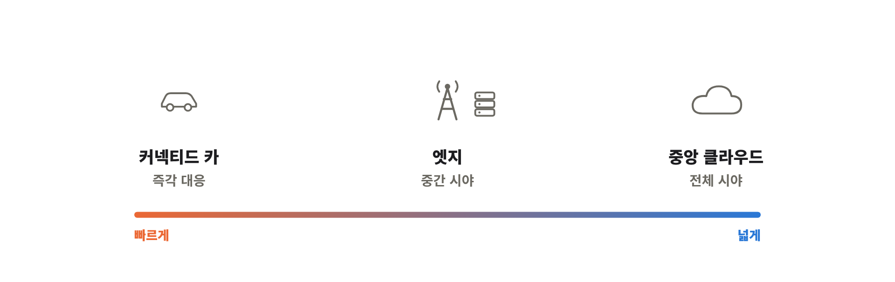
<!-- 슬라이드 65: Communication for AI/ML -->

두 번째는 반대로, <mark class="pink">머신러닝이 잘 돌아가도록 통신을 설계하는</mark> 방향.

엣지 서버가 AI 모델을 학습하려면 **학습 데이터가 효율적으로 모여야** 함. 엣지 디바이스(폰, IoT 센서 등)에서 모은 학습 데이터를 엣지 서버로 잘 올려줘야 서버가 원하는 모델을 만들 수 있음.

- **도구** = 무선통신
- **목표** = 머신러닝 (결과물이 **AI 모델**)
- 연구 질문: *머신러닝을 돕는 통신 기술을 어떻게 설계할까?*

이번 글은 대부분 이 **두 번째 방향(CML)** 얘기임.

### 1-4. 6G는 거대한 AI를 받치는 인프라가 된다

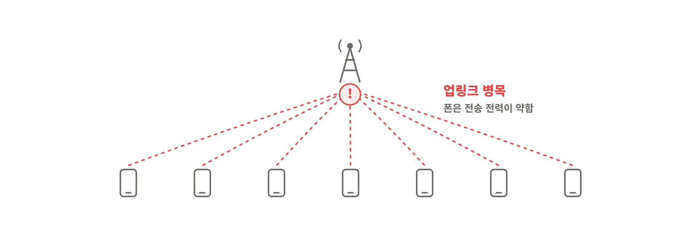
<!-- 슬라이드 66: Distill Intelligence from Mobile Data -->

이 관점에서 보면 <mark class="mint">6G 네트워크 인프라는 거대한 머신러닝 모델을 떠받치는 기반</mark>이 됨.
슬라이드 그림이 딱 그 느낌임. 물 위에 뜬 거대한 건물(대규모 머신러닝)을 바다 밑 기둥(6G 인프라)이 받치고 있음.

흐름은 이렇게 감.

> 수많은 IoT · 스마트 기기가 모은 **방대한 센싱 데이터** (사람의 결정과 행동, 환경과 맥락) → **머신러닝** → **AI**

이 데이터를 **효율적으로 올리는 것**이 미래의 핵심이 될 거라는 게 교수님 시각.

### 1-5. 그런데 이게 쉽지 않다

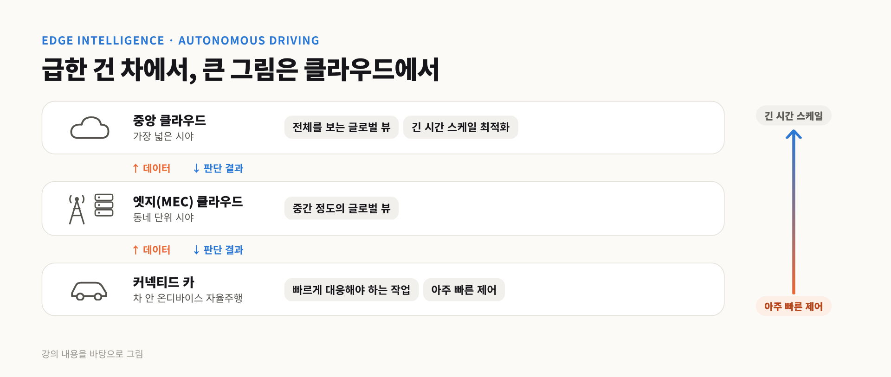
<!-- 슬라이드 67: Demand on Intelligent Radios -->

문제는 이게 그렇게 간단하지 않다는 것.

- 6G가 감당해야 할 서비스가 엄청 다양함 (eMBB, URLLC, mMTC와 그 조합들, 자율주행, 산업 자동화, XR 등)
- 전 세계 모바일 데이터 트래픽은 이미 **월 120엑사바이트** 수준
- 이미 용량 한계에 다다른 네트워크가, 머신러닝을 위해 **복잡하고(Complex) 이질적인(Heterogeneous)** 데이터까지 다 받쳐줘야 함

그림에서 사람이 지렛대 위에 무거운 짐(복잡 · 이질적인 요구)을 받치고 있는데, 그 지렛대를 받치는 게 **머신러닝(AI)**임. 즉 이걸 감당하려면 <mark class="pink">통신 기술 자체를 더 똑똑하게(intelligent)</mark> 설계해야 함.

---

## 2. 엣지 인텔리전스: 어디서 배우고 어디서 추론할까

### 2-1. 세 개의 층: 클라우드 · 엣지 · 온디바이스

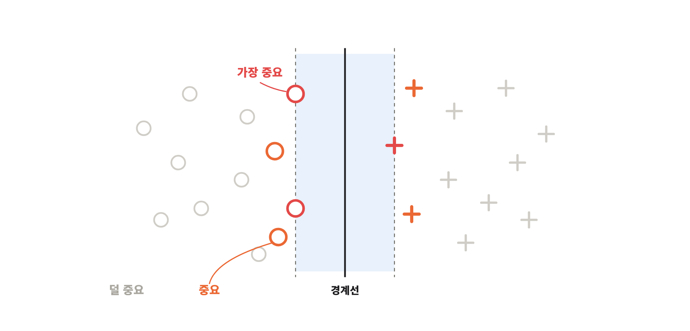
<!-- 슬라이드 68: Edge Intelligence in 6G Network -->

교수님이 그린 6G 엣지 인텔리전스 개념도는 세 층으로 되어 있음.

| 층 | 어디서? | 하는 일 |
|---|---|---|
| **클라우드 러닝 (Cloud learning)** | 데이터센터 | 글로벌하게 **아주 큰 문제**를 큰 연산 능력으로 학습 |
| **엣지 러닝 (Edge learning)** | 기지국마다 붙은 엣지 서버 | 단말과 가까워서 **빠르게** 학습 · AI 서비스 제공. 클라우드보다는 가벼운 작업 담당 |
| **온디바이스 러닝 (On-device learning)** | 폰, 센서 등 단말 | 데이터를 **직접 수집**하는 곳. 아주 간단한 건 직접 처리하고, 어려운 건 데이터를 엣지로 올림 |

오른쪽 컬러 막대 네 개가 층마다 무엇이 좋고 나쁜지를 보여줌.

| 기준 | 클라우드 | 엣지 | 온디바이스 |
|---|---|---|---|
| 연산 능력 (Computing capacity) | **가장 큼** | 중간 | 가장 작음 |
| 지연시간 (E2E latency) | 가장 김 | 중간 | **가장 짧음** |
| 저장공간 (Storage) | **가장 큼** | 중간 | 가장 작음 |
| 대역폭 (Bandwidth) | 가장 좁음 | 중간 | **가장 넓음** |

위로 갈수록 힘은 세지만 멀어서 느리고, 아래로 갈수록 빠르지만 힘이 약함. 이 <mark class="mint">복잡한 트레이드오프를 잘 활용해서</mark> 엣지 인텔리전스 시스템을 설계해야 함.

### 2-2. 예시: 자율주행

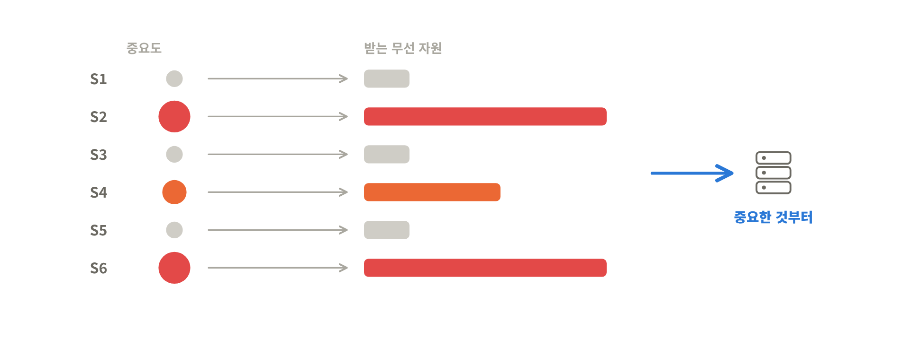
<!-- 슬라이드 69: Edge Intelligence for Autonomous Driving -->

가장 직관적인 예가 자율주행임. 요즘은 테슬라처럼 **차 안에서(온디바이스)** 자율주행을 꽤 잘 하지만, 더 넓은 시야(글로벌 뷰)가 있으면 더 잘할 수 있음.

| 층 | 담당 | 시간 스케일 |
|---|---|---|
| **중앙 클라우드** | 경로 계획, 도시 전체 교통 관리 | 김 (Large time scale) |
| **엣지 클라우드** | 실시간 위치 추정 · 지도 작성, 주변 서비스 | 중간 |
| **커넥티드 카** | 군집 주행(Platooning), 충돌 회피 같은 즉각 제어 | 즉각 (Instantaneous) |

차는 센싱 · 인식 데이터를 위로 올리고, 위에서는 제어 신호를 내려줌.
결국 <mark class="pink">필요한 지연시간에 따라 층을 나눠서(계층적으로)</mark> 설계하면 됨. 급한 건 차에서, 큰 그림은 클라우드에서.

> 💡 이게 Physical AI 로봇에도 그대로 적용됨. 넘어지지 않게 균형 잡는 건 로봇 몸 안에서 바로(밀리초), "부엌에 가서 컵 가져와" 같은 계획은 엣지나 클라우드에서. 반사신경은 척수에서, 계획은 뇌에서 하는 사람 몸이랑 비슷한 구조임.

### 2-3. 결국 중요한 건 데이터

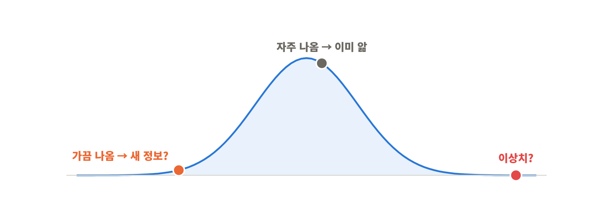
<!-- 슬라이드 70: The Importance of Big Data -->

AI · 머신러닝을 잘하려면 결국 뭐가 제일 중요하냐? **데이터**임.
데이터를 엣지 서버로 효율적으로 공급해 줘야 서버가 자기 연산 능력으로 학습을 할 수 있음.

AI, 자율주행, 헬스케어, 증강현실, 온라인 게임, 물류… 전부 데이터 없으면 못 함.
슬라이드에 나온 **이코노미스트(The Economist)** 표지가 이걸 한 줄로 말해 줌. 지금 산업을 굴리는 게 석유라면, 미래엔 <mark class="pink">데이터가 새로운 석유(Data is the new oil)</mark>가 된다는 것.

---

## 3. 엣지 러닝 ①: 중요한 데이터부터 올려라

### 3-1. 중앙집중형 엣지 러닝과 업로드 병목

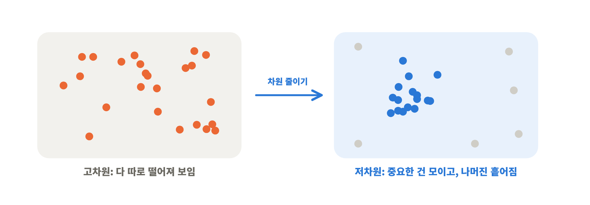
<!-- 슬라이드 71: Centralized Edge Learning -->

사람들이 제일 먼저 떠올리는 건 <mark class="pink">중앙집중형 엣지 러닝(Centralized Edge Learning)</mark>임. 기지국(엣지 서버) 하나에 여러 단말이 붙어서 **자기 데이터를 다 올리는** 구조.

통신 용어 하나 짚고 감.
- **다운링크 (Downlink)**: 기지국 → 단말
- **업링크 (Uplink)**: 단말 → 기지국

보통 **업링크가 병목**임. 보내는 주체가 단말이라 **전송 전력을 크게 못 올리기** 때문. 그런데 엣지 러닝은 수많은 단말이 방대한 학습 데이터를 **동시에 업로드**해야 하니까, 여기서 <mark class="mint">통신 병목(Communication Bottleneck)</mark>이 터짐.
그래서 **대용량 학습 데이터를 어떻게 효율적으로 올릴지**가 핵심 이슈.

### 3-2. 모든 데이터가 똑같이 중요할까?

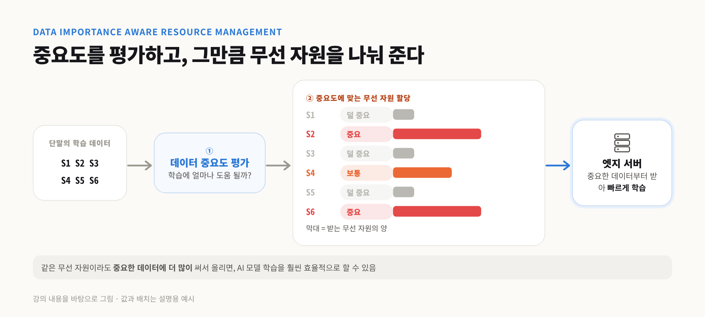
<!-- 슬라이드 72: Not All Data Samples are Useful -->

여기서 통신하는 사람과 컴퓨터 사이언스 하는 사람의 시각이 갈림. 슬라이드는 이걸 섀넌과 튜링의 가상 대화로 재밌게 표현함.

- **통신 쪽 (섀넌 st.)**: "데이터 샘플은 다 평등하게 태어났지."
  통신 시스템은 비트 단위로 설계함. 어차피 데이터는 0과 1로 쪼개지고, 0과 1 사이에 중요도 차이는 없음. 그래서 **모든 데이터를 똑같이** 취급해 왔음.
- **컴퓨터 사이언스 쪽 (튜링 st.)**: "아니아니, 데이터마다 중요도가 확실히 달라!"
  어떤 데이터는 학습에 훨씬 중요하고, 어떤 건 별로임.

AI · 머신러닝이 통신 안으로 들어오면서, 통신 쪽도 이제 <mark class="pink">데이터마다 중요도가 다르다는 컴퓨터 사이언스의 시각</mark>을 받아들여야 효율적인 6G 엣지 네트워크를 설계할 수 있음.

### 3-3. 데이터 중요도 예시: SVM

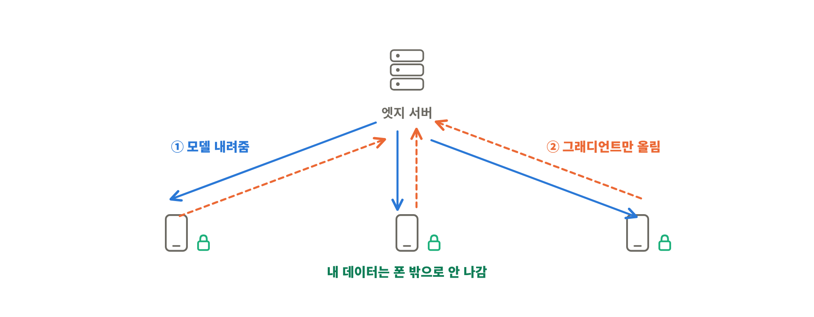
<!-- 슬라이드 73: Data Importance: Example -->

머신러닝 공부하면 제일 먼저 배우는 것 중 하나가 <mark class="pink">서포트 벡터 머신(SVM)</mark>임. 동그라미(○)와 십자가(+)를 구분하는 분류기라고 보면 됨.

- 두 그룹 사이에 **경계선(초평면, hyperplane)**을 긋고, 왼쪽이면 ○, 오른쪽이면 +로 판단
- 경계선을 정하는 데 결정적인 건 점선 위에 걸쳐 있는 샘플들, 즉 **서포트 벡터(Support Vector)**

그래서 데이터 중요도가 이렇게 나뉨.

| 위치 | 중요도 |
|---|---|
| 점선(경계) 바로 위 = 서포트 벡터 | **Critical** (결정적) |
| 경계 근처 | **Important** |
| 경계에서 먼 곳 | **Less important** |

경계에서 멀리 떨어진 데이터는 아무리 많이 들어와도 분류기 설계에 별 영향이 없음. 반대로 <mark class="mint">경계에 가까운 데이터는 "애매해서(uncertain)" 더 중요함</mark>.
물론 이건 SVM을 썼을 때의 한 예시일 뿐, 절대적인 기준은 아님.

> 💡 시험공부로 비유하면, 이미 확실히 아는 쉬운 문제를 100개 더 푸는 것보다 **맞을까 틀릴까 애매한 문제** 몇 개를 푸는 게 실력 향상에 훨씬 도움 되는 것과 같음.

### 3-4. 새로운 설계 기준: 비트 수 → 학습 속도

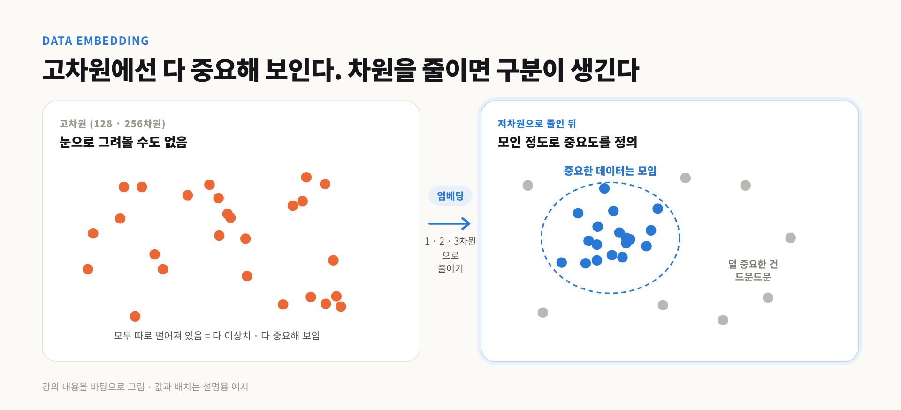
<!-- 슬라이드 74: New Design Criteria -->

그래서 통신 시스템의 설계 목표 자체가 바뀜.

| 구분 | 기존 | 새로운 |
|---|---|---|
| 이름 | 합 전송률 최대화 (Sum Rate Maximization) | 빠른 지능 획득 (Fast Intelligence Acquisition) |
| 목표 | 모든 기기가 보내는 **비트 수 총합**을 최대로 | **중요한 데이터**를 골라 많이 보내서 **학습을 빠르게** |

예전엔 "모든 디바이스에서 비트를 얼마나 많이 올리나"를 봤다면, 이제는 <mark class="pink">"AI 모델을 얼마나 빨리 학습시키나"</mark>가 핵심임. 그러니 데이터를 다 올리는 게 아니라, 학습 속도를 끌어올릴 중요한 데이터를 빨리빨리 뽑아 올리는 게 새 설계 기준.

### 3-5. 데이터 중요도를 반영한 자원 관리

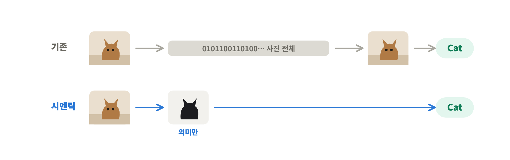
<!-- 슬라이드 75: Data Importance Aware Resource Management -->

이걸 시스템으로 만든 게 <mark class="pink">데이터 중요도 인지 자원 관리(Data Importance Aware Resource Management)</mark>임.

1. 학습 데이터 샘플(S1, S2, S3…)이 들어오면
2. **중요도 평가(Importance Evaluation)** 블록이, 엣지 서버가 보내준 **지금 학습 중인 모델**을 기준으로 각 샘플이 얼마나 중요한지 매김
3. **무선 자원 할당(Radio Resource Allocation)** 블록이 그 **중요도**와 **채널 상태 정보**를 같이 보고 무선 자원을 나눠 줌
4. 중요한 데이터일수록 더 좋은 자원을 받아서 먼저, 확실하게 엣지 서버로 올라감

### 3-6. 중요한 데이터일까, 이상치일까?

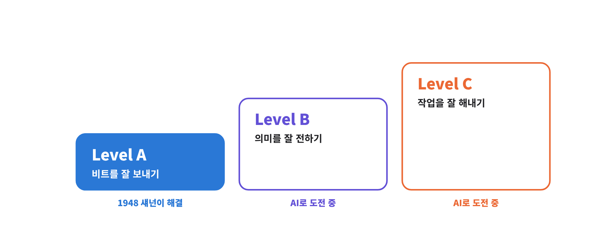
<!-- 슬라이드 76: Important Data or Outlier? -->

근데 SVM 예시처럼 중요도를 깔끔하게 정의할 수 있는 경우는 드묾. 실제로는 **데이터 중요도를 정하는 것 자체가 어려움**.

두 가지 관점이 부딪힘.
- **자주 나오는 데이터**: 이미 비슷한 걸 많이 봤으니까 덜 중요하다? (그래프 꼭대기: "이거 전에 본 것 같은데")
- **가끔 나오는 데이터**: 새로운 정보라 학습에 영향을 줄 수 있으니 중요하다? (그래프 바닥: "이건 처음 보는데")

문제는 가끔 나오는 데이터가 사실 **이상치(outlier)**일 수도 있다는 것. 평균적인 성능을 목표로 학습하는 AI 입장에서는 이상치가 오히려 도움이 안 될 수 있음.

### 3-7. 데이터 임베딩: 차원을 줄여서 보자

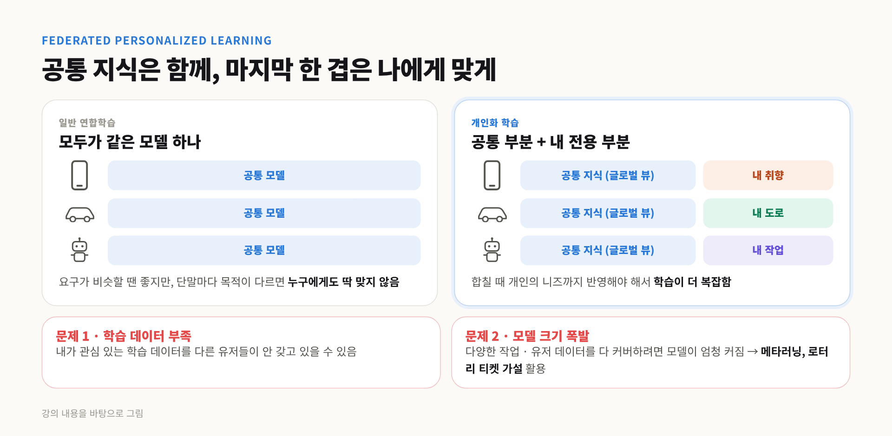
<!-- 슬라이드 77: Data Embedding -->

여기에 **고차원 문제**까지 겹침. 실제 데이터는 128차원, 256차원처럼 차원이 엄청 높아서 눈으로 그려볼 수도 없고, 고차원 공간에선 **모든 데이터가 다 드문드문 떨어져 보여서** 다 중요해 보임.

> 💡 슬라이드 그림이 이걸 보여줌. 1차원에선 칸이 10개뿐이라 데이터가 빽빽한데, 2차원이면 100칸, 3차원이면 1,000칸이라 같은 데이터가 점점 텅 빈 공간에 흩어짐. 이게 이른바 "차원의 저주".

그래서 나온 아이디어가 <mark class="pink">데이터 임베딩(Data Embedding)</mark>임.
- 고차원 데이터를 **저차원 표현**으로 줄임
- 줄여 놓으면 중요한 데이터는 모이고, 덜 중요한 데이터는 드문드문 퍼짐 → **데이터끼리 비슷한 정도**를 잴 수 있음
- 그 유사도에 따라 **업로드 우선순위**를 정함

### 3-8. 데이터 디프닝: 피처 하나씩 깊게 보기

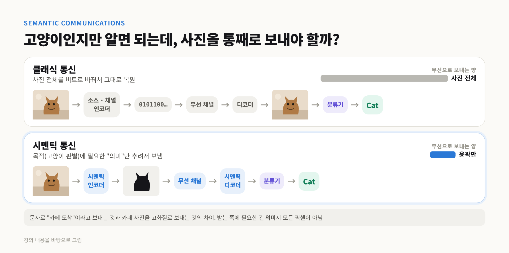
<!-- 슬라이드 78: Data Deepening: Feature-by-Feature Design (Kook et al., ICC 2023) -->

이걸 구현한 기술 중 하나가 교수님 연구팀이 개발한 <mark class="pink">데이터 디프닝(Data Deepening)</mark>임.

- **PCA(주성분 분석)**를 쓰면 데이터를 설명하는 축(피처)을 정보량이 큰 순서대로 줄 세울 수 있음
- 그래서 **앞쪽 피처에 우선순위**를 줌
- 먼저 첫 번째 피처만 보고 분류해 봄 → 거기서 **애매한 영역(그림의 회색 ACI 영역)**에 있는 데이터만 골라
- 다음 피처를 추가해서 **한 단계 더 깊게(deepening)** 봄

즉 확실한 데이터는 얕게 보내고, 애매한 데이터만 더 많은 정보를 붙여 보내는 구조라서 보낼 데이터가 확 줄어듦.
오른쪽 그래프(MNIST, Fashion-MNIST)를 보면, 데이터를 전부 올리는 방식(Full offloading)보다 **오류율은 비슷하게 유지하면서 에너지 소모가 훨씬 적음**. 이걸 미리 받아두기(prefetching)와 합친 게 JD2P(Joint Data Deepening-and-Prefetching)임.

---

## 4. 엣지 러닝 ②: 데이터는 두고 모델만 오가자 (연합학습)

### 4-1. Federated Edge Learning

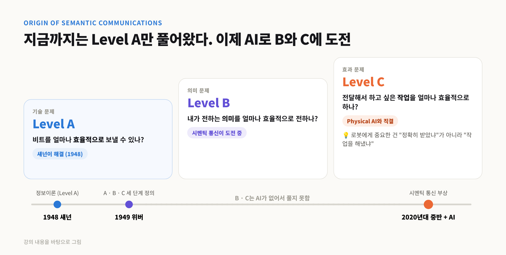
<!-- 슬라이드 79: Federated Edge Learning -->

중앙집중형 엣지 러닝은 효율적일 수 있지만 큰 약점이 있음. 단말의 **사생활이 담긴 데이터를 엣지 서버로 다 올려야** 해서 <mark class="pink">프라이버시 보호가 안 됨</mark>.

그래서 구글이 제안한 게 <mark class="pink">연합학습(Federated Learning)</mark>임. 데이터는 단말에 그대로 두고, 학습은 단말에서 하고, 서버는 결과만 모아서 합침.

| 단계 | 누가 | 하는 일 |
|---|---|---|
| **Step 1** | 서버 | 지금 학습 중인 **글로벌 모델(마더 모델)**을 각 단말에 **브로드캐스트** |
| **Step 2** | 단말 | 받은 모델로 **자기 로컬 데이터**를 써서 학습, 그래디언트(gradient) 계산 |
| **Step 3** | 단말 | 계산한 **그래디언트만** 서버로 업로드 |
| **Step 4** | 서버 | 모인 그래디언트를 **평균(aggregation)**해서 글로벌 모델 업데이트 |

이걸 몇 번 반복하면, 단말 데이터를 하나도 안 올리고도 글로벌 모델을 효율적으로 학습할 수 있음.

장점 세 가지
- **분산된 데이터**로 학습
- **단말의 연산 자원** 활용
- **사용자 프라이버시** 보호

> 💡 폰 키보드의 다음 단어 추천이 대표 사례임. 내가 친 문장은 폰 밖으로 안 나가고, "이런 방향으로 모델을 고치면 좋겠다"는 업데이트만 서버로 감.

### 4-2. Federated Personalized Learning

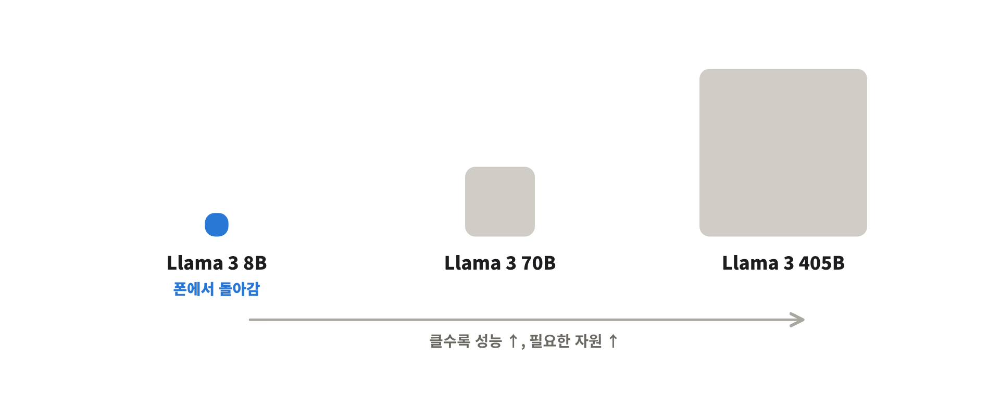
<!-- 슬라이드 80: Federated Personalized Learning -->

연합학습이 한 단계 진화한 게 <mark class="pink">연합 개인화 학습(Federated Personalized Learning)</mark>임.

- 일반 연합학습: 모든 단말이 **하나의 공통 모델**을 같이 만듦
- 개인화 학습: 클라우드 · 엣지의 **글로벌 뷰**는 살리면서, 각 단말이 **자기 목적에 맞는 개인화 모델**을 가짐

단말마다 요구가 다 다른(heterogeneous) 상황을 만족시킬 수 있지만, 서버에서 합칠 때 개인의 요구까지 반영해야 하니 **학습이 더 복잡해짐**.

### 4-3. 개인화 학습의 어려움

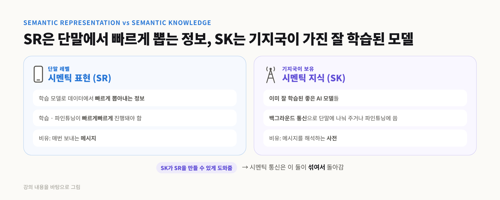
<!-- 슬라이드 81: Heterogeneous Data Set and Tasks -->

단말마다 가진 데이터셋과 작업(task)이 뒤섞여 있어서 일반 연합학습보다 어려움.

슬라이드 그림이 왜 어려운지 보여줌.
- **일반 연합학습의 가정**: 모델 하나로 모든 단말의 데이터를 동시에 잘 나눌 수 있다
- **실패 모드 (a) 모델이 너무 단순**: 직선 하나로는 주황 · 파랑 데이터를 동시에 못 나눔
- **실패 모드 (b) 조건이 엇갈림**: 단말마다 같은 입력에 대한 정답 기준이 달라서, 어떤 분류기로도 전부를 동시에 맞힐 수 없음

그래서 개인화 학습의 두 가지 챌린지
1. **학습 데이터 부족** – 내가 관심 있는 데이터를 다른 유저들이 안 갖고 있을 수 있음
2. **모델이 너무 복잡해짐** – 모든 작업과 유저 데이터를 다 커버하려면 모델 크기가 폭발함

이걸 풀려고 **메타러닝(Meta-learning)**이나 **로터리 티켓 가설(Lottery Ticket Hypothesis)** 같은 기법을 많이 씀.

> 💡 로터리 티켓 가설은 "큰 신경망 안에는 처음부터 잘 학습되는 작은 부분 네트워크(당첨 복권)가 숨어 있다"는 가설임. 그 작은 부분만 찾아내면 모델을 확 줄여도 성능이 유지된다는 것.

---

## 5. 시멘틱 통신: 비트 말고 "의미"를 보내자

### 5-1. 클래식 통신 vs 시멘틱 통신

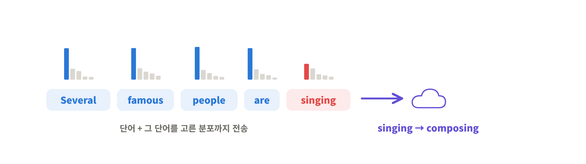
<!-- 슬라이드 82: Semantic Communications -->

고양이 사진을 보내서, 받는 쪽 AI 분류기가 "고양이"라고 맞히는 게 목표라고 해 봄.

**클래식 통신**
> 고양이 사진 → 소스 인코더 · 채널 인코더로 **비트**로 변환 → 무선 채널 → 디코더로 **사진 복원** → 분류기 → "Cat"

지금의 통신 시스템은 전부 디지털이라 모든 게 비트 단위로 움직임.

근데 목적이 **고양이냐 아니냐만 맞히는 거**라면, 원본 사진을 다 보내야 할까?
이미지 · 영상 같은 대용량 데이터는 트래픽이 엄청 듦.

**시멘틱 통신**
> 고양이 사진 → **시멘틱 인코더**가 고양이 윤곽 정도만 담은 아주 간단한 그림(**시멘틱 표현**) 생성 → 전송 → **시멘틱 디코더** → 분류기 → "Cat"

원본을 다 보낼 때보다 <mark class="pink">훨씬 적은 데이터로도 원하는 작업을 달성</mark>할 수 있음. 이게 시멘틱 통신의 기본 아이디어.

> 💡 친구한테 "역 앞 카페 도착"이라고 문자 보내는 거랑, 카페 사진을 고화질로 찍어 보내는 거의 차이임. 친구가 알아야 할 건 "도착했다"는 **의미**지 사진의 모든 픽셀이 아님.

### 5-2. 시멘틱 통신의 기원: 섀넌과 위버

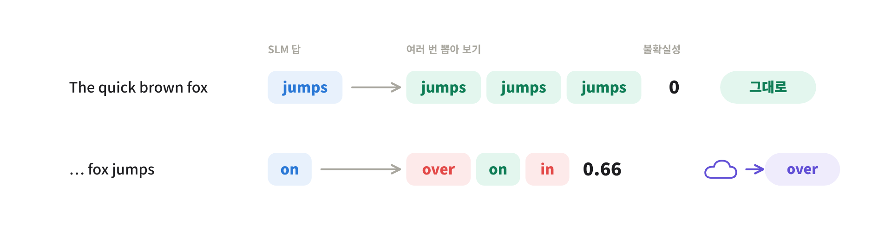
<!-- 슬라이드 83: Origin of Semantic Communications -->

시멘틱(semantic)은 "의미"라는 뜻이라, **의미론적 통신**이라고 보면 됨. 근데 이게 생각보다 역사가 깊음.

통신 시스템의 기초를 만든 사람이 **클로드 섀넌(Claude Shannon)**임. 1948년 정보이론의 토대를 세운 논문에서 섀넌이 푼 건 "비트를 얼마나 정확하게 전달하느냐"였음. 1949년 **워런 위버(Warren Weaver)**가 이걸 정리하면서 통신 문제를 세 단계로 나눔.

| 단계 | 질문 | 상태 |
|---|---|---|
| **Level A** (기술) | 기호(비트)를 얼마나 **정확하게** 보낼 수 있나? | 섀넌이 해결 → 지금까지 통신 시스템의 기반 |
| **Level B** (의미) | 보낸 기호가 원하는 **의미**를 얼마나 정확하게 전달하나? | 정의만 하고 못 풀었음 |
| **Level C** (효과) | 전달된 의미가 원하는 **행동**에 얼마나 효과적으로 영향을 주나? | 정의만 하고 못 풀었음 |

70년 넘게 통신은 **Level A** 기반으로만 발전했음. Level B · C는 당시엔 풀 도구(AI)가 없었으니까.
근데 2020년대 중반을 넘어오면서 머신러닝 · AI가 엄청 발전했고, 사람들이 Level B · C 문제를 다시 꺼내 들면서 <mark class="pink">시멘틱 통신이 큰 화두</mark>로 떠오름.

> 💡 Level C가 Physical AI랑 딱 맞닿아 있음. 로봇한테 보내는 메시지의 목표는 "정확히 전달됐냐"가 아니라 "로봇이 원하는 행동을 했냐"니까.

### 5-3. 6G 시멘틱 네이티브 라디오

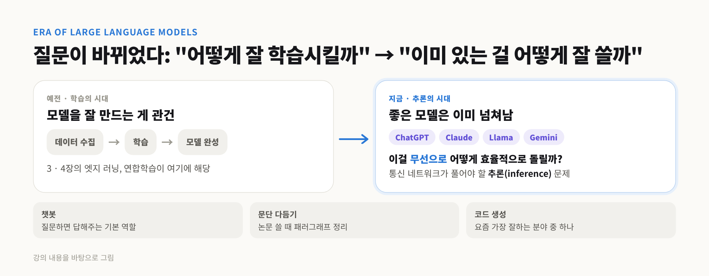
<!-- 슬라이드 84: 6G Semantic Native Radio: Overview -->

교수님 연구팀이 그리는 6G 시스템은 기존 엣지 인텔리전스를 진화시킨 <mark class="pink">6G 시멘틱 네이티브 라디오(Semantic Native Radio)</mark>임.

- 각 단말은 딥러닝으로 학습된 **시멘틱 인코더 · 디코더**를 가짐
- 인코더로 **시멘틱 표현**을 만들고, 무선 채널로 주고받음
- 인코더 · 디코더는 서로 **의미가 맞춰져(alignment)** 있어야 함

핵심은 인코더 · 디코더를 **처음부터(scratch) 학습하지 않는다**는 것.
기지국이 ChatGPT, Bard, LLaMA 같은 LLM이나 SAM, OpenPose, CLIP 같은 이미 잘 학습된 모델들을 갖고 있으니까, 이 지식을 써서 인코더 · 디코더를 **빠르게 파인튜닝**하자는 것. 이걸 <mark class="mint">시멘틱 지식(Semantic Knowledge, SK)</mark>이라고 부름.

연구는 세 갈래로 진행 중임.
1. 시멘틱 개념 정의 및 정량화 (SR · SK)
2. 5G 엣지 클라우드와 연동해서 6G 핵심 기술 설계 · 표준화
3. 시멘틱 통신으로 **멀티 로봇 시스템**을 구현해서 실증 검증

### 5-4. 시멘틱 표현(SR) vs 시멘틱 지식(SK)

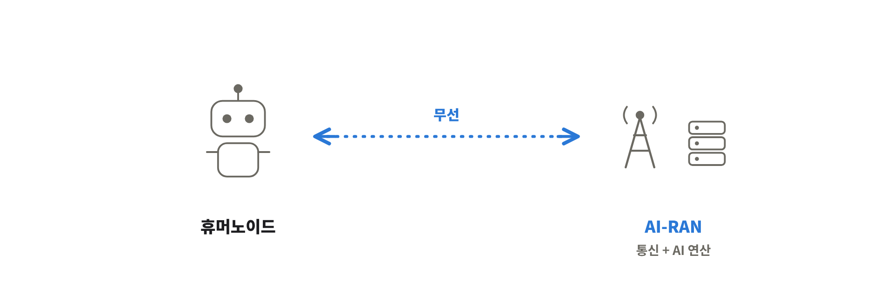
<!-- 슬라이드 85: Semantic Knowledge & Semantic Representation -->

두 개념을 구분해야 함.

| 구분 | 시멘틱 표현 (SR) | 시멘틱 지식 (SK) |
|---|---|---|
| 정체 | 채널 환경 · 목적에 맞게 **데이터에서 뽑아낸 정보** | SR을 뽑을 수 있게 **미리 학습된 AI 모델 묶음** |
| 통신 방식 | 송수신기가 **실시간**으로 주고받음 → 저지연 · 고신뢰 필요 | 채널 환경 · 목적과 독립적. **백그라운드 통신**으로 미리 설정 |
| 통신 부담 | 가벼움 | 무거움 (모델이니까) |
| 비유 | 매번 보내는 **메시지** | 메시지를 해석하는 **사전(공통 지식)** |

그림에서 아래층(System 1)은 실시간으로 SR을 주고받고, 위층(System 2)은 시간 여유를 두고 무거운 SK를 동기화함.
SK는 기지국이 갖고 있다가 단말에 나눠 주거나 파인튜닝하는 데 쓰고, SR은 단말 수준에서 그때그때 빠르게 뽑아냄. 이 둘이 **섞여서** 돌아가는 구조임.

### 5-5. 예시 ①: 시멘틱 지식으로 빠른 엣지 추론

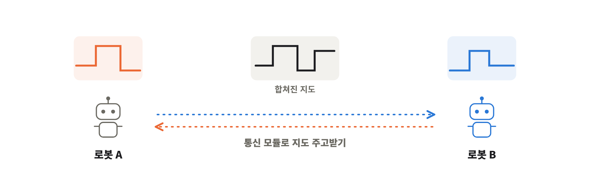
<!-- 슬라이드 86: Example 1 – Semantic-Knowledge Assisted Fast Edge Inference -->

1. 엣지 서버가 작은 트랜스포머 모델 **DeiT-Tiny**(시멘틱 지식)를 단말에 미리 내려줌
2. 단말은 자기 사진에 DeiT-Tiny를 돌려서 **어텐션 맵**을 뽑음. 사진에서 어느 패치(조각)가 중요한지 색으로 표시해 주는 지도
3. 중요도가 기준값(threshold)을 넘는 **패치만 골라서** 서버로 보냄
4. 서버는 더 큰 모델 **DeiT-Base**로 최종 추론 → "되새(Brambling)", "아이리시 세터(Irish setter)", "눈표범(Snow leopard)"

여기서 SK(DeiT-Tiny)는 단말이 직접 학습한 게 아니라 서버에서 **받아 쓴** 것. 단말은 그걸로 중요한 데이터만 골라내고, 진짜 무거운 추론은 서버의 큰 모델이 함.

> 💡 3장의 "중요한 데이터부터 올려라"가 여기서 **이미지 패치 단위**로 구현된 셈임. 사진의 배경 풀밭은 안 보내고 새가 있는 부분만 보내는 것.

### 5-6. 예시 ②: 파인튜닝으로 빠르게 적응

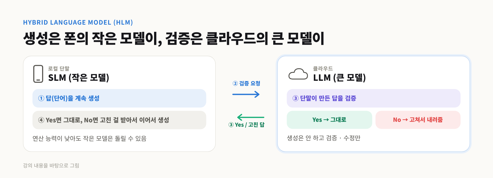
<!-- 슬라이드 87: Example 2 – Fast adaption through fine-tuning semantic knowledge -->

단말이 가진 로컬 데이터(라이다 점구름, 깊이 이미지, 카메라 영상 등)를 처음부터 혼자 학습하는 게 아니라,
1. 서버의 **시멘틱 지식 중 나한테 맞는 것**을 내려받고
2. 내 데이터로 **파인튜닝**해서
3. 원하는 작업(장면 분할, 물체 검출 등)에 맞는 **시멘틱 표현**을 만들어 냄

같은 SK에서 출발해도 단말마다 **목적에 따라 다른 결과**를 낼 수 있다는 게 포인트.

### 5-7. 예시 ③: 여러 시멘틱 지식을 골라 쓰기

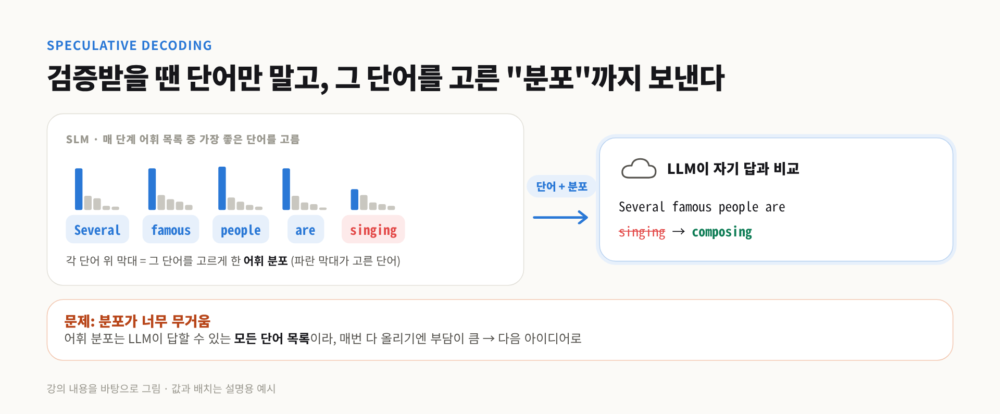
<!-- 슬라이드 88: Example 3 – Executing AI tasks via multiple semantic knowledge -->

요즘 LLM은 여러 전문가(expert)를 두고 필요한 것만 골라 쓰는 **MoE(Mixture of Experts)** 구조로 많이 돌아감. 이 아이디어를 가져와서,
- **전문가 하나 = 시멘틱 지식 하나**로 보고
- 유저가 "사진을 물체별로 나눠줘"라고 요청하면
- **LLM**이 요청을 분석해서 목표를 정하고(semantic segmentation), **게이팅 네트워크**가 여러 엣지에 흩어진 SK 중 필요한 것만 골라서(라우팅)
- 그걸로 시멘틱 코딩을 해서 결과를 냄

---

## 6. LLM 추론을 무선으로: 단말 SLM + 서버 LLM

### 6-1. 학습의 시대에서 추론의 시대로

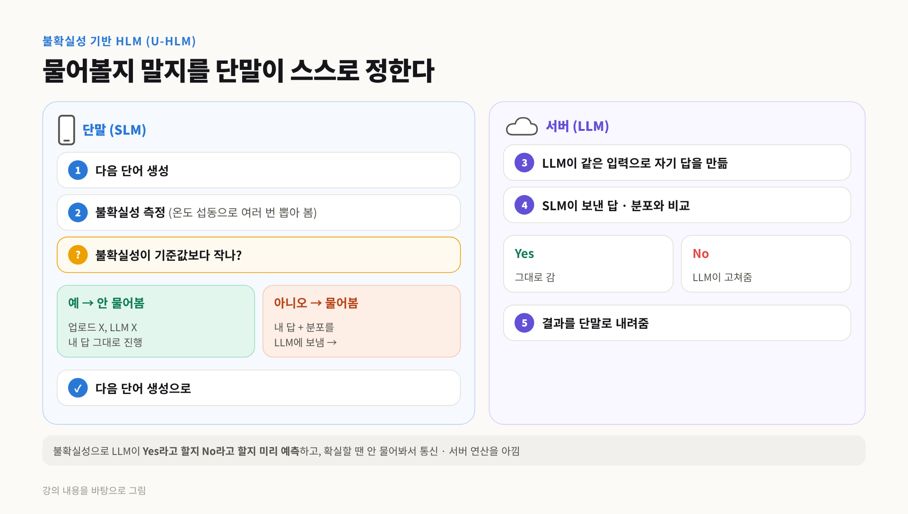
<!-- 슬라이드 89: Era of Large Language Models (LLM) -->

돌고 돌아 LLM까지 왔음. AI가 처음 나왔을 때는 **학습의 시대**였음. 어떻게 하면 학습을 잘, 효율적으로 할지가 중요했음.
근데 좋은 모델이 워낙 많이 나오다 보니 질문이 바뀜.

> 이미 잘 학습된 모델이 이렇게 많은데, **이걸 가장 효율적으로 쓰는 방법**은 뭘까?

앞의 시멘틱 지식도 이런 맥락이고, 한 발 더 나가면 이런 질문이 됨.

> **LLM 서비스를 무선으로 돌리려면** 어떻게 해야 할까?

즉 <mark class="pink">학습의 문제가 아니라 추론(inference)의 문제</mark>를 AI와 통신 네트워크로 어떻게 효율적으로 풀지가 새 관점임.
ChatGPT, Claude, Llama, Gemini 같은 LLM은 이미 챗봇을 넘어 교육, 문단 다듬기, 코드 생성까지 온갖 데 쓰이고 있음.

### 6-2. LLM은 왜 이렇게 강할까: 창발 능력

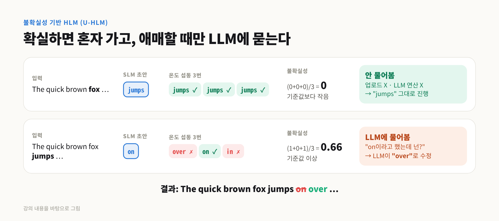
<!-- 슬라이드 90: Emergent Abilities of LLM (Wei et al., 2022) -->

LLM이 왜 이렇게 강한지 설명하는 말로 2020년대 초반부터 <mark class="pink">창발 능력(Emergent Abilities)</mark>이라는 표현이 많이 쓰였음.

> 모델 크기와 학습 데이터 규모가 **특정 임계점을 넘으면**, 작을 땐 없던 새로운 능력이 갑자기 생기는 것

그래프를 보면 학습 연산량이 10²²~10²³ FLOPs 수준까지는 성능이 거의 바닥(무작위 수준)이다가, 그 이상으로 올라가면 **갑자기 확 좋아짐**. 산수, 단어 맞추기, 다중 작업 이해 등 여러 과제에서 같은 패턴.

근데 규모가 어마어마함. 개인 폰이나 PC로는 학습이 불가능하고 OpenAI, 구글처럼 데이터센터를 갖춘 곳에서나 가능함.
게다가 **추론할 때도** 이 큰 모델을 돌리려면 <mark class="mint">엄청난 메모리와 대역폭</mark>이 필요함.

### 6-3. 작은 언어 모델(SLM)의 등장

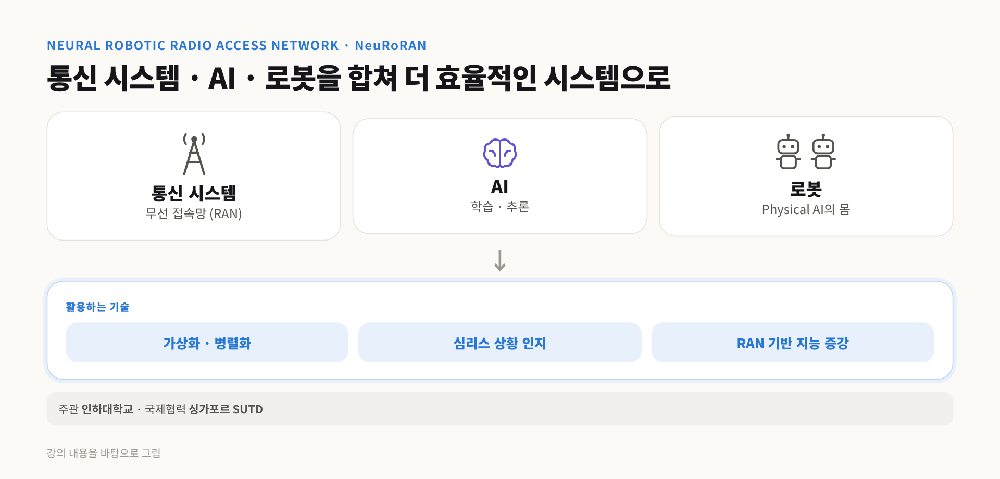
<!-- 슬라이드 91: Rise of Small Language Models (SLM) -->

그래서 폰이나 노트북에서는 LLM을 통째로 돌리는 대신 <mark class="pink">SLM(Small Language Model)</mark>을 돌리는 흐름이 생김.

- LLM은 수십~수천억 파라미터 규모
- SLM은 그보다 훨씬 작은 모델 (수십억 파라미터 이하)
- 그래프를 보면 GPT-4 이후로 **모델 크기의 기하급수적 증가는 멈췄고**, 2024년부터 Gemma 2B, Phi-3, GPT-4o mini 같은 **SLM이 쏟아져 나옴**

SLM은 개인 PC나 스마트폰에 직접 설치해서 쓸 수 있음.

### 6-4. LLM vs SLM: 대신 성능이 떨어진다

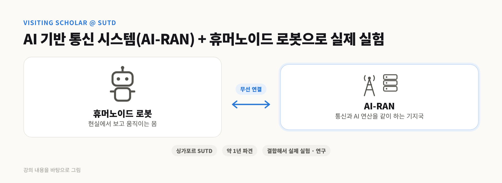
<!-- 슬라이드 92: LLM vs. SLM (Llama 3 benchmark) -->

물론 SLM은 LLM보다 성능이 떨어짐. Llama 3 기준으로 보면

| 벤치마크 | Llama 3 **8B** | Llama 3 70B | Llama 3 405B |
|---|---|---|---|
| MMLU (일반 지식) | 69.4 | 83.6 | 87.3 |
| GSM8K (초등 수학) | 84.5 | 95.1 | 96.8 |
| MATH (고급 수학) | 51.9 | 68.0 | 73.8 |
| HumanEval (코딩) | 72.6 | 80.5 | 89.0 |

8B 모델은 폰에서도 돌아가지만 성능이 가장 낮음. 즉 <mark class="pink">SLM은 연산 효율은 좋지만 성능이 떨어지는</mark> 트레이드오프가 있음.

### 6-5. 하이브리드 언어 모델(HLM)

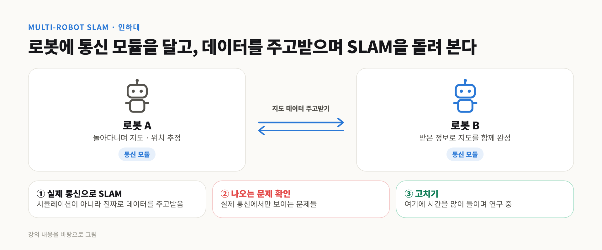
<!-- 슬라이드 93: Hybrid Language Model (HLM) -->

이 트레이드오프를 풀려고 나온 게 <mark class="pink">하이브리드 언어 모델(HLM, Hybrid Language Model)</mark>임. 무선 네트워크에서 LLM 추론을 가능하게 할 유망한 해법.

- **단말**에는 SLM, **서버(클라우드)**에는 LLM
- 단어 생성은 **단말 SLM이 다 함**
- SLM이 만든 단어를 서버 LLM이 **검증**함
  - **Yes** → 그대로 감
  - **No** → LLM이 **고쳐서** 다시 내려줌

그림 흐름으로 보면
1. 엣지 SLM이 "quick brown dog barks"처럼 단어를 차례로 생성 (자기회귀 생성)
2. 후보 단어들을 클라우드 LLM에 보냄
3. LLM이 한꺼번에 검증: quick ✅, brown ✅, dog ❌ (확률 0.04)
4. 검증된 단어 + 고친 단어(fox)를 다시 내려줌

단말은 연산 능력이 낮아도 SLM은 돌릴 수 있으니, **생성은 단말이, 검증은 LLM이** 맡는 분업 구조.

### 6-6. HLM의 바탕: 추측 디코딩 (Speculative Decoding)

<!-- 슬라이드 94: Speculative Decoding (Leviathan et al., ICML 2023) -->

HLM은 <mark class="pink">추측 디코딩(Speculative Decoding)</mark>이라는 기법을 기반으로 함. 핵심만 보면

1. SLM이 입력을 보고 **어휘 분포 x(t)**를 계산함. "다음 단어가 A일 확률, B일 확률…" 전체 목록
2. 그 분포에서 **초안 단어(draft token) d**를 뽑음
3. LLM도 같은 입력에 대해 자기 어휘 분포 **y(t)**를 계산해서 비교
   - SLM이 그 단어에 준 확률 ≤ LLM이 준 확률이면 → **바로 채택**
   - SLM이 더 높게 줬으면 → LLM 확률 ÷ SLM 확률의 비율로 채택, 나머지 확률로 **거절**
   - 거절되면 LLM이 (LLM 분포 − SLM 분포) 중 양수인 부분에서 **새 단어를 다시 뽑음**

중요한 건, 서버가 검증하려면 <mark class="mint">SLM의 어휘 분포 x(t) 자체를 무선으로 받아야 한다</mark>는 것. 단어 하나만 보내는 게 아니라 "그 단어를 고르게 된 확률표"까지 보내야 함.

> 💡 이렇게 하면 결과의 확률 분포가 LLM 혼자 생성한 것과 수학적으로 똑같아짐. 그래서 "SLM의 속도 + LLM의 품질"을 동시에 노릴 수 있는 것.

### 6-7. 무선에서 HLM의 문제: 토큰 처리량

<!-- 슬라이드 95: HLM in Wireless Networks -->

예를 들어 SLM이 "Several famous people are **singing**"을 생성했다고 해 봄. 각 단어는 어휘 목록 중 확률이 가장 높은 걸 고른 결과임 (several 0.8, famous 0.75, people 0.7, are 0.9, singing 0.55). 이걸 큰 모델로 보내면 큰 모델이 확신 없던 마지막 단어 singing을 다른 단어로 **고쳐줌**.

문제는 이걸 무선으로 하면 **토큰 처리량(초당 생성 단어 수)**이 떨어진다는 것.

| | 초당 토큰 수 |
|---|---|
| 추측 디코딩 없이 (SLM만) | 1 ÷ SLM 연산 시간 |
| 추측 디코딩 사용 (HLM) | 1 ÷ (SLM 연산 시간 + **통신 시간** + LLM 연산 시간) |

- 어휘 분포는 단어 수만큼 긴 목록이라 **업로드할 통신 지연이 큼**
- SLM, LLM **둘 다 추론**하니까 연산 지연도 큼

### 6-8. 아이디어: U-OPS (불확실할 때만 물어보기)

<!-- 슬라이드 96: Idea – Uncertainty-Aware Opportunistic Skipping (U-OPS) -->

그래서 교수님 연구팀이 제안한 게 <mark class="pink">U-OPS (Uncertainty-Aware Opportunistic Skipping)</mark>임.

> SLM이 만든 단어의 **불확실성(uncertainty)이 기준값보다 클 때만** 어휘 분포를 서버로 보내고, 확실하면 **서버 검증을 건너뜀(skip)**

- 불확실성을 잘 재면, 단말이 "내 답이 얼마나 확실한지" 스스로 판단할 수 있음
- 그걸로 서버 LLM이 검증하면 **Yes가 나올지 No가 나올지 미리 예측**할 수 있음
- 확실하면(Yes 예상) → 안 물어보고 넘어감 → **업로드 · LLM 연산 다 절약**
- 애매하면(No 예상) → 서버에 물어봄

남은 숙제는 두 가지: **불확실성을 어떻게 잴까?** 그리고 **기준값을 얼마로 잡을까?**

### 6-9. 불확실성은 어떻게 재나

<!-- 슬라이드 97: Uncertainty Measurement -->

불확실성을 재는 방법 세 가지를 비교해서, 각각이 **실제 거절 확률(LLM이 No라고 할 확률)**과 얼마나 맞아떨어지는지 봄.

| 방법 | 아이디어 |
|---|---|
| 몬테카를로 드롭아웃 (Monte-Carlo Dropout) | 모델 일부를 랜덤하게 꺼가며 여러 번 돌려 봄 |
| 프롬프트 섭동 (Prompt Perturbation) | 입력 문장을 살짝 바꿔가며 돌려 봄 |
| **온도 섭동 (Temperature Perturbation)** | 출력의 무작위성(온도)을 바꿔가며 여러 번 뽑아 봄 |

셋 다 거절 확률이랑 관계는 있는데, <mark class="mint">온도 섭동만 뚜렷한 직선 관계</mark>를 보이고 불확실성 범위도 넓게 펼쳐짐. 그래서 온도 섭동을 씀.

### 6-10. 예시: The quick brown fox jumps over

<!-- 슬라이드 98: Example of Token Generation in U-OPS -->

기준값 u_th = 0.5로 놓고 보면

**(a) 건너뛰기 (Skip)**
- 입력: "The quick brown fox" → SLM 추론: **jumps**
- 온도 섭동으로 3번 뽑아 보니: jumps, jumps, jumps → SLM이랑 전부 같음
- 불확실성 = (0+0+0)/3 = **0** ≤ 0.5 → 서버에 **안 물어봄**

**(b) 전송 (Transmit)**
- 입력: "The quick brown fox jumps" → SLM 추론: **on**
- 온도 섭동으로 3번 뽑아 보니: over, on, in → SLM이랑 다른 게 2개
- 불확실성 = (1+0+1)/3 = **0.66** > 0.5 → 서버에 물어봄
- "나는 on이라고 생각했는데 너는?" → LLM이 **over**로 고쳐줌

그래서 "The quick brown fox jumps on"이 아니라 **"jumps over"**로 바로잡고, 다음 단어부터 다시 생성을 이어감.

### 6-11. 결과: LLM 거의 그대로, 통신은 아끼고

<!-- 슬라이드 99: Numerical Evaluation -->

정확도는 생성한 답과 정답을 같은 공간의 벡터로 바꾼 뒤 **코사인 유사도**로 잼 (높을수록 정답에 가까움). 네 개 데이터셋(Alpaca, QED, CREAK, StrategyQA) 결과를 평균해서 그려 보면 이럼.

<!-- 직접 만든 그림: 슬라이드 99 표의 4개 데이터셋 평균 코사인 유사도 -->

- **SLM 혼자**: 0.330 → LLM(0.555)보다 한참 낮음
- **HLM** (매 단어 서버 검증): 0.539
- **Rand-HLM** (랜덤하게 골라서 검증): 0.508
- **U-HLM** (불확실할 때만 검증): **0.539**

슬라이드 수치로 정리하면 U-HLM은
- 평균적으로 **LLM 정확도의 97.54%**, **HLM 정확도의 100.05%** 달성
- 랜덤하게 물어보는 Rand-HLM보다 **이득이 244% 더 큼**

즉 <mark class="pink">매번 물어보지 않아도 LLM에 가까운 성능</mark>이 나온다는 것. 통신과 서버 연산은 아끼면서.

> 💡 사람으로 치면, 신입사원이 모든 문장마다 팀장한테 결재받는 게 HLM, 아무 때나 찍어서 물어보는 게 Rand-HLM, **자신 없는 부분만 골라 물어보는 게** U-HLM임. 팀장 시간은 확 아끼면서 결과물 품질은 거의 그대로.

---

## 7. 마무리: 교수님의 Physical AI 연구

### 7-1. NeuRoRAN: 로봇 + 통신 + AI

<!-- 슬라이드 101: Neural Robotic Radio Access Network (NeuRoRAN) -->

지금까지 AI · 머신러닝과 통신 얘기만 했으니, 마지막으로 교수님이 실제로 하고 있는 Physical AI 연구를 앞 내용과 연결해서 소개함.

교수님이 진행 중인 연구는 <mark class="pink">NeuRoRAN (Neural Robotic Radio Access Network)</mark>임. 통신 시스템(무선 접속망), AI, 로봇을 하나로 합쳐 더 효율적인 시스템을 만드는 연구.

> **연구 목표**: 기존 로봇의 3중 한계를 뛰어넘는, AI-RAN 기반 **범용적 · 적응적 · 지능형** 로봇 서비스 실현

세 가지 축
1. **가상화 · 병렬화 기반 서비스 다양화** – GPU 하나로 여러 로봇 서비스를 나눠 돌림 (2편 VM 다중화와 연결)
2. **Seamless 상황 인지** – 로봇이 움직여도 끊김 없이 주변 상황을 인지 (2편 이동성 MEC와 연결)
3. **RAN 기반 지능 증강** – 로봇의 SLM/SMM 결과를 AI-RAN의 LLM/LMM이 검증 · 보정 (6장 HLM과 연결)

주관기관은 **인하대학교**, 국제협력기관은 싱가포르의 **SUTD(Singapore University of Technology and Design)**.

> 💡 3번 축이 이번 3편의 HLM을 로봇에 그대로 옮긴 거임. 로봇 안의 작은 모델(SLM, 작은 멀티모달 모델 SMM)이 먼저 판단하고, 기지국 쪽 큰 모델(LLM, LMM)이 검증 · 보정해 주는 구조.

### 7-2. SUTD 파견 실험: 휴머노이드 + AI-RAN

<!-- 슬라이드 102: Visiting Scholar@SUTD -->

교수님은 2025년 8월부터 2026년 7월까지 1년 동안 SUTD에 파견 가 있었음. 거기서 SUTD가 가진 AI 기반 통신 시스템(**AI-RAN**)을 **휴머노이드 로봇(Unitree G1)**이랑 결합해서 실제로 실험함.

구성은 세 층.
- **Device AI**: 로봇 안의 Jetson Orin NX 보드 + 5G 동글
- **Edge AI**: 5G 코어 + AI-RAN 오케스트레이터, NVIDIA GH200 위에서 VLM 추론
- **Cloud AI**: AWS 클라우드

로봇이 본 장면을 VLM으로 해석하는 데 걸린 시간을 비교한 표를 그래프로 다시 그리면 이럼.

<!-- 직접 만든 그림: 슬라이드 102 표의 E2E 지연 비교 -->

- **로봇 혼자** (Jetson Orin, Moondream2-1.8B): 통신은 0인데 연산에만 **약 4초**
- **5G로 엣지에 맡김** (GH200, Gemma3-4B): 통신 12ms + 연산 597ms = **약 0.61초**
- 유선으로 연결해도 0.61초로 거의 같음 → <mark class="pink">5G 통신 지연은 전체의 2%도 안 됨</mark>

즉 로봇 혼자 끙끙대는 것보다, 5G로 엣지 서버에 맡기는 게 **약 6.6배 빠름**. 심지어 엣지 쪽이 더 큰 모델(4B vs 1.8B)을 돌리는데도.

> 💡 2편에서 본 "연산이 무거우면 넘겨라"가 실제 로봇에서 숫자로 확인된 사례임. 로봇 몸 안에 큰 GPU를 넣으면 무겁고 배터리도 금방 닳는데, 똑똑한 통신이 있으면 **뇌를 기지국 옆에 두고** 몸은 가볍게 갈 수 있음.

### 7-3. 인하대 실험: 멀티 로봇 SLAM

<!-- 슬라이드 103: Multi-Robot SLAM -->

인하대에서는 **멀티 로봇 SLAM**을 통신 시스템이랑 엮어서 연구 중임. SLAM은 로봇이 돌아다니면서 **지도를 그리는 동시에 자기 위치를 추정**하는 기술.

- 로봇마다 라이다(Ouster LiDAR), 9축 IMU를 달고, **5G-V2X 통신 모듈**로 데이터를 주고받음
- 로봇 A가 자기 지도 정보(특징, 위치 등)를 압축 · 패킹해서 보내면
- 로봇 B가 받아서 **빠진 데이터를 복원(inpainting)**하고, 같은 장소인지 알아본 뒤(place recognition) **두 지도를 합침**

실제로 통신 모듈을 달고 데이터를 주고받아 보니, 시뮬레이션에선 안 보이던 문제들이 나옴. 예를 들어 110m × 40m 규모 실험에서는 **몇 초 동안 패킷 오류가 계속되자 SLAM 자체가 무너지는** 실패가 있었음. 이런 문제를 찾아서 고치는 데 시간을 많이 쓰고 있다고 함.

> 💡 Physical AI에서 통신이 왜 중요한지 보여주는 장면임. 화면 속 AI는 응답이 1초 늦어도 괜찮지만, 같이 지도를 그리던 로봇들은 통신이 몇 초 끊기면 서로 길을 잃음.

---

## 8. 핵심 요약

1. AI와 통신이 만나는 방향은 두 가지. **MLC(통신을 위한 AI)**와 **CML(AI를 위한 통신)**. 도구와 목표가 서로 뒤집힌 관계
2. 6G 엣지 인텔리전스는 **클라우드 · 엣지 · 온디바이스** 세 층으로 나뉘고, 연산 능력 · 지연 · 저장 · 대역폭 트레이드오프에 따라 일을 나눔
3. 엣지 러닝의 병목은 **업링크**. 그래서 설계 기준이 "비트를 많이"에서 **"중요한 데이터부터, 학습을 빠르게"**로 바뀜 (SVM 예시, 데이터 임베딩, 데이터 디프닝)
4. **연합학습**은 데이터 대신 그래디언트만 올려서 프라이버시를 지킴. **개인화 학습**은 데이터 부족 · 모델 복잡도가 숙제
5. **시멘틱 통신**은 비트 대신 "의미"를 보냄. 1949년 위버가 정의만 해둔 Level B · C 문제를 AI로 다시 푸는 중. **SR(실시간 메시지)**과 **SK(미리 학습된 모델)**를 구분
6. 이제는 학습보다 **추론**의 시대. 단말 **SLM**이 생성하고 서버 **LLM**이 검증하는 **HLM**, 그리고 불확실할 때만 물어보는 **U-OPS**로 LLM 정확도의 97.5%를 유지하면서 통신을 아낌
7. 교수님 연구 **NeuRoRAN**은 이걸 로봇에 적용함. 휴머노이드 VLM 추론을 5G 엣지에 맡기면 로봇 혼자보다 약 6.6배 빠름

>한 줄로 묶으면  
>**1편이 네트워크에 "기억력", 2편이 "계산력"을 줬다면, 3편은 "판단력"을 준 것. 중요한 데이터를 골라 보내고, 의미만 보내고, 모를 때만 물어보는 통신이 Physical AI 로봇의 몸과 뇌를 이어주는 신경망이 된다.**

---

## 참고문헌
- Shannon, C. E. (1948). A mathematical theory of communication. *Bell System Technical Journal*, 27(3), 379–423.
- Weaver, W. (1949). Recent contributions to the mathematical theory of communication. In C. E. Shannon & W. Weaver, *The Mathematical Theory of Communication*. University of Illinois Press.
- Kook, S., Shin, W.-Y., Kim, S.-L., & Ko, S.-W. (2023). Joint data deepening-and-prefetching for energy-efficient edge learning. *IEEE International Conference on Communications (ICC)*.
- Wei, J., et al. (2022). Emergent abilities of large language models. *arXiv:2206.07682*.
- Leviathan, Y., Kalman, M., & Matias, Y. (2023). Fast inference from transformers via speculative decoding. *International Conference on Machine Learning (ICML)*, 19274–19286.
- Hao, Z., et al. (2024). Hybrid SLM and LLM for edge-cloud collaborative inference. *Proceedings of the Workshop on Edge and Mobile Foundation Models*.
- Tong, W. (2024). The rise of small language model. *ObjectBox*.