이전까지 송파구에서 인구, 성별, 교통수단, 나이대별로 총 100명을 정리했는데요! 이제는 이제 이 데이터들을 가지고
자전거 이용 수요를 조사해야 합니다.<br>
그러기 위해서 송파구에 자전거 이용 수요에 영향을 미치는 요소를 알아봐야겠죠?

그래서 이제 주민들이 실제로 송파구 안에서 어떻게 움직이고, "어떤 조건에서 자전거를 탈 확률이 높아지는지"를
시뮬레이션하기 위한 핵심 작업을 진행해 볼 거예요.

### 들어가기 전에, 이번에 할 과정을 생각해보자면

1. 지도 제작
2. 인프라 조사 
   - 필수 교통 거점 (3종) : 지하철역, 버스 정류장, 기존 따릉이 대여소
   - 상권,시설 카테고리 (4종)
     - 쇼핑시설 (대형 쇼핑몰, 마트 / 전통시장, 소매점)
     - 공원, 여가시설
     - 학교
     - 오피스, 업무시설
3. 주민별 주거구역 정하기 
4. 주민별 출퇴근 위치 정하기 
5. 주민별 출퇴근 시간 정하기 
6. 지도 설계
   - 지도 그리기
   - 인프라 위치 표시
   - 주민 위치 표시
   - 주민 출퇴근 표시

---

## 1. 지도 제작

>pydeck으로 3D지도를 제작해보겠습니다!

|우리 단계|	pydeck에서 쓸 기능|
|---|---|
|1. 인프라 표시|	점(ScatterplotLayer), 개수를 3D 막대로 세우기(ColumnLayer)|
|2. 주민 거주지|	행정동을 인구만큼 높이 올리기(GeoJsonLayer extruded)|
|3. 출퇴근 위치|	집에서 직장까지 3D 포물선(ArcLayer)|
|4. 출퇴근 시간| 	시간에 따라 사람이 움직이는 애니메이션(TripsLayer)|

이렇게 단계별로 진행할겁니다.<br>
결과가 HTML 파일 하나로 나와서 나중에 바로 보여드릴게요. 
바탕지도는 CARTO 지도를 쓰는데, 토큰 없이 쓸 수 있더라구요.

> ### 1. pycharm 설정!

 <mark class="mint">**1-1. 파이참 프로젝트 준비하기**</mark>

지금까지 파이참으로 데이터 표본설계했는데 이번에도 파이참 사용해요<br>
(그냥 제가 파이참을 좋아해요)

상단의 파일 클릭해 새 프로젝트 만들어주고!(저는 프로젝트명을 SongPa_sim 으로 했어요~)<br>
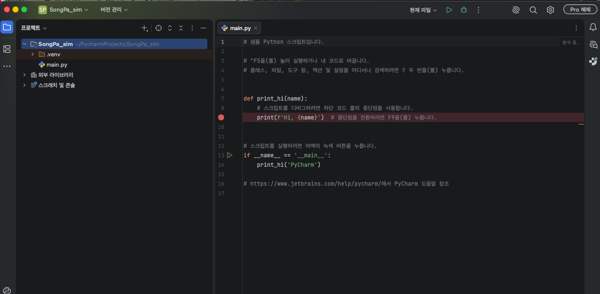

터미널 클릭해서 패키지 설치해줄게요! 아래 코드 입력해주세요

```
pip install pydeck geopandas admdongkor osmnx
``` 

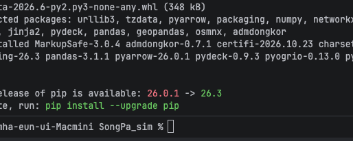 {:.left} 이렇게 좌라라ㅏㄹ설치가 됩니다. 좀 걸리니 기다려주고요

---

각각의 패키지를 이용하여 오늘 송파구 맵을 만들어볼거에용.

|패키지	|하는 일|
|---|----|
|pydeck	|3D 지도 그리기|
|geopandas	|지도 데이터(경계, 건물)를 표처럼 다루기|
|admdongkor	|송파구 행정동 경계 받기|
|osmnx	|OpenStreetMap에서 건물, 도로, 물 받기|


 <mark class="mint">**1-2. 폴더 만들기**</mark>
그다음에는 프로젝트에서 우클릭 → New → Directory로 data(받은 자료), maps(만든 지도)  폴더 두 개를 만들게요

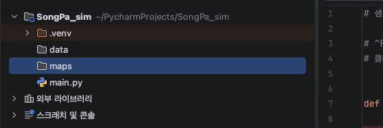 {:.left} 요로코롬~ <br>
각 폴더는<br>
data << 받은 자료 (주민 100명 CSV, 경계, OSM 데이터)<br>
maps << 완성된 지도 HTML<br>
이렇게 들어갈 예정이랍니다~<br>
---

그리고 마무리로 전에 만들었던 sonpa_residents_100.csv 를 data 폴더에 쏙 넣어주면
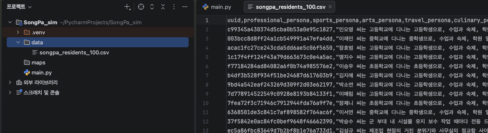
세팅은 완료!


>### 2. 송파구 3D 바탕지도 만들기

 <mark class="mint">**2-1. 코드파일 만들기**</mark>

프로젝트팡에서 SongPa_sim 폴더를 우클릭해서 New → Python File 을 눌러 basemap 파일을 만들었어요
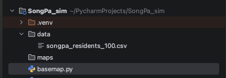 {:.left}  여기서 아래 코드를 적어봤어요

---

``` 
import admdongkor as adk
import pandas as pd
import pydeck as pdk

# 1) 송파구 행정동 경계 불러오기
emd = adk.get("20261001", "emd", crs=4326)
songpa = emd[emd["sggnm"] == "송파구"].copy()
print("송파구 행정동 수:", len(songpa))

# 2) 동 이름을 놓을 위치 구하기
pts = songpa.to_crs(5179).representative_point().to_crs(4326)
labels = pd.DataFrame({"name": songpa["emdnm"], "lon": pts.x, "lat": pts.y})

# 3) 레이어 만들기
songpa["name"] = songpa["emdnm"]
dong_layer = pdk.Layer(
    "GeoJsonLayer",
    data=songpa[["name", "geometry"]].__geo_interface__,
    filled=True,
    stroked=True,
    get_fill_color=[214, 219, 210], #색
    get_line_color=[120, 115, 100],
    get_line_width=8,
    pickable=True,
)
outline_layer = pdk.Layer(
    "GeoJsonLayer",
    data=songpa.dissolve().__geo_interface__,
    filled=False,
    stroked=True,
    get_line_color=[43, 42, 39],
    get_line_width=45,
)
label_layer = pdk.Layer(
    "TextLayer",
    data=labels,
    get_position=["lon", "lat"],
    get_text="name",
    get_size=14,
    get_color=[43, 42, 39],
    character_set=pdk.types.String("auto"),
    parameters={"depthCompare": "always"},
)

# 4) 카메라: 송파구 중심에서 비스듬히 내려다보기
center = songpa.to_crs(5179).dissolve().centroid.to_crs(4326).iloc[0]
view = pdk.ViewState(latitude=center.y, longitude=center.x,
                     zoom=12.6, pitch=50, bearing=-15)

# 5) 지도 만들고 HTML로 저장 (바탕지도 없이 송파구만)
deck = pdk.Deck(layers=[dong_layer, outline_layer, label_layer],
                initial_view_state=view,
                map_provider=None,
                tooltip={"text": "{name}"})
deck.to_html("maps/step1_basemap.html", open_browser=True,
             css_background_color="white")#바탕색
print("저장 완료: maps/step1_basemap.html")

``` 

> **코드 설명**
> <br>
> **1) 송파구 행정동 경계 불러오기**
> - **adk.get("20261001", "emd", crs=4326)** 은 2026년 10월 기준 전국 행정동(emd) 경계를 불러와요. **crs=4326** 은 위도·경도 좌표로 받겠다는 뜻이에요.
> - **emd["sggnm"] == "송파구"** 로 시군구 이름이 송파구인 동만 남기고 **.copy()** 로 새 표에 저장해요. 27개가 나와야 해요.
>
> **2) 동 이름을 놓을 위치 구하기**
> - **representative_point()** 는 동 안에 반드시 들어가는 점을 하나 구해요. 동 이름을 여기에 놓을 거예요.
> - 위경도에서 바로 계산하면 부정확해서, 미터 단위 좌표계(**5179**)로 바꿔 계산한 다음 다시 위경도(**4326**)로 돌려요.
> - 이름, 경도, 위도를 표(**DataFrame**)로 묶어요.
>
> **3) 레이어 만들기**
> 레이어는 투명 필름 같은 거예요. 아래부터 3장을 겹쳐서 쌓아요.
> - **dong_layer**: 27개 동을 회녹색(**get_fill_color**)으로 칠하고 얇은 선으로 나눠요. **pickable=True** 라서 마우스를 올리면 동 이름이 떠요.
> - **outline_layer**: **dissolve()** 로 27개 동을 하나로 합친 송파구 테두리를 45m 굵기 선으로 그려요.
> - **label_layer**: 동 이름을 써요.
>   - **pdk.types.String("auto")** 는 "한글도 쓸 수 있게 글자를 자동으로 준비해"라는 뜻이에요. 그냥 **"auto"** 라고 쓰면 pydeck이 이걸 계산식으로 잘못 읽어서 글씨가 안 나와요.
>   - **parameters={"depthCompare": "always"}** 는 글씨를 항상 맨 위에 그리라는 뜻이에요. 이게 없으면 지도를 기울였을 때 글씨 아래쪽이 땅에 가려져서 받침이 잘려요.
>
> **4) 카메라 설정**
> - **centroid** 로 송파구 전체의 중심점을 구해서 카메라를 거기에 맞춰요.
> - **zoom** 은 확대 정도, **pitch=50** 은 지도를 50도 기울이는 각도(3D 느낌의 핵심!), **bearing=-15** 는 지도를 살짝 돌리는 각도예요.
>
> **5) 지도 만들고 저장**
> - **map_provider=None** 으로 바탕지도를 꺼서 송파구만 보이게 해요.
> - **tooltip** 은 마우스를 올렸을 때 띄울 내용이에요. **{name}** 자리에 동 이름이 들어가요.
> - **to_html** 로 HTML 파일로 저장하고, **open_browser=True** 라서 브라우저가 바로 열려요.
> - **css_background_color** 는 송파구 밖 빈 공간의 배경색이에요.

이렇게 하고 실행버튼 눌렀더니

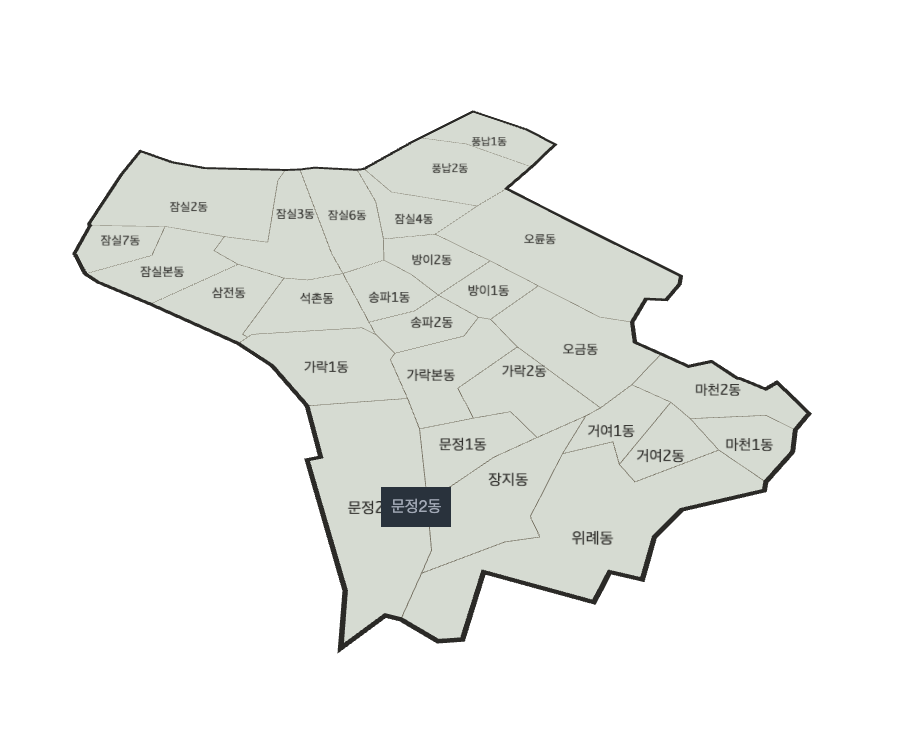
이렇게 나왔네요 성공!

>### 3. OSM에서 도로·버스·지하철 받기
이번단계는 데이터파일만 받아보려 합니다.

 <mark class="mint">**3-1. 파일 만들기**</mark>

1. 왼쪽 프로젝트 창에서 프로젝트 폴더를 우클릭하고. 
2. New → Python File을 누르고 이름에 download를 입력해써요.

그파일에는 아래 코드를 입력했습니당<br>
``` 
import admdongkor as adk
import geopandas as gpd
import osmnx as ox

# 1) 송파구 경계 준비
emd = adk.get("20261001", "emd", crs=4326)
songpa = emd[emd["sggnm"] == "송파구"]
songpa.to_file("data/songpa_dong.geojson", driver="GeoJSON")
boundary = songpa.dissolve()
area = boundary.geometry.iloc[0]

# 2) 도로망 받기 (차도 + 골목 + 인도 + 산책로)
G = ox.graph_from_polygon(area, network_type="all", simplify=True)
nodes, edges = ox.graph_to_gdfs(G)
edges = gpd.clip(edges, boundary)
edges = edges[["highway", "geometry"]].copy()
edges["highway"] = edges["highway"].astype(str)
edges.reset_index(drop=True).to_file("data/roads.geojson", driver="GeoJSON")
print("교차로 노드:", len(nodes), "/ 도로 구간:", len(edges))

# 3) 버스정류장, 지하철역 받기
def points(tags, name):
    gdf = ox.features_from_polygon(area, tags=tags)
    gdf = gdf.to_crs(5179)
    gdf["geometry"] = gdf.geometry.representative_point()
    gdf = gdf.to_crs(4326)
    keep = [c for c in ["name", "station", "subway"] if c in gdf.columns]
    gdf = gdf[keep + ["geometry"]].astype({c: str for c in keep})
    gdf.reset_index(drop=True).to_file(f"data/{name}.geojson", driver="GeoJSON")
    print(name, len(gdf))
    return gdf

points({"highway": "bus_stop"}, "bus_stops")
points({"railway": "station"}, "subway")
``` 

>**코드 설명**
>1) 송파구 경계를 songpa_dong.geojson으로 저장해 둬요. 다음 단계에서 계속 써요. 
>2) network_type="all"이라서 차도뿐 아니라 골목, 인도, 산책로까지 다 받아요. 자전거는 골목으로도 다니니까요. gpd.clip으로는 송파구 밖으로 삐져나간 길을 잘라내요.
>3) OSM에서는 시설을 "태그"로 찾아요. highway=bus_stop이 버스정류장, railway=station이 역이에요. 역은 건물 모양(면)으로 들어 있기도 해서 representative_point()로 한 점으로 바꿔요.

실행해보면..!
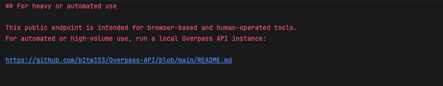
아뉘 에러가 뜨네요!<br>
 <mark class="pink">교차로 노드: 11987 / 도로 구간: 34208</mark>
<br>
이라고 뜬거 보면, 도로는 불러오는데 성공했지만 , 다른걸 불러오는데 오류가난 것같아요.

확인해보니 코드문제가 아니라 OSM 데이터를 나눠 주는 Overpass 서버가 지금 사람이 몰려서 꽉 찼다(502 Bad Gateway)는 뜻이라네요?

그럼 도로는 받았으니 , 버스 정류장이랑 지하철만 따로 받을게요!<br>
이번에는 서버가 바끄면 다른 서버로 바꿔서 자동으로 다시 시도하는 코드를 만들었어요.
``` 
# Overpass 서버 여러 곳 (한 곳이 바쁘면 다음 곳으로)
SERVERS = [
    "https://overpass-api.de/api",
    "https://overpass.kumi.systems/api",
    "https://overpass.private.coffee/api",
]
``` 
이거 추가하시면 됩니다. 그럼 일단 기존 코드에서 버스 다운로드하는 로직은 삭제할게요!
<br>그럼 최종 이렇게 나옵니다

``` 
import os
import time
import admdongkor as adk
import geopandas as gpd
import osmnx as ox

# Overpass 서버 여러 곳 (한 곳이 바쁘면 다음 곳으로)
SERVERS = [
    "https://overpass-api.de/api",
    "https://overpass.kumi.systems/api",
    "https://overpass.private.coffee/api",
]

def retry(job):
    wait = 10
    for attempt in range(6):
        ox.settings.overpass_url = SERVERS[attempt % len(SERVERS)]
        try:
            return job()
        except Exception as e:
            print(f"  {ox.settings.overpass_url} 실패 → {wait}초 뒤 다시 시도")
            time.sleep(wait)
            wait *= 2
    raise RuntimeError("서버가 계속 바빠요. 잠시 뒤에 다시 실행해 주세요.")

# 1) 송파구 경계 준비
emd = adk.get("20261001", "emd", crs=4326)
songpa = emd[emd["sggnm"] == "송파구"]
songpa.to_file("data/songpa_dong.geojson", driver="GeoJSON")
boundary = songpa.dissolve()
area = boundary.geometry.iloc[0]

# 2) 도로망 받기 (이미 받았으면 건너뛰기)
if os.path.exists("data/roads.geojson"):
    print("도로망: 이미 있어서 건너뜀")
else:
    G = retry(lambda: ox.graph_from_polygon(area, network_type="all", simplify=True))
    nodes, edges = ox.graph_to_gdfs(G)
    edges = gpd.clip(edges, boundary)
    edges = edges[["highway", "geometry"]].copy()
    edges["highway"] = edges["highway"].astype(str)
    edges.reset_index(drop=True).to_file("data/roads.geojson", driver="GeoJSON")
    print("교차로 노드:", len(nodes), "/ 도로 구간:", len(edges))

# 3) 버스정류장, 지하철역 받기
def points(tags, name):
    gdf = retry(lambda: ox.features_from_polygon(area, tags=tags))
    gdf = gdf.to_crs(5179)
    gdf["geometry"] = gdf.geometry.representative_point()
    gdf = gdf.to_crs(4326)
    keep = [c for c in ["name", "station", "subway"] if c in gdf.columns]
    gdf = gdf[keep + ["geometry"]].astype({c: str for c in keep})
    gdf.reset_index(drop=True).to_file(f"data/{name}.geojson", driver="GeoJSON")
    print(name, len(gdf))

points({"highway": "bus_stop"}, "bus_stops")
points({"railway": "station"}, "subway")

``` 

>**코드 설명 (바뀐 부분만)**
> - retry 함수: 받다가 실패하면 다음 서버로 바꾸고, 10초 → 20초 → 40초처럼 기다리는 시간을 두 배씩 늘리면서 최대 6번 다시 시도해요. 
> - os.path.exists(...): data/roads.geojson 파일이 이미 있으면 도로 받기를 건너뛰어요. 
> - 도로와 버스·지하철 받는 부분을 전부 **retry(lambda: ...)** 로 감쌌어요. lambda는 "이 작업을 나중에 실행해 줘"라고 retry 함수에 일을 넘기는 방법이에요.

바뀐걸로 실행해보니 (시간 오래 걸렸어요 ㅜ)
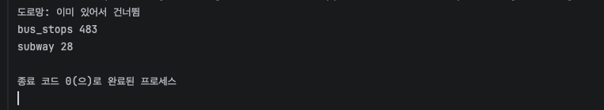
이렇게 뜨면 성공입니다~~

>### 4. 따릉이 대여소에서 송파구만 골라내기
저의 목표는 자전거를 많이 탈 수 있게 설계하는 것이니! 일단 송파구에 따릉이가 얼마나 있는지 알아보자구요
<br>

 <mark class="mint">**4-1. 서울시 공공자전거 따릉이 대여소 정보 구하기** </mark>

https://data.seoul.go.kr/dataList/OA-13252/F/1/datasetView.do
<br>여기 링크로 들어가시면 대여소 정보 파일을 얻을 수 있더라구요.<br>

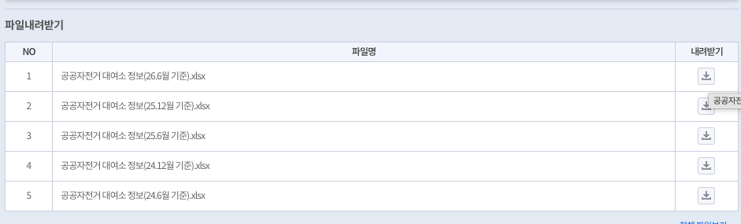
아주그냥 최신걸로 다운했어요!
<br>다운받았으면 data 폴더에 넣어주시면 됩니다.

 <mark class="mint">**4-2. 엑셀 읽는 패키지 설치** </mark>

받은 파일은 엑셀인데, 파이썬은 엑셀을 못읽거든요. 그래서 이 코드 터미널에 입력합시다!<br>
`pip install openpyxl`

 <mark class="mint">**4-3. 코드 작성** </mark>

프로젝트 폴더 우클릭 → New → Python File → 이름은 bike로 만들고 아래 코드를 작성했어요.
``` 
import pandas as pd
import geopandas as gpd

# 받은 파일 이름 (다르면 여기만 고치기)
FILE = "data/공공자전거 대여소 정보(26.6월 기준).xlsx"

# 1) 엑셀 읽고, "위도"가 있는 줄을 열 이름으로 쓰기
raw = pd.read_excel(FILE, header=None, dtype=str)
head = raw.index[raw.apply(lambda r: r.str.contains("위도", na=False).any(), axis=1)][0]
df = raw.iloc[head + 1:].copy()
df.columns = raw.iloc[head].str.strip()

# 2) 송파구만 남기기
songpa = df[df.apply(lambda r: r.str.contains("송파구", na=False).any(), axis=1)].copy()

# 3) 위도·경도를 숫자로 바꾸고 이상한 좌표 빼기
lat = [c for c in df.columns if "위도" in str(c)][0]
lon = [c for c in df.columns if "경도" in str(c)][0]
songpa[lat] = pd.to_numeric(songpa[lat], errors="coerce")
songpa[lon] = pd.to_numeric(songpa[lon], errors="coerce")
songpa = songpa.dropna(subset=[lat, lon])
songpa = songpa[(songpa[lat] > 37) & (songpa[lon] > 126)]

# 4) 지도용 점으로 바꾸고, 송파구 경계 안만 저장
name = [c for c in df.columns if "명" in str(c)][0]
bike = gpd.GeoDataFrame({"name": songpa[name]},
                        geometry=gpd.points_from_xy(songpa[lon], songpa[lat]), crs=4326)
dong = gpd.read_file("data/songpa_dong.geojson")
bike = gpd.clip(bike, dong.dissolve())
bike.reset_index(drop=True).to_file("data/bike_stations.geojson", driver="GeoJSON")
print("송파구 따릉이 대여소:", len(bike))
``` 

>**코드 설명**
>1) 열린데이터광장 엑셀은 맨 위에 제목 줄이 몇 줄 붙어 있어요. 그래서 header=None으로 일단 다 읽고, "위도"라는 글자가 있는 줄을 찾아서 그 줄을 열 이름으로 써요. 
>2) 어느 칸이든 "송파구"가 적힌 줄만 남겨요. 
>3) 위도·경도를 숫자로 바꿔요. 비어 있는 좌표는 dropna로 빼고, 0처럼 서울이 아닌 좌표는 범위 조건으로 빼요. 
>4) points_from_xy로 위도·경도를 지도 위의 점으로 바꿔요. 마지막에 gpd.clip으로 송파구 경계 안에 있는 것만 한 번 더 걸러요.

실행해보면..!
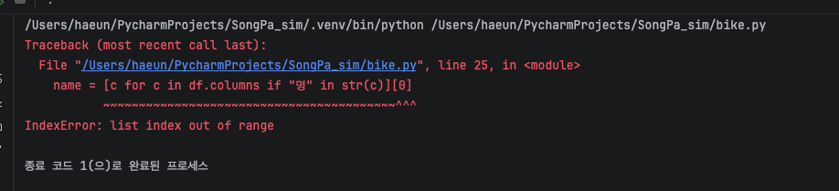
아 또 실패네요.
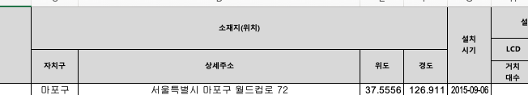
여기보시면 엑셀의 열은 이렇게 위치가 주소, 위도, 경도 세가지로 표시되있어요. 그래서 
필요한 열을 각각 제가 지정해서 다시 짜볼게요!
``` 
import pandas as pd
import geopandas as gpd

# 받은 파일 이름 (다르면 여기만 고치기)
FILE = "data/공공자전거 대여소 정보(26.6월 기준).xlsx"

# 1) 엑셀 읽기: 위 5줄은 제목이라 건너뛰고, 열 이름은 직접 붙이기
cols = ["번호", "이름", "자치구", "주소", "위도", "경도", "설치시기", "거치대_LCD", "거치대_QR", "운영방식"]
df = pd.read_excel(FILE, header=None, skiprows=5, names=cols)

# 2) 송파구만 남기기
songpa = df[df["자치구"] == "송파구"].copy()

# 3) 거치대 수 합치기 (LCD + QR)
songpa["거치대"] = songpa[["거치대_LCD", "거치대_QR"]].fillna(0).sum(axis=1).astype(int)

# 4) 좌표가 이상한 줄 빼기
songpa = songpa[(songpa["위도"] > 37) & (songpa["경도"] > 126)]

# 5) 지도용 점으로 바꾸고, 송파구 경계 안만 저장
bike = gpd.GeoDataFrame(songpa[["번호", "이름", "거치대"]],
                        geometry=gpd.points_from_xy(songpa["경도"], songpa["위도"]), crs=4326)
dong = gpd.read_file("data/songpa_dong.geojson")
bike = gpd.clip(bike, dong.dissolve())
bike = bike.rename(columns={"이름": "name"})
bike.reset_index(drop=True).to_file("data/bike_stations.geojson", driver="GeoJSON")
print("송파구 따릉이 대여소:", len(bike))
print(bike.head())
``` 

> **코드 설명**
> - **`read_excel(header=None, skiprows=5, names=cols)`**: 위 5줄(제목)은 버리고, 열 이름은 직접 붙여요. 이 파일은 열 이름이 여러 줄에 흩어져 있어서 자동으로 읽으면 엉망이 돼요.
> - **`.copy()`**: 걸러낸 표를 원본과 분리해요. 이게 없으면 다음 줄에서 열을 추가할 때 `SettingWithCopyWarning` 경고가 떠요.
> - **`.fillna(0).sum(axis=1)`**: 빈칸을 0으로 채운 다음 **가로 방향(같은 줄끼리)**으로 더해요. 거치대 수가 LCD 칸이나 QR 칸 중 한 곳에만 적혀 있어서 합쳐 주는 거예요.
> - **`(조건1) & (조건2)`**: pandas에서는 `and` 대신 `&`를 쓰고, 조건마다 **괄호가 꼭 필요해요**. 괄호를 빼면 에러가 나요.
> - **`points_from_xy(경도, 위도)`**: 순서가 **경도(x) 먼저**예요. 위도를 먼저 넣으면 점이 엉뚱한 곳에 찍혀요.
> - **`crs=4326`**: GPS에서 쓰는 위도·경도 좌표계라고 알려 주는 거예요. 이걸 맞춰야 다른 지도 데이터와 겹쳐 그릴 수 있어요.
> - **`dissolve()` + `clip()`**: 27개 동을 송파구 하나로 합친 다음, 그 경계 안에 있는 점만 남겨요. 엑셀엔 송파구라고 적혀 있지만 좌표가 경계 밖에 찍힌 3개가 여기서 빠져요.
> - **`reset_index(drop=True)`**: 걸러내면서 띄엄띄엄해진 줄 번호를 0부터 다시 매기고, 옛 번호는 버려요.

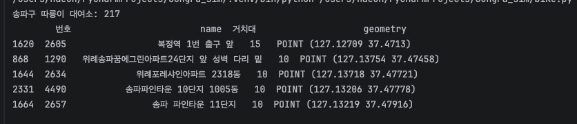
짜라란 실행했더니 동작합니다!
<br>이제 이 정보를 아까 지도에 올리기만 하면 되겠네요.

>### 5. 3D 지도에 다 올리기
basemap에서 쓴 pydeck 방식 그대로, 받은 데이터를 레이어로 하나씩 쌓아볼게요<br>

<mark class="mint">**5-1. 코드 작성** </mark>

프로젝트 폴더 우클릭 → New → Python File → 이름은 map3d로 만들고<br>
아래 코드를 작성해줍니다.

``` 
import geopandas as gpd
import pandas as pd
import pydeck as pdk

# 1) 데이터 불러오기
dong   = gpd.read_file("data/songpa_dong.geojson")
roads  = gpd.read_file("data/roads.geojson")
bus    = gpd.read_file("data/bus_stops.geojson")
subway = gpd.read_file("data/subway.geojson")
bike   = gpd.read_file("data/bike_stations.geojson")

# 2) 도로 굵기 정하기 (큰길은 굵게, 골목은 가늘게)
def road_width(highway):
    if any(k in highway for k in ["motorway", "trunk", "primary", "secondary"]):
        return 10
    if any(k in highway for k in ["tertiary", "residential", "unclassified"]):
        return 4
    return 1.5

roads["w"] = roads["highway"].apply(road_width)

# 3) 점 데이터를 lon, lat 표로 바꾸기
def to_points(gdf):
    return pd.DataFrame({"name": gdf["name"].astype(str),
                         "lon": gdf.geometry.x, "lat": gdf.geometry.y})

bus_pts, subway_pts, bike_pts = to_points(bus), to_points(subway), to_points(bike)

# 4) 동 이름 위치
pts = dong.to_crs(5179).representative_point().to_crs(4326)
labels = pd.DataFrame({"name": dong["emdnm"], "lon": pts.x, "lat": pts.y})

# 5) 레이어 쌓기 (아래 → 위)
ON_TOP = {"depthCompare": "always"}

layers = [
    pdk.Layer("GeoJsonLayer", dong[["emdnm", "geometry"]].__geo_interface__,
              filled=True, stroked=True,
              get_fill_color=[214, 219, 210], get_line_color=[160, 168, 160],
              get_line_width=6),
    pdk.Layer("GeoJsonLayer", roads[["w", "geometry"]].__geo_interface__,
              get_line_color=[126, 140, 136], get_line_width="properties.w",
              line_width_min_pixels=0.5, parameters=ON_TOP),
    pdk.Layer("ScatterplotLayer", bus_pts, get_position=["lon", "lat"],
              get_fill_color=[60, 111, 209], get_radius=15, radius_min_pixels=2,
              pickable=True, parameters=ON_TOP),
    pdk.Layer("ScatterplotLayer", bike_pts, get_position=["lon", "lat"],
              get_fill_color=[31, 163, 107], get_radius=25, radius_min_pixels=3,
              pickable=True, parameters=ON_TOP),
    pdk.Layer("ColumnLayer", subway_pts, get_position=["lon", "lat"],
              get_fill_color=[214, 69, 69], radius=40, get_elevation=150,
              disk_resolution=12, pickable=True),
    pdk.Layer("GeoJsonLayer", dong.dissolve().__geo_interface__,
              filled=False, stroked=True,
              get_line_color=[60, 70, 68], get_line_width=30),
    pdk.Layer("TextLayer", labels, get_position=["lon", "lat"], get_text="name",
              get_size=13, get_color=[60, 70, 68],
              character_set=pdk.types.String("auto"), parameters=ON_TOP),
]

# 6) 카메라 & 저장
center = dong.to_crs(5179).dissolve().centroid.to_crs(4326).iloc[0]
view = pdk.ViewState(latitude=center.y, longitude=center.x,
                     zoom=12.6, pitch=50, bearing=-15)

deck = pdk.Deck(layers=layers, initial_view_state=view, map_provider=None,
                tooltip={"text": "{name}"})
deck.to_html("maps/songpa_3d.html", open_browser=True,
             css_background_color="white")
print("저장 완료: maps/songpa_3d.html")
``` 

>**코드 설명**
> 1) **any(k in highway for k in [...]):** 리스트 안의 단어 중 하나라도 도로 종류에 들어 있으면 True예요. OSM 도로 종류는 "['residential', 'service']"처럼 여러 개가 섞여 있는 경우가 있어서 == 대신 in으로 찾아요. 
> 2) **.apply(road_width)**: 열의 값 하나하나에 함수를 실행해서 결과로 새 열(w)을 만들어요.
> 3) **gdf.geometry.x, .y**: 점의 경도(x)와 위도(y)를 꺼내요. ScatterplotLayer와 ColumnLayer는 lon, lat 열이 있는 일반 표를 받아서 이렇게 바꿔 줘요.
> 4) **"properties.w": GeoJSON**에서는 열 값이 properties 안에 들어 있어요. 그래서 도로마다 굵기를 w 열에서 읽으라고 이렇게 써요. 
> 5) **ON_TO**P: basemap에서 동 이름 받침이 잘렸던 것과 같은 문제를 막아요. 땅과 높이가 같은 도로와 점이 땅에 가려지지 않게, 항상 위에 그리라는 설정이에요. 
> 6) **ColumnLayer**: 지하철역을 높이 150m짜리 빨간 기둥으로 세워요. 기둥은 원래 땅 위로 솟아 있어서 ON_TOP이 필요 없어요.

실행해보면!
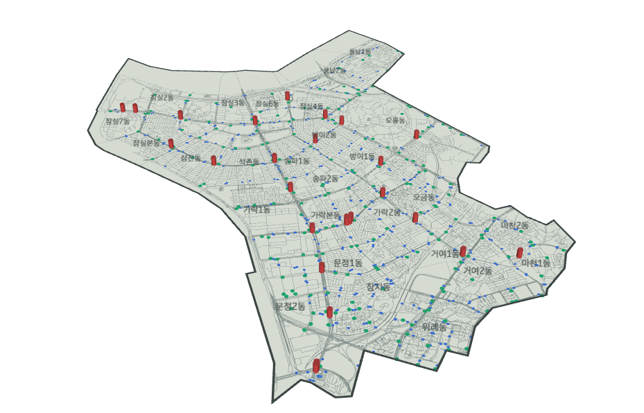
회색 선은 도로, 파란 점은 버스정류장, 초록 점은 따릉이, 빨간 기둥은 지하철역이랍니다.
<br>아 근데 점이랑 도형 모양과 색이 마음에 들지않아 바꿀게요!


## 1. 인프라 조사
## 2. 주민별 주거구역 정하기
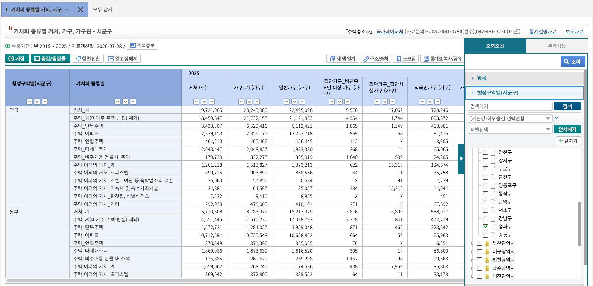
여기 링크를 통해 송파구의 주거를 조사해봤는데요.