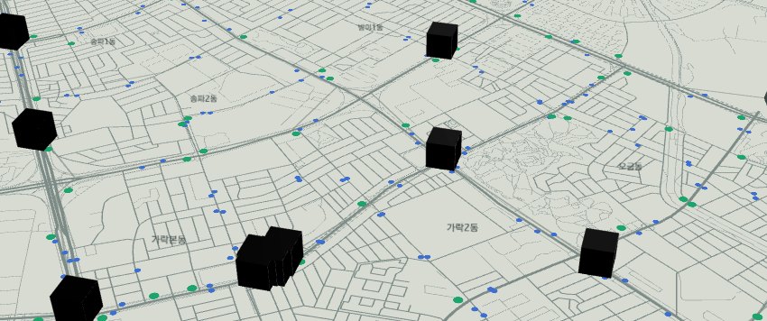
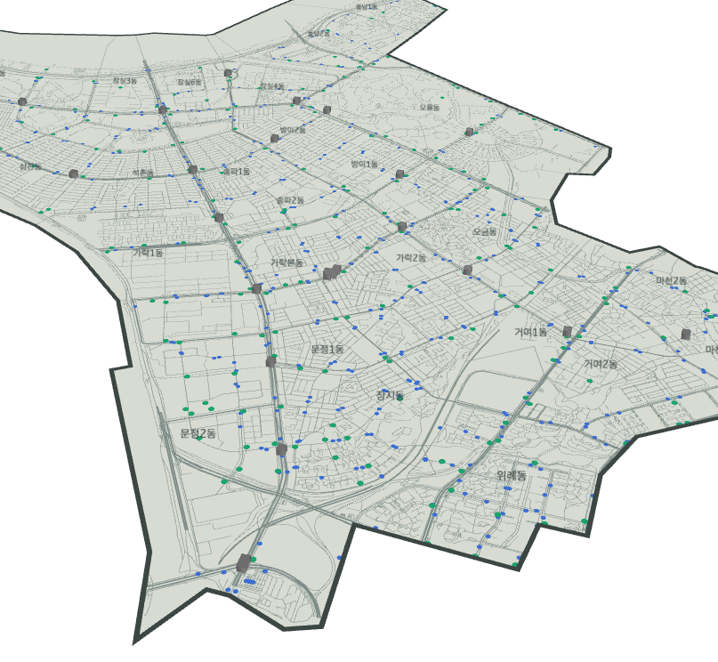
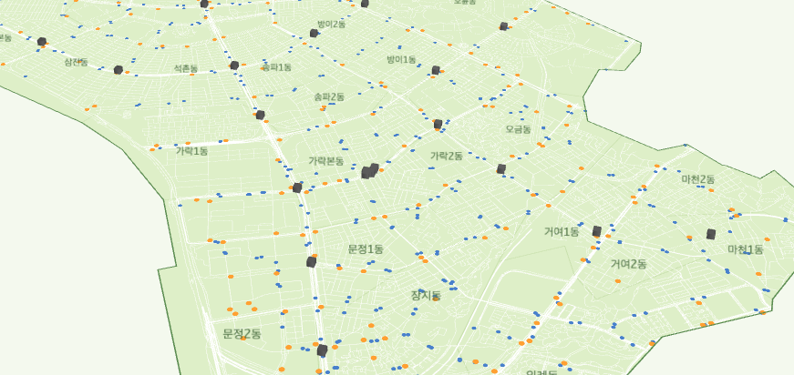
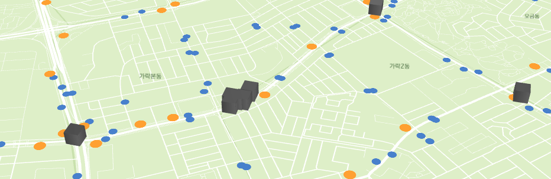
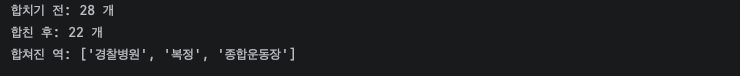
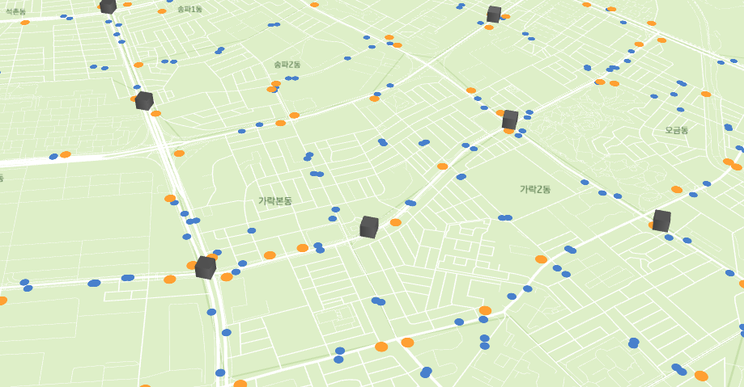

# 인프라 데이터 구축 1편: 송파구 3D 지도 만들기

## 들어가며

### 0-1. 이번에 할 일

지난 편까지 송파구 주민 100명을 인구, 성별, 나이대, 교통수단 비율에 맞춰 만들었어요.<br>
이제 이 주민들이 송파구 안에서 실제로 어떻게 움직이는지, 그리고 <mark>어떤 조건에서 자전거를 탈 확률이 높아지는지</mark> 시뮬레이션해 볼 차례예요.

그러려면 먼저 송파구가 어떻게 생겼는지 알아야겠죠? 길은 어디로 나 있고, 지하철역과 따릉이 대여소는 어디 있는지요.

전체 과정은 이렇게 잡았어요.

1. **지도 제작** ← 이번 편
2. **인프라 조사**
   - 필수 교통 거점 3종: 지하철역, 버스정류장, 따릉이 대여소 ← 이번 편
   - 상권·시설 4종: 쇼핑, 공원·여가, 학교, 오피스
3. 주민별 거주지 정하기
4. 주민별 출퇴근 위치 정하기
5. 주민별 출퇴근 시간 정하기
6. 지도에 주민과 출퇴근 경로 표시하기

이번 편에서는 **송파구 3D 지도를 만들고, 교통 거점 3종을 올리는 것**까지 해요.

### 0-2. 사용할 도구

지도는 **pydeck**으로 만들어요. 결과가 HTML 파일 하나로 나와서 브라우저에서 바로 돌려 볼 수 있고, 단계마다 쓸 기능이 다 있더라고요.

| 단계 | pydeck에서 쓸 기능 |
|---|---|
| 인프라 표시 | 점(ScatterplotLayer), 3D 기둥(ColumnLayer) |
| 주민 거주지 | 행정동을 인구만큼 높이 올리기(GeoJsonLayer extruded) |
| 출퇴근 위치 | 집에서 직장까지 3D 포물선(ArcLayer) |
| 출퇴근 시간 | 시간에 따라 사람이 움직이는 애니메이션(TripsLayer) |

함께 쓰는 패키지는 네 개예요.

| 패키지 | 하는 일 |
|---|---|
| pydeck | 3D 지도 그리기 |
| geopandas | 지도 데이터(경계, 점, 선)를 표처럼 다루기 |
| admdongkor | 송파구 행정동 경계 받기 |
| osmnx | OpenStreetMap에서 도로, 시설 받기 |

---

## 1. 준비하기

### 1-1. 파이참 프로젝트 만들기

지금까지 표본설계도 파이참으로 했는데, 이번에도 파이참을 써요. (그냥 제가 파이참을 좋아해요ㅎㅎ)

상단 메뉴의 File → New Project로 새 프로젝트를 만들었어요. 이름은 `SongPa_sim`으로 했어요.


터미널을 열고 패키지를 설치해요.

```
pip install pydeck geopandas admdongkor osmnx
```

{:.left}

이렇게 좌라라락 설치돼요. 시간이 좀 걸리니 기다려 주세요.

### 1-2. 폴더 만들기

프로젝트에서 우클릭 → New → Directory로 폴더 두 개를 만들었어요.

{:.left}

| 폴더 | 넣을 것 |
|---|---|
| `data` | 받은 자료 (주민 100명 CSV, 경계, OSM 데이터) |
| `maps` | 완성된 지도 HTML |

마지막으로 지난 편에서 만든 `songpa_residents_100.csv`를 `data` 폴더에 쏙 넣어 주면 세팅 완료!


---

## 2. 송파구 바탕 지도 만들기

### 2-1. 코드 작성

프로젝트 폴더 우클릭 → New → Python File로 `basemap` 파일을 만들었어요.

{:.left}

송파구 행정동 경계를 불러와서, 바탕지도 없이 송파구만 비스듬히 보이게 그려 볼 거예요.

<details markdown="1">
<summary>📄 basemap.py 전체 코드 보기</summary>

```python
import admdongkor as adk
import pandas as pd
import pydeck as pdk

# 1) 송파구 행정동 경계 불러오기
emd = adk.get("20261001", "emd", crs=4326)
songpa = emd[emd["sggnm"] == "송파구"].copy()
print("송파구 행정동 수:", len(songpa))

# 2) 동 이름을 놓을 위치 구하기
pts = songpa.to_crs(5179).representative_point().to_crs(4326)
labels = pd.DataFrame({"name": songpa["emdnm"], "lon": pts.x, "lat": pts.y})

# 3) 레이어 만들기
songpa["name"] = songpa["emdnm"]
dong_layer = pdk.Layer(
    "GeoJsonLayer",
    data=songpa[["name", "geometry"]].__geo_interface__,
    filled=True,
    stroked=True,
    get_fill_color=[214, 219, 210],
    get_line_color=[120, 115, 100],
    get_line_width=8,
    pickable=True,
)
outline_layer = pdk.Layer(
    "GeoJsonLayer",
    data=songpa.dissolve().__geo_interface__,
    filled=False,
    stroked=True,
    get_line_color=[43, 42, 39],
    get_line_width=45,
)
label_layer = pdk.Layer(
    "TextLayer",
    data=labels,
    get_position=["lon", "lat"],
    get_text="name",
    get_size=14,
    get_color=[43, 42, 39],
    character_set=pdk.types.String("auto"),
    parameters={"depthCompare": "always"},
)

# 4) 카메라: 송파구 중심에서 비스듬히 내려다보기
center = songpa.to_crs(5179).dissolve().centroid.to_crs(4326).iloc[0]
view = pdk.ViewState(latitude=center.y, longitude=center.x,
                     zoom=12.6, pitch=50, bearing=-15)

# 5) 지도 만들고 HTML로 저장 (바탕지도 없이 송파구만)
deck = pdk.Deck(layers=[dong_layer, outline_layer, label_layer],
                initial_view_state=view,
                map_provider=None,
                tooltip={"text": "{name}"})
deck.to_html("maps/step1_basemap.html", open_browser=True,
             css_background_color="white")
print("저장 완료: maps/step1_basemap.html")
```

</details>

> **코드 설명**
> - **`adk.get("20261001", "emd", crs=4326)`**: 2026년 10월 기준 전국 행정동(emd) 경계를 불러와요. `crs=4326`은 GPS와 같은 **위도·경도 좌표계**로 받겠다는 뜻이에요.
> - **`.copy()`**: 걸러낸 송파구 표를 원본과 분리해요. 아래에서 `name` 열을 추가할 때 `SettingWithCopyWarning` 경고가 안 뜨게 해요.
> - **`to_crs(5179)` → 계산 → `to_crs(4326)`**: 위경도는 각도라서 거리·면적 계산이 부정확해요. 그래서 **미터 단위 좌표계(5179)**로 바꿔서 계산한 다음 다시 위경도로 돌려요.
> - **`representative_point()`**: 동 **안에 반드시 들어가는** 점을 구해요. 중심점(`centroid`)은 동 모양이 휘어 있으면 동 밖에 찍힐 수 있어서, 이름 위치로는 이게 더 안전해요.
> - **`__geo_interface__`**: geopandas 표를 pydeck이 읽을 수 있는 **GeoJSON 형식**으로 바꿔요.
> - **레이어**: 투명 필름처럼 `layers=[...]`에 적은 순서대로 아래부터 쌓여요. 땅 → 테두리 → 이름 순서예요.
> - **`dissolve()`**: 27개 동을 **하나로 합쳐서** 송파구 전체 모양으로 만들어요. 테두리를 그릴 때 써요.
> - **`pickable=True`** + **`tooltip`**: 마우스를 올리면 동 이름을 띄워요.
> - **`pitch=50`, `bearing=-15`**: 지도를 50도 기울이고(3D 느낌의 핵심!) 15도 돌려요.
> - **`map_provider=None`**: 바탕지도를 꺼서 송파구만 보이게 해요.
> - **`css_background_color`**: 송파구 밖 배경색이에요. 이건 웹페이지(CSS) 설정이라서 `"white"` 같은 색 이름을 써도 돼요.

### 2-2. 결과

실행 버튼을 눌렀더니!


송파구 27개 동이 비스듬히 잘 나왔어요. 성공!

>💡 **동 이름 받침이 잘렸던 이유**
>
>처음엔 `parameters={"depthCompare": "always"}`가 없어서 "잠실7동"이 "자시7도"로 보였어요. 지도를 기울이면 글씨는 바닥에 세운 간판처럼 서 있게 되는데, **글씨 아래쪽이 땅 밑으로 들어가서 받침만 가려진** 거였어요. 글씨를 항상 맨 위에 그리게 하니까 해결됐어요.
>
>`pdk.types.String("auto")`로 한 번 감싼 것도 비슷한 이유예요. pydeck은 그냥 `"auto"`라고 쓰면 이걸 `"@@=auto"`라는 **계산식으로 바꿔 버려서** 한글이 준비되지 않아요.

---

## 3. 교통 거점 데이터 받기

이번 단계는 지도에 올릴 **데이터 파일만** 받아요.

| 데이터 | 출처 |
|---|---|
| 도로망, 버스정류장, 지하철역 | OpenStreetMap (osmnx) |
| 따릉이 대여소 | 서울 열린데이터광장 |

### 3-1. 도로·버스·지하철 받기

New → Python File로 `download` 파일을 만들고, OpenStreetMap에서 도로망과 버스정류장, 지하철역을 받는 코드를 짰어요.

<details markdown="1">
<summary>📄 처음 짠 코드 보기 (에러 난 버전)</summary>

```python
import admdongkor as adk
import geopandas as gpd
import osmnx as ox

# 1) 송파구 경계 준비
emd = adk.get("20261001", "emd", crs=4326)
songpa = emd[emd["sggnm"] == "송파구"]
songpa.to_file("data/songpa_dong.geojson", driver="GeoJSON")
boundary = songpa.dissolve()
area = boundary.geometry.iloc[0]

# 2) 도로망 받기 (차도 + 골목 + 인도 + 산책로)
G = ox.graph_from_polygon(area, network_type="all", simplify=True)
nodes, edges = ox.graph_to_gdfs(G)
edges = gpd.clip(edges, boundary)
edges = edges[["highway", "geometry"]].copy()
edges["highway"] = edges["highway"].astype(str)
edges.reset_index(drop=True).to_file("data/roads.geojson", driver="GeoJSON")
print("교차로 노드:", len(nodes), "/ 도로 구간:", len(edges))

# 3) 버스정류장, 지하철역 받기
def points(tags, name):
    gdf = ox.features_from_polygon(area, tags=tags)
    gdf = gdf.to_crs(5179)
    gdf["geometry"] = gdf.geometry.representative_point()
    gdf = gdf.to_crs(4326)
    keep = [c for c in ["name", "station", "subway"] if c in gdf.columns]
    gdf = gdf[keep + ["geometry"]].astype({c: str for c in keep})
    gdf.reset_index(drop=True).to_file(f"data/{name}.geojson", driver="GeoJSON")
    print(name, len(gdf))
    return gdf

points({"highway": "bus_stop"}, "bus_stops")
points({"railway": "station"}, "subway")
```

</details>

실행해 보면..!


아뉘 에러가 뜨네요!<br>
그런데 위쪽을 보면 <mark class="pink">교차로 노드: 11987 / 도로 구간: 34208</mark>이 찍혀 있어요. **도로는 받는 데 성공**했고, 버스정류장에서 멈춘 거예요.

확인해 보니 코드 문제가 아니었어요. OSM 데이터를 나눠 주는 **Overpass 서버에 사람이 몰려서 꽉 찼다**(502 Bad Gateway)는 뜻이었어요.

### 3-2. 서버가 바쁘면 다시 시도하기

그래서 두 가지를 바꿨어요.

1. **서버를 여러 곳 준비해서**, 한 곳이 바쁘면 다른 서버로 바꿔 다시 시도해요.
2. 도로는 이미 받았으니까, **도로 파일이 있으면 건너뛰어요.** 안 그러면 실행할 때마다 몇 분씩 도로를 다시 받거든요.

```python
# Overpass 서버 여러 곳 (한 곳이 바쁘면 다음 곳으로)
SERVERS = [
    "https://overpass-api.de/api",
    "https://overpass.kumi.systems/api",
    "https://overpass.private.coffee/api",
]
```

<details markdown="1">
<summary>📄 download.py 최종 코드 보기</summary>

```python
import os
import time
import admdongkor as adk
import geopandas as gpd
import osmnx as ox

# Overpass 서버 여러 곳 (한 곳이 바쁘면 다음 곳으로)
SERVERS = [
    "https://overpass-api.de/api",
    "https://overpass.kumi.systems/api",
    "https://overpass.private.coffee/api",
]

def retry(job):
    wait = 10
    for attempt in range(6):
        ox.settings.overpass_url = SERVERS[attempt % len(SERVERS)]
        try:
            return job()
        except Exception as e:
            print(f"  {ox.settings.overpass_url} 실패 → {wait}초 뒤 다시 시도")
            time.sleep(wait)
            wait *= 2
    raise RuntimeError("서버가 계속 바빠요. 잠시 뒤에 다시 실행해 주세요.")

# 1) 송파구 경계 준비
emd = adk.get("20261001", "emd", crs=4326)
songpa = emd[emd["sggnm"] == "송파구"]
songpa.to_file("data/songpa_dong.geojson", driver="GeoJSON")
boundary = songpa.dissolve()
area = boundary.geometry.iloc[0]

# 2) 도로망 받기 (이미 받았으면 건너뛰기)
if os.path.exists("data/roads.geojson"):
    print("도로망: 이미 있어서 건너뜀")
else:
    G = retry(lambda: ox.graph_from_polygon(area, network_type="all", simplify=True))
    nodes, edges = ox.graph_to_gdfs(G)
    edges = gpd.clip(edges, boundary)
    edges = edges[["highway", "geometry"]].copy()
    edges["highway"] = edges["highway"].astype(str)
    edges.reset_index(drop=True).to_file("data/roads.geojson", driver="GeoJSON")
    print("교차로 노드:", len(nodes), "/ 도로 구간:", len(edges))

# 3) 버스정류장, 지하철역 받기
def points(tags, name):
    gdf = retry(lambda: ox.features_from_polygon(area, tags=tags))
    gdf = gdf.to_crs(5179)
    gdf["geometry"] = gdf.geometry.representative_point()
    gdf = gdf.to_crs(4326)
    keep = [c for c in ["name", "station", "subway"] if c in gdf.columns]
    gdf = gdf[keep + ["geometry"]].astype({c: str for c in keep})
    gdf.reset_index(drop=True).to_file(f"data/{name}.geojson", driver="GeoJSON")
    print(name, len(gdf))

points({"highway": "bus_stop"}, "bus_stops")
points({"railway": "station"}, "subway")
```

</details>

> **코드 설명**
> - **`network_type="all"`**: 차도뿐 아니라 골목, 인도, 산책로까지 다 받아요. 자전거는 골목으로도 다니니까요.
> - **`gpd.clip`**: 송파구 경계 밖으로 삐져나간 길을 잘라내요.
> - **OSM 태그**: OSM은 시설을 "태그"로 찾아요. `highway=bus_stop`이 버스정류장, `railway=station`이 역이에요. 역은 건물 모양(면)으로 들어 있기도 해서 `representative_point()`로 한 점으로 바꿔요.
> - **`retry` 함수**: 실패하면 다음 서버로 바꾸고, 10초 → 20초 → 40초처럼 기다리는 시간을 두 배씩 늘리면서 최대 6번 다시 시도해요.
> - **`os.path.exists(...)`**: `data/roads.geojson` 파일이 이미 있으면 도로 받기를 건너뛰어요.
> - **`retry(lambda: ...)`**: `lambda`는 "이 작업을 나중에 실행해 줘"라고 retry 함수에 일을 넘기는 방법이에요.

바꾼 코드로 실행하니 (시간이 꽤 걸렸어요ㅜ)


버스정류장 **483개**, 지하철역 **28개**. 성공이에요~

### 3-3. 따릉이 대여소 받기

제 목표는 자전거를 많이 타게 만드는 거니까! 송파구에 따릉이가 얼마나 있는지부터 알아봐야겠죠.

**① 파일 받기**

[서울시 공공자전거 따릉이 대여소 정보](https://data.seoul.go.kr/dataList/OA-13252/F/1/datasetView.do)에서 가장 최신인 26.6월 기준 파일을 받아 `data` 폴더에 넣었어요.


**② 엑셀 읽는 패키지 설치**

pandas로 엑셀 파일을 읽으려면 `openpyxl`이 필요해요. 터미널에 입력해 주세요.

```
pip install openpyxl
```

**③ 코드 작성 (첫 시도)**

New → Python File로 `bike` 파일을 만들었어요. 처음엔 "위도"라는 글자가 있는 줄을 찾아서 그 줄을 열 이름으로 쓰는 방식으로 짰어요.

<details markdown="1">
<summary>📄 처음 짠 코드 보기 (에러 난 버전)</summary>

```python
import pandas as pd
import geopandas as gpd

# 받은 파일 이름 (다르면 여기만 고치기)
FILE = "data/공공자전거 대여소 정보(26.6월 기준).xlsx"

# 1) 엑셀 읽고, "위도"가 있는 줄을 열 이름으로 쓰기
raw = pd.read_excel(FILE, header=None, dtype=str)
head = raw.index[raw.apply(lambda r: r.str.contains("위도", na=False).any(), axis=1)][0]
df = raw.iloc[head + 1:].copy()
df.columns = raw.iloc[head].str.strip()

# 2) 송파구만 남기기
songpa = df[df.apply(lambda r: r.str.contains("송파구", na=False).any(), axis=1)].copy()

# 3) 위도·경도를 숫자로 바꾸고 이상한 좌표 빼기
lat = [c for c in df.columns if "위도" in str(c)][0]
lon = [c for c in df.columns if "경도" in str(c)][0]
songpa[lat] = pd.to_numeric(songpa[lat], errors="coerce")
songpa[lon] = pd.to_numeric(songpa[lon], errors="coerce")
songpa = songpa.dropna(subset=[lat, lon])
songpa = songpa[(songpa[lat] > 37) & (songpa[lon] > 126)]

# 4) 지도용 점으로 바꾸고, 송파구 경계 안만 저장
name = [c for c in df.columns if "명" in str(c)][0]
bike = gpd.GeoDataFrame({"name": songpa[name]},
                        geometry=gpd.points_from_xy(songpa[lon], songpa[lat]), crs=4326)
dong = gpd.read_file("data/songpa_dong.geojson")
bike = gpd.clip(bike, dong.dissolve())
bike.reset_index(drop=True).to_file("data/bike_stations.geojson", driver="GeoJSON")
print("송파구 따릉이 대여소:", len(bike))
```

</details>

실행해 보면..!


아 또 실패네요. 엑셀을 열어 봤더니 원인이 보였어요.


**제목 줄이 5줄**이고, 열 이름이 여러 줄에 흩어져 있었어요.

| 줄 | 들어 있는 것 |
|---|---|
| 1번째 | 대여소번호, 보관소(대여소)명, 소재지(위치), 설치시기 … |
| 2번째 | LCD, QR |
| 3번째 | 자치구, 상세주소, **위도**, **경도** |
| 4~5번째 | 거치대수, 빈 줄 |

"위도"는 3번째 줄에 있는데 대여소 이름은 1번째 줄에 있어서, 이름 열을 못 찾은 거예요.

**④ 열을 직접 지정해서 다시 짜기**

그래서 위 5줄은 건너뛰고, 열 이름은 제가 직접 붙였어요. 코드도 훨씬 짧아졌어요.

<details markdown="1">
<summary>📄 bike.py 최종 코드 보기</summary>

```python
import pandas as pd
import geopandas as gpd

# 받은 파일 이름 (다르면 여기만 고치기)
FILE = "data/공공자전거 대여소 정보(26.6월 기준).xlsx"

# 1) 엑셀 읽기: 위 5줄은 제목이라 건너뛰고, 열 이름은 직접 붙이기
cols = ["번호", "이름", "자치구", "주소", "위도", "경도", "설치시기", "거치대_LCD", "거치대_QR", "운영방식"]
df = pd.read_excel(FILE, header=None, skiprows=5, names=cols)

# 2) 송파구만 남기기
songpa = df[df["자치구"] == "송파구"].copy()

# 3) 거치대 수 합치기 (LCD + QR)
songpa["거치대"] = songpa[["거치대_LCD", "거치대_QR"]].fillna(0).sum(axis=1).astype(int)

# 4) 좌표가 이상한 줄 빼기
songpa = songpa[(songpa["위도"] > 37) & (songpa["경도"] > 126)]

# 5) 지도용 점으로 바꾸고, 송파구 경계 안만 저장
bike = gpd.GeoDataFrame(songpa[["번호", "이름", "거치대"]],
                        geometry=gpd.points_from_xy(songpa["경도"], songpa["위도"]), crs=4326)
dong = gpd.read_file("data/songpa_dong.geojson")
bike = gpd.clip(bike, dong.dissolve())
bike = bike.rename(columns={"이름": "name"})
bike.reset_index(drop=True).to_file("data/bike_stations.geojson", driver="GeoJSON")
print("송파구 따릉이 대여소:", len(bike))
print(bike.head())
```

</details>

> **코드 설명**
> - **`read_excel(header=None, skiprows=5, names=cols)`**: 위 5줄(제목)은 버리고, 열 이름은 직접 붙여요.
> - **`.fillna(0).sum(axis=1)`**: 빈칸을 0으로 채운 다음 **가로 방향(같은 줄끼리)**으로 더해요. 거치대 수가 LCD 칸이나 QR 칸 중 한 곳에만 적혀 있어서 합쳐 주는 거예요.
> - **`(조건1) & (조건2)`**: pandas에서는 `and` 대신 `&`를 쓰고, 조건마다 **괄호가 꼭 필요해요**.
> - **`points_from_xy(경도, 위도)`**: 순서가 **경도(x) 먼저**예요. 위도를 먼저 넣으면 점이 엉뚱한 곳에 찍혀요.
> - **`dissolve()` + `clip()`**: 27개 동을 송파구 하나로 합친 다음, 그 경계 안에 있는 점만 남겨요.
> - **`reset_index(drop=True)`**: 걸러내면서 띄엄띄엄해진 줄 번호를 0부터 다시 매겨요.


짜라란~ 송파구 따릉이 대여소 **217개**를 받았어요!<br>
엑셀에는 송파구 대여소가 220개 있었는데, 그중 3개는 좌표가 송파구 경계 바로 밖에 찍혀 있어서 `clip`에서 빠졌어요.

---

## 4. 3D 지도에 올리기

### 4-1. 레이어 쌓기

basemap에서 쓴 pydeck 방식 그대로, 받은 데이터를 레이어로 하나씩 쌓아 볼게요.<br>
New → Python File로 `map3d` 파일을 만들었어요.

<details markdown="1">
<summary>📄 map3d.py 첫 버전 코드 보기</summary>

```python
import geopandas as gpd
import pandas as pd
import pydeck as pdk

# 1) 데이터 불러오기
dong   = gpd.read_file("data/songpa_dong.geojson")
roads  = gpd.read_file("data/roads.geojson")
bus    = gpd.read_file("data/bus_stops.geojson")
subway = gpd.read_file("data/subway.geojson")
bike   = gpd.read_file("data/bike_stations.geojson")

# 2) 도로 굵기 정하기 (큰길은 굵게, 골목은 가늘게)
def road_width(highway):
    if any(k in highway for k in ["motorway", "trunk", "primary", "secondary"]):
        return 10
    if any(k in highway for k in ["tertiary", "residential", "unclassified"]):
        return 4
    return 1.5

roads["w"] = roads["highway"].apply(road_width)

# 3) 점 데이터를 lon, lat 표로 바꾸기
def to_points(gdf):
    return pd.DataFrame({"name": gdf["name"].astype(str),
                         "lon": gdf.geometry.x, "lat": gdf.geometry.y})

bus_pts, subway_pts, bike_pts = to_points(bus), to_points(subway), to_points(bike)

# 4) 동 이름 위치
pts = dong.to_crs(5179).representative_point().to_crs(4326)
labels = pd.DataFrame({"name": dong["emdnm"], "lon": pts.x, "lat": pts.y})

# 5) 레이어 쌓기 (아래 → 위)
ON_TOP = {"depthCompare": "always"}

layers = [
    pdk.Layer("GeoJsonLayer", dong[["emdnm", "geometry"]].__geo_interface__,
              filled=True, stroked=True,
              get_fill_color=[214, 219, 210], get_line_color=[160, 168, 160],
              get_line_width=6),
    pdk.Layer("GeoJsonLayer", roads[["w", "geometry"]].__geo_interface__,
              get_line_color=[126, 140, 136], get_line_width="properties.w",
              line_width_min_pixels=0.5, parameters=ON_TOP),
    pdk.Layer("ScatterplotLayer", bus_pts, get_position=["lon", "lat"],
              get_fill_color=[60, 111, 209], get_radius=15, radius_min_pixels=2,
              pickable=True, parameters=ON_TOP),
    pdk.Layer("ScatterplotLayer", bike_pts, get_position=["lon", "lat"],
              get_fill_color=[31, 163, 107], get_radius=25, radius_min_pixels=3,
              pickable=True, parameters=ON_TOP),
    pdk.Layer("ColumnLayer", subway_pts, get_position=["lon", "lat"],
              get_fill_color=[214, 69, 69], radius=40, get_elevation=150,
              disk_resolution=12, pickable=True),
    pdk.Layer("GeoJsonLayer", dong.dissolve().__geo_interface__,
              filled=False, stroked=True,
              get_line_color=[60, 70, 68], get_line_width=30),
    pdk.Layer("TextLayer", labels, get_position=["lon", "lat"], get_text="name",
              get_size=13, get_color=[60, 70, 68],
              character_set=pdk.types.String("auto"), parameters=ON_TOP),
]

# 6) 카메라 & 저장
center = dong.to_crs(5179).dissolve().centroid.to_crs(4326).iloc[0]
view = pdk.ViewState(latitude=center.y, longitude=center.x,
                     zoom=12.6, pitch=50, bearing=-15)

deck = pdk.Deck(layers=layers, initial_view_state=view, map_provider=None,
                tooltip={"text": "{name}"})
deck.to_html("maps/songpa_3d.html", open_browser=True,
             css_background_color="white")
print("저장 완료: maps/songpa_3d.html")
```

</details>

> **코드 설명**
> - **`any(k in highway for k in [...])`**: 리스트 안의 단어 중 하나라도 도로 종류에 들어 있으면 True예요. OSM 도로 종류는 `"['residential', 'service']"`처럼 여러 개가 섞여 있기도 해서 `==` 대신 `in`으로 찾아요.
> - **`.apply(road_width)`**: 열의 값 하나하나에 함수를 실행해서 새 열(`w`)을 만들어요.
> - **`gdf.geometry.x`, `.y`**: 점의 경도(x)와 위도(y)를 꺼내요. ScatterplotLayer와 ColumnLayer는 `lon`, `lat` 열이 있는 표를 받거든요.
> - **`"properties.w"`**: GeoJSON에서는 열 값이 `properties` 안에 들어 있어요. 도로마다 굵기를 `w` 열에서 읽으라는 뜻이에요.
> - **`ON_TOP`**: 동 이름 받침이 잘렸던 것과 같은 문제를 막아요. 땅과 높이가 같은 도로와 점이 땅에 가려지지 않게 항상 위에 그려요.
> - **ColumnLayer**: 지하철역을 높이 150m짜리 기둥으로 세워요. 기둥은 원래 땅 위로 솟아 있어서 `ON_TOP`이 필요 없어요.

실행해 보면!


회색 선은 도로, 파란 점은 버스정류장, 초록 점은 따릉이, 빨간 기둥은 지하철역이에요.

### 4-2. 모양과 색 다듬기

잘 나오긴 했는데, 점이랑 기둥 모양, 색이 마음에 안 들었어요.


<!-- ↑ 경로를 /assets/img/ 로 맞춰 주세요 -->

이런 느낌으로 가고 싶네요. 추구미!

**① 지하철역을 정육면체로**

빨간 원기둥 대신 정육면체로 바꿨어요. `ColumnLayer`의 설정만 바꾸면 돼요.

```python
    pdk.Layer("ColumnLayer", subway_pts, get_position=["lon", "lat"],
              get_fill_color="gray", radius=35, get_elevation=49,
              disk_resolution=4, angle=45,
              wireframe=True, get_line_color=[80, 80, 80],
              pickable=True),
```

| 설정 | 뜻 |
|---|---|
| `disk_resolution` | 기둥 단면의 꼭짓점 개수. 3은 삼각형, 4는 사각형, 6은 육각형, 12 이상이면 거의 원기둥 |
| `angle=45` | 기둥을 45도 돌려서 반듯한 정사각형 방향으로 |
| `radius`, `get_elevation` | 중심에서 꼭짓점까지 거리, 높이(m). 한 변이 `35 × √2 ≈ 49m`라서 높이도 49m로 맞춰야 정육면체가 돼요 |
| `wireframe` | 모서리에 선을 그려서 상자 느낌 내기 |




뭔 숯검댕이가;;<br>
알고 보니 pydeck은 **색 이름을 글자로 못 알아들어요.** `"gray"`를 앞에서 본 것처럼 계산식(`"@@=gray"`)으로 바꿔 버려서 색을 못 찾고 검은색이 된 거였어요. 색은 꼭 `[빨강, 초록, 파랑]` 숫자로 넣어야 해요.

```python
              get_fill_color=[110, 110, 110],
```

이번에는 제발 되라...!



성공입니다!

**③ 테두리 얇게**

송파구 테두리가 너무 두꺼워서 얇게 바꿨어요. 처음엔 숫자만 30에서 8로 줄였는데, 아래쪽 테두리가 여전히 두꺼웠어요.<br>
`get_line_width`는 **미터 단위**라서, 지도를 기울이면 카메라에 가까운 쪽이 더 굵게 보이거든요. 그래서 **픽셀 단위**로 바꿨어요.

```python
    pdk.Layer("GeoJsonLayer", dong.dissolve().__geo_interface__,
              filled=False, stroked=True,
              get_line_color=EDGE, get_line_width=1.5,
              line_width_units=pdk.types.String("pixels")),
```

이제 확대하든 기울이든 항상 1.5픽셀로 보여요. 여기도 `"pixels"`를 그냥 쓰면 계산식이 되니까 `pdk.types.String`으로 감쌌어요.

**④ 색 조합 바꾸기 (봄 잔디)**

마지막으로 전체 색을 푸릇푸릇하게 바꿨어요. 따릉이가 이번 프로젝트의 주인공이라 **주황색**으로 제일 눈에 띄게 하고, 도로는 흰색으로 해서 잔디밭 사이로 길이 난 느낌을 냈어요.

| 요소 | 색 |
|---|---|
| 땅 | 연두 `[222, 239, 200]` |
| 도로 | 흰색 `[255, 255, 255]` |
| 따릉이 | 주황 `[255, 160, 50]` |
| 버스정류장 | 파랑 `[72, 128, 204]` |
| 지하철역 | 회색 `[110, 110, 110]` |

색은 코드 맨 위에 변수로 모아 뒀어요. 나중에 다른 조합을 써 보고 싶으면 이 세 줄만 바꾸면 돼요.

```python
# 0) 색 모음 (봄 잔디)
BG, LAND, DONG, ROAD = "#F4F9EE", [222, 239, 200], [200, 224, 172], [255, 255, 255]
BUS, BIKE, SUB, SUBLINE = [72, 128, 204], [255, 160, 50], [110, 110, 110], [70, 70, 70]
EDGE, TEXT = [90, 140, 80], [80, 115, 70]
```

<details markdown="1">
<summary>📄 map3d.py 최종 코드 보기</summary>

```python
import os
import geopandas as gpd
import pandas as pd
import pydeck as pdk

# 0) 색 모음 (봄 잔디)
BG, LAND, DONG, ROAD = "#F4F9EE", [222, 239, 200], [200, 224, 172], [255, 255, 255]
BUS, BIKE, SUB, SUBLINE = [72, 128, 204], [255, 160, 50], [110, 110, 110], [70, 70, 70]
EDGE, TEXT = [90, 140, 80], [80, 115, 70]

# 1) 데이터 불러오기
dong   = gpd.read_file("data/songpa_dong.geojson")
roads  = gpd.read_file("data/roads.geojson")
bus    = gpd.read_file("data/bus_stops.geojson")
bike   = gpd.read_file("data/bike_stations.geojson")

# 지하철: 합친 파일이 있으면 그걸 쓰고, 없으면 원본 쓰기
if os.path.exists("data/subway_stations.geojson"):
    subway = gpd.read_file("data/subway_stations.geojson")
else:
    subway = gpd.read_file("data/subway.geojson")

# 2) 도로 굵기 정하기 (큰길은 굵게, 골목은 가늘게)
def road_width(highway):
    if any(k in highway for k in ["motorway", "trunk", "primary", "secondary"]):
        return 10
    if any(k in highway for k in ["tertiary", "residential", "unclassified"]):
        return 4
    return 1.5

roads["w"] = roads["highway"].apply(road_width)

# 3) 점 데이터를 lon, lat 표로 바꾸기
def to_points(gdf):
    return pd.DataFrame({"name": gdf["name"].astype(str),
                         "lon": gdf.geometry.x, "lat": gdf.geometry.y})

bus_pts, subway_pts, bike_pts = to_points(bus), to_points(subway), to_points(bike)

# 4) 동 이름 위치
pts = dong.to_crs(5179).representative_point().to_crs(4326)
labels = pd.DataFrame({"name": dong["emdnm"], "lon": pts.x, "lat": pts.y})

# 5) 레이어 쌓기 (아래 → 위)
ON_TOP = {"depthCompare": "always"}

layers = [
    pdk.Layer("GeoJsonLayer", dong[["emdnm", "geometry"]].__geo_interface__,
              filled=True, stroked=True,
              get_fill_color=LAND, get_line_color=DONG, get_line_width=6),
    pdk.Layer("GeoJsonLayer", roads[["w", "geometry"]].__geo_interface__,
              get_line_color=ROAD, get_line_width="properties.w",
              line_width_min_pixels=0.5, parameters=ON_TOP),
    pdk.Layer("ScatterplotLayer", bus_pts, get_position=["lon", "lat"],
              get_fill_color=BUS, get_radius=15, radius_min_pixels=2,
              pickable=True, parameters=ON_TOP),
    pdk.Layer("ScatterplotLayer", bike_pts, get_position=["lon", "lat"],
              get_fill_color=BIKE, get_radius=20, radius_min_pixels=3,
              pickable=True, parameters=ON_TOP),
    pdk.Layer("ColumnLayer", subway_pts, get_position=["lon", "lat"],
              get_fill_color=SUB, radius=35, get_elevation=49,
              disk_resolution=4, angle=45,
              wireframe=True, get_line_color=SUBLINE, pickable=True),
    pdk.Layer("GeoJsonLayer", dong.dissolve().__geo_interface__,
              filled=False, stroked=True,
              get_line_color=EDGE, get_line_width=1.5,
              line_width_units=pdk.types.String("pixels")),
    pdk.Layer("TextLayer", labels, get_position=["lon", "lat"], get_text="name",
              get_size=13, get_color=TEXT,
              character_set=pdk.types.String("auto"), parameters=ON_TOP),
]

# 6) 카메라 & 저장
center = dong.to_crs(5179).dissolve().centroid.to_crs(4326).iloc[0]
view = pdk.ViewState(latitude=center.y, longitude=center.x,
                     zoom=12.6, pitch=50, bearing=-15)

deck = pdk.Deck(layers=layers, initial_view_state=view, map_provider=None,
                tooltip={"text": "{name}"})
deck.to_html("maps/songpa_3d.html", open_browser=True,
             css_background_color=BG)
print("저장 완료: maps/songpa_3d.html")
```

</details>


<!-- ↑ 경로를 /assets/img/ 로 맞춰 주세요 -->

완료!

### 4-3. 겹치는 지하철역 합치기


<!-- ↑ 경로를 /assets/img/ 로 맞춰 주세요 -->

자세히 보니 정육면체가 두 개씩 붙어 있는 역이 5군데 있더라고요?

OSM은 역을 "건물 하나"가 아니라 **노선의 정거장 하나**로 기록한대요. 그래서 3호선과 8호선이 만나는 가락시장역은 점이 두 개예요.

| 환승역 | 노선 |
|---|---|
| 잠실 | 2호선, 8호선 |
| 가락시장 | 3호선, 8호선 |
| 석촌 | 8호선, 9호선 |
| 오금 | 3호선, 5호선 |
| 복정 | 8호선, 수인분당선 |

지도에서는 보기만 거슬리지만, 나중에 **역별로 이용자 수를 나눠 주면 환승역에 수요가 두 배로 몰리잖아요?.** 그래서 같은 이름의 역을 하나로 합쳤어요.

New → Python File로 `merge_subway` 파일을 만들었어요.

```python
import geopandas as gpd

subway = gpd.read_file("data/subway.geojson")
print("합치기 전:", len(subway), "개")

# 1) 역 이름 정리: 괄호 부분과 끝의 "역"을 떼기
subway["base"] = (subway["name"].fillna("").astype(str)
                  .str.replace(r"\(.*\)", "", regex=True)
                  .str.strip()
                  .str.removesuffix("역"))

# 2) 이름이 없는 역은 서로 합쳐지지 않게 각자 다른 이름 붙이기
no_name = subway["base"].isin(["None", "nan", ""])
subway.loc[no_name, "base"] = "이름없음_" + subway.index[no_name].astype(str)

# 3) 같은 이름끼리 묶어서, 위치는 가운데로 하나만 남기기
merged = subway.to_crs(5179).dissolve(by="base", as_index=False)
merged["geometry"] = merged.geometry.centroid
merged = merged.to_crs(4326)[["base", "geometry"]].rename(columns={"base": "name"})

merged.to_file("data/subway_stations.geojson", driver="GeoJSON")
print("합친 후:", len(merged), "개")
print("합쳐진 역:", subway["base"].value_counts()[lambda s: s > 1].index.tolist())
```

> **코드 설명**
> - **`r"\(.*\)"`**: 괄호와 그 안의 글자를 찾는 정규식이에요. "몽촌토성 (평화의문)" → "몽촌토성"처럼 이름을 맞춰요.
> - **`removesuffix("역")`**: 끝에 붙은 "역"만 떼요. "가락시장역"과 "가락시장"이 같은 이름이 돼요.
> - **이름 없는 역**: 빈 이름끼리 잘못 합쳐지지 않게 `이름없음_12`처럼 번호를 붙여 따로 둬요.
> - **`dissolve(by="base")`**: 같은 이름인 줄을 하나로 합쳐요. 점 두 개가 하나로 묶이면 `centroid`로 그 가운데 점을 구해요.
> - **`value_counts()[lambda s: s > 1]`**: 이름별 개수를 세서 2개 이상인 것, 즉 합쳐진 역만 골라 보여 줘요.

실행했더니


<!-- ↑ 경로를 /assets/img/ 로 맞춰 주세요 -->

다시 실행하면


<!-- ↑ 경로를 /assets/img/ 로 맞춰 주세요 -->

이제 환승역도 정육면체 하나로 보여요!

---

## 정리

### 이번 편에서 모은 데이터

| 파일 | 내용 | 개수 |
|---|---|---|
| `songpa_dong.geojson` | 송파구 행정동 경계 | 27개 |
| `roads.geojson` | 도로망 (골목, 인도 포함) | 34,208개 |
| `bus_stops.geojson` | 버스정류장 | 483개 |
| `subway_stations.geojson` | 지하철역 (환승역 합침) | 28개 → 합친 개수 |
| `bike_stations.geojson` | 따릉이 대여소 | 217개 |

### 삽질 기록

| 문제 | 원인 | 해결 |
|---|---|---|
| 동 이름 받침이 잘림 | 기울인 지도에서 글씨 아래쪽이 땅에 가려짐 | `depthCompare: "always"` |
| 지하철역이 새까맣게 나옴 | pydeck이 글자 값을 계산식으로 바꿈 | 색은 숫자로, 글자는 `pdk.types.String`으로 감싸기 |
| 버스정류장 받다가 502 에러 | Overpass 서버 과부하 | 서버를 바꿔 가며 다시 시도 |
| 따릉이 엑셀 읽기 실패 | 열 이름이 여러 줄에 흩어짐 | 제목 줄 건너뛰고 열 이름 직접 지정 |
| 테두리가 안 얇아짐 | 미터 단위라 가까운 쪽이 굵게 보임 | 픽셀 단위로 변경 |
| 환승역이 두 개씩 | OSM이 노선마다 역을 따로 기록 | 같은 이름끼리 합치기 |

지도 세팅은 이걸로 끝! 다음 편에서는 쇼핑, 공원, 학교, 오피스 같은 **상권·시설 인프라 조사**를 시작해 볼게요. 뿅