## 들어가며

이번 8주차는 스마트모빌리티공학과 고승우 교수님 강의임. 교수님 주 연구 분야는 **무선통신**이고, 그중에서도 **Semantic & Token Communication**, **Physical AI를 위한 통신** 쪽을 중점적으로 연구하신다고 함.

오늘 주제는 한 줄로 요약하면 이거임.

> **통신, AI, Physical AI가 어떻게 연결되어 있고, 어떻게 융합되어 가고 있는가**

로봇이나 자율주행차가 "보고 · 이해하고 · 행동하는" 건 지난 강의들에서 봤는데, 이번엔 그 로봇들이 **서로, 그리고 서버와 어떻게 연결되느냐**를 통신 쪽 시각에서 보는 회차라고 보면 됨.

흐름은 이렇게 감.
1. **배경**: 1G → 5G 진화, 5G가 생각보다 성공 못 한 이유, 그래서 6G는 뭘 노리는가
2. **6G의 비전**: Native AI, 통신-컴퓨팅 융합, 그리고 Physical AI
3. **Wireless Caching**: Physical AI로 가는 길의 첫 번째 기술

---

## 1. 배경: 1G에서 5G까지

### 1-1. 통신은 "음성"에서 "모든 것"으로 진화했다

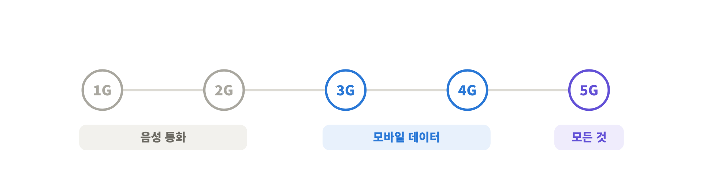
<!-- 슬라이드 4: 1G to 5G -->

지금 우리가 쓰는 건 **5G** 시스템임. 이름 그대로 1세대(1G)부터 5세대(5G)까지 차근차근 진화해 왔음.

| 세대 | 시기 | 주력 | 대략적인 속도 |
|---|---|---|---|
| 1G | 1980s | 아날로그 **음성** | 2.4 kbps |
| 2G | 1990s | 디지털 **음성** | 14.4 kbps |
| 3G | 2000s | **모바일 데이터** | 3.1 Mbps |
| 4G | 2010s | 모바일 브로드밴드 (LTE) | 100 Mbps |
| 5G | 2020s~ | **Internet of Everything** | 1~10 Gbps |

- <mark class="pink">1G · 2G</mark>는 **보이스 트래픽**(전화 통화)을 다루는 게 메인이었음
- <mark class="pink">3G · 4G</mark>로 넘어가면서 음성이 아니라 **모바일 데이터**를 주고받는 시스템으로 바뀜. 우리가 폰으로 유튜브 보는 게 가능해진 게 이때부터임
- 그게 더 진화해서 지금의 **5G**

한마디로 <mark class="mint">초기엔 "통화하는 기계"였던 통신망이, 이제는 인터넷에 떠다니는 모든 데이터를 다 먹어치우는 시스템으로 진화했다</mark>고 이해하면 됨.

### 1-2. 5G는 세 가지 목표로 설계됐다

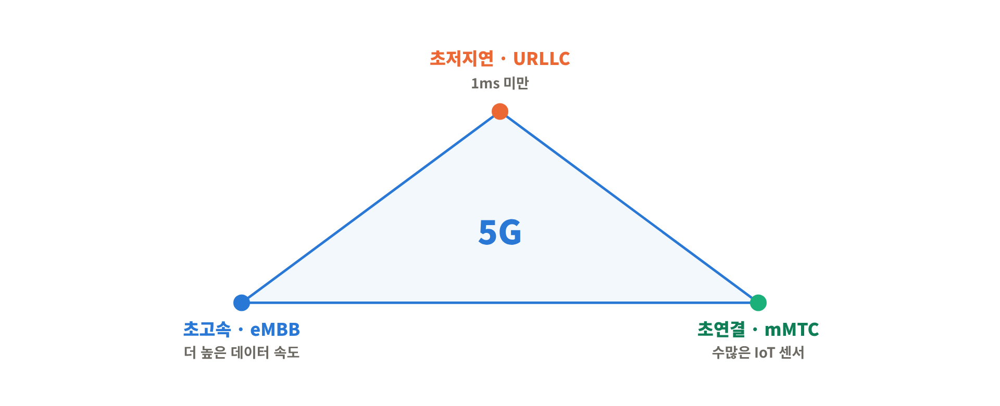
<!-- 슬라이드 5: 5G Connectivity Space -->

5G는 크게 세 가지 기준(criteria)을 놓고 설계됐음.

① <mark class="pink">URLLC (Ultra-Reliable Low Latency Communication)</mark> 
지연시간(latency)을 **1ms 미만**으로 줄이겠다는 목표. 자율주행, 로보틱스, 원격의료처럼 "늦으면 사고 나는" 서비스용.

② <mark class="pink">eMBB (enhanced Mobile Broadband)</mark> 
더 높은 데이터 속도를 주겠다는 목표. 음성보다 비디오 트래픽이 훨씬 무거우니까 **수 Gbps급 속도**를 서포트하겠다는 거.

③ <mark class="pink">mMTC (massive Machine Type Communication)</mark> 
스마트폰뿐 아니라 웨어러블, 스마트시티, 스마트홈에 깔린 **엄청난 수의 IoT 센서**를 다 연결하겠다는 목표. 슬라이드 기준으로 1km²당 수백만 개 노드 수준.

### 1-3. 5G의 "Big Three" 기술

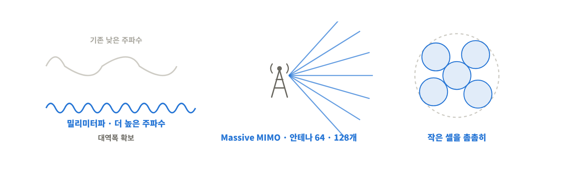
<!-- 슬라이드 6: Big three technologies in 5G -->

이 세 목표를 달성하려고 꺼낸 핵심 기술이 세 개 있음.

① 밀리미터파 (mmWave) 
기존 통신은 수 GHz 이하, 상대적으로 낮은 주파수 대역을 썼음. 근데 이 대역은 이미 꽉 차서 쓸 수 있는 대역폭이 부족함.
그래서 5G는 **30GHz 근처, 파장이 mm 단위인 높은 주파수 대역**으로 올라가기로 함. 특히 우리나라 5G는 **28GHz 대역**을 기반으로 많이 설계됐음.

② Massive MIMO 
기지국 안테나 수를 64개, 128개 수준으로 **엄청 많이(massive)** 늘려서, 한 번에 더 많은 유저를 각각 빔으로 쏴서 서포트하는 기술.

③ Ultra-dense Small Cell 
기존엔 큰 매크로셀(macro cell) 하나가 넓은 지역을 담당했는데, 그보다 **작은 스몰셀을 촘촘하게 많이 깔아서** 전체 용량(capacity)을 올리겠다는 전략.

> 💡 셋 다 결국 같은 질문에 대한 답임. **"용량을 어떻게 늘릴까?"** 
> mmWave = 도로를 **넓히기**(대역폭 확보), Massive MIMO = 차선을 **잘게 나눠 쓰기**(공간 재사용), Small Cell = 톨게이트를 **여러 개 짓기**(셀 밀도 증가).

### 1-4. 현실: 5G는 생각보다 성공하지 못했다

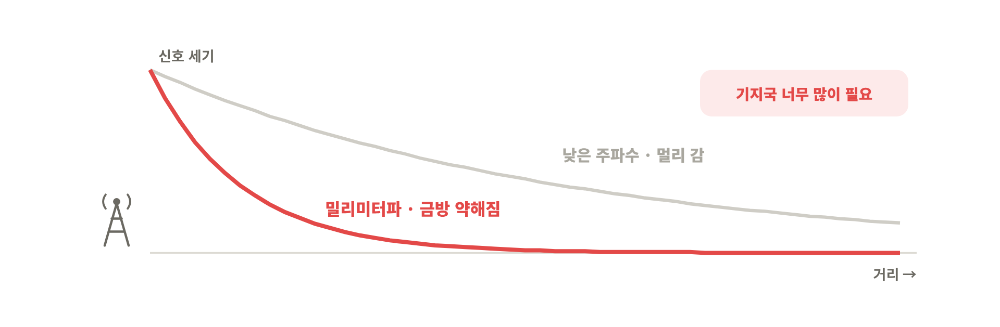
<!-- 슬라이드 7: Reality -->

근데 5G는 업계에서 그렇게 성공적인 시스템으로 평가받지 못하고 있음. 원인은 핵심 기술이었던 **mmWave**.

- 대역폭 확보하려고 높은 주파수로 올라갔는데, mmWave 신호는 **조금만 멀어지거나 장애물을 만나면 급격하게 약해짐(감쇠)**
- 이걸 커버하려면 셀을 엄청 촘촘하게 깔아야 함
- 통신사(SKT, KT, LG U+)가 실제로 깔아보니 **경제성이 안 나옴**
- 결국 <mark class="pink">2022년 말, 정부가 28GHz 주파수 할당을 취소</mark>함. 슬라이드 기사 기준으로 KT와 LG U+는 할당 취소, SKT는 이용 기간 단축

즉 5G의 간판 기술이었던 mmWave를 사실상 포기한 셈이고, 그래서 사람들이 "그럼 **6G는 어떻게 설계해야 하지?**"를 훨씬 진지하게 고민하게 됨.

> 💡 우리가 쓰는 "5G"는 대부분 3.5GHz 대역(Sub-6)임. 그래서 체감 속도가 광고만큼 안 나온다는 얘기가 계속 나왔던 거. 진짜 Gbps급 속도는 28GHz에서 나오는 건데, 그쪽이 경제성 문제로 접혔기 때문.

---

## 2. 6G의 비전: AI, 그리고 Physical AI

### 2-1. 6G가 노리는 숫자들

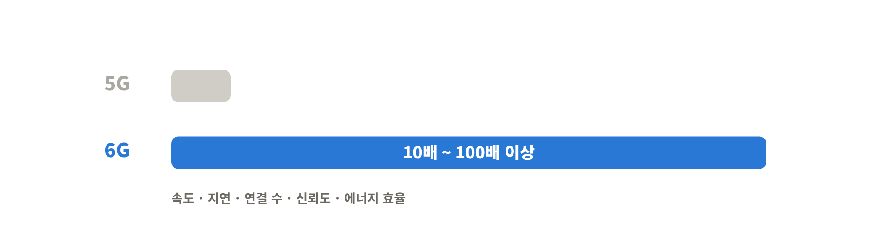
<!-- 슬라이드 8: Toward 6G -->

5G의 실패를 넘어서려고 6G를 많이들 고민 중임.
6G는 5G 대비 거의 모든 지표를 **10배~100배 이상** 끌어올리는 걸 목표로 함.

| 지표 | 5G | 6G 목표 |
|---|---|---|
| 최대 전송 속도 | 20 Gbps | **1,000 Gbps** |
| 사용자 체감 속도 | 0.1 Gbps | **1 Gbps** |
| 무선 지연시간 | 1 ms | **0.1 ms** |
| 연결 밀도 (기기/km²) | 10⁶ | **10⁷** |
| 신뢰도 (오류율) | 10⁻⁵ | **10⁻⁷** |
| 에너지 · 주파수 효율 | 1x | **2x** |

### 2-2. 6G meets AI

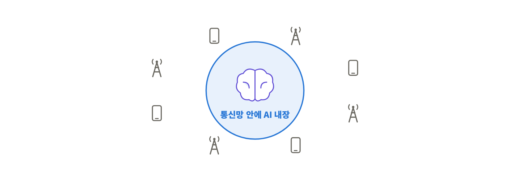
<!-- 슬라이드 9: 6G meets AI (MIT Technology Review) -->

6G로 넘어가면서 다들 제일 관심 갖는 키워드는 **AI**임.

슬라이드에 나온 건 MIT Technology Review 기사인데, 지금처럼 LLM이 대세가 되기 전부터 이미 **"AI가 6G의 핵심 기술이 될 것"**이라고 예측했던 글임.
기사 요지는, AI 에이전트들의 진짜 힘은 **서로 협업할 때** 나오는데, 모바일 사회에서 그 협업은 결국 **무선통신을 통해서만** 가능하다는 것.

### 2-3. 6G Vision: Native AI

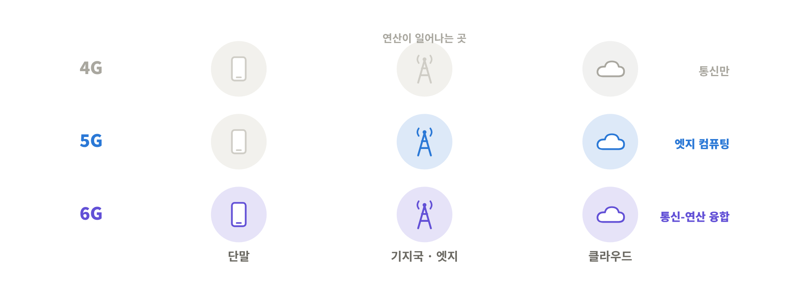
<!-- 슬라이드 10: 6G Vision: Native AI (Huawei, Samsung, Ericsson, Nokia) -->

이 흐름을 받아서 화웨이, 삼성, 에릭슨, 노키아 같은 글로벌 통신장비 업체들이 다 비슷한 비전을 내놓고 있음.

> <mark class="pink">Native AI</mark> = AI를 나중에 덧붙이는 게 아니라, 처음부터 **통신 시스템 안에 AI를 내장**해서 설계하겠다

참고로 화웨이는 중국 회사인데, 글로벌 통신장비 시장 점유율은 삼성보다 훨씬 큼. 회사마다 그림은 다르지만 **AI를 6G의 핵심 기술로 채택한다**는 방향은 공통임.

### 2-4. 왜 AI냐? 통신-컴퓨팅 융합

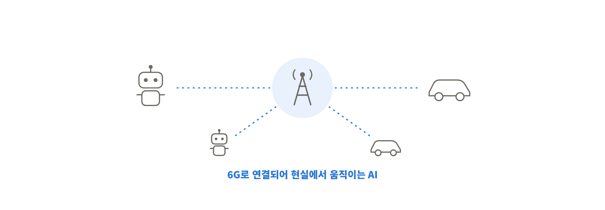
<!-- 슬라이드 11: Communications and Computing Convergence -->

AI가 6G 핵심이 된 근본 배경은 <mark class="mint">통신과 컴퓨팅의 융합(Communications and Computing Convergence)</mark>임.
6G를 "통신 기술"로만 보면 안 되고, **통신 + AI 연산을 같이 잘하기 위한 시스템**이라고 이해하면 됨.

| 세대 | 컴퓨팅 구조 | 연산이 어디서? |
|---|---|---|
| 4G | **Cloud Computing** | 멀리 있는 클라우드에서. 네트워크는 통신만 담당 |
| 5G | **Edge Computing** | 기지국 · 코어 · 클라우드 곳곳에 연산 능력을 분산 |
| 6G | **Communications & Computing Convergence** | 네트워크와 **단말(로봇, 차, 기기)**까지 연산을 쪼개서 나눠 처리 |

4G는 통신만을 위해 설계된 시스템이었고, 5G에서 엣지 컴퓨팅이 등장했다면, 6G는 그게 **단말까지 내려가서** 통신과 연산이 완전히 한 몸이 되는 단계.

### 2-5. 6G Vision: Physical AI

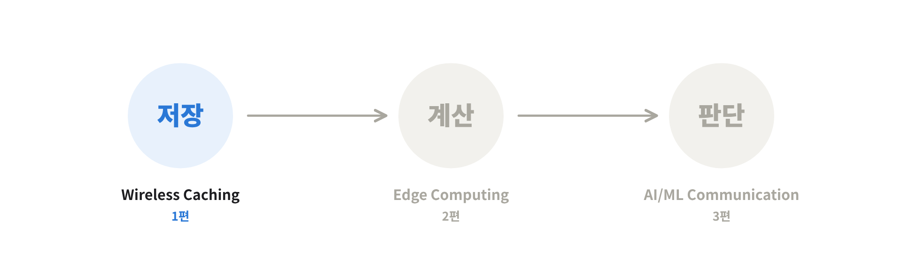
<!-- 슬라이드 12: 6G Vision: Physical AI (Qualcomm) -->

통신-컴퓨팅 융합으로 얻을 수 있는 또 다른 비전이 바로 **Physical AI**임.
퀄컴 슬라이드를 보면 Physical AI가 6G 시대의 핵심 애플리케이션이 될 거라고 하면서, 이걸 현실화하는 요소들을 이렇게 꼽음.

- **Compound AI System** – 추론 모델, VLA, 인식 등 여러 AI를 묶은 시스템
- **Heterogeneous Edge Compute** – 다양한 엣지 연산 자원
- **Physical AI MLOps** – 학습 · 행동 복제 · 강화학습 · 디지털 트윈 같은 운영 파이프라인
- **AI Flywheel** – 데이터 수집 → 학습 → 배포 → 다시 데이터, 이렇게 도는 선순환
- **Deployment-ready Dev Platform** – 바로 배포 가능한 개발 플랫폼

결국 6G는 단순한 통신이 아니라, **컴퓨팅 네트워크(스토리지 + 연산)가 융합되면서 Physical AI까지 진화하는 시스템**이라는 게 오늘 강의의 큰 그림임.

### 2-6. Physical AI로 가는 로드맵

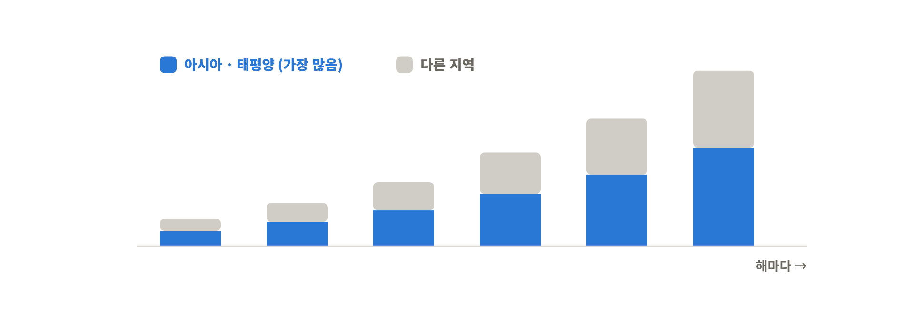
<!-- 슬라이드 13: Road to Native & Physical AI -->

이런 연구는 2010년대 초반부터 쭉 이어져 왔음. 교수님이 정리한 로드맵은 3단계.

| 단계 | 기술 | 주요 키워드 |
|---|---|---|
| ① | **Wireless Caching** | 캐시 가능 네트워크, 콘텐츠 인기도, 셀룰러 캐싱, D2D 캐싱 |
| ② | **Edge Computing** | 연산 오프로딩, 통신-연산 공동 설계, MEC |
| ③ | **AI/ML-Driven Communication** | 엣지 러닝, 연합학습, 지식 증류, Split learning, 엣지 추론 |

> 💡 단계별로 네트워크가 맡는 역할이 커지는 구조임. 
> ① 데이터를 **저장**해 두는 네트워크 → ② 데이터를 **계산**해 주는 네트워크 → ③ 데이터로 **학습 · 추론**까지 하는 네트워크. 
> 저장(Storage) → 연산(Compute) → 지능(AI) 순서로 레벨업한다고 보면 됨.

이번 글에서는 첫 번째인 **Wireless Caching**을 다룸.

---

## 3. Wireless Caching

### 3-1. 모바일 데이터 트래픽 수요

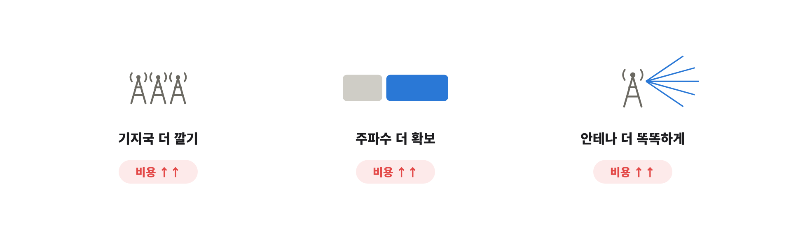
<!-- 슬라이드 15: Demand of Mobile Data Traffic (Cisco VNI 2018) -->

캐싱 얘기 전에 모바일 데이터가 얼마나 쓰이고 있는지부터 봄.
시스코(Cisco)가 2017년부터 2022년까지 모바일 데이터 트래픽을 예측한 표임 (단위: 월간 엑사바이트, EB).

| 지역 | 2017 | 2022 | 연평균 성장률 |
|---|---|---|---|
| **아시아 · 태평양** | 5.88 | **43.17** | 49% |
| 중동 · 아프리카 | 1.22 | 11.17 | 56% |
| 중 · 동유럽 | 1.38 | 7.75 | 41% |
| 북미 | 1.26 | 5.85 | 36% |
| 서유럽 | 1.02 | 5.12 | 38% |
| 중남미 | 0.75 | 4.44 | 43% |
| **전체** | 11.51 | **77.49** | 46% |

- **아시아 · 태평양**이 압도적으로 많음. 한국, 중국, 일본 중심으로 스마트폰 보급이 엄청 많이 됐기 때문
- 해가 갈수록 증가폭이 **급속도로** 커짐. 전체 기준 5년 만에 약 **6.7배**

### 3-2. 모바일 데이터 쓰나미

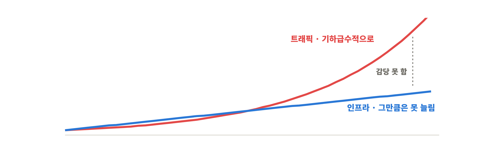
<!-- 슬라이드 16: Mobile Data Tsunami -->

이렇게 트래픽이 폭증하는 상황을 <mark class="pink">모바일 데이터 쓰나미(Mobile Data Tsunami)</mark>라고 부름.

여기서 핵심 질문은 이거임.

> 이 쓰나미를 받아낼 만큼 **무선 인프라와 통신 기술이 빠르게 발전할 수 있을까?**

### 3-3. 기존 해법: 용량 늘리기

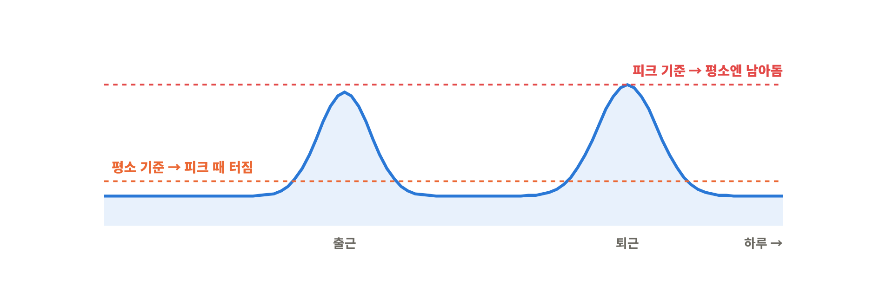
<!-- 슬라이드 17: Capacity-increasing solutions -->

트래픽을 감당하려면 결국 통신 용량(capacity)을 확보해야 함. 기존 최신 기술은 크게 세 가지였음.

1. **기지국 밀도 높이기 (Denser BS deployment)** – 사용자 많은 지역에 기지국을 10배 더 깔기
2. **추가 주파수 확보 (Additional spectra)** – 앞에서 본 mmWave처럼 더 높은 대역 쓰기
3. **주파수 효율 개선 (Improved spectral efficiency)** – 분산 안테나(DAS), 셀 간 협력 등으로 안테나를 똑똑하게 써서 효율 10배

### 3-4. 근본적인 문제 ①: 인프라는 무한히 늘릴 수 없다

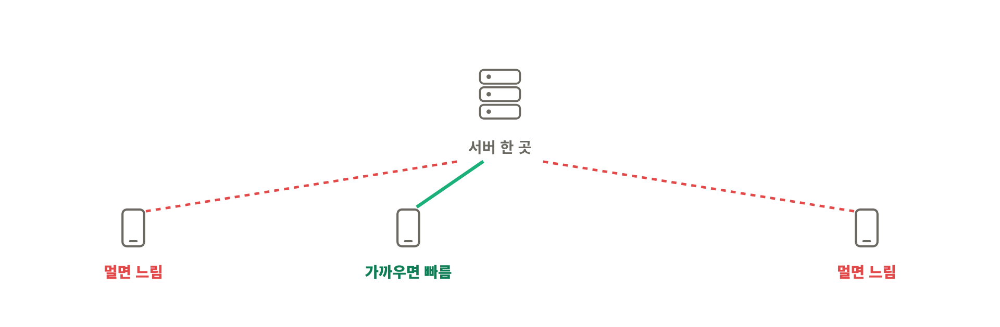
<!-- 슬라이드 18: Fundamental Issues - Sustainability and Scalability -->

근데 이 세 가지 다 그렇게 성공적이지 못했음. 전부 **인프라를 많이 깔아야** 하는 방식이라 비용이 너무 많이 듦.

- 무선 링크 성능엔 물리적 한계가 있고, 주파수는 희소하고, 환경 · 운영 제약도 있음
- 트래픽은 기하급수적으로 느는데, **인프라는 기하급수적으로 늘릴 수가 없음**
- 즉 <mark class="pink">지속가능성(Sustainability)과 확장성(Scalability)</mark>이 떨어짐

그래서 통신 분야의 고민은 이렇게 바뀜.

> "인프라를 늘리는 것 말고, **다른 방법**은 없을까?"

### 3-5. 근본적인 문제 ②: 피크 타임의 혼잡

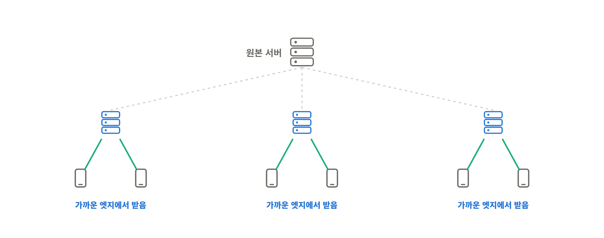
<!-- 슬라이드 19: Big Congestion & Long Latency -->

또 다른 이슈는, 아무리 네트워크를 잘 만들어도 **데이터 사용 패턴**에 따라 효율이 크게 달라진다는 것.

고속도로 사진으로 보면 바로 이해됨.
- **오프피크 타임**엔 차가 거의 없음
- **출퇴근 피크 타임**엔 차가 꽉 막힘

차에 탄 사람들이 데이터를 쓴다고 치면, 시간대별로 트래픽 패턴이 완전히 달라짐.
- **피크 타임 기준**으로 네트워크를 설계하면 → 평소엔 설비가 놀고 있음 (돈 낭비)
- **오프피크 기준**으로 설계하면 → 피크 때 터짐

어느 쪽으로 해도 <mark class="mint">비용 측면에서 답이 잘 안 나오는 고민</mark>이었던 거.

### 3-6. 인터넷도 같은 문제를 겪었다

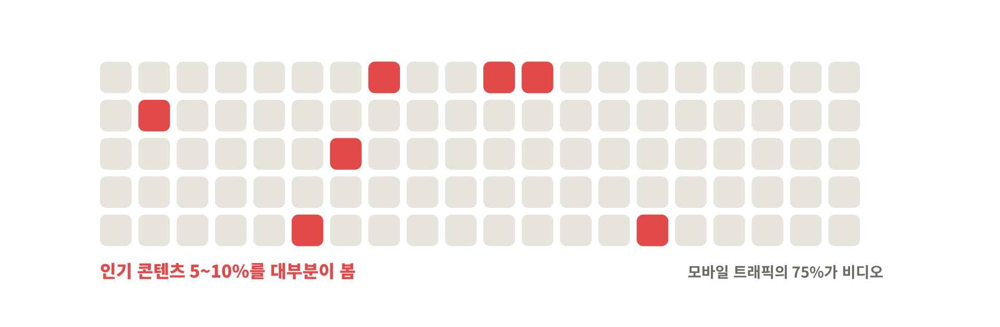
<!-- 슬라이드 20: Similar Problem in Internet -->

사실 이런 문제는 유선 인터넷에도 똑같이 있었음.

인터넷은 보통 **서버**에 데이터가 있고, 우리가 요청하면 인터넷망을 타고 서버에서 데이터가 오는 구조임.
근데 서버가 한 곳에만 있으면, **서버와의 거리에 따라 지연시간이 달라짐**.
- 서버 근처 유저 → 빠름
- 지구 반대편 유저 → 느림

슬라이드에 나온 문제 두 가지
- 콘텐츠를 담은 웹 인프라에 **과부하**가 걸림
- 사용자 입장에선 **지연시간을 예측할 수 없음**

### 3-7. 인터넷의 해법: CDN

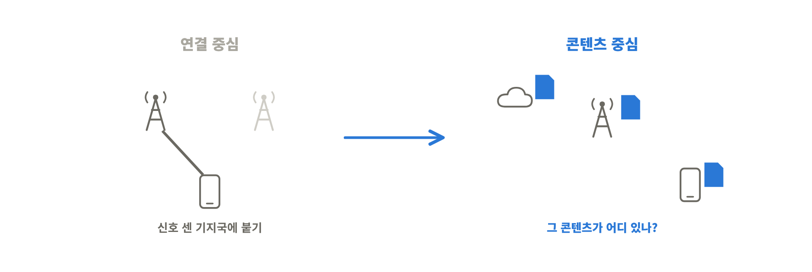
<!-- 슬라이드 21: Solution: Global CDN Platform -->

이 문제에 대한 인터넷 쪽 대답이 <mark class="pink">CDN (Content Delivery Network)</mark>임.

- 원본 서버(Central Origin) 하나에만 의존하지 않고
- 지역마다 **로컬 엣지 서버(Local Edge)**를 깔아둠
- 사람들이 많이 보는 데이터를 **미리 복사해서 엣지에 갖다 놓음**
- 그러면 유저는 멀리 있는 원본 서버가 아니라 **가까운 엣지 서버**에 접속함

효과는 세 가지: **지연시간 감소, 처리량 증가, 혼잡 감소**.

> 💡 넷플릭스, 유튜브가 빠른 이유가 이거임. 넷플릭스는 국내 통신사 망 안에 자체 캐시 서버(Open Connect)를 넣어둬서, 우리가 보는 영상 대부분이 미국이 아니라 국내 통신사 안에서 바로 날아옴.

그럼 자연스럽게 이런 생각이 듦.

> **이걸 무선 네트워크에도 똑같이 적용하면 어떨까?**

### 3-8. 콘텐츠의 특징: 다들 비슷한 걸 본다

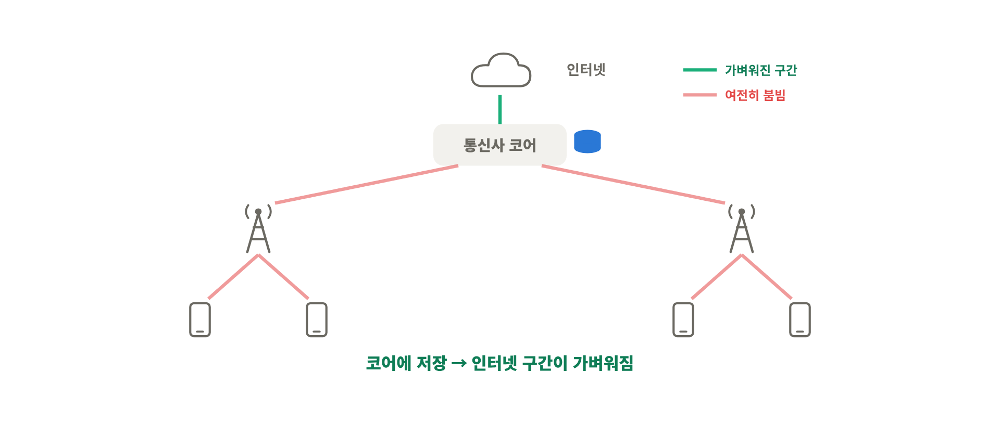
<!-- 슬라이드 22: Content Characteristics -->

무선에 CDN 아이디어를 가져올 수 있는 근거는 데이터 트래픽 자체의 특징에 있음.

- 2020년 무렵 전 세계 모바일 데이터 트래픽의 **75%가 비디오**
- 사람들이 모든 영상을 골고루 보는 게 아니라, **인기 콘텐츠 5~10%를 대다수가 소비**함
- 트래픽 양은 폭증해도 **"서로 다른(unique)" 콘텐츠 수는 그만큼 폭증하지 않음**
- 게다가 네트워크 장비랑 단말(폰)에도 **저장공간이 엄청 많이** 깔려 있음

그럼 결론은 간단함.

> 모든 데이터를 엣지 서버에 갖다 놓을 필요 없이, **인기 있는 5~10%만** 엣지에 갖다 놔도 효율적으로 돌릴 수 있지 않을까?

### 3-9. Connection-Centric에서 Content-Centric으로

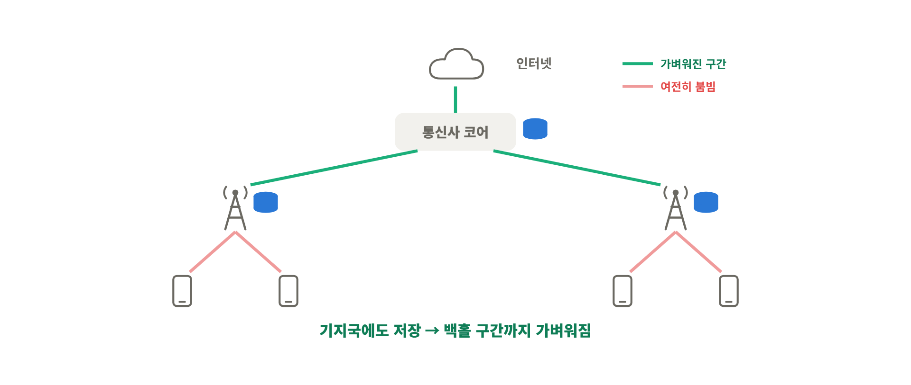
<!-- 슬라이드 23: Connection-Centric vs Content-Centric -->

여기서 네트워크 설계 철학이 바뀜.

| 구분 | Connection-Centric | Content-Centric |
|---|---|---|
| 기준 | **연결** | **콘텐츠** |
| 동작 | 나한테 신호를 제일 세게 주는 기지국에 붙어서 데이터를 받음 | 콘텐츠가 이름을 갖고, 네트워크 **어디에든** 놓일 수 있음 |
| 관심사 | "어느 기지국에 붙을까?" | "**그 콘텐츠가 어디 있을까?**" |

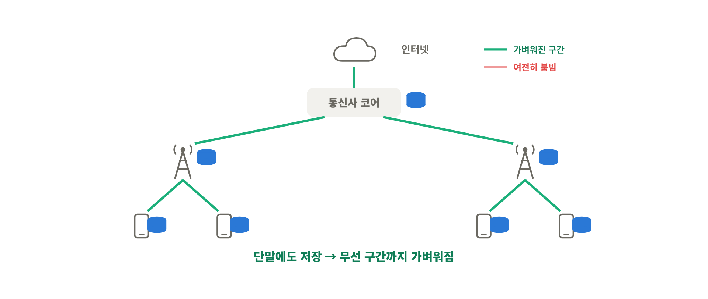
<!-- 슬라이드 24: New Design Policy -->

즉 네트워크가 <mark class="pink">Connection-centric Network → Content-centric Network</mark>로 진화한 것.
원본 서버, 코어 라우터, CDN 서버, 기지국, 그리고 유저 단말까지, 콘텐츠가 놓일 수 있는 곳이 네트워크 전체로 퍼진 그림임.

### 3-10. Cache-enabled Wireless Network: 세 가지 질문

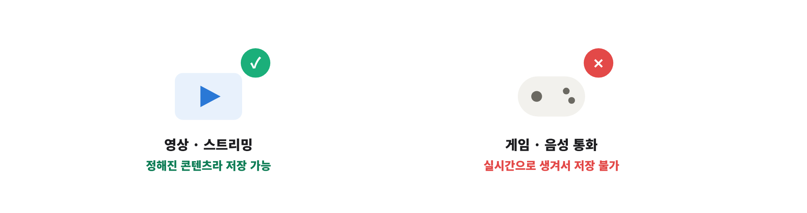
<!-- 슬라이드 25: Cache-enabled Wireless Networks -->

그래서 핵심은 <mark class="mint">캐시가 가능한 무선 네트워크(Cache-enabled Wireless Network)를 어떻게 잘 설계하느냐</mark>임.

여기서 **캐시(cache)**는 그냥 "저장공간(storage)"이라고 생각하면 됨. 컴퓨터 구조에서 가져온 말인데, 캐시는 원래 메인 메모리보다 **작음**.
엣지 네트워크의 저장공간도 클라우드보다 훨씬 작으니까, **이 한정된 공간을 얼마나 잘 쓰느냐**가 관건임.

답해야 할 질문은 세 가지.
1. **Where to cache?** – 어디에 저장할까?
2. **What to cache?** – 무엇을 저장할까?
3. **How to cache?** – 어떻게 저장할까?

### 3-11. Where to cache? ① 코어에 저장 (EPC Caching)

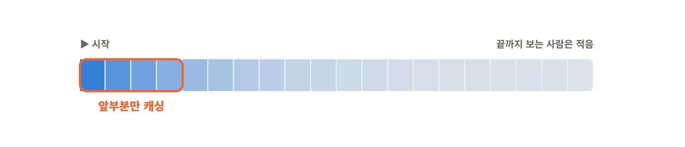
<!-- 슬라이드 26: No caching → EPC caching -->

- **캐싱이 없을 때**: 모든 데이터를 매번 인터넷에서 끌어옴 → 인터넷 구간 트래픽이 엄청 많음
- **EPC 캐싱**: 자주 쓰는 데이터를 통신사 코어망(MNO core, EPC = Evolved Packet Core)에 옮겨둠

기지국(그림의 삼각형)은 코어 네트워크에 연결돼 있으니, 인터넷 서버에서 **코어까지만** 미리 가져다 놔도 인터넷 쪽에서 오가는 트래픽이 확 줄어듦.

### 3-12. Where to cache? ② 기지국에도 저장 (EPC + RAN Caching)

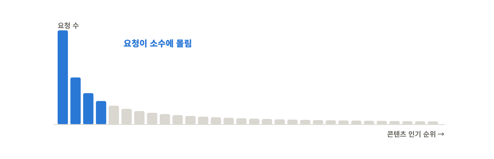
<!-- 슬라이드 27: EPC caching → EPC+RAN caching -->

한 단계 더 나가서, **기지국마다 저장공간**을 둔다면? 중요한 데이터를 **기지국까지** 끌어다 놓을 수 있음.

- 코어와 기지국을 잇는 구간(**백홀, backhaul**) 트래픽이 크게 줄어듦
- 백홀 혼잡이 완화되고
- 유저가 느끼는 지연시간도 줄어듦

### 3-13. Where to cache? ③ 단말에도 저장 (EPC + RAN + D2D Caching)

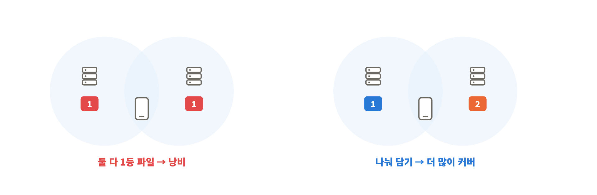
<!-- 슬라이드 28: EPC+RAN caching → EPC+RAN+D2D caching -->

마지막으로, **단말(폰)도 저장공간이 있으니까** 이걸 활용하자는 게 단말 캐싱임.
옆 사람 폰에 이미 있는 영상을 기지국을 거치지 않고 **단말끼리 직접(D2D, Device-to-Device)** 주고받는 거.

- 기지국-단말 사이 무선 구간(**RAN**) 트래픽까지 줄어듦
- 무선 트래픽을 분산(offload)하고, 무선 자원을 아낌

| 캐싱 위치 | 줄어드는 트래픽 |
|---|---|
| 코어 (EPC) | 인터넷 ↔ 통신사 구간 |
| + 기지국 (RAN) | 코어 ↔ 기지국 구간 (백홀) |
| + 단말 (D2D) | 기지국 ↔ 단말 구간 (무선) |

> 💡 데이터를 유저 쪽으로 **한 칸씩 당겨 올수록** 그 칸 위쪽 구간의 짐이 덜어지는 구조임. 대신 아래로 내려갈수록 저장공간은 작아지고 관리할 곳은 많아짐. 이게 뒤에 나오는 How to cache가 어려운 이유.

### 3-14. What to cache? ① 캐싱 가능한 트래픽

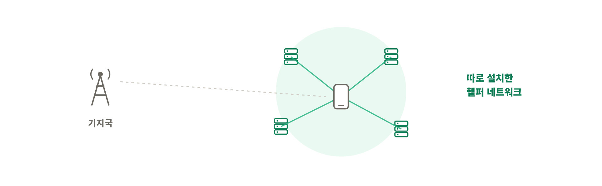
<!-- 슬라이드 29: What to cache? -->

모든 트래픽을 캐싱할 수 있는 건 아님.

- ❌ **캐싱 불가**: 게임, 음성통화 같은 **인터랙티브 애플리케이션**. 실시간으로 그때그때 생성되는 데이터라 미리 저장해 둘 수가 없음
- ⭕ **캐싱 가능**: 비디오 스트리밍처럼 **이미 정해진 콘텐츠**. 전체 트래픽의 약 60%로 추정

넷플릭스 메인 화면에 "지금 뜨는 콘텐츠"가 있는 것처럼, 콘텐츠엔 **인기도(popularity)**가 있음.
- 인기도는 **시시각각 변하지만 (dynamic)**
- 어느 정도 **예측 가능함 (predictable)**

그래서 요즘 많이 소비되는 콘텐츠를 잘 측정해서 그걸 기준으로 캐싱하면 훨씬 효율적임.

### 3-15. What to cache? ② 통째로 말고 앞부분만

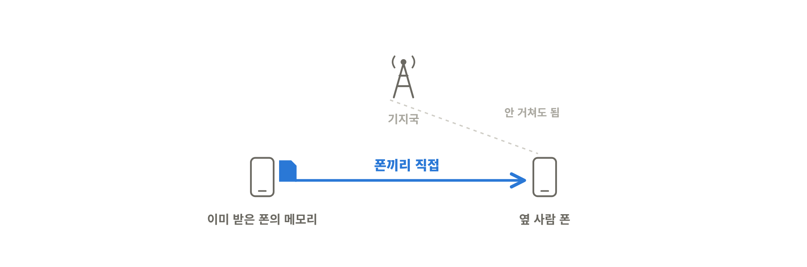
<!-- 슬라이드 30: Inter-object / Inter-chunk popularity -->

캐싱할 때도 인기 콘텐츠를 **통째로** 저장하는 게 아니라, 단위를 쪼개서 일부만 저장하는 게 더 효율적일 수 있음.

- **파일 단위 (File-level, inter-object)** 인기도: 어떤 영상이 인기 있나
- **청크 단위 (Chunk-level, inter-chunk)** 인기도: 그 영상의 **어느 부분**이 많이 소비되나

유튜브 생각해 보면 바로 이해됨. 영상을 처음부터 보긴 하는데, **끝까지 보는 사람은 생각보다 별로 없음**.
슬라이드 기준으로 <mark class="pink">유튜브 영상의 60%는 전체 길이의 20%도 안 보고 끝남</mark>. 그리고 앞부분이 뒷부분보다 훨씬 많이 재생됨.

그래서 소비가 많은 **초반 청크만** 잘 캐싱해 둬도 효율이 훨씬 좋아짐.
결국 <mark class="mint">콘텐츠 수요를 정확히 예측하는 게 미리 받아두기(prefetching)의 핵심</mark>임.

### 3-16. What to cache? ③ 요청은 소수 콘텐츠에 몰린다

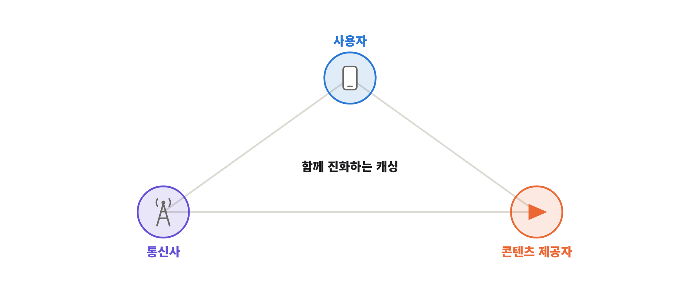
<!-- 슬라이드 31: Zipf distribution -->

유저 요청 패턴을 보면 모든 콘텐츠를 골고루 요청하는 게 아니라 **소수의 인기 콘텐츠에 몰려 있음**.
비디오 요청 분포는 보통 **Zipf 분포**로 모델링함. 그래프처럼 1등 콘텐츠 요청 확률이 확 높고, 순위가 내려갈수록 쭉 떨어지는 롱테일 모양.

그러니까 **인기도 높은 콘텐츠 위주로, 그것도 앞부분만** 잘라서 캐싱하는 게 효율적이라는 결론.

> 💡 Zipf 분포는 "k등의 인기도가 대략 1/k에 비례"하는 분포임. 1등이 2등의 두 배, 3등의 세 배쯤 요청받는 느낌. 이 쏠림이 셀수록(그래프의 γ가 클수록) 작은 캐시로도 많은 요청을 처리할 수 있음. 
> 슬라이드 오른쪽 아래 질문(서로 다른 요청 사이의 **상관관계**를 어떻게 모델링할까?)은 이 모델이 "요청은 서로 독립"이라고 가정하는 한계를 짚는 거. 실제론 A 영상 본 사람이 B도 볼 확률이 높은 식의 연관이 있으니까.

### 3-17. How to cache? 어떤 파일을 어느 헬퍼에?

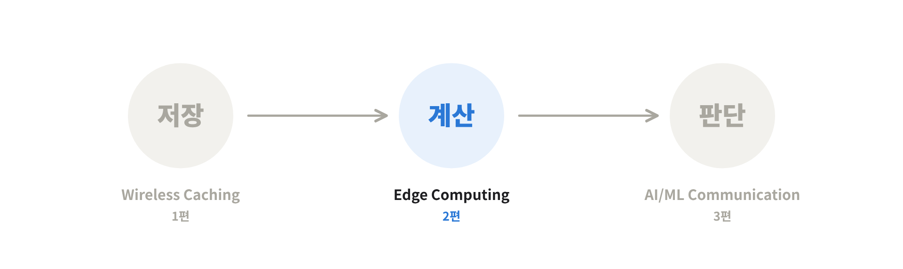
<!-- 슬라이드 32: How to cache? -->

여기서 **헬퍼(helper)**는 캐시 메모리를 가진 장치를 말함. 코어든 기지국이든 단말이든 저장공간 있으면 다 헬퍼.

- 모든 유저가 **헬퍼 하나에만** 접속할 수 있다면 → 답은 간단함. 그 헬퍼에 **가장 인기 있는 파일**을 채우면 끝
- 근데 무선 네트워크에선 한 유저가 **여러 헬퍼에 동시에 닿을 수 있음** → 헬퍼마다 뭘 나눠 담을지 정하는 문제가 엄청 복잡해짐. 슬라이드 표현으로 <mark class="pink">최적 캐싱은 보통 NP-hard</mark>

> 💡 NP-hard는 "경우의 수가 폭발해서 정답을 빠르게 구하기 어려운 문제"라는 뜻. 예를 들어 내 근처에 기지국 두 개가 겹친다면, 둘 다 1등 영상을 저장하는 건 낭비임. 하나는 1등, 하나는 2등을 담는 게 나을 수 있는데, 이런 조합을 네트워크 전체에서 맞추려니 어려워지는 거.

### 3-18. Cooperative Caching ① 캐싱 헬퍼

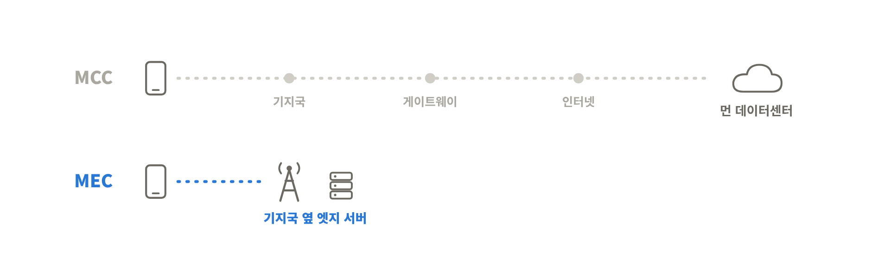
<!-- 슬라이드 33: Caching Helpers (Chae et al., GLOBECOM 2015) -->

그래서 기존 기지국 말고 **캐싱 헬퍼 네트워크를 따로 깔아서** 협력하게 하는 연구들이 나옴.

슬라이드에 나온 모델은 이런 구조임.
- **기지국**: 캐시가 없고, 유저 한 명이 받을 수 있는 대역폭이 **작음**
- **캐싱 헬퍼**: 파일을 하나씩만 저장하지만, 유저에게 주는 대역폭이 **큼**
- 유저 근처(협력 영역) 헬퍼들이 원하는 파일을 갖고 있으면 **헬퍼들이 함께 전송**하고, 없으면 기지국이 전송
- 목표는 **전송 성공 확률이 최대가 되도록** 어떤 헬퍼에 어떤 파일을 둘지 최적화하는 것

### 3-19. Cooperative Caching ② 단말끼리 협력

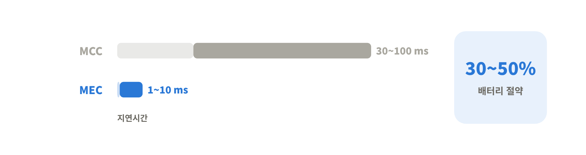
<!-- 슬라이드 34: Mobile Cooperation (Guo, Duan & Zhang, 2015) -->

헬퍼를 따로 까는 대신, **유저 단말의 메모리**를 효율적으로 활용하는 방향도 많이 연구됨.

- 단말들을 **관심사(취향)에 따라 그룹**으로 나눔
- 공유 방식은 세 가지
  - Ⅰ. 공유 안 함
  - Ⅱ. **같은 그룹 안에서** 파일 공유
  - Ⅲ. **다른 그룹과도** 파일 공유
- 근거리 통신으로 서로 파일을 나눠 주면 **대역폭 · 백홀 사용량이 줄고, 다운로드 지연도 줄어듦**

### 3-20. 정리: 이해관계자 모두의 협력

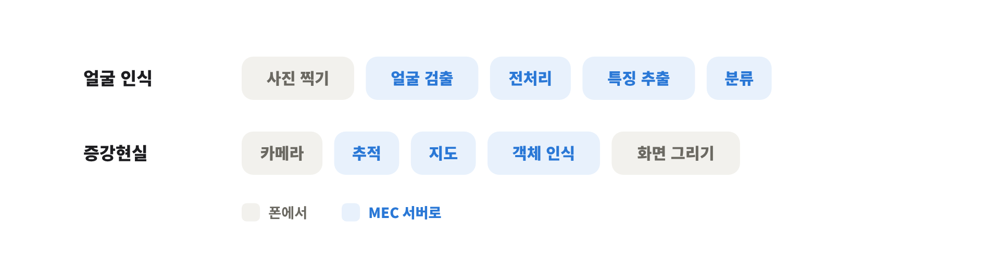
<!-- 슬라이드 35: Collaboration among stakeholders -->

정리하면, 캐싱은 기존의 **연결(connection) 기반 접근이 아니라 콘텐츠 인기도 기반 접근**이라서 세 이해관계자가 함께 얽혀서 진화하고 있음.

| 이해관계자 | 원하는 것 | 내줄 수 있는 것 |
|---|---|---|
| **사용자 (Users)** | 빠른 성능, 프라이버시 | 단말의 저장공간 · 에너지 |
| **통신사 (Telecom Operators)** | 망 부하 감소, 데이터 접근 | 호스팅 공간, 데이터 수집, 표준 |
| **콘텐츠 제공자 (Content Providers)** | 저렴한 전송, 신뢰 | CDN 인프라 |

그리고 이건 먼 미래 기술이 아니라 <mark class="mint">지금 우리가 쓰는 통신망에서도 이미 많이 활용되고 있는 기술</mark>임.

---

## 4. 핵심 요약

1. 통신은 **음성(1G·2G) → 데이터(3G·4G) → 모든 것(5G)**으로 진화했고, 5G는 **URLLC · eMBB · mMTC**를 목표로 **mmWave · Massive MIMO · Small Cell**을 꺼냈음
2. 하지만 mmWave는 감쇠가 심해 경제성이 안 나왔고, 국내 28GHz 할당이 취소되면서 **5G는 기대만큼 성공하지 못함**
3. 6G는 **Native AI**와 **통신-컴퓨팅 융합**을 핵심으로 삼고, 그 끝에 **Physical AI**를 비전으로 둠
4. Physical AI로 가는 로드맵은 **Wireless Caching → Edge Computing → AI/ML-Driven Communication** (저장 → 연산 → 지능)
5. **Wireless Caching**은 "인프라를 더 깔지 말고, 인기 콘텐츠를 유저 가까이 미리 갖다 놓자"는 발상. 네트워크가 **Connection-centric → Content-centric**으로 바뀜
6. 설계 질문은 **Where(코어 · 기지국 · 단말) / What(인기 콘텐츠, 그중에서도 앞부분) / How(여러 헬퍼에 어떻게 나눌지, NP-hard)**

>한 줄로 묶으면  
>**트래픽 폭증을 인프라 확장만으로는 못 막으니, 네트워크가 콘텐츠를 "기억"해서 유저 가까이 두자는 게 Wireless Caching이고, 이게 네트워크가 저장 → 연산 → 지능으로 진화하는 Physical AI 로드맵의 첫걸음이다.**

다음 편에서는 로드맵 두 번째 단계인 **Edge Computing**으로 넘어감.

---

## 참고문헌
- Wang, X., Chen, M., Taleb, T., Ksentini, A., & Leung, V. C. M. (2014). Cache in the air: Exploiting content caching and delivery techniques for 5G systems. *IEEE Communications Magazine*, 52(2), 131–139.
- Chae, S. H., et al. (2015). Cooperative transmission via caching helpers. *2015 IEEE Global Communications Conference (GLOBECOM)*.
- Guo, Y., Duan, L., & Zhang, R. (2015). Cooperative local caching and file sharing under heterogeneous file preferences. *arXiv:1510.04516*.
- Cisco (2018). *Cisco Visual Networking Index (VNI)*.