# 깃허브 블로그 제작기 1편: 곰돌이부터 배포까지

## 들어가며

### 0-1. 왜 직접 만들기로 했을까

공부한 걸 어딘가 정리해 두고 싶었어요. 노션에도 써보고 네이버 블로그에도 써봤는데, 둘 다 조금씩 아쉬웠거든요.

| | 좋았던 점 | 아쉬웠던 점 |
|---|---|---|
| 노션 | 정리가 편함, 데이터베이스 기능 | **검색에 안 잡힘**, 공유 링크가 못생김 |
| 네이버 블로그 | 검색은 잘 됨, 에디터 편함 | **코드 블록 불편**, 디자인 손댈 수 없음 |
| 깃허브 블로그 | 마크다운, git 관리, 디자인 자유 | 처음에 만들 게 많음 |

결국 깃허브 블로그를 골랐어요. 마크다운으로 쓰고, git으로 관리하고, 무료로 호스팅되고, 무엇보다 <mark>디자인을 끝까지 내가 정할 수 있다</mark>는 게 좋았어요.

그리고 솔직히 말하면 **잔디**도 한몫했어요ㅎㅎ 공부한 만큼 초록색이 쌓이는 게 눈에 보이면 동기부여가 되니까요.

> 이게 나중에 발목을 잡을 줄은 몰랐지만요ㅜㅜ 4장에서 이야기할게요.
{: .note }

### 0-2. 이번 글의 흐름

1편에서는 **블로그를 만들어서 띄우기까지**를 다뤄요. 총 4파트예요.

① <mark class="pink">기술 고르기</mark><br>
처음엔 React로 시작했다가 왜 Jekyll로 갈아엎었는지, 그리고 Jekyll이 어떤 구조로 돌아가는지.

② <mark class="pink">캐릭터 만들기</mark><br>
곰돌이 세 마리를 어떻게 만들고 화면에 앉혔는지. 사실 이게 제일 재밌었어요.

③ <mark class="pink">디자인 구현</mark><br>
Figma로 그린 화면을 실제로 움직이게 만드는 과정. 아치, 영수증 팝업, 반응형, 스크롤 효과.

④ <mark class="pink">잔디가 안 심기던 닷새</mark><br>
푸시는 되는데 기여 그래프가 비어 있던 문제를 어떻게 추적했는지. 개인적으로 제일 많이 배운 부분이에요.

글 쓰는 걸 편하게 만든 도구들(사진 자동화, 형광펜, 콜아웃 같은 것들)은 **2편**에서 다룰게요.

---

## 1. 기술 고르기

>블로그를 만들겠다고 마음먹고 제일 먼저 부딪힌 게 "그래서 뭘로 만들지?"였어요. 처음 고른 답이 틀렸다는 걸 꽤 늦게 알았습니다.

### 1-1. 처음엔 React였어요

Figma로 홈 화면을 먼저 그렸어요. 머릿속에 그림이 있어야 만들 수 있을 것 같았거든요.

그린 화면은 이랬어요.

- 아치형 전시 공간 세 개가 가로로 나란히
- 각 아치 안에 곰돌이 인형이 한 마리씩
- 곰돌이 발밑에 **동그란 상표**가 매달려 있고, 거기에 카테고리 이름과 글 개수
- 곰돌이를 누르면 **영수증 모양 팝업**이 떠서 그 카테고리의 태그 목록이 나옴

이걸 그대로 구현하려니 React가 자연스러워 보였어요. 클릭하면 팝업 뜨고, 상태 관리하고, 애니메이션 넣고. 실제로 만들어 보니 화면은 예쁘게 나왔어요.

### 1-2. "검색 노출 중요해" 한마디에 갈아엎음

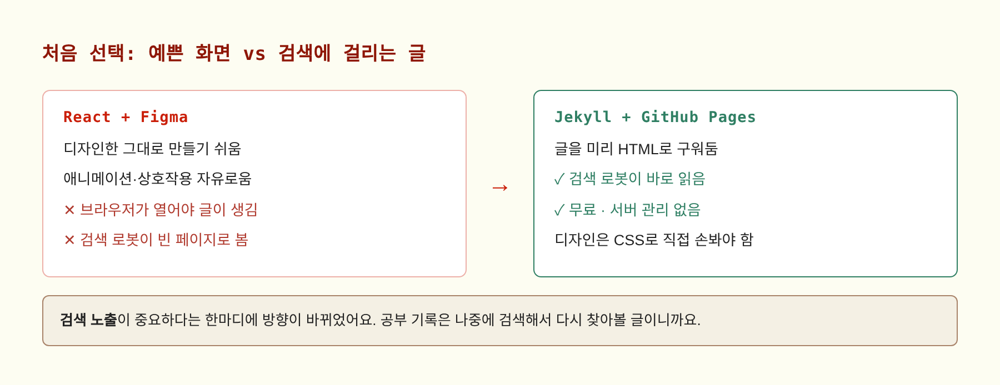

근데 중요한 걸 빠뜨렸더라고요. <mark class="pink">검색 노출</mark>이요.

React로 만든 페이지는 **브라우저가 자바스크립트를 실행해야 비로소 글이 생겨요.** 검색 로봇이 들어왔을 때는 아직 빈 껍데기라서, 내가 쓴 글이 거기 있다는 걸 모를 수 있어요.

공부 기록은 **나중에 검색해서 다시 찾아볼 글**인데, 검색에 안 걸리면 만드는 의미가 절반은 사라지는 거잖아요.

> Jekyll은 글을 **미리 HTML로 구워두는** 방식이에요. 검색 로봇이 들어오면 완성된 글이 이미 거기 있어요.<br>
> 대신 React처럼 자유롭게 상호작용을 만들기는 어려워요. 애니메이션이나 팝업은 직접 CSS랑 자바스크립트로 짜야 해요.
{: .warn }

결과적으로는 잘한 선택이었다고 생각해요. 영수증 팝업도, 스크롤 효과도 결국 다 구현했거든요. 조금 더 손이 갔을 뿐이에요.

### 1-3. Jekyll이 돌아가는 방식

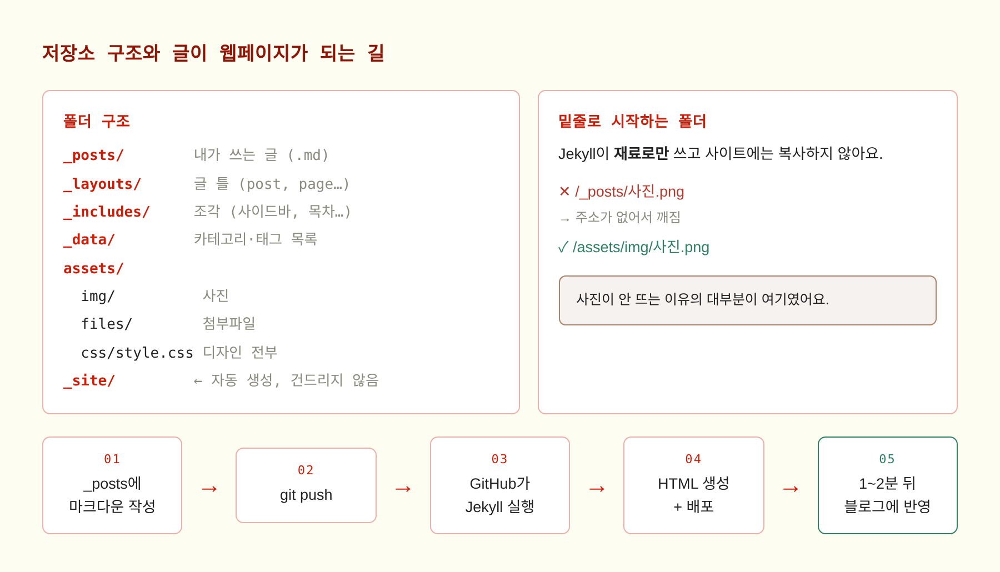

Jekyll을 한 문장으로 설명하면 이래요.

> **마크다운 글 + 틀(layout) = 완성된 HTML**

제가 하는 일은 `_posts` 폴더에 `.md` 파일을 하나 만드는 것뿐이에요. 나머지는 Jekyll이 해요.

- 글 맨 위의 `title`, `categories`를 읽어서
- `_layouts/post.html` 틀에 끼워 넣고
- 사이드바·목차 같은 `_includes` 조각을 붙이고
- `assets/css/style.css`를 입혀서
- 완성된 HTML 파일을 만들어요

그리고 이 작업을 **GitHub가 대신 해줘요.** 제 컴퓨터에서 빌드해서 올릴 필요가 없어요. `git push`만 하면 GitHub가 알아서 Jekyll을 돌리고 배포까지 합니다.

<details markdown="1">
<summary>글 하나가 웹페이지가 되기까지 — 자세히</summary>

1. `_posts/2026-11-13-제목.md` 파일을 만들어요. 파일 이름의 **날짜가 글 날짜**가 돼요
2. 맨 위에 `---`로 감싼 구역(front matter)에 제목·카테고리를 적어요
3. `git push`로 GitHub에 올려요
4. GitHub Actions가 자동으로 돌면서 Jekyll을 실행해요
5. Jekyll이 `_site/` 폴더에 완성된 HTML을 만들어요
6. 그 결과물이 `lithonhaeun.github.io` 주소로 배포돼요
7. 1~2분 뒤 브라우저에서 보여요

여기서 `_site/` 폴더는 **자동 생성물**이라 제가 건드릴 일이 없어요. git에도 안 올라가고요.

</details>

### 1-4. 처음에 제일 많이 헤맨 것 — 밑줄 폴더

구조를 이해하는 데 시간이 좀 걸렸어요. 핵심은 **밑줄(`_`)로 시작하는 폴더**예요.

`_posts`, `_layouts`, `_includes`, `_data` 같은 폴더는 Jekyll이 **재료로만** 쓰고, 완성된 사이트에는 복사하지 않아요. 밑줄 없는 `assets` 폴더만 그대로 올라가요.

이걸 모르고 사진을 `_posts` 폴더에 넣었다가 한참 헤맸어요.

```markdown
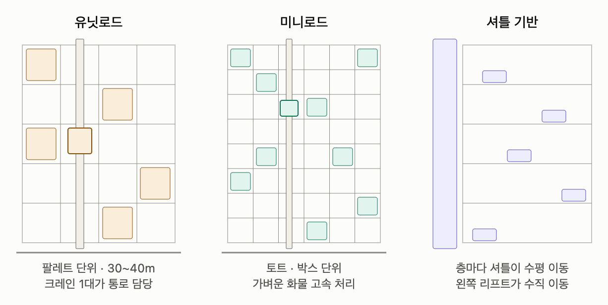       ← 주소 자체가 없어서 깨짐
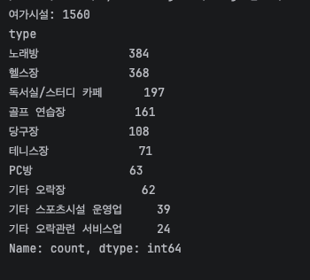               ← 상대경로도 깨짐
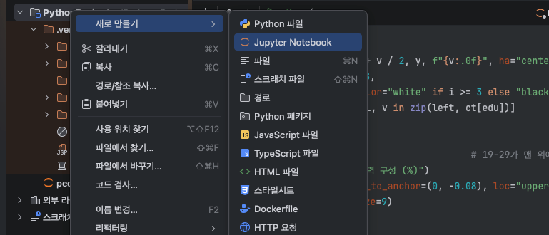   ← 이게 맞아요
```

> 사진이 안 뜨는 이유의 **대부분이 이거**였어요. 글 파일이 있는 위치랑, 글이 만들어지는 주소가 다르거든요. 글은 `/posts/제목/` 같은 주소로 만들어지는데 상대경로는 그 기준으로 계산되니까요.
{: .warn }

그래서 사진은 무조건 `assets/img/`에 넣고 `/`로 시작하는 경로로 써야 해요. 이게 나중에 귀찮아져서 2편에서 자동화합니다.

---

## 2. 캐릭터 만들기

>사실 이 부분이 제일 재밌었어요. 블로그에 성격을 입히는 작업이라서요.

### 2-1. 왜 곰돌이였을까

블로그를 만들면서 "기술 블로그처럼 깔끔하게" 할지, "내 색깔이 보이게" 할지 고민했어요.

깔끔한 기술 블로그는 이미 세상에 많잖아요. 그리고 제가 매일 들어와서 글을 쓸 공간인데, 정이 가는 구석이 하나는 있었으면 했어요.

그래서 **마스코트**를 하나 두기로 했어요. 조건은 두 가지였어요.

- 카테고리가 세 개니까 **셋으로 변주**가 가능할 것
- 크림색·빨강 톤이랑 안 부딪힐 것

곰인형이 딱 맞았어요. 갈색이라 크림색 배경에 잘 얹히고, 소품만 바꾸면 성격이 달라 보이거든요.

### 2-2. 이빨 곰돌이

{: .medium }

기본형이에요. 이름은 <mark>이빨 곰돌이</mark>. 보시면 아시겠지만 **사람 이빨**이 달려 있어요ㅋㅋㅋ

귀여운 곰인형에 사람 치아가 붙어 있으니까 묘하게 웃기면서 기억에 남더라고요. 프로필 사진으로도 이 친구를 쓰고 있어요.

> 이미지는 **Gemini로 만들었어요.** "갈색 테디베어, 사람 이빨, 흰 배경" 같은 식으로 설명을 넣고 여러 장 뽑아서 마음에 드는 걸 골랐어요.<br>
> 흰 배경으로 뽑는 게 중요했어요. 나중에 배경을 지우고 아치 안에 앉혀야 했거든요.
{: .tip }

### 2-3. 카테고리별 곰돌이 세 마리


기본형을 가지고 카테고리마다 성격을 입혔어요. 같은 곰돌이인데 소품만 다르게요.

| 카테고리 | 곰돌이 | 소품 |
|---|---|---|
| **personal** | 힙한 곰돌이 | 비니, 선글라스, 검은 맨투맨, 에코백 |
| **study** | 공부하는 곰돌이 | 볼펜, 미적분 노트 |
| **major** | 전공하는 곰돌이 | 동그란 안경, 노트북 |

personal 곰돌이가 들고 있는 에코백에 "WORLD FAMOUS TRAVELERS"라고 쓰여 있고, 맨투맨엔 "ODETOTHE BRAIN"이 적혀 있어요. AI가 알아서 넣은 건데 꽤 그럴듯하더라고요ㅎㅎ

study 곰돌이 노트에 적힌 건 미적분 필기예요. 자세히 보면 수식이 좌우반전돼 있는데, 그냥 뒀어요. 작게 들어가면 안 보이니까요.

> **AI 이미지를 쓸 때 느낀 점**<br>
> 한 번에 원하는 게 나오진 않아요. 같은 설명으로 열 장쯤 뽑아서 고르는 식이었어요. 특히 **세 마리의 털 색과 자세를 비슷하게** 맞추는 게 어려웠어요. 나란히 놓였을 때 따로 노니까요.<br>
> 그래서 기본형을 먼저 확정하고, 그 이미지를 기준으로 소품만 추가해 달라고 하는 쪽이 훨씬 잘 됐어요.
{: .check }

### 2-4. 이미지를 화면에 앉히기

이미지가 준비됐으면 화면에 넣어야죠. 여기서 할 일이 두 가지였어요.

**① 배경 지우기**

흰 배경 그대로 쓰면 크림색 화면에 흰 네모가 둥둥 떠요. 배경을 투명하게 만들어서 PNG로 저장했어요.

**② 아치 안에 정확히 앉히기**

아치 이미지와 곰돌이 이미지가 따로라서, 곰돌이를 아치 안쪽 바닥에 딱 맞춰 올려야 했어요.

```css
.niche__bear{
  position:absolute;
  left:50%;
  bottom:7%;              /* 아치 바닥에서 살짝 띄움 */
  transform:translateX(-50%);
  transition:transform .25s;
}
.niche__arch:hover .niche__bear{
  transform:translateX(-50%) scale(1.04);   /* 마우스 올리면 살짝 커짐 */
}
```

`bottom` 값을 7%로 잡은 건 몇 번 바꿔보면서 맞춘 거예요. 곰돌이마다 다리 길이가 조금씩 달라서, `_data/categories.yml`에 **곰돌이별 크기 값**을 따로 적어뒀어요.

```yaml
- id: personal
  bear: /assets/img/bear-personal.png
  bear_width: 64        # 곰돌이마다 다르게
  tag_left: 7.8         # 상표 매다는 위치
```

> 마우스를 올리면 곰돌이가 **4% 커져요.** 아주 미묘한데, 이런 게 "눌러도 되는구나"를 알려주더라고요.
{: .tip }

### 2-5. 같은 이미지를 여기저기서 재사용

곰돌이 이미지는 한 번 만들어두고 **세 군데**에서 써요.

- **홈 화면** — 아치 안에 크게
- **사이드바** — 카테고리 옆에 작게 (52px)
- **카테고리 페이지** — 제목 옆 장식으로

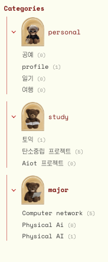

사이드바에 들어간 모습이에요. 같은 이미지를 작게 줄여서 쓰고, 마우스를 올리면 역시 살짝 커져요. 태그 옆 괄호 안 숫자가 글 개수고요.

> 처음엔 사이드바용 작은 이미지를 따로 만들까 했는데, 그러면 곰돌이를 바꿀 때마다 **두 번 작업**해야 해요. 그냥 CSS로 크기만 줄이는 쪽이 나았어요.
{: .note }

---

## 3. 디자인 구현

>Figma 그림을 실제로 움직이는 화면으로 만드는 과정이에요. 생각보다 재밌었고, 생각보다 오래 걸렸어요.

### 3-1. 처음 그린 화면

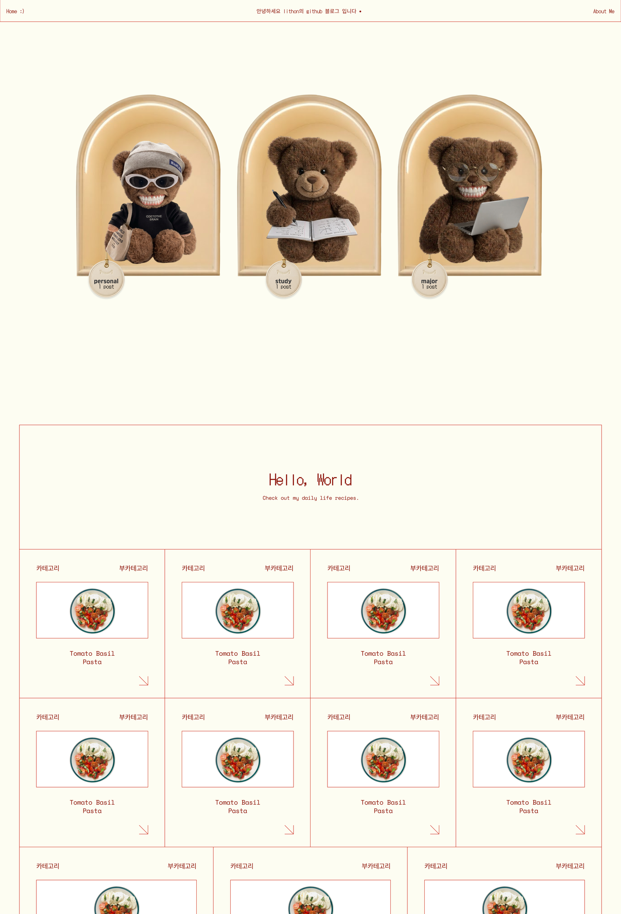

이게 처음 그린 홈 화면이에요. 위에 아치 세 개, 아래에 "Hello, World" 보드와 글 카드가 쭉 깔려 있어요.

카드 안 사진이 전부 파스타인 건, 그때는 글이 하나도 없어서 Figma 기본 샘플 이미지를 그냥 둔 거예요ㅎㅎ

처음엔 아치 모양을 **CSS로 흉내 내보려** 했어요. `border-radius`로 위를 둥글게 깎고 그림자를 넣고요. 근데 영 아니더라고요. 안쪽이 움푹 들어간 느낌, 가장자리의 부드러운 광택 같은 게 CSS로는 잘 안 나왔어요.

> 결국 **이미지 파일**을 쓰는 쪽으로 바꿨어요. 아치도, 곰돌이도, 동그란 상표도 전부 이미지로요.<br>
> CSS로 흉내 내는 것보다 훨씬 빠르고 결과도 좋았어요. "코드로 다 해야 한다"는 생각을 버리니까 편해지더라고요.
{: .check }

### 3-2. 영수증 팝업

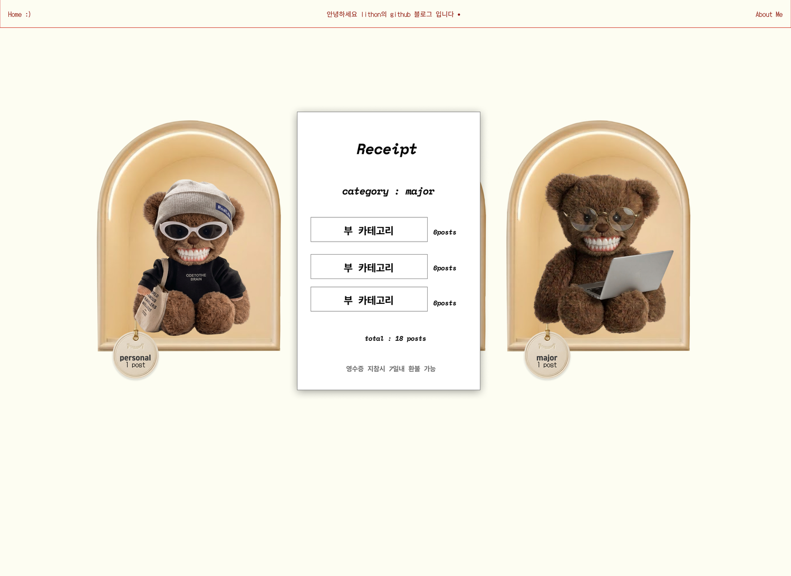

곰돌이를 누르면 영수증이 떠요. 여기서 위치를 여러 번 고쳤어요.

| 시도 | 결과 |
|---|---|
| 화면 정가운데에 띄우기 | 곰돌이와 상관없는 데서 뜨니까 어색 |
| 곰돌이들 사이 빈 공간에 | 어느 곰돌이를 눌렀는지 모르겠음 |
| **누른 곰돌이 바로 위에** | ✅ 이걸로 |

영수증 안쪽 내용도 꽤 많이 손봤어요.

| 요소 | 처음 | 바꾼 뒤 |
|---|---|---|
| 항목 제목 | ITEM / QTY | **Tag / Posts** |
| 개수 표시 | x0 | **0** |
| 합계 | 1 | **1 posts** |
| 그림자 | 사방에 | **바깥쪽 아랫부분만** |
| 가장자리 | 톱니 모양 | **평평하게** |

진짜 영수증처럼 보이게 하려고 점선 구분선, 바코드, 하단의 "영수증 지참시 7일내 환불 가능" 문구까지 넣었어요. 사소한 것 같은데 이런 게 모여서 분위기가 달라지더라고요.

> 톱니 모양 가장자리는 만들었다가 **지웠어요.** 진짜 영수증 같긴 한데 화면에서는 지저분해 보였거든요. 만들었다고 꼭 써야 하는 건 아니더라고요.
{: .note }

### 3-3. 카테고리는 한 곳에서만 고치기

카테고리랑 태그를 사이드바, 홈 화면, 카테고리 페이지 세 군데에서 쓰는데, 이걸 각각 적어두면 하나 고칠 때마다 세 군데를 고쳐야 해요.

그래서 `_data/categories.yml` 파일 **하나**에만 적어두고 나머지는 전부 여기서 읽어가게 했어요.

<details markdown="1">
<summary>실제 파일 내용 보기</summary>

```yaml
- id: personal
  subs: [profile, portfolio]
  bear: /assets/img/bear-personal.png
  small: /assets/img/bear-personal-small.png
  thumb: /assets/img/cat-personal.png
  bear_width: 64
  tag_left: 7.8

- id: study
  subs: [토익, 탄소중립 프로젝트, Aiot 프로젝트]
  ...

- id: major
  subs: [Computer network, Physical AI]
  ...
```

`subs`가 태그 목록이고, `bear`·`small`·`thumb`은 쓰이는 자리마다 다른 이미지예요.

</details>

글 개수도 자동으로 세요. 글에 적힌 태그를 전부 모아서 데이터 파일 목록이랑 합치기 때문에, **데이터 파일에 없는 태그를 글에 써도** 사이드바에 알아서 나타나요.

> **여기서 황당한 버그를 하나 겪었어요.**<br>
> 사이드바에 "Physical Ai"와 "Physical AI"가 **따로** 떠 있는 거예요. 하나는 (0), 하나는 (1)이고요.<br>
> 알고 보니 데이터 파일엔 `Ai`로, 글에는 `AI`로 적어놔서 컴퓨터가 **다른 태그로 본** 거였어요. 대소문자 하나 차이인데 찾는 데 한참 걸렸어요ㅜㅜ
{: .warn }

### 3-4. 화면 크기에 맞춰 움직이게

처음엔 글 목록 카드가 고정 크기였어요. 창을 줄이면 레이아웃이 깨지고, 넓은 모니터에서는 가운데만 덩그러니 몰려 있었고요.

**① 카드는 화면 폭에 따라 개수가 달라지게**

```css
.grid--4{
  grid-template-columns:repeat(auto-fill, minmax(min(250px,100%), 1fr));
}
```

`auto-fill`이랑 `minmax`를 쓰면 "최소 250px, 들어가는 만큼 알아서"가 돼요. 넓으면 4개, 좁으면 2개, 더 좁으면 1개로 저절로 바뀌어요.

**② 좁은 화면에서는 사이드바를 서랍으로**

1000px 이하에서는 사이드바가 위로 밀려 올라가는 대신, **왼쪽에서 열리는 서랍 메뉴**가 되게 했어요. 상단에 햄버거 버튼이 나타나고요.

**③ 넓은 화면에서는 전체 폭을 넓게**

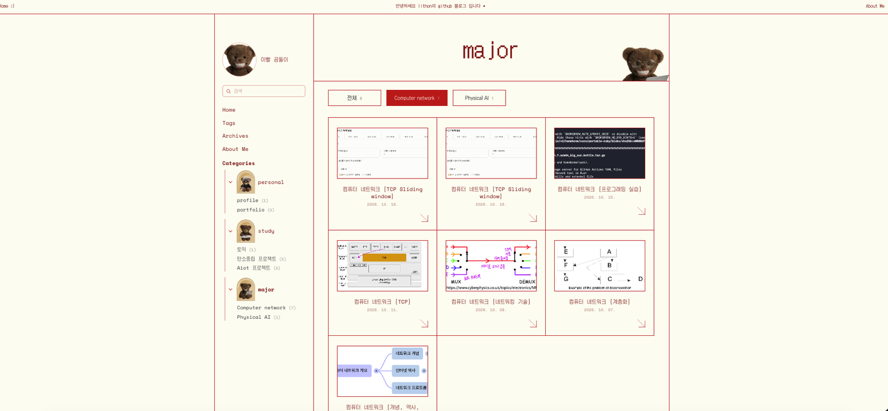

맥미니로 보니까 이렇게 양옆이 너무 비더라고요. 그래서 전체 폭을 **1280px → 1600px**로 늘렸어요.

> 근데 폭 값이 홈 화면, 사이드바 레이아웃, 목차 위치 **세 군데**에 흩어져 있었어요. 하나만 고치니까 목차가 본문에서 떨어져 나가더라고요.<br>
> 그래서 `--wrap` 변수 하나로 묶어뒀어요. 이제 맨 위 한 줄만 고치면 셋이 같이 따라와요.
>
> ```css
> :root{ --wrap:1600px; }
> .with-sidebar{ max-width:var(--wrap); }
> .rail{ right:max(14px, calc(50vw - var(--wrap)/2 + 18px)); }
> ```
{: .check }

### 3-5. 스크롤 효과

홈 화면에 들어오면 **곰돌이 세 마리만 화면을 꽉 채우고**, 스크롤을 내려야 글 목록이 나타나게 하고 싶었어요.

```css
.shelf{
  min-height:calc(100svh - 45px);   /* 화면 높이에서 상단바만 뺀 만큼 */
}
```

그리고 아래쪽에 "스크롤하세요" 화살표를 넣고, 살짝 위아래로 움직이게 했어요. 스크롤을 시작하면 사라지고요.

글 카드는 화면에 들어올 때 아래에서 떠오르듯 나타나요. `IntersectionObserver`로 "이 카드가 화면에 보이기 시작했는지"를 감지해서 클래스를 붙이는 방식이에요.

> 움직임을 싫어하거나 어지러움을 느끼는 분들도 있어요. 그래서 `prefers-reduced-motion` 설정을 켜둔 분에게는 **애니메이션이 전부 꺼지게** 해뒀어요. 접근성 설정 하나 추가하는 거라 어렵지 않았어요.
{: .tip }

---

## 4. 잔디가 안 심기던 닷새

>이 블로그를 만들면서 가장 오래 붙잡고 있었던 문제예요. 결론부터 말하면 **제 잘못이 아니었는데**, 그걸 증명하는 데 이틀이 걸렸어요.

### 4-1. 증상

9월 말쯤 이상한 걸 발견했어요. 글도 올라가고 블로그도 잘 바뀌는데, **기여 그래프에 색이 안 칠해지는** 거예요.

하루 지나도 그대로, 이틀 지나도 그대로. 커밋은 분명히 GitHub에 올라가 있고, 커밋 목록에 제 아이디와 프로필 사진까지 제대로 붙어 있는데 말이죠.

### 4-2. 가설을 하나씩 지우기

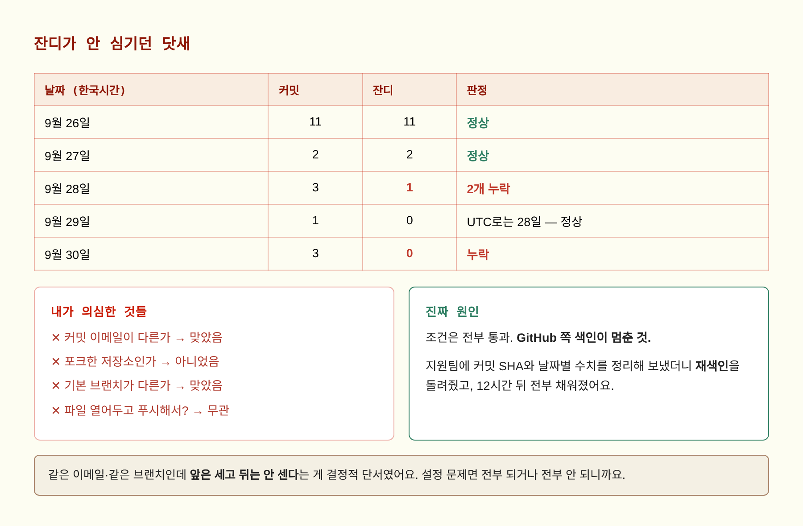

GitHub 문서에 잔디가 심기는 조건이 나와 있어요. 하나씩 확인해 봤어요.

<details markdown="1">
<summary>① 커밋 이메일이 계정에 연결돼 있나?</summary>

```bash
git config --list
```

전역 설정은 noreply 주소인데, **저장소 설정에 학교 메일**이 따로 들어 있었어요. 그리고 `git config --list`는 **나중에 나온 값이 이기기** 때문에, 실제로는 학교 메일로 커밋되고 있었어요.

범인을 찾았다 싶었죠. 근데 GitHub 설정에 들어가 보니 학교 메일도 **Verified**로 등록돼 있었어요. 땡.

</details>

<details markdown="1">
<summary>② 포크한 저장소인가?</summary>

포크한 저장소는 잔디가 안 심긴다는 글을 봤어요. 확인해 보니 제 저장소는 포크가 아니었어요. 땡.

</details>

<details markdown="1">
<summary>③ 기본 브랜치가 아닌 곳에 올렸나?</summary>

```bash
git fetch origin
git log --oneline -4 main
git log --oneline -4 origin/main
```

로컬 `main`과 원격 `origin/main`의 최신 커밋이 **완전히 같았어요.** 기본 브랜치도 `main`이 맞았고요. 땡.

</details>

<details markdown="1">
<summary>④ 히스토리를 고쳐서 그런가?</summary>

```bash
git show a299b05 --pretty=fuller
```

작성일(AuthorDate)과 커밋일(CommitDate)을 비교했어요. **초 단위까지 똑같았어요.** 한 번도 손댄 적 없는 커밋이라는 뜻이에요. 땡.

</details>

중간에 엉뚱한 의심도 했어요. "파일을 에디터에 열어둔 채로 푸시해서 그런가?" 하고요.

> git은 파일이 에디터에 열려 있는지 **알지도 못해요.** `git add` 하는 순간 디스크에 저장된 내용을 읽어갈 뿐이에요.
{: .note }

### 4-3. 결정적 단서

날짜별로 커밋 수랑 잔디 수를 나란히 적어보니까 이상한 게 보였어요.

| 날짜 (한국시간) | 커밋 | 잔디 | |
|---|---|---|---|
| 9/26 | 11개 | **11개** | ✅ |
| 9/27 | 2개 | **2개** | ✅ |
| 9/28 | 3개 | **1개** | ❌ |
| 9/29 | 1개 | **0개** | ? |
| 9/30 | 3개 | **0개** | ❌ |

같은 이메일, 같은 브랜치, 같은 저장소인데 **앞은 세고 뒤는 안 세는** 거예요.

> 설정이 원인이면 전부 되거나 전부 안 되지, 중간에서 끊길 수가 없어요.
{: .check }

이게 결정적이었어요. 제 설정은 문제가 없고, **GitHub 쪽 색인이 멈춘 것**이라는 결론이 나왔어요.

그리고 하나 더 알게 된 게 있어요. **9월 29일 칸이 빈 건 버그가 아니라 정상**이었어요.

기여 그래프는 <mark class="mint">UTC 기준</mark>이에요. 한국은 UTC+9라서 9시간을 빼야 해요. 한국시간 9월 29일 00시 08분에 만든 커밋은 UTC로 계산하면 **9월 28일 15시 08분**이거든요. UTC 기준 9월 29일엔 커밋이 진짜로 하나도 없었던 거예요.

> 새벽에 커밋하는 습관이 있으면 **잔디가 전날 칸에 찍혀요.** 오전 9시 전에 한 커밋은 전부 하루 전으로 가요.
{: .tip }

### 4-4. 지원팀에 보낸 것

GitHub Support에 이렇게 정리해서 보냈어요.

- 날짜별 커밋 수와 실제 잔디 수 **표**
- 누락된 커밋의 **SHA 목록**
- `.patch`로 확인한 **작성자 이메일**
- AuthorDate와 CommitDate가 **동일**하다는 사실
- 인접한 날(9/26, 9/27)은 **정확히 일치**한다는 점
- 24시간 넘게 기다렸다는 사실

처음엔 "무료 플랜은 셀프서비스 자원만 제공된다"며 티켓이 닫혔어요. 그런데 그 뒤에 다른 담당자가 들어와서 <mark>기여 데이터 재구축(rebuild)</mark>을 직접 돌려줬어요.

12시간쯤 뒤에 확인해 보니 **빈칸이 전부 채워져 있었어요.** 🎉

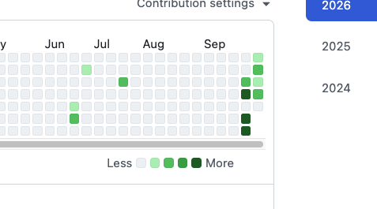

### 4-5. 여기서 배운 것

> **"안 돼요"보다 "이 조건은 통과했고, 이 수치는 이렇게 어긋나요"**<br>
> 처음엔 저도 "왜 안 되죠?"라고만 물었어요. 그때는 일반적인 안내만 돌아왔어요.<br>
> 표를 만들어서 "9/26은 11:11로 맞는데 9/28은 3:1입니다"라고 보여주니까 그때부터 진짜 조사가 시작됐어요. **재현 가능한 숫자**가 가장 강한 설명이더라고요.
{: .check }

그리고 하나 더. 그 과정에서 **`git push --force`는 절대 쓰지 말자**는 것도 배웠어요. 검색하면 "강제 푸시하면 잔디 심긴다"는 글이 꽤 나오는데, 실제로 그렇게 했다가 이전 파일을 전부 날린 사례도 같이 나오거든요.

---

## 5. 1편 정리

### 5-1. 배운 것 네 가지

① <mark class="pink">도구는 목적에 맞춰 고르기</mark><br>
React가 Jekyll보다 나쁜 기술인 게 아니라, **검색에 걸려야 하는 글**에는 Jekyll이 맞았던 거예요. 예쁜 화면을 먼저 생각하다가 정작 중요한 조건을 빠뜨릴 뻔했어요.

② <mark class="pink">코드로 다 할 필요 없음</mark><br>
아치를 CSS로 흉내 내느라 쓴 시간보다, 이미지로 만들어 넣은 게 훨씬 빠르고 결과도 좋았어요.

③ <mark class="pink">같은 값을 두 군데 적지 않기</mark><br>
카테고리를 `_data` 한 곳에 모은 것, 화면 폭을 `--wrap` 변수로 묶은 것, 곰돌이 이미지를 한 장으로 재사용한 것. 전부 같은 원칙이에요. `Physical Ai` / `Physical AI` 사건도 결국 같은 교훈이고요.

④ <mark class="pink">증거를 모아서 말하기</mark><br>
잔디 문제를 해결한 건 결국 **날짜별 수치 표**였어요. 추측으로 이것저것 해보는 것보다, 가설을 하나씩 지워나가는 게 빨랐어요.

### 5-2. 지금까지 만든 것

| 항목 | 내용 |
|---|---|
| 기반 | Jekyll 4 + GitHub Pages |
| 캐릭터 | 이빨 곰돌이 + 카테고리별 세 마리 (Gemini 생성) |
| 홈 화면 | 아치 3개 + 영수증 팝업 + 스크롤 효과 |
| 카테고리 | `_data` 한 곳에서 관리, 글 개수 자동 집계 |
| 반응형 | 1600px 기준, 좁은 화면은 서랍 메뉴 |
| 배포 | push하면 1~2분 뒤 자동 반영 |

---

**2편에서는** 글 쓰는 걸 편하게 만든 것들을 다룰게요. 사진 넣기 자동화, 형광펜, 콜아웃, 토글, 첨부파일, 목차, 그리고 인쇄까지요.

사실 블로그를 만드는 것보다 **계속 쓰게 만드는 게** 더 어렵더라고요. 글 한 편 올리는 데 열 단계를 거쳐야 하면 결국 안 쓰게 되니까요.

---

### 참고 자료

- [Jekyll 공식 문서](https://jekyllrb.com/docs/)
- [GitHub Pages 문서](https://docs.github.com/en/pages)
- [기여 그래프에 커밋이 안 보일 때 (GitHub Docs)](https://docs.github.com/en/account-and-profile/how-tos/contribution-settings/troubleshooting-missing-contributions)
- [kramdown 문법 (Jekyll 기본 마크다운 변환기)](https://kramdown.gettalong.org/syntax.html)
- [CSS Grid의 auto-fill과 minmax (MDN)](https://developer.mozilla.org/ko/docs/Web/CSS/CSS_grid_layout)
