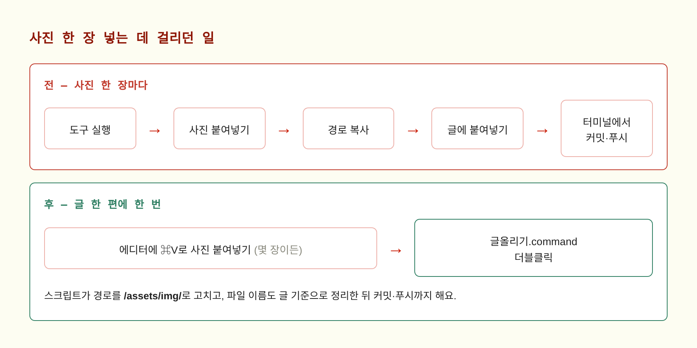
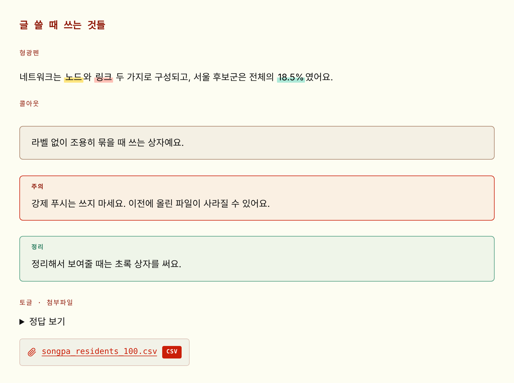
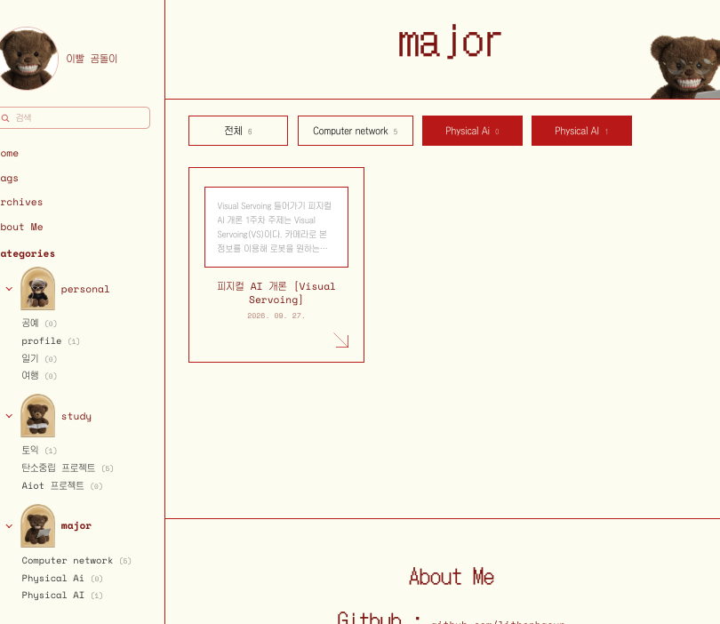

# 깃허브 블로그 제작기 2편: 글쓰기를 편하게

## 들어가며

### 0-1. 1편 복습: 블로그는 만들었는데

1편에서는 Jekyll로 블로그를 만들어서 띄우기까지를 다뤘어요. React로 시작했다가 검색 노출 때문에 갈아엎은 이야기, 곰돌이 아치랑 영수증 팝업을 옮긴 이야기, 그리고 잔디가 안 심겨서 이틀을 쓴 이야기까지요.

그런데 블로그가 완성되고 나니까 **진짜 문제가 그때부터** 시작되더라고요.

글 한 편 올리는 데 이런 과정을 거쳐야 했거든요.

1. 사진 넣는 도구 실행
2. 사진 붙여넣기
3. 나온 경로 복사
4. 글에 붙여넣기
5. 사진이 여러 장이면 **2~4번을 반복**
6. 터미널 열어서 커밋, 푸시

사진 다섯 장 있는 글이면 이걸 다섯 번 해야 해요. 이러면 결국 안 쓰게 돼요ㅜㅜ

### 0-2. 이번 글의 흐름

그래서 2편은 **쓰는 과정을 줄여온 기록**이에요.

① <mark class="pink">사진 넣기 자동화</mark><br>
여섯 단계를 두 단계로 줄인 과정.

② <mark class="pink">글 꾸미는 도구들</mark><br>
형광펜, 콜아웃, 토글, 첨부파일. 마크다운에 없는 기능을 직접 만들어 넣었어요.

③ <mark class="pink">읽기 좋게 만들기</mark><br>
목차, 사이드바 고정, 화면 폭, 인쇄까지.

---

## 1. 사진 넣기 자동화

>글 쓰면서 제일 자주 하는 일이 사진 넣기인데, 제일 번거로웠어요. 이걸 줄이는 게 가장 효과가 컸어요.

### 1-1. 무엇이 문제였나



처음엔 사진을 넣는 전용 도구를 만들어 뒀었어요. 실행하면 클립보드의 사진을 `assets/img/`에 저장하고 경로를 알려주는 스크립트요.

잘 돌아가긴 했는데, **사진 한 장마다 도구를 실행해야** 한다는 게 문제였어요. 글 쓰다가 흐름이 끊기니까요.

### 1-2. 에디터가 이미 할 수 있는 일이었어요

알고 보니 **PyCharm에서 마크다운 파일에 사진을 그냥 ⌘V로 붙여넣으면** 파일 저장이랑 경로 삽입까지 알아서 해주더라고요. 도구를 만들 필요가 없었던 거예요.

딱 하나 문제가, PyCharm이 넣어주는 경로가 이런 모양이라는 거예요.

```markdown

```

1편에서 봤듯이 상대경로는 블로그에서 깨져요. `/assets/img/...`로 시작해야 하거든요.

### 1-3. 올릴 때 한 번에 고치기

그래서 매번 손으로 고치는 대신, **올리는 스크립트가 알아서 고치게** 했어요.

`글올리기.command`를 더블클릭하면 순서대로 이런 일이 일어나요.

```
① _posts 안의 글에서 상대경로 사진을 전부 찾음
② assets/img 바깥에 있으면 거기로 옮김
③ 파일 이름을 글 기준으로 정리 (image_7.png → network-week2-1.png)
④ 링크를 /assets/img/... 로 바꿔 씀
⑤ 커밋 → pull --rebase → push
```

>💡 이름 정리가 생각보다 유용해요. `image_7.png`, `image_23.png`처럼 쌓이면 나중에 어느 글 사진인지 몰라요. 글 제목이 한글이면 날짜를 써서 `2026-11-13-1.png`처럼 붙여요.

몇 가지를 신경 썼어요.

| 항목 | 처리 |
|---|---|
| 이미 `/assets/`로 된 링크 | 건드리지 않음 |
| `https://`로 시작하는 링크 | 건드리지 않음 |
| 파일이 없는 경로 | 고치지 않고 **경고만** 표시 |
| 여러 번 실행 | 결과가 같음 (안전) |

그래서 지금은 이렇게 돼요.

>**사진을 몇 장이든 붙여넣고 → 글 다 쓰고 → 더블클릭 한 번.**

### 1-4. 순서 하나 때문에 났던 에러

처음엔 스크립트가 `pull` 다음에 `commit`을 하게 짜여 있었어요. 그랬더니 이런 에러가 났어요.

```
error: cannot pull with rebase: You have unstaged changes.
```

저장 안 된 변경이 있으면 rebase를 못 하거든요. **커밋을 먼저** 하도록 순서를 바꾸니까 해결됐어요.

>⚠️ 그리고 `git add .`를 쓸 때는 조심해야 해요. 한 번은 고치고 있던 다른 파일이 같이 커밋돼서, 나중에 `git show --stat HEAD`로 확인하고 알았어요.

---

## 2. 글 꾸미는 도구들

>마크다운은 깔끔하지만 단순해요. 강조할 방법이 **굵게**랑 `코드` 정도뿐이라, 긴 글을 쓰면 다 비슷해 보여요. 그래서 몇 가지를 직접 만들어 넣었어요.



### 2-1. 형광펜

HTML의 `<mark>` 태그에 CSS를 입혔어요. 글자 전체를 덮지 않고 **아래쪽 절반만** 칠해서 진짜 형광펜으로 그은 느낌이 나게 했어요.

```markdown
네트워크는 <mark>노드</mark>와 <mark class="pink">링크</mark>로 구성돼요.
```

노랑(기본), 분홍, 민트, 파랑 네 가지예요. 긴 문장이 두 줄로 넘어가도 양쪽 줄 다 칠해지게 맞췄어요.

>⚠️ 하나 함정이 있어요. 형광펜 **안쪽**에 `**굵게**`를 쓰면 별표가 글자로 그대로 나와요. kramdown이 HTML 태그 안쪽은 마크다운으로 안 읽거든요. 굵게는 **바깥쪽**에 써야 해요.
>
>```markdown
>**<mark>이렇게요</mark>**
>```

### 2-2. 콜아웃

`>` 인용문은 하나뿐이라 "참고"랑 "주의"를 구분할 수가 없었어요. 그래서 종류별 상자를 만들었어요.

쓰는 법은 평소처럼 `>`로 쓰고, **바로 아래 줄에** 종류를 붙이면 돼요.

```markdown
> 강제 푸시는 쓰지 마세요. 이전에 올린 파일이 사라질 수 있어요.
{: .warn }
```

| 종류 | 라벨 | 색 |
|---|---|---|
| `.note` | 없음 | 모카 |
| `.tip` | 팁 | 주황 |
| `.warn` | 주의 | 빨강 |
| `.check` | 정리 | 초록 |

>💡 이건 kramdown의 **IAL**이라는 문법이에요. 블록 바로 아래 줄에 `{: .클래스 }`를 쓰면 그 블록에 클래스가 붙어요. 사진 크기 조절(`{: .left }`)이나 사진 두 장 나란히 놓기(`{: .pair }`)도 같은 문법이에요.

색을 정하는 데 생각보다 오래 걸렸어요ㅎㅎ 갈색 하나 고르는데 `#6f5340` → `#8a6e38` → `#5D4035` → `#a9846a`까지 왔다 갔다 했거든요. **주의 상자(주황)랑 색이 겹치면 안 된다**는 조건이 있어서 그랬어요.

### 2-3. 토글

긴 코드나 정답을 숨겨두고 싶을 때 쓰는 거예요. HTML의 `<details>` 태그가 이미 있어서, 그냥 쓰면 돼요.

```markdown
<details markdown="1">
<summary>정답 보기</summary>

전체 지연은 각 링크의 전송 시간을 모두 더한 값이에요.

</details>
```

CSS로 테두리랑 화살표를 입힌 버전도 만들어 봤는데, **기본 모양이 더 마음에 들어서** 그냥 쓰기로 했어요. 깔끔하고 본문에 잘 묻히거든요.

>⚠️ `<summary>` 다음과 `</details>` 앞에 **빈 줄**이 있어야 해요. 없으면 안쪽 마크다운이 글자로 그대로 나와요.

### 2-4. 첨부파일

글에서 쓴 csv나 pdf를 독자가 받아갈 수 있게 만들었어요. 글 맨 위에 파일 경로만 적으면 본문 아래에 상자가 자동으로 붙어요.

```yaml
---
title: 데이터 표본 설계 [3편]
files:
  - /assets/files/songpa_residents_100.csv
---
```

파일 이름이랑 `CSV` 같은 확장자 배지는 경로에서 자동으로 뽑아요. `files:`를 안 쓴 글에는 아예 안 나타나고요.

처음엔 상자가 본문 폭을 꽉 채우게 만들었는데, 짧은 파일명 하나만 있으면 휑해 보이더라고요. 그래서 **파일 이름 길이만큼만** 줄어들게 바꿨어요.

>💡 용량은 조심해야 해요. 저장소에 한 번 올라간 파일은 나중에 지워도 git 기록에 남아서 계속 무거워져요. 수 MB짜리 결과표 정도는 괜찮지만, 큰 파일은 구글 드라이브에 올리고 링크만 거는 쪽이 나아요.

---

## 3. 읽기 좋게 만들기

>글이 길어지니까 쓰는 것만큼 **읽는 경험**도 신경 쓰게 됐어요.

### 3-1. 목차

오른쪽에 막대 모양으로 떠 있다가, 마우스를 올리면 펼쳐지는 방식이에요. 지금 읽고 있는 위치도 표시돼요.

처음엔 `##`과 `###`이 막대 길이만 살짝 다르고 글자는 똑같아서, 펼쳐도 전부 같은 층으로 보였어요. **뒤죽박죽**이더라고요.

그래서 네 가지를 바꿨어요.

- **대제목**은 굵게, 조금 크게, 진한 색
- **소제목**은 한 칸 들여쓰고 작게, 연한 색
- 대제목 **위에 여백**을 줘서 단락이 덩어리로 보이게
- 현재 위치는 소제목이어도 진하게

### 3-2. 사이드바 따라오기

글을 한참 읽다가 다른 카테고리로 가려면 맨 위까지 스크롤해야 했어요. 그래서 사이드바가 화면에 붙어서 따라오게 했어요.

>⚠️ 여기서 예상 못 한 게 하나 있었어요. `position: sticky`를 걸면 사이드바 높이가 내용만큼으로 줄어들어서, **빨간 세로 테두리 선이 중간에 뚝 끊겨요.**<br>
>그래서 선을 사이드바에서 떼어내 바깥 틀과 본문 쪽으로 옮겼어요. 보기엔 똑같은데 이제 페이지 끝까지 이어져요.

### 3-3. 본문 정렬

`##` 제목만 가운데 정렬이고 `###`이랑 본문은 왼쪽이라, 글이 지그재그로 보였어요. 본문 제목을 전부 왼쪽으로 맞추니까 훨씬 정돈돼 보이더라고요.

글 맨 위의 큰 제목은 표지 느낌이라 **가운데 그대로** 뒀어요.

### 3-4. 인쇄

공부한 걸 출력해서 보려고 ⌘P를 눌렀더니 **37페이지**가 나왔어요ㅋㅋㅋ 화면 기준 글자 크기랑 줄 간격 그대로에, 사이드바랑 댓글까지 같이 인쇄되니까요.

그래서 인쇄할 때만 적용되는 설정을 넣었어요.

| 항목 | 화면 | 인쇄 |
|---|---|---|
| 사이드바·목차·댓글 | 보임 | **숨김** |
| 본문 글자 | 16px | 10pt |
| 줄 간격 | 1.85 | 1.55 |
| 제목 | 34px | 14pt |
| 사진 | 전체 폭 | 70% |

실제로 PDF를 뽑아서 재보니 **9페이지가 5페이지**로 줄었어요. 37페이지면 20페이지쯤 되는 셈이에요.

표랑 코드블록이 페이지 경계에서 잘리지 않게, 제목이 페이지 맨 아래에 혼자 남지 않게도 같이 맞췄어요. 화면은 하나도 안 바뀌고요.

>💡 브라우저는 기본적으로 **배경색을 인쇄하지 않아요.** 크림색 배경이 알아서 하얗게 나와서, 잉크 걱정은 안 해도 되더라고요.

---

## 4. 종합과 정리

### 4-1. 돌아보니 배운 것

① <mark class="pink">도구를 만들기 전에 이미 있는지 찾아보기</mark><br>
사진 넣는 도구를 공들여 만들었는데, 알고 보니 **에디터가 이미 하는 일**이었어요. 제가 만들어야 했던 건 도구 전체가 아니라 **경로를 고치는 한 조각**이었고요.

② <mark class="pink">한 번에 하나씩만 번거롭게</mark><br>
사진 한 장마다 도구를 실행하는 건 안 쓰게 되지만, 글 한 편에 한 번 더블클릭은 할 만해요. **번거로움의 총량보다 반복 횟수**가 중요하더라고요.

③ <mark class="pink">기본값이 더 나을 때도 있음</mark><br>
토글은 CSS를 입힌 버전을 만들어 놓고도 결국 **기본 모양**을 골랐어요. 만들었다고 꼭 써야 하는 건 아니었어요.

④ <mark class="pink">작은 디테일이 쌓여서 분위기를 만듦</mark><br>
영수증의 점선, 형광펜이 아래쪽만 칠해지는 것, 첨부파일 상자가 이름 길이만큼만 줄어드는 것. 하나하나는 사소한데 모이니까 "직접 만든 느낌"이 나요.

### 4-2. 지금 블로그 모습



1편에서 Figma로 그렸던 그 화면이 이렇게 됐어요. 곰돌이는 사이드바로 옮겨 가고, 카드에는 파스타 대신 진짜 글이 들어가 있고요.

### 4-3. 지금 글 쓰는 과정

| 단계 | 하는 일 |
|---|---|
| 1 | `_posts`에 `2026-11-13-제목.md` 만들기 |
| 2 | 맨 위에 제목·카테고리·설명 적기 |
| 3 | 글 쓰면서 사진은 ⌘V로 붙여넣기 |
| 4 | 강조는 형광펜, 묶을 건 콜아웃, 긴 건 토글 |
| 5 | `글올리기.command` 더블클릭 |

1~2분 뒤면 블로그에 올라가 있어요. 잔디도 같이 심기고요🌱

### 4-4. 앞으로 해보고 싶은 것

- **아이패드로 쓰기** — github.dev를 써보려고 해요. 사파리에서 주소만 치면 VS Code가 열리더라고요
- **네이버 블로그 글 가져오기** — 도구는 만들어 뒀는데 아직 제대로 못 써봤어요
- **다크 모드** — 밤에 보면 크림색이 좀 밝아요

>블로그를 만들면서 제일 크게 배운 건, **계속 쓰게 만드는 게 만드는 것보다 어렵다**는 거예요.<br>
>그래서 1편의 디자인보다 2편의 자잘한 자동화가 사실 더 오래 걸렸어요. 근데 지금 글을 쓰고 있다는 게 그 증거 같아서 뿌듯하네요ㅎㅎ

---

### 참고 자료

- [kramdown IAL 문법](https://kramdown.gettalong.org/syntax.html#inline-attribute-lists)
- [MDN — `<details>` 태그](https://developer.mozilla.org/ko/docs/Web/HTML/Element/details)
- [MDN — `<mark>` 태그](https://developer.mozilla.org/ko/docs/Web/HTML/Element/mark)
- [MDN — 인쇄용 CSS](https://developer.mozilla.org/en-US/docs/Web/CSS/CSS_media_queries/Printing)
- [PyCharm 마크다운 사용하기](https://www.jetbrains.com/help/pycharm/markdown.html)
