# 인프라 데이터 구축 2편: 송파구 3D 지도 만들기

## 들어가며
오늘할일

|순서	| 할 일                 |
|---|---------------------|
|1| 	상권·시설 데이터 조사       |
|2| 	받은 개수 확인하고, 부족한 건 보충할지 정하기 |
|3| 	3D 지도에 시설 올리기      |
|4| 	시설을 밀집 구역으로 묶기 (주민 출근지로 쓸 준비) |

## 1. 상권·시설 조사

>쇼핑시설, 공원·여가시설, 학교, 오피스·업무시설 순서로 조사해볼게용

### 1-1. 쇼핑시설 데이터 받기

https://www.data.go.kr/data/15083033/fileData.do 여깃 공공데이터포털에 들어가니 '소상공인시장진흥공단_상가(상권)정보' 파일이 있더라구요
여기서 서울 데이터만 사용할거에용

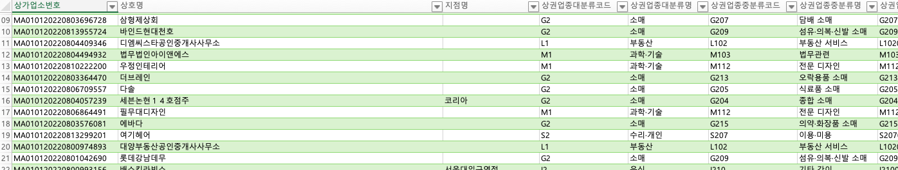
와 아주 많네용...괜찮아요 하나하나 지도에 점 찍는거 아니니까

먼저 송파구에 있는가게만 남기고 음식, 소매 , 과학·기술 , 수리·개인 ,교육,그 외 (예술·스포츠, 부동산, 보건의료 등) 중에서
소매점만 추려볼게요.

### 1-2. 쇼핑시설 골라내기

엑셀 파일을 data 폴더에 넣고, 프로젝트 폴더 우클릭 → New → Python File → 이름은 shopping

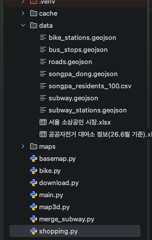{:.left}

data 폴더에 seoul_shops.xlsx 들어있고, shopping 파일도 만들어졌죠?

---

그리고 shopping 파일에는 이 코드를 썼어용
```python
import pandas as pd
import geopandas as gpd

FILE = "data/seoul_shops.xlsx"

# 1) 필요한 열만 읽기 (서울 전체 55만 줄이라 1~2분 걸려요)
cols = ["상호명", "상권업종대분류명", "상권업종중분류명", "상권업종소분류명",
        "시군구명", "행정동명", "경도", "위도"]
df = pd.read_excel(FILE, usecols=cols, dtype=str)
print("서울 전체:", len(df))

# 2) 송파구만 남기고, 다음에 또 쓰려고 CSV로 저장
songpa = df[df["시군구명"] == "송파구"].copy()
songpa.to_csv("data/songpa_shops_all.csv", index=False, encoding="utf-8-sig")
print("송파구 전체 상가:", len(songpa))

# 3) 쇼핑시설 = 소매업만
shop = songpa[songpa["상권업종대분류명"] == "소매"].copy()
shop["경도"] = pd.to_numeric(shop["경도"], errors="coerce")
shop["위도"] = pd.to_numeric(shop["위도"], errors="coerce")
shop = shop.dropna(subset=["경도", "위도"])

# 4) 지도용 점으로 바꾸고, 송파구 경계 안만 저장
shop = shop.rename(columns={"상호명": "name", "상권업종중분류명": "type"})
shopping = gpd.GeoDataFrame(shop[["name", "type", "행정동명"]],
                            geometry=gpd.points_from_xy(shop["경도"], shop["위도"]), crs=4326)
dong = gpd.read_file("data/songpa_dong.geojson")
shopping = gpd.clip(shopping, dong.dissolve())
shopping.reset_index(drop=True).to_file("data/shopping.geojson", driver="GeoJSON")

print("쇼핑시설:", len(shopping))
print(shopping["type"].value_counts().head(10))

```

>**코드 설명**
> - usecols=cols: 엑셀 열 39개 중에 필요한 8개만 읽어요. 파일이 150MB나 돼서 다 읽으면 훨씬 오래 걸려요. 
> - dtype=str: 모든 값을 글자로 읽어요. 코드 번호처럼 앞자리 0이 있는 값이 숫자로 바뀌어 0이 사라지는 걸 막아요. 경도·위도는 3)에서 따로 숫자로 바꿔요. 
> - to_csv(..., encoding="utf-8-sig"): 송파구 상가 3만 4천 개를 CSV로 따로 저장해 둬요. 다음에 오피스를 정할 때 다시 쓸 건데, 엑셀을 매번 1~2분씩 읽지 않아도 되게 하려는 거예요. utf-8-sig로 저장하면 엑셀로 열어도 한글이 안 깨져요. 
> - rename(...): 지도 코드가 name 열로 툴팁을 띄우니까, "상호명"을 name으로 바꿔요. 중분류는 type으로 짧게 바꿨어요.

실행했더니..! 1~2qns뒤에 결과가 나왔어요

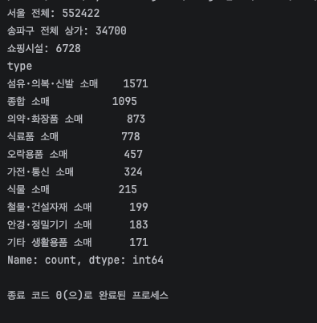{:.left}

그래 고생많았다 너도

그럼 data 폴더에 songpa_shops_all.csv(송파구 상가 34,700개 전체)도 생겼어요. 쇼핑시설 조사 끝!

>근데 이거 소매점인데 대형병원과 큰 프랜차이즈 그리고 백화점은 없나 싶었거든요?<br>
>보니까 대형병원은 들어있는데 백화점·대형마트 건물 자체는 없고, 안에 있는 가게들만 있어요.<br>
>그럼지도에 점들이 몰려 찍히겠지만 나중에 밀집구역으로 묶으면 될 것 같네요!
{:.note}

### 1-3 . 공원 조사

공원은 https://www.data.go.kr/data/15012890/standard.do 공공데이터포털에서 전국도시공원정보표준데이터.csv를 다운받아
활용했어요

소매점처럼 너무 엑셀파일이 커서 송파구로만 필터링하는데 오래 걸리려나 했는데


이미 송파구 따로 정보를 모아놨네요 👏🏻👏🏻👏🏻👏🏻👏🏻👏🏻👏🏻
<br>다운받은 파일은 parks.csv로 제목 고치고 data 파일에 넣어뒀어요.
<br>프로젝트 폴더 우클릭 → New → Python File → 이름은 parks
<br>그리고 새 파일에 이 코드 입력하면..!

```python
import pandas as pd
import geopandas as gpd

# 1) 공원 파일 읽기
p = pd.read_csv("data/parks.csv")

# 2) 지도용 점으로 바꾸기
parks = gpd.GeoDataFrame(
    {"name": p["공원명"], "type": p["공원구분"], "area": p["공원면적"]},
    geometry=gpd.points_from_xy(p["경도"], p["위도"]), crs=4326)

# 3) 송파구 경계 안만 남기고 저장
dong = gpd.read_file("data/songpa_dong.geojson")
parks = gpd.clip(parks, dong.dissolve())
parks.reset_index(drop=True).to_file("data/parks.geojson", driver="GeoJSON")

print("공원:", len(parks))
print(parks["type"].value_counts())
```

> **코드 설명**
> - **1)** 공원 CSV를 읽어요. 이 파일은 첫 줄이 바로 열 이름이라 따릉이 때처럼 줄을 건너뛸 필요가 없어요.
> - **2)** 필요한 열 3개만 골라서 이름을 바꿔요. 공원명은 `name`, 공원구분(어린이공원, 근린공원 등)은 `type`, 공원면적은 `area`로요. 위도·경도는 `points_from_xy`로 지도 위의 점으로 바꿔요. 순서는 **경도 먼저**예요.
> - **3)** 송파구 경계 안에 있는 공원만 남기고 `parks.geojson`으로 저장해요.

`data` 폴더에 `parks.geojson`이 생기면 돼요.

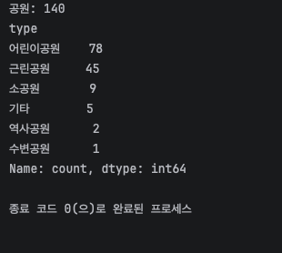{:.left}

이렇게 뜨면 성공!

---

### 1-4 . 여가시설 조사

여가시설은 새로 받을 필요 없어요. 쇼핑 때 저장해 둔 songpa_shops_all.csv(송파구 상가 34,700개)에서 골라낼 거예요.
<br>프로젝트 폴더 우클릭 → New → Python File → 이름은 leisure

```python
import pandas as pd
import geopandas as gpd

# 1) 송파구 상가 파일 읽기
s = pd.read_csv("data/songpa_shops_all.csv", dtype=str)

# 2) 여가시설만 남기기: 스포츠 + 오락 + 독서실·스터디카페 (복권방은 빼기)
s = s[s["상권업종중분류명"].isin(["스포츠 서비스", "유원지·오락", "도서관·사적지"])]
s = s[s["상권업종소분류명"] != "복권 발행/판매업"]

# 3) 위도·경도를 숫자로 바꾸기
s["경도"] = pd.to_numeric(s["경도"], errors="coerce")
s["위도"] = pd.to_numeric(s["위도"], errors="coerce")
s = s.dropna(subset=["경도", "위도"])

# 4) 지도용 점으로 바꾸기
leisure = gpd.GeoDataFrame(
    {"name": s["상호명"], "type": s["상권업종소분류명"]},
    geometry=gpd.points_from_xy(s["경도"], s["위도"]), crs=4326)

# 5) 송파구 경계 안만 남기고 저장
dong = gpd.read_file("data/songpa_dong.geojson")
leisure = gpd.clip(leisure, dong.dissolve())
leisure.reset_index(drop=True).to_file("data/leisure.geojson", driver="GeoJSON")

print("여가시설:", len(leisure))
print(leisure["type"].value_counts().head(10))
```

> **코드 설명**
> - **1)** `dtype=str`로 모든 값을 글자로 읽어요. 쇼핑 때와 같은 이유예요.
> - **2)** 상가 데이터의 "예술·스포츠" 업종은 중분류가 세 개예요.
>
>   | 중분류 | 예시 | 쓸까? |
>   | --- | --- | --- |
>   | 스포츠 서비스 | 헬스장, 골프연습장, 테니스장, 수영장 | ✅ |
>   | 유원지·오락 | 노래방, 당구장, PC방 | ✅ |
>   | 도서관·사적지 | 독서실, 스터디카페 |  ✅ |
>
> - 솔직히 독서실, 스터디카페가 여가시설인가 고민했는데...머...음...여가죠 며...<br>
>   `.isin([...])`은 값이 리스트 안에 **하나라도 있으면** 남겨요. 그다음 줄에서 복권방은 여가시설로 보기 어려워서 뺐어요.
> - **3)** 글자로 읽은 위도·경도를 숫자로 바꾸고, 비어 있는 줄은 빼요.
> - **4)** 가게 이름은 `name`, 소분류(노래방, 헬스장 등)는 `type`으로 바꿔요.
> - **5)** 송파구 경계 안만 남기고 `leisure.geojson`으로 저장해요.


`data` 폴더에 `leisure.geojson`이 생기면 돼요.

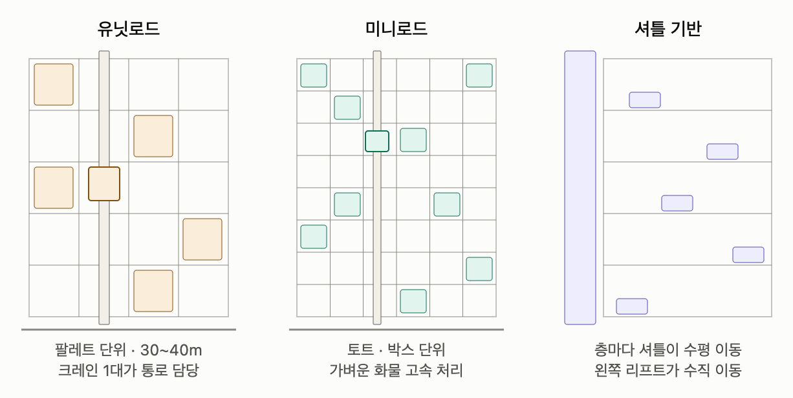{:.left}

성공!

---

### 1-4 .교육시설 조사


https://www.data.go.kr/data/15021148/standard.do 또 공공데이터포털에서 전국초중등학교위치표준데이터.csv 다운해줬어요

받은 파일을 schools.csv로 바꿔서 data 폴더에 넣고, 프로젝트 폴더 우클릭 → New → Python File → 이름은 schools

```python
import pandas as pd
import geopandas as gpd

# 1) 학교 파일 읽기 (한글 인코딩이 cp949라서 지정해 줘야 해요)
d = pd.read_csv("data/schools.csv", encoding="cp949")

# 2) 송파구에서 운영 중인 학교만 남기기
d = d[d["소재지도로명주소"].str.startswith("서울특별시 송파구", na=False)]
d = d[d["운영상태"] == "운영"]

# 3) 지도용 점으로 바꾸기
schools = gpd.GeoDataFrame(
    {"name": d["학교명"], "type": d["학교급구분"]},
    geometry=gpd.points_from_xy(d["경도"], d["위도"]), crs=4326)

# 4) 송파구 경계 안만 남기고 저장
dong = gpd.read_file("data/songpa_dong.geojson")
schools = gpd.clip(schools, dong.dissolve())
schools.reset_index(drop=True).to_file("data/schools.geojson", driver="GeoJSON")

print("학교:", len(schools))
print(schools["type"].value_counts())
```

> **코드 설명**
> - **`encoding="cp949"`**: 이 파일은 한글을 옛날 방식(cp949)으로 저장해서, 그냥 읽으면 `UnicodeDecodeError`가 나요. 공공데이터 CSV는 이런 경우가 많아요.
> - **`.str.startswith("서울특별시 송파구", na=False)`**: 도로명주소가 "서울특별시 송파구"로 **시작하는** 학교만 남겨요. 전국 파일이라 송파구만 골라내는 거예요. `na=False`는 주소가 비어 있는 줄은 그냥 빼라는 뜻이에요.
> - **`운영상태 == "운영"`**: 폐교한 학교가 섞여 있을 수 있어서 운영 중인 학교만 남겨요. 송파구는 지금 90개 전부 운영 중이지만, 안전장치로 넣었어요.
> - **`type` 열**: 학교급구분(초등학교, 중학교, 고등학교)을 남겨요. 나중에 학생 주민을 학교급에 맞는 학교로 보낼 때 써요.


`data` 폴더에 `schools.geojson`이 생기면 돼요.

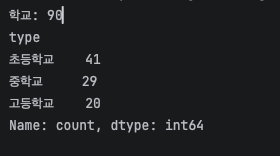{:.left}

성공!

---

### 1-5. 오피스·업무시설 조사

오피스는 두 가지 자료를 같이 쓸 거예요.

1. 쇼핑 때 저장해 둔 `songpa_shops_all.csv`의 **"과학·기술"** 업종
2. 서울 열린데이터광장의 [서울시 사업체현황(산업대분류별/동별) 통계](https://data.seoul.go.kr/dataList/DT201004O0400042017/S/2/datasetView.do)

왜 두 개냐면요!<br>
`songpa_shops_all.csv`는 간판 달린 가게 위주라서 세무사, 디자인 사무실 같은 곳은 있는데 **일반 회사는 거의 없더라고요.**<br>
그래서 일반 회사까지 다 들어 있는 사업체현황 통계를 같이 보기로 했어요.

| | 과학·기술 업종 (상가 데이터) | 사업체현황 통계 |
|---|---|---|
| 위치 | 사무실마다 정확한 좌표 | 동 단위 |
| 직원 수 |  없음 |  동별 합계 |
| 일반 회사 | 거의 없음 | 다 포함 |

보시다시피 둘 다 하나씩 아쉬워요. 사업체현황은 **위치가 동 단위**이고 **직원 수도 동별 합계**로만 나오거든요.<br>
그래서 두 자료를 합쳐서 출근지를 정할 거예요.

> **왜 바로 사무실 하나를 고르지 않을까?**
>
>송파구 통근·통학자는 376,433명인데 우리 주민은 100명이에요. 주민 한 명이 약 **3,700명**을 대표하는 셈이죠.<br>
>그런데 이 한 명의 직장을 "○○세무사 사무실" 하나로 딱 정해 버리면, 몇 명 안 되는 사무실에 3,700명이 출근하는 꼴이 되잖아요?.<br>
>게다가 사무실 6,117개를 똑같은 확률로 뽑으면, 1인 사무실이랑 직원 수백 명인 회사가 뽑힐 확률이 같아져요. 실제로 사람이 많이 일하는 곳이 아니라 **간판이 많은 곳**으로 출근지가 몰리는 거죠.

그래서 출근지는 **두 단계**로 정할게요.

| 단계 | 하는 일 | 쓰는 데이터 |
|---|---|---|
| 1 | **어느 동으로 갈지** 정하기 | 동별 종사자 수. 사람이 많이 일하는 동일수록 뽑힐 확률을 높게 |
| 2 | **그 동 안에서 정확한 지점** 고르기 | 오피스 6,117곳 중 그 동에 있는 것 하나 |

예를 들어 김○○ 씨라면 먼저 종사자가 많은 문정2동이 뽑히고, 그다음 문정2동 안의 사무실 하나가 출근지가 되는 식이에요.

이렇게 하면 동으로 묶어도 **주민 한 명 한 명은 정확한 좌표**를 가져요. 동은 "어디로 갈 확률이 높은지"를 정할 때만 쓸 예정입니당!

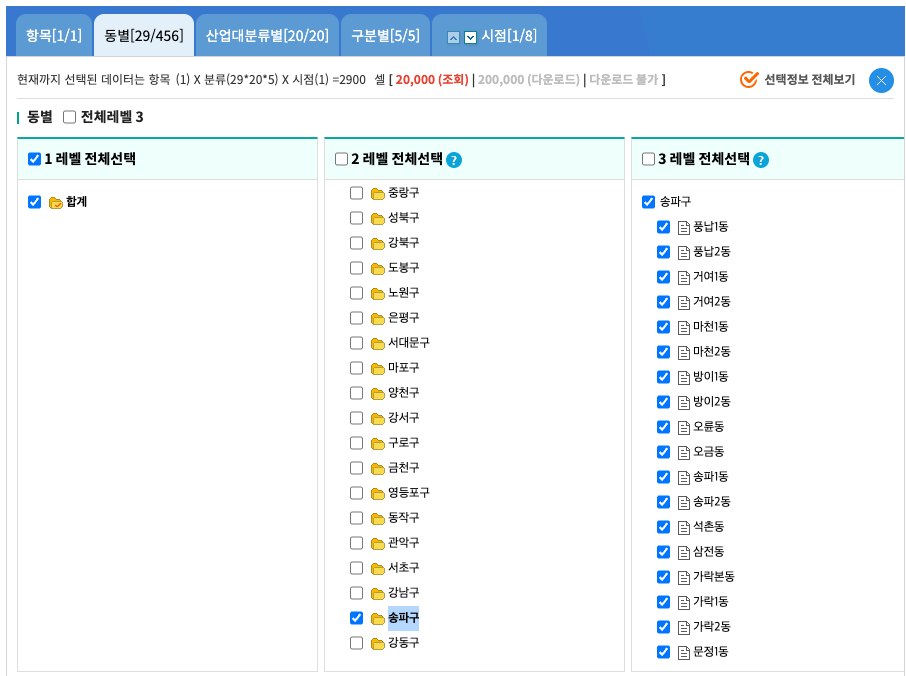
이렇게 송파구만 선택하여 자료 다운했어요!

받은 파일 이름을 **workers(dong).csv**로 바꿔서 data 폴더에 넣고, 프로젝트 폴더 우클릭 → New → Python File → 이름은 workers(dong)
```
import pandas as pd
import geopandas as gpd

# 1) 통계 파일 읽기: 위 5줄은 제목이라 건너뛰고, 필요한 열만 이름 붙이기
raw = pd.read_csv("data/workers(dong).csv", header=None, skiprows=5)
df = pd.DataFrame({
    "구": raw[1],
    "동": raw[2],
    "사업체수": raw[3],
    "종사자수": raw[5],
})

# 2) 송파구의 동만 남기기 ("소계" 줄은 송파구 합계라서 빼기)
df = df[(df["구"] == "송파구") & (df["동"] != "소계")].copy()
df["사업체수"] = pd.to_numeric(df["사업체수"])
df["종사자수"] = pd.to_numeric(df["종사자수"])

# 3) 동별로 출근지로 뽑힐 확률 = 그 동 종사자수 / 송파구 전체 종사자수
df["확률"] = df["종사자수"] / df["종사자수"].sum()
df = df.sort_values("종사자수", ascending=False)

# 4) 동 이름이 지도 경계와 잘 맞는지 확인
dong = gpd.read_file("data/songpa_dong.geojson")
missing = set(df["동"]) - set(dong["emdnm"])
print("지도에 없는 동 이름:", missing if missing else "없음 ✅")

df[["동", "사업체수", "종사자수", "확률"]].to_csv(
    "data/workers_by_dong.csv", index=False, encoding="utf-8-sig")
print("동 개수:", len(df), "/ 종사자 합계:", df["종사자수"].sum())
print(df[["동", "종사자수", "확률"]].head(10).to_string(index=False))

```

>코드 설명 
> - header=None, skiprows=5: 따릉이 때처럼 제목 줄 5줄을 건너뛰어요. 열 이름이 여러 줄이라 자동으로 읽으면 엉망이 되거든요. 
> - raw[1], raw[2], raw[3], raw[5]: 열 이름이 없으니 **몇 번째 열인지(0부터)**로 꺼내요. 1번은 구, 2번은 동, 3번은 사업체수 소계, 5번은 종사자수 소계예요. 4번은 "여성대표자" 사업체수라서 건너뛰어요.
> - "동" != "소계": 첫 줄은 송파구 전체 합계(동 이름이 "소계")라서 빼요. 이걸 안 빼면 합계가 두 배가 돼요. 
> - 확률: 그 동의 종사자 수를 송파구 전체로 나눠요. 27개 동의 확률을 다 더하면 1이 돼요. 다음 편에서 출근지 동을 뽑을 때 이 확률을 그대로 써요. 
> - set(...) - set(...): 통계표의 동 이름 중 지도 경계에 없는 이름을 찾아요. 이름이 하나라도 다르면 나중에 동을 연결할 때 빠지니까 미리 확인하는 거예요.


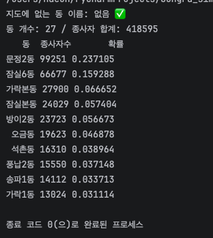{:.left}

되따!! 이제 인프라 다 모았네요~~~ 아구 되다...(힘들었다...)

---

## 2. 인프라 지도에 표시하기

###
이제 모은 데이터를 전부 지도에 올려요. 1편 교통 지도(map3d)는 그대로 두고, 새 파일로 만들게요.

왜 계속 자꾸자꾸 새파일 만드냐구요? 지도를 하나로 다 하면 수정도 어렵고, 각각의 원하는 레이어를 
내가 원하는대로 보기 위해서계속 새 파일 만들었어요. 지금 블로그도 글 많아져서 2편으로 또 작성중인데...

지금까지 모은 **교통 3종 + 인프라 5종**을 3D 지도 하나에 올려요. 1편 교통 지도(`map3d`)는 그대로 두고, `map_infra`라는 새 파일로 만들어요.

| 인프라 | 색 | 모양 | 개수 |
| --- | --- | --- | --- |
| 지하철역 | 회색 | 정육면체 | 28 |
| 버스정류장 | 파랑 | 점 | 483 |
| 따릉이 | 주황 | 점 | 217 |
| 쇼핑 | 분홍 | 작은 점 | 6,728 |
| 공원 | 초록 (반투명) | **실제 넓이만큼 큰 원** | 140 |
| 여가 | 청록 | 작은 점 | 1,560 |
| 학교 | 노랑 | **직육면체 (학교 건물 모양)** | 90 |
| 오피스 | 보라 | 작은 점 | 6,117 |


```python
import os
import webbrowser
from pathlib import Path
import numpy as np
import geopandas as gpd
import pandas as pd
import pydeck as pdk
from shapely.geometry import box

# 0) 색 모음 (봄 잔디 + 인프라)
BG, LAND, DONG, ROAD = "#F4F9EE", [222, 239, 200], [200, 224, 172], [255, 255, 255]
EDGE, TEXT = [90, 140, 80], [80, 115, 70]
COLORS = {
    "지하철역":   [110, 110, 110],
    "버스정류장": [72, 128, 204],
    "따릉이":     [255, 160, 50],
    "쇼핑":       [236, 96, 140],
    "공원":       [70, 160, 80],
    "여가":       [0, 160, 170],
    "학교":       [250, 210, 40],
    "오피스":     [120, 90, 200],
}

# 1) 데이터 불러오기
dong     = gpd.read_file("data/songpa_dong.geojson")
roads    = gpd.read_file("data/roads.geojson")
bus      = gpd.read_file("data/bus_stops.geojson")
bike     = gpd.read_file("data/bike_stations.geojson")
shopping = gpd.read_file("data/shopping.geojson")
parks    = gpd.read_file("data/parks.geojson")
leisure  = gpd.read_file("data/leisure.geojson")
schools  = gpd.read_file("data/schools.geojson")
offices  = gpd.read_file("data/offices.geojson")

if os.path.exists("data/subway_stations.geojson"):
    subway = gpd.read_file("data/subway_stations.geojson")
else:
    subway = gpd.read_file("data/subway.geojson")

# 2) 도로 굵기
def road_width(highway):
    if any(k in highway for k in ["motorway", "trunk", "primary", "secondary"]):
        return 10
    if any(k in highway for k in ["tertiary", "residential", "unclassified"]):
        return 4
    return 1.5

roads["w"] = roads["highway"].apply(road_width)

# 3) 점 데이터를 lon, lat 표로 바꾸기
def to_points(gdf):
    return pd.DataFrame({"name": gdf["name"].astype(str),
                         "lon": gdf.geometry.x, "lat": gdf.geometry.y})

# 공원은 면적만큼 실제 크기의 원으로 (원 넓이 = π × 반지름²)
park_pts = to_points(parks)
park_pts["r"] = np.sqrt(parks["area"].astype(float) / np.pi)

# 학교는 가로로 긴 직육면체 (가로 80m × 세로 35m)
school_box = schools.to_crs(5179)
school_box["geometry"] = school_box.geometry.apply(
    lambda p: box(p.x - 40, p.y - 17.5, p.x + 40, p.y + 17.5))
school_box = school_box.to_crs(4326)

# 4) 점 레이어 만드는 함수
ON_TOP = {"depthCompare": "always"}

def dots(df, color, radius, min_px=2):
    return pdk.Layer("ScatterplotLayer", df, get_position=["lon", "lat"],
                     get_fill_color=color, get_radius=radius,
                     radius_min_pixels=min_px, pickable=True, parameters=ON_TOP)

layers = [
    pdk.Layer("GeoJsonLayer", dong[["emdnm", "geometry"]].__geo_interface__,
              filled=True, stroked=True,
              get_fill_color=LAND, get_line_color=DONG, get_line_width=6),
    pdk.Layer("ScatterplotLayer", park_pts, get_position=["lon", "lat"],
              get_fill_color=COLORS["공원"] + [110], get_radius="r",
              radius_min_pixels=3, pickable=True, parameters=ON_TOP),
    pdk.Layer("GeoJsonLayer", roads[["w", "geometry"]].__geo_interface__,
              get_line_color=ROAD, get_line_width="properties.w",
              line_width_min_pixels=0.5, parameters=ON_TOP),
    dots(to_points(offices),  COLORS["오피스"], 10, 1),
    dots(to_points(shopping), COLORS["쇼핑"],   10, 1),
    dots(to_points(leisure),  COLORS["여가"],   12, 1.5),
    dots(to_points(bus),      COLORS["버스정류장"], 15),
    dots(to_points(bike),     COLORS["따릉이"], 20, 3),
    pdk.Layer("GeoJsonLayer", school_box[["name", "geometry"]].__geo_interface__,
              extruded=True, filled=True, get_elevation=25,
              get_fill_color=COLORS["학교"], wireframe=True,
              get_line_color=[190, 150, 20], pickable=True),
    pdk.Layer("ColumnLayer", to_points(subway), get_position=["lon", "lat"],
              get_fill_color=COLORS["지하철역"], radius=35, get_elevation=49,
              disk_resolution=4, angle=45, wireframe=True,
              get_line_color=[70, 70, 70], pickable=True),
    pdk.Layer("GeoJsonLayer", dong.dissolve().__geo_interface__,
              filled=False, stroked=True, get_line_color=EDGE, get_line_width=1.5,
              line_width_units=pdk.types.String("pixels")),
]

# 5) 범례 (지도 왼쪽 위에 뜨는 설명 상자)
items = "".join(
    f"<div><span style='color:rgb({c[0]},{c[1]},{c[2]})'>●</span> {k}</div>"
    for k, c in COLORS.items())
legend = f"""
<div style="position:absolute; top:16px; left:16px; z-index:10; padding:12px 16px;
            background:white; border-radius:8px; font:13px sans-serif;
            box-shadow:0 1px 4px rgba(0,0,0,.15); line-height:1.8">
  <b>송파구 인프라</b>{items}
</div>"""

# 6) 카메라 & 저장
center = dong.to_crs(5179).dissolve().centroid.to_crs(4326).iloc[0]
view = pdk.ViewState(latitude=center.y, longitude=center.x,
                     zoom=12.6, pitch=50, bearing=-15)

deck = pdk.Deck(layers=layers, initial_view_state=view, map_provider=None,
                tooltip={"text": "{name}"})
html = deck.to_html(as_string=True, css_background_color=BG)
html = html.replace("</body>", legend + "</body>")   # 범례 끼워 넣기

out = Path("maps/songpa_infra.html")
out.write_text(html, encoding="utf-8")
webbrowser.open(out.resolve().as_uri())
print("저장 완료:", out)
```
>  **코드설명**
> - **`COLORS` 딕셔너리**: 인프라 이름과 색을 한곳에 모았어요. 레이어 색과 범례 색을 둘 다 여기서 가져와서, 색을 바꿀 때 한 군데만 고치면 돼요.
> - **공원 크기 `np.sqrt(area / np.pi)`**: 원의 넓이는 `π × 반지름²`이라서, 거꾸로 `반지름 = √(넓이 ÷ π)`로 풀면 공원과 **넓이가 같은 원**을 그릴 수 있어요. 올림픽공원은 크게, 어린이공원은 작게 보여요.
> - **`COLORS["공원"] + [110]`**: 색 리스트 끝에 4번째 숫자(투명도)를 붙여서 반투명하게 해요. 공원 원이 커도 아래 도로가 비쳐 보여요.
> - **학교 직육면체**: 1편 지하철에 쓴 ColumnLayer는 바닥이 **정사각형**만 돼요. 그래서 `box()`로 학교 점 둘레에 **가로 80m × 세로 35m** 직사각형을 직접 그리고, `extruded=True`로 25m 높이까지 세웠어요. 미터 단위로 그려야 해서 미터 좌표계(5179)에서 만든 다음 위경도로 돌렸어요.
> - **`dots()` 함수**: 점 레이어 다섯 개가 설정이 거의 똑같아서, 색과 크기만 받아서 레이어를 만들어 주는 함수로 묶었어요.
> - **레이어 순서**: 개수가 많은 오피스·쇼핑을 먼저 깔고, 따릉이·학교·지하철처럼 중요한 걸 나중에 올렸어요. 나중에 쌓은 게 위에 보이거든요.
> - **범례 끼워 넣기**: pydeck에는 범례 기능이 없어요. 그래서 `to_html(as_string=True)`로 HTML을 **글자로** 받은 다음, 맨 끝 `</body>` 바로 앞에 범례 상자를 끼워 넣어 저장했어요.

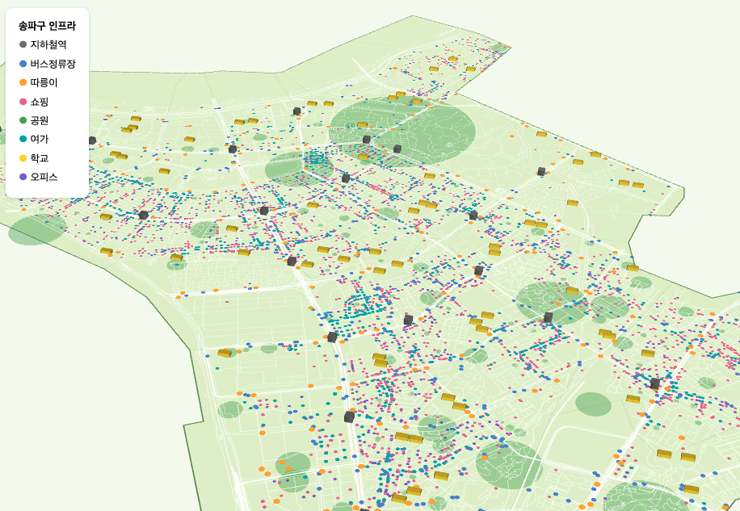
짠!!!!

아 근데 저는 공원을 그냥 점으로 표시하기 그래서 면적별로 사이즈 다른 원으로 표현했거든요? 상당히 눈에 들어오지 않고 별로라 실제 모양으로 표시하고 싶네요
<br>공원 실제 테두리는 OpenStreetMap 에 들어있다고 합니다. 

> **OpenStreetMap(OSM)이 뭐냐면?**
>
> 전 세계 사람들이 같이 만드는 **무료 지도**예요. "지도판 위키백과"라고 생각하면 쉬워요. 네이버·카카오 지도는 **보는 용도**라 데이터를 코드로 가져오기 어렵지만, OSM은 도로·공원 같은 **데이터 자체**를 열어 둬서 파이썬(`osmnx`)으로 "송파구 도로만 줘", "공원 모양만 줘" 같은 요청을 할 수 있어요.
>
> 다만 자원봉사자가 만들다 보니 **지역마다 꼼꼼함이 달라요.** 한국은 도로나 큰 공원은 잘 그려져 있지만, 가게나 작은 공원은 빠진 게 많아요. 그래서 이 프로젝트에서는 이렇게 나눠 썼어요.
> 그래서 도로나 공원 모양은 OpenStreetMap에서, 시설 목록은 공공데이터에서 가져온겁니당
{:.note}

<details markdown="1">
<summary>공원 면적 표시 코드</summary>

프로젝트 폴더 우클릭 → New → Python File → 이름은 park_areas
```
import time
import geopandas as gpd
import osmnx as ox

SERVERS = [
    "https://overpass-api.de/api",
    "https://overpass.kumi.systems/api",
    "https://overpass.private.coffee/api",
]

def retry(job):
    wait = 10
    for attempt in range(6):
        ox.settings.overpass_url = SERVERS[attempt % len(SERVERS)]
        try:
            return job()
        except Exception as e:
            print(f"  {ox.settings.overpass_url} 실패 → {wait}초 뒤 다시 시도")
            time.sleep(wait)
            wait *= 2
    raise RuntimeError("서버가 계속 바빠요. 잠시 뒤에 다시 실행해 주세요.")

# 1) 송파구 경계
dong = gpd.read_file("data/songpa_dong.geojson")
boundary = dong.dissolve()
area = boundary.geometry.iloc[0]

# 2) OSM에서 공원 모양(면) 받기
gdf = retry(lambda: ox.features_from_polygon(area, tags={"leisure": ["park", "garden"]}))
gdf = gdf[gdf.geom_type.isin(["Polygon", "MultiPolygon"])]

# 3) 이름만 남기고, 송파구 경계 안만 저장
gdf = gdf[["name", "geometry"]] if "name" in gdf.columns else gdf[["geometry"]].assign(name="")
gdf["name"] = gdf["name"].fillna("").astype(str)
gdf = gpd.clip(gdf, boundary)
gdf.reset_index(drop=True).to_file("data/park_areas.geojson", driver="GeoJSON")

print("공원 영역:", len(gdf))
print("면적 합계(㎢):", round(gdf.to_crs(5179).area.sum() / 1e6, 2))
```

코드 설명 

retry: 1편 download와 같아요. 서버가 바쁘면 다른 서버로 바꿔서 다시 시도해요.
leisure: park, garden: OSM에서 공원과 정원 태그가 달린 것만 받아요.
geom_type.isin(["Polygon", "MultiPolygon"]): 모양(면)으로 그려진 것만 남겨요. 점으로만 찍힌 공원은 모양이 없어서 빼요.
to_crs(5179).area: 면적은 미터 좌표계에서 재야 정확해요. ㎡를 1,000,000으로 나눠서 ㎢로 보여 줘요.

2. map_infra 고치기

① 데이터 불러오는 곳에 한 줄 추가

python
park_areas = gpd.read_file("data/park_areas.geojson")

② layers에서 공원 원 레이어를 바꾸기

이 레이어를 찾아서

python
    pdk.Layer("ScatterplotLayer", park_pts, get_position=["lon", "lat"],
              get_fill_color=COLORS["공원"] + [110], get_radius="r",
              radius_min_pixels=3, pickable=True, parameters=ON_TOP),

아래 두 개로 바꾸세요. 첫 번째는 실제 공원 모양, 두 번째는 공원 140개를 작은 점으로 찍는 레이어예요.

python
    pdk.Layer("GeoJsonLayer", park_areas.__geo_interface__,
              filled=True, stroked=False,
              get_fill_color=COLORS["공원"] + [140], pickable=True),
    dots(to_points(parks), COLORS["공원"], 12, 2),

</details>

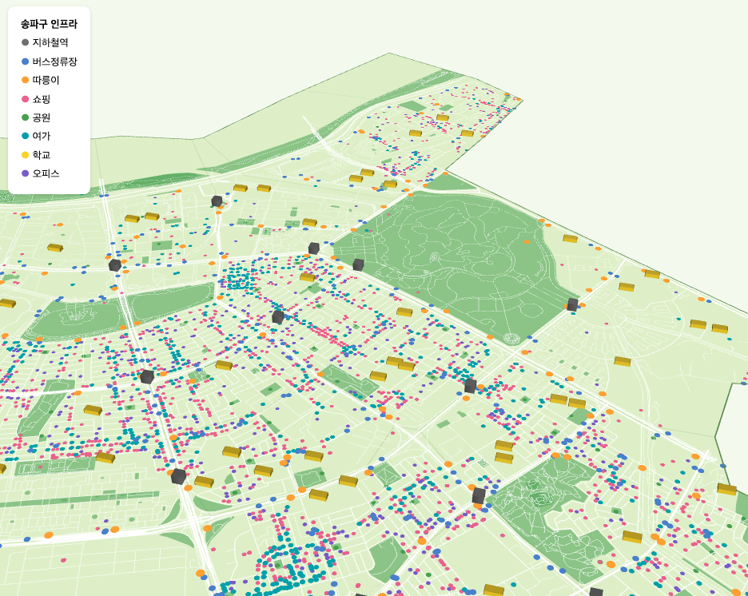
일부러 OSM에 있는 공원 면적과 OSM에 없는 작은 공원 색을 같게해 OSM과 겹쳐도 티 안나게 했어용<br>
히히 이제 찐찐찐 최종으로 각 점들이 몇개씩 있는지 나오도록만 수정하면!!<br>

map_infra의 5) 범례 부분만 이걸로 바꾸었습니당
```
COUNTS = {
    "지하철역": len(subway), "버스정류장": len(bus), "따릉이": len(bike), "쇼핑": len(shopping),
    "공원": len(parks), "여가": len(leisure), "학교": len(schools), "오피스": len(offices),
}

rows = "".join(
    f'<div style="display:flex;align-items:center;gap:8px;margin:6px 0">'
    f'<span style="width:10px;height:10px;border-radius:50%;background:rgb({c[0]},{c[1]},{c[2]})"></span>'
    f'<span style="flex:1">{name}</span>'
    f'<span style="color:#888;font-variant-numeric:tabular-nums">{COUNTS[name]:,}</span></div>'
    for name, c in COLORS.items()
)

legend = f'''
<div style="position:absolute;top:12px;left:12px;z-index:10;background:white;
            padding:12px 16px;border-radius:12px;box-shadow:0 2px 8px rgba(0,0,0,.15);
            font-family:sans-serif;font-size:13px;min-width:160px">
  <b style="font-size:14px">송파구 인프라</b>
  {rows}
</div>
'''
```

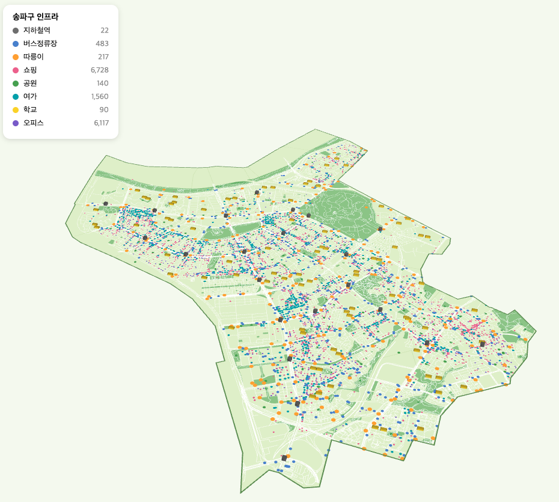
이제 진짜 다 했구요 

다음편으로 주민 100명 거주지 정하고. 통근 통학 목적지 정하고 지도에 표시할게용

