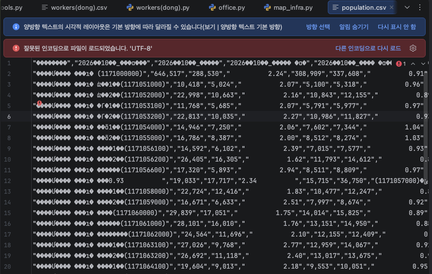
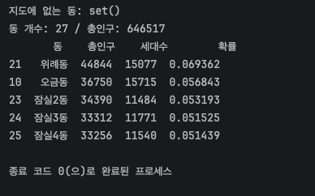
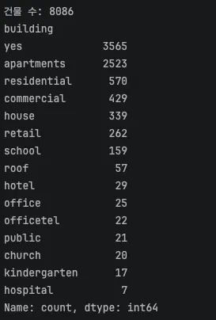
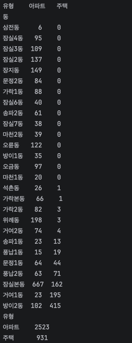
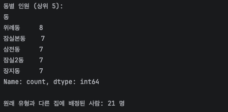
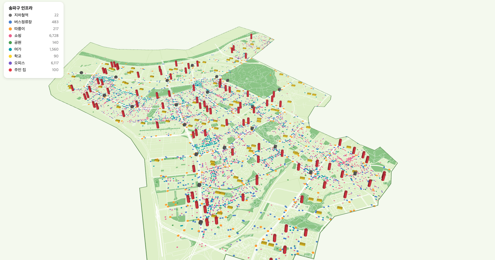
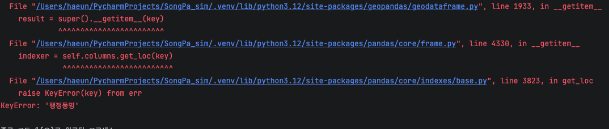

# 인프라 데이터 구축 3편: 송파구 주민 100명 거주지와 목적지 정하기

## 들어가며
오늘할일

|단계	|할 일| 	결과                |
|---|----|--------------------|
|3-1|	동별 인구수 받기	| 어느 동에 살지 고르는 확률    |
|3-2	|동 안의 주거 건물 위치 받기 (아파트 / 그 외)	| 집 좌표 후보            |
|3-3	|100명에게 동 → 건물 순서로 배정	| residents_home.csv |
|3-4	|지도에 집 위치 찍기	| 확인용 지도             |

## 1.동별 인구수 조사
### 1-1. 주민등록 인구통계 사이트 

https://jumin.mois.go.kr/

로 들어가시면 아주 정확한 데이터가 있답니당

csv 파일로 저는 다운해서 population.csv로 바꾸고 data 폴더에 올려줍니당
<br>으잉 지금까지 잘만 되던데 흠...실행이 이것때문에 안된다면 엑셀로 다시 시도해보죠 머


새 파이썬 파일 population을 만들고 아래 코드 써서 실행하면!

<details markdown="1">
<summary>동별 인구정리 코드</summary>

```
import pandas as pd
import geopandas as gpd

# 1) 읽기: 한글은 cp949, 숫자의 쉼표는 thousands로 제거
raw = pd.read_csv("data/population.csv", encoding="cp949", thousands=",")
raw.columns = ["행정구역", "총인구", "세대수", "세대당인구", "남자", "여자", "남여비율"]

# 2) 송파구 합계 줄은 빼고, 동 줄만 남기기
pop = raw[raw["행정구역"].str.contains(r"동\(")].copy()

# 3) "서울특별시 송파구 풍납1동(1171051000)" → "풍납1동"
pop["동"] = pop["행정구역"].str.extract(r"송파구 (\S+)\(")

# 4) 동을 고를 확률 = 그 동 인구 / 송파구 전체 인구
pop["확률"] = pop["총인구"] / pop["총인구"].sum()
pop = pop[["동", "총인구", "세대수", "확률"]]

# 5) 지도 경계의 동 이름과 맞는지 확인
dong = gpd.read_file("data/songpa_dong.geojson")
print("지도에 없는 동:", set(pop["동"]) - set(dong["emdnm"]))

pop.to_csv("data/population_by_dong.csv", index=False, encoding="utf-8-sig")
print("동 개수:", len(pop), "/ 총인구:", pop["총인구"].sum())
print(pop.sort_values("총인구", ascending=False).head())

```
코드 설명 

thousands=",": "10,418" 같은 문자를 쉼표를 빼고 숫자 10418로 읽어 줘요. 이게 없으면 글자로 읽혀서 더하기가 안 돼요.
str.contains(r"동\("): "동(" 이 들어간 줄만 남겨요. 첫 줄 송파구 (1171000000)은 "동("이 없어서 빠져요. (는 정규식에서 특별한 기호라 앞에 \를 붙였어요.
str.extract(r"송파구 (\S+)\("): "송파구 “ 뒤부터 “(” 앞까지, 띄어쓰기 없는 글자(\S+)만 뽑아요. 괄호 ( )로 감싼 부분이 결과가 돼요.
set(...) - set(...): 인구 파일에는 있는데 지도에는 없는 동 이름을 찾아요. set()이 나오면 다 맞는 거예요.

</details>

{:.left}

성공입니다!

---

## 2.주거 건물 조사
### 2-1. 주거 건물 위치 받기 (`buildings`)

집 좌표는 **OSM 건물 데이터**에서 가져와요. OSM 건물에는 `building`이라는 꼬리표가 붙어 있어서, 아파트는 `apartments`, 주택은 `house`처럼 구분돼 있어요.

다만 한국 OSM은 꼬리표가 들쭉날쭉해서, 그냥 `yes`(건물이긴 함)로만 적힌 것도 많아요. 
그래서 이번 단계는 **일단 송파구 건물을 전부 받아서 어떤 꼬리표가 몇 개 있는지 보는 것**까지만 할래요.
결과를 보고 아파트/주택을 어떻게 나눌지 정할게요.

새 파이썬 파일 `buildings`를 만드세요.

<details markdown="1">
<summary>buildings 코드 보기</summary>

```python
import time
import geopandas as gpd
import osmnx as ox

SERVERS = [
    "https://overpass-api.de/api",
    "https://overpass.kumi.systems/api",
    "https://overpass.private.coffee/api",
]

def retry(job):
    wait = 10
    for attempt in range(6):
        ox.settings.overpass_url = SERVERS[attempt % len(SERVERS)]
        try:
            return job()
        except Exception as e:
            print(f"  {ox.settings.overpass_url} 실패 → {wait}초 뒤 다시 시도")
            time.sleep(wait)
            wait *= 2
    raise RuntimeError("서버가 계속 바빠요. 잠시 뒤에 다시 실행해 주세요.")

# 1) 송파구 경계
dong = gpd.read_file("data/songpa_dong.geojson")
area = dong.dissolve().geometry.iloc[0]

# 2) OSM에서 건물 전부 받기 (몇 분 걸릴 수 있어요)
gdf = retry(lambda: ox.features_from_polygon(area, tags={"building": True}))
gdf = gdf[gdf.geom_type.isin(["Polygon", "MultiPolygon"])]

# 3) 필요한 열만 남기기
cols = [c for c in ["building", "name", "building:levels"] if c in gdf.columns]
gdf = gdf[cols + ["geometry"]].reset_index(drop=True)

# 4) 바닥 면적(㎡) 재고, 건물 모양 → 건물 안의 점 하나로 바꾸기
m = gdf.to_crs(5179)
gdf["면적"] = m.area.round()
gdf["geometry"] = m.representative_point().to_crs(4326)

# 5) 건물마다 어느 동에 있는지 붙이기
gdf = gpd.sjoin(gdf, dong[["emdnm", "geometry"]], predicate="within").drop(columns="index_right")

gdf.to_file("data/buildings.geojson", driver="GeoJSON")
print("건물 수:", len(gdf))
print(gdf["building"].value_counts().head(15))
```

</details>

> **코드 설명 (어려운 부분만)**
> - **`tags={"building": True}`**: 꼬리표 값이 뭐든 상관없이 `building`이 붙은 건 다 받아요.
> - **`cols = [c for c in ... if c in gdf.columns]`**: OSM에 `name`이나 `building:levels`(층수)가 하나도 없으면 그 열 자체가 안 생겨서 에러가 나요. 그래서 **실제로 있는 열만** 골라요.
> - **`representative_point()`**: 건물 모양을 **건물 안에 반드시 들어가는 점 하나**로 바꿔요. 집 좌표는 점 하나면 되고, 파일도 훨씬 가벼워져요. 면적은 점으로 바꾸기 **전에** 재야 해서 4번에서 순서를 지켰어요.
> - **`gpd.sjoin(..., predicate="within")`**: "이 점이 어느 동 경계 **안**에 있나"를 찾아서 동 이름(`emdnm`)을 붙여요. 3-3에서 "위례동에 사는 사람 → 위례동 건물 중에서 고르기"를 할 때 필요해요.

실행하면 
{:.left}

성공! 엄청나네요.

8,086개 받았어요! 결과를 보면 이렇게 나눌 수 있어요.

| 꼬리표 | 개수 | 분류 |
| --- | --- | --- |
| `apartments` | 2,523 | **아파트** ✅ 충분해요 |
| `residential` | 570 | **주택** (한국 OSM에선 보통 빌라·다세대에 붙어요) |
| `house` | 339 | **주택** |
| `officetel` | 22 | **주택** (오피스텔, '주택 이외의 거처' 사는 사람용) |
| `yes` | 3,565 | ❓ 정체불명 (일단 보류) |
| 상가·학교·교회·병원 등 | 나머지 | ❌ 제외 |

아파트는 2,523개로 넉넉한데, **주택은 931개뿐**이에요. 송파구에는 빌라가 많은 동(석촌·삼전·송파·마천·거여 등)이 있어서, **동마다 주택 건물이 충분한지** 먼저 확인해야 해요. 부족한 동이 있으면 그때 `yes` 건물 중 작은 것을 주택으로 보충할게요.

### 2-2. 집 후보 나누기 (`home_types`)

`buildings`는 다운로드가 오래 걸리니까 다시 실행하지 않도록, 새 파일 `home_types`에서 저장된 파일을 읽어서 나눠요.
<br>보기 쉽게 동별 표로 만들었답니다.

```python
import geopandas as gpd
import pandas as pd

b = gpd.read_file("data/buildings.geojson")

APT = ["apartments"]
HOUSE = ["residential", "house", "detached", "terrace", "semidetached_house", "officetel"]

# 1) 꼬리표로 아파트 / 주택 나누기
b["유형"] = None
b.loc[b["building"].isin(APT), "유형"] = "아파트"
b.loc[b["building"].isin(HOUSE), "유형"] = "주택"
homes = b[b["유형"].notna()].copy()

# 2) 동별로 아파트·주택이 몇 개씩 있는지 표로 보기
dongs = pd.read_csv("data/population_by_dong.csv")["동"]
table = pd.crosstab(homes["emdnm"], homes["유형"]).reindex(dongs, fill_value=0)
print(table.sort_values("주택"))

homes.to_file("data/homes.geojson", driver="GeoJSON")
print(homes["유형"].value_counts())
```

> **코드 설명 (어려운 부분만)**
> - **`b.loc[조건, "유형"] = "아파트"`**: 조건에 맞는 줄에만 값을 넣어요. 어디에도 안 걸린 건물은 `None`으로 남아서, `notna()`로 걸러내면 집 후보만 남아요.
> - **`pd.crosstab(행, 열)`**: "동 × 유형" 표를 만들어서 칸마다 개수를 세요. 엑셀의 피벗 테이블과 같아요.
> - **`reindex(dongs, fill_value=0)`**: 집 후보가 **하나도 없는 동**은 crosstab 표에서 아예 빠져요. 27개 동 이름을 기준으로 다시 줄을 세우고, 없는 동은 0으로 채워서 눈에 보이게 해요.
> - **`sort_values("주택")`**: 주택이 적은 동부터 보여 줘서, 부족한 동을 바로 찾을 수 있어요.

실행해서

아따 길다!<br> 근데 주택이 0인데 이게 맞을리가 없잖아요?? 송파구는 아파트만 있는곳이 아닐텐데..
<br> 빌라나 작은 건물도 아파트로 치는거 같은데.. 일단 고민점으로 놔둘게요 왜냐하면 통계 사이트에도 건물을 위치로 기록해둔곳이없어요ㅜㅜ

알겠어요, `yes` 보충은 빼고 **꼬리표 있는 건물만** 쓸게요. 대신 주택이 없는 동에 사는 빌라 주민은 **그 동의 아파트**에 배정되도록 해 둘게요. 27개 동 모두 아파트가 최소 6개 이상 있어서, 집이 없는 사람은 생기지 않아요.

### 2-3. 100명에게 집 배정하기 (`assign_homes`)

 새 파일 `assign_homes` 또 만들어주고.

```python
import numpy as np
import pandas as pd
import geopandas as gpd

rng = np.random.default_rng(42)

people = pd.read_csv("data/songpa_residents_100.csv", encoding="utf-8-sig")
pop = pd.read_csv("data/population_by_dong.csv")
homes = gpd.read_file("data/homes.geojson")

# 0) 주민의 주거 형태 → 아파트 / 주택 두 가지로 묶기
people["집유형"] = np.where(people["housing_type"] == "아파트", "아파트", "주택")

# 1) 동 고르기: 인구 비율대로 100명 뽑기
people["동"] = rng.choice(pop["동"], size=len(people), p=pop["확률"])

# 2) 그 동 안에서 건물 고르기
def pick_home(row):
    cand = homes[(homes["emdnm"] == row["동"]) & (homes["유형"] == row["집유형"])]
    if cand.empty:                                  # 맞는 유형이 없으면 그 동의 아무 집
        cand = homes[homes["emdnm"] == row["동"]]
    w = cand["면적"] / cand["면적"].sum()            # 큰 건물일수록 잘 뽑히게
    h = cand.iloc[rng.choice(len(cand), p=w)]
    return pd.Series({"lon": h.geometry.x, "lat": h.geometry.y, "배정유형": h["유형"]})

people[["lon", "lat", "배정유형"]] = people.apply(pick_home, axis=1)

people.to_csv("data/residents_home.csv", index=False, encoding="utf-8-sig")
print("동별 인원 (상위 5):")
print(people["동"].value_counts().head())
print("\n원래 유형과 다른 집에 배정된 사람:", (people["집유형"] != people["배정유형"]).sum(), "명")
```

> **코드 설명 (어려운 부분만)**
> - **`default_rng(42)`**: 랜덤 뽑기의 시작값(seed)을 고정해요. 몇 번을 실행해도 **같은 사람이 같은 집**에 배정돼서, 블로그 결과와 코드 결과가 항상 같아요. 42는 그냥 관습적으로 많이 쓰는 숫자예요.
> - **`encoding="utf-8-sig"`**: 이 주민 파일은 맨 앞에 눈에 안 보이는 표시(BOM)가 붙어 있어요. 그냥 읽으면 첫 열 이름이 `uuid`가 아니라 `\ufeffuuid`가 돼서, 이걸로 깔끔하게 읽어요.
> - **`np.where(조건, A, B)`**: 조건이 참이면 A, 거짓이면 B. 다세대·연립·단독·오피스텔 등을 전부 "주택" 하나로 묶어요.
> - **`rng.choice(..., p=확률)`**: 확률표대로 뽑아요. 오피스 목적지를 정할 때 쓸 방법과 같아요.
> - **`people.apply(pick_home, axis=1)`**: 한 사람(한 줄)씩 `pick_home`에 넣어서 집을 골라요. `pd.Series`로 돌려주면 `lon`, `lat`, `배정유형` 세 열이 한 번에 생겨요.
> - **`배정유형`**: 실제로 배정된 집이 아파트인지 주택인지 기록해요. 마지막 줄에서 **원래 빌라 주민인데 아파트에 들어간 사람**이 몇 명인지 세어 줘요.


이게 뭔 뜻이냐! 21명이 원래 유형과 다른 집(빌라 주민 → 아파트)에 들어갔다는 것이에요.. 아 그럼 처음부터 페르소나를 다시 만들어야 하는지...아...
<br>100명만 뽑아서 이렇게 된거 같은데 일단 진행시킬게요...

### 2-4. 지도에 주민 집 찍기

`map_infra`에 **주민 집 레이어**를 하나 추가해요. 다른 시설은 점이니까, 집은 눈에 띄게 **빨간 기둥**으로 세울게요. 범례에도 자동으로 "주민 집 100"이 붙어요.

`map_infra`에서 네 군데만 고치면 돼요.

**① 데이터 불러오는 곳에 한 줄 추가**

```python
homes = pd.read_csv("data/residents_home.csv")
```

**② `COLORS` 맨 끝에 색 추가**

```python
COLORS = {"지하철역":[110,110,110],"버스정류장":[72,128,204],"따릉이":[255,160,50],"쇼핑":[236,96,140],
          "공원":[70,160,80],"여가":[0,160,170],"학교":[250,210,40],"오피스":[120,90,200],
          "주민 집":[230,57,70]}
```

**③ `COUNTS` 맨 끝에 개수 추가**

```python
    "학교": len(schools), "오피스": len(offices), "주민 집": len(homes),
```

**④ `layers`에서 학교 레이어 다음, 지하철 레이어 앞에 추가**

```python
    pdk.Layer("ColumnLayer", homes, get_position=["lon", "lat"],
              radius=25, get_elevation=150, disk_resolution=12,
              get_fill_color=COLORS["주민 집"], pickable=True),
```

> **코드 설명 (어려운 부분만)**
> - **`ColumnLayer`**: 지하철 정육면체와 같은 레이어예요. 지하철은 `disk_resolution=4`라서 사각기둥이었고, 이번엔 **12**로 해서 둥근 원기둥이 돼요.
> - **`get_elevation=150`**: 기둥 높이 150m. 학교 상자(25m)보다 훨씬 높아서, 시설 점들 사이에서도 집이 한눈에 보여요.
> - 범례는 `COLORS`를 돌면서 만들기 때문에, ②·③만 추가하면 **범례 줄이 자동으로 생겨요.** 둘 중 하나만 넣으면 `KeyError`가 나니까 꼭 같이 넣어 주세요.

실행해서 

옹 좀 있어보인다!

## 3. 출근지와 시간!

출근지와 시간은 **두 단계**로 나눠서 할게요. 이번엔 목적지 정하기만 하고, 시간은 그다음에 정해요.

| 단계  | 할 일 | 결과 |
|-----| --- | --- |
| 3-1 | 100명의 **목적지** 정하기 | `residents_dest.csv` |
| 4-1 | **출발 시각 + 이동 시간** 정하기 | 몇 시에 나가서 몇 분 걸리는지 |

### 3-1 주민을 그룹으로 나눠 보니

주민 파일의 `occupation`을 보면 **무직 29명, 학생 10명**이고 나머지는 직업이 제각각이에요. "전직 ○○, 현재 구직중"인 사람이 3명 있어서, 이 사람들은 **무직**으로 넣었어요.

| 그룹 | 인원 | 목적지 | 고르는 방법 |
| --- | --- | --- | --- |
| 학생 | 10 | 학교 (초·중·고 맞춰서) | **가장 가까운** 학교 |
| 직장인 | 58 | 오피스 | 종사자 비율로 **동** 고르기 → 그 동의 회사 하나 |
| 무직 (60세 미만) | 26 | 학원·독서실·스터디카페 | 가까운 **5곳 중 하나** |
| 무직 (60세 이상) | 6 | 병원·의원 | 가까운 **5곳 중 하나** |

> 노인복지관은 소상공인 데이터에 없어서, 60세 이상은 **병·의원(요양병원 포함)**으로 정했어요. 직장인은 시뮬레이션 범위가 송파구라서 **모두 송파구 안에서 일한다**고 가정해요.

### 3-2. 목적지 정하기 (`destinations`)

학원·병원은 2편 쇼핑 때 저장해 둔 `songpa_shops_all.csv`(송파구 가게 34,700개 전체)에서 뽑아요. 새 파일 `destinations`를 만드세요.

<details markdown="1">
<summary>destinations 코드 보기</summary>

```python
import numpy as np
import pandas as pd
import geopandas as gpd

rng = np.random.default_rng(42)

people = pd.read_csv("data/residents_home.csv")
workers = pd.read_csv("data/workers_by_dong.csv")
offices = gpd.read_file("data/offices.geojson")
schools = gpd.read_file("data/schools.geojson")
shops = pd.read_csv("data/songpa_shops_all.csv")

# 1) 무직용 목적지 후보 (소상공인 전체 데이터에서)
def to_gdf(df):
    return gpd.GeoDataFrame({"name": df["상호명"].values},
                            geometry=gpd.points_from_xy(df["경도"], df["위도"]), crs=4326)

study = to_gdf(shops[(shops["상권업종대분류명"] == "교육") |
                     (shops["상권업종소분류명"] == "독서실/스터디 카페")])
hospital = to_gdf(shops[shops["상권업종대분류명"] == "보건의료"])

# 2) 사람마다 그룹 나누기
def group(row):
    job = row["occupation"]
    if job == "학생":
        return "학생"
    if job == "무직" or "구직중" in job:
        return "무직(청장년)" if row["age"] < 60 else "무직(노년)"
    return "직장인"

people["그룹"] = people.apply(group, axis=1)

# 3) 거리 계산은 미터 좌표계(5179)에서
home = gpd.GeoSeries(gpd.points_from_xy(people["lon"], people["lat"]), crs=4326).to_crs(5179)
schools_m, study_m, hospital_m = schools.to_crs(5179), study.to_crs(5179), hospital.to_crs(5179)

def near(cand_m, cand, p, k=1):
    """집 p에서 가까운 k곳 중 하나를 고르기"""
    idx = cand_m.distance(p).nsmallest(k).index
    return cand.loc[rng.choice(idx)]

def pick_dest(i, row):
    p = home[i]
    if row["그룹"] == "학생":
        same = schools["type"] == row["education_level"]       # 초·중·고 맞추기
        return near(schools_m[same], schools, p)                # 가장 가까운 학교
    if row["그룹"] == "무직(청장년)":
        return near(study_m, study, p, k=5)                     # 가까운 학원·독서실 5곳 중 하나
    if row["그룹"] == "무직(노년)":
        return near(hospital_m, hospital, p, k=5)               # 가까운 병·의원 5곳 중 하나
    dong = rng.choice(workers["동"], p=workers["확률"])          # 직장인: 동 먼저
    cand = offices[offices["행정동명"] == dong]
    if cand.empty:
        cand = offices
    return cand.iloc[rng.integers(len(cand))]                   # 그 동의 회사 하나

rows = []
for i, row in people.iterrows():
    d = pick_dest(i, row)
    rows.append({"목적지": d["name"], "dest_lon": d.geometry.x, "dest_lat": d.geometry.y})
people = pd.concat([people, pd.DataFrame(rows)], axis=1)

# 4) 집~목적지 직선거리(km)
dest = gpd.GeoSeries(gpd.points_from_xy(people["dest_lon"], people["dest_lat"]), crs=4326).to_crs(5179)
people["직선거리_km"] = (home.distance(dest) / 1000).round(2)

people.to_csv("data/residents_dest.csv", index=False, encoding="utf-8-sig")
print(people["그룹"].value_counts())
print(people.groupby("그룹")["직선거리_km"].mean().round(2))
```

</details>

> **코드 설명 (어려운 부분만)**
> - **`cand_m.distance(p)`**: 후보 **전부**와 집 사이 거리를 한 번에 재요. 미터 단위로 재야 해서 5179로 바꾼 `_m` 버전을 써요.
> - **`nsmallest(k).index`**: 거리가 가장 짧은 k개의 **번호**만 뽑아요. 학교는 k=1(가장 가까운 곳), 학원·병원은 k=5(가까운 5곳 중 랜덤)예요. 모두 같은 학원에 몰리지 않게 하려고 5곳 중에서 골라요.
> - **`schools_m[same]`**: 학생의 `education_level`(초등학교/중학교/고등학교)과 같은 종류의 학교만 남겨요. 고등학생이 초등학교에 가면 안 되니까요.
> - **`"구직중" in job`**: 직업 글자 안에 "구직중"이 들어 있는지 확인해요. "전직 ○○, 현재 구직중"을 무직으로 보내는 부분이에요.
> - **`pd.concat([...], axis=1)`**: 원래 주민 표 옆에 목적지 표를 **가로로** 붙여요.


아 에러가 또 ... 