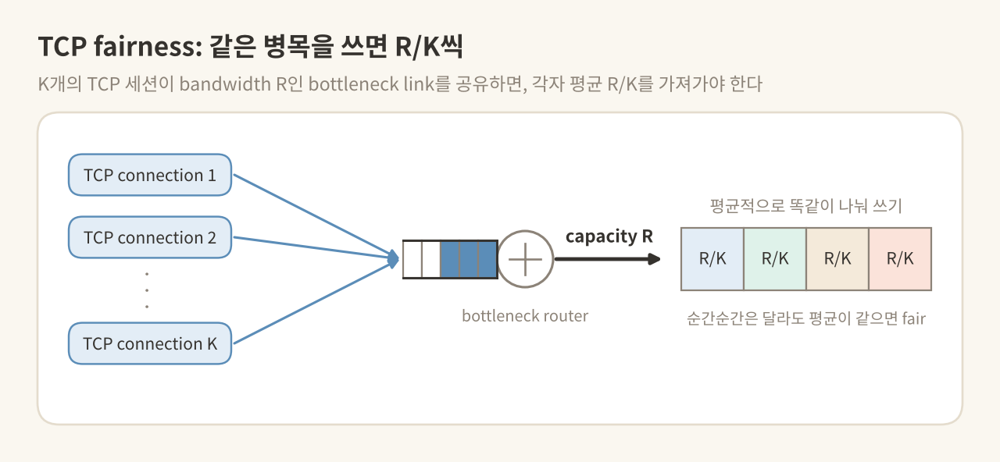
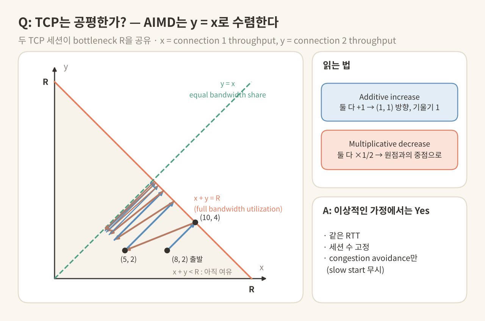
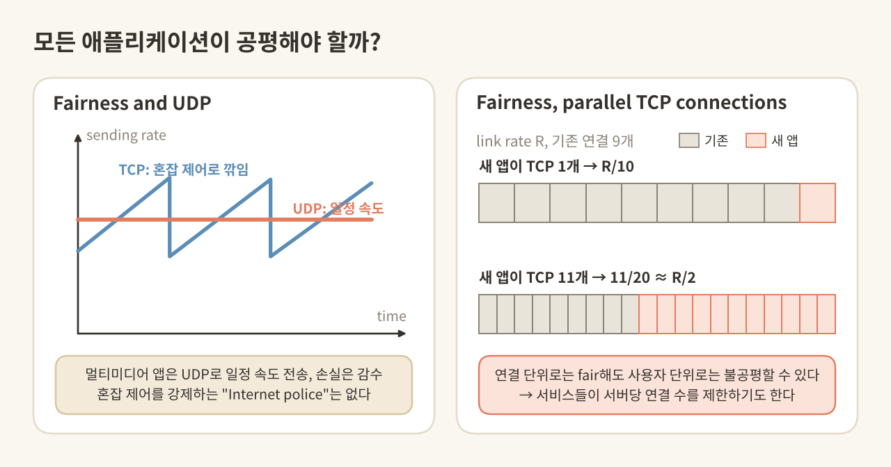
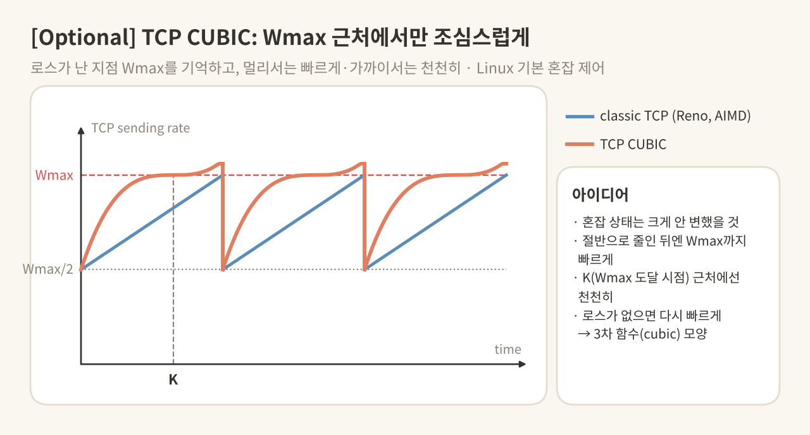
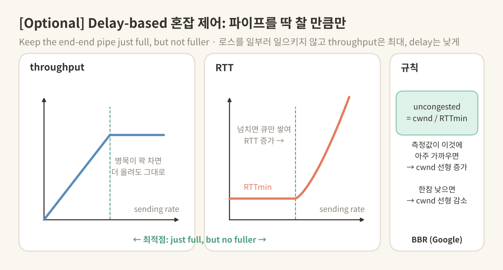
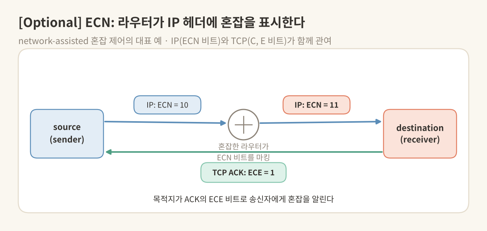
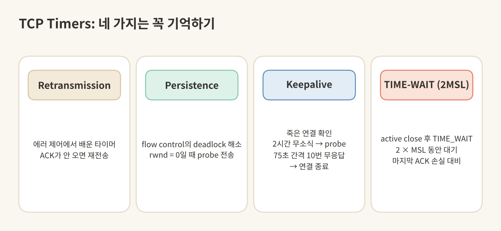
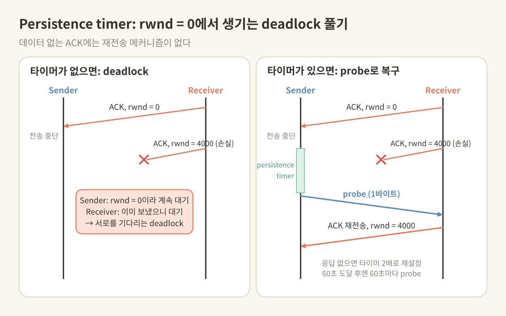
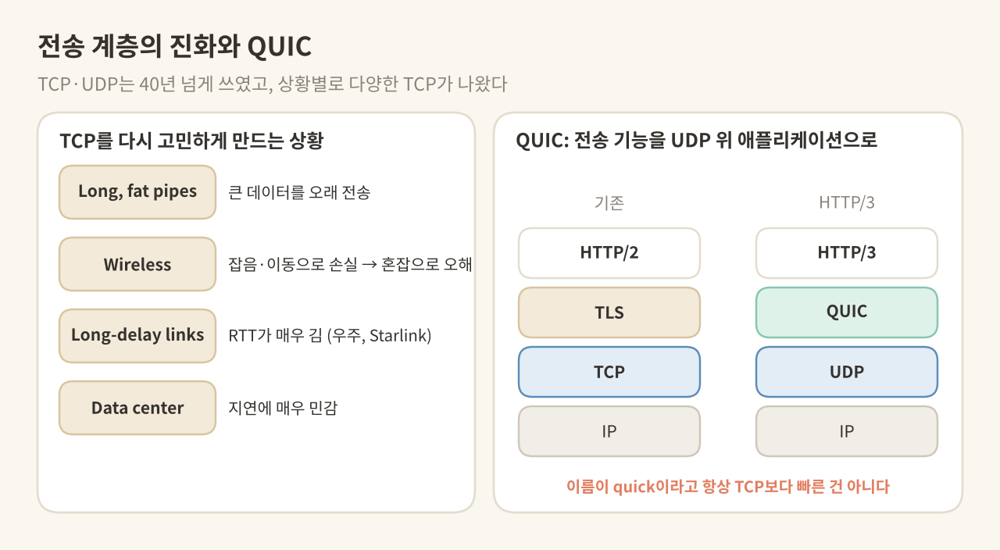

# 컴퓨터네트워크 7주차 — TCP 혼잡 제어: 혼잡의 원리부터 fairness, QUIC까지

## 들어가며

앞에서부터 계속 "혼잡 제어, 혼잡 제어"라는 표현을 써 왔는데, 이번 주에는 드디어 그 혼잡(congestion)을 정면으로 다룬다. 목표는 세 가지다. 혼잡이 무엇인지 이해하고, 네트워크에서 혼잡이 발생하는 원인을 파악하고, TCP가 이 문제를 풀기 위해 어떤 알고리즘을 품고 있는지 이해하는 것이다.

- **Part 1 — Principles of Congestion Control:** 혼잡의 정의, 세 가지 시나리오로 보는 혼잡의 원인과 비용, 혼잡 제어의 두 가지 접근
- **Part 2 — TCP Congestion Control:** sliding window 다시 보기, AIMD, slow start, 그리고 둘을 잇는 ssthresh
- **Part 3 — TCP fairness와 그 너머:** AIMD는 왜 공평한가, UDP와 parallel TCP, [Optional] CUBIC·delay-based·ECN, TCP 타이머, QUIC

강의는 두 번에 걸쳐 진행됐다. 첫 시간(약 58분)에 슬라이드 24까지 다뤘고, 다음 시간(약 38분)에 복습을 한 뒤 TCP fairness부터 전송 계층 마무리까지 이어 갔다. 두 번째 시간의 복습에서 새로 짚은 내용은 해당 부분에 함께 넣었다. 참고로 Optional 표시가 붙은 슬라이드는 시험에 나오지 않는다. 그림은 강의자료를 그대로 쓰지 않고 핵심만 새로 그렸다.

---

## Part 1. 혼잡 제어의 원리

### 혼잡이란 무엇인가

사실 혼잡을 아주 정확하게 정의하기는 쉽지 않다. 강의자료는 informal하게, **네트워크가 감당할 수 없는 많은 데이터가, 여러 소스에서, 너무 빠르게 들어오는 상황**을 congestion이라고 부른다.

> too many sources sending too much data too fast for network to handle

"많은 소스, 많은 데이터, 빠르게"가 모두 만족되면 혼잡인 건 분명하지만, 일부 조건이 조금 다르다고 혼잡이 아니라고 할 수는 없다. 그러니 이 정의를 외우려 하기보다 느낌을 잡는 게 중요하다. 보내고 받는 사람이 있고 그 사이에 네트워크가 있는데, 내가 보낸 데이터가 그 안에서 뭔가 막혀 잘 처리가 안 되는 상황, 그게 혼잡이다.

교통 네트워크를 떠올리면 쉽다. 명절에 차량이 잔뜩 몰려 가지도 못하고 계속 멈춰 있는 상황을 우리는 혼잡이라고 부른다.

### 끝단(호스트)에서 혼잡을 어떻게 알아챌까

문제는 우리 대부분이 네트워크를 운용하는 사람이 아니라, 양 끝 호스트 A나 B에서 프로그램을 실행하거나 개발하는 사람이라는 것이다. A와 B 입장에서는 중간에서 무슨 일이 벌어지는지 직접 관찰할 방법이 마땅치 않다. 차를 타고 가면 막히는 걸 체감하지만, 집에 있을 때는 누가 알려 주지 않는 이상 거기가 막히는지 알 수 없는 것과 같다.

그래서 호스트 입장에서 혼잡이 드러나는 모습(manifestations)을 봐야 하는데, 크게 두 가지다.

- **긴 지연(long delays):** A에서 B로 패킷을 보내 봤더니 기대보다 훨씬 오래 걸린다. RTT는 계속 측정하고 있으니 충분히 알 수 있다. 원인도 이미 배웠다. four sources of packet delay 중 transmission delay와 propagation delay는 경로가 같으면 거의 안 변하고, processing delay는 그렇게 큰 값이 아니다. 결국 **라우터 버퍼에 패킷이 쌓여 queueing delay가 늘어난 것**이다.
- **패킷 손실(packet loss):** 라우터 버퍼는 유한하다. 그 크기를 넘어서면(buffer overflow) 언젠가는 패킷이 버려질 수밖에 없다. 그래서 내가 보낸 패킷이 도착하지 않았다는 것 자체가 혼잡을 추론하는 근거가 된다.

### TCP 혼잡 제어는 loss 기반이 기본이다

우리 경험으로는 딜레이를 측정해서 푸는 게 자연스럽게 느껴지는데, 웃기게도 **TCP의 혼잡 제어는 loss 기반으로 동작하는 게 디폴트**다. 옛날 컴퓨터는 느렸고 성능도 제각각이라 딜레이로 측정하기가 기술적으로 힘들었을 것이고, 패킷 로스가 더 명확한 시그널이라는 이유도 있었을 것이다. 어찌 됐든 직관적인 딜레이가 아니라 패킷 로스를 이용해 푸는 것이 일반적인 접근이라는 점은 꼭 기억해 두자.

### Flow control과는 다른 문제다

수신 버퍼가 넘치지 않게 하는 flow control과 헷갈리기 쉽지만, 혼잡 제어가 다루는 대상은 **중간에 있는 네트워크**에서 벌어지는 문제다.

- **Flow control:** 한 sender가 한 receiver에게 너무 빠르게 보낸다 (one sender too fast for one receiver)
- **Congestion control:** 너무 많은 sender가 너무 빠르게 보낸다 (too many senders, sending too fast)

Flow control은 TCP 표준에 반영된 뒤 수십 년 동안 사실상 변한 적이 없다. 반면 혼잡 제어는 계속 업데이트되고 있다. 기본 알고리즘은 그대로지만, 예를 들어 딜레이가 매우 긴 위성 네트워크가 등장하면 그에 맞는 알고리즘을 새로 만들어야 한다. 그래서 네트워크 분야의 **top-10 문제** 중 하나로 불리고, 지금도 정말 많은 사람이 연구하고 있다.

---

## 혼잡의 원인과 비용: 세 가지 시나리오

이제 네트워크에서 실제로 왜 혼잡이 생기는지를, 아주 단순한 상황부터 조금씩 현실적으로 바꿔 가며 살펴본다.

### 시나리오 1: 버퍼가 무한한 라우터 하나

여러 사용자가 데이터를 빠르게 보내는 상황을 모델링하기 위해, 두 호스트 A와 B가 데이터를 보내는 그림을 생각해 보자.

- 중간에 공용 라우터가 하나 있고, 버퍼는 **무한**하다 (one router, infinite buffers).
- 입력·출력 링크의 capacity는 R이다. 라우터에서 나가는 케이블은 하나뿐이고 그 레이트가 R이다.
- 애플리케이션이 데이터를 만드는 속도를 **λin**, 받는 쪽에서 실제로 측정한 throughput을 **λout**이라고 한다.
- 재전송은 일단 생각하지 않는다 (no retransmissions needed).

**Throughput 관점.** A와 B가 같은 속도로, 0에서 시작해 조금씩 보내는 속도를 올린다고 하자. 이론적으로는 문제없이 라우터를 통과하니 출력도 입력에 비례해 선형적으로 올라간다. (실제로 재 보면 딜레이 때문에 이론값과 measured throughput이 조금 다르지만, 여기서는 이론만 본다.) 그런데 두 호스트가 출력 링크 하나(R)를 공유하고 있으니 **R/2까지는 잘 올라가지만 그 이상은 못 올린다.** 더 밀어 넣어도 출력 링크가 R로 제한되어 있기 때문이다. 이론적으로 깔끔하게 나눠 쓴다면 절반씩 나눠 먹게 된다 (maximum per-connection throughput: R/2).

**Delay 관점.** 고정된 실험 상황이라 propagation, transmission, processing delay는 다 정해져 있고, 결국 queueing delay만 변한다. 속도를 높일수록 새 패킷이 도착했을 때 앞에 패킷이 쌓여 있을 확률이 커진다. 이 효과는 누적된다. 입력이 적을 때는 딜레이가 별로 안 늘다가, 중간 이상부터 갑자기 가파르게 늘고, **R/2 근처에서는 무한대에 가까워진다.**

왜 그럴까? 버퍼가 무한대이기 때문이다. 패킷이 하나 도착했을 때 앞에 쌓여 있을 패킷 개수를 확률적으로 모델링해 보면, 버퍼가 무한하다는 건 무한대에 가까운 패킷이 쌓여 있을 확률도 0이 아니라는 뜻이다. 레이트를 높이면 그 확률이 커지고, 그게 쌓이면서 딜레이가 비약적으로 늘어난다 (large delays as arrival rate approaches capacity).

즉 **아주 이상적인 시스템에서도 혼잡은 충분히 발생할 수 있고**, 이렇게 늘어나는 딜레이를 보면 혼잡이 생겼다는 걸 알 수 있다.

### 시나리오 2: 버퍼가 유한하면 재전송이 생긴다

시나리오 1은 버퍼가 무한하다고 했으니 현실적이지 않다. 무한 버퍼에서는 보내 놓기만 하면 도착이 보장되고, 엄청난 시간이 걸릴 뿐이다. 그래서 재전송도 필요 없었다. 하지만 버퍼가 유한하면 패킷이 손실되고, 보내는 쪽은 손실되거나 타임아웃된 패킷을 **재전송**할 수밖에 없다 (sender retransmits lost, timed-out packet).

ARQ에서 배웠듯 재전송은 전송 계층이 한다. 여기서 속도를 두 가지로 구분해야 한다.

- **λin:** 애플리케이션이 보내는 원래 데이터의 속도. 애플리케이션 계층의 입력과 출력은 같다 (λin = λout).
- **λ'in:** 재전송까지 포함해 전송 계층이 실제로 내보내는 속도. 재전송이 더해지니 **λ'in ≥ λin**이다.

**이상화 1 — perfect knowledge.** sender가 라우터 버퍼에 빈자리가 있을 때만 보낸다고 해 보자. 당연히 비현실적인 가정이다. 재전송을 대비해 카피는 두지만, free buffer space를 노려 보내니 손실이 없다. 그러면 시나리오 1과 달라질 이유가 없어서, 입력을 늘린 만큼 출력도 R/2까지 그대로 늘어난다.

**이상화 2 — some perfect knowledge.** 실제로는 버퍼 상황을 알 수 없다. 버퍼가 꽉 차 있으면(no buffer space!) 패킷은 discard되고, sender는 패킷이 손실됐다는 걸 알 때만 다시 보낸다고 하자. 운 좋게 버퍼가 비어 있을 때만 전달되니, 입력을 아무리 늘려도 출력이 그만큼 나오지 않고 그래프가 꺾인다. R/2로 보낼 때 그중 일부는 재전송이니, 네트워크가 가진 capacity 일부가 재전송에 낭비되는 것이다 ("wasted" capacity due to retransmissions).

**현실적인 시나리오 — un-needed duplicates.** 여기에 하나가 더 있다. 패킷이 손실되지 않았는데 queueing delay 때문에 늦게 도착하면, ACK가 제때 안 와서 타임아웃이 발생한다. 그러면 첫 패킷이 이미 도착했는데도 똑같은 걸 또 보내고, 두 사본이 모두 전달된다 (sender times out prematurely, sending two copies, both of which are delivered). 상대방은 이미 잘 받았는데 중복해서 보낸, 순수한 낭비다. 그래서 throughput은 기대보다 훨씬 더 낮아진다.

정리하면, 혼잡이 발생하면 재전송이 생길 수밖에 없고, 그 재전송에는 실제 손실 때문인 것도 있지만 타임아웃 때문에 생기는 중복 재전송도 있다. 강의자료는 이를 혼잡의 "costs"라고 부른다.

- 같은 수신 throughput을 얻기 위해 더 많은 일(재전송)을 해야 한다.
- 불필요한 재전송 때문에 링크가 한 패킷의 사본을 여러 개 실어 나르고, 최대 달성 가능한 throughput이 줄어든다.

여기까지만 보면 혼잡은 그렇게 중요한 문제로 보이지 않을 수도 있다. "reliable하게 보내려면 어쩔 수 없이 겪는 거야" 정도로 넘어갈 만하다. 진짜 문제는 다음 시나리오다.

### 시나리오 3: 멀티홉과 congestion collapse

이번에는 호스트가 4개(four senders)이고, 라우터 4개가 네트워크에 대칭적으로 놓여 있다(multi-hop paths). 각 호스트의 flow는 라우터 두 개를 거치고, 서로 엇갈려서 라우터를 공유한다. 라우터 하나를 flow 두 개가 쓰니 각자 R/2씩 나눠 쓸 수 있는 상황이고, 버퍼는 유한하며 타임아웃과 재전송이 일어난다.

여기서 λin과 λ'in을 계속 높이면 이상한 일이 벌어진다.

- **빨간 flow(A → C)** 는 문제의 라우터에 바로 직결되어 첫 홉으로 들어온다. A는 재전송까지 포함해 열심히 데이터를 밀어 넣는다.
- **파란 flow** 는 앞의 라우터를 한 번 거쳐서 오기 때문에, 첫 번째 버퍼에서 운 나쁘게 손실될 수 있다. 살아남아 두 번째 버퍼에 도착해도, 그 버퍼는 A의 패킷이 비대칭적으로 차지하고 있다.

공간이 있으면 전송되고 없으면 버려지는 일이 반복되다 보면, A는 첫 홉까지는 throughput을 어느 정도 유지하지만 두 번째 홉을 거쳐 오는 파란 flow는 줄어들 수밖에 없다. 빨간 λ'in을 아주 높이면 위쪽 큐에 도착하는 파란 패킷은 모두 버려지고, **파란 throughput은 0으로 간다.**

문제는 이 그림이 대칭이라는 것이다. 모두가 서로의 두 번째 홉을 눌러 버리는 구조라서, 결국 4개 호스트 모두 두 번째 라우터에서 throughput이 0에 가까워지고 실제 출력 throughput도 0에 가까워진다. 그래프로 보면 처음에는 조금씩 올라가다가, 일정 이상에서 꺾이고, R/2쯤에서는 오히려 바닥을 친다.

이렇게 혼잡 때문에 성능이 조금 떨어지는 정도가 아니라 서로가 데이터를 못 보내는 상황을 **congestion collapse**라고 한다. 혼잡으로 멸망했다는, 아주 극단적인 표현이다. 여기서 강의자료가 짚는 또 하나의 비용은 이것이다. **패킷이 버려지면, 그 패킷을 나르느라 upstream에서 쓴 전송 capacity와 버퍼링도 전부 낭비된 것이다.**

### Insights: 지금까지의 정리

- throughput은 capacity를 절대 넘을 수 없다.
- capacity에 가까워질수록 delay가 커진다.
- loss와 재전송은 유효 throughput을 줄인다.
- 불필요한 중복은 유효 throughput을 더 줄인다.
- downstream에서 손실된 패킷 때문에 upstream의 전송 capacity와 버퍼링이 낭비된다.

### 수업 중 질문들

**Q. 전송 지연이나 전파 지연은 혼잡과 별로 상관이 없나요?**
별로 상관이 없다. 일반적으로 정해진 값이라, 같은 경로를 쓴다면 혼잡의 큰 원인이 되기는 어렵다. 다만 propagation delay가 기냐 아니냐에 따라 혼잡이 얼마나 심해지는지 같은 특성에는 영향을 줄 수 있다.

**Q. 이 throughput 그래프 모양을 보고 혼잡을 판단해서 알려 주면 되지 않나요?**
많이 나오는 좋은 의견이다. 하지만 이 그래프는 호스트 수가 고정된 상황을 가정한 모양이다. 호스트 수나 애플리케이션이 보내는 속도가 바뀌면 모양도 달라지니, 그래프만으로 판단하는 건 현실적이지 않다. 대신 버퍼에 남아 있는 양 같은 다른 정보를 보고 "지금 혼잡하니 덜 보내"라고 알려 주는 건 충분히 가능하고 의미가 있다. (바로 다음에 나오는 network-assisted 방식이다.)

**원인과 결과를 헷갈리지 말 것.** 혼잡이 발생하니까 딜레이가 길어지는 것이지, 딜레이가 길어져서 혼잡이 생기는 게 아니다.

---

## 혼잡 제어의 두 가지 접근

이제 혼잡이 무엇이고, 네트워크 참여자들의 어떤 동작 때문에 생기는지 파악했다. 그럼 이걸 제어하는 기술이 필요한데, 크게 두 가지 접근이 있다.

### End-end congestion control (종단간 혼잡 제어)

**TCP가 쓰는 방식**이다. 네트워크는 가만히 있고(no explicit feedback from network), 양 끝 호스트가 스스로 파악한 정보만으로, 또는 둘 사이의 연결을 통해 정보를 동기화하면서 혼잡 상황을 추론한다(congestion inferred from observed loss, delay). 그리고 그걸 바탕으로 혼잡에 대응하는 제어 알고리즘을 돌린다.

두 호스트는 네트워크 안에서 무슨 일이 벌어지는지 모르니, 직접 데이터를 보내 보며 겪은 패킷 로스와 딜레이를 바탕으로 추론(infer)한다. 물론 여기서 AI를 쓴다는 말은 아니다. 정해진 알고리즘으로 "이건 혼잡에 가까운 상황이니 이렇게 처리하겠다"는 설계를 TCP가 한다는 뜻이다.

### Network-assisted congestion control

앞의 질문처럼, **네트워크가 혼잡이 생겼다는 사실을 직접 알려 주는** 방법도 있다. 혼잡한 라우터가 자기를 지나는 flow의 송수신 호스트에게 "지금 여기 혼잡하니 보내는 양을 줄이든 다른 경로를 쓰든 하라"고 피드백을 준다. 혼잡 정도를 알려 주거나, 보낼 속도를 직접 정해 줄 수도 있다(may indicate congestion level or explicitly set sending rate).

문제는 라우터가 엄청나게 많고, 각 TCP가 자기 데이터가 어떤 경로로 흘러가는지 파악할 권한도 보통 없다는 것이다. 그래서 만들기도 쉽지 않고 scalability 측면에서도 쉽지 않다. 일부 제한된 경우에만 쓰고, 학부에서는 이런 게 있다 정도로만 다룬다. 실무에서는 **TCP ECN** 같은 기술을 만날 수 있고, ATM, DECbit 프로토콜에서도 쓰인 적이 있다.

두 방식을 대비해서 기억해 두자. 네트워크는 가만히 있고 끝단이 추론하는 것이 end-end, 라우터가 직접 알려 주는 것이 network-assisted다.

---

## Part 2. TCP의 혼잡 제어

지금까지는 혼잡과 혼잡 제어에 대한 일반론이었다. 이제 TCP가 실제로 어떻게 동작하는지 보자.

### TCP sliding window 다시 보기

TCP sliding window에서 배운 내용을 다시 가져온다. TCP가 데이터를 보내는 양은 send window로 제한된다. sender는 보냈지만 아직 ACK를 못 받은(in-flight) 데이터가 cwnd를 넘지 않도록 한다.

> LastByteSent − LastByteAcked < cwnd

이걸 이론적으로 분석한 결과를 보면, **한 RTT 동안 congestion window(cwnd)만큼 데이터를 보낸다**고 모델링해도 근사적으로 맞는다. cwnd만큼 보내고, RTT 동안 ACK를 기다렸다가, 또 보낸다.

$$\text{TCP rate} \approx \frac{\text{cwnd}}{\text{RTT}} \ \text{bytes/sec}$$

stop-and-wait에서 pipelining으로 가는 과정을 떠올리면 납득이 된다. cwnd가 1이면 하나를 보내고 ACK를 받는 데 한 RTT가 걸리고, 그동안 보낸 양은 1 세그먼트다. 그러니 레이트는 1 세그먼트/RTT다. 윈도를 늘리면 ACK가 여러 개 오는데, 이를 하나로 퉁쳐서 보면 한 RTT 동안 cwnd개의 세그먼트를 채워 보내는 것이다. 그래서 일정한 크기까지는 위 공식대로 cwnd/RTT가 된다.

cwnd는 관찰된 네트워크 혼잡에 따라 동적으로 조절된다. 이것이 곧 TCP 혼잡 제어의 구현이다.

**swnd = min(rwnd, cwnd).** 앞에서 send window의 크기 swnd는 min(rwnd, cwnd)라고 했다. 이번 파트에서는 수신 버퍼가 충분히 커서 advertised window(rwnd)를 무한대로 가정한다. 그러면 swnd = cwnd가 되고, flow control의 영향은 고려하지 않고 분석할 수 있다. 또 이번 슬라이드들은 cwnd를 byte가 아니라 **MSS 단위**(세그먼트 개수)로 쓰는 경우가 많다.

---

## AIMD: Additive Increase, Multiplicative Decrease

아쉽게도 TCP의 혼잡 제어는 알고리즘 하나로 되어 있지 않고, **여러 알고리즘이 섞여서 동작**한다. 그래서 하나하나 기억하고, 그것들이 어떻게 결합되는지 정확하게 파악하는 것이 매우 중요하다. 첫 번째가 AIMD다.

### 기본 아이디어

sender는 패킷 로스(혼잡)가 나기 전까지 보내는 속도를 올리고, 로스가 나면 속도를 낮춘다. TCP의 속도는 결국 cwnd/RTT라고 했으니, **속도를 올린다는 건 결국 cwnd를 늘린다는 말과 같다.** 왜 갑자기 윈도 얘기가 나오는지 이 연결을 꼭 이해해야 한다.

- **Additive Increase:** 전송에 성공하면, 즉 혼잡이 없다고 보면, 로스가 감지될 때까지 매 RTT마다 cwnd를 1 MSS씩 **더해서** 늘린다.
- **Multiplicative Decrease:** 패킷 로스가 발생하면 혼잡으로 간주하고, cwnd를 **곱하기로** 크게 줄인다. 로스 이벤트마다 절반으로.

다른 교재에서는 AIMD를 **congestion avoidance**라고 부르기도 한다. 뒤의 그림에서도 이 이름이 나오니 같은 것이라고 기억해 두자.

두 동작의 느낌 차이를 꼭 잡아야 한다. Additive increase는 RTT 라운드마다 일정한 값만 올리니 **상당히 보수적**이다. 지난 라운드에 패킷 3~4개를 bottleneck link에 채워 넣어 손실 없이 성공했다면, "1개 정도는 더 넣어도 버퍼에 큰 문제가 없겠지" 하고 하나를 덧붙여 보내는 식이다. 반면 multiplicative decrease는 **아주 급격하게** 줄여서 혼잡을 가급적 빨리 해소하려는 동작이다. 절반으로 줄일 수도 있고, 아예 1 MSS부터 다시 시작할 수도 있다.

### Sawtooth behavior

이 알고리즘을 시간에 따라 관찰하면, 일정한 값을 더하니 기울기가 일정한 직선으로 올라간다. 그러다 갑자기 곱하기로 크게 떨어지고, 다시 성공하면 올랐다가, 또 낮추기를 반복한다. 톱날처럼 보여서 **sawtooth behavior**라고 부르고, 강의자료는 이를 "bandwidth를 탐색하는(probing for bandwidth)" 동작이라고 표현한다.

이 동작은 **매 RTT마다** 일어난다. 데이터를 보내 보고 ACK를 받아야만 혼잡이 났는지 새로 알 수 있기 때문이다. ACK가 없으면 알 수가 없다. 한 RTT 동안 로스가 났다는 걸 알면 크게 줄이고, 안 났으면 일정한 값으로 계속 늘린다. 슬라이드의 "until loss detected"가 바로 이 뜻이다.

### Additive increase를 그림으로 보면

cwnd가 4라고 하자. 그림의 정수는 byte가 아니라 **MSS 기준 세그먼트 개수**다. 이론 분석에서는 보통 MSS 단위를 쓰니, 세그먼트 개수로 생각하는 편이 훨씬 편하다.

cwnd = 4면 세그먼트 4개가 가고, delayed ACK가 없다고 보면 ACK가 하나씩 돌아온다. 네 번째 ACK까지 오는 것을 한 RTT로 본다. ACK가 잘 도착할 때마다 4 → 5 → 6 → 7처럼 일률적으로 하나씩 늘리는 것, 이것이 additive increase다.

### Multiplicative decrease: Tahoe와 Reno

곱해서 줄이는 방법은 두 가지다.

**Triple duplicate ACK → 절반으로 (TCP Reno).** 상수를 곱해 줄이는 방법, 즉 cwnd에 1/2을 곱하는 것이다. 사실 TCP는 원래 이렇게 하지 않았고, 나중에 TCP Reno라는 패치에서 도입됐다. triple duplicate ACK는 fast retransmit 상황이다. 하나 정도는 손실됐지만 나머지는 정상적으로 도착했다는 뜻이다. 버퍼가 잠깐 넘쳐 하나가 날아갔지만 뒤에 오는 건 받아줄 여유가 있었던 것이니, **심각하지 않은 혼잡**으로 볼 수 있다. cwnd를 줄이는 건 결국 TCP의 성능을 낮추는 일이니, 이때는 절반만 줄여도 괜찮지 않을까 하는 생각에서 나온 패치다.

**Timeout → 1 MSS로 (TCP Tahoe, 디폴트).** 디폴트는 타임아웃으로 로스를 감지하면 cwnd를 1 MSS로 떨구는 것이다. 현재 cwnd로 나눠 버리는 셈이다. 그러면 속도는 갑자기 떨어지지만, 모두가 보내는 양을 팍 줄이니 네트워크 혼잡은 바로 해소될 수 있다. 아주 보수적인 접근이다.

여기서도 **loss 기준**이라는 점을 기억하자. 혼잡의 결과로 지연도 나타나고 로스도 나타나지만, TCP는 로스를 기준으로 설계되어 있고 지연은 전혀 고려하지 않는다.

### Why AIMD?

얼핏 보면 "정상일 때 천천히 올리고 혼잡이면 급하게 떨군다" 정도라 별로 대단해 보이지 않는다. 하지만 AIMD는 이론적으로 **매우 좋은 분산 알고리즘**이다. 비동기적으로 동작하는 분산 알고리즘(a distributed, asynchronous algorithm)으로서, 네트워크 전체에서 서로 다른 속도로 보내고 있어도 혼잡이 생기면 대응해서 정상 상태로 돌아가는 성질이 수학적으로 증명되어 있다.

- 혼잡된 flow들의 속도를 네트워크 전체에서 최적화한다.
- 바람직한 안정성(stability)을 갖는다.

그래서 TCP의 베이직한 알고리즘으로 쓰인다.

**Q. AIMD는 공평하지 않은 알고리즘 아닌가요?**
그렇게 생각할 수 있지만, AIMD로 동작시키면 결국 fair한(공평한) 결과로 간다는 것이 증명되어 있다. 아주 중요한 이슈라 뒤의 TCP fairness에서 그림으로 확인한다.

---

## TCP slow start

두 번째 알고리즘은 **slow start**다. 이름 때문에 천천히 보낸다고 착각하기 쉽지만, 실제로는 **처음에만 느리고 아주 빠르게 속도를 올리는** 알고리즘으로 유명하다. AIMD와 비교했을 때 그렇다는 말이다.

연결이 시작되면 첫 로스 이벤트가 나기 전까지 속도를 지수적으로 올린다.

- 처음에는 cwnd = 1 MSS에서 시작한다 (initially cwnd = 1 MSS).
- ACK를 하나 받으면 cwnd가 2, 두 개에 대한 ACK를 받으면 4, 한 라운드가 더 지나면 8이 된다.

실제 구현은 **ACK가 확인해 준, 이번에 새로 전송이 완료된 데이터 크기만큼 cwnd를 늘리는 것**이다(done by incrementing cwnd for every ACK received). 그 결과 1 → 2 → 4 → 8처럼 라운드(RTT)마다 2배씩 늘어난다(double cwnd every RTT). 원래 동작은 "ACK마다 더하기"이고, 그 결과가 "RTT마다 2배"라는 것을 정확히 구분해서 기억하자.

> summary: initial rate is slow, but ramps up exponentially fast

AIMD는 한 RTT마다 1 세그먼트 정도밖에 안 늘린다. 그에 비하면 slow start는 진짜 빠르다.

---

## Slow start에서 congestion avoidance로

실제 TCP에서는 slow start와 AIMD가 **결합돼서** 동작한다. 처음에는 cwnd가 작게 시작하니 slow start로 빠르게 전송 레이트를 올리고, 어느 선을 넘으면 AIMD로 바꾼다.

### ssthresh: 알고리즘을 바꾸는 기준점

그 기준이 **slow start threshold(ssthresh)** 라는 변수다. 이 값은 동적으로 계속 조절된다.

- cwnd < ssthresh 이면 **slow start** (지수 증가)
- cwnd ≥ ssthresh 이면 **AIMD** (선형 증가)
- 로스 이벤트가 생기면 ssthresh는 **로스 직전 cwnd의 1/2**로 정해진다

강의자료의 질문도 이것이다. "지수 증가는 언제 선형으로 바꿔야 할까?" 답은 "cwnd가 타임아웃 직전 값의 절반에 도달했을 때"다.

ssthresh는 이렇게 이해하면 된다. 정확한 추정치는 아니지만, **bottleneck link의 버퍼를 채우는 데 큰 무리가 없을 것이라고 TCP가 기억해 두는 기준값**이다. 그래서 거기까지는 빠르게 올려도 괜찮다고 보는 것이다. 그런데 로스가 났다는 건 이 기준값을 고쳐야 한다는 뜻이다. 그래서 로스가 나면 cwnd만 줄이는 게 아니라 **ssthresh도 함께 줄인다**는 점을 꼭 기억하자.

### 그림 예시: ssthresh = 16에서 시작

1. **Slow start.** 1 → 2 → 4 → 8 → 16까지 올라간다.
2. **AIMD(additive increase).** 16에 도달한 뒤부터는 16 → 17 → 18 → 19 → 20. 각 라운드(RTT) 동안 로스 없이 ACK가 잘 도착했다는 뜻이다.
3. **Timeout 발생 (cwnd = 20).** 재전송은 내부적으로 처리하고, 그와 병행해 cwnd를 **1 MSS**로 낮춘다. ssthresh는 그 시점 cwnd의 절반인 **10**이 된다.
4. **다시 slow start.** 1 → 2 → 4 → 8, 그리고 10까지 올라간 뒤 AIMD가 동작해 11 → 12.
5. **Triple duplicate ACK 발생 (cwnd = 12).** fast recovery 패치(TCP Reno)가 있다면 cwnd를 절반인 **6**으로 줄이고, ssthresh도 6이 된다. 그래서 slow start 없이 바로 AIMD가 동작해 6 → 7 → 8.

### Timeout vs Triple duplicate ACK

이 부분을 정확하게 기억해야 한다. **둘 다 ssthresh는 직전 cwnd의 절반이 된다.** 다른 건 cwnd다.

| 로스 감지 | 혼잡을 어떻게 보나 | ssthresh | cwnd | 다음 동작 |
| --- | --- | --- | --- | --- |
| Timeout | 심각한 혼잡 | 직전 cwnd / 2 | 1 MSS | 처음부터 slow start |
| Triple duplicate ACK (Reno) | 심각하지 않은 혼잡 | 직전 cwnd / 2 | 직전 cwnd / 2 | 바로 AIMD (fast recovery) |

### 정리: "Simplified" TCP congestion control

이 동작들을 보면 이렇게 정리할 수 있다.

- **Slow start**는 빠르게 속도를 올리기 위해 만들어졌다.
- TCP는 stable하게 동작하고 싶기 때문에 **AIMD**로 혼잡에 대응한다. AIMD를 다르게는 혼잡을 회피한다고 해서 **congestion avoidance** 알고리즘이라고 부른다.
- **Timeout**은 심각한 혼잡으로 보고 처음부터 다시 시작한다. 반면 **fast retransmit**(triple duplicate ACK)은 심각하지 않으니 빠르게 회복하는, 즉 **fast recovery**를 해서 AIMD가 그대로 동작하도록 설계했다.

강의자료는 이를 finite state diagram(FSM)처럼 그려 정리했다. 연결이 수립되면 slow start에서 시작하고, cwnd > ssthresh가 되면 congestion avoidance로 넘어간다. 어느 상태에서든 timeout이면 ssthresh = 1/2 window, cwnd = 1 MSS로 slow start에 돌아가고, 3 duplicate ACKs면 ssthresh = 1/2 window, cwnd = ssthresh로 congestion avoidance에 들어간다. (교재 그림에는 오류가 있어서 강의자료의 그림은 수정한 버전이고, cwnd의 단위는 MSS다.)

뒤에 이어지는 그림 4장(FSM for TCP Tahoe/Reno와 각각의 예시, 슬라이드 25~28)은 실제 Tahoe와 Reno의 동작을 묘사한 것이다. 우리가 배운 건 단순화한 버전이고, 이 4장은 **시험에 나오지 않는다**고 다음 시간에 다시 확인해 주셨다. 강의자료에는 Optional 표시가 없지만 시험 범위 밖이다.

---

## Part 3. TCP fairness

혼잡 제어를 설계할 때 중요한 이슈 중 하나가 TCP와 TCP 사이, 즉 네트워크 flow들 사이의 **fairness**(공평성) 문제다.

### Fairness goal: K개가 나눠 쓰면 R/K씩

혼잡 제어의 원리에서처럼, 라우터에서 외부로 나가는 케이블의 capacity가 R로 제한되어 있다고 하자. 두 연결이 이 bottleneck link를 공유하는데 한쪽이 많이 쓰고 한쪽이 적게 쓴다면 불공평하다고 생각할 여지가 있다.

그럼 어떤 결과를 기대할까? 둘이 같이 쓴다면 1/2씩 나눠 쓰는 게 합리적이다. 순간순간은 한쪽이 더 보낼 수도 덜 보낼 수도 있지만, 적어도 평균적으로는 그렇게 되기를 기대한다. 강의자료는 이를 일반화해서 이렇게 쓴다.

> Fairness goal: if K TCP sessions share same bottleneck link of bandwidth R, each should have average rate of R/K

### 왜 혼잡 제어에서 fairness를 따질까

TCP는 혼잡 제어 알고리즘으로 보내는 속도를 동적으로 올렸다 내렸다 한다. 이건 flow control과는 다른 느낌으로 봐야 한다.

- **Flow control:** 상대가 받을 준비가 안 돼서 속도를 줄이는 것이다. 통신하는 주체의 능력이나 목표 때문에 그러는 것이니, 이걸 두고 fair하다 아니다를 따지는 건 이상하다.
- **Congestion control:** 동작하는 주체는 보내는 쪽이지만, 내가 급격하게 절반으로, 혹은 1 MSS로 줄인다는 건 사실상 **네트워크에 봉사하는 것**이다. 안 하면 더 이득을 볼 수 있는데 하게 만드는 것이다.

그러니 적어도 구현된 알고리즘이 fair하게 동작하도록 설계되어 있는지는 따져 볼 필요가 있다. 이 질문에 답한 재미있는 분석이 다음 그림이다.

### Q: TCP는 공평한가?

X축은 TCP connection 1의 throughput, Y축은 connection 2의 throughput이다. 둘이 bottleneck link를 공유하고 있으니 각 연결의 throughput은 아무리 커져도 R을 넘을 수 없다. connection 1의 throughput을 x, connection 2를 y라고 하면, 둘의 합도 bottleneck capacity를 넘을 수 없으니 **x + y ≤ R**이다.

x + y = R은 x절편과 y절편이 모두 R인 직선이다. 둘이 보내는 양은 이 선 아래 영역에서 조절된다. 더 늘려 봤자 실제로는 늘지 않는다. 처음에 많이 보내더라도 라우터가 처리를 못 하면 큐에 쌓이고 버려지기 때문이다.

**비대칭에서 출발.** 어느 순간 connection 1은 많이, connection 2는 조금 보내고 있다고 하자. 합이 R보다 작으니 버퍼가 넘칠 일은 거의 없지만, 비대칭이긴 하다. 다만 이런 상태는 순간적으로 얼마든지 있을 수 있으니 이것만으로 fair하다 아니다를 말하기는 어렵다.

**Additive increase: (1, 1) 방향으로.** bottleneck 버퍼를 어느 정도 채운 뒤 TCP는 AIMD로 동작한다. 라운드마다 connection 1도 1씩, connection 2도 1씩 늘리니, (3, 1)이었다면 (4, 2), (5, 3)처럼 **(1, 1) 벡터를 따라** 올라간다(기울기 1). 선에 닿기 전까지는 둘 다 아직 bottleneck을 채우지 않았으니 레이트를 높여도 문제가 없다.

**Multiplicative decrease: 원점과의 중점으로.** 그러다 선을 넘는 순간 버퍼가 넘치고 패킷이 날아가서, 둘 다 혼잡을 인식하고 multiplicative decrease를 한다. 예를 들어 (10, 4)에서 패킷 하나만 날아가는 fast recovery 상황이라 절반으로 줄였다면 (5, 2)가 된다. **원점과 그 점을 이은 선분의 중점으로 점프**하는 것이다. 타임아웃이라면 둘 다 (1, 1)로 다시 시작한다. 어느 경우든 원점을 향해 보내는 양이 줄어든다.

**결국 y = x로 수렴.** (1, 1)로 초기화하는 경우는 빼고 중점으로 가는 경우만 보면, 절반에서 다시 (1, 1) 방향으로 올라가고, 다시 중점으로 떨어지기를 반복한다. 이걸 계속하면 **y = x 선으로 수렴**한다. y = x는 두 연결의 레이트가 같다는 뜻이니, 둘이 bottleneck link를 잘 나눠 쓰고 있다는 결론이 나온다. 처음엔 fair하지 않았더라도 AIMD의 동작 때문에 결국 fair하게 rate를 쓰게 되는 것이다.

물론 여기에는 가정이 많이 붙는다. RTT가 같다고 보고, 세션 수가 고정되어 있다고 보고, slow start는 무시하고 congestion avoidance만 본다. 그래서 실제로는 이렇게 깔끔하지 않다. 하지만 **이론적으로는 TCP가 fair하게 설계되어 있다고 주장할 수 있다**는 점이 매우 중요하다.

> Is TCP fair? A: Yes, under idealized assumptions (same RTT, fixed number of sessions only in congestion avoidance)

### 모든 애플리케이션이 공평해야 할까?

**Fairness and UDP.** 네트워크에는 TCP만 있는 게 아니다. UDP에는 혼잡 제어도, 속도를 조절하는 기능 자체도 없다. 일정 속도로 보내는 프로그램을 만들어 두면 혼잡이 생겨도 UDP는 계속 이기적으로 보낼 수 있으니, 자기 이득을 최대화할 여지가 많다.

현대의 멀티미디어 애플리케이션이 다 TCP를 안 쓰는 건 아니지만, 상당수는 TCP를 피하는 경향이 있다. TCP를 쓰면 혼잡 제어에 걸려 보내는 양이 뚝 떨어질 때마다 동영상 품질도 확 떨어진다. 동영상은 큰 데이터를 끊임없이 스트리밍해야 하니 사람들이 엄청 불편해할 수밖에 없다. 그래서 UDP로 오디오·비디오를 일정 속도로 보내고 패킷 손실은 감수한다. 그리고 혼잡 제어를 쓰는지 단속하는 **"Internet police"는 없다.** 애플리케이션을 설계할 때 이걸 어떻게 강제할지도 이슈다.

**Fairness, parallel TCP connections.** 앞의 분석은 TCP 연결 하나와 하나가 경쟁할 때 똑같이 나눈다는 것이었다. 그런데 테라바이트급 파일을 10개로 쪼개 TCP 연결 10개로 받는 사람과, 같은 파일을 연결 하나로 받는 사람이 있다면? AIMD를 똑같이 돌려도 연결 10개를 만든 사람이 10배 빠르게 받는다. 강의자료의 예시도 같다. rate R인 링크에 기존 연결이 9개 있을 때,

- 새 앱이 TCP 1개를 열면 R/10을 받는다.
- 새 앱이 TCP 11개를 열면 R/2를 받는다.

그래서 **연결 단위의 fairness만으로 충분한가**라는 이슈가 생긴다. 서비스를 받는 입장에서는 사용자 단위로 fairness를 따지는 게 필요할 수도 있다. 이걸 어떻게 해결하는지는 교수님이 화두만 던지셨으니 한번 찾아보면 좋다.

교수님은 90년대에 이런 걸 많이 겪으셨다고 한다. 서버 하나에 TCP 연결을 여러 개 만들어 빠르게 받는다고 광고하며 돈을 벌려던 다운로드 프로그램도 실제로 있었다. 요즘은 인터넷이 워낙 빨라져 잘 안 보이고, 서비스 회사들이 서버 하나에 만들 수 있는 연결 수를 제한하는 식으로 통제한다. 체감은 안 되더라도 매우 중요한 문제다.

---

## [Optional] 혼잡 제어 더 알아보기

이 부분은 Optional 슬라이드라 **시험에 나오지 않는다.** 교수님도 디테일하게 이해하려 하지 말라고 하셨으니 이런 게 있구나 정도로 보고 넘어가자.

### TCP Tahoe vs TCP Reno

TCP Tahoe를 Reno라는 구현이 패치했다고 했다. 둘의 차이는 **fast recovery를 쓰느냐**다. Tahoe는 fast recovery가 없어서 slow start, AIMD, 뚝 떨어져서 다시 slow start, AIMD를 반복한다. Reno는 앞에서 본 것처럼 빠르게 복구한다. 강의자료에는 로스 후 cwnd가 Reno는 ssthresh + 3 (MSS), Tahoe는 1 (MSS)로 표시되어 있다. (앞의 단순화한 버전에서는 Reno의 cwnd를 ssthresh로 보았다.) 이 둘의 비교를 시험에 내는 다른 학교도 있다고 한다.

### TCP CUBIC

AIMD가 좋은 건 알겠지만 보수적이다. 그럼 AIMD보다 빠르게 bottleneck link를 꽉 채우면서도 로스는 안 나게 하려면 어떻게 설계할까? 그 결과 중 하나가 **TCP CUBIC**이다.

교수님이 굳이 소개하신 이유는 한국 사람들이 주로 만들었기 때문이다. 현재 Colorado Boulder에 있는 하상태 교수님과, 삼성에서 부사장까지 했던 이인종 교수님 등이 만들었다(슬라이드에는 Former VP of Google로 적혀 있다). CUBIC은 **리눅스의 default 혼잡 제어 알고리즘**이다. 리눅스를 쓰고 있다면 앞에서 배운 방식이 아니라 CUBIC으로 동작하는 게 보통이다.

아이디어는 이렇다. AIMD에서 절반으로 떨어졌다는 건 그 지점에서 로스가 있었다는 뜻이다. 버퍼가 넘치는 순간이 그 지점, 즉 **Wmax**라는 걸 안다면 거기까지 갈 때는 조금 더 이기적으로 굴어도 되지 않을까? 절반으로 줄인 직후에는 빠르게 올리다가, Wmax 근처에서는 천천히 접근하면 더 높은 레이트로 보낼 수 있다.

Wmax까지 갔는데도 로스가 안 났다면, 다른 사람이 레이트를 줄였든 어쨌든 bottleneck 상황이 완화돼서 더 올릴 수 있다는 뜻이다. 우연일 수도 있으니 처음에는 조금 느리게 올리지만, 계속 로스가 없으면 다시 빠르게 올린다.

이 모양이 바로 **3차 함수**다. Wmax에 도달하는 시점을 K라고 하면, (K, Wmax) 근처에서는 기울기를 낮게, 거기서 멀어질수록 기울기를 높게 만든다. 현재 시간과 K 사이 거리의 세제곱(cube)에 따라 W를 늘린다고 해서 CUBIC이다. 이 아이디어로 대박을 터뜨렸다는 정도는 기억해 두자.

### Delay-based 혼잡 제어와 BBR

지금까지는 혼잡 제어를 **loss 중심**으로 배웠다. 로스가 났느냐, 그리고 로스가 난 건 분명하지만 빠르게 복구할 수 있는 triple duplicate ACK 상황만 봤다.

그런데 혼잡이 생기면 관찰할 수 있는 또 하나가 지연이다. 그러니 지연을 측정해서 혼잡 제어를 하겠다는 접근도 있다. 버퍼가 넘치지 않는 선에서 딜레이를 보며 더 보낼 수 있는지 판단하는 것이다. 이런 방식의 예로 교수님은 **TCP Vegas**를 들었다.

강의자료의 목표는 "sender에서 receiver까지의 파이프를 **딱 찰 만큼만, 그 이상은 아니게**" 유지하는 것이다. bottleneck link는 계속 바쁘게 하되 지연과 버퍼링은 높이지 않는다.

- RTTmin은 관찰된 최소 RTT(혼잡 없는 경로)이고, 혼잡이 없을 때의 throughput은 cwnd/RTTmin이다.
- 측정한 throughput(지난 RTT 동안 보낸 바이트 / RTTmeasured)이 이 값에 아주 가까우면 경로가 혼잡하지 않으니 cwnd를 선형으로 늘린다.
- 한참 낮으면 경로가 혼잡하니 cwnd를 선형으로 줄인다.

Vegas 자체는 Tahoe나 Reno와 함께 돌 때 페널티를 받는 등의 문제로 잘 쓰이지 않았다. 교수님은 구글이 이를 발전시켜 **BBR**이라는 혼잡 제어 알고리즘을 제안했다고 소개하셨다. 강의자료에는 BBR이 로스를 일부러 일으키지 않고 throughput은 최대로, delay는 낮게 유지하는 delay 기반 접근이며 구글의 내부 백본 네트워크에 배포되었다고 나온다. 관심 있다면 찾아보자.

### Explicit congestion notification (ECN)

앞에서 TCP에도 network-assisted 혼잡 제어를 만들 수 있다고 했는데, 그 대표 예가 **ECN**이다.

- 혼잡한 라우터가 IP 헤더(ToS 필드)의 2비트를 마킹해서 혼잡을 표시한다. 마킹 정책은 네트워크 운영자가 정한다.
- 이 표시는 목적지까지 전달된다.
- 목적지는 ACK 세그먼트의 ECE 비트를 세팅해 송신자에게 혼잡을 알린다.
- 그래서 IP(ECN 비트 마킹)와 TCP(C, E 비트 마킹)가 모두 관여한다.

---

## TCP Timers

TCP의 마지막 파트에 덤으로 들어간 내용이다. 디테일을 외울 필요는 없고 슬라이드 41 정도만 잘 이해해도 시험에는 문제없다고 하셨다. TCP에는 타이머가 여러 개 있다. **이 4개가 있다는 건 꼭 기억하자.** 객관식 문제로 만들기 좋다고 하셨다.

- **Retransmission timer:** 에러 제어에서 이미 배운 재전송 타이머다.
- **TIME-WAIT timer (2MSL timer):** 연결을 먼저 종료한 쪽(active close)은 상대의 FIN을 받고 ACK를 보낸 뒤 TIME_WAIT 상태에 들어가 2 × MSL(maximum segment lifetime) 동안 기다린다. 마지막 ACK가 손실되면 상대가 FIN을 다시 보내는데, 그때 final ACK를 다시 보낼 수 있게 하려는 것이다. TCP에 반드시 구현되어야 하는 타이머다.
- **Keepalive timer:** 서버와 클라이언트가 인증까지 마친 상태라면, 당장 데이터를 안 보내더라도 연결은 가급적 끊고 싶지 않을 수 있다. 이때 연결이 살아 있는지 확인하는 메시지를 주기적으로 보내는 역할이다. 보냈는데 답이 없다면 상대 컴퓨터가 죽었거나 네트워크 상태가 나쁜 것이니, 그 연결은 사실상 없다고(dead connection) 판단할 수 있다. 강의자료 기준으로는 2시간 동안 아무 세그먼트도 못 받으면 probe를 보내고, 75초 간격 probe 10번에도 응답이 없으면 연결을 끊는다.
- **Persistence timer:** flow control 때문에 생길 수 있는 **deadlock**(교착 상태)을 풀기 위한 타이머다. 아래에서 조금 더 본다.

### Persistence timer와 deadlock

receiver가 advertised window(rwnd)를 0으로 알려 주면 sender는 데이터를 보낼 수 없다. 나중에 receiver가 "rwnd가 늘었으니 보내도 돼"라는 ACK를 보냈는데 이게 손실되면 어떻게 될까?

- sender는 rwnd = 0인 상태에서 업데이트를 못 받았으니 계속 못 보낸다.
- receiver는 "나는 이미 보냈으니 끝"이라고 생각하고 기다린다.
- 데이터 없는 ACK에는 재전송 메커니즘이 없다. 그래서 서로가 상대를 기다리는 deadlock이 된다.

이걸 풀기 위해, 작은 데이터를 실어 실제로 문제가 없는지 확인하는 동작이 persistence timer다. 강의자료에 따르면 sender는 rwnd가 0인 ACK를 받으면 persistence timer를 시작하고, 타이머가 만료되면 **1바이트짜리 probe 세그먼트**를 보낸다. probe는 receiver가 ACK를 다시 보내게 만든다. 응답이 없으면 타이머 값을 2배로 늘려 다시 설정하고, 보통 60초 threshold에 도달한 뒤에는 60초마다 probe를 보낸다. 지난 학기까지는 자세히 설명했지만 이번 학기는 가볍게 넘어간다고 하셨다.

---

## 전송 계층의 진화와 QUIC

전송 계층을 아주 자세히 배웠는데, TCP는 40년 넘게 쓰이면서 여러 문제점이 알려졌다. 네트워크 상황에 맞춰 TCP를 최적화하려는 연구도 계속 나왔다.

- **Long, fat pipes:** 많은 데이터를 보내야 하는 전송에서는 별도의 TCP 방식을 쓰는 게 좋다.
- **Wireless:** 무선에서는 잡음이나 이동 때문에 패킷 로스가 당연하게 자주 생긴다. 그런데 TCP는 로스를 혼잡 시그널로 보고 설계됐으니, 이 정보를 그대로 쓰는 게 맞는지가 이슈다.
- **Long-delay links:** 우주선 사이의 통신, 화성 탐사선의 데이터를 받아 오는 네트워크, 최근의 Starlink처럼 RTT가 매우 긴 경우다.
- **Data center networks:** 컴퓨터가 잔뜩 모인 데이터 센터는 지연에 매우 민감하다.

한국에서 이런 걸 실제로 상용화하는 곳은 많지 않지만, 구글이나 마이크로소프트 같은 곳을 목표로 하는 엔지니어라면 네트워크 분야에서는 이런 이슈가 계속 나오니 전공해 보는 것도 좋다고 하셨다. 전송 계층은 상당히 재미있지만, 많은 사람이 연구하는 만큼 어려운 분야이기도 하다.

### QUIC

**QUIC**(Quick UDP Internet Connections)은 구글이 만든 프로토콜이다. 구글은 Chrome 브라우저를 쓰면서 기존 인터넷이 너무 느리다고 보고, 데이터를 더 빠르게 공급할 수 있는 전송 계층을 만들기로 했다. TCP의 개선 사항들을 분석해 도입하면 더 빠르면서 안전한 전송 계층이 된다고 보고 구현한 것이 QUIC이다. 강의자료의 표현으로는 전송 계층의 기능을 **UDP 위의 애플리케이션 계층으로 옮긴** 것이다.

Chrome으로 구글 사이트에 접속하면 실제로 QUIC으로 통신한다. 다른 기업들도 쓰기 시작하면서 **HTTP/3**라는 이름으로 표준화되었다. 교수님 말씀으로는 전 세계 트래픽의 30% 정도가 QUIC과 HTTP/3로 되어 있다고 한다. 얼마나 빠르게 전환될지는 더 지켜봐야 한다.

QUIC이 TCP보다 나은 부분은 강의자료에 정리되어 있다. 강의에서 자세히 설명하지는 않았다.

- 연결 설정 때 reliability, congestion control, authentication, encryption 상태를 1 RTT에 확립한다. TCP + TLS는 handshake를 두 번 순차적으로 해야 한다.
- QUIC 연결 하나 위에 여러 application-level stream을 다중화하고, congestion control은 공통으로 쓴다.
- stream 사이의 HOL(head-of-line) blocking이 없다.

**주의: QUIC이 항상 TCP보다 빠른 건 아니다.** 다른 분반 교수님도 강조하셨다는데, 이름이 "quick"이라 무조건 TCP보다 빠르다고 착각하기 쉽다. 그건 구글이 자기 프로토콜을 팔려고 포장한 것에 가깝고, 빠를 때도 있지만 오히려 나쁠 때도 있다. 이름 때문에 빠를 거라고 기대하지는 말자.

---

## 마치며

이번 글에서는 혼잡이 무엇이고 왜 생기는지부터, TCP가 이를 어떻게 다루고 얼마나 공평한지, 그리고 전송 계층이 어디로 가고 있는지까지 훑었다.

| 단계 | 핵심 아이디어 |
| --- | --- |
| 혼잡의 정의 | 너무 많은 소스가 너무 빠르게, 신호는 지연과 손실, flow control과는 다른 문제 |
| 시나리오 1 | 무한 버퍼, throughput은 R/2가 한계, R/2 근처에서 지연 폭증 |
| 시나리오 2 | 유한 버퍼, λ'in ≥ λin, 재전송과 불필요한 중복이 capacity를 낭비 |
| 시나리오 3 | 멀티홉, upstream 낭비, throughput이 0으로 떨어지는 congestion collapse |
| 두 가지 접근 | TCP는 end-end(끝단이 추론), network-assisted는 라우터가 알려 줌(ECN) |
| Sliding window | rate ≈ cwnd/RTT, swnd = min(rwnd, cwnd), 이번엔 rwnd = ∞ |
| AIMD | 성공하면 RTT마다 +1 MSS, 로스면 곱하기로 감소, sawtooth |
| Slow start | cwnd = 1에서 시작, ACK마다 늘려 RTT마다 2배 |
| ssthresh | 로스 시 직전 cwnd/2, timeout이면 cwnd = 1, 3 dup ACK면 cwnd = 절반 |
| TCP fairness | AIMD는 y = x로 수렴, 이상적인 가정에서는 fair |
| UDP·parallel TCP | UDP는 혼잡 제어 없음, 연결을 여러 개 열면 더 많이 가져감 |
| [Optional] | Tahoe vs Reno, CUBIC(리눅스 기본), delay-based·BBR, ECN |
| TCP Timers | retransmission, persistence, keepalive, TIME-WAIT(2MSL) |
| QUIC | UDP 위에 전송 기능, HTTP/3, 이름처럼 항상 빠른 건 아님 |

특히 꼭 잡고 갈 것은 이렇다. TCP 혼잡 제어는 **loss 기반**이라는 것, 속도를 바꾼다는 건 결국 **cwnd를 바꾼다**는 것, **timeout과 triple duplicate ACK의 차이**, 그리고 **AIMD가 왜 공평한 결과로 가는지**다. Optional 부분은 시험에 안 나오니 관심이 가는 것만 찾아보면 된다.