# 컴퓨터네트워크 — Internet Protocol (1): 네트워크 계층 개론부터 subnetting까지

## 들어가며

TCP를 몇 주에 걸쳐 공부했으니, 이번 주부터는 한 계층 내려가 **인터넷 프로토콜(IP)** 을 다룬다. 인터넷 프로토콜 파트는 2주 정도에 걸쳐 진행되고, 소켓 프로그래밍 진도에 따라 조금 더 길어질 수도 있다.

미리 알아 둘 점이 있다. 이 파트는 자잘하게 외울 것들이 많은데, 지금은 잘 안 쓰이는 부분도 섞여 있다. 그래서 슬라이드를 하나하나 다 외우려 하기보다, 수업 흐름을 따라가며 어떤 게 중요하고 어떤 게 아닌지를 구분하는 게 중요하다.

- **Part 1 — Network Layer Introduction:** 네트워크 계층이 하는 일, forwarding과 routing, data plane과 control plane(per-router와 SDN), 네트워크 서비스 모델과 QoS, best effort가 성공한 이유
- **Part 2 — Internet Protocol Basics:** IP가 제공하는 서비스, IPv4 헤더의 각 필드, IP의 역다중화, IPv6 헤더와 바뀐 점
- **Part 3 — IPv4 Fragmentation:** MTU 때문에 라우터가 datagram을 쪼개는 이유, reassembly는 목적지에서만, length·MF·offset 계산
- **Part 4 — IPv4 Options:** record route, source route, timestamp, 그리고 IPv4 옵션이 사실상 쓰이지 않는 이유
- **Part 5 — IP Addressing (1):** IPv4·IPv6 주소 표기, classful addressing과 network mask, subnetting과 subnet mask

강의는 두 번에 걸쳐 진행됐다. 10주차 강의(약 71분)에서 슬라이드 1~26, IP Fragmentation 직전까지 다뤘고, 11주차 강의(약 70분)에서 슬라이드 27~66, 강의자료 끝까지 이어 갔다. 영상 제목은 10, 11주차지만 강의자료 파일은 둘 다 Week 09다. 그림은 강의자료를 그대로 쓰지 않고 핵심만 새로 그렸다.

---

## Part 1. 네트워크 계층 개론

3계층 네트워크 레이어를 공부한 지 좀 오래됐으니, 개론을 다시 살펴보면서 그때 가볍게 다뤘던 부분을 조금 더 디테일하게 본다.

### 네트워크 계층이 하는 일

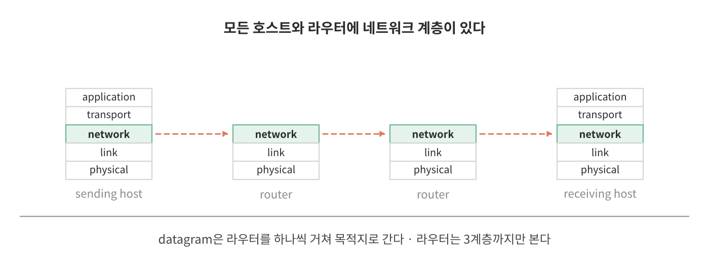

네트워크 계층은 상위 계층에 일종의 **물류 배송 서비스**를 제공한다. 데이터를 보내는 sending host에서 받는 receiving host까지 데이터를 잘 전달하는 것이 목표다. 전송 계층의 데이터를 segment라고 불렀으니, 강의자료는 이를 "segment를 transport한다"고 표현한다.

- **sender:** segment를 datagram으로 encapsulation해서 link layer로 넘긴다.
- **receiver:** datagram을 풀어(decapsulation) segment를 transport layer protocol로 전달한다.

물류 배송이니 **네트워크의 모든 노드가 네트워크 계층을 가지고 있어야** 동작한다. 물론 브리지, 허브, 리피터처럼 2계층이나 1계층에서만 동작하는 장비도 있지만, 그런 걸 제외하면 사실상 인터넷의 모든 기기가 네트워크 계층을 포함한다는 걸 꼭 기억하자.

인터넷에 초점을 맞추니 노드는 **호스트**와 **라우터**로 나눠서 본다. 호스트는 데이터를 생성하거나 받는 컴퓨터다. IP를 얘기할 때 매우 중요한 건 **라우터**다. 호스트가 보낸 데이터를 실제로 받아서 전달하는, 즉 forwarding하는 작업을 라우터가 하기 때문이다. 라우터는 두 관점에서 이해해야 한다.

- 라우터에 IP datagram이 도착하면 **헤더 필드를 체크**해서 어디로 보낼지 판단한다.
- 라우터 중심으로 보면, input port에 도착한 datagram을 **output port로 옮기는** 작업이다.

강의자료 그림에서는 랩탑 하나가 서버로 데이터를 보낼 때, 여러 라우터를 거쳐 경로를 따라 데이터를 흘려보낸다.

### 두 가지 핵심 기능: forwarding과 routing

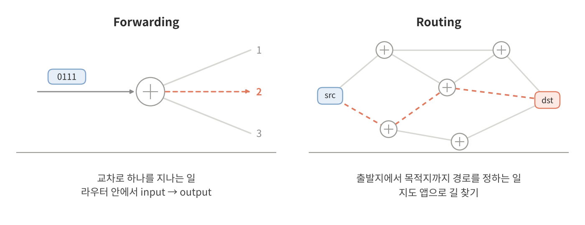

앞으로 네트워크 계층의 대표 기능을 말하라고 하면, **forwarding과 routing으로 구분해서 설명**하는 게 꼭 필요하다.

- **Forwarding:** 라우터의 input link로 들어온 패킷을 알맞은 output link로 옮기는 것. 앞에서 말한 라우터의 두 번째 관점 그대로다.
- **Routing:** source에서 destination까지 패킷이 갈 경로를 정하는 것. 이를 위한 알고리즘이 routing algorithm이다.

**교통 네트워크 비유.** forwarding은 일종의 **교차로**다. 교차로의 신호등은 직진할지, 왼쪽으로 갈지, 오른쪽으로 갈지를 제어해서 차가 다음 길로 갈 수 있게 해 준다. 그런데 신호등은 차들이 어디서 출발해 어디로 가는지 알고 그렇게 동작할까? 그렇지 않다. 자기 교차로 안에서 소통이 원활하도록 하는 기능만 한다. 반면 시작점에서 끝점까지 가는 경로를 찾는 문제는 따로 있고, 이걸 routing이라고 부른다.

사람이 운전할 때는 둘을 함께 한다. 네이버 지도나 T맵으로 어디서 어디로 갈지 경로를 확인한 다음, 교차로에 도착하면 거기서 어디로 갈지를 스스로 처리한다.

**왜 굳이 둘을 나눌까?** 실제로 처음 네트워크를 설계한 사람들은 두 기능을 구분하지 않았다. 필요성을 못 느꼈으니 네트워크 계층이 할 일을 그냥 합쳐서 구현했다. 그런데 forwarding은 **지역적으로** 일어나는 동작이 많다. 그 위치에서 내부 상태나 동작을 바꾸는 데 초점이 있다. 반면 routing은 **전체 숲을 볼 수 있어야** 한다. 어디로 가는 게 좋은 길인지는 혼잡 같은 문제가 생기면 계속 달라진다. 그러니 둘을 나눠 전문적으로 다루는 게 좋다.

그래서 90년대 이후로 네트워크를 배우는 사람들은 대부분 forwarding과 routing을 구분해서 얘기한다. 다만 그 전에 만들어진 기술이나 프로그램은 구분을 제대로 안 하는 경우도 있으니 주의하자.

### Data plane과 control plane

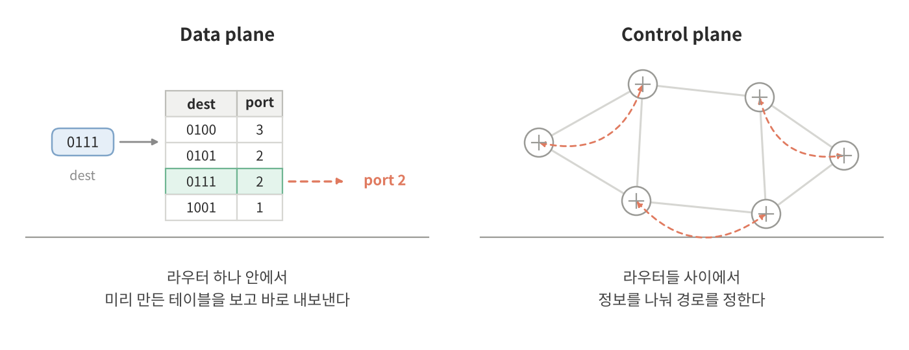

방금 내용과 이어서, 네트워크 계층을 건물의 한 층처럼 3차원적으로 생각한 다음 **data plane**과 **control plane**으로 나눠 얘기하기도 한다.

**Data plane (데이터 평면).** 라우터 자체로만, 지역적으로 동작하는 기능이다(local, per-router function). 도착한 패킷을 처리하는 것과 관련이 많아서 데이터 평면이라고 부른다. 가장 유명한 기능이 input port에 도착한 datagram을 어느 output port로 forwarding할지 판단하는 것이다.

**Control plane (제어 평면).** 라우터와 라우터가 서로 정보를 공유하며 동작해야 하는 부분이다. 전체 네트워크 상태를 모르면 어디에 혼잡이 있는지, 이쪽 경로로 갈 수 있는지 알 수 없으니 제어를 잘할 수 없다. 그래서 숲을 보는 로직, 즉 **network-wide logic**을 다룬다. source host에서 destination host까지의 end-end path를 라우터들 사이에서 어떻게 정할지 결정한다.

참고로 지금 인터넷에서는 **호스트가 아니라 라우터가 경로를 정한다.** 그래서 이런 정보를 수집하고 처리하는 것도 라우터다. 앞의 운전 비유 때문에 헷갈릴 수 있으니 주의하자.

### Control plane을 구현하는 두 가지 방법

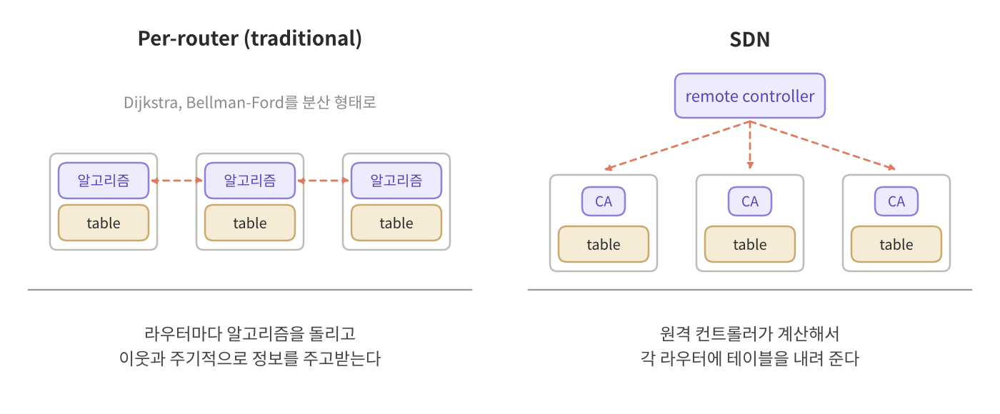

현대에는 두 가지 접근이 쓰인다.

**1) Per-router control plane (traditional routing algorithms).** routing algorithm을 각 라우터에 구현해서, 라우터마다 개별적으로 경로를 판단한다. 알고리즘 수업에서 배운 Dijkstra나 Bellman-Ford 같은 알고리즘을 **분산 알고리즘 형태로 바꿔** 실제 라우터에 적용한 것들이 쓰인다. 예전에 인터넷에서 라우팅을 구현한다고 하면 대부분 이 방법이었다.

그림을 보면 각 라우터의 머리 부분(프로세싱하는 부분)에 routing algorithm이 개별적으로 설치되어 있다. 알고리즘을 돌리려면 입력이 있어야 하니, 다른 라우터와 **일정 주기로 소통**해서 현재 네트워크 상황을 수집한다. 입력이 모이고 Dijkstra 같은 알고리즘을 돌리면, 도착한 패킷의 목적지에 따라 1번, 2번, 3번 중 어느 포트로 내보낼지 계산할 수 있다.

**Local forwarding table.** 그 계산 결과를 정리한 것이 테이블이다. 그림에서는 IP datagram 헤더에 4비트짜리 destination address가 적혀 있고, 첫 번째 열에는 올 수 있는 주소 값이, 두 번째 열에는 output port가 정리되어 있다. 이 라우터 안에서 input에서 output으로 전달하는 기능이니 forwarding이라는 이름을 붙여 **local forwarding table**이라고 부른다.

테이블이 만들어지면 라우터는 그 결과로 **매우 빠르게** 패킷을 분류해 출력 포트로 내보낸다. 빠르다는 걸 강조하는 이유는, 패킷이 도착할 때마다 routing algorithm을 돌릴 수는 없기 때문이다. 시간이 엄청 걸린다. 그리고 라우터들은 예를 들어 1분에 한 번씩 주기적으로 정보를 교환해 업데이트하니, 특별한 이벤트가 없는 한 그 1분 동안은 테이블을 바꿀 필요가 없다. 그래서 실제 forwarding은 **테이블 기반**으로 일어난다.

**2) Software-Defined Networking (SDN).** 10~15년 전쯤 엄청나게 유행했고, 실제로 네트워크의 일정 영역에서 활용(leverage)되고 있는 기술이다. 이름 그대로 네트워크를 연결하는 방법을 **소프트웨어로 정의**한다는 뜻이다. 위의 알고리즘은 한번 라우터에 설치되면 바꾸기 힘들다. 반면 SDN은 소프트웨어로 정의하니 쉽게 교체할 수 있다는 걸 장점으로 삼는다.

SDN은 보통 라우터와 별도로 **원격 서버(remote controller)** 를 운영한다. 서버 하나만 두는 건 좋지 않다. 그 서버가 죽으면 전체 네트워크의 경로를 판단하는 두뇌가 죽는 것이니 엄청난 문제가 된다. 보안 수업에서 말하는 **single point of failure(SPOF)** 다. 그래서 그림에서도 서버를 두 대 정도 둔다.

컨트롤러들은 각 라우터로부터 네트워크 상황을 수집한다. 라우터는 적어도 자기 주변 상황은 알고 있을 테니까. 정보를 받은 컨트롤러는 각 라우터 입장에서 어떤 패킷이 도착하면 어디로 forwarding할지 테이블을 계산해서 **라우터에 내려보내 설치**한다(remote controller computes, installs forwarding tables in routers). 그러면 라우터는 똑같이 destination address로 output port를 정한다. (그림의 CA는 각 라우터에 있는 control agent다.)

**두 방식의 장단점.**

| | Per-router (traditional) | SDN |
| --- | --- | --- |
| 계산 위치 | 각 라우터가 개별적으로 | 원격 컨트롤러가 한 곳에서 |
| 장점 | 잘 만든 분산 알고리즘이 설치되면 일부 라우터가 고장 나도 자동 복구 | 전체 그림을 정확히 계산해 라우터를 원하는 대로 동작시킴, 교체 쉬움, 다양한 필드 활용 |
| 단점 | 멀리 있는 라우터와 정보 공유가 어렵고, 전달 시간 때문에 정보 불일치가 생김, 소수의 전문가만 설정·변경 가능 | 컨트롤러가 고장 나면 전체가 고장 날 수 있음 |

per-router 방식에서 이웃 라우터끼리는 정보 교환이 빨라 문제가 없을 수 있다. 하지만 몇 홉 떨어진 라우터와 데이터를 공유하는 방법을 설계하는 것도 쉽지 않고, 정보가 전달되는 시간까지 고려하면 정보 불일치 때문에 원치 않는 결과가 나오는 상황까지 다 처리해야 한다. 앞에서 Dijkstra를 그대로 쓰지 않고 분산 알고리즘으로 바꾼다고 한 이유가 이거다. 각 라우터가 따로 계산해서 처음엔 결과가 불일치하더라도 어떤 값으로 **수렴**한다는 걸 분산 알고리즘에서 배우는데, 이런 걸 고려하지 않으면 구현 자체가 힘들다.

SDN의 또 다른 장점도 있다. destination address 하나로만 판정하는 건 사실 아주 적은 정보만 쓰는 것이다. SDN은 소프트웨어로 정의되니 **포트 번호나 Ethernet MAC address 같은 다른 필드**까지 이용해 forwarding하는 방식도 구현할 수 있다. 그래서 더 다양한 시나리오를 실현하는 데 더 유연하다고 주장하기도 한다.

**SDN은 어디에서 먹혔나.** traditional 방식은 80, 90년대 인터넷의 발전과 함께 이미 모든 기기에 설치됐다. 네트워크는 고장 나면 난리가 나니, 운영하는 사람들은 엄청난 돈벌이가 되는 게 아니면 바꿀 생각이 전혀 없다. SDN은 2000년대 초반에 처음 제안됐는데, 유연하다는 건 좋지만 일반 통신사 입장에서는 도입할 유인이 별로 없었다.

반면 **클라우드 컴퓨팅**이 SDN과 거의 비슷한 시기에 등장했다(교수님은 AWS가 2008년쯤 나왔다고 기억하셨다). 클라우드는 컴퓨팅 자원을 유연하게 제공하는 건데, 컴퓨팅 자원만 유연하고 네트워크 자원이 유연하지 않으면 자원 배분이 힘들다. 데이터를 전달해야 하니까. 그래서 SDN이 클라우드와 맞물려 함께 발전했다.

특히 **데이터 센터**를 지으며 신규 네트워크 장비를 설치할 때는 옛날 방식보다 SDN 기반으로 하자는 흐름이 생겼다. 실제로 구글이나 마이크로소프트가 네트워크 분야 컨퍼런스에 "SDN 기반으로 구축해 보니 비용도 절감되고 성능도 좋아졌다"는 논문을 많이 냈다. 즉 SDN이 실제로 적용된 사례는 있지만, 전 세계 네트워크 전체가 바뀌려면 아직 시간이 더 걸린다.

---

## 네트워크 서비스 모델

인터넷의 서비스 모델이 **best effort**라는 건 이미 얘기했다. 이번에는 조금 더 세밀하게, 인터넷이 제공하지는 않지만 **어떤 종류의 네트워크 서비스 모델이 존재할 수 있는지** 본다.

### 개별 datagram 서비스와 flow 서비스

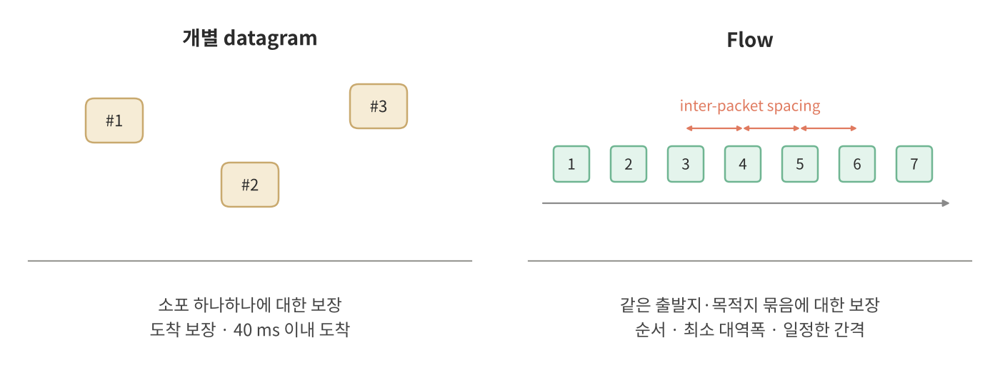

서비스는 individual datagram 단위로도, flow 단위로도 제공할 수 있다.

**개별 datagram에 대한 서비스.** 패킷 하나하나를 상품으로 보고 서비스를 제공한다. 우편물을 보낼 때 대개 이렇게 서비스를 받는다.

- guaranteed delivery: 이 소포가 반드시 도착하는지
- guaranteed delivery with less than 40 msec delay: 40 ms 지연 이내 도착 보장. 하루 배송 같은 개념이다.

**Flow에 대한 서비스.** 우리가 네트워크를 쓸 때 패킷 한두 개만 주고받지 않는다. 수백, 수천, 수만 개를 주고받는다면 하나로 묶어 서비스를 제공하는 게 나을 때가 많다. 비디오 스트리밍 중에 패킷마다 서비스를 다르게 설정하면 부자연스럽다. 비디오를 보는 한 세션 동안의 서비스를 보장받고 싶을 것이다. 이렇게 묶인 datagram을 **flow**라고 한다.

보통 네트워크 flow는 **source와 destination이 정해진 패킷들의 집합**이다. TCP라면 포트 번호로 결정된 데이터가 오가는 것을 하나의 bidirectional flow로 볼 수 있다. flow에 대한 서비스로는 이런 것들이 있다.

- **in-order datagram delivery:** 비디오는 데이터가 순서대로 와야 끊김 없이 볼 수 있다. 이걸 계약 조건에 넣는 것이다.
- **guaranteed minimum bandwidth:** 화질을 보장하려면 최소한 예를 들어 480p가 재생될 정도의 대역폭은 보장해야 한다.
- **restrictions on changes in inter-packet spacing:** 패킷 사이 도착 간격이 들쭉날쭉하기보다 일정 범위 안에 있는 게 비디오 시청에는 좋다. 도착 간의 시간 간격을 spacing이라는 표현으로 써서 헷갈릴 수 있는데, 이런 제약을 둬서 서비스 품질을 높이고 돈을 벌겠다는 생각이다.

### Quality of Service (QoS)

인터넷은 방금 말한 것들을 **전혀 보장하지 않았다.** 처음에는 군용 목적으로 만들어졌고, 그다음 학술 목적으로 컸기 때문에 판매한다는 느낌으로 구축하지 않았다.

그런데 이런 기술이 돈벌이가 된다는 걸 알게 되면 경영·경제 쪽 사람들이 달려들어 상품화하려 한다. 그때 이쪽 동네로 들어온 용어가 **Quality of Service(QoS)** 다. 네트워크가 제공하는 재화가 서비스가 되는 것이고, 이 서비스를 어느 수준까지 해서 판매하는지 계약서에 쓰기 위해 만든 단어다.

참고로 QoS는 보통 **o를 소문자로** 쓴다. QOS라고 대문자로 쓰는 사람도 있지만 가급적 Q, o, S로 쓰자.

### 서비스 모델 비교

| Network Architecture | Service Model | Bandwidth | Loss | Order | Timing |
| --- | --- | --- | --- | --- | --- |
| Internet | best effort | none | no | no | no |
| ATM | Constant Bit Rate (CBR) | constant rate | yes | yes | yes |
| ATM | Available Bit Rate (ABR) | guaranteed min | no | yes | no |
| Internet | IntServ Guaranteed (RFC 1633) | yes | yes | yes | yes |
| Internet | DiffServ (RFC 2475) | possible | possibly | possibly | no |

앞의 개념을 Bandwidth, Loss, Order, Timing(패킷 간격) 네 가지로 정리한 표다. 다시 한번, **인터넷의 best effort 모델은 이 중 아무것도 보장하지 않는다.** 강의자료의 말로 하면 목적지 도착, 전달 타이밍이나 순서, end-end flow가 쓸 수 있는 대역폭 중 어느 것도 보장하지 않는다.

**ATM: CBR과 ABR.** 인터넷이 뜨던 시기에 통신사들이 차세대 인터넷 기술이라고 만든 것이 **Asynchronous Transfer Mode(ATM)** 다. 매일 쓰는 현금인출기(automated teller machine)와는 다른 것이다. 지금은 인터넷과의 경쟁에서 실패해 사장됐다. 하지만 통신사들이 이걸 만들며 네트워크 계층 서비스 모델을 몇 가지 정의했다.

- **Constant Bit Rate (CBR):** bandwidth를 일정 값으로 고정해 전송하게 해 준다. circuit switching이 제공하는 것 같은 안정적인 품질이다. 통신사는 예전에 circuit switching 기반 전화로 돈을 벌었고, 인터넷은 그런 품질 보장이 안 되니 "이게 돈벌이가 되겠다"고 본 것이다. 그래서 손실도 없고, 순서도 안 바뀌고, 간격도 유지되는 아주 고품질 서비스로 설계했다.
- **Available Bit Rate (ABR):** 저가로 쓰려는 사람들을 위한 서비스다. CBR로 회선을 제공하고 남은 대역폭을 쓰게 해 주되, 아무 제약 없이 쓰게 하면 통화도 못 할 품질이 될 테니 최솟값은 보장한다(guaranteed min). loss와 timing은 보장하지 않지만, 인터넷보다는 좋아야 하니 order는 보장한다.

ATM이 승리하지 못했어도, 이런 서비스 모델로 돈을 벌 기회를 만들 수 있고 이런 기술이 필요하다는 느낌은 받을 것이다. 다만 사람들이 거기에 비싼 돈을 내고 싶지 않았을 뿐이다.

**IntServ와 DiffServ.** 인터넷 쪽에서도 이를 경계해 IntServ, DiffServ라는 기술로 대응했다. 디테일은 다루지 않는다. **IntServ**는 ATM이 말하는 수준까지 보장하려고 노력했던 흔적인데, 현재는 죽은 기술이다. **DiffServ**는 기업 네트워크에서 아직도 쓰는 경우가 있다. 이런 단어가 있다 정도로 넘어가면 된다. 결국 인터넷은 가능한 범위 안에서 노력하는 정도이고, **대부분 best effort 서비스 모델**이라는 걸 기억하자.

### Best effort는 왜 이렇게까지 성공했을까

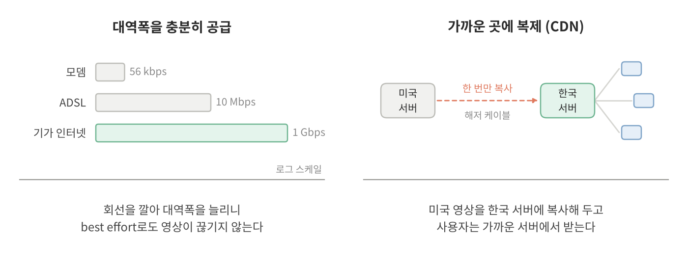

네트워크 하는 사람들 입장에서는 ATM 같은 기술이 성공했다면 더 많은 석박사들을 회사에 취직시켜 돈을 벌 수 있었을 텐데 그러지 못했다. 그래서 강의자료에는 반성에 대한 얘기도 있다. 인터넷은 왜 이렇게 성공해 버렸을까?

**1) 메커니즘이 단순하다.** 복잡하게 느껴질 수 있지만 ATM 같은 걸 만드는 것보다 훨씬 간단했다. 그래서 전 세계에 설치하는 과정에서 트러블이 덜했다. 잘 운영되면 사람들은 굳이 바꿀 필요성을 못 느낀다.

**2) 대역폭을 충분히 공급했다(sufficient provisioning).** 기술, 특히 하드웨어의 발전이 엄청 빨랐다. 교수님이 90년대 초반에 처음 인터넷을 쓸 때는 모뎀으로 56 kbps 수준이었다. 1초에 56 kb도 못 보낸 것이다(바이트도 아니고 비트다). 2000년대 닷컴 버블이 꺼지기 직전쯤 ADSL 같은 기술이 나오면서 10 Mbps급이 되어 100~200배 정도 빨라졌고, 미국에서는 더 빠른 기술들이 등장했다.

돌아보니, 케이블을 더 깔고 더 비싼 하드웨어로 bandwidth를 무진장 공급하면 voice나 video도 best effort로 충분히 품질 좋게 할 수 있었다. 실제로 그렇게 실현했다. 우리나라는 기가 인터넷까지 속도를 올려서, 2000년대 기준으로 25년 만에 다시 100배를 넘게 뛰었다. 그러니 유튜브를 재생해도 best effort로 전혀 끊김이 없고, 앞의 기술을 굳이 고도화할 필요성을 못 느끼는 것이다. 강의자료의 표현으로는 "대부분의 시간 동안(most of the time)" "충분히 좋은(good enough)" 성능이다.

**3) 애플리케이션 계층에서 서비스를 복제했다(CDN).** 유튜브를 한국에서 본다면 분명 한계가 있다. 해저 케이블로 태평양을 건너야 하는데, 이건 아주 희소하고 비싼 자원이다. 이걸 푸는 방법이 **서버 replication**이다. 미국에 있는 동영상을 한국 통신사의 서버를 빌려 카피해 두고, 한국 사용자는 한국 서버에서만 받아 가게 한다. 그러면 해저 케이블을 쓰는 횟수가 크게 줄어든다. 이런 **content distribution network(CDN)** 가 아주 성공적으로 도입되면서 사용자들을 상당히 감당할 수 있게 됐다.

슬라이드에는 없지만 **locality**도 있다. 한국 사람들끼리 보는 동영상, 미국 사람들끼리 보는 동영상이 따로 있다. 이걸 고려해 서버를 배치하면 네트워크의 아주 긴 경로를 쓰는 일을 최소화할 수 있다.

결국 이런 얘기다. "네트워크에 돈 투자하지 말고 **개발자를 괴롭히자**." 개발자가 소프트웨어를 잘 만들고 하드웨어를 잘 깔아 scalable한 시스템을 구축하면, 앞의 QoS 기술을 도입하지 않아도 됐다.

**4) 혼잡 제어가 효과적으로 동작했다.** "elastic" 서비스의 congestion control도 이런 결과를 낳은 이유로 꼽힌다.

이 중 어떤 게 가장 강한 이유였는지 밝히는 건 쉽지 않다. 처음 네트워크를 연구한 사람들은 best effort에서 더 고도화하는 걸 노렸지만, best effort가 왜 이렇게까지 성공했는지는 아직도 논란의 여지가 있다. 강의자료의 결론처럼 best effort 모델의 성공에 반박하기는 어렵다.

---

## Part 2. 인터넷 프로토콜 기초

이제 인터넷 프로토콜의 기초를 본다. 앞으로 인터넷 프로토콜은 줄여서 **IP**라고 부른다.

IP는 **버전 4와 버전 6** 두 가지가 있다. 다른 버전들도 있었지만 내부 개발용이라 실제로 deploy된 적은 없다. 그래서 보통 IP라고 하면 버전 4를 가리킨다. 중국처럼 늦게 인터넷에 들어왔고 사용자 규모가 큰 경우를 빼면 아직 버전 6을 메인으로 쓰는 곳은 많지 않다. 점진적으로 바뀌어 가고는 있다.

### IP가 제공하는 서비스

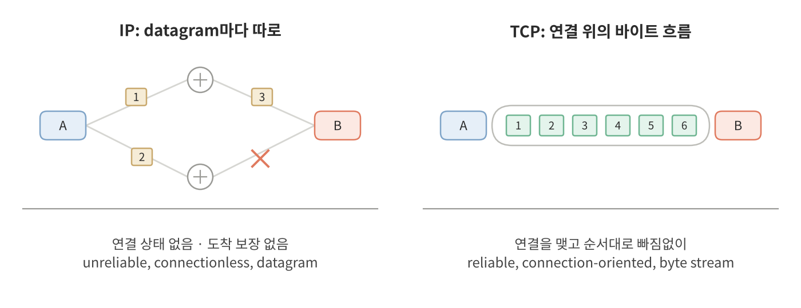

IP가 제공하는 서비스가 무엇이냐고 누가 물으면 세 단어로 답하면 된다. IPv4(RFC 791)는 **unreliable, connectionless, datagram delivery** 서비스를 제공한다. TCP가 **reliable, connection-oriented, byte stream delivery** 서비스였던 것과 매우 대비된다.

**Unreliable.** 각 datagram이 목적지에 도착한다는 **어떤 보장도 하지 않는다.** 그래서 best effort 서비스라고 부른다. 필요 없이 트래픽을 다 버리지는 않지만 패킷의 운명은 보장하지 않는다. 필요한 신뢰성은 **상위 계층**이 제공해야 한다.

**Connectionless.** circuit switching에서는 통신하려면 중간 장치들이 connection setup으로 상태를 유지해 그쪽으로 갈 수 있도록 세팅해야 했다. store-and-forward를 쓰는 IP는 그런 connection 개념 없이 네트워크 계층을 구현했기 때문에 connectionless라고 한다.

즉 **라우터들은 통신에 대한 state information을 따로 유지하지 않는다.** 그래서 원칙적으로 **각 datagram은 독립적으로 처리**된다. 소포를 다룰 때 "전에 누가 이런 소포를 보냈었네" 같은 걸 활용해 동작하지 않는다는 것이다. 이게 일반적인 IP의 동작이라는 걸 꼭 기억하자.

---

## IPv4 헤더

IP가 주고받는 PDU인 datagram은 헤더와 payload로 이루어진다.

- **헤더:** 최소 20바이트, 최대 60바이트
- **datagram 전체:** 최대 65,535바이트 (2^16 − 1)

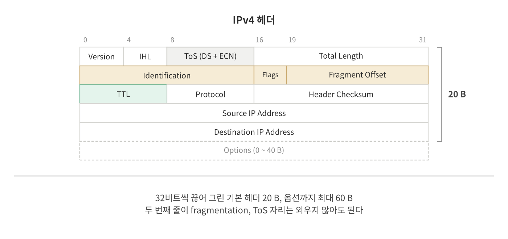

헤더는 **각 필드의 위치까지 다 외우는 것을 추천**한다. 단, 강의자료에서 노란색으로 표시된 원래 ToS 비트 구성은 외우지 않아도 된다. 그림은 32비트(4바이트) 기준으로 잘라 2차원으로 표현한 것이다.

### 첫 번째 줄: Version, IHL, ToS, Total Length

**Version (4 bits).** IP의 버전이 적혀 있다. IPv4면 0100, 즉 4다. IPv4와 IPv6는 서로 호환되지 않는다(not interoperable).

**Internet Header Length, IHL (4 bits).** TCP에서도 비슷한 걸 봤다. 헤더 길이를 4비트로 표현하는데, 이 값을 **4배**로 뻥튀기해서 계산하니 최대 15 × 4 = 60바이트까지 표현된다. 그러면 IHL의 최솟값은? 헤더가 최소 20바이트이니 **5**다.

**Type of Service, ToS (8 bits).** 원래는 IP가 다루는 배송물의 내용이 뭔지, 그래서 네트워크에서 어떤 종류의 처리를 받아야 하는지 기재하려고 만든 필드다. 하지만 이 개념은 **폐기됐고 지금은 쓰이지 않는다.** 그래서 외울 필요가 없고, **시험에도 내지 않는다**고 하셨다.

네트워크를 더 공부하고 싶은 사람을 위해 덧붙이면, 지금 이 자리는 앞에서 말한 **DiffServ**를 구현하기 위한 6비트 DS(Differentiated Services) Codepoint와, 혼잡을 explicit하게 알려 주는 2비트 **ECN**(Explicit Congestion Notification)으로 바꿔 기업 네트워크에서 쓰고 있다. ECN은 혼잡 제어에서 봤던 그 기술이다. VPN을 다루는 소프트웨어 개발자라면 이 부분을 더 봐야겠지만, 일반 학생 입장에서는 이런 필드가 있다 정도로 기억하면 된다.

**Total Length (16 bits).** 현재 IP datagram의 전체 길이로, **헤더까지 포함**한다. 16비트이니 2^16 − 1 = 65,535가 앞에서 말한 최대 크기가 된다. IPv4에는 payload length 필드가 따로 없어서, payload 길이는 Total Length − Header Length로 구한다.

### 두 번째 줄: Identification, Flags, Fragment Offset

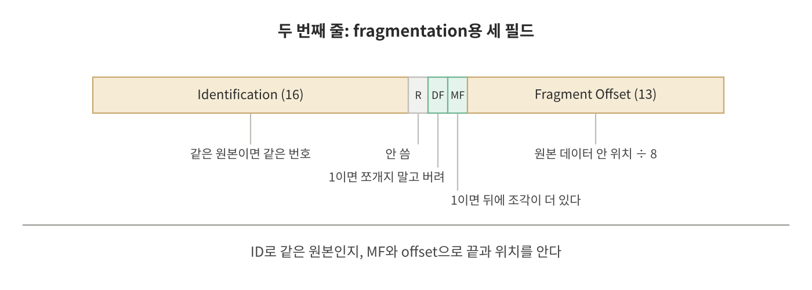

이 줄이 **매우 중요하다.** IP fragmentation에 관련된 필드가 여기 모여 있다. 자세한 계산은 뒤의 Part 3에서 보는데, 간단히 말하면 datagram이 라우터를 거쳐 가는 도중에 **잘리는(fragment) 경우**가 있고, 이를 처리하기 위한 필드들이다.

**Identification (16 bits).** fragmentation과 별도로도 언급되는 필드라 이름을 꼭 기억해 두자. **송장 번호, 조회 번호**라고 생각하면 된다. 택배를 받으면 택배 번호로 배송 조회를 하듯, 원래 그런 목적으로 붙은 번호다. 원래는 호스트가 datagram을 보낼 때마다 1씩 늘려서 붙였다.

**Flags (3 bits).** 첫 번째는 reserved, 예약되어 있어 안 쓴다. 나머지 두 개만 쓴다.

- **Don't Fragment (DF):** "쪼개지 마라"라는 표시다. 배송 중에 쪼개야 하는 상황이 생기더라도 쪼개서 전달하지 말고 **차라리 버리라**는 뜻이다. 실제로 1로 표시하면, 쪼개져야 하는 상황에서 버려진다.
- **More Fragments (MF):** 이 fragment 말고도 **후속 fragment가 더 있으니** 적절히 처리하라고 알려 주는 flag다.

**Fragment Offset (13 bits).** 쪼개진 조각이 원래 데이터의 어디에 해당하는지를 나타낸다. 실제 값은 8로 나눠서 적는데, 자세한 건 Part 3의 예시에서 본다.

### 세 번째 줄: TTL, Protocol, Header Checksum

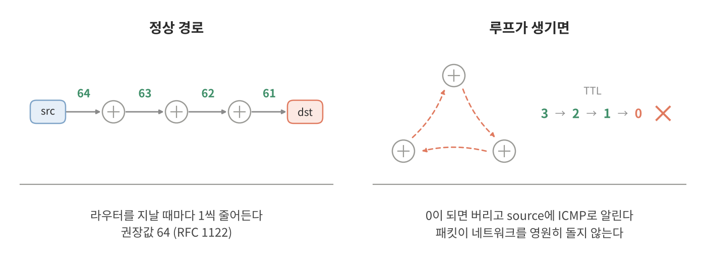

**Time-to-Live, TTL (8 bits).** IP datagram이 **몇 홉까지 살아남을 수 있는지**를 적는 필드다. 라우터를 거쳐 다른 네트워크로 한 번 넘어가는 것을 홉이라고 했다.

예를 들어 TTL을 16으로 세팅해 보냈다고 하자. 첫 번째 라우터는 이 값을 1 줄이고 다음 네트워크로 보낸다. 다음 라우터도 1 줄이고 보낸다. 16, 15, 14로 줄어 가다가 **0이 되는 순간, 그걸 처리하는 라우터는 datagram을 버린다.** 강의자료에 따르면 이때 source는 ICMP 메시지로 이 사실을 통보받는다.

이런 필드를 만든 이유는 **루프** 때문이다. 경로 설정이 잘못돼 네트워크에 뺑뺑이 도는 사이클이 생겼는데, 패킷이 없어지지 않고 forward, forward, forward 되면 네트워크에 패킷이 계속 쌓인다. 이를 막기 위해 datagram이 살아남을 수 있는 최대 홉 수를 TTL로 제한한다. 이런 필드가 네트워크에 왜 필요한지 인식하는 게 매우 중요하다.

예시로 16을 들었지만, 현대 네트워크에서는 **64 정도**를 추천한다(RFC 1122). 128이나 255처럼 더 큰 값을 쓰는 경우도 있다.

**Protocol (8 bits).** 네트워크 계층에서 **demultiplexing**을 실현하기 위한 필드다. IP 위에는 TCP도, UDP도, 다른 프로토콜도 있을 수 있다. 도착한 datagram을 TCP에 넘겨야 한다면 protocol 필드 값이 TCP를 가리키도록 세팅되어 있어야 한다. 이 값으로 TCP 프로그램에 보낼지, UDP 프로그램에 보낼지 판단한다. 번호는 TCP가 6, UDP가 17인데 **외울 필요는 전혀 없다.**

**Header Checksum (16 bits).** checksum으로 오류가 있는지 체크하는데, 이름이 **header** checksum이라는 데 주목하자. IP는 자기가 배송하는 데이터의 신뢰성을 보장하지 않는다고 했다(unreliable). 예를 들어 라우터가 input에서 output 포트로 옮기다가 복사를 잘못했을 수도 있지만, 그런 건 전혀 체크하지 않는다. 다만 **송장이 틀리면** 문제가 되니, 송장에 해당하는 **헤더 부분만** checksum을 계산한다. 데이터 부분의 에러 체크는 TCP에서 했다.

### 나머지: 주소와 옵션

마지막 두 줄은 **Source IP Address**, 그다음 **Destination IP Address**다. source 다음에 destination이 온다는 건 여러 번 강조했으니 기억하자. IPv4 주소는 32비트라 한 줄씩 차지한다.

이렇게 5줄, **20바이트가 기본 IP 헤더**다. 여기에 최대 **40바이트**의 옵션이 붙을 수 있다. 그 뒤에 데이터가 들어가는데, 보통 **payload**라고 부른다.

**시험 팁.** 필드 위치를 정확하게 외우는 것까지 시험에 내지는 않으셨다고 한다. 하지만 "빈칸을 채우시오" 같은 문제가 나오면 쓸 수 있을 정도는 외워 두자. 설마 저걸 다 빈칸으로 뚫지는 않을 테니까.

### 상세 슬라이드: 가볍게 보고 넘어가기

강의자료에는 헤더 필드를 더 자세히 설명한 슬라이드들이 있다. 이 부분은 하나하나 다 설명하지 않고 **가볍게 보고 넘어가면 된다**고 하셨다(다 설명하면 시험 문제를 내야 하니까). 네트워크에 깊은 관심이 있다면 한번쯤 살펴보면 좋다. 수업에서 짚은 것만 정리한다.

**Identification은 IP에서 정말 중요할까?** 송장 번호에 비유했더니 이 번호가 IP에서 엄청 중요하다고 착각할 수 있다. 송장 번호는 유일성도 보장하고, 보통 1씩 늘리니 몇 번째로 발행됐는지 순서를 나타내는 의미도 있다. 그런데 IP는 **순서를 보장하지 않는다**고 했다. 그러니 번호를 붙여도 라우터들은 전혀 관심이 없고 동작에 관여하지 않는다. identification 그 자체는 별로 중요하지 않다.

중요해지는 상황은 **fragmentation**이다. 한 패킷이 여러 개로 쪼개지면, 이것들이 원래 같은 datagram이었다는 걸 알려 주는 식별자가 필요하다. identification은 그 목적으로 쓰인다. RFC 6864는 이 필드를 **fragmentation과 reassembly 외의 목적으로 써서는 안 된다(MUST NOT)** 고 말한다.

**UDP와 576바이트.** UDP에 관심이 있다면 이 슬라이드는 체크해 두면 좋다. 최대 크기는 65,535바이트지만, RFC 791에 따르면 호스트가 576바이트보다 큰 IPv4 datagram을 꼭 받을 수 있어야 하는 건 아니다. 1980년대의 16비트 CPU가 64 KB 메모리만 직접 접근할 수 있었기 때문이다. 그래서 UDP를 쓰는 많은 IETF 프로토콜이 이 한계를 피하려고 데이터 크기를 512바이트로 제한한다.

**Options.** 옵션의 모양(Type, Length, Value)도 굳이 외울 필요는 없다. 옵션은 가변 길이지만 32비트 경계에서 끝나도록 1바이트짜리 NOP, EOP 옵션으로 채운다. 이것도 처리 문제 때문일 것이다. 강의자료에 따르면 표준화된 옵션 대부분은 오늘날 거의 쓰이지 않아서, 기업 네트워크 경계의 방화벽에서 막거나 제거하는 경우가 많다.

### IP의 역다중화

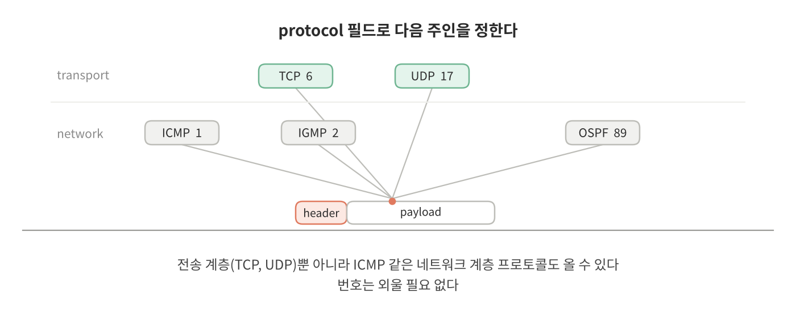

이 부분은 체크해 두자. 앞의 설명만 들으면 protocol 필드에는 TCP, UDP 같은 **전송 계층** 프로토콜 값만 적힌다고 착각할 수 있다. 그런데 여기 올 수 있는 것 중 일부는 **네트워크 계층**으로 분류되는 것들이다. 뒤에서 배울 **ICMP**도 IP의 protocol 필드에 올 수 있다는 걸 염두에 두자. 그림처럼 IGMP, OSPF도 마찬가지다.

디테일하게 묻지는 않으니 가볍게 봐도 되지만, 네트워크 관련 자격증 시험을 본다면 알아 두어야 한다.

---

## IPv6 헤더

### 단순함을 위해 다시 만든 헤더

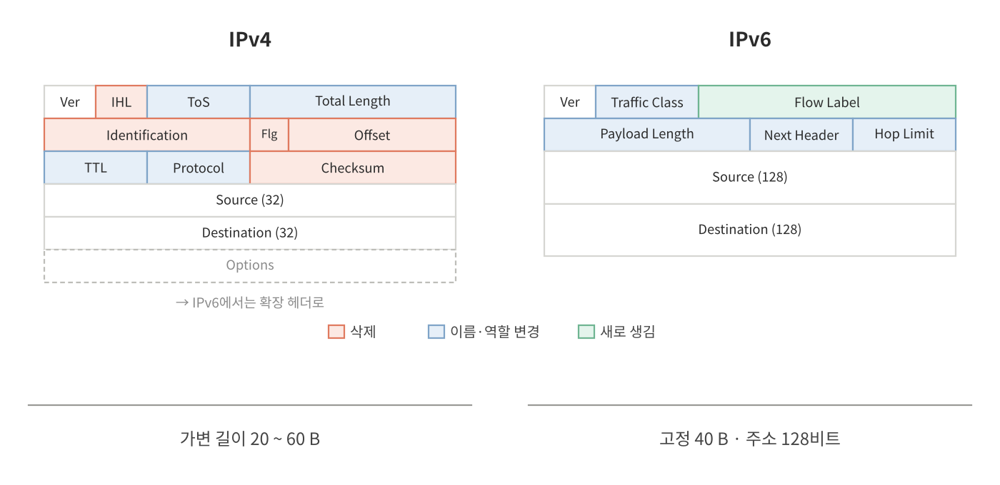

**IPv6**는 차세대 인터넷 프로토콜(IPng)이라는 이름으로 처음 개발됐다가 버전 6으로 최종 결정됐다. IPv4가 실제로 전 세계에 deploy된 뒤에 개발된 기술이라, 앞에서 만든 것 중 불필요했던 걸 제거하고 **단순하게** 하는 데 맞춰져 있다.

앞에서 인터넷 속도가 엄청나게 빨라졌다고 했다. 그 말은 라우터가 처리해야 할 패킷의 양이 급격하게 늘었다는 뜻이다. 그런데 IP에 필드가 많다는 건 필요에 따라 그걸 일일이 체크해야 한다는 뜻이고, 라우터의 계산 비용을 높인다. 그래서 IPv6를 만든 사람들은 **필드 수를 엄청 줄였다.**

**Version.** 첫 4비트는 바꾸면 안 된다. IPv4와 IPv6가 같은 네트워크에 흐르니, 이 값이 6인지 보고 IPv6인지 확인한다.

**Header Length 제거 → 40바이트 고정.** 원래 Version 뒤에는 IHL이 있었다. IPv6에는 없다. 헤더 길이가 바뀌는 걸 체크해서 메모리 공간을 세팅하는 것 자체가 엄청난 오버헤드라고 보고, **헤더를 고정값으로** 만들어야 빠르게 처리한다고 판단해 없앴다.

**Traffic Class.** DiffServ와 ECN은 IPv6와 비슷한 시기에 개발돼서 이 자리를 추가해 두었다. 강의자료 그림에서는 6비트 DSField와 2비트 ECN으로 그려져 있다.

**Flow Label (20 bits).** identification과 비슷하지만 다른 개념이다. 개별 datagram에 송장 번호를 붙이는 건 실제 물류나 우편에서는 중요하지만, IPv4에서는 fragmentation 말고는 전혀 활용하지 않았다.

서비스를 고도화하는 측면에서 생각해 보면, 누군가 비디오를 보고 있다면 그 flow를 구분해 특별한 처리를 해서 돈을 벌고 싶을 수 있다. 개별 송장 번호는 필요 없고, "유튜브는 몇 번 flow다"를 구분하는 식별자를 붙이겠다는 게 flow label이다. 다만 사용법이 잘 표준화되어 있지 않아서, 일반 인터넷보다는 데이터 센터나 기업 네트워크처럼 서비스를 고도화하고 싶은 회사들이 각자의 방법으로 번호를 붙인다. 수업에서는 쓰는 법을 다루지 않고, 이런 컨셉으로 라우터를 고도화해 서비스를 차등화할 수 있다는 것만 기억하면 된다.

**Payload Length (16 bits).** 헤더 길이는 고정이고 payload 길이만 바뀌니, total length 대신 payload length를 적는다.

**Next Header (← Protocol).** protocol 필드를 대체한 이름이다. 앞에서 protocol 필드를 전송 계층 프로토콜을 구분하는 식별자라고 했는데, 실제로는 네트워크 계층에 있는 걸 가리키는 경우도 있어서 이상했다. 그래서 그냥 next header라고 부르기로 했다.

**Hop Limit (← TTL).** Time-to-Live는 datagram이 살아 있는 시간이라는 은유적인 표현이라 재미는 있지만, 홉의 제한이라는 뜻을 정확하게 전달하지 못한다. 그래서 hop limit으로 바꿨다. 학술 네트워크에서 자기들끼리 쓰던 은어 같은 개념이 표준화로 가면서 바뀐 것으로 보인다. 강의자료에 따르면 TTL은 원래 초 단위의 최대 수명이었지만, 라우터는 항상 적어도 1씩 줄여야 했다.

**128비트 주소.** IPv6의 주소 길이는 무려 **128비트**, IPv4의 **4배**다. 사람이 외우지 못할 정도로 키웠다. 그만큼 전 세계에 많은 호스트가 설치될 거라고 가정했고, 이번에 만들면 더 이상 못 바꿀 거라는 위기의식이 있었던 것으로 보인다. 그 결과 IPv6 헤더는 총 **40바이트**다.

### Next Header 체인: 옵션을 대신하는 확장 헤더

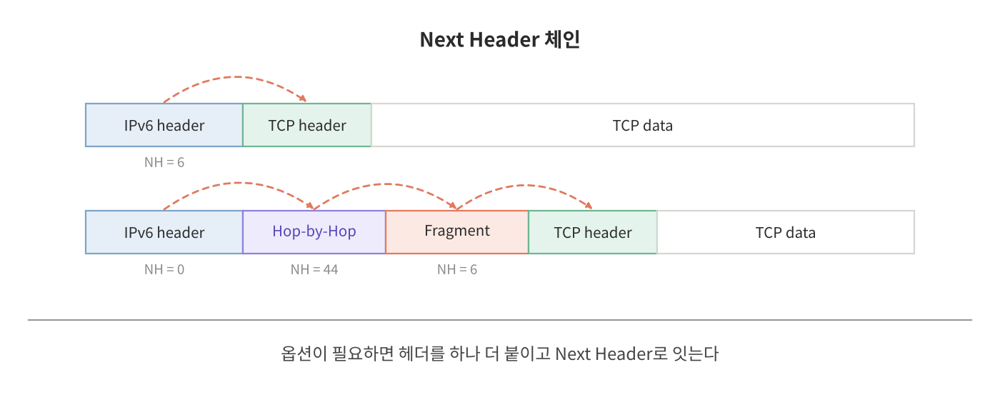

IPv6 헤더 다음에 바로 TCP 데이터가 들어간다면, next header는 protocol 필드와 같은 값인 **6**을 쓴다.

그런데 헤더 길이가 고정됐으니 IPv6에는 **옵션 개념이 없어졌다.** 옵션 비슷한 걸 구현하고 싶다면 next header로 **헤더를 하나 더 붙이는** 것을 허용한다. 옵션을 정말 써야 한다면 **별도의 계층을 두는 것처럼 쓰라**는 설계 의도가 보인다. 그림 아래쪽처럼 IPv6 Header → Hop-by-Hop Options Header → Fragment Header → TCP 순으로 체인이 이어진다. 강의자료에 따르면 Hop-by-hop Options 헤더는 경로상의 모든 장비가 처리하도록 되어 있다.

### Fragmentation도 없앴다

fragmentation은 네트워크의 어떤 경로를 흘러가다가 라우터가 어쩔 수 없이 쪼개는 상황이라고 했다. 쪼개야 하는 이유는 **MTU의 제한** 때문이다. 1500바이트 MTU를 쓰다가 600바이트 MTU인 쪽으로 간다면, 보낸 사람은 1500바이트를 실어 보냈으니 여러 개로 쪼개야 하는 상황이 생긴다.

IPv6를 만든 사람들은 "네트워크 성능이 이미 좋아졌는데 MTU 차이가 그렇게 크겠어? 필요하더라도 그걸 꼭 IPv6가 해야 해?"라고 생각했다. 그래서 별도로 **next header 부분에서 처리**하도록 설계했다. 강의자료에 따르면 IPv6는 라우터나 방화벽 같은 **중간 장비에서의 fragmentation을 허용하지 않고**, 끝단 호스트만 IPv6 fragment 확장 헤더로 패킷을 쪼갤 수 있다.

### 수업 중 질문

**Q. IPv6에서는 왜 header checksum이 없나요?**
매우 좋은 질문이다. header checksum을 체크해야 할 만큼 네트워크 장비가 후지지 않기 때문이다. 예전에는 컴퓨터 성능이 너무 안 좋아서 계산하다가 오류가 나는 경우가 많았다. 지금은 성능이 좋아져서 굳이 체크할 필요성을 못 느꼈고, 그래서 계산을 뺐다고 보는 게 맞다. 강의자료도 같은 이유를 든다. 유선 네트워크에서 비트 오류는 비교적 드물고, 필요하면 상위 계층에 더 강한 메커니즘이 있다.

교수님은 이런 예를 드셨다. 컴퓨터가 데이터를 잘 저장할 것 같지만, 1년 정도 안 끄고 계속 켜 두면 갑자기 윈도우가 죽는 상황이 생긴다. 이유는 여러 가지지만 메모리에 약간의 오류가 생기는 경우도 있다. 그래서 서버급 컴퓨터는 **ECC** 메모리를 쓴다. 일반 메모리보다 두 배 정도 비싸지만 오류를 정정하는 기능이 있다. 고속 라우터도 이런 걸 써서 에러를 잡을 수 있으니, IP에서 굳이 체크할 필요성을 못 느낀 것으로 보인다.

---

## Part 3. IPv4 Fragmentation

IPv4 포맷을 살펴보며 fragmentation이 개념적으로 중요하다고 했다. 이제 그 부분을 자세히 본다.

### MTU와 fragmentation

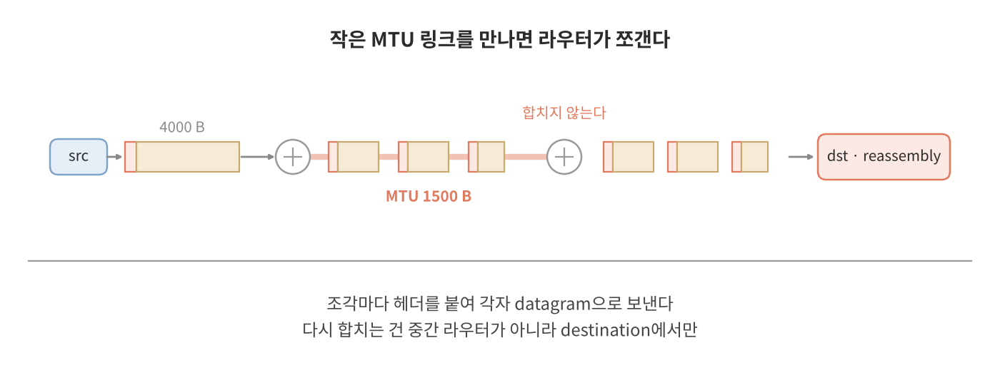

인터넷에서 데이터는 호스트와 라우터를 거쳐 최종 목적지로 가는데, 각 네트워크, 각 링크에는 **MTU**가 있다. 그 링크에 한 번에 흘려보낼 수 있는 IP datagram의 크기가 정해져 있다는 뜻이다. 강의자료의 말로는 가장 큰 link-level frame의 크기이고, 링크 종류마다 MTU가 다르다.

통신하는 두 컴퓨터는 각자 자기 링크의 MTU는 확인할 수 있으니, 적어도 작은 값을 골라 보내는 게 합리적이다. 문제는 **경로상의 모든 링크의 MTU를 알 방법이 마땅치 않다**는 것이다. 하나하나 체크하는 방법을 구현할 수는 있지만, 통신할 때마다 경로가 바뀌는 상황에서 매번 그걸 체크하느라 시간을 보내는 건 합리적이지 않다.

그래서 자기가 아는 정보로 패킷을 만들어 흘려보낸다. 그런데 어떤 라우터에서 다음 라우터로 가는 링크의 MTU가 패킷보다 작다면? 한 번에 보낼 방법이 없으니 **쪼개서 보내야** 한다.

쪼갠다는 건 패킷 하나로 여러 개의 패킷을 만든다는 뜻이다. 그런데 데이터를 흘려보낼 때는 헤더를 붙여 보내야 하니, **각 조각에도 헤더를 다 붙여야** IP datagram으로서 네트워크를 흘러갈 수 있다. 이 작업을 라우터가 하는데, 이를 **IP fragmentation**이라고 한다. datagram 하나가 여러 개의 datagram이 되는 것이다.

### Reassembly는 목적지에서만

합리적으로 생각하면, 어떤 링크에서만 MTU가 작아 쪼개졌고 그 뒤로는 MTU가 계속 크다면 다음 라우터에서 다시 합치면 되지 않을까 싶다.

하지만 인터넷에서는 **중간 라우터가 합치지 않는다.** 쪼개진 것을 합치는 작업을 **reassembly**라고 하는데, reassembly는 **destination에서만** 한다. 꼭 기억하자.

쪼개야 하는 상황은 네트워크의 라우터 때문에 생겼지만, 원래대로 복원하는 작업은 중간 라우터가 굳이 할 필요가 없고 받는 쪽에서 잘 받아 처리하면 되니 그쪽에 떠넘기는 것이다. 사실 이게 더 합리적이다. 강의자료 그림처럼 한 홉이라면 조각들이 같은 링크를 탈 가능성이 높지만, 합쳐야 할 위치가 다르고 조각마다 **다른 경로**를 타고 온다면 어디서 합칠지 모호해진다.

fragment가 생긴 datagram은 IP 헤더의 비트로 확인할 수 있다. 앞에서 본 두 번째 줄의 **Identification, Flags, Fragment Offset** 세 필드다.

- **Flags 첫 비트:** 사용하지 않는다.
- **Don't Fragment (DF):** 이 datagram은 fragmentation하면 안 되니, MTU가 작은 곳을 거쳐야 한다면 그냥 폐기해 달라는 뜻이다. 보내는 쪽이 어떤 이유로 이 데이터가 쪼개지면 안 된다고 알리는 용도로 쓴다.
- **More Fragments (MF):** fragmentation에서 매우 중요하다. **1이면 이 조각이 맨 끝 조각이 아니고, 0이면 맨 마지막 조각**이다.

### 예시: 4000바이트 datagram, MTU 1500바이트

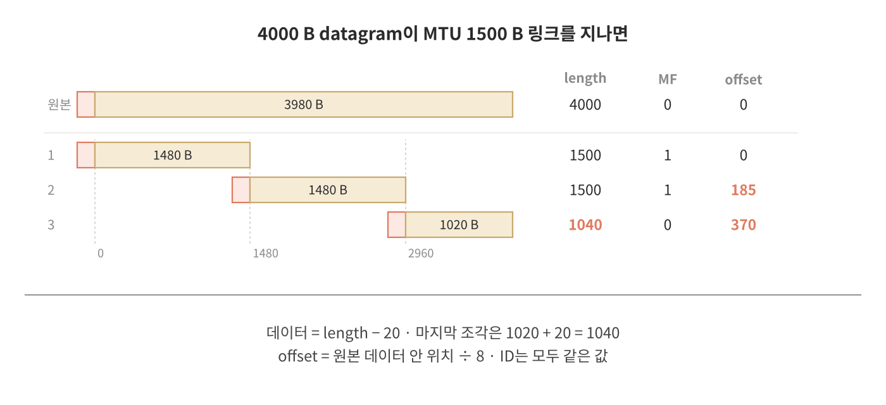

호스트가 **4000바이트**짜리 IP datagram을 보냈다고 하자. 그림의 length는 total length다.

**쪼개지기 전.** length는 4000, ID는 x(identification에 임의의 값이 들어 있다는 뜻)다. 아직 쪼개지지 않았으니 MF는 0이고, offset도 특별히 세팅할 이유가 없으니 0이다. 그래서 **MF와 offset이 둘 다 0이면 fragmentation이 일어나지 않은 패킷**이라는 걸 쉽게 알 수 있다.

**MTU 1500바이트 링크를 지날 때.** 첫 번째 조각을 1500바이트, 두 번째 조각도 1500바이트로 만들고, 애매하게 남은 나머지로 마지막 조각을 만든다. 여기서 **헤더가 추가된다**는 걸 주의해야 한다. 이 예시는 IP 옵션을 쓰지 않는다고 가정하니 헤더는 20바이트다.

1. total length 1500짜리 조각에 실제로 담기는 데이터는 1500 − 20 = **1480바이트**다. 두 번째 조각도 마찬가지다. total length 필드에는 1500이 적히고, 데이터는 1480바이트가 들어간다.
2. 원본 datagram에도 20바이트 헤더가 붙어 있었으니 실제 데이터는 4000 − 20 = **3980바이트**였다.
3. 첫 번째와 두 번째 조각이 1480바이트씩 나눠 먹었으니, 마지막 조각의 데이터는 3980 − 2 × 1480 = 3980 − 2960 = **1020바이트**다.
4. 그런데 세 번째 조각의 크기가 1020은 아니다. 헤더 20바이트를 더해야 하니 length는 **1040바이트**다.

별거 아니지만, **실제로 시험에 내면 20~30%가 이걸 틀린다**고 하셨다. 어렵지는 않은데 헷갈릴 수 있으니 꼼꼼하게 체크해서 기억하자.

**Identification.** 세 조각은 같은 datagram에서 나왔으니 identification이 모두 **x로 같다.** 송장 번호가 같아야 같은 원본에서 쪼개졌다는 걸 알고 다시 합칠 수 있다.

**MF flag.** 앞의 두 조각은 1, 맨 마지막 조각은 0이다. 그래서 reassembly를 하는 destination은 조각이 도착했다고 바로 상위 계층에 올리지 않고, 뒤 조각까지 와야 마무리할 수 있다는 걸 안다.

**Fragment offset.** 조각이 순서대로 도착한다면 MF의 1과 0만 보면 되겠지만, 실제로는 다른 경로로 오면서 **순서대로 오지 않을 수 있다.** 그래서 순서를 맞추기 위한 추가 정보가 필요하고, 그게 offset이다. offset은 **원래 datagram의 데이터 부분(data portion)에서 이 조각이 어느 위치에 있었는지**를 저장한다.

### Offset은 8로 나눈 값

문제는 offset 필드 크기가 애매하다는 것이다. flag 3비트 때문에 fragment offset은 **13비트**다. 반면 IP datagram은 16비트를 꽉 채워 65,535바이트까지 보낼 수 있다. 그래서 TCP의 header length 필드처럼 테크닉을 쓴다. **실제 위치를 8로 나눠서 기재**한다. 3비트만큼 right shift하는 것이다.

- 첫 번째 조각: payload의 0번째 위치 → 0 ÷ 8 = **0**
- 두 번째 조각: 1480번부터 시작 → 1480 ÷ 8 = **185**
- 세 번째 조각: 2960번부터 시작 → 2960 ÷ 8 = **370**

| | length | ID | MF | offset |
| --- | --- | --- | --- | --- |
| 원본 | 4000 | x | 0 | 0 |
| 조각 1 | 1500 | x | 1 | 0 |
| 조각 2 | 1500 | x | 1 | 185 |
| 조각 3 | 1040 | x | 0 | 370 |

필드를 어떻게 해석하는지 정확히 알아야 fragment 문제가 나왔을 때 정확히 답할 수 있다. 교수님도 이렇게 디테일하게 설명한 건 처음이라고 하셨다.

### 한 번 더 쪼개지는 경우

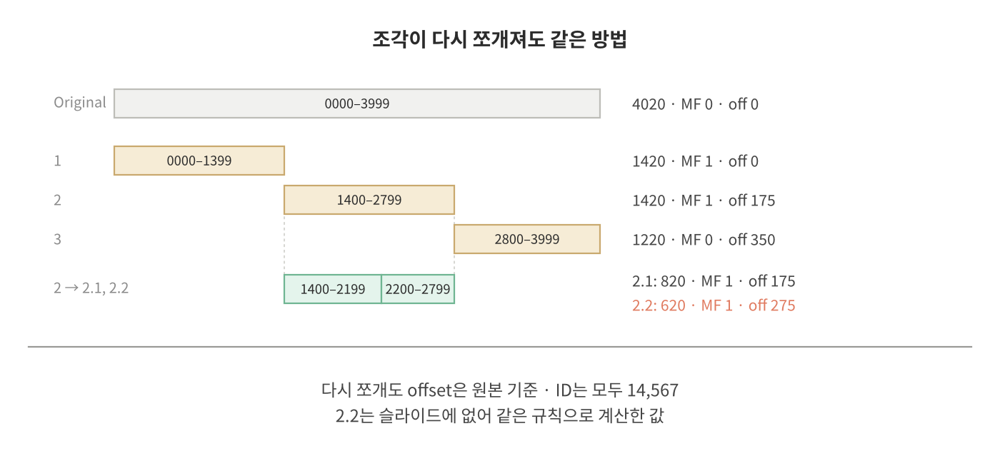

문제를 더 어렵게 만들면, 어떤 링크에서 datagram을 세 조각으로 쪼갠 뒤 그중 하나가 또 쪼개지는 상황도 생각할 수 있다. 이때도 같은 방법으로 처리하면 된다. 강의자료 예시에서는 4020바이트 datagram(데이터 0000–3999)이 1420, 1420, 1220바이트 세 조각(offset 000, 175, 350)으로 나뉘고, 두 번째 조각이 다시 820바이트짜리 2.1(데이터 1400–2199, offset 175)과 2.2로 나뉜다. 다시 쪼개도 offset은 **원본 데이터 기준**이라는 점이 포인트다. 그림의 2.2(620바이트, MF 1, offset 275)는 슬라이드에 값이 없어서 같은 규칙으로 직접 계산한 것이다.

여기까지 시험에 낸 적은 없다고 하셨다. 시험 시간이 길지 않으니까. 그래도 한 번쯤은 체크해 보고 넘어가자.

---

## Part 4. IPv4 Options

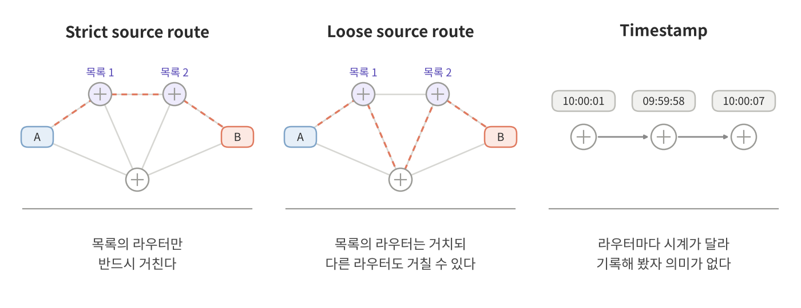

TCP처럼 IP도 헤더에 옵션을 붙일 수 있고, 최대 40바이트까지 추가할 수 있다. TCP처럼 처리 측면에서 32비트 배수로 늘어나도록 패딩을 넣는 부분도 있다. 하지만 TCP에서도 이런 부분을 강조하지 않았듯, 이런 디테일까지 외울 필요는 없고 **시험에 내지 않는다.**

### IPv4 옵션은 사실상 쓰이지 않는다

TCP 옵션은 실제 현업에서 쓰인다. window scaling, MSS, timestamp 옵션 같은 것들로 TCP의 여러 문제를 해결한다. 반면 **IPv4 옵션은 대부분 현재 쓰이지 않는다.** 쓸 수 없는 인터넷 환경이 됐다.

옵션 필드에 이상한 정보를 실어 공격하는 일이 실제로 많이 벌어졌기 때문이다. 기업 네트워크 같은 곳을 보호하려고 특정 위치에서 트래픽을 감시하는 **방화벽**이 "IP 옵션이 붙어 있어? 못 통과해" 하고 설정해 둔 경우가 많아서, 사람들이 아예 옵션을 붙여 보내는 걸 포기하게 됐다. 그래서 IPv4 옵션의 디테일은 굳이 알 필요가 없고, 개념만 체크한다. 앞의 두 개(End of option, No operation)는 패딩용이니 넘어간다.

**Record route.** 내가 보내는 datagram이 어떤 라우터들을 거쳐 갔는지 옵션에 기록해 달라는 기능이다. 강의자료에 따르면 옵션 필드 40바이트 한계 때문에 주소를 최대 9개만 저장할 수 있는데, 평균 라우터 홉 수가 약 15라 그다지 유용하지 않다.

**Source route.** datagram을 보내는 주체가 "이러이러한 라우터를 거쳐 갔으면 좋겠다"고 옵션에 명시하고, 그걸 따라가게 하는 옵션이다. 이 옵션이 없으면 **각 라우터가 다음 홉을 어디로 할지 판단**하는 게 일반적인 IP의 기본 동작이다. 이걸 꼭 기억하자. TMI로, source route에는 두 가지가 있다.

- **Strict source route:** 지정한 라우터들을 거치지 않으면 보내는 걸 포기하라는 뜻이다. 반드시 거쳐 가도록 강제한다. 강의자료에 따르면 목록에 없는 라우터는 방문하면 안 된다. 이 라우터를 거치지 않으면 이상한 행위라는 걸 알 수 있으니 보안적인 의미로 쓸 수 있다.
- **Loose source route:** 목록의 라우터는 거치되, 다른 라우터도 거칠 수 있다.

이 정도 컨셉이면 충분하다.

**Timestamp.** 각 라우터가 패킷을 처리한 시각을 기록해 달라는 옵션이다. 그런데 이건 **별로 의미가 없다.** 왜일까? 분산 시스템에 살고 있다면 이 정도는 생각할 수 있어야 한다고 하셨다.

우리가 가진 시계가 모두 정확한 시간을 가리킬까? 사람마다 시계의 정확도가 다르다. 그러니 각자의 시계로 적은 시간이 의미 있는 정보라고 보기 힘들다. 이걸 해결하려면 경로상의 **모든 라우터의 시각을 동기화**하는 기능이 필요한데, 이건 상당한 비용이 든다. 그래서 timestamp는 쓸 만한 옵션이 될 수 없다.

반면 **TCP의 timestamp 옵션**은 쓸 만하다. 양 끝의 두 컴퓨터만 관여하니, 둘 사이에 시간 오차가 있다면 일정하게 딱 그만큼 차이가 날 것이다. 그걸 보정하는 방법을 만들면 되니, 완전히 정확하지 않아도 유효하게 쓸 수 있다. IPv4의 timestamp 옵션은 그런 면에서 한계가 있고, 실제로도 쓸모가 없으며 공격에 쓰이는 경우가 많아 거의 쓰이지 않는다는 게 일반적인 의견이다.

시험 문제 낼 게 없을 때 객관식으로라도 나올 수 있으니 개념은 기억해 두고, timestamp 얘기는 한 번 고민해 보자.

---

## Part 5. IP Addressing

이제 IP에서 매우 중요한 부분인 **addressing**, 즉 IP에 주소를 매기는 방법으로 넘어간다. address에 -ing가 붙었으니 "주소를 매기는 방법"이다.

### IPv4 주소와 dotted-decimal notation

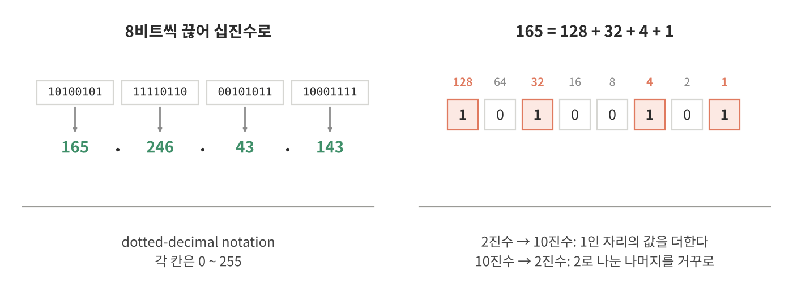

소켓 프로그래밍 때도 얘기했듯, IPv4 주소는 헤더에 기재할 수 있는 **32비트 non-negative integer**다. 사람이 비트로 외우기는 너무 힘드니 **8비트씩 끊어 점을 찍고 십진수로** 바꿔 쓴다. 점을 찍은 네 개의 수라서 dotted-quad라고도 하지만, 더 많이 쓰는 표현은 **dotted-decimal notation**이다. 컴퓨터 분야에서 dotted decimal notation이라는 말을 들으면 바로 IP 주소를 떠올려야 한다.

각 칸은 8비트이니 **0~255** 사이의 값이다. 256.으로 시작하는 IP 주소는 존재할 수 없다. 입력한 주소가 실제 IP 주소인지 이 범위로 검증할 수 있다. 0.0.0.0과 255.255.255.255(모두 0, 모두 1)는 네트워크를 설정할 때 아주 많이 보게 되니 눈에 익혀 두자.

**시험에 많이 나오는 문제**가 2진수를 dotted decimal로, 거꾸로 dotted decimal을 2진수로 바꾸는 것이다. 꼭 할 수 있어야 한다.

- **2진수 → 10진수:** 각 자리값(1, 2, 4, 8, … 128)을 곱해 더하면 된다. 0과 1뿐이니 1인 자리의 값만 합치면 된다.
- **10진수 → 2진수:** 중학교 때 배운 방법이다. 165를 2로 나눠 몫 82를 적고 나머지 1을 옆에 적는다. 몫이 0이 될 때까지(최대 8번) 반복한 뒤, 나머지를 **거꾸로** 읽으면 10100101이 된다.

강의자료에는 이런 변환 예시가 네 개씩 있다. 예를 들어 10000001 00001011 00001011 11101111은 129.11.11.239이고, 111.56.45.78은 01101111 00111000 00101101 01001110이다. 시험 전에 복습으로 손으로 한 번 풀어 보자.

### 잘못된 주소 찾기, 16진수 표기

더 실용적인 건 **잘못 입력된 dotted decimal 주소를 찾는 것**이다. 웹사이트에 "IP 주소를 입력하세요" 폼을 만든다면, 입력값의 오류를 검증하는 로직을 짜야 할 일이 생긴다.

- **111.56.045.78:** 045처럼 **leading zero**를 불필요하게 붙이면 안 된다. 사용자 입력에서는 허용해 줘야 할 수도 있지만, dotted decimal에 맞는 표기는 아니다.
- **221.34.7.8.20:** 십진수가 5개다. 4바이트를 넘는다.
- **75.45.301.14:** 301처럼 **255를 넘는 값**이 들어가면 안 된다.
- **11100010.23.14.67:** 2진수와 10진수를 섞어 쓴 것 같다. 엄청 큰 십진수로 볼 수도 있지만, 어쨌든 이렇게 쓰면 안 된다.

**16진수 표기.** 시험에 낸 적은 별로 없지만, 2진수를 16진수로 바꿔 쓰는 것도 많이 쓰게 된다. 특히 C 언어로 이런 값을 저장할 때 보통 16진수로 표기한다. 4비트씩 묶어 한 글자로 바꾸면 10000001 00001011 00001011 11101111은 **0X810B0BEF**(또는 810B0BEF₁₆)다. 아주 기초적인 부분이니 손에 익을 정도로 연습해 두자.

### IPv6 주소 표기

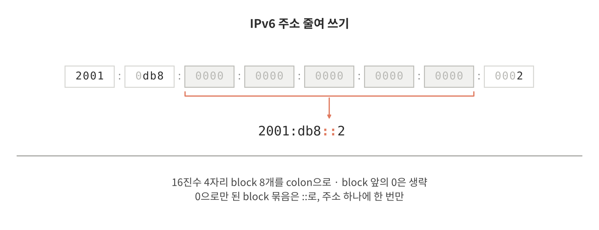

IPv6 주소는 **128비트 non-negative integer**로, 공간이 IPv4의 4배다. 그러다 보니 표기법도 복잡해졌다.

IPv4와 다른 표기라는 걸 알리기 위해 **block**이라는 단위로 나열하고, block 사이는 **colon(:)** 으로 구분한다. MAC 주소도 colon을 쓰지만 길이가 달라서 구분할 수 있다. 128비트를 16진수로 나열하니 4자리 block이 **8개** 나온다. 예: 5f05:2000:80ad:5800:0058:0800:2023:1d71

주소를 쓸 때마다 이걸 다 쓰느라 1분씩 낭비하면 끔찍하니, 표기를 단순화하는 규칙이 있다.

- **규칙 1. leading zero 생략:** 각 block의 맨 앞 0은 쓰지 않아도 틀리지 않는다. 0058은 58로, 0800은 800으로 쓸 수 있다. → 5f05:2000:80ad:5800:58:800:2023:1d71
- **규칙 2. 0인 block은 ::로 생략:** 0으로 된 block 7개 뒤에 1이 있다면 **::1**로 줄인다. 2001:0db8:0:0:0:0:0:2처럼 앞에 block 2개, 가운데 0 block 5개, 마지막에 2가 있다면 **2001:db8::2**로 쓴다.

규칙 2에는 고민할 부분이 있다. 데이터 block, 0 block들, 데이터 block, 또 0 block들이 섞여 있다고 하자. 한쪽은 0 block이 2개, 다른 쪽은 3개인데 양쪽을 다 ::로 줄이면 어느 쪽이 2개를 생략한 건지 알 수 없다. 이런 것까지 다 따질 필요는 없고 시험에도 거기까지는 안 나온다. 다만 주소를 배정할 때 이런 문제가 없도록 고민하는 건 별도로 필요하니 한 번쯤 생각해 보자.

**IPv4-mapped IPv6 address.** IPv4 주소를 워낙 많이 쓰니, IPv6에서도 쓸 수 있도록 주소 체계에 대응시킨 것이다. colon 두 개, ffff, colon 다음 마지막 32비트에 IPv4의 dotted decimal을 적는다. 예: **::ffff:10.0.0.1**. 이렇게 쓰면 IPv4 주소를 IPv6 컴퓨터에서 쓸 수 있게 세팅한 것이라고 이해하면 된다.

**IPv4-compatible IPv6 address.** 예: ::0102:f001 == ::1.2.240.1. 이것도 IPv4와 대응시킨 주소 체계라고 이해하면 충분하다.

**포트 번호와 함께 쓸 때.** 웹 브라우저나 VS Code에서 192.168.0.1:5000처럼 쳐 본 적이 있을 것이다. dotted decimal은 colon으로 IP 주소와 포트 번호를 구분할 수 있지만, IPv6는 주소 안에 colon이 있어 구분이 안 된다. 그래서 귀찮지만 **대괄호**를 넣어 표기한다. 예: http://[2001:db8::2]:443/

이 규칙들을 기말고사에 낸 적은 없지만, 상식 수준에서 알아 두자. 심심하면 **객관식**으로는 낼 수도 있고, 주관식으로 낼 가능성은 없다고 미리 말씀하셨다.

### Classful addressing: 처음의 주소 배정 방식

지금까지는 주소를 어떻게 표기하고 몇 비트를 쓰는지만 봤다. 그런데 addressing에서는 이 주소를 **네트워크와 호스트에 어떻게 배정해서 쓰는가**도 중요하다. 이 배정 방식은 인터넷 역사에서 두세 번 바뀌었고, **그 흐름을 다 기억하는 것**을 추천하셨다.

나이가 있는 구세대 엔지니어는 예전 방식만 기억하는 경우가 있고, 신세대는 마지막 방식만 배워서 그것만 얘기하기도 해서 지금은 섞여 있는 상황이다. 그리고 개념적으로는 **옛날 방식이 훨씬 이해하기 쉽다.** 표기는 나중 방식이 더 쉽지만. 그래서 꼼꼼하게 짚고 간다.

가장 처음 쓰인 방식이 **classful addressing**이다. 32비트 주소를 **5개의 클래스**로 나눠 할당한다.

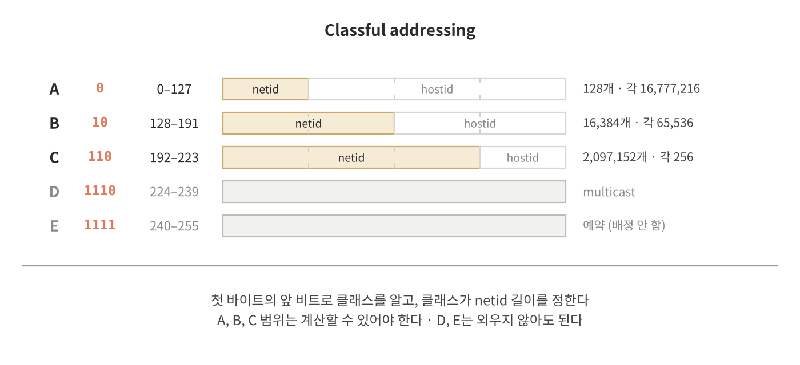

**클래스 구분법.** 네트워크에서는 8비트를 octet이라고도 한다고 했다. big-endian 순서로 앞에서부터 적었을 때, **첫 번째 바이트만 보고** 클래스를 알 수 있게 되어 있다.

- **클래스 A:** 첫 바이트의 맨 앞 비트(MSB, Most Significant Bit)가 **0**. 맨 앞이 0인 8비트 수는 0부터 127까지, 총 128개다.
- 나머지 클래스는 무조건 MSB가 1이고, 그다음 비트로 구분한다.
- **클래스 B:** 앞 두 자리가 **10**. 10000000 = 128부터 10111111 = 191까지.
- **클래스 C:** 앞 세 자리가 **110**. 192부터 223까지.
- **클래스 D:** 앞 네 자리가 **1110**. (강의자료 기준 224–239)
- **클래스 E:** 앞 네 자리가 **1111**. (240–255) 클래스가 5개뿐이라 여기서 더 내려가지 않는다.

**D와 E는 굳이 안 외워도 된다.** 하지만 **A, B, C의 수 범위는 필요할 때 계산할 수 있을 정도로 연습**해야 한다.

### netid와 hostid

클래스가 중요한 이유는, classful addressing에서 주소를 배정할 때 **네트워크가 쓰는 부분(network ID, netid)과 호스트가 쓰는 부분(host ID, hostid)의 경계**를 클래스로 정하기 때문이다.

인하대학교가 네트워크를 하나만 구축한다고 생각해 보자. 같은 기술을 쓰고 특정 관리자가 관리하는 네트워크가 인터넷에 하나 있다면, 다른 기업이나 학교와 구분할 **네트워크 식별자**가 필요하다. 이걸 주소 체계 안에서 처리하려고, 주소의 **앞부분을 네트워크 주소**로 만들어 두고 인하대학교라면 network ID가 다 같은 주소로 시작하게 한 것이다.

문제는 기관마다 컴퓨터 수가 다르다는 것이다. 그래서 그걸 고려해 클래스를 나눴다.

| 클래스 | netid | hostid | 네트워크(블록) 수 | 블록당 주소 수 |
| --- | --- | --- | --- | --- |
| A | 첫 1바이트 | 3바이트 | 128 | 16,777,216 |
| B | 앞 2바이트 | 2바이트 | 16,384 | 65,536 |
| C | 앞 3바이트 | 1바이트 | 2,097,152 | 256 |

- **클래스 A:** network ID가 첫 바이트다. 0~127만 쓸 수 있으니 전 세계에 많아 봤자 128개다. 대신 각 기관은 host ID로 무려 3바이트를 마음대로 배정할 수 있다.
- **클래스 B:** 중간 사이즈다. 앞 2바이트가 network ID이고, 첫 바이트의 범위 안에서 두 번째 바이트 8비트는 마음대로 쓸 수 있으니 2^8 × (첫 바이트 범위의 개수)만큼 network ID가 있다. 꽤 많은 기관이 쓸 수 있고, 각 기관은 16비트, 최대 6만여 개의 주소를 쓸 수 있다.
- **클래스 C:** 3바이트를 network ID로 쓰니 네트워크 개수는 엄청나게 많지만, 각 네트워크에 들어갈 수 있는 호스트는 200여 개(2^8 = 256)밖에 안 된다.

host ID를 많이 배정받아야 하는 기관은 별로 없을 거라는 생각에, 기관 크기를 고려해 **차등적으로 자원을 분배**한 것이다.

**클래스 D와 E.** 클래스 E는 미래에 쓸 일이 있으면 쓰려고 만들어 둔 주소라 배정하지 않았다. 클래스 D는 **multicast 주소**로 쓰인다. 특정 그룹의 호스트들에게 같은 데이터를 동시에 보내고 싶을 때 multicast로 보내는데, 그 그룹을 가리킬 주소가 필요하다. IPTV처럼 같은 아파트에서 같은 채널을 보는 사람이 여럿이라면 multicast로 보낼 수 있다. 심화 주제라 수업에서 강조하지는 않는다. **A, B, C를 정확하게 외우자.**

### Classful 라우팅과 network mask

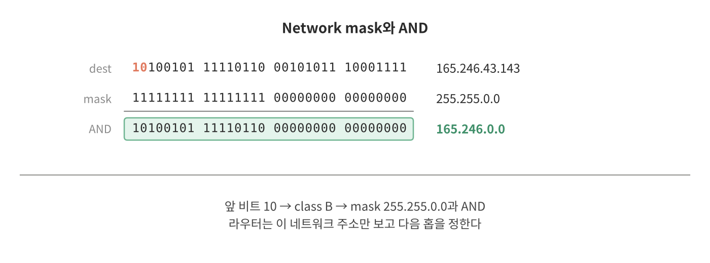

classful addressing을 쓰는 인터넷에서 라우터는 주소의 **네트워크 주소 부분**을 확인해야 한다. 개별 호스트가 어디 있는지 찾아가려면 인터넷의 모든 호스트 주소를 표로 저장해야 하니 메모리가 터진다.

네트워크와 호스트 부분을 나눠 쓰면, network ID는 결국 **지역**을 말한다. 서울, 인천, 부산, 광주처럼. 그러니 거기로 가는 링크가 어디인지만 표에 적어 다음 라우터에 넘기고, 이걸 반복하면 최종 목적지에 갈 수 있다. 마지막에 그 네트워크에 도착하면 라우터가 관여하지 않고 로컬한 방식으로 처리하면 된다.

그래서 routing process는 destination 주소에서 **네트워크 주소 부분을 뽑아내는** 알고리즘이 된다. 앞 비트 몇 개로 클래스를 확인하고, 그 클래스의 network ID 부분을 뽑는 것이다. forwarding table의 엔트리에는 네트워크 주소와, 그 주소일 때 패킷을 보낼 포트(인터페이스) 번호가 적힌다.

이걸 빠르게 하려고 복잡하게 프로그래밍하지 않고 **network mask**를 쓴다.

1. destination 주소의 첫 비트가 1이다 → 클래스 A는 아니다.
2. 두 번째 비트가 0이다 → **클래스 B**다.
3. 클래스 B면 network ID는 **상위 16비트**다.
4. 32비트 중 앞 16비트를 1, 나머지를 0으로 채운 값과 **AND** 연산을 하면 앞부분 주소만 뽑아낼 수 있다(XOR이 아니라 AND다).

이렇게 클래스별로 **network mask**(A는 255.0.0.0, B는 255.255.0.0, C는 255.255.255.0)를 정해 두고 AND로 주소를 뽑아내는 것이 일반적인 라우터 구현이었다. 정리하면, classful addressing에서는 **주소 안에 클래스 정보가 있으니** 라우터가 그걸 보고 맞는 mask를 골라 네트워크 주소를 계산한다.

### Classful addressing의 문제

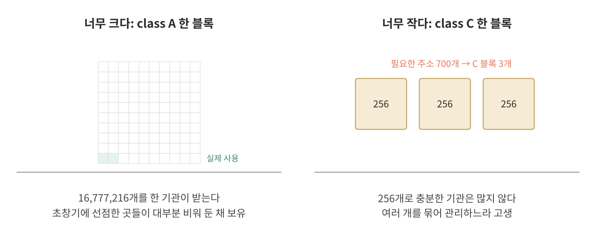

기관마다 호스트 수가 다르니 세 단계로 나눠 자원을 배분하자는 건 방법적으로 훌륭하다. 문제는 **너무 과하다**는 것이다. 이 기술이 70, 80년대에 만들어졌다는 걸 생각하면 더 그렇다. 전 세계 128개 정도의 네트워크가 각각 1,600만 대 이상을 처리하게 설계된 반면, 200만 개 정도의 네트워크는 고작 250여 개 주소만 쓸 수 있다. 강의자료의 말로는 클래스 A와 B 블록은 상당수가 낭비되고, 클래스 C 블록이 딱 맞을 만큼 작은 기관은 그렇게 많지 않다.

처음에는 인터넷에 붙은 네트워크가 미국의 대학이나 기관밖에 없었으니 개념만 만들어 적당히 배분하면 됐겠지만, **초창기에 잘못된 배분**을 했다. 강의자료에는 전 세계 IPv4 주소를 기관별로 얼마나 쓰고 있는지 2차원으로 그린 지도(CAIDA, 2007)가 있는데, MIT, Apple, HP, 통신사 같은 곳이 눈에 보일 정도로 주소를 많이 갖고 있다.

MIT는 학생이 많기는 하겠지만 클래스 A 주소 하나를 갖고 있는 것으로 보인다. 아무리 컴퓨터가 많아도 1,600만 대는 아닐 텐데 클래스 A를 배정받았다. 인터넷 초창기에 "우리는 클래스 A 가져갈게" 하고 **먼저 선점**했고, 그걸 계속 유지하고 있는 것이다. 클래스 A는 128개밖에 없으니, 이런 잘못된 배분이 있으면 전 세계 인터넷에서 쓸 수 있는 실질적인 호스트 수가 제한될 수밖에 없다.

**인하대학교는 어떤 클래스일까?** nslookup으로 inha.ac.kr의 IP 주소를 조회해 보면 **165.246**으로 시작한다. 165는 128~191 사이이니 **클래스 B**다. 인하대가 비교적 일찍 인터넷을 시작해서 중간 사이즈 주소를 할당받았고, 그래서 수만 대의 컴퓨터를 같은 네트워크 주소로 설정할 수 있다. 역사가 길지 않은 학교라면 클래스 C 주소인 경우가 있는데, 그러면 정보통신처 직원들이 클래스 C 여러 개를 묶어 관리해야 해서 엄청나게 고생한다.

**IPv4 주소는 희소 자원이다.** 주소가 32비트밖에 없으니 전 세계에 약 43억 개뿐이다. 그래서 주소를 **돈으로 사고파는** 상황까지 생겼다. 구글이 IPv4 주소 블록을 사들이기도 하고, 주소를 엄청 가진 MIT가 일부를 다른 회사에 팔기도 했다. 주소 배정 문제가 실제로 비즈니스가 된다는 것, 그래서 이걸 이해하는 게 충분히 의미 있다는 걸 알아 두자.

### Subnet addressing (Subnetting)

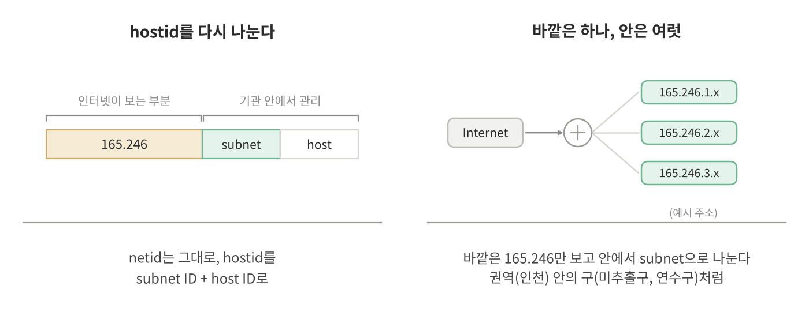

classful addressing에서 끝나지 않고 다음 스텝이 있다. **subnet addressing**, 줄여서 **subnetting**이다(RFC 950). 네트워크를 직접 설정해 본 사람이라면 subnet mask를 설정해 본 적이 있을 텐데, 그것과 연결해서 이해하면 좋다.

클래스 B 주소를 가진 인하대학교를 생각해 보자. 규모가 크고 건물마다 컴퓨터가 배치되어 있다. 데이터 링크 계층 기술로 연결할 수도 있지만, 규모가 크면 **서로 다른 데이터 링크 기술**로 연결해야 하는 상황이 생긴다. 그러면 인터넷의 정의에 따라 이들은 **서로 다른 네트워크**로 구분돼야 하고, 원칙적으로는 network ID를 따로 발급받아야 운영할 수 있다. 그런데 network ID는 희소한 자원이라 마음대로 발급받을 수 있는 상황이 절대 아니다.

그래서 클래스 B처럼 수만 대를 허용하는 곳에서는, 네트워크 주소는 그대로 두고 **host ID 부분을 다시 나눠** 처리하는 기술이 필요하다. 그게 subnet addressing이다. 강의자료에 따르면 인터넷 성장의 첫 10년 동안은 subnetting 없이 classful addressing만 있었고, 1980년대 초 LAN이 늘어나면서 host ID가 큰 클래스를 인터넷 core 라우팅 인프라는 바꾸지 않고 쪼갤 필요가 생겼다.

subnet addressing은 **그 기관의 라우터만 조금 수정**해서 동작하게 설계한 패치 기술 같은 것이다. host ID 부분을 **subnet ID와 host ID**로 나눠 쓴다. 인터넷 바깥으로 나갈 때는 network ID만 보면 되니 기존 시스템과 호환성을 유지하고, 인하대 내부 라우터만 subnet ID를 지원해 세밀하게 처리하면 된다.

비유하면, 앞에서는 인천이나 서울 같은 **권역** 단위 처리를 만들었고, 인천 안에서 배송할 때는 **미추홀구, 연수구**처럼 나눠 처리하는 개념을 구현한 것이다.

### Subnet mask

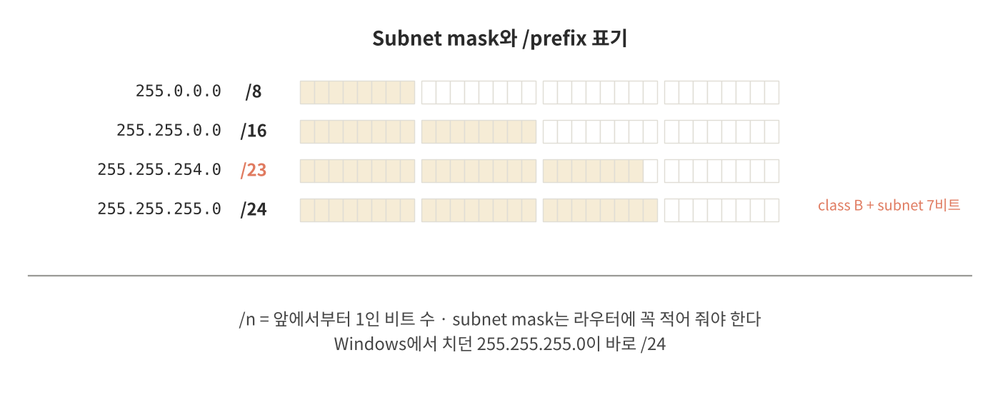

subnet mask를 지원하는 라우터 장비에는 네트워크를 설정할 때마다 **반드시 subnet mask를 기재**해야 한다. classful addressing에서는 network mask를 설정할 필요가 없었다. 주소를 보면 클래스를 알고, 클래스를 알면 mask를 바로 알았으니까. 하지만 subnet mask는 몇 비트를 subnet에 쓸지 알려 줘야 하니 반드시 적어야 한다.

적는 방법은 network mask와 비슷하다. 클래스 B 주소에서 아랫부분 중 **7비트를 subnet ID**로 쓰고 싶다면, 상위 23비트(16 + 7)를 1, 나머지를 0으로 채운 값을 쓴다. 편의상 **슬래시(/) 뒤에 1로 채워진 비트 수**를 적어 **/23**으로 표기하고, dotted decimal로는 255.255.254.0이다. 강의자료에 따르면 IPv4에서는 dotted decimal 표기가 널리 쓰였지만 요즘은 이런 **prefix length** 표기가 더 흔하다.

**Windows 설정에서 보는 subnet mask.** 네트워크 설정에서 IP를 수동으로 설정하는 화면을 보면 IPv4 주소와 함께 subnet mask를 적는 칸이 있다. 대부분 환경에서 클래스 C처럼 주소를 배정하는 경우가 많아서 **255.255.255.0**을 맨날 타이핑하는데, 그게 나오는 이유가 바로 이것이다.

### Subnet addressing에서의 라우팅

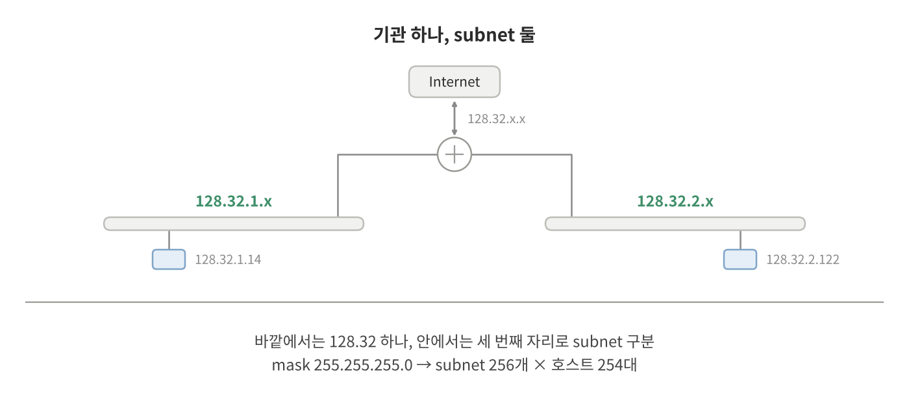

subnet 주소도 **AND 연산**으로 파악한다. 그래서 subnet addressing을 지원하는 라우터는 네트워크 주소뿐 아니라 **subnet 주소를 뽑아내는 기능**을 지원해야 실제로 찾아갈 다음 홉을 계산할 수 있다. 강의자료에 따르면 라우팅 과정은 classful addressing과 거의 같고, network mask 대신 subnetwork mask를 쓸 뿐이다.

예를 들어 128.32.1.14를 /24 mask와 AND하면 subnet 주소 128.32.1.0이 나온다. 그림처럼 어떤 기관의 라우터는 **외부로 나갈 때는 네트워크 주소(128.32)를 기준**으로 처리하고, **내부에서는 세 번째 자리까지** 써서 subnet을 구분한다. 강의자료 예시처럼 기관 전체에 subnet mask 255.255.255.0을 쓰면 subnet을 256개 만들 수 있고, 각 subnet에는 호스트 254대가 들어갈 수 있다.

### Subnet 그림으로 보기

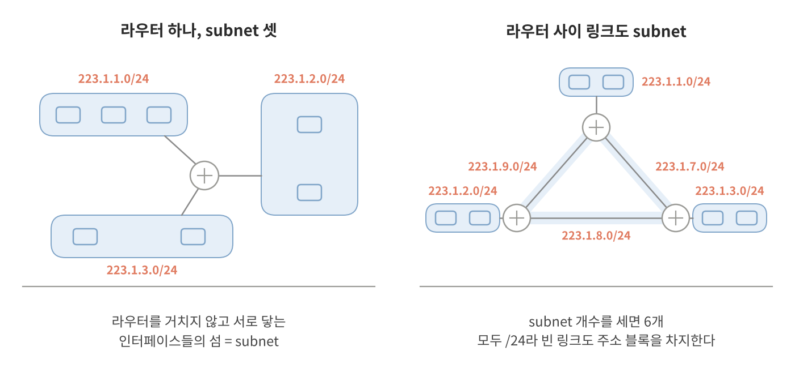

실제로 한 기관에서 네트워크를 구축하면 subnet이 어떻게 나뉠까? 기관이 라우터 하나로 인터넷에 접속하는데 건물이 3개 있다고 하자. 케이블을 장거리로 뽑은 다음 건물 안에서는 Ethernet switch 같은 걸로 연결한다. 케이블이 길고 별도로 구축되니 보통은 layer 2 기술로 독립적으로 구성한다. 똑같은 Ethernet을 쓸 수도 있지만, 구축하는 사람 입장에서는 **별도인 것처럼** 다루고 싶어진다.

그리고 subnet addressing으로 주소를 할당한다. 그림 왼쪽처럼 223.1.1.x, 223.1.2.x, 223.1.3.x가 각각 별도의 subnet이 되어, **하나의 네트워크가 세 개의 subnet**으로 나뉜다. 정확한 정보는 라우터에 설정된 subnet mask를 봐야 알지만, 이 그림에서는 주소의 세 번째 자리가 다른 것을 보고 유추할 수 있다. 실제로는 라우터의 각 포트에 subnet 주소가 설정되어 있고, 그래서 별도의 네트워크로 구분된다.

강의자료의 정의로는, subnet은 **중간에 라우터를 거치지 않고 물리적으로 서로 닿을 수 있는 인터페이스들**이다. 각 인터페이스를 호스트나 라우터에서 떼어 냈을 때 생기는 고립된 섬 하나하나가 subnet이다. 같은 subnet의 기기는 상위 비트(subnet part)가 같고, 나머지 하위 비트가 host part다.

**라우터 사이의 링크도 subnet이다.** 실제로 적용해 보면 조금 이해가 안 되는 부분도 나온다. 라우터 3개가 있는 기관에서 라우터끼리 point-to-point로 연결하면, 거기에 컴퓨터가 하나도 없어도 **subnet으로 관리**해야 한다. 그림 오른쪽에서 subnet 개수를 세라고 하면 **6개**다(223.1.1/24, 223.1.2/24, 223.1.3/24, 223.1.7/24, 223.1.8/24, 223.1.9/24).

**다음 시간 예고: subnet mask의 한계.** 이 그림은 큰 이슈를 하나 보여 준다. **모든 subnet이 24비트 subnet mask**를 쓴다는 것이다. 라우터 사이의 링크에는 컴퓨터가 없는데도 /24 하나를 통째로 차지해서, 그 주소를 다른 곳에 할당하지 못하게 만든다. 이것이 subnet mask 기술의 문제점이고, 다음 시간에는 이를 극복하기 위한 기술을 두 번째 파트 강의자료(Internet Protocol (2))에서 본다.

---

## 마치며

이번 글에서는 네트워크 계층의 큰 그림을 다시 잡고, IP의 서비스와 헤더, fragmentation과 옵션, 그리고 IPv4 주소를 표기하고 배정하는 방법(classful addressing과 subnetting)까지 훑었다.

| 단계 | 핵심 아이디어 |
| --- | --- |
| 네트워크 계층 | 호스트에서 호스트까지 배송, 모든 호스트와 라우터에 있다 |
| Forwarding vs Routing | 교차로 하나 통과(local) vs 출발지–목적지 경로 계획(network-wide) |
| Data plane vs Control plane | 라우터 안의 forwarding vs 라우터들 사이의 경로 결정 |
| Per-router vs SDN | 각 라우터가 분산 알고리즘 vs 원격 컨트롤러가 테이블 설치, 데이터 센터에서 성공 |
| 서비스 모델 | 개별 datagram(도착, 지연) vs flow(순서, 최소 대역폭, 패킷 간격), QoS |
| 서비스 모델 비교 | 인터넷 best effort는 보장 없음, ATM CBR·ABR, IntServ(죽음)·DiffServ(기업망) |
| Best effort의 성공 | 단순함, 대역폭 공급, CDN 복제, 혼잡 제어 |
| IP 서비스 | unreliable, connectionless, datagram (TCP의 정반대) |
| IPv4 헤더 | 20~60B, 최대 65,535B, IHL × 4, ToS는 안 외워도 됨 |
| Fragmentation 필드 | Identification(송장 번호), DF·MF flag, Fragment Offset |
| TTL·Protocol·Checksum | 홉마다 −1 후 0이면 버림(루프 방지, 권장 64), 역다중화, 헤더만 검사 |
| IPv6 헤더 | 고정 40B, 128비트 주소, flow label, next header, hop limit, checksum·fragmentation 제거 |
| Fragmentation | MTU보다 크면 라우터가 쪼개고, 조각마다 헤더, reassembly는 destination에서만 |
| Fragmentation 계산 | 데이터 = length − 20, 마지막 조각 length에 헤더 더하기, offset = 바이트 위치 ÷ 8, MF는 마지막만 0 |
| IPv4 옵션 | 최대 40B, 방화벽 때문에 사실상 안 씀, record route·source route(strict/loose)·timestamp(시계 동기화 문제) |
| IPv4 주소 | 32비트, dotted decimal, 각 칸 0~255, 2진수 ↔ 10진수 변환, 잘못된 표기 찾기 |
| IPv6 주소 | 128비트, 16진수 block 8개, leading zero 생략, ::, IPv4-mapped, 포트는 대괄호 |
| Classful addressing | 첫 바이트로 클래스 구분(A 0–127, B 128–191, C 192–223), netid·hostid, network mask와 AND |
| Classful의 문제 | A·B 낭비, 초창기 선점, IPv4는 희소 자원 |
| Subnetting | hostid를 subnet ID + host ID로, 기관 내부 라우터만 수정, subnet mask(/23, 255.255.255.0) 필수 |
| Subnet | 라우터 없이 닿는 인터페이스들의 섬, 라우터 간 링크도 subnet, 모두 /24면 주소 낭비 |

특히 꼭 잡고 갈 것은 이렇다.

- 네트워크 계층의 두 기능인 **forwarding과 routing의 차이**
- IP 서비스가 **unreliable, connectionless, datagram**이라는 것
- **IPv4 헤더의 필드 위치**(빈칸 채우기 정도)와 **TTL이 왜 필요한지**
- **fragmentation 계산**: 헤더 20바이트, 마지막 조각 길이, offset ÷ 8. 시험에서 20~30%가 틀리는 부분이다.
- **reassembly는 destination에서만** 한다는 것
- **2진수 ↔ dotted decimal 변환**과 **클래스 A, B, C의 범위**
- **subnet mask**가 무엇이고 왜 필요한지

다음 시간에는 모든 subnet이 같은 크기의 mask를 써서 생기는 주소 낭비를 어떻게 극복하는지, Internet Protocol (2)로 이어진다.