# 컴퓨터네트워크 Internet Protocol (2): CIDR부터 Forwarding, NAT까지

## 들어가며

이번 주 강의는 교수님 해외 출장으로 두 편 모두 비대면으로 진행됐다. 강의자료는 **Week 10. Internet Protocol (2)** 하나이고, 화요일 영상(12-01, 약 71분)에서 슬라이드 1~31을, 목요일 영상(12-02, 약 85분)에서 32~62를 다뤘다. 지난 시간에 다 못 한 IP addressing의 최신 기술부터 시작해서, 라우터 내부, IP forwarding, NAT까지 이어진다.

- **Part 1 — IP Addressing (2):** subnet addressing 정리, VLSM, CIDR, 주소 할당 예제, route aggregation, special-purpose address
- **Part 2 — What's Inside a Router:** control plane과 data plane, input port, queueing, longest prefix matching
- **Part 3 — IP Forwarding:** direct·indirect delivery, next-hop router와 default router, 교재의 forwarding 기법, datagram을 받았을 때의 처리, forwarding table 예제
- **Part 4 — Network Address Translation (NAT):** 사설 IP, 포트 번호를 이용한 주소 변환, NAT의 장점과 논란
- **Optional — IPv6 Tunneling:** 시험 범위는 아니지만 개념만

라우터끼리 경로 정보를 주고받는 알고리즘을 다루는 **IP routing**은 내용이 어려워서 강의 계획서대로 13주차에 따로 다룬다. 그림은 강의자료를 그대로 쓰지 않고, 한 장에 핵심 하나만 담아 새로 그렸다.

---

## Part 1. IP Addressing (2)

지난 시간에 classful addressing과 subnet addressing까지 봤다. 이번에는 그 뒤에 나온 비교적 최신 기술인 VLSM과 CIDR를 다룬다. 흐름을 먼저 그림으로 잡고 가자.

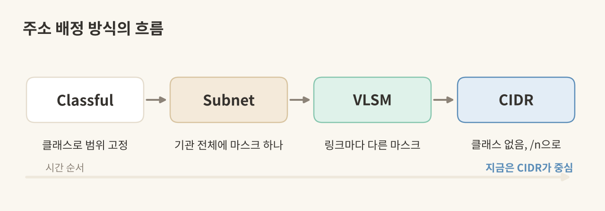

교수님이 목요일 영상 시작에서 강조한 점도 같이 적어 둔다. 요즘은 **CIDR**가 거의 중심이고, classful addressing은 예전에 배운 사람들 머릿속에 남아 있다. 그 사이에 subnet addressing도 한동안 많이 쓰여서 용어들이 시스템마다 섞여 있다. 그러니 밖에서 용어를 너무 strict하게 쓸 필요는 없지만, 수업에서는 이것들을 **시간 순서에 따라 구분해서** 다뤘다는 걸 기억하자.

### Subnet addressing 다시 보기

classful addressing은 network mask로 network address를 뽑아서 라우팅했다. subnet addressing은 거의 같은 과정인데, network mask 대신 **subnet mask**를 쓴다.

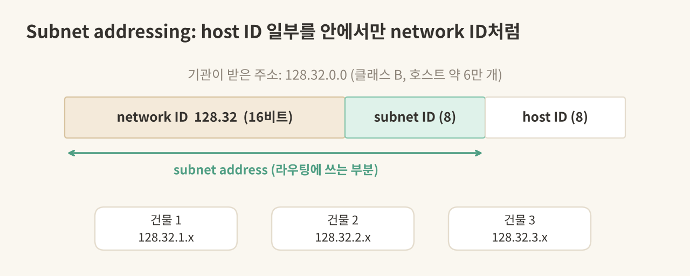

subnet addressing이 필요했던 이유는 이렇다. 인터넷 주소는 상당히 **희소한 자원**이다. 기관은 network ID를 발급받아서, 그 network ID로 시작하는 주소들을 묶어 쓸 권한을 갖는다. 예를 들어 클래스 B인 128.32를 받은 기관은 뒤 두 자리(16비트)를 마음대로 써서 약 6만 개의 호스트에 주소를 줄 수 있다.

그런데 이 기관 안에 독립적인 네트워크가 여러 개 있을 수 있다. 건물이 떨어져 있거나, 기술적인 이유로 서로 다른 데이터 링크 기술을 쓰면, 라우터 입장에서는 **별도의 네트워크**로 봐야 한다. 원칙대로라면 각각에 다른 network ID를 받아야 하지만, 이미 6만 개 주소를 쓸 권한을 돈 주고 사 온 상황이라 그게 어렵다.

그래서 잔머리를 굴려서, **host ID 중 일부를 내부에서만 network ID처럼** 쓰기로 했다. 이 부분이 **subnet ID**다. network ID와 subnet ID를 합친 **subnet address**를 라우팅할 때 network address 대신 조회해서, 패킷을 어디로 forwarding할지 정한다. 이게 subnet addressing이다. (교재는 'subnetid', 원래 RFC는 'subnet id'라는 용어를 쓴다.)

### Variable-Length Subnet Mask (VLSM)

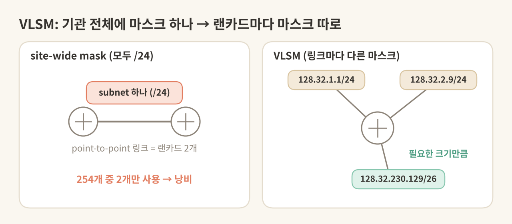

9주차 마지막에 본 예제를 떠올려 보자. 세 네트워크에 적절한 수의 호스트를 주려고 24비트 subnet mask를 썼다. 같은 기관이니 **site-wide**, 즉 기관 안의 모든 라우터가 **같은 subnet mask**를 쓰는 상황이었다.

그러다 보니 라우터와 라우터를 연결한 링크도 subnet 하나로 봐야 했다. 이 링크에는 랜카드가 두 개밖에 없다. 최대 250여 개의 호스트를 놓을 수 있는 subnet인데, point-to-point로 연결했으니 실제로는 **IP 주소 두 개만** 쓰는 셈이다. 너무 아깝다.

그래서 나온 것이 **VLSM**이다. **링크별로 subnet mask를 따로 설정**할 수 있게 라우터 코드를 업데이트한 것이다. 강의자료 그림에서 같은 라우터라도 한쪽 랜카드는 **128.32.1.1/24**(subnet address 128.32.1.0), 다른 쪽은 **128.32.230.129/26**처럼 서로 다르게 설정되어 있다.

앞에서는 기관 전체가 같은 mask를 써서 **전역 변수**처럼 세팅하면 그만이었다. VLSM에서는 **랜카드마다 개별적으로** subnet mask를 설정한다. 지난 수업에서 본 Windows 설정 화면도 랜카드별로 IP 주소와 subnet mask를 넣게 되어 있는데, 바로 VLSM을 고려해서 UI를 만들었기 때문이다.

VLSM을 쓰면 sub-network마다 수용할 수 있는 호스트 수가 달라지니, **더 세밀하게 주소를 배정**할 수 있다. subnet addressing을 중심으로 한 첫 번째 개선 방안이라고 보면 된다.

### Classless Inter-Domain Routing (CIDR)

링크마다 subnet mask를 주고 나면 약간 충격적인 사실을 알게 된다. **더 이상 클래스가 필요 없다.**

VLSM의 원래 목적은 내부 네트워크를 여러 sub-network로 나누는 것이었다. 외부로 나가는 링크는 원래대로 클래스를 기준으로 썼을 것이다. 128.32는 클래스 B이니 network mask는 16비트였다. 그런데 다른 링크에 mask를 따로 설정했다면, 외부 링크에도 똑같이 mask를 따로 적는 건 기술적으로 전혀 어렵지 않다. 그러면 이 라우터에서 클래스를 확인할 필요가 없어진다.

이 VLSM 기술을 **전 세계의 모든 라우터**에 적용하면 어떨까? 클래스를 확인하는 절차를 생략하고, subnet을 그냥 네트워크 주소로 재해석해서, 인터넷 전체에 주소를 더 세밀하게 나눠 줄 수 있다. 이 motivation에서 나온 것이 **CIDR**다.

- 라우터가 더 이상 클래스에 의존하지 않는다.
- 대신 랜카드에 IP 주소를 적을 때마다 **mask를 반드시 같이 적기로** 모두가 약속한다. 그래서 인터넷 라우팅 시스템에서 클래스 개념을 없앴다.
- 클래스가 없으니 네트워크와 subnet을 구분할 방법도 없어진다. 그래서 subnet mask라고 부르던 것의 이름을 **CIDR mask**로 바꿨다.

다만 CIDR mask는 전문가들이 쓰는 표준 용어이고, 대부분의 운영체제 UI는 여전히 **subnet mask**라고 쓴다. 다들 그렇게 배웠기 때문이다. Windows에서 본 것처럼, subnet mask라고 생각해도 전혀 문제없다.

라우터가 테이블을 만들 때 CIDR mask도 반드시 같이 적어야 하는 오버헤드는 있다. 하지만 네트워크마다 호스트 수를 유연하게 줄 수 있다는 장점이 커서 널리 쓰이게 됐고, 이게 **현재 인터넷의 주소 체계를 대표**한다.

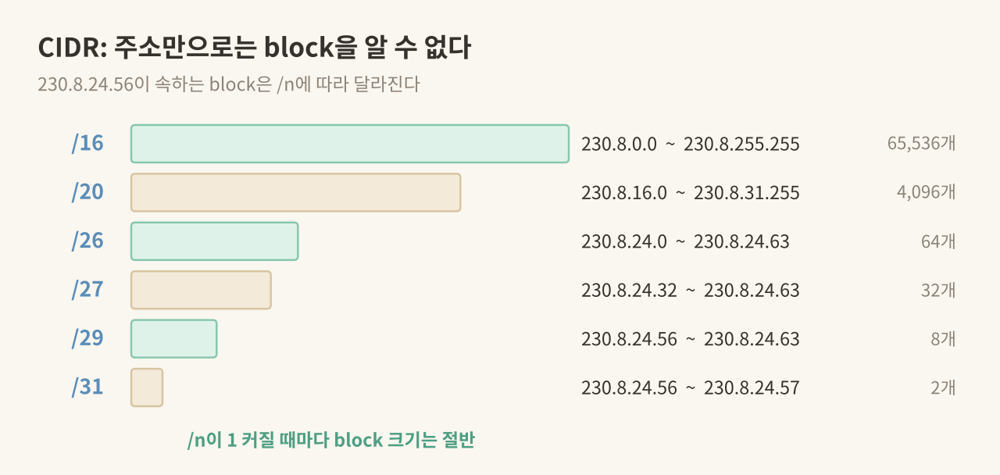

CIDR에서는 **IP 주소만으로는 그 주소가 어느 네트워크(block)에 속하는지 알 수 없다.** 그래서 IP 주소와 CIDR mask를 링크마다 항상 같이 적어야 한다. mask는 255.255.255.0처럼 적어도 되지만 길어서 보통 **/24**처럼 prefix length로 적는다.

IP 주소와 prefix length가 주어지면 subnet address를 구할 수 있고, 그 안에서 쓸 수 있는 주소 범위를 **block**이라고 부른다. 예를 들어 랜카드 주소가 230.8.24.56이라도 prefix length에 따라 block의 범위가 달라진다. /n이 1 커질 때마다 block 크기가 절반이 된다.

### 주소 할당 예제 1: 130.34.12.64/26을 같은 크기 4개로

어떤 기관이 **130.34.12.64/26**을 받았고, 내부에 **호스트 수가 같은 subnet 4개**가 필요하다. 네트워크 관리자라면 어떻게 나눌까?

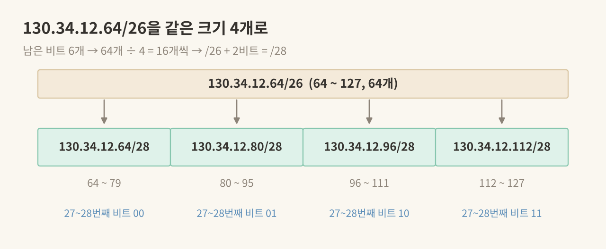

먼저 주소를 보자. 앞 세 옥텟이 24비트이고, 64는 2진수로 **01**000000이다. 26번째 비트까지만 쓰고 나머지가 다 0이다. subnet addressing 식으로 말하면 subnet 주소이고, CIDR 식으로 말하면 그냥 **네트워크 주소 하나**다.

1. 상위 26비트가 고정이니 남은 비트는 **6개**, 주소는 2⁶ = **64개**다.
2. 같은 크기 4개로 나누면 64 ÷ 4 = **16개**씩이다.
3. 4개로 나누려면 2비트가 더 필요하니 prefix length는 26 + 2 = **/28**이다.
4. 27~28번째 비트를 00, 01, 10, 11로 바꾸면 네 subnet이 나온다.

| Subnet | Block | 범위 |
| --- | --- | --- |
| 1 | 130.34.12.64/28 | 64 ~ 79 |
| 2 | 130.34.12.80/28 | 80 ~ 95 |
| 3 | 130.34.12.96/28 | 96 ~ 111 |
| 4 | 130.34.12.112/28 | 112 ~ 127 |

80, 96, 112는 네 번째 옥텟 0101, 0110, 0111에 해당하는 값이다. 강의자료에 나온 대로 **각 subnet의 시작 주소는 그 subnet의 주소 개수로 나누어떨어진다.**

### 주소 할당 예제 2: 14.24.74.0/24를 120 · 60 · 10개로

조금 더 복잡한 경우다. 14로 시작하니 클래스 A 주소지만, prefix가 적혀 있으니 CIDR block이다. 이 block을 받아서 subnet 3개에 **120개, 60개, 10개**를 줘야 한다.

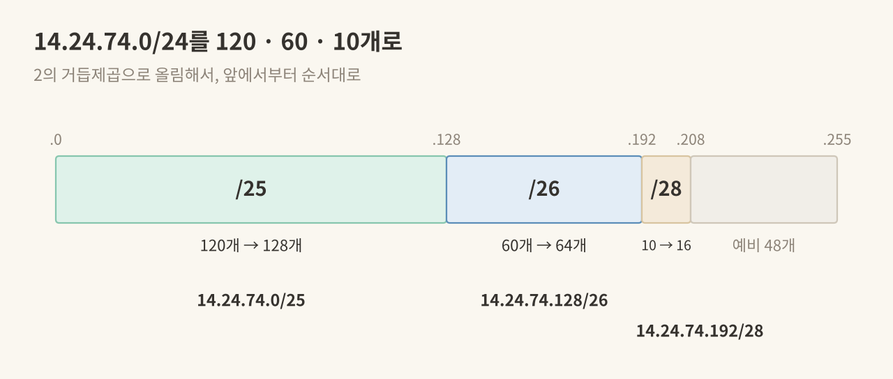

답은 여러 개가 있을 수 있다. /24라는 건 8비트의 자유도, 즉 256개가 있다는 뜻이다. 120개를 앞에 둘 수도, 중간이나 뒤에 둘 수도 있지만, 순서대로 **앞에서부터** 나누는 게 합리적이다.

- **120개 → /25:** 120개를 담으려면 128개가 필요하다. prefix가 1 커질 때마다 block이 절반이 되니, 256을 절반으로 나눈 /25다. **14.24.74.0/25** (0~127).
- **60개 → /26:** 128개를 썼으니 남은 건 14.24.74.128부터다. 60개에는 64개면 되니 남은 128을 다시 절반으로, prefix를 1 늘린다. **14.24.74.128/26** (128~191).
- **10개 → /28:** 128 + 64 = 192부터다. 남은 걸 다 줄 수도 있지만, 주소는 희소한 자원이니 나중에 다른 subnet에 줄 걸 생각해 **딱 맞게** 16개만 준다. 64에서 16이면 절반의 절반이니 /28이다. **14.24.74.192/28** (192~207).

다 더하면 208개이고, **208~255의 48개는 예비**로 남는다.

교수님이 개념 위주로 설명해서 바로 이해가 안 될 수도 있다. 직접 관리자가 됐다고 생각하고 머릿속으로 풀어 보면 어렵지 않으니, 이런 **주소 공간 배정 문제를 꼭 연습**하자.

### Route aggregation

주소 배정과 연결된 중요한 개념이 **route aggregation**이다. 인터넷 라우터들을 **계층적인 트리 형태**로 보고 주소를 그 구조에 맞게 주면, 각 라우터의 테이블 크기를 크게 줄일 수 있다. 하위 라우터들의 경로를 **합쳐서 주소 하나의 형태로 상위 라우터에 보고**하는 방식이다. 강의자료는 RFC 2008의 문장을 인용하는데, 요지는 hierarchical routing이 지금 크기의 인터넷까지 라우팅을 확장해 온 유일하게 검증된 방법이라는 것이다.

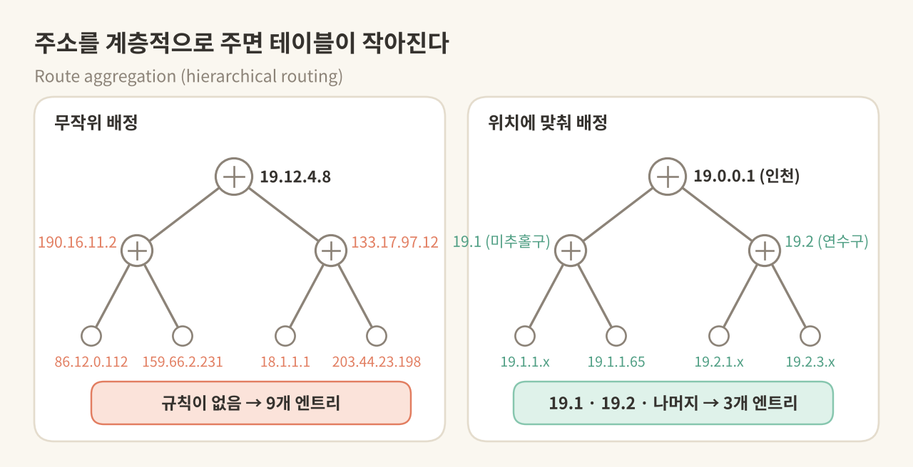

- **왼쪽, 무작위 배정:** 위치와 상관없이 주소를 줬다. 라우터 19.12.4.8은 아래쪽 주소들 사이에 아무 규칙이 없으니, "얘네는 전부 1번 인터페이스로" 같은 걸 하나하나 다 적어야 한다. **9개 엔트리**가 필요하고, 이걸 다른 라우터와 공유하는 오버헤드도 엄청 크다.
- **오른쪽, 위치에 맞춘 배정:** 위쪽 라우터가 19.0.0.1이고, 아래 네트워크는 전부 19로 시작한다. 두 번째 십진수로 하위 두 라우터(19.1, 19.2)를 나누고, 그 아래는 세 번째 자리로 다시 나눈다. 네 번째 자리는 host ID로 보면 된다. 그래서 라우터 19.0.0.1은 **19.1, 19.2, 나머지** 이렇게 **3개 엔트리**면 된다.

교수님의 **인천 비유**가 직관적이다. 아래쪽 전체를 인천이라고 하고, 한쪽은 미추홀구, 다른 쪽은 연수구, 그 안에 용현동 같은 동이 있다고 하자. 내려갈수록 주소가 지역을 구체적으로 정한다. 그러면 밖에는 "인천으로 가는 트래픽은 이 라우터로 보내 주세요, 알아서 아래로 전달할게요"라고 말하면 된다. 인천 라우터는 1번은 미추홀구, 2번은 연수구, 나머지는 3번으로 보내면 끝이다.

prefix 앞부분이 같은 것만 합쳐서 알리니, 주소를 **aggregation**했다고 표현한다.

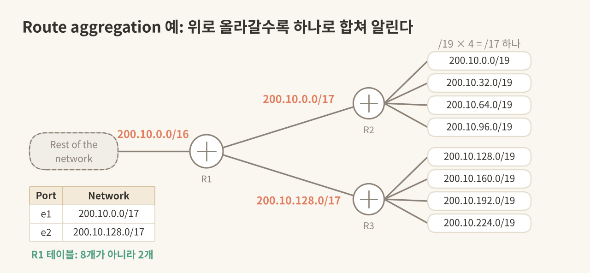

조금 더 실제에 가까운 예도 있다. R2는 200.10.0.0, .32.0, .64.0, .96.0 네 개의 **/19** block을 갖고 있다. 크기가 같고 32씩 증가한다. 이걸 합치면 200.10.0.0부터 시작하는 128개 묶음, 즉 **200.10.0.0/17** 하나로 R1에게 "이건 다 나한테 보내"라고 알리면 된다. R1의 테이블에는 딱 한 줄만 적힌다. R3도 같은 방식으로 **200.10.128.0/17**을 알린다. R1은 다시 이 둘을 합쳐 **200.10.0.0/16**으로 바깥에 알린다.

이렇게 아래에서 위로 올라갈수록 엔트리를 통합해서 적은 개수로 보낸다. 이게 route aggregation의 대표적인 예이고, sub-network의 반대 개념이라는 뜻에서 **supernetting**이라고도 한다.

슬라이드 15는 같은 시나리오에서 실제 라우터 테이블이 압축되는 모습을 보여 준다. next-hop address나 default router 같은 개념이 나오니, Part 3의 IP forwarding을 보고 나서 다시 보면 "앞에서 한 걸 실사례로 설명하는구나" 하고 바로 보일 것이다. 강의에서는 따로 설명하지 않았지만 **시험에는 나올 수 있으니 공부해 두자.**

### IPv4 special-purpose addresses

주소 중에는 **특수 목적**으로 쓰여서 일반 유니캐스트 주소로 배정하지 않는 범위가 있다. 강의자료의 표는 교재 1판에서 가져온 것이라 조금 오래됐다. 디테일을 다 외울 필요는 없고, 상식으로 기억해 두면 된다.

#### host ID가 전부 0 / 전부 1

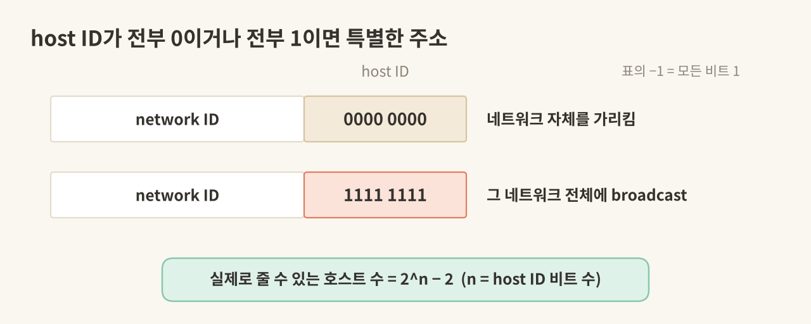

지금까지 host ID 값이 주어지면 그게 호스트 하나에 부여된다고 설명했는데, 정확히 말하면 조금 틀린 설명이었다. 여기서 보정하자.

표에서 host ID가 **−1**이면 특정 목적의 주소라는 뜻이다. "−1이 어떻게 나오지?" 싶을 텐데, 표기를 편하게 하려는 것이다. C 언어에서 32비트 int에 −1을 넣고 unsigned int로 바꿔 보면, 2의 보수 표기 때문에 **모든 비트가 1**이다. host ID 길이가 상황마다 달라서 그냥 −1로 써 둔 것이다.

- **host ID가 모두 1:** 그 network ID를 가진 네트워크에 **broadcast**하는 용도다.
- **host ID가 모두 0:** 그 **네트워크 자체**를 가리킨다.

그래서 host ID가 n비트면 모두 0인 값과 모두 1인 값을 쓸 수 없으니, 실제로 호스트에 줄 수 있는 주소는 **2ⁿ − 2개**다.

#### Loopback (127.x.y.z)

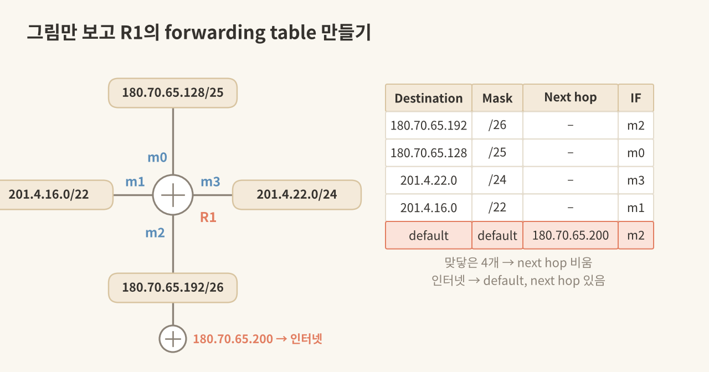

network ID가 **127**이면 **loopback** 주소다. 전기전자 쪽에서 출력 단자에서 입력 단자로 케이블을 꽂아 장비가 스스로 낸 신호를 받을 수 있는지 테스트하는 걸 loopback이라고 한다.

**현재 컴퓨터의 다른 프로세스**에 데이터를 보내고 싶을 때 이 주소를 쓴다. 127.x.y.z는 기본적으로 내 컴퓨터를 가리키고, 대표적인 게 **127.0.0.1**이다. 한 프로그램이 destination을 127.x로 적어 보내면, 네트워크 계층이 그걸 바로 다른 쪽으로 넘겨준다. 데이터 링크나 physical 계층으로는 내려가지 않게 설계되어 있어서, **밖에서는 이 datagram을 볼 수 없다.** Unix 계열은 보통 loopback을 디바이스 드라이버(loopback interface)로 구현해서 IP에서 IP의 다른 쪽으로 보낸다(슬라이드 21). 모든 운영체제가 이렇게 구현하는 건 아니다.

#### 0.0.0.0 (all-zero address)

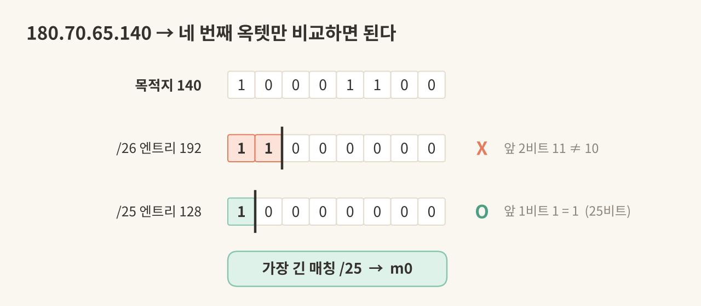

0.0.0.0은 **자기 자신**을 가리키는 용도로도 쓴다. 아직 IP 주소를 받지 못했을 때 자기 대신 0.0.0.0을 적는 경우가 종종 있다. 예를 들어 IP가 없어서 자기 주소를 모르는 기기가 DHCP 서버에게 물어볼 때, source를 0.0.0.0, destination을 255.255.255.255로 보낸다. DHCP를 배울 때 다시 나온다.

#### Limited broadcast와 directed broadcast

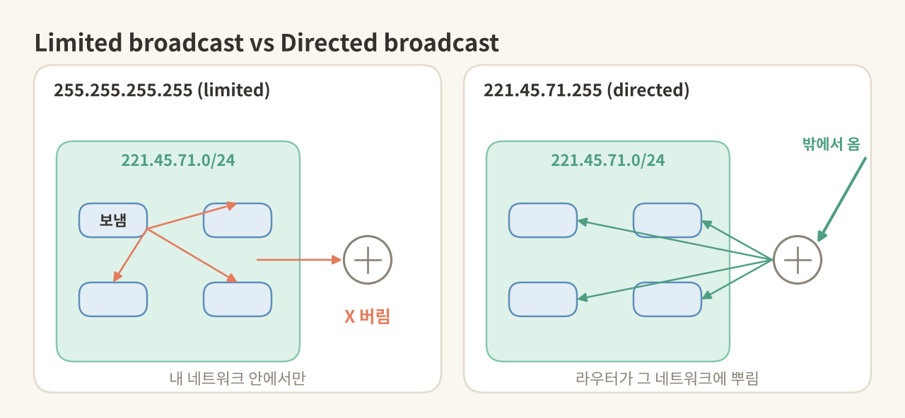

- **Limited broadcast (255.255.255.255):** destination이 255.255.255.255이면, 패킷을 만든 컴퓨터와 **같은 네트워크**에 있는 호스트들만 broadcast로 받는다. 다음 홉으로 forward할 수 있는 라우터는 이 패킷을 **버린다.**
- **Directed broadcast:** network ID를 적고 뒤를 모두 1로 채운 주소다(예: 221.45.71.255). 그 네트워크로 forwarding해서 **그 안의 모든 기기**에 broadcast하라는 뜻이다. 보통 바깥에서 만들어져서 라우터에 도착한 다음에야 뿌려지니, limited broadcast와는 상황이 다르다.

---

## Part 2. What's Inside a Router

화요일 영상은 라우터 내부 구조까지 다뤘다. 이 파트는 라우터가 어떻게 생겼는지 이해하는 시간이다.

### Control plane과 data plane

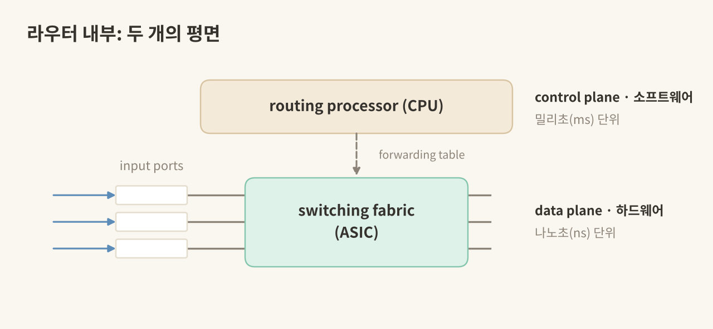

인터넷 프로토콜은 크게 **control plane**과 **data plane**으로 나눠 볼 수 있다고 했다.

- **Control plane (제어 평면):** 라우터끼리 어디가 교통 상황이 좋은지 정보를 교환하고, 그에 따라 라우터의 동작을 제어한다. 상당히 느리게 동작해서 **밀리초(ms)** 단위로 이벤트가 일어난다.
- **Data plane (데이터 평면):** 입력으로 들어온 패킷을 출력 포트로 내보낸다. 교차로에서 신호등이 차를 보내 주는 쪽이다. control plane과 독립적으로 동작하고, 여기가 빠를수록 인터넷이 원활해지니 **나노초(ns)** 단위로 동작한다.

컴퓨터 구조로 보면 이렇다.

- **Routing processor:** 일종의 **CPU**다. 절차적인 코드가 돌면서 라우터 정보를 교환하고 업데이트한다. 실제 라우터 장비는 인텔 CPU를 쓰지 않는 경우가 대부분이고, 저가형 유무선 공유기는 **ARM CPU**를 쓰는 경우도 많다.
- **High-speed switching fabric:** data plane은 반도체를 특화해서 빠르게 만든다고 했다. 입력 포트로 들어온 패킷의 차선을 바꿔 출력 포트로 내보내는 연결이 마치 **직물(fabric)** 같아서 switching fabric이라고 부른다. 보통 **ASIC(주문형 반도체)** 로 구현한다. 이런 칩이 상용화돼 아주 싸게 살 수 있어서, 공유기 정도의 라우터는 만들기 쉬워졌다.
- **Input / output ports:** 패킷이 도착하면 헤더를 보고 어느 output port로 보낼지 판단한다. 대형 라우터는 이 부분이 독립적인 랜카드처럼 되어 있는 경우가 많다.

비유하면 교차로(roundabout)가 있고, 이를 관제하는 관제 센터(station manager), 들어오는 톨게이트(entry stations), 나가는 길(exit roads)이 있는 모습이다.

### Input port에서 일어나는 일

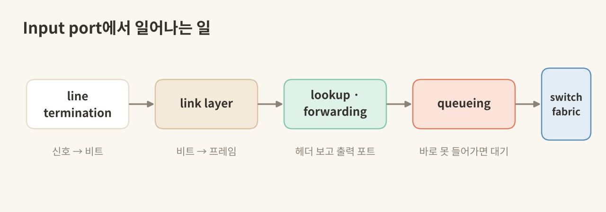

switching fabric 앞부분을 확대하면 이렇다.

- **Line termination:** 케이블이 꽂힌 끝부분이다. 케이블로 들어온 신호를 **비트**로 바꾼다(physical layer).
- **Link layer protocol:** 비트 시퀀스가 도착하면 데이터 링크 계층 프로토콜(예: 이더넷)에 따라 **프레임**에서 정보를 뽑아낸다.
- **Lookup, forwarding:** 라우터니까 **IP 헤더**를 보고, input port 메모리에 있는 forwarding table에서 어느 output port로 나갈지 찾는다("match plus action"). 그리고 switching fabric으로 넘겨 출력한다. 이게 **forwarding**이다.
- **Queueing:** 교차로에 차가 잔뜩 쌓이듯 패킷이 쌓이면 바로 나가지 못한다. switching fabric으로 바로 넣지 못해 기다리는 것이 **input port queueing**이다.

### Queueing delay는 어디서 생길까

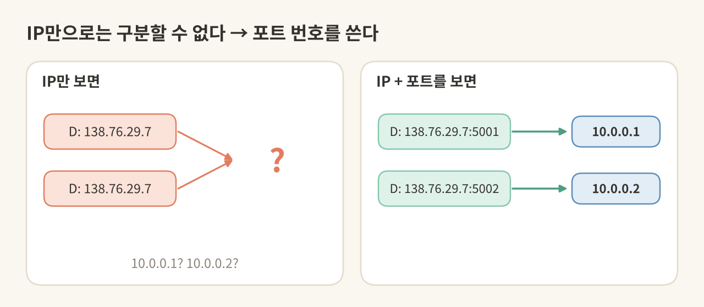

고급 라우터는 input queueing을 줄이는 여러 기법을 쓰고, 대개 상당히 빠르게 동작한다. 그래서 앞에서 배운 queueing delay에서 input queue가 미치는 영향은 비교적 작다.

슬라이드에는 없지만 교수님이 덧붙인 내용이 있다. queueing delay의 **가장 큰 요소는 output port의 queue**다. 나가는 링크의 데이터 레이트가 들어오는 속도보다 훨씬 느린 경우가 많아서, 뒤쪽 출력 큐에서 대기하는 일이 많다. (교수님이 그림을 넣지 못한 걸 직접 아쉬워했다.)

### Destination-based forwarding과 generalized forwarding

- **Destination-based forwarding:** 전통적인 방식이다. **도착지 IP 주소만** 보고 output port를 정한다.
- **Generalized forwarding:** 더 일반화해서, **SDN**처럼 소프트웨어로 정의해 헤더 필드의 임의의 값을 보고 forwarding 규칙을 만들 수 있다.

이 부분은 참고만 하고 넘어가도 된다.

### 범위로 적은 forwarding table의 문제

앞에서 route aggregation과 계층적 라우팅을 배웠는데, 여기서는 forwarding table을 더 요약해서 표현하는 알고리즘을 본다.

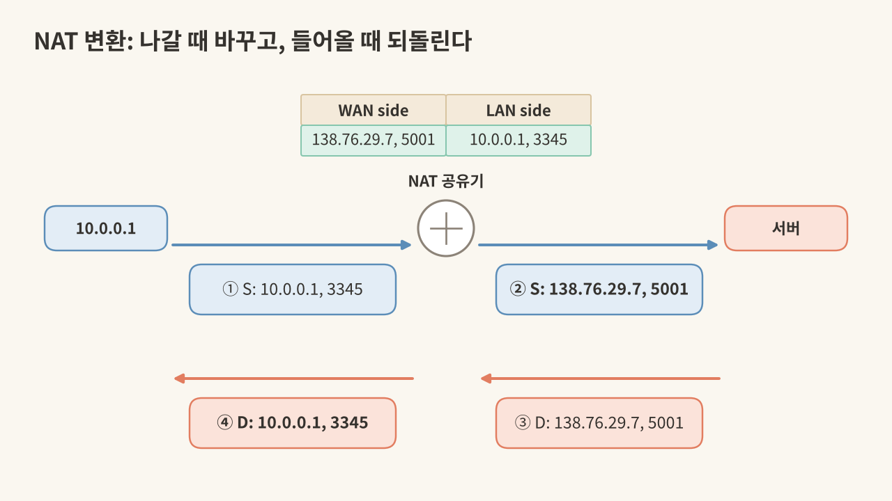

강의자료의 테이블은 주소 범위로 적혀 있다. 앞 16비트(11001000 00010111)는 모두 같고, 세 번째 바이트만 다르다.

- 첫 번째(00010000~00010111)와 두 번째(00011000)는 지금까지 배운 대로 **네트워크 주소 하나**로 정확히 적을 수 있다.
- 세 번째(00011001~00011111)는 **엔트리 하나로 적을 수 없다.** 네트워크 주소는 뒷부분이 000부터 111까지 전부라고 약속했으니, 001, 010, 011, 100, 101, 110, 111을 다 나열해야 한다.

그런데 딱 보면 "00011000"과 "그 나머지 `00011***`" 두 엔트리로 적을 수 있다면 훨씬 간결할 것 같다. 그 방법이 바로 다음에 나오는 규칙이다.

### Longest prefix matching

인터넷을 만든 사람들이 이 문제를 고민해서 내놓은 답이 **longest prefix matching**이다. 주소의 앞부분을 prefix라고 하는데, destination 주소와 **가장 길게 매칭되는 prefix**가 있으면 그 엔트리를 우선한다는 규칙이다.

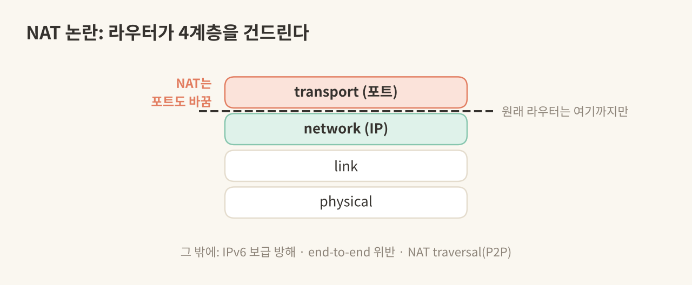

교수님은 학생들이 슬라이드만으로는 이해하기 쉽지 않을 것 같아서, 올해 처음으로 **인천 주소 비유**를 들었다. 앞 16비트는 모두 같으니 "인천"이라고 하자(110으로 시작하니 클래스 C 주소이기도 하다).

| prefix | 비유 | IF |
| --- | --- | --- |
| `00010***` | 인천 서구 | 0 |
| 00011000 | 인천 미추홀구 용현동 | 1 |
| `00011***` | 인천 미추홀구 | 2 |
| otherwise | 그 밖 | 3 |

택배 주소와 비교해서 **가장 길게 맞는 규칙**을 따른다고 생각하면 된다.

- **인천 서구 가정동:** 서구 규칙과 맞으니 **0번**.
- **인천 미추홀구 숭의동:** 미추홀구까지 맞고 용현동은 아니니 **2번**.
- **인천 미추홀구 용현동:** 미추홀구 규칙과 용현동 규칙 둘 다 맞지만, 용현동까지 맞는 게 더 기니 **1번**.

미추홀구 주소 중 용현동만 아니면 전부 2번으로 간다. 즉 longest prefix matching을 쓰면 **구체적으로 적은 규칙은 예외로 보고 우선**하고, 나머지는 짧게 매칭되는 것 중 가장 길게 맞는 걸 찾아 보내면 된다. 그래서 아까 범위로는 여러 줄이 필요했던 테이블을 **네트워크 주소만 적은 엔트리 몇 개**로 정확히 표현할 수 있다.

강의자료의 예도 같다. destination의 세 번째 바이트가 **00010110**이면 `00010***`만 맞으니 **0번**이다. **00011000**이면 1번 규칙과 2번 규칙이 둘 다 맞지만, 00011000이 더 길게 맞으니 **1번**이다.

교수님이 목요일 복습에서 다시 강조한 것도 이 부분이다. input port에 line termination, 링크 계층 처리, queue가 있다는 것도 중요하지만, 그보다 **forwarding을 할 때 longest prefix matching이 쓰인다**는 걸 꼭 기억하자. Part 3에서 직접 손으로 풀어 본다.

---

## Part 3. IP Forwarding

여기부터는 목요일 영상(12-02) 내용이다. 지금까지 addressing을 엄청 다양하게 다뤘는데, addressing과 연결돼서 계속 나올 수밖에 없는 게 **forwarding**이다. 이 파트에서는 forwarding에서 하는 작업을 좀 더 세밀하게 보고, 이론적으로 정리한 다음, 실제 구현에서 볼 수 있는 forwarding table까지 살펴본다.

### 호스트에서의 forwarding: direct와 indirect

호스트의 IP가 패킷을 만들어 어딘가로 보낼 때, 크게 두 가지로 나눠 본다.

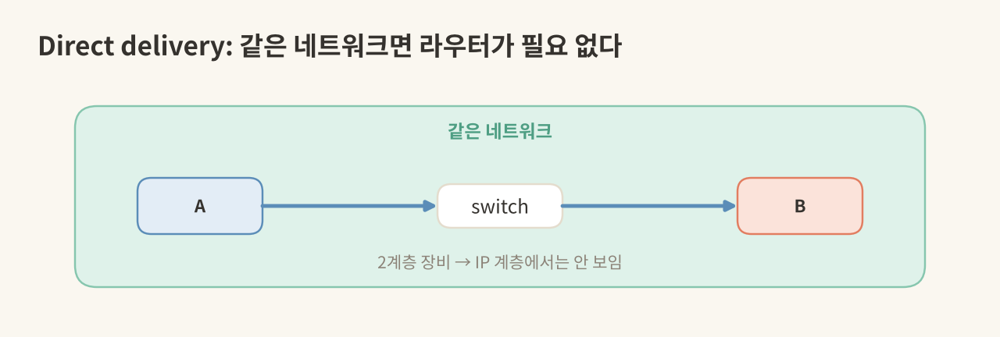

**Direct delivery.** destination이 **같은 네트워크**에 있으면 라우터를 거칠 필요가 없다. 데이터 링크 계층에서 배운 것처럼, A가 스위치에 패킷을 넘기면 스위치가 broadcast를 하거나, address learning으로 알고 있다면 바로 unicast해서 도착지에 전달한다. 이때 IP는 존재하지만 **패킷을 만드는 것 외에는 별 역할을 하지 않는다.** 라우터는 관여하지 않는다.

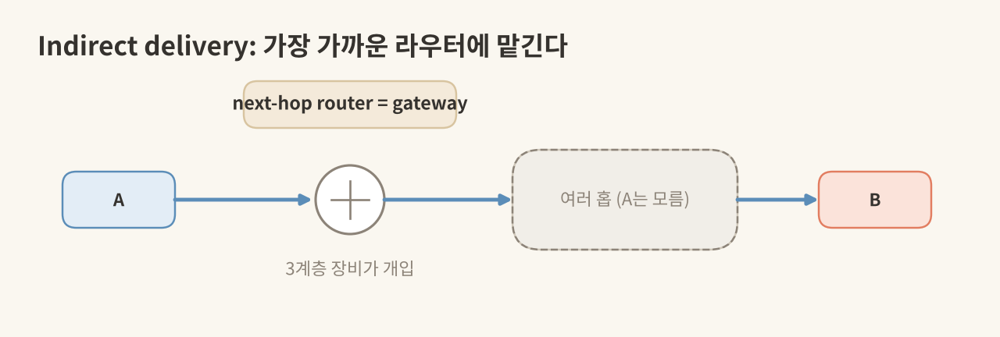

**Indirect delivery.** A가 여러 홉을 거쳐야만 B에게 갈 수 있다면, A는 뒤쪽 네트워크가 어떻게 생겼는지 모른다. 그러니 B로 보내려면 반드시 거쳐야 하는, **나와 가장 가까운 라우터**를 골라 거기에 보내야 한다. 라우터를 거친다는 건 A가 직접 배송할 수 없다는 뜻이다.

> **"스위치를 거쳤는데 왜 직접 배송인가요?"**
> 여기서는 **IP 계층의 관점**에서 본다. 스위치는 2계층 장비라서 3계층 입장에서는 안 보인다. 그냥 데이터를 전달할 수 있는 길이 있는 것처럼 보일 뿐이다. 그래서 direct로 간주한다. 반면 3계층 장비인 라우터가 개입하면 indirect다.

### Next-hop router, gateway, default router

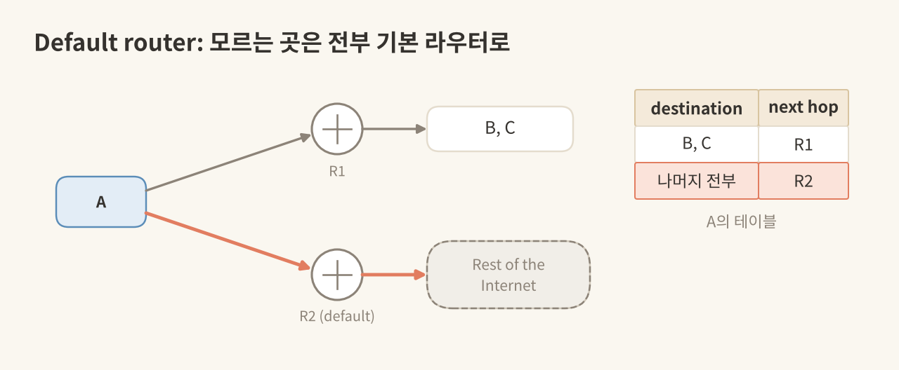

indirect delivery를 하려면 destination마다 **그걸 전달해 줄 다음 라우터**를 알아야 한다. B나 C로 가려면 R1을 거치고, 다른 쪽에 있는 D로 가려면 R2로 보내야 한다는 식이다.

- **Next-hop router:** 이 다음 라우터를 부르는 이름이다.
- **Gateway:** 조금 덜 이론적인 표현이다. 내가 속한 기관의 **관문**을 통해 밖으로 내보낸다는 비유에서 나온 말이다.
- **Default router:** 잘 아는 호스트 몇 개라면 표로 외울 수 있지만, 전 세계 모든 호스트를 표로 만드는 건 불가능하다. 그래서 **구체적으로 모르는 나머지는 기본 라우터 하나로** 보내도록 세팅한다.

앞에서 본 routing table이나 forwarding table에 default가 적혀 있던 이유가 바로 이것이다.

---

## Forwarding 기법

direct·indirect delivery, gateway, default router 같은 개념은 라우팅이 처음 만들어질 때부터 이렇게 정해 놓은 게 아니다. 여러 연구자가 연구하면서 이론으로 정리한 것이다. 그래서 교재(Forouzan)는 **routing table을 줄이기 위한 forwarding 기법**들을 하나씩 나눠 설명한다. 핵심은 앞의 내용이고, 여기서는 테이블에 무엇을 적느냐의 관점에서 다시 본다.

### Route method vs next-hop method

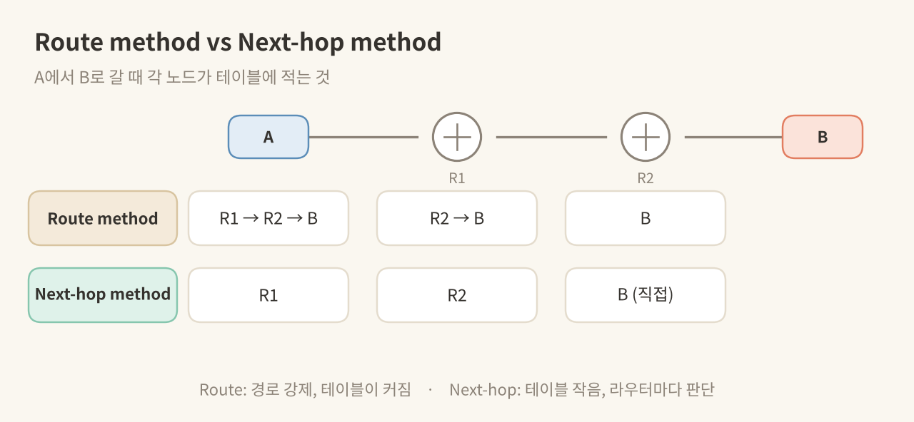

A에서 B로 보낼 때 테이블에 적는 방법은 두 가지가 있을 수 있다.

- **Route method:** source routing처럼, B로 가려면 R1 → R2 → B를 거쳐야 한다는 **전체 경로**를 테이블에 적고 "이대로 가라"고 한다. R1도 마찬가지로 B까지 거쳐야 하는 라우터를 모두 적는다. 목적지와 가까운 라우터는 적을 게 적지만, **멀어질수록 테이블이 엄청나게 커진다.**
- **Next-hop method:** **바로 다음 홉**만 적는다. 테이블에 적는 양이 확 줄어든다.

next-hop method는 테이블 정보가 적다 보니, R1에 도착했을 때 R1의 표가 R2에서 R3로 바뀌어 있으면 R3 쪽 경로로 갈 수도 있다. route method에는 정해진 경로로 가게 하는 **강제성**이 있지만, next-hop method는 **각 라우터가 개별적으로 다음 홉을 판단**한다. 유연하다는 장점이 있는 반면, 패킷이 여러 경로로 퍼져서 도착 **순서가 지켜지지 않는** 원인이 되기도 한다.

### Network-specific method

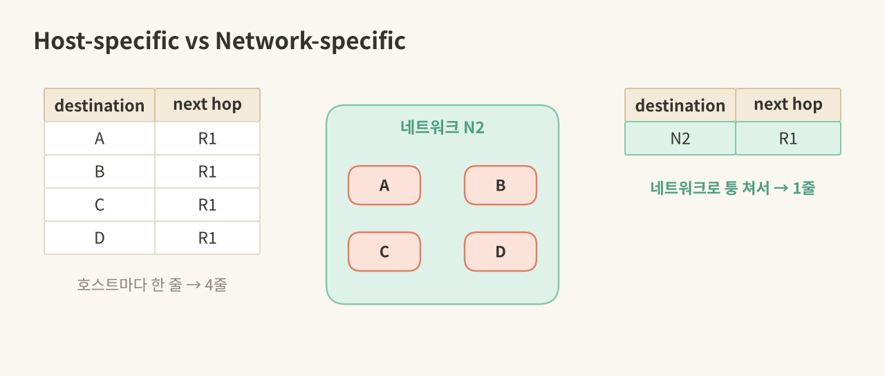

destination을 호스트 하나하나로 적으면 테이블이 너무 커진다. 그래서 **같은 네트워크에 있는 기기들은 퉁 쳐서 네트워크 주소 하나로** 적는다. "인천에 갈 때는 이 라우터가 next hop이다" 같은 식이다. 엔트리 개수가 훨씬 줄어든다.

forwarding 설정 프로그램은 특정 호스트를 정확히 적는 것도 보통 허용하지만, **네트워크 주소로 적는 게 더 일반적**이다. 그리고 network-specific 방식은 **longest prefix matching과 궁합이 좋다.** 호스트 단위로만 적는다면 longest prefix matching이라는 개념 자체가 필요 없다.

### Host-specific method

destination에 **호스트 주소를 직접** 적는 방식이다. 효율은 떨어지지만, 관리자가 특정 호스트의 경로를 더 세밀하게 통제하고 싶을 때 쓴다. 사실상 network-specific method와 **섞어 쓰는 경우**를 보여 주는 것이라고 보면 된다.

### Default method

구체적으로 적혀 있지 않은 나머지를 처리할 **기본 라우터**를 두는 방식이다. 그러면 인터넷을 통해 누군가 전달해 주겠지, 하고 넘길 수 있다.

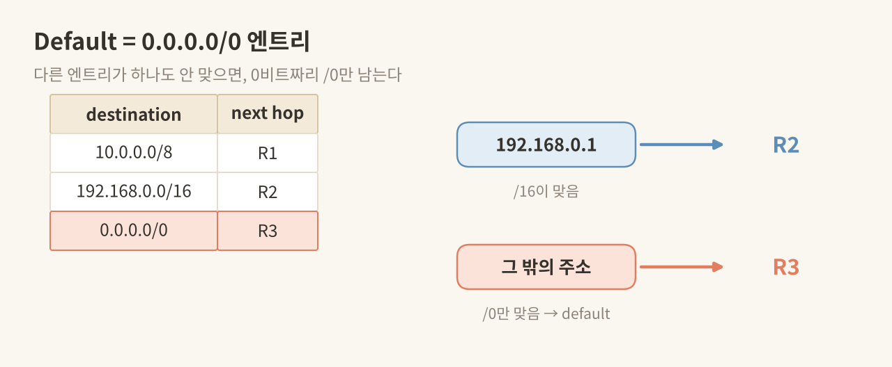

longest prefix matching과 연결하면, default는 **네트워크 주소를 0.0.0.0(/0)으로 둔 엔트리 하나**와 같다. 예를 들어 테이블에 이런 엔트리가 있다고 하자.

| Destination | Next hop |
| --- | --- |
| 10.0.0.0/8 | R1 |
| 192.168.0.0/16 | R2 |
| 0.0.0.0/0 (default) | R3 |

(강의에서는 prefix 길이를 따로 말하지 않아서 /8, /16을 붙여 예시로 정리했다.) 목적지가 192.168.0.1이면 192.168.0.0 엔트리가 더 정확히 매칭되니 R2로 간다. 어느 엔트리와도 맞지 않는 주소라면 /0인 default만 남으니 default가 선택된다. 그래서 default router를 0.0.0.0에 대응시켜 구현하는 경우도 있다.

| 기법 | 테이블에 적는 것 | 특징 |
| --- | --- | --- |
| Route method | 전체 경로 | 강제성 있음, 테이블이 커짐 |
| Next-hop method | 다음 홉만 | 테이블 작음, 라우터마다 개별 판단 |
| Network-specific | 네트워크 주소 | 가장 일반적, longest prefix matching과 짝 |
| Host-specific | 호스트 주소 | 비효율적이지만 세밀한 통제 |
| Default | 0.0.0.0/0 하나 | 나머지 전부를 기본 라우터로 |

---

## 호스트가 datagram을 받으면

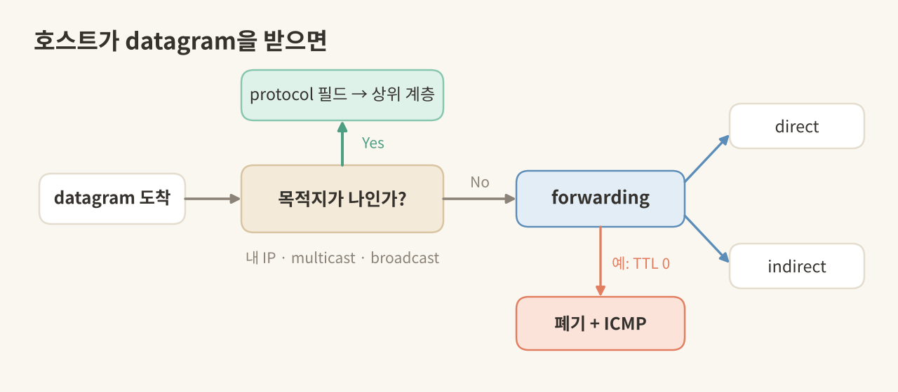

이제 호스트에서 IP datagram을 받았을 때 IP가 어떻게 처리하는지 본다. datagram은 **외부(데이터 링크)에서 올라올 수도** 있고, TCP나 UDP를 거쳐 **프로그램에서 내려올 수도** 있다.

호스트에는 **routing table(forwarding table)** 이 기본적으로 있고, datagram을 받을 때마다 이 테이블을 참조한다. 참고로 Unix 계열에서 (kernel IP) routing table이라고 부르는 것을 현대 교재에서는 forwarding table, RFC에서는 FIB(forwarding information base)라고 부른다.

1. **이 호스트가 받아야 하는 datagram이면 → protocol 필드를 보고 상위 계층으로.** destination 주소가 이 컴퓨터의 IP 주소 중 하나이거나, multicast·broadcast 주소라서 이 호스트가 받아야 하는 경우다. 위로 올려 보내고 다시 아래로 내려가지 않는다.
2. **아니면 → forwarding function으로.** 바깥 어딘가로 가야 한다. direct delivery면 데이터 링크 계층으로 넘기기만 하면 되고, 아니면 indirect delivery다.
3. **폐기해야 하는 경우.** forwarding하려고 보니 TTL이 0이 되는 경우처럼 버려야 할 때가 있다. forwarding 기능이 허용되지 않은 호스트도 조용히 버린다. 이때 보통 source에게 왜 폐기됐는지 알려 주는 **ICMP 메시지**를 보낼 수 있다. ICMP는 나중에 자세히 다룬다.

---

## 라우터가 datagram을 받으면

라우터의 forwarding function도 앞의 내용과 거의 겹친다.

### Forwarding table의 네 칸

라우터의 forwarding table에는 보통 이 네 가지가 적힌다.

| 칸 | 내용 |
| --- | --- |
| **Destination** | 보통 네트워크 주소 |
| **Mask** | destination과 결합해 네트워크 주소를 의미하게 함 |
| **Next hop** | 다음 라우터의 주소 (직접 연결이면 비움) |
| **Interface** | next hop으로 가기 위해 쓰는 라우터의 랜카드 |

슬라이드에서 본 테이블들은 이해하기 편하게 이 중 일부만 요약한 것이라는 점에 주의하자.

### 핵심 규칙과 그 밖의 특징

- forwarding의 핵심 알고리즘은 **longest prefix matching**이다.
- 설정을 그렇게 넣어서 **같은 길이로 여러 엔트리가 동시에 매칭**되면, 대부분의 구현은 **먼저 찾은 엔트리(first entry)** 를 쓴다. 그중 하나를 골라 **load balancing**을 하는 구현도 있다.
- IP forwarding은 **hop-by-hop**으로, 각 라우터에서 개별적으로 일어난다. 한 라우터가 전체 경로 정보를 갖고 있지 않다.
- forwarding table은 다른 라우터와 정보를 주고받으며 업데이트한다. 이때 쓰는 것이 **routing protocol**이고, RIP, OSPF, BGP, IS-IS가 유명하다. 수업에서 비중 있게 배우지는 않지만, 통신사나 네트워크 엔지니어를 목표로 한다면 공부해야 한다.

> **집에 있는 공유기는?**
> 유무선 공유기나 L3 스위치는 **routing protocol을 보통 지원하지 않는다.** 100만 원짜리 공유기라도 대개 그렇다. 홈 네트워크는 통신사가 적절한 라우팅으로 집까지 트래픽을 보내 준다고 가정하고 설계됐으니, 다른 라우터와 통신할 명분이 없기 때문이다. 해킹해서 직접 설치해 볼 수는 있지만 일반적인 상황은 절대 아니다.

### Routing table vs forwarding table

현대 네트워크 분야에서는 forwarding과 routing을 구분한다고 했다. 그런데 예전 시스템이나 교재는 두 단어를 크게 구분하지 않는다. 대표적인 예가 지금 배우는 Forouzan의 『TCP/IP Protocol Suite』다. 이 책의 routing table은 **현대적 의미로 거의 다 forwarding table**이다.

그래서 수업에서는 테이블이라는 관점에서 둘을 굳이 구분하지 않고, **시험에서 구분하라고 하지도 않는다.** 다만 현업에서는 구분해서 쓴다는 건 알아 두자.

---

## 예제 1: 그림만 보고 R1의 forwarding table 만들기

교수님이 **시험에 자주 내는 문제**라고 강조한 유형이다. 왼쪽 그림만 보고 R1의 테이블을 만들 수 있어야 한다.

1. **칸 정하기.** Destination, Mask, Next hop, Interface 네 가지가 있어야 완전한 forwarding table이다.
2. **직접 맞닿은 네트워크 채우기.** 그림에 호스트는 따로 없고, 네트워크 주소와 prefix length가 적혀 있다. R1과 맞닿은 네트워크 4개를 destination으로 적는다. 마스크는 원칙적으로 255.255.255.128처럼 적어야 하지만 길어서 /25처럼 prefix length만 적어도 된다.
3. **Next hop은 비우고 interface만.** 직접 맞닿은 네트워크는 direct delivery를 하니 next hop이 없다. 대신 내보낼 랜카드는 적어야 한다. 180.70.65.128/25는 m0, 201.4.16.0/22는 m1, 201.4.22.0/24는 m3, 180.70.65.192/26은 m2다.
4. **외부 인터넷은 default로.** 빠뜨리기 쉬운 부분이다. 0.0.0.0으로 적기도 하지만 "default, default"라고 적어도 문제없다. 구현에서 어떻게 적느냐의 문제일 뿐이다.
5. **Default의 next hop.** 이건 indirect delivery다. 그림에서 아래쪽 라우터 옆에 적힌 **180.70.65.200**은 그 라우터의 랜카드 IP 주소로 보는 게 합리적이다. /26은 적을 필요 없다. 그리고 그 라우터로 가는 인터페이스는 **m2**다.

| Destination | Mask | Next hop | Interface |
| --- | --- | --- | --- |
| 180.70.65.192 | /26 | – | m2 |
| 180.70.65.128 | /25 | – | m0 |
| 201.4.22.0 | /24 | – | m3 |
| 201.4.16.0 | /22 | – | m1 |
| default | default | 180.70.65.200 | m2 |

엔트리를 넣는 순서는 상관없다. 강의자료 테이블은 마스크가 긴 순서로 정렬되어 있다.

---

## 예제 2·3: longest prefix matching 손으로 풀기

패킷이 R1에 도착했을 때 라우터가 어떻게 forwarding하는지 설명하는 문제다. 테이블의 각 엔트리마다 **네트워크 주소와 마스크로 매칭되는지** 확인하고, 여러 개가 맞으면 **prefix가 가장 긴 엔트리**의 인터페이스로 내보낸다.

교수님의 풀이 방법은 이렇다. 가장 효율적인 방법도 아니고 실제 라우터가 이렇게 구현되지도 않지만, 손으로 풀기엔 좋다.

> 테이블 맨 위부터 하나씩 매칭되는지 확인하고, **몇 비트가 매칭됐는지 옆에 적어 둔다.** 다 적은 다음 가장 긴 것을 고른다.

### 목적지 180.70.65.140

- **180.70.65.192/26:** 앞의 세 옥텟은 맞다. /26이니 네 번째 옥텟의 **상위 2비트**를 봐야 한다. 192 = 128 + 64 = **11**000000이다. (클래스 C의 시작 주소가 192라서 외워 두면 좋다.) 140은 **10**001100이다. 11과 10이 달라서 **불일치**.
- **180.70.65.128/25:** /25이니 상위 1비트만 본다. 128 = **1**0000000, 140 = **1**0001100. **일치, 25비트.**
- **201.x 두 엔트리:** 첫 옥텟부터 201과 180이 달라 불일치.
- **default:** 0비트가 매칭된 것으로 본다.

맞은 것은 25비트와 0비트이고, 더 긴 25비트를 골라 **m0**로 보낸다.

> **140을 2진수로 빨리 바꾸는 법**
> 2로 계속 나눠도 되지만, 큰 수부터 들어가는지 보는 게 빠르다. 140은 128을 깔고 시작하니 첫 비트는 1, 남은 건 12다. 12에는 64, 32, 16이 안 들어가니 0, 0, 0. 12 = 8 + 4이니 나머지는 1100. 그래서 **10001100**이다.

강의자료 풀이는 마스크가 긴 순서로 정렬되어 있어 두 번째 엔트리에서 멈춘다. 하지만 교수님은 **뒤에 더 긴 게 매칭될 수도 있으니 나머지 엔트리까지 반드시 확인하라**고 강조했다.

### 목적지 201.4.22.35

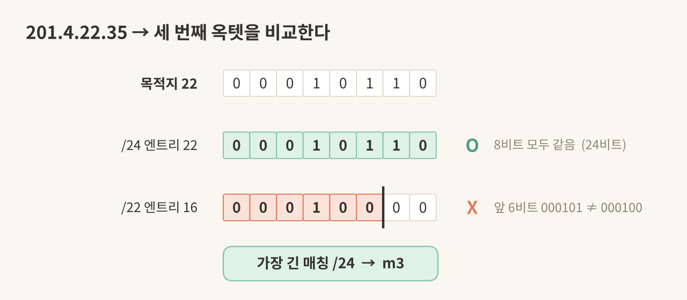

- **180.70.x 두 엔트리:** 딱 봐도 첫 옥텟이 달라 불일치.
- **201.4.22.0/24:** 세 옥텟만 맞으면 된다. **일치, 24비트.**
- **201.4.16.0/22:** 201.4는 맞았다. 앞 두 옥텟이 16비트이니 세 번째 옥텟의 **앞 6비트**를 봐야 한다. 22 = 16 + 4 + 2 = **000101**10, 16 = **000100**00. 6비트가 달라서 **불일치**.
- **default:** 0비트.

가장 긴 매칭은 24비트이니 **m3**로 보낸다.

---

## 예제 4: forwarding table만 보고 토폴로지 그리기

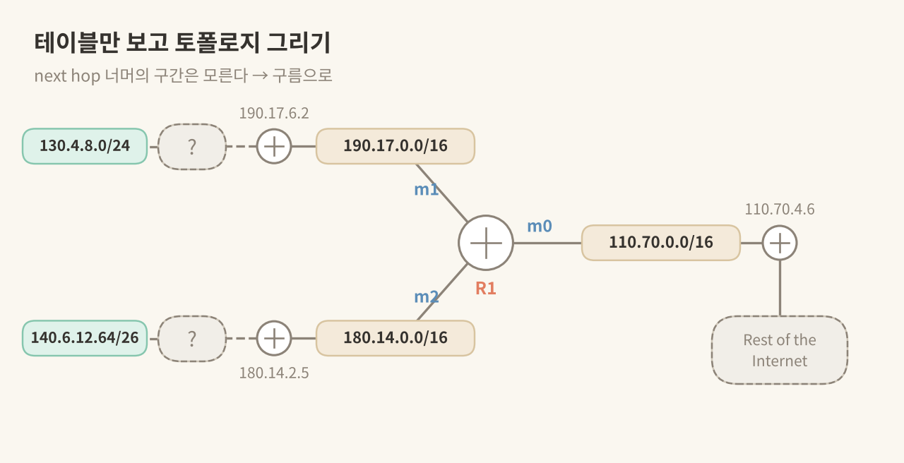

이번에는 반대로, R1의 테이블(교재 Table 6.2)만 보고 그림을 그려 보는 문제다.

| Mask | Network | Next hop | Interface |
| --- | --- | --- | --- |
| /26 | 140.6.12.64 | 180.14.2.5 | m2 |
| /24 | 130.4.8.0 | 190.17.6.2 | m1 |
| /16 | 110.70.0.0 | – | m0 |
| /16 | 180.14.0.0 | – | m2 |
| /16 | 190.17.0.0 | – | m1 |
| default | default | 110.70.4.6 | m0 |

1. **R1과 인터페이스부터.** 테이블에 m0, m1, m2가 있으니 R1에서 선을 세 개 뺀다.
2. **Next hop이 있는 엔트리 → indirect.** 140.6.12.64/26은 m2 쪽이고 next hop이 180.14.2.5다. 그러니 m2 쪽에 **next-hop router(180.14.2.5)** 가 하나 있고, 그 뒤에 140.6.12.64/26이 있다. 130.4.8.0/24도 같은 방식으로 m1 쪽 **190.17.6.2** 라우터 뒤에 있다.
3. **Next hop이 없는 엔트리 → R1과 직접 맞닿은 네트워크.** 110.70.0.0/16은 m0, 190.17.0.0/16은 m1, 180.14.0.0/16은 m2에 붙어 있다. 거기에 스위치가 있든 뭐가 있든, 그쪽 호스트들은 해당 인터페이스로 내보내면 배송된다. next-hop 라우터 주소 190.17.6.2와 180.14.2.5가 각각 190.17.0.0/16, 180.14.0.0/16 안에 들어가는 것도 확인할 수 있다. 즉 그 라우터들은 R1과 같은 네트워크에 붙어 있다.
4. **Default → 나머지 인터넷.** m0 쪽에 랜카드가 **110.70.4.6**인 라우터가 있고, R1 입장에서 rest of the Internet은 이 default router를 통해 접근한다.

> **실수하기 쉬운 부분**
> next-hop router와 130.4.8.0 네트워크가 **바로 연결되어 있다고 착각하면 안 된다.** R1이 가진 정보만으로는 그 사이를 알 수 없다. 직접 연결일 수도, 아닐 수도 있다. 그래서 **구름(Unknown)으로 그려 두는 게 정확한 답**이다.

이런 테이블이 주어졌을 때 그림을 그릴 수 있도록 **반드시 연습하자.** 시험에 충분히 나올 수 있고, 그려 보는 과정에서 forwarding 개념과 용어를 얼마나 이해했는지 확인할 수 있다.

---

## Multi-homed host (시험 제외)

스마트폰은 Wi-Fi와 LTE·5G를 함께 지원한다. 둘은 서로 다른 데이터 링크 기술이다. 컴퓨터 하나가 두 네트워크에 동시에 접속하면 지금까지 얘기한 내용이 훨씬 복잡해진다. 이런 호스트를 **multi-homed host**라고 하고, 슬라이드 45~47은 인터넷에서 이걸 어떻게 처리하는지 다룬다. 상당히 어려운 주제라 학부에서 보통 다루지 않고, **시험에도 전혀 나오지 않는다.** 실무적으로 관심 있는 사람만 참고하면 된다. (강의자료에는 RFC 1122의 strong/weak host model이 나오고, 기본값이 Linux는 weak, 최신 Windows는 strong이라고 되어 있다.)

---

## Part 4. Network Address Translation (NAT)

NAT는 대부분의 유무선 공유기에 들어가 있고, 인터넷 발전 과정에서 상당히 중요한 기술이다. 네트워크 관련 **면접 질문**으로도 충분히 나올 수 있으니 꼭 잘 기억하자.

### NAT가 해결하려는 상황

집에 공유기를 설치하면, 밖으로 나가는 회선은 한 달에 4~5만 원씩 내고 빌려 쓰는 것이다. 대부분의 통신사는 이때 쓸 수 있는 **IP 주소 개수를 제한**한다. 예전에는 딱 하나만 주는 경우가 많았고, 요즘은 IoT 기기가 늘면서 4~5개 정도까지 주기도 하지만 여전히 아주 제한적이다. 반면 집 안의 스마트 기기는 계속 늘어난다. 그래서 공유기를 설치해 거기서 각 기기에 IP를 할당한다.

그런데 문제가 있다. 인터넷은 **네트워크 주소로 위치를 판단해서** 패킷을 forwarding한다. 그러니 주소가 중복되면 안 되고, 실제로 대부분 **유니크한 IP를 쓰는 호스트**를 가정하고 설계됐다.

### 사설(private) IP 주소

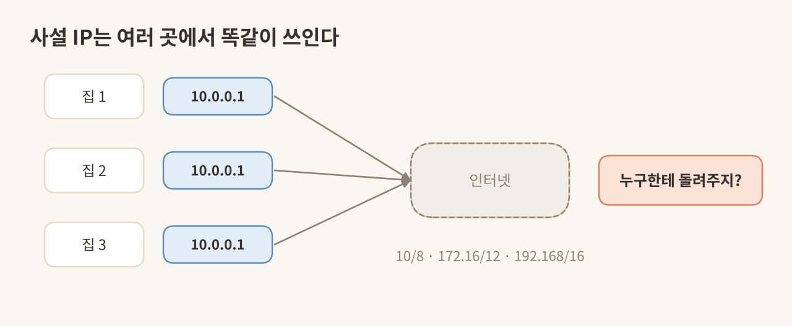

예외가 있다. **10/8, 172.16/12, 192.168/16** 같은 주소는 프라이빗 네트워크용이라 여러 곳에서 **재사용**할 수 있다. 하지만 이 주소로 외부와 직접 소통하는 건 불가능하다. 같은 주소를 쓰는 네트워크가 전 세계에 엄청나게 많으니, 찾아갈 방법이 없다.

공인 IP 하나와 재사용 가능한 내부 주소가 있을 때, 외부 인터넷과 소통하는 방법이 **NAT**다. 목표는 **로컬 네트워크의 모든 기기가 공인 IP 주소 하나를 공유해서** 외부와 소통하는 것이다.

### 가면 비유와 포트 번호

교수님은 여기서 잠깐 영상을 멈추고 직접 고민해 보라고 했다. 이 상황은 **가면을 써야 하는 상황**과 비슷하다. 공유기의 공인 IP라는 가면이 하나 있고, 안쪽에는 서로 다른 조직원들이 있다. 조직원들이 밖과 소통할 때 가면을 쓰면, 안에서는 구분되지만 밖에서는 같은 사람으로 보인다.

물리적으로 가면을 옮길 수는 없으니, 10.0.0.1이 패킷을 밖으로 보낼 때 **source IP를 내부 주소에서 공인 주소로 바꿔 주면** 된다. 응답은 공인 IP로 돌아올 테니, 공유기가 받아서 다시 10.0.0.1로 바꿔 주면 된다.

그런데 **IP 주소만으로는 부족하다.** 거의 같은 시기에 10.0.0.2도 밖과 소통하고 있다면, 밖에서 돌아온 두 패킷의 destination IP가 똑같아서 누구 것인지 구분할 방법이 없다. 그래서 NAT를 만든 사람들은 **포트 번호까지 사용해서** 구분하기로 했다. (포트 번호는 전송 계층 헤더에 있지만 편의상 같이 그린다.)

1. **10.0.0.1:3345**가 HTTP 서버 **128.119.40.186:80**으로 패킷을 보낸다.
2. 공유기는 destination을 보고 밖으로 나가는 패킷임을 안다. 그대로 내보내면 안 되니, NAT 프로그램이 source를 **138.76.29.7:5001**로 바꾸고, 이 짝을 **NAT translation table**에 기록한다.
3. 서버는 S와 D만 바꿔서 **138.76.29.7:5001**로 응답한다.
4. 공유기는 테이블을 보고 "5001번은 10.0.0.1의 3345였지" 하고 destination을 **10.0.0.1:3345**로 바꿔 넘긴다. 원래 프로그램으로 데이터가 잘 전달된다.

이렇게 나갈 때마다 자기 정보를 바꿔치기하는, 일종의 가면을 쓰는 작업으로 주소를 변환하는 것이 **Network Address Translation**이다.

### NAT의 장점

장점과 기술적인 내용은 슬라이드에 정리되어 있다. 교수님이 하나하나 짚지는 않았지만, 마음이 동하면 여기서도 시험 문제를 낼 수 있다고 분명히 말했다.

- **IP 공유:** ISP에서 공인 IP 하나만 받아도 모든 기기가 쓸 수 있다. 사용자 입장에선 좋다. ISP 입장에서도 IP 주소를 절약하는 장점이 될 수 있지만, 원래 IP마다 돈을 받고 싶었던 ISP에게는 손해, 즉 단점일 수도 있다.
- **내부 주소를 자유롭게 변경:** 테이블은 패킷이 나가고 응답이 들어올 때만 기록한다. 그래서 내부 기기 주소는 **밖에 알리지 않고** 필요에 따라 바꿔도 된다. 공인 IP를 바꾸는 절차는 현실적으로 복잡할 수밖에 없다. (강의자료에는 내부 주소를 바꾸지 않고 ISP를 바꿀 수 있다는 장점도 있다.)
- **보안:** 테이블에 없는 외부 접근은 안으로 넣어 줄 방법이 마땅치 않다. 외부에서 로컬 기기에 **직접 접근할 수 없다.**

공유기에 **port forwarding**이라는 기능이 있어서, 외부에서 온 패킷을 특정 기기로 넘겨줄 수 있다는 걸 아는 사람도 있을 것이다. 그건 각자 공부할 내용이고, **NAT의 역할은 아니다.** port forwarding을 안 쓰는 사용자라면 NAT 덕분에 오히려 보안이 높아지는 결과가 된다.

### NAT를 둘러싼 논란

반대로 NAT는 좀 이상한 부분이 있어서 논란이 많았다.

- **계층 위반:** 라우터는 3계층(네트워크 계층)까지만 처리하는 장비라고 배웠다. 그런데 NAT는 **4계층 정보인 포트 번호**를 쓴다. 계층을 넘어 처리하면 protocol layering을 만든 장점이 사라진다.
- **IPv6 보급 방해:** IPv6는 43억 개밖에 넣을 수 없는 주소 문제를 큰 주소 공간으로 해결하려고 만든 것이다. 그런데 NAT로 공인 IP를 덜 쓰면 더 많은 기기를 인터넷에 넣을 수 있다. 싼 공유기만 설치하면 바로 해결되는데, IPv6를 쓰려면 전 세계 라우터를 다 바꿔야 한다. 그러니 **IPv6를 굳이 쓸 이유가 없어진다.**
- **End-to-end argument 위반:** 네트워크 계층 장비가 포트 번호를 조작한다. 디테일하게 다루지는 않는다.
- **NAT traversal 문제:** 토렌트 같은 **P2P** 애플리케이션은 한 컴퓨터가 클라이언트이면서 서버 역할도 한다. 서버라면 외부에서 아무 때나 트래픽을 보낼 수 있어야 하는데, NAT 뒤의 기기에는 마음대로 접근할 수 없다. 그래서 이를 해결하는 **NAT traversal** 기술이 따로 연구된다. TCP의 simultaneous open(동시 개방)을 다룰 때 FYI로 잠깐 나왔던 단어다.

네트워크를 연구하는 사람 입장에서 NAT는 **복잡한 기분이 드는 기술**이다. 공유기 보급에 엄청 기여했지만, IPv6를 만든 사람들 입장에서는 세상을 한 세대 바꿀 기술이 NAT 때문에 도입되지 못한 셈이니까.

그래도 NAT는 현재 쓰이고 있고 앞으로도 남을 것이다(here to stay). 홈 네트워크 중심으로 설명했지만 **기관 네트워크**나 **4G/5G 셀룰러 네트워크**에서도 같은 문제가 생긴다. 다만 환경마다 NAT를 쓰는 방식이 조금씩 다르니, 통신사를 고려한다면 여기 설명만으로는 부족할 수 있다.

---

## IPv6 Tunneling (Optional, 시험 제외)

IPv4가 전 세계에 깔린 상황에서 IPv6를 쓰는 사람들이 있다고 하자. IPv6와 IPv4는 직접 통신이 안 된다. 그래도 IPv6 컴퓨터끼리는 통신할 수 있어야 한다. 문제는 경로 중간에 **IPv4만 있는 구간**이 있을 수 있다는 것이다.

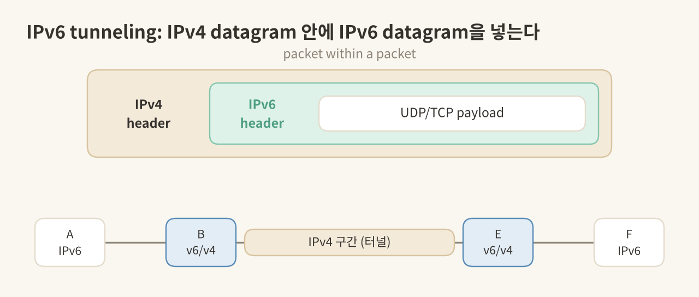

이를 극복하는 기술이 **tunneling**이다. IPv6 datagram을 **IPv4 datagram의 payload로 encapsulation**해서 IPv4인 것처럼 위장해 보내고(packet within a packet), IPv6와 IPv4를 모두 지원하는 라우터 사이를 지나가게 한다. 슬라이드 그림에서는 B와 E 사이에 터널이 만들어져서 A가 F까지 갈 수 있다.

깊이 들어가면 꽤 재미있지만 시험에는 내지 않는다. 요즘 많이 쓰는 **VPN**도 결국 이 내용을 확장해서 쓰는 기술이라고 이해하면 된다.

### IPv6 보급 현황

구글 통계로는 구글에 접속하는 클라이언트의 약 **40%** 가 IPv6를 쓴다(2023년). 개발된 지 **25년이 넘었는데도** 아직 보급이 많이 안 된 셈이다. 그 이유 중 하나가 바로 **NAT**였다는 것 정도는 기억하자.

---

## 마치며

이번 글로 IP 파트는 일단 마무리다. IP routing은 마지막 강의(13주차 슬라이드)에서 다시 다룬다.

| 주제 | 핵심 아이디어 |
| --- | --- |
| 주소 배정 흐름 | classful → subnet(마스크 하나) → VLSM(링크마다 다른 마스크) → CIDR(인터넷 전체, 클래스 없음) |
| CIDR | 주소만으로는 block을 모름 → IP + /n을 항상 같이. /n이 1 커지면 block은 절반 |
| 주소 할당 | 2의 거듭제곱으로 올림, 앞에서부터 순서대로, 시작 주소는 block 크기로 나누어떨어짐 |
| Route aggregation | 계층적으로 배정한 인접 prefix 여러 개를 짧은 prefix 하나로 요약 (supernetting) |
| 특수 주소 | host ID 전부 0 = 네트워크, 전부 1 = broadcast(2ⁿ − 2), 127 = loopback, 0.0.0.0, 255.255.255.255 |
| 라우터 내부 | control plane(CPU, ms) / data plane(switching fabric·ASIC, ns), queueing delay는 주로 output port |
| Longest prefix matching | 가장 길게 맞는 prefix 우선, 구체적인 규칙 = 예외 |
| Direct vs indirect | IP 계층 기준으로 라우터를 거치는지. 스위치는 3계층에서 안 보임 |
| Next hop · gateway · default | 다음 라우터, 기관의 관문, 모르는 곳은 기본 라우터로 |
| Forwarding 기법 | route vs next-hop, network-specific(일반적, LPM과 짝), host-specific, default(0.0.0.0/0) |
| 호스트의 수신 처리 | 내 것이면 protocol 필드로 위로, 아니면 forwarding, 버리면 ICMP |
| Forwarding table | Destination · Mask · Next hop · Interface, longest prefix matching, hop-by-hop |
| 공유기 | routing protocol(RIP, OSPF, BGP, IS-IS)을 보통 지원하지 않음 |
| NAT | (사설 IP, 포트) ↔ (공인 IP, 새 포트)를 translation table로 변환 |
| NAT 논란 | 계층 위반, IPv6 보급 방해, end-to-end 위반, NAT traversal |

특히 꼭 잡고 갈 것은 이렇다. **주소 block을 요구사항에 맞게 나누는 것**, **그림을 보고 forwarding table을 만드는 것**, **longest prefix matching을 비트 단위로 손으로 푸는 것**(모든 엔트리를 확인할 것), **테이블만 보고 토폴로지를 그리는 것**(모르는 구간은 구름으로)은 시험에 나올 수 있는 유형이다. 그리고 NAT는 포트 번호로 주소를 바꿔치기하는 원리와 장점·논란까지 설명할 수 있어야 한다.
